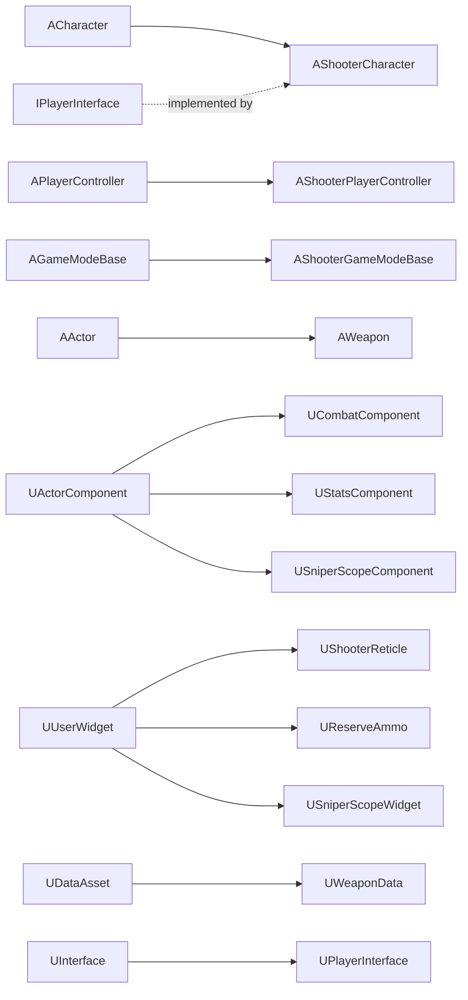

**Language / 语言：** **English** ｜ [中文](DOCUMENTATION.zh-CN.md)

---

# FPS Project — Code Reference

> Project: Unreal Engine 5.8 ｜ Module `FPS` ｜ Path `Source/FPS/`
> This document is **documentation only** — no code was modified. Suggested reading order: §2 (overall structure) → §5 (interface) → §6/§7 (the two core classes) → the rest as needed.
> Companion overview: [README.md](<README.md>). Chinese version: [DOCUMENTATION.zh-CN.md](<DOCUMENTATION.zh-CN.md>).

---

## Table of Contents

1. [About this document](#1-about-this-document)
2. [Code map and data flow](#2-code-map-and-data-flow)
3. [Module and build layer](#3-module-and-build-layer)
4. [Enums, structs and delegates](#4-enums-structs-and-delegates)
5. [IPlayerInterface — character capability interface](#5-iplayerinterface--character-capability-interface)
6. [AShooterCharacter — the player character](#6-ashootercharacter--the-player-character)
7. [UCombatComponent — the combat core](#7-ucombatcomponent--the-combat-core)
8. [AWeapon — the weapon actor](#8-aweapon--the-weapon-actor)
9. [UWeaponData — the weapon data asset](#9-uweapondata--the-weapon-data-asset)
10. [Damage and hit-zone system](#10-damage-and-hit-zone-system)
11. [UStatsComponent — health](#11-ustatscomponent--health)
12. [AShooterPlayerController — input and movement](#12-ashooterplayercontroller--input-and-movement)
13. [AShooterGameModeBase](#13-ashootergamemodebase)
14. [UShooterReticle — dynamic reticle](#14-ushooterreticle--dynamic-reticle)
15. [UReserveAmmo — ammo HUD](#15-ureserveammo--ammo-hud)
16. [Sniper scope — USniperScopeComponent / USniperScopeWidget](#16-sniper-scope--usniperscopecomponent--usniperscopewidget)
17. [Configuration layer](#17-configuration-layer)
18. [End-to-end sequences](#18-end-to-end-sequences)
19. [Blueprint contract checklist](#19-blueprint-contract-checklist)
20. [Caveats, known issues and extension notes](#20-caveats-known-issues-and-extension-notes)

---

## 1. About this document

| Section | Content | Audience |
| --- | --- | --- |
| 3 | Module, build, gameplay tags, trace channel | Anyone setting up the project |
| 4 | Every enum / struct / delegate | Everyone (quick reference) |
| 5–8 | Interface, character, combat component, weapon | Anyone changing gameplay (core) |
| 9 | How to fill in the data asset | Designers / asset wranglers |
| 10–16 | Damage, health, input, UI, sniper scope | Look up by feature |
| 17–19 | Config, sequences, blueprint contract | Anyone debugging integration |
| 20 | Pitfalls and TODOs | Whoever inherits the project |

Legend:

- `◆` — the function or member is called from / affects Blueprints.
- `⇄` — the function participates in replication or is an RPC.
- `⚠` — known issue or a pitfall worth remembering.

---

## 2. Code map and data flow

### 2.1 Class relationships



### 2.2 Ownership

```
BP_ShooterGameMode
└─ BP_ShooterCharacter (AShooterCharacter)
   ├─ SpringArm (USpringArmComponent)          // length 0, exists only for camera lag
   │  └─ FirstPersonCamera (UCameraComponent)
   │     └─ Mesh1P (USkeletalMeshComponent)    // arms, owner-only
   ├─ Mesh (the 3P body from ACharacter)       // what other players see
   ├─ Combat (UCombatComponent, Replicated)
   │  └─ spawned at runtime → AWeapon × N (Inventory)
   │     ├─ Mesh1P (the gun the owner sees)
   │     └─ Mesh3P (the gun others see)
   ├─ Stats (UStatsComponent, Replicated)
   └─ SniperScope (USniperScopeComponent, created with NewObject at runtime)
      ├─ Capture (USceneCaptureComponent2D)
      ├─ RenderTarget (UTextureRenderTarget2D)
      └─ Overlay (USniperScopeWidget, added to the viewport with ZOrder = -1)
```

### 2.3 Data flow of one shot (overview)

```
Input IA_FireWeapon (Started)
 → AShooterCharacter::Input_FireWeapon_Pressed
 → UCombatComponent::Initiate_FireWeapon_Pressed   (store bTriggerPressed, fire-rate gate)
 → UCombatComponent::Local_FireWeapon
     ├─ play the 1P fire montage
     ├─ AWeapon::WeaponTrace          (sphere sweep → FHitResult)
     ├─ AWeapon::Local_Fire           (→ blueprint FireEffect; predictive magazine decrement)
     ├─ broadcast OnCurrentReserveAmmoChanged (UI refresh)
     ├─ start FireTimer (fire rate / automatic loop)
     └─ Server_FireWeapon(Hit)  ⇄
          ├─ fire-rate validation
          ├─ bone → hit zone → damage multiplier
          ├─ IPlayerInterface::Execute_DoDamage   (server-side health)
          ├─ AWeapon::Auth_Fire                   (authoritative magazine decrement)
          └─ Multicast_FireWeapon(Hit, AuthAmmo)  ⇄
               ├─ local:   AWeapon::Rep_Fire(AuthAmmo) (reconcile)
               └─ remote:  Local_Fire(FX, bFirstPerson=false) + 3P fire montage
```

---

## 3. Module and build layer

### 3.1 `Source/FPS/FPS.Build.cs`

| Item | Value | Notes |
| --- | --- | --- |
| `PCHUsage` | `UseExplicitOrSharedPCHs` | Shared PCH |
| `PublicDependencyModuleNames` | `Core`, `CoreUObject`, `Engine`, `InputCore`, `EnhancedInput`, `GameplayTags`, `PhysicsCore`, `UMG` | Without `PhysicsCore`, `EPhysicalSurface` fails to link; without `GameplayTags`, `NativeGameplayTags.h` is missing |
| `PrivateDependencyModuleNames` | `Slate`, `SlateCore` | Internal UMG dependencies |

### 3.2 `Source/FPS/FPS.cpp` / `FPS.h`

- `IMPLEMENT_PRIMARY_GAME_MODULE(FDefaultGameModuleImpl, FPS, "FPS")` declares `FPS` as the primary game module. `FPS.h` is just an aggregate header pulling in `CoreMinimal.h` and `FPSTraceChannels.h`.

### 3.3 `FPSTraceChannels.h`

```cpp
namespace FPSTraceChannels { constexpr ECollisionChannel ECC_Weapon = ECC_GameTraceChannel2; }
```

- **Purpose**: give the "Weapon" channel a readable alias instead of sprinkling `ECC_GameTraceChannel2` everywhere.
- **Effect**: mirrors `+DefaultChannelResponses=(Channel=ECC_GameTraceChannel2,...,bTraceType=True,...,Name="Weapon")` in [DefaultEngine.ini](<Config/DefaultEngine.ini>). **If the channel order ever changes (adding/removing a channel in Project Settings), this constant and the ini must be updated together.**

### 3.4 `ShooterGamePlayTags.h` / `.cpp`

| Constant | Tag | Purpose |
| --- | --- | --- |
| `Tag_WeaponType_None` | `Weapon.type.none` | Unspecified type |
| `Tag_WeaponType_Rifle` | `Weapon.type.rifle` | Rifle (long gun) |
| `Tag_WeaponType_Pistol` | `Weapon.type.pistol` | Pistol |
| `Tag_WeaponType_Sniper` | `Weapon.type.sniper` | Sniper rifle (**only this one activates the scope**) |
| `Tag_WeaponType_Melee` | `Weapon.type.melee` | Melee |

- Declared as native tags (`UE_DECLARE/DEFINE_GAMEPLAY_TAG_EXTERN`), so no ini registration is required.
- **Effect**: `AWeapon::WeaponType` and every `TMap<FGameplayTag, …>` in `UWeaponData` are keyed by these tags; `USniperScopeComponent::UpdateView` uses `MatchesTagExact(Tag_WeaponType_Sniper)` to decide whether to raise the scope.

### 3.5 Target files

| File | Content |
| --- | --- |
| [FPS.Target.cs](<Source/FPS.Target.cs>) | `Type = Game`, `BuildSettingsVersion.V7`, module `FPS` |
| [FPSEditor.Target.cs](<Source/FPSEditor.Target.cs>) | `Type = Editor`, same settings |

---

## 4. Enums, structs and delegates

### 4.1 `EWeaponKind` (Weapon.h) — determines slot eligibility

| Value | Display name | Notes |
| --- | --- | --- |
| `LongGun` | Long Gun | Only long guns can occupy the main / secondary slots |
| `Pistol` | Pistol | Pistol slot |
| `Melee` | Knife | Melee slot; melee is exempt from the "hide the reticle while aiming" rule and does not require an `AimSocket` |

### 4.2 `EFireType` (Weapon.h)

| Value | Effect |
| --- | --- |
| `Single` | Never re-fires automatically; `FireTimerFinished` will not call `Local_FireWeapon` again |
| `Automatic` | As long as `bTriggerPressed == true` and the magazine is non-empty, `FireTimerFinished` keeps firing |

### 4.3 `EWeaponStatus` (Weapon.h) — the weapon state machine

| Value | Entered when | Left when | Effect |
| --- | --- | --- | --- |
| `Idle` | Initial equip, montage finished | — | Can fire / reload / cycle |
| `Firing` | ⚠ **never written by any code** | — | Reserved |
| `Reloading` | `Initiate_ReloadWeapon`, `Server_ReloadWeapon` | `OnReloadMontageEnded`, `Client_ReloadWeapon`, `Server_EndReload`, `Notify_ReloadWeapon` | Blocks firing, cycling and duplicate reloads |
| `Cycling` | While an equip montage plays | `OnEquipMontageEnded` | Blocks reloading and further cycling |
| `UnEquipped` | Constructor, when `Equip` swaps a weapon out, `OnRep_Instigator` on a non-equipped gun | When `Equip` selects it | Paired with `SetActorHiddenInGame(true)` to hide the gun |

### 4.4 `EWeaponSlot` (CombatComponent.h)

| Value | Resolution rule (`FindWeaponForSlot`) |
| --- | --- |
| `Main` | The 1st `EWeaponKind::LongGun` |
| `Secondary` | The 2nd `LongGun` |
| `Pistol` | The 1st `Pistol` |
| `Melee` | The 1st `Melee` |

### 4.5 `ETurningInPlace` (ShooterType.h)

`Left` / `Right` / `NotTurning` — computed by `AShooterCharacter::TurnInPlace` and consumed by the 3P animation blueprint for turn-in-place animations.

### 4.6 `EHitZone` (ShooterType.h)

`Head` / `Torso` / `Limb` — the result of hit-zone resolution, used to scale damage.

### 4.7 `EDeathState` (StatsComponent.h)

`NotDead` / `DeadStart` / `DeadFinished` — ⚠ only `NotDead` is ever used; the death state machine is not implemented.

### 4.8 `FPlayerAnim` (WeaponData.h) — the struct injected into the animation blueprints

| Field | Type | Purpose |
| --- | --- | --- |
| `IdleAnim` | `UAnimSequence*` | Standing idle |
| `AimIdleAnim` | `UAnimSequence*` | Aiming idle |
| `CrouchIdleAnim` | `UAnimSequence*` | Crouch idle |
| `SprintAnim` | `UAnimSequence*` | Sprint |
| `AimOffset_Hip` | `UBlendSpace*` | Hip-fire aim offset |
| `AimOffset_Aim` | `UBlendSpace*` | ADS aim offset |
| `Strafe_Standing` | `UBlendSpace*` | Standing locomotion blend space |
| `Strafe_Crouching` | `UBlendSpace*` | Crouched locomotion blend space |

**Effect**: `UCombatComponent::ApplyEquippedWeaponAnim` copies the whole struct **by value** into the identically-named struct variable on the ABP, which is how animation sets swap when the player changes weapons.

### 4.9 `FMontageData` (WeaponData.h)

| Field | Purpose |
| --- | --- |
| `EquipMontage` | Weapon draw / holster animation |
| `ReloadMontage` | Reload animation |
| `FireMontage` | Fire animation |

The same struct is reused in three maps: `WeaponMontages` (animations on the **weapon's own** skeletal mesh, e.g. the magazine moving during a reload), `FirstPersonMontages`, and `ThirdPersonMontages`.

### 4.10 Delegates

| Delegate | Declared in | Parameters | Fired when | Used for |
| --- | --- | --- | --- | --- |
| `FWeaponFirstReplicated` | ShooterCharacter.h | `AWeapon*` | The first weapon has finished replicating to a client; broadcast exactly once | Lets the HUD wait until a weapon exists before fetching the reticle material |
| `FReticleChanged` | CombatComponent.h | `UMaterialInstanceDynamic*` | `InitializeWeaponWidget` / weapon swap | The reticle widget swaps its material |
| `FCurrentReserveAmmoChanged` | CombatComponent.h | `int32 RoundsInServe, int32 RoundsInWeapon, UTexture2D*` | Equip, fire, reload, `OnRep_CurrentReserveAmmo` | Refreshes the ammo text and weapon icon |
| `FHealthChanged` | StatsComponent.h | `UStatsComponent*, float Old, float New, AActor* Instigator` | Health or max health changes | Health bar UI, death checks |

---

## 5. IPlayerInterface — character capability interface

**Location**: [PlayerInterface.h](<Source/FPS/Public/Interface/PlayerInterface.h>) (the `.cpp` is intentionally empty — the comment says it does not need to be modified).

**Why it exists**: `AWeapon` needs to act back on its owner (fetch attach points, fetch the 1P/3P meshes, apply damage), but a weapon should not `Cast<AShooterCharacter>`. With a `BlueprintNativeEvent` interface, **weapons depend only on the interface**, so any blueprint character that implements these events can reuse the entire weapon system.

Every function is `BlueprintNativeEvent + BlueprintCallable`, so C++ callers must use the `IPlayerInterface::Execute_Xxx(Object, ...)` form.

| Function | Signature | Purpose | Called by |
| --- | --- | --- | --- |
| ◆`GetWeaponAttachPoint` | `FName(const FGameplayTag& WeaponTag) const` | Returns the socket name on the character for a given weapon type | `AWeapon::AttachToOwingPawn` |
| ◆`GetMesh1P` | `USkeletalMeshComponent*() const` | Returns the first-person (arms) mesh | `AWeapon::AttachToOwingPawn`, `UCombatComponent::ApplyEquippedWeaponAnim/PlayEquipMontage/GetReloadMontage/Local_FireWeapon` |
| ◆`GetMesh3P` | `USkeletalMeshComponent*() const` | Returns the third-person (body) mesh | Same as above (3P branches), `Multicast_FireWeapon` |
| ◆`WeaponReplicated` | `void()` | Signals "the weapon has replicated to the client" | `UCombatComponent::SpawnInventory`, `OnRep_CurrentWeapon` |
| ◆`GetCurrentWeapon` | `AWeapon*()` | Returns the current weapon | `UShooterReticle::NativeOnInitialized` |
| ◆`GetReserveAmmo` | `int32() const` | Returns the current reserve ammo | Blueprint / UI queries |
| ◆`Notify_ReloadWeapon` | `void()` | Animation-notify entry point: fills the magazine on the authority and pushes the result to the client | Reload animation AnimNotify in Blueprints |
| ◆`DoDamage` | `bool(float DamageAmout, AActor* DamageInstigator)` | Applies damage to "any actor implementing this interface" | `UCombatComponent::Server_FireWeapon` |

**Implementers**: only `AShooterCharacter` (section 6).

---

## 6. AShooterCharacter — the player character

**Location**: [ShooterCharacter.h](<Source/FPS/Public/ShooterCharacter.h>) / [ShooterCharacter.cpp](<Source/FPS/Private/ShooterCharacter.cpp>)
**Inherits**: `ACharacter` + `IPlayerInterface`

### 6.1 Components and defaults (constructor)

| Member | Type | Setup | Effect |
| --- | --- | --- | --- |
| `SpringArm` | `USpringArmComponent` | Attached to the root; `TargetArmLength = 0`; `bEnableCameraLag = true`; `CameraLagSpeed = 15`; `bUsePawnControlRotation = true` | The camera does not handle rotation itself; the spring arm's **camera lag** gives the crosshair a smooth trailing feel. Length 0 keeps the camera at the character's head |
| `FirstPersonCamera` | `UCameraComponent` | Attached to `SpringArm`; `bUsePawnControlRotation = false` | Follows the control rotation (forwarded by the spring arm); its FOV is set to `DefaultFOV = 90` in `BeginPlay` |
| `Mesh1P` | `USkeletalMeshComponent` | Attached to `FirstPersonCamera`; `bOnlyOwnerSee = true`; `bCastDynamicShadow = false`; `bReceivesDecals = false`; `VisibilityBasedAnimTickOption = OnlyTickPoseWhenRendered`; TickGroup = `TG_PrePhysics`; `AllowPrivateAccess` | Arms visible only to the local player; no shadow, no decals — saves performance. `TG_PrePhysics` plus the tick prerequisite below guarantees "arms animate first, sight alignment is computed afterwards" |
| `GetMesh()` (3P body) | `USkeletalMeshComponent` | `bOnlyOwnerSee = false`; `bOwnerNoSee = true`; `bReceivesDecals = false` | You never see your own body; everyone else does |
| `Combat` | `UCombatComponent` | `SetIsReplicated(true)` | The combat core (section 7) |
| `Stats` | `UStatsComponent` | `SetIsReplicated(true)` | Health (section 11) |
| `DefaultFOV` | `float` | `90.f` (`EditDefaultsOnly`) | The hip-fire FOV, and the FOV the camera is forced back to while the sniper scope is active |
| `TurningStatus` | `ETurningInPlace` | `NotTurning` | Exposed to the ABP |
| `bWeaponFirstReplicated` | `bool` | `false` | Ensures `OnWeaponFirstReplicated` is broadcast only once |
| — | — | Calls `ConfigureWeaponHitCollision()` | See 6.3 |

### 6.2 Lifecycle functions

| Function | Behaviour and effect |
| --- | --- |
| `BeginPlay()` | ① On a non-dedicated server, if no `USniperScopeComponent` exists yet, **create one dynamically** with `NewObject` + `RegisterComponent` (so the blueprint does not need to add it); ② `Super::BeginPlay()`; ③ call `ConfigureWeaponHitCollision()` **again** (the comment notes that the Blueprint overrides collision settings after the constructor); ④ set the camera FOV to `DefaultFOV`; ⑤ record `StartingAimRotation` (initial yaw); ⑥ cache `Mesh1P`'s authored relative location/rotation into `AuthoredHipMeshLocation/Rotation`; ⑦ `ConfigureAimTickOrder()` |
| `BeginDestroy()` | Calls `Combat->DestroyInventory()` so every spawned weapon actor is destroyed with the character |
| `Tick(DeltaTime)` | Each frame: `CalculateTurnInPlaceParameters` → `CalculateFABRIKSocket` → `UpdateAimSocketAlignment` → `Scope->UpdateView()` when the scope component exists. **The order matters**: turn-in-place parameters first, then the IK socket, then ADS alignment |
| `PossessedBy(NewController)` | After `Super::`, calls `Combat->SpawnInventory()` — weapons are only spawned (on the server) once the character is possessed |
| `OnRep_PlayerState()` | On clients, once `PlayerState` has replicated, calls `Combat->InitializeWeaponWidget()` to push the reticle material and ammo into the HUD |

### 6.3 Function-by-function reference

#### `ConfigureWeaponHitCollision()` (private)

| Target | Setting | Why |
| --- | --- | --- |
| `GetCapsuleComponent()` | `ECR_Ignore` on the `ECC_Weapon` channel | The capsule has no bones, so a capsule hit leaves `Hit.BoneName` empty and hit zones cannot be resolved |
| `GetMesh()` (3P body) | `SetCollisionEnabled(QueryOnly)` + `ECR_Block` on `ECC_Weapon` | Lets bullets hit the **skeletal body mesh** so the bone name is available for headshot detection |
| `Mesh1P` | `NoCollision` | Your own arms never participate in hit detection |

#### `GetFixedAimRotation() const` ◆

```
FRotator AimRotation = GetBaseAimRotation();
if (AimRotation.Pitch > 90 && !IsLocallyControlled())
    Pitch = MapRangeClamped(Pitch, [270,360) → [-90,0])
```
- **Purpose**: fixes the pitch representation for **remote** characters. After network compression the pitch lands in `[270,360)`; mapping it into `[-90,0]` is what animation blueprints and sights expect.
- **Effect**: remote players' aim direction no longer flips. Locally controlled characters are unaffected (their pitch is already in `[-90,90]`).
- ◆ `BlueprintCallable` — mainly intended for ABP / blueprint math.

#### `HasCurrentWeapon() const` ◆
- Returns true when `Combat` is valid and `Combat->CurrentWeapon != nullptr`. Blueprints and the HUD use it to test "do I already have a weapon?".

#### `CalculateTurnInPlaceParameters(float DeltaTime)` (private)

```
horizontal speed == 0 and not falling:
    AO_Yaw = NormalizedDeltaRotator(current yaw, StartingAimRotation).Yaw
    if TurningStatus == NotTurning: InterpAO_Yaw = AO_Yaw
    TurnInPlace(DeltaTime)
speed > 0 or falling:
    StartingAimRotation = current yaw
    AO_Yaw = 0
    MovementOffsetYaw = NormalizedDeltaRotator(movement direction, aim direction).Yaw
    TurningStatus = NotTurning
finally AO_Yaw *= -1
```
- **Outputs** (all `BlueprintReadOnly`, read by the ABPs):
  - `AO_Yaw`: the yaw difference between the body and the aim direction (negated to match the skeleton's convention) — drives **turn-in-place animations** and aim offsets.
  - `MovementOffsetYaw`: the movement direction relative to the aim direction — drives **8-way locomotion / gait blending**.
  - `TurningStatus`: the turn-in-place state.
- **Effect**: standing still lets the upper body rotate; as soon as the player moves, the reference angle resets.

#### `TurnInPlace(float DeltaTime)` (private)

- `AO_Yaw > 90` → `Right`; `AO_Yaw < -90` → `Left`.
- While turning: `InterpAO_Yaw = FInterpTo(InterpAO_Yaw, 0, DeltaTime, 4.0)` and `AO_Yaw` is pulled toward 0 (the turn animation "consumes" the angle).
- Once `|AO_Yaw| < 5` the turn ends and `StartingAimRotation` is reset to the current yaw.
- **Effect**: the state automatically returns to `NotTurning` after the animation finishes, so it can never get stuck.

#### `CalculateFABRIKSocket()` (private) ◆

1. Returns immediately with no weapon.
2. Takes the weapon's `Mesh3P`; if it has no socket named `FABRIK`, sets `FABRIK_SocketTransform` to `Identity` and returns.
3. **`WeaponMesh->RefreshBoneTransforms()`** — critical: **a hidden third-person gun does not tick its animation**, so without a forced refresh the code reads a stale pose.
4. Reads the `FABRIK` socket's world transform and converts it into the `hand_r` bone space of the 3P body via `GetMesh()->TransformToBoneSpace("hand_r", ...)`.
5. Writes `FABRIK_SocketTransform` (location + rotation, scale forced to 1).

- **Effect**: ABP_ThirdPerson uses this transform for **FABRIK IK**, so the left hand grips the handguard/body correctly.

#### `ConfigureAimTickOrder()` (private)

- `PrimaryActorTick.AddPrerequisite(Mesh1P, Mesh1P->PrimaryComponentTick)`.
- **Effect**: the character tick (which contains the ADS alignment) runs **after** `Mesh1P`'s animation tick, so the arm pose it reads is the current frame's.

#### `GetAimTimelineAlpha(float)` (private) ⚠

- Currently just `return AimAlignAlpha;` (`AimAlignAlpha` is permanently 0, `AimTimeline` is never assigned, and nothing calls this function).
- Conclusion: this is **leftover / unwired** code; timeline-driven ADS was replaced by the blueprint-variable approach below.

#### `UpdateAimSocketAlignment(float)` (private) ◆ — ADS sight alignment

Guard clause (any failure returns early): locally controlled, and `Mesh1P` / `FirstPersonCamera` / `Combat` all valid.

1. Uses the template helper `FindBlueprintStruct<FVector>(this, "AdsMesh1PLoc")` to locate a `FVector` property **on the character blueprint** by name; if it is missing, the whole function bails out (so the variable must exist in the blueprint).
2. Takes the current weapon's `Mesh1P`, which must exist and be **attached under `Mesh1P` (the arms)**.
3. If the weapon has no `AimSocket`: for non-melee weapons it logs a **one-time warning** (tracked via `MissingAimSocketWeapon`, to avoid spamming every frame), keeps the blueprint-supplied position, and returns.
4. Computation:
   - `SocketWorld`: the sight socket's world position;
   - convert it to camera space: `SocketCamera`;
   - desired position `DesiredWorld` = camera space with **X preserved and Y/Z zeroed** (i.e. pull the sight onto the view axis);
   - convert the delta into `Mesh1P`'s parent space: `DeltaParent`;
   - `CenteredLocation = Mesh1P->GetRelativeLocation() + DeltaParent`;
   - discard the write if the result contains NaN.
5. `*AdsLocationProperty = CenteredLocation;` — it **writes the character blueprint variable `AdsMesh1PLoc` directly**.

- **Effect**: the blueprint drives `Mesh1P`'s ADS position from `AdsMesh1PLoc`, so "the weapon's sight automatically lines up with the screen centre". The blend strength is decided by the blueprint timeline/interp — C++ only computes the target value.
- ⚠ This function only handles position, not rotation (the comment is explicit that the blueprint does not apply the rotator variables; `Mesh1P` keeps its component rotation, yaw −90 relative to the camera).

#### `SetupPlayerInputComponent(UInputComponent*)` ◆

Uses `CastChecked<UEnhancedInputComponent>` (a mismatch asserts) to bind nine actions:

| Input action | Trigger event | Callback | Effect |
| --- | --- | --- | --- |
| `CycleWeaponAction` | `Started` | `Input_CycleWeapon` | Cycle weapons |
| `FireWeaponAction` | `Started` | `Input_FireWeapon_Pressed` | Fire (press) |
| `FireWeaponAction` | `Completed` | `Input_FireWeapon_Released` | Stop firing (release; drives automatic fire) |
| `AimWeaponAction` | `Started` | `Input_Aim_Pressed` | Toggle ADS + blueprint event `OnAim` |
| `ReloadWeaponAction` | `Started` | `Input_ReloadWeapon` | Reload |
| `EquipMainWeaponAction` | `Started` | `Input_EquipMainWeapon` | Main weapon |
| `EquipSeconedaryWeaponAction` | `Started` | `Input_EquipSeconedaryWeapon` | Secondary weapon (**the original spelling "Seconedary" is intentional — do not "fix" it**) |
| `EquipMeleeWeaponAction` | `Started` | `Input_EquipMeleeWeapon` | Melee |
| `EquipPistolWeaponAction` | `Started` | `Input_EquipPistolWeapon` | Pistol |

#### Input callbacks (private)

| Function | Behaviour |
| --- | --- |
| `Input_CycleWeapon` | `Combat->Initiate_CycleWeapon()` |
| `Input_ReloadWeapon` | `Combat->Initiate_ReloadWeapon()` |
| `Input_FireWeapon_Pressed` | `Combat->Initiate_FireWeapon_Pressed()` |
| `Input_FireWeapon_Released` | `Combat->Initiate_FireWeapon_Released()` |
| `Input_Aim_Pressed` | `Combat->Initiate_Aim_Pressed()`, then the blueprint event **`OnAim(Combat->bAiming)`** (`BlueprintImplementableEvent`, used for FOV / recoil / audio) |
| `Input_EquipXxx` | Forwards to the public `EquipXxx()` of the same name |

Every callback is guarded by `IsValid(Combat)`.

#### Public equip functions (public, ◆ `BlueprintCallable`)

`EquipMainWeapon() / EquipSeconedaryWeapon() / EquipMeleeWeapon() / EquipPistolWeapon()`
- All are thin wrappers around `Combat->Initiate_EquipXxx()`.
- **Effect**: blueprints (an inventory UI, a pickup prompt, …) can switch weapons directly instead of simulating key presses.

#### IPlayerInterface implementation

| Function | Details |
| --- | --- |
| `GetWeaponAttachPoint_Implementation(Tag)` | `checkf(Combat)` and `checkf(Combat->WeaponData)` assertions → looks the tag up in `WeaponData->GripPoints`; on a miss logs a warning and falls back to `"RifleSocket"` |
| `GetMesh1P_Implementation()` | Returns `Mesh1P` |
| `GetMesh3P_Implementation()` | Returns `GetMesh()` |
| `WeaponReplicated_Implementation()` | On the first call sets `bWeaponFirstReplicated = true` and broadcasts `OnWeaponFirstReplicated` (for the HUD) |
| `GetCurrentWeapon_Implementation()` | `Combat->CurrentWeapon` |
| `GetReserveAmmo_Implementation()` | `Combat->CurrentReserveAmmo` |
| `Notify_ReloadWeapon_Implementation()` | `Combat->Notify_ReloadWeapon()` (authority-side instant refill + push to the client) |
| `DoDamage_Implementation(DamageAmount, Instigator)` | `Stats->ChangeHealthByAmout(-DamageAmount, Instigator)`; picks a random `HitReacts` index and calls `Multicast_HitReact`; **always returns false** (⚠ the return value is unused, and an empty `HitReacts` array will index out of bounds) |

#### `Multicast_HitReact_Implementation(int32 MontageIndex)` ⇄

- Condition: `GetNetMode() != NM_DedicatedServer` **and** not locally controlled → i.e. this is "someone else's" client.
- Calls `Montage_Play(HitReacts[MontageIndex])` on the 3P body's `AnimInstance`.
- **Effect**: you never see your own third-person hit reaction, but other players do.

### 6.4 Key members exposed to Blueprints

| Member | Notes |
| --- | --- |
| ◆`OnWeaponFirstReplicated` | `BlueprintAssignable`; the first weapon has replicated |
| ◆`HitReacts` | `TArray<UAnimMontage*>`, `EditDefaultsOnly`; the hit-reaction pool |
| ◆`FABRIK_SocketTransform` | `BlueprintReadOnly`; the IK target |
| ◆`AO_Yaw` / `MovementOffsetYaw` / `TurningStatus` | `BlueprintReadOnly`; animation parameters |
| ◆`OnAim(bool)` | `BlueprintImplementableEvent`; ADS state callback |
| `GetFirstPersonCamera()` / `GetCombatComponent()` / `GetDefaultFieldOfView()` | C++ accessors (used by `SniperScopeComponent`) |

---

## 7. UCombatComponent — the combat core

**Location**: [CombatComponent.h](<Source/FPS/Public/CombatComponent.h>) / [CombatComponent.cpp](<Source/FPS/Private/CombatComponent.cpp>)
**Role**: concentrates inventory / equipping / firing / reloading / aiming / ammo into one replicated component; the character only forwards input.

### 7.1 Key members

| Member | Replication | Notes |
| --- | --- | --- |
| `WeaponData` | `EditDefaultsOnly` (not replicated) | Points at `DA_WeaponData`; required for every weapon |
| `DefaultWeaponClass` | `EditDefaultsOnly` | The weapon classes spawned at spawn time |
| `TraceLength` | `EditDefaultsOnly`, default `20000` | Hit-detection length in cm |
| `Inventory` | `Replicated` (`TArray<AWeapon*>`, `Transient`) | The spawned weapon instances |
| `CurrentWeapon` | `ReplicatedUsing = OnRep_CurrentWeapon` | The equipped weapon |
| `bAiming` | `Replicated` + `COND_SkipOwner` | ADS toggle; the owner already predicted it, so it is not echoed back |
| `CurrentReserveAmmo` | `ReplicatedUsing = OnRep_CurrentReserveAmmo` + `COND_OwnerOnly` | Reserve ammo for the current weapon |
| `ReserveAmmo` | Not replicated (`TMap<FGameplayTag,int32>`) | **Per-weapon-type reserve pool**, server-authoritative |
| `bTriggerPressed` | Not replicated | Local trigger state; drives automatic fire |
| `FireTimer` / `ServerNextFireTime` | Not replicated | Fire-rate throttling |
| `LocalWeaponIndex` | Not replicated | Local cycling index |

Delegates: `OnReticleChanged`, `OnCurrentReserveAmmoChanged` (both `BlueprintAssignable`).

### 7.2 Helpers

#### `static UCombatComponent* FindCombatComponent(const AActor* Actor)` ◆
- Null-safe `FindComponentByClass<UCombatComponent>()`.
- **Effect**: the UI (`UShooterReticle`, `UReserveAmmo`) and `AWeapon::OnRep_Instigator` all use it to locate the combat component from an arbitrary actor.

#### `GetLifetimeReplicatedProps` ⇄

```cpp
DOREPLIFETIME(Inventory);
DOREPLIFETIME(CurrentWeapon);
DOREPLIFETIME_CONDITION(bAiming, COND_SkipOwner);
DOREPLIFETIME_CONDITION(CurrentReserveAmmo, COND_OwnerOnly);
```

#### `TickComponent(...)` / `BeginPlay()`
- Both are currently **empty implementations** (they only call `Super::`) — reserved extension points.

### 7.3 Inventory and equipping

#### `SpawnInventory()` ⇄ — spawn the starting weapons

1. Returns immediately unless `ROLE_Authority` (spawning happens on the server only).
2. Iterates `DefaultWeaponClass` → `SpawnWeapon()` → `Inventory.AddUnique()` + `ReserveAmmo.Add(WeaponType, StartingCarriedAmmo)`.
3. Counts `LongGun` / `Pistol` / `Melee` and logs a **warning** when there are more than the slots can hold (more than 2 long guns, more than 1 pistol, more than 1 melee), naming which ones will be ignored.
4. If the inventory is non-empty: `Equip(Inventory[0])` → `InitializeWeaponWidget()` → `IPlayerInterface::Execute_WeaponReplicated(GetOwner())`.
- **Called from**: `AShooterCharacter::PossessedBy`.

#### `SpawnWeapon(TSubclassOf<AWeapon>) const` (private) ⇄
- Server only. `FActorSpawnParameters` sets `Instigator = owning Pawn`, `Owner = owning Actor`, `AlwaysSpawn`.
- Immediately after spawning: `SetActorHiddenInGame(true)` and status `UnEquipped`.
- **Why `Instigator` matters**: clients use `AWeapon::OnRep_Instigator` to find the `Combat` component and decide whether to attach the gun to the body.

#### `Equip(AWeapon* Weapon)` ⇄ — equip a weapon (shared by client and server)

1. Previous weapon (if different): `DetachFromPawn()` + hide + `UnEquipped`.
2. `CurrentWeapon = Weapon`; unhide; status `Idle`; `AttachToOwingPawn()`.
3. `ApplyEquippedWeaponAnim(CurrentWeapon)` — swaps the animation set.
4. Reserve ammo: use the value stored in `ReserveAmmo` if present, otherwise `StartingCarriedAmmo` (and register that type in the map).
5. Broadcasts `OnCurrentReserveAmmoChanged(reserve, magazine, icon)` + `NotifyAmmoChanged()`.
- **Effect**: this is the complete "finish an equip" action; it runs on both client and server and converges to the same state.

#### `DestroyInventory()`
- Iterates `Inventory` and calls `Destroy()` on each; invoked from `AShooterCharacter::BeginDestroy`.

#### `InitializeWeaponWidget()` ◆
- Requires a valid `CurrentWeapon`; broadcasts `OnReticleChanged(weapon reticle dynamic material)` + `NotifyAmmoChanged()`.
- **Fired from**: `SpawnInventory`, `OnRep_CurrentWeapon`, `AShooterCharacter::OnRep_PlayerState`.

#### `NotifyAmmoChanged()` ◆
- Broadcasts `OnCurrentReserveAmmoChanged(CurrentReserveAmmo, CurrentWeapon->Ammo, CurrentWeapon->WeaponIcon)`.
- **Call sites**: `Equip`, `ApplyReload`, `Local_FireWeapon`, `Multicast_FireWeapon` (local branch), `Client_ReloadWeapon`.

#### `OnRep_CurrentWeapon(AWeapon* LastWeapon)` ⇄
1. Previous weapon: detach, hide, `UnEquipped`.
2. When the new weapon is valid: unhide, `AttachToOwingPawn()`, `ApplyEquippedWeaponAnim()`, `Execute_WeaponReplicated(Owner)`, `InitializeWeaponWidget()`.
- **Effect**: on clients the weapon is attached and animated automatically once its replication arrives (the server never takes this path).

#### `AdvanceWeaponIndex()` (private)
- With 2+ weapons, `LocalWeaponIndex = (LocalWeaponIndex + 1) % Inventory.Num()` and returns the new index.

#### `Initiate_CycleWeapon()` — cycle entry point

Guards: a current weapon exists, status is neither `Cycling` nor `Reloading`, and the inventory holds at least 2 weapons.
Flow: `AdvanceWeaponIndex()` → `Local_CycleWeapon(NextIndex, /*bFirstPerson=*/true)` (instant local feedback) → `Server_CycleWeapon(NextIndex)` (server).

#### `Local_CycleWeapon(int32 WeaponIndex, bool bFirstPerson)` (private)
- Returns on an invalid index or weapon; calls `Equip()` when the weapon differs; then `PlayEquipMontage(Weapon, bFirstPerson)`.

#### `Server_CycleWeapon_Implementation(int32 WeaponIndex)` ⇄
- Returns on an invalid index; refuses while the current weapon is reloading.
- **Listen-server special case**: on `NM_ListenServer` when the owner is locally controlled, it skips the duplicate `Equip` (the local machine already did it) and only updates `LocalWeaponIndex`.
- Finally calls `Multicast_CycleWeapon(WeaponIndex)`.

#### `Multicast_CycleWeapon_Implementation(int32 WeaponIndex)` ⇄
- On the locally controlled pawn (the initiator) it returns immediately — the comment is explicit: otherwise this would call `Server_CycleWeapon` again from `Local_CycleWeapon` and **overflow the stack on a listen server**.
- Other clients: update `LocalWeaponIndex` → `Local_CycleWeapon(WeaponIndex, /*bFirstPerson=*/false)` (3P montage).

#### `ApplyEquippedWeaponAnim(AWeapon* Weapon)` (private) ◆ — animation set injection

```
Select the map by view: WeaponData->FirstPersonAnims / ThirdPersonAnims
Look up Weapon->WeaponType to get FPlayerAnim*
Find an FStructProperty on the AnimInstance class by name:
    1P → "CurrenrAnim"   (that is literally how ABP_FirstPerson spells it)
    3P → "CurrentAnim"
Only write when the type matches FPlayerAnim::StaticStruct() (CopyCompleteValue)
```
- **Effect**: the ABP's struct variable is swapped wholesale when the weapon changes, so idle / aim-offset / strafe animations follow the weapon.
- ⚠ The 1P property name is `CurrenrAnim` (a typo that exists in the asset). Renaming it silently breaks animation swapping with **no log output**.

#### `PlayEquipMontage(AWeapon* Weapon, bool bFirstPerson)` (private)

1. Selects `FirstPersonMontages` / `ThirdPersonMontages`; reads `EquipMontage` for the weapon's tag, falling back to the shared `WeaponMontages` map.
2. Gets the matching mesh's `AnimInstance`; a `Montage_Play` result ≤ 0 counts as failure.
3. Sets `bEnableAutoBlendOut = true`.
4. Binds `OnEquipMontageEnded` as the end delegate and puts the weapon into **`Cycling`**.
- **Effect**: reloading and further cycling are blocked while the draw animation plays; the state returns to `Idle` automatically when the montage ends.
- The code comment explains that playing the equip animation on the 1P arms mesh is **intentional**, even though the clip belongs to the full-body skeleton (an earlier "reject mismatched skeletons" check is what silenced 1P).

#### `OnEquipMontageEnded(UAnimMontage*, bool)` (private)
- If the current weapon is still `Cycling` → restore `Idle`.

#### Slot equipping

| Function | Behaviour |
| --- | --- |
| `FindWeaponForSlot(EWeaponSlot) const` (private) | Iterates the inventory: `Pistol`/`Melee` return the first matching kind; `Main`/`Secondary` return the 1st/2nd `LongGun` (tracked with `LongGunIndex`). Returns `nullptr` if absent |
| `Initiate_EquipSlot(EWeaponSlot)` (private) | Requires a found weapon that is not already current; refuses while the current weapon is `Cycling`/`Reloading`; `LocalWeaponIndex = Index` → `Local_CycleWeapon(Index, true)` → `Server_EquipSlot(Slot)` |
| `Server_EquipSlot_Implementation(EWeaponSlot)` ⇄ | **Re-resolves the weapon from the slot on the server** (the comment notes a client must not be able to put a pistol in the main slot) and then goes through `Server_CycleWeapon_Implementation` |
| `Initiate_EquipMainWeapon()` ◆ / `Initiate_EquipSeconedaryWeapon()` ◆ / `Initiate_EquipMeleeWeapon()` ◆ / `Initiate_EquipPistolWeapon()` ◆ | Call `Initiate_EquipSlot(Main/Secondary/Melee/Pistol)` respectively |

### 7.4 Firing and hit detection

#### `Initiate_FireWeapon_Pressed()` — trigger down

```
no current weapon → return
bTriggerPressed = true
reloading → return (nothing fires until the trigger is released)
if (FireTimer is active) return;   // crucial: let the burst inside FireTimerFinished continue
if (Ammo > 0) Local_FireWeapon();
```
- **Effect**: single-fire weapons rely on `Completed` to clear `bTriggerPressed`; automatic weapons rely on the `FireTimer` loop.

#### `Initiate_FireWeapon_Released()`
- `bTriggerPressed = false`.

#### `Local_FireWeapon()` (private) — local / predictive shot

1. Requires `WeaponData` and `CurrentWeapon`; returns while reloading.
2. Plays the **1P fire montage** (`FirstPersonMontages[WeaponType].FireMontage`).
3. `CurrentWeapon->WeaponTrace(Hit, TraceLength)` performs hit detection.
4. Reads the physical surface type (`Hit.PhysMaterial`'s `SurfaceType`, defaulting to `SurfaceType1`).
5. `CurrentWeapon->Local_Fire(ImpactPoint, ImpactNormal, SurfaceType, /*bIsFirstPerson=*/true)` — local FX plus a **predictive magazine decrement**.
6. `NotifyAmmoChanged()` refreshes the UI.
7. `SetTimer(FireTimer, FireTimerFinished, CurrentWeapon->FireTime)` — the fire rate.
8. `Server_FireWeapon(Hit)` reports the shot (the **full FHitResult** is sent to the server).

#### `FireTimerFinished()` (private) — the fire-rate timer expired

```
no weapon → return
if Ammo == 0 && reserve > 0 && locally controlled → Initiate_ReloadWeapon() (auto-reload on empty), return
if reloading → return
if bTriggerPressed && FireType == Automatic && Ammo > 0 → Local_FireWeapon() (burst)
```
- ⚠ The comment states this deliberately does **not** use `ApplyReload()` (which would refill instantly and skip the montage).

#### `Server_FireWeapon_Implementation(const FHitResult& Hit)` ⇄ — authoritative shot

1. Validates `CurrentWeapon` and that it is not reloading.
2. **Fire-rate throttle**: `MinInterval = max(0, FireTime - 0.02)`; if `Now < ServerNextFireTime` the shot is dropped (anti "client fires faster than the weapon allows"), otherwise `ServerNextFireTime = Now + MinInterval`.
3. **Damage resolution** (only when the hit actor implements `IPlayerInterface`):
   - `ResolveDamageBone(Hit)` gets the bone name;
   - `ScaleDamageForBone(Damage, Bone, HeadshotMultiplier, LimbMultiplier)` computes the final damage;
   - logs a `Log`-level line (target / bone / zone / damage);
   - `IPlayerInterface::Execute_DoDamage(Hit.GetActor(), Damage, GetOwner())`.
4. On a non-listen-server owner, calls `CurrentWeapon->Auth_Fire()` (authoritative magazine decrement).
5. `Multicast_FireWeapon(Hit, CurrentWeapon->Ammo)` broadcasts final FX and the authoritative round count.

#### `Multicast_FireWeapon_Implementation(const FHitResult& Hit, int32 AuthAmmo)` ⇄

- **Local branch**: `Rep_Fire(AuthAmmo)` (reconcile the local prediction) + `NotifyAmmoChanged()`, then `return`. The comment notes the owning machine already played the 1P FX in `Local_FireWeapon`, so it must not repeat it.
- **Remote branch**: requires `WeaponData` (otherwise `ensure` + return); `Local_Fire(..., bIsFirstPerson=false)` plays the **third-person** muzzle FX; then plays `ThirdPersonMontages[WeaponType].FireMontage`.

### 7.5 Reloading

#### `Initiate_ReloadWeapon()` — reload entry point

Guards: a current weapon exists; status is not `Reloading`/`Cycling`; `Ammo < MagCapacity`; `CurrentReserveAmmo > 0`; a 1P reload montage is available.
Flow: status → `Reloading` → `Server_ReloadWeapon()` → `PlayReloadMontage(true)`; if playback fails the status is rolled back and `Server_EndReload()` is called.

#### `ApplyReload()` ◆ — the animation-notify-driven "insert magazine"

- Runs only for the locally controlled pawn or on `ROLE_Authority` (the comment explains that simulated proxies also play the 3P montage but their notifies must be ignored).
- `Needed = MagCapacity - Ammo`; `Taken = min(Needed, CurrentReserveAmmo)`; returns false when `Taken <= 0`.
- Updates the magazine, reserve and `ReserveAmmo` map, calls `NotifyAmmoChanged()`, returns true.
- **Called from**: an **AnimNotify** on the blueprint reload animation (the frame where the magazine is inserted). This is what makes the numbers line up with the animation.

#### `GetReloadMontage(bool bFirstPerson, UAnimMontage*& OutMontage, UAnimInstance*& OutAnim) const` (private)
- Selects the map by view → reads `ReloadMontage` → gets the matching mesh's `AnimInstance`; returns false if anything is missing.

#### `PlayReloadMontage(bool bFirstPerson)` (private)
1. Returns false when `GetReloadMontage` or `Montage_Play` fails (result ≤ 0).
2. **1P only**: additionally plays `WeaponMontages[WeaponType].ReloadMontage` on the **weapon's own `Mesh1P`** (the magazine animation). The comment notes the 3P gun skips it, otherwise the magazine floats.
3. **1P only**: binds `OnReloadMontageEnded` (only the 1P montage holds the `Reloading` lock; the 3P one is purely cosmetic).

#### `OnReloadMontageEnded(UAnimMontage*, bool)` (private)
- `Reloading` → `Idle`; if this machine is the locally controlling client (not the authority), calls `Server_EndReload()` so the server unlocks too.

#### `Server_ReloadWeapon_Implementation()` ⇄
- **Listen-server owner**: skips the duplicate validation (already handled locally) and goes straight to `Multicast_ReloadWeapon()`.
- Otherwise: repeats the full guard set (not reloading, not cycling, magazine not full, reserve available), sets `Reloading`, then `Multicast_ReloadWeapon()`.

#### `Multicast_ReloadWeapon_Implementation()` ⇄
- The locally controlled pawn returns immediately (avoiding a restart of the 1P reload animation mid-play); other clients call `PlayReloadMontage(false)`.

#### `Server_EndReload_Implementation()` ⇄
- Restores `Idle` when the status is `Reloading`.

#### `Client_ReloadWeapon_Implementation(int32 NewWeaponAmmo, int32 NewCarryAmmo)` ⇄
- Only the locally controlled pawn handles it: writes back magazine / reserve / `ReserveAmmo`, sets `Idle`, calls `NotifyAmmoChanged()`.
- If the trigger is still held and the magazine is non-empty → immediately `Local_FireWeapon()` (resume fire on reload completion).

#### `Notify_ReloadWeapon()` ◆ — authoritative instant refill + push

- Returns immediately unless `ROLE_Authority`. The comment explains that client RPCs only execute with authority, so a 1P notify on a remote client must not call `Client_ReloadWeapon`; the server's 3P notify performs the transfer.
- Computes `EmptySpace` / `AmountToRefill`, fills the magazine, syncs `ReserveAmmo`, sets `Idle`, and finally `Client_ReloadWeapon(magazine, reserve)`.
- **Difference from `ApplyReload`**: `ApplyReload` changes data on the machine that runs it; `Notify_ReloadWeapon` changes data **on the authority** and pushes it to the owner. Both are driven by reload animation notifies, which is how the three combinations (standalone / client / server) are covered.

### 7.6 Aiming

| Function | Behaviour |
| --- | --- |
| `Initiate_Aim_Pressed()` | `bNextAim = !bAiming` → `Local_Aim(bNextAim)` (instant local) + `Server_Aim(bNextAim)` |
| `Local_Aim(bool bPressed)` (private) | Only sets `bAiming = bPressed` (a replicated property that skips the owner) |
| `Server_Aim_Implementation(bool bPressed)` ⇄ | The server also calls `Local_Aim`, keeping the server and remote clients in agreement |

- **Effect**: the ADS **camera FOV change is implemented by the blueprint `OnAim` event**; C++ only maintains the boolean state and the ADS position alignment. The sniper scope disc is handled by `USniperScopeComponent`.

---

## 8. AWeapon — the weapon actor

**Location**: [Weapon.h](<Source/FPS/Public/Weapon/Weapon.h>) / [Weapon.cpp](<Source/FPS/Private/Weapon/Weapon.cpp>)

### 8.1 Constructor defaults

| Member | Default | Notes |
| --- | --- | --- |
| `PrimaryActorTick.bCanEverTick` | `false` | The weapon itself does not tick (performance) |
| `bReplicates` | `true` | Must replicate |
| `bNetUseOwnerRelevancy` | `true` | Relevancy follows the owner, so your gun stops replicating to players who cannot see you |
| `Mesh1P` | Root component; `CastShadow = false`; hidden by default; `OnlyTickPoseWhenRendered` | First-person gun |
| `Mesh3P` | Attached under `Mesh1P`; `CastShadow = true`; hidden by default | Third-person gun |
| `AimFeildOfView` | `60` | Expected ADS FOV (note the original spelling `AimFeildOfView`) |
| `AimSocketName` | `"AimSocket"` | The sight socket (the ADS alignment target) |
| `TraceRadius` | `5` | Sphere-sweep radius in cm |
| `FireTime` | `0.1` | Seconds between shots |
| `Damage` | `15` | Base damage |
| `HeadshotMultiplier` | `2.0` | Head multiplier |
| `LimbMultiplier` | `0.75` | Limb multiplier |
| `MagCapacity` / `Ammo` / `StartingCarriedAmmo` | `10` / `5` / `10` | Magazine capacity / current magazine / starting reserve |
| `WeaponStatus` | `UnEquipped` | Starts unequipped |
| `WeaponKind` | `LongGun` | Defaults to long gun |

### 8.2 Function reference

| Function | Behaviour and effect |
| --- | --- |
| `OnRep_Instigator()` ⇄ | Client callback when `Instigator` replicates. Uses `FindCombatComponent(GetInstigator())`: if **this actor is the current weapon** → unhide + `AttachToOwingPawn()`; otherwise → `DetachFromPawn()` + hide + `UnEquipped`. **Effect**: fixes the bug where a client attached *every* replicated gun to the body, making the holstered rifle and the equipped pistol appear at the same time |
| `GetMesh1P()` / `GetMesh3P()` | Return the two weapon meshes |
| `HasAimSocket() const` | `Mesh1P` valid && `AimSocketName` not None && `DoesSocketExist`. Both the ADS alignment and the "missing socket" warning depend on it |
| `GetAimSocketWorldLocation(FVector&) const` | Returns false without a socket; otherwise outputs `Mesh1P->GetSocketLocation(AimSocketName)` in world space |
| `GetReticleDynamicMaterialInstance()` ◆ | Lazily creates and returns `DynMatInst_Reticle = UMaterialInstanceDynamic::Create(ReticleMaterial, this)`. **Effect**: each weapon owns an independent reticle material instance (for spread/colour), and the HUD swaps it into the Image brush |
| `CaptureAuthoredMeshRelative()` (private) | One-time capture of `Mesh1P`/`Mesh3P` **relative transforms** (guarded by `bCapturedAuthoredRelative`) |
| `AttachToOwingPawn()` | ① `CaptureAuthoredMeshRelative()`; ② `SetMeshVisibility()`; ③ fetches the attach point and the 1P/3P meshes through the interface; ④ snaps `Mesh1P`/`Mesh3P` to the attach point with `SnapToTargetNotIncludingScale`, then **writes the hand-authored relative offset back** via `SetRelativeTransform`; ⑤ temporarily sets `Mesh3P`'s anim tick option to `AlwaysTickPoseAndRefreshBones` and calls `RefreshBoneTransforms()`. **Effect**: fixes "the gun stays parented to the previous socket" and "the hidden 3P gun keeps a stale pose so the FABRIK socket is wrong" |
| `DetachFromPawn()` | Restores `Mesh3P`'s anim tick option to `OnlyTickPoseWhenRendered`, then detaches both meshes with `KeepRelativeTransform` |
| `SetMeshVisibility(APawn*) const` (private) | Locally controlled: `Mesh1P` visible, `Mesh3P` hidden; everyone else: the opposite |
| `WeaponTrace(FHitResult& OutHit, float TraceLength)` | See "Hit detection" below |
| `Local_Fire(ImpactPoint, ImpactNormal, SurfaceType, bIsFirstPerson)` | ① Calls the blueprint event **`FireEffect`** (muzzle flash, bullet hole, sound, tracer); ② **only when `bIsFirstPerson`** and the owner is locally controlled, predictively does `Ammo--` (`Clamp`), incrementing `Sequence` when not authoritative. **Effect**: remote multicasts are purely cosmetic, so a listen server never double-decrements |
| `Auth_Fire()` | Authoritative magazine decrement (`Clamp(Ammo - 1, 0, MagCapacity)`) |
| `Rep_Fire(int32 AuthAmmo)` | Client reconciliation: `Sequence = max(Sequence - 1, 0)`; `Ammo = Clamp(AuthAmmo - Sequence, 0, MagCapacity)`. **Effect**: the locally predicted but unacknowledged shot count (`Sequence`) offsets the authoritative value, so the displayed ammo does not jump |
| `BeginPlay()` | Empty implementation (only `Super::`) |
| ◆`FireEffect(...)` | `BlueprintImplementableEvent` implemented in the weapon blueprint; parameters: impact point, impact normal, surface type, whether this is first person (so the blueprint can switch 1P/3P FX) |

#### Hit detection, `WeaponTrace` in detail

```cpp
Start     = PlayerController->GetActorEyesViewPoint()   // world eye position
Direction = the eyes rotation's forward vector
End       = Start + Direction * TraceLength
```
- `FCollisionQueryParams`: `bReturnPhysicalMaterial = true` (the surface type feeds `FireEffect`); ignores **the weapon itself** and **the owning pawn**.
- `FCollisionResponseParams`: everything starts as `ECR_Ignore`, then only `ECC_Pawn`, `ECC_WorldStatic`, `ECC_WorldDynamic` and `ECC_PhysicsBody` are set to `ECR_Block` — an **explicit whitelist of hittable object types**.
- `SweepSingleByChannel(..., ECC_Weapon, FCollisionShape::MakeSphere(TraceRadius), ...)`: uses the custom `Weapon` channel with a sphere sweep (a bullet with volume).
- **Miss fallback**: `OutHit.Location/ImpactPoint = End`, `Normal/ImpactNormal = -Direction`, `Distance = TraceLength`, `Time = 1`. The comment explains that otherwise `ImpactPoint` stays at the origin and the impact FX explodes at world zero.

### 8.3 Notes for contributors
- `AWeapon` has **no** tick of its own and never fires on its own: all decisions live in `UCombatComponent`; the weapon only provides "presentation + data + hit detection".
- Blueprint weapon subclasses (`BP_Rifle`, `BP_Pistol`, `BP_M700`, …) must set `WeaponType` (tag), `WeaponKind`, the two meshes / animation blueprints and `AimSocketName`, and implement `FireEffect`.

---

## 9. UWeaponData — the weapon data asset

**Location**: [WeaponData.h](<Source/FPS/Public/WeaponData.h>) (the `.cpp` is only an include; this is pure data)
**Instance**: `/Game/FPS/Data/DA_WeaponData` (referenced by `CombatComponent::WeaponData`)

| Property | Type | Key → value | Consumers |
| --- | --- | --- | --- |
| `GripPoints` | `TMap<FGameplayTag, FName>` | Weapon type → socket name on the character (e.g. `Weapon.type.rifle` → `RifleSocket`) | `AShooterCharacter::GetWeaponAttachPoint_Implementation` |
| `WeaponMontages` | `TMap<FGameplayTag, FMontageData>` | Weapon type → animations on the **weapon skeleton** (magazine movement while reloading) | `PlayEquipMontage` (fallback), `PlayReloadMontage` (1P weapon mesh) |
| `FirstPersonAnims` | `TMap<FGameplayTag, FPlayerAnim>` | Weapon type → arm animation set | `ApplyEquippedWeaponAnim` → ABP_FirstPerson |
| `ThirdPersonAnims` | `TMap<FGameplayTag, FPlayerAnim>` | Weapon type → full-body animation set | `ApplyEquippedWeaponAnim` → ABP_ThirdPerson |
| `FirstPersonMontages` | `TMap<FGameplayTag, FMontageData>` | Weapon type → equip / reload / fire (1P) | `PlayEquipMontage`, `GetReloadMontage`, `Local_FireWeapon` |
| `ThirdPersonMontages` | `TMap<FGameplayTag, FMontageData>` | The same, for 3P | `PlayEquipMontage`, `GetReloadMontage`, `Multicast_FireWeapon` |

**Effect (data-driven design)**: adding a weapon usually requires **no C++ changes** — pick a `WeaponType` tag in the weapon blueprint, then add entries for that tag in the five maps of `DA_WeaponData` (`GripPoints` is mandatory, otherwise the code falls back to `RifleSocket`).

---

## 10. Damage and hit-zone system

**Location**: [ShooterType.h](<Source/FPS/Public/ShooterType/ShooterType.h>) / [ShooterType.cpp](<Source/FPS/Private/ShooterType/ShooterType.cpp>)
All three are **free functions** (not members), so any module can reuse them.

### `EHitZone ResolveHitZone(FName BoneName)`

| Condition | Result |
| --- | --- |
| `BoneName.IsNone()` | `Torso` |
| contains `head` or `neck` (case-insensitive) | `Head` |
| contains `arm` / `hand` / `thigh` / `calf` / `foot` / `toe` / `ball` / `leg` | `Limb` |
| anything else | `Torso` |

- Uses **substring matching** instead of hard-coded bone names, so it works with the UE5 Mannequin (`head`, `neck_01`, `lowerarm_l`, `thigh_r`, `foot_l`, …) and most third-party skeletons.
- ⚠ Order matters: head is tested before limbs (so `neck` is not caught by `leg`), but note that `ball` intentionally matches `ball_l` (the foot bone).

### `FName ResolveDamageBone(const FHitResult& Hit)`

1. If `Hit.BoneName` is not None, use it (the normal path: once the mesh has `QueryOnly` + Block on the `Weapon` channel, the bone name is populated).
2. Otherwise try casting `Hit.GetComponent()` to `USkeletalMeshComponent` and use `FindClosestBone(Hit.ImpactPoint)` (a fallback for a hit on a skeleton without a physics body).
3. If both fail → `NAME_None` (which ends up scored as `Torso`).

### `float ScaleDamageForBone(BaseDamage, BoneName, HeadshotMultiplier, LimbMultiplier)`

| Zone | Result |
| --- | --- |
| `Head` | `BaseDamage * HeadshotMultiplier` |
| `Limb` | `BaseDamage * LimbMultiplier` |
| `Torso` (default) | `BaseDamage` |

- **Call chain**: `UCombatComponent::Server_FireWeapon` → these three functions → `Execute_DoDamage`.
- **Effect**: hit resolution happens entirely **on the server**, so a client cannot fake a headshot.

---

## 11. UStatsComponent — health

**Location**: [StatsComponent.h](<Source/FPS/Public/Stats/StatsComponent.h>) / [StatsComponent.cpp](<Source/FPS/Private/Stats/StatsComponent.cpp>)

| Member | Replication | Default | Notes |
| --- | --- | --- | --- |
| `Health` | `ReplicatedUsing = OnRep_Health`, `COND_OwnerOnly`, `EditDefaultsOnly` | `100` | Current health |
| `MaxHealth` | `ReplicatedUsing = OnRep_MaxHealth`, `COND_OwnerOnly`, `EditDefaultsOnly` | `100` | Health ceiling |
| `DeathState` | `ReplicatedUsing = OnRep_DeathState` | `NotDead` | ⚠ unused |
| `OnHealthChanged` / `OnMaxHealthChanged` | `BlueprintAssignable` | — | Four-parameter delegates (component, old value, new value, instigator) |

| Function | Behaviour |
| --- | --- |
| Constructor | Disables ticking (`bStartWithTickEnabled = false`, `bCanEverTick = false`); `SetIsReplicatedByDefault(true)`; 100/100 |
| `GetLifetimeReplicatedProps` ⇄ | Replicates `DeathState`; `Health`/`MaxHealth` are `COND_OwnerOnly` (**enemies cannot read your health**) |
| `static FindStatsComponent(const AActor*)` ◆ | Null-safe `FindComponentByClass`, used by blueprints and other components |
| `ChangeHealthByAmout(float Amout, AActor* Instigator)` ◆ | Stores the old value → `Health = Clamp(Health + Amout, 0, MaxHealth)` → broadcasts `OnHealthChanged(component, old, new, Instigator)`; ⚠ **always returns false** (the return value is not implemented) |
| `ChangeMaxHealthByAmout(float Amout, AActor* Instigator)` ◆ | `MaxHealth += Amout` (⚠ no lower/upper bounds) → broadcasts `OnMaxHealthChanged` |
| `GetHealthNormolize() const` ◆ | `MaxHealth > 0 ? Health / MaxHealth : 0` — **the health-bar percentage** |
| `BeginPlay()` | Empty implementation |
| `OnRep_DeathState(EDeathState)` | ⚠ empty implementation |
| `OnRep_Health(float OldValue)` | Broadcasts `OnHealthChanged(component, old, new, nullptr)` so clients refresh the health bar |
| `OnRep_MaxHealth(float OldValue)` | Broadcasts `OnMaxHealthChanged(...)` |

**How to use it (effect)**: in Blueprints, bind `OnHealthChanged` to the health bar (`WB_Health`) and drive the progress bar from `GetHealthNormolize()` or `NewValue`. The damage instigator is passed in by `UCombatComponent` (`GetOwner()`, i.e. the shooter), which is what a kill feed would use.

---

## 12. AShooterPlayerController — input and movement

**Location**: [ShooterPlayerController.h](<Source/FPS/Public/ShooterPlayerController.h>) / [.cpp](<Source/FPS/Private/ShooterPlayerController.cpp>)

| Function | Behaviour and effect |
| --- | --- |
| Constructor | `bReplicates = true` (the controller replicates too) |
| `BeginPlay()` | Gets `UEnhancedInputLocalPlayerSubsystem` (via `ULocalPlayer::GetSubsystem`) and adds `ShooterIMC` at priority `0` — **this is what makes all input work**; it silently skips if either is invalid |
| `SetupInputComponent()` | Gets `UEnhancedInputComponent` (returns on failure, unlike the character's `CastChecked`) and binds each action if non-null: `MoveAction → Triggered → Input_Move`, `LookAction → Triggered → Input_Look`, `JumpAction → Started → Input_Jump`, `CrouchAction → Started → Input_Crouch` |
| `Input_Move(const FInputActionValue&)` | Reads an `FVector2D`; builds a rotation matrix from the **yaw of the control rotation** and takes its X/Y axes → `AddMovementInput(Forward, Y)` and `AddMovementInput(Right, X)`. **Effect**: WASD is camera-relative and does not slow down when looking up or down |
| `Input_Look(const FInputActionValue&)` | `AddYawInput(X)` + `AddPitchInput(Y)`; sensitivity comes from the input assets / `MouseX`/`MouseY` in `DefaultInput.ini` |
| `Input_Jump()` | If `bWantsToCrouch` is true → cancel crouching (stand up); otherwise `GetCharacter()->Jump()`. **Effect**: pressing jump while crouched stands up first instead of getting stuck |
| `Input_Crouch()` | Toggles `CharacterMovement->bWantsToCrouch` directly (**toggle**, not hold) |

---

## 13. AShooterGameModeBase

**Location**: [ShooterGameModeBase.h](<Source/FPS/Public/ShooterGameModeBase.h>) / [.cpp](<Source/FPS/Private/ShooterGameModeBase.cpp>)

- An empty `AGameModeBase` subclass with no overrides.
- **Purpose**: acts as the C++ type anchor so `GlobalDefaultGameMode=/Script/FPS.ShooterGameModeBase` in `DefaultEngine.ini` resolves; real projects should use the blueprint subclass `BP_ShooterGameMode` to set `DefaultPawnClass` / `PlayerControllerClass` / `HUDClass` and the scoring rules.

---

## 14. UShooterReticle — the dynamic reticle

**Location**: [ShooterReticle.h](<Source/FPS/Public/Ui/ShooterReticle.h>) / [.cpp](<Source/FPS/Private/Ui/ShooterReticle.cpp>)

| Member / function | Behaviour and effect |
| --- | --- |
| ◆`Image_Reticle` | `meta = (BindWidgetOptional)`; can be bound to an identically named `UImage` in the WBP |
| `ResolveReticleImage()` (private) | Returns the bound `Image_Reticle` if present; otherwise `GetWidgetFromName("Image_Reticle")`, then falls back to `"Image_Redicle"` (**tolerating the typo in the original asset**) |
| `NativeOnInitialized()` | ① Listens to `PlayerController->OnPossessedPawnChanged`; ② calls `OnPossessedPawnChanged` once with the current pawn (initial binding); ③ if a weapon already exists → `OnReticleChanged(weapon reticle material)`; otherwise subscribes to the character's `OnWeaponFirstReplicated` and waits |
| `NativeTick(...)` | Decides whether the player is "aiming down sights and not holding melee" → if so sets the Image to `Collapsed` (no UI crosshair while sights are up, the weapon's own sights are used), otherwise `HitTestInvisible`. **The widget keeps ticking**, so the crosshair returns when aiming is released |
| `OnPossessedPawnChanged(Old, New)` | Unsubscribes from the old pawn's combat component and subscribes to the new one; refreshes the material immediately if the new pawn already has a weapon |
| `OnWeaponFirstReplicated(AWeapon*)` | Applies the weapon's reticle material once the weapon has replicated |
| `OnReticleChanged(UMaterialInstanceDynamic*)` | Stores it in `CurrentReticle_DynMatInst` and calls `Image->SetBrushResourceObject(material)`. **Effect**: the reticle look follows the weapon (e.g. a fine cross for the sniper) |

**How to use it**: create a WBP whose parent class is `UShooterReticle` containing an Image named `Image_Reticle`, then place it in the HUD (or add it straight to the viewport). The material comes from the weapon blueprint's `ReticleMaterial`; its dynamic parameters can drive spread and hit feedback.

---

## 15. UReserveAmmo — the ammo HUD

**Location**: [ReserveAmmo.h](<Source/FPS/Public/Ui/ReserveAmmo.h>) / [.cpp](<Source/FPS/Private/Ui/ReserveAmmo.cpp>)

| Member / function | Behaviour and effect |
| --- | --- |
| ◆`Image_WeaponIcon` | Bound weapon-icon `UImage` |
| ◆`Text_Ammo` | Bound ammo `UTextBlock` |
| `NativeOnInitialized()` | ① Sets both widgets **fully transparent** (`SetRenderOpacity(0)`) so an empty HUD is not visible before a weapon exists; ② listens to `OnPossessedPawnChanged`; ③ initialises immediately from the current pawn; ④ subscribes to `OnWeaponFirstReplicated` when the weapon has not replicated yet |
| `OnPossessedPawnChanged(Old, New)` | Unsubscribes from the old pawn's `OnCurrentReserveAmmoChanged`, subscribes to the new one, restores both opacities to 1, then `RefreshAmmoFromPawn(new pawn)` |
| `RefreshAmmoFromPawn(APawn*)` | Reads `Combat->CurrentReserveAmmo`, `CurrentWeapon->Ammo` and `WeaponIcon` directly and calls the refresh function once (**pulls** instead of waiting for a broadcast) |
| `OnCurrentReserveAmmoChanged(int32 reserve, int32 magazine, UTexture2D* icon)` | ① `SetBrushFromTexture(icon)` when an icon exists; ② formats the text as `"{magazine}/{reserve}"` (`NSLOCTEXT`, localisable) |
| `OnWeaponFirstReplicated(AWeapon*)` | Forwards to `RefreshAmmoFromPawn(GetOwningPlayerPawn())` |

**Effect**: the HUD shows `7/30`-style "magazine / reserve" numbers and updates live on fire, reload and weapon swap; changing pawns (respawn, character swap) re-binds automatically.

---

## 16. Sniper scope — USniperScopeComponent / USniperScopeWidget

**Location**: [SniperScopeComponent.h](<Source/FPS/Public/Weapon/SniperScopeComponent.h>) / [.cpp](<Source/FPS/Private/Weapon/SniperScopeComponent.cpp>)

### 16.1 Design idea

Rather than changing the main camera FOV (which would zoom the entire screen and destroy peripheral vision), the component:
1. Attaches a `USceneCaptureComponent2D` to the first-person camera and renders a copy of the view with a **narrower FOV** (= magnification) into a `UTextureRenderTarget2D`;
2. Uses a full-screen UMG mask (`M_SniperScope`) to draw that image **only inside the scope disc**, leaving everything outside at normal scale;
3. Forces the main camera FOV back to `DefaultFOV` every frame (the comment notes that otherwise the blueprint aim timeline would zoom the whole screen).

### 16.2 Compile-time constants

| Constant | Value | Meaning |
| --- | --- | --- |
| `SniperMagnification` | `3.f` | Magnification (fixed 3x) |
| `SniperMaskRadius` | `0.5f` | Scope disc radius in **vertical screen UV** (the material corrects for aspect, so 0.5 is a circle as tall as the screen) |
| `SniperRingWidth` | `0.022f` | Width of the scope's black rim |
| `SniperReticleThickness` | `0.0014f` | Crosshair line thickness |
| `SniperCaptureLongEdge` | `1280` | Long-edge resolution of the capture target |
| `SniperScopeMaterialPath` | `/Game/FPS/UI/M_SniperScope.M_SniperScope` | **Hard-coded material path** |

### 16.3 USniperScopeWidget (the full-screen mask widget)

| Function | Behaviour |
| --- | --- |
| `SetScopeMaterial(UMaterialInstanceDynamic*)` | Stores the material and calls `SetBrushFromMaterial` if the Image already exists |
| `NativeOnInitialized()` | **Builds the widget tree entirely in C++** (there is no WBP asset for it): creates a `UCanvasPanel` as `RootWidget` → creates a `UImage` → adds it to the canvas with anchors `(0,0,1,1)` and zero margin (fills the screen) → sets `HitTestInvisible` (never blocks input) → applies the material |

### 16.4 USniperScopeComponent

| Function | Behaviour |
| --- | --- |
| Constructor | `PrimaryComponentTick.bCanEverTick = false` — it does not tick itself; the character's `Tick` calls `UpdateView()` |
| `EndPlay(...)` | Removes the Overlay from its parent and nulls it; `DestroyComponent()` on the Capture; then `Super::EndPlay` — **prevents component/widget leaks** |
| `UpdateView()` (public) | ① Evaluates `bWantScope`: locally controlled && `Combat->bAiming` && the current weapon's `WeaponType.MatchesTagExact(Tag_WeaponType_Sniper)`; ② not satisfied → `SetScopeActive(false)` and return; ③ satisfied → `EnsureResources()`, return if not ready; ④ `SetScopeActive(true)` + `ApplyScopeFrame()` |
| `EnsureResources()` (private) | **Lazy initialisation (runs once)**: gets the character's first-person camera → `LoadObject` the scope material (warning on failure) → creates a `UTextureRenderTarget2D` (`RTF_RGBA8`, black clear colour, no mips, initialised at 1280 long edge, `UpdateResourceImmediate`) → creates a `USceneCaptureComponent2D` attached to the camera (zero relative location/rotation; FOV = scope FOV; `TextureTarget`; `SCS_FinalColorLDR`; not per-frame and not on movement by default; `bAlwaysPersistRenderingState`; `PRM_RenderScenePrimitives`; post-process weight 0; TickGroup = `TG_PostUpdateWork`) → creates the material instance and sets `ScopeView`/`MaskRadius`/`RingWidth`/`ReticleThickness`/`Aspect` → creates the Overlay widget, assigns the material, starts it `Collapsed`, and calls `AddToViewport(-1)` (**ZOrder −1, under the HUD**, so ammo and health stay visible) → records `bResourcesReady` |
| `SetScopeActive(bool)` (private) | Returns immediately when the state is unchanged (avoiding per-frame churn); on change it synchronises the Capture's `bCaptureEveryFrame`, `SetVisibility`, `SetComponentTickEnabled`, and the Overlay's visibility (`HitTestInvisible` / `Collapsed`). **Effect**: zero cost while not aiming |
| `ApplyScopeFrame()` (private) | ① Forces the camera FOV back to `DefaultFOV`; ② recomputes the Capture FOV; ③ clears `HiddenActors` and adds **the character and the current weapon** (so the gun and arms do not smear across the lens); ④ reads the viewport size, computes the aspect ratio and writes it to the material's `Aspect`; ⑤ resizes the RenderTarget to match the screen aspect ratio (long edge 1280, minimum 16) |
| `ComputeScopeFieldOfView(float CameraFOV) const` (private) | `HalfCamera = ToRadians(FOV/2)`; `HalfScope = Atan(Tan(HalfCamera) / magnification)`; returns `ToDegrees(HalfScope*2)`. **Effect**: mathematically exact N× magnification rather than simply dividing the FOV by 3 |

### 16.5 Material parameters the component expects

| Parameter | Type | Purpose |
| --- | --- | --- |
| `ScopeView` | Texture | The magnified image |
| `MaskRadius` | Scalar | Scope disc radius |
| `RingWidth` | Scalar | Black rim width |
| `ReticleThickness` | Scalar | Crosshair line thickness |
| `Aspect` | Scalar | Aspect-ratio correction |

---

## 17. Configuration layer

### 17.1 Collision channels ([DefaultEngine.ini](<Config/DefaultEngine.ini>))

```ini
+Profiles=(Name="Projectile", CollisionEnabled=QueryOnly, bCanModify=True, ObjectTypeName="Projectile", ...)
+DefaultChannelResponses=(Channel=ECC_GameTraceChannel1, DefaultResponse=ECR_Block, bTraceType=False, bStaticObject=False, Name="Projectile")
+DefaultChannelResponses=(Channel=ECC_GameTraceChannel2, DefaultResponse=ECR_Block, bTraceType=True,  bStaticObject=False, Name="Weapon")
+EditProfiles=(Name="Trigger", CustomResponses=((Channel="Projectile",Response=ECR_Ignore)))
```

- `ECC_GameTraceChannel2` is **Weapon**, i.e. `FPSTraceChannels::ECC_Weapon`.
- Character setup: the capsule ignores it, the body mesh blocks it (see 6.3) → bullets pass through the capsule and hit the skeleton.
- `WeaponTrace` additionally narrows hittable types to Pawn / WorldStatic / WorldDynamic / PhysicsBody with `FCollisionResponseParams`.

### 17.2 Input ([DefaultInput.ini](<Config/DefaultInput.ini>), [DefaultEngine.ini](<Config/DefaultEngine.ini>))

| Setting | Value | Impact |
| --- | --- | --- |
| `DefaultPlayerInputClass` | `/Script/EnhancedInput.EnhancedPlayerInput` | Uses Enhanced Input |
| `DefaultInputComponentClass` | `/Script/EnhancedInput.EnhancedInputComponent` | Makes `CastChecked<UEnhancedInputComponent>` succeed |
| `MouseX`/`MouseY` sensitivity | `0.07` | Look sensitivity |
| Gamepad stick dead zone | `0.25` | Gamepad input |
| `DefaultViewportMouseCaptureMode` | `CapturePermanently_IncludingInitialMouseDown` | Mouse is locked during play |
| `DefaultTouchInterface` | `None` | Mobile touch joystick disabled |

### 17.3 Default map and GameMode ([DefaultEngine.ini](<Config/DefaultEngine.ini>))

```ini
EditorStartupMap=/Game/FirstPerson/Lvl_FirstPerson.Lvl_FirstPerson
GameDefaultMap=/Game/FirstPerson/Lvl_FirstPerson.Lvl_FirstPerson
GlobalDefaultGameMode=/Script/FPS.ShooterGameModeBase
```

---

## 18. End-to-end sequences

### 18.1 Spawn → first weapon

```
Server: GameMode spawns the Pawn → PossessedBy
  → UCombatComponent::SpawnInventory
      → SpawnWeapon × N (Instigator=Pawn, Owner=Pawn, hidden)
      → initialise ReserveAmmo
      → Equip(Inventory[0]): attach + ApplyEquippedWeaponAnim + broadcast ammo
      → InitializeWeaponWidget(): broadcast reticle material
      → IPlayerInterface::Execute_WeaponReplicated(Owner)
Client: Inventory / CurrentWeapon replication arrives
  → AWeapon::OnRep_Instigator (is this the current weapon? attach : hide)
  → UCombatComponent::OnRep_CurrentWeapon (attach + animation + broadcasts + initial HUD)
  → AShooterCharacter::WeaponReplicated_Implementation (one-shot broadcast for the UI)
```

### 18.2 Single / automatic fire

```
press:  Initiate_FireWeapon_Pressed (bTriggerPressed = true, first shot fires Local_FireWeapon immediately)
local:  1P montage → WeaponTrace → Local_Fire (predictive decrement) → UI refresh → FireTimer → Server_FireWeapon
server: rate throttle → hit-zone damage → Execute_DoDamage → Auth_Fire → Multicast_FireWeapon
local callback:  Rep_Fire(authoritative rounds) reconciliation
remote callback: 3P muzzle FX + 3P fire montage
automatic: FireTimerFinished checks bTriggerPressed && Automatic && Ammo > 0 → next shot
empty mag: FireTimerFinished sees Ammo == 0 && reserve > 0 → auto reload
release: Initiate_FireWeapon_Released (bTriggerPressed = false)
```

### 18.3 Reloading

```
Initiate_ReloadWeapon (local guards: not reloading / not cycling / magazine not full / reserve available / 1P montage exists)
  → status Reloading → Server_ReloadWeapon → PlayReloadMontage(1P)
        ├─ arms 1P reload montage (holds the lock + end delegate)
        └─ weapon Mesh1P reload montage (magazine movement)
Server_ReloadWeapon → Multicast_ReloadWeapon → remotes PlayReloadMontage(3P)
animation notify: ApplyReload() (local/authoritative data change) and/or Notify_ReloadWeapon() (authoritative change + Client_ReloadWeapon push)
montage end: OnReloadMontageEnded → status Idle → (non-authority) Server_EndReload
Client_ReloadWeapon: writes back authoritative rounds, status Idle, UI refresh, and resumes fire immediately if the trigger is still held
```

### 18.4 Weapon cycling

```
Initiate_CycleWeapon / Initiate_EquipSlot
  → local: Equip(new weapon) + PlayEquipMontage(1P) → status Cycling
  → Server_CycleWeapon / Server_EquipSlot (server re-resolves the slot)
      → listen-server owner: skips the duplicate Equip
      → Multicast_CycleWeapon → other clients Equip + PlayEquipMontage(3P)
EquipMontage end → OnEquipMontageEnded → Idle
```

### 18.5 Aiming (regular weapon vs sniper)

```
IA_AimWeapon (Started) → Initiate_Aim_Pressed
  → Local_Aim(!bAiming) (replicated to remotes, owner skipped) + Server_Aim
  → blueprint event OnAim(bAiming) (FOV / recoil / audio)
regular weapon with an AimSocket: character Tick → UpdateAimSocketAlignment → writes AdsMesh1PLoc → blueprint drives Mesh1P to the ADS pose
sniper: character Tick → USniperScopeComponent::UpdateView → toggles SceneCapture + the full-screen scope mask
melee: UI reticle is not hidden, no AimSocket required, scope never activates
```

### 18.6 Hits and death (current implementation state)

```
server Server_FireWeapon → ResolveDamageBone → ScaleDamageForBone → Execute_DoDamage
  → UStatsComponent::ChangeHealthByAmout(-damage) → OnHealthChanged (health bar)
  → Multicast_HitReact → other clients play a hit reaction montage
⚠ DeathState never transitions; post-death handling must be implemented in Blueprints based on Health <= 0
```

---

## 19. Blueprint contract checklist

Several C++/Blueprint contracts are implicit (by name or by interface). Changing the blueprints can break them silently, so verify each one:

| Category | Name | Type | Consumer | Consequence if missing |
| --- | --- | --- | --- | --- |
| Character BP variable | `AdsMesh1PLoc` | `FVector` | `UpdateAimSocketAlignment` | ADS position alignment stops working (the function returns as soon as the property is not found) |
| ABP_FirstPerson variable | `CurrenrAnim` (**note the spelling**) | `FPlayerAnim` | `ApplyEquippedWeaponAnim` | 1P animations do not follow the weapon, **with no log output** |
| ABP_ThirdPerson variable | `CurrentAnim` | `FPlayerAnim` | `ApplyEquippedWeaponAnim` | Same as above (3P) |
| ABP variables | `AO_Yaw` / `MovementOffsetYaw` / `TurningStatus` | float / float / enum | written by the character tick | Turn-in-place / locomotion blending breaks |
| ABP variable | `FABRIK_SocketTransform` | `FTransform` | written by the character tick | 3P hand IK breaks |
| Skeletal socket | `AimSocket` on the weapon mesh (renameable via `AimSocketName`) | Socket | `HasAimSocket` / ADS alignment | ADS keeps the blueprint position and logs one warning |
| Skeletal socket | `FABRIK` on the weapon mesh | Socket | `CalculateFABRIKSocket` | `FABRIK_SocketTransform` stays at Identity |
| Character skeleton socket | the attach point named by `GripPoints` (e.g. `RifleSocket`) | Socket | `AttachToOwingPawn` | The weapon snaps to the wrong place |
| Widget | `Image_Reticle` (also accepts `Image_Redicle`) | `UImage` | `UShooterReticle` | No reticle |
| Widget | `Text_Ammo` / `Image_WeaponIcon` | `UTextBlock` / `UImage` | `UReserveAmmo` | No ammo text / icon |
| Animation notify | `ApplyReload` and/or `Notify_ReloadWeapon` on the reload animation | AnimNotify | ammo transfer logic | The reload animation plays but the magazine never refills |
| Blueprint event | `FireEffect(impact point, normal, surface type, is1P)` | `BlueprintImplementableEvent` | `AWeapon::Local_Fire` | No muzzle FX / bullet holes / sound |
| Blueprint event | `OnAim(bool)` | `BlueprintImplementableEvent` | `AShooterCharacter::Input_Aim_Pressed` | No ADS presentation such as the FOV change |
| Data asset | `Combat → WeaponData` = `DA_WeaponData` | `UWeaponData*` | attach points / animation lookups | `checkf` assertion crash |
| Data asset | All five maps keyed by the weapon tag | — | equip / reload / fire | Missing animations (some have fallbacks, some are silently skipped) |
| Material | `M_SniperScope` with `ScopeView`/`MaskRadius`/`RingWidth`/`ReticleThickness`/`Aspect` | Material | sniper scope | No scope disc, plus a warning log |
| Input | 8 character + 4 controller `UInputAction` references | — | `SetupPlayerInputComponent` | The action does nothing (some paths assert) |

---

## 20. Caveats, known issues and extension notes

### 20.1 Known issues

| # | Location | Issue | Impact / suggestion |
| --- | --- | --- | --- |
| 1 | `EWeaponStatus::Firing` | No code ever writes this state | Placeholder only; enable it if you want "no reloading while firing" |
| 2 | `AimTimeline`, `AimAlignAlpha`, `GetAimTimelineAlpha()` | Declared but never wired into a call chain | Legacy code; ADS actually works through the `AdsMesh1PLoc` blueprint variable |
| 3 | `UStatsComponent::DeathState` / `OnRep_DeathState` | Always `NotDead`; the callback is empty | Implement death yourself (or drive it from Blueprints via `OnHealthChanged` ≤ 0) |
| 4 | `UStatsComponent::ChangeHealthByAmout` | Always returns `false` | Do not rely on the return value to detect a lethal hit |
| 5 | `UStatsComponent::ChangeMaxHealthByAmout` | `MaxHealth += Amout` with no floor | A negative amount can produce 0 or a negative ceiling |
| 6 | `AShooterCharacter::DoDamage_Implementation` | With an empty `HitReacts`, `RandRange(0, -1)` indexes out of bounds | Configure at least one hit-reaction montage, or add your own guard |
| 7 | `UCombatComponent::Notify_ReloadWeapon` vs `ApplyReload` | Two ammo-transfer paths coexist | If **both** notifies fire during one reload, rounds are added twice; attach **only one** of them per animation (whichever the 1P/3P path needs) |
| 8 | `AShooterCharacter::Multicast_HitReact` | Relies on `GetMesh()->GetAnimInstance()` being non-null | Verify the 3P mesh has an anim class assigned |
| 9 | `USniperScopeComponent` constants | Magnification, disc radius, etc. are compile-time constants | Making them configurable (3x/6x) requires converting them to `UPROPERTY`s |
| 10 | `SniperScopeMaterialPath` | Hard-coded asset path | Moving/renaming the asset breaks the scope (a warning is logged) |
| 11 | `CastChecked<UEnhancedInputComponent>` | Character input binding **crashes** if the input component type is wrong | Keep `DefaultInputComponentClass` set to EnhancedInput |
| 12 | `AShooterGameModeBase` | Empty shell | Requires a blueprint subclass for match rules |
| 13 | `AWeapon::Rep_Fire`'s `Sequence` | Only incremented during non-authoritative prediction | Ammo can wobble briefly under high latency / packet loss and converges via the multicast |

### 20.2 Review notes (code-quality observations)

- **Comments record design decisions**: many comments explain *why not* to do something (the recursion overflow in `Multicast_CycleWeapon`, why `Initiate_FireWeapon_Pressed` must not gate on `FireTimer`, why the 1P equip montage plays even with a mismatched skeleton). Do **not** treat them as redundant when refactoring.
- **Good decoupling through the interface**: `AWeapon` ↔ `AShooterCharacter` communicate exclusively through `IPlayerInterface`, so porting weapons to another character type is cheap.
- **Clear data-driven boundary**: weapon numbers (damage / fire rate / magazine) live on `AWeapon`; animations and attach points live on `UWeaponData`. Moving the numbers into `UWeaponData` is the natural next step.
- **Server authority**: damage, inventory spawning, slot resolution and magazine settlement all happen on the server; clients only predict and present, which is a solid anti-cheat foundation.

### 20.3 Extension guide

| Feature to add | Suggested change |
| --- | --- |
| A new weapon (no C++) | Subclass `BP_Weapon` → pick a `WeaponType` tag and `WeaponKind` → add entries for that tag in the five maps of `DA_WeaponData` → append it to `DefaultWeaponClass` on `BP_ShooterCharacter` |
| Recoil / spread | Add parameters to `AWeapon` and drive the reticle material and camera shake from the `FireEffect` blueprint; spread affects either `TraceRadius` or the randomised direction |
| Reload cancelling / tactical reload | Add state branches in `Initiate_ReloadWeapon` and `OnReloadMontageEnded`; keeping the chambered round when reserve is empty requires a branch in `ApplyReload` |
| Death and respawn | Transition `DeathState` and broadcast when health reaches zero inside `UStatsComponent`; handle `RestartPlayer` in the GameMode (the character's `BeginDestroy` already clears the inventory) |
| More weapon slots / pickups | Extend `EWeaponSlot` and add branches to `FindWeaponForSlot`; a pickup does `Inventory.AddUnique` + `ReserveAmmo.Add` + `Equip` |
| Variable-magnification scope | Convert `SniperMagnification` and friends into `UPROPERTY`s, switch them on input, and reapply `Capture->FOVAngle` and the material parameters |

---

*This document was compiled by reading the source on the current `master` branch (local state after commit `74c1cfd Add New Weapon Type:Sniper`).*
