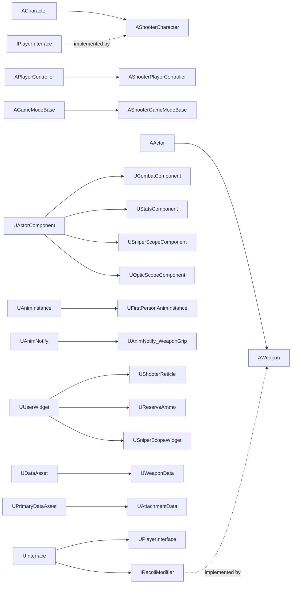

**Language / 语言：** **English** ｜ [中文](DOCUMENTATION.zh-CN.md)

---

# FPS Project — Code Reference

> Project: Unreal Engine 5.8 ｜ Module `FPS` ｜ Path `Source/FPS/`
> This document is **documentation only** — no code was modified. Suggested reading order: §2 (overall structure) → §5 (interface) → §6/§7 (the two core classes) → the rest as needed.
> Companion overview: [README.md](<README.md>). Chinese version: [DOCUMENTATION.zh-CN.md](<DOCUMENTATION.zh-CN.md>).

---

## Table of Contents

1. [About this document](#1-about-this-document)
2. [Code map and data flow](#2-code-map-and-data-flow)
3. [Module and build layer](#3-module-and-build-layer)
4. [Enums, structs and delegates](#4-enums-structs-and-delegates)
5. [IPlayerInterface — character capability interface](#5-iplayerinterface--character-capability-interface)
6. [AShooterCharacter — the player character](#6-ashootercharacter--the-player-character)
7. [UCombatComponent — the combat core](#7-ucombatcomponent--the-combat-core)
8. [AWeapon — the weapon actor](#8-aweapon--the-weapon-actor)
9. [UWeaponData — the weapon data asset](#9-uweapondata--the-weapon-data-asset)
10. [Damage and hit-zone system](#10-damage-and-hit-zone-system)
11. [UStatsComponent — health](#11-ustatscomponent--health)
12. [AShooterPlayerController — input and movement](#12-ashooterplayercontroller--input-and-movement)
13. [AShooterGameModeBase](#13-ashootergamemodebase)
14. [UShooterReticle — dynamic reticle](#14-ushooterreticle--dynamic-reticle)
15. [UReserveAmmo — ammo HUD](#15-ureserveammo--ammo-hud)
16. [Sniper scope — USniperScopeComponent / USniperScopeWidget](#16-sniper-scope--usniperscopecomponent--usniperscopewidget)
17. [Configuration layer](#17-configuration-layer)
18. [End-to-end sequences](#18-end-to-end-sequences)
19. [Blueprint contract checklist](#19-blueprint-contract-checklist)
20. [Caveats, known issues and extension notes](#20-caveats-known-issues-and-extension-notes)
21. [Attachment data asset — `UAttachmentData`](#21-attachment-data-asset--uattachmentdata)
22. [Attachment and loadout UI](#22-attachment-and-loadout-ui)
23. [Optics, flashlight and first-person FABRIK](#23-optics-flashlight-and-first-person-fabrik)
24. [Weapon feel and ADS revision (Steps 1–8)](#24-weapon-feel-and-ads-revision-steps-18)
25. [Combat feedback, lean, loadout WBP and switch/reload rules (since Step 8)](#25-combat-feedback-lean-loadout-wbp-and-switchreload-rules-since-step-8)
26. [Prone, slide, crouch modes, grip hold style and magazine attachments](#26-prone-slide-crouch-modes-grip-hold-style-and-magazine-attachments)
27. [Menus, out-of-match loadouts, rooms, pause, Team Deathmatch and death camera (2026-10 revision)](#27-menus-out-of-match-loadouts-rooms-pause-team-deathmatch-and-death-camera-2026-10-revision)
28. [In-match HUD, warmup clock, Search & Destroy, throwables and burst/shotgun weapon work (2026-10 revision 2)](#28-in-match-hud-warmup-clock-search--destroy-throwables-and-burstshotgun-weapon-work-2026-10-revision-2)
29. [Match HUD widgets — `UMatchHUD`, headers and kill feed](#29-match-hud-widgets--umatchhud-headers-and-kill-feed)
30. [Room lobby, session subsystem, BDM mode & economy, first-person spectator camera, weapon pickups and scoreboard (2026-10 revision 3)](#30-room-lobby-session-subsystem-bdm-mode--economy-first-person-spectator-camera-weapon-pickups-and-scoreboard-2026-10-revision-3)

> **Latest revision (2026-10 revision 3):** new top-level section `30` covers the **Online Subsystem session manager** (`UShooterSessionSubsystem`, `FRoomBrowserEntry`, `URoomBrowserScreen`), the **room lobby** (`ALobbyGameMode`, `ALobbyGameState`, `ALobbyPlayerController`, `ULobbyScreen`), **seamless travel team migration** (`AShooterPlayerState::CopyProperties`), the **BDM mode & economy buy shop** (`ABDMGameMode`, `ABDMGameState`, `UBuyShopScreen`, `FBuyShopItem`), the **authentic first-person teammate spectator camera** (`SetFirstPersonViewedLocally`, 1P spectate montages), **world interaction & weapon pickups** (`IInteractable`, `AWeaponPickup`, ground terrain snapping), and the **real-time Tab scoreboard with damage assists** (`UScoreboardScreen`, `NotifyDamage`, `AssistWindow`). Where it disagrees with earlier sections, §30 wins.
>
> **Previous revision (2026-10 revision 2):** new top-level sections `28` and `29` cover the **in-match HUD** (`UMatchHUD`, `UMatchHeaderWidget` / `UTDMHeaderWidget` / `USDHeaderWidget`, `UKillFeedWidget` / `UKillFeedEntry`), the **warmup clock**, **`PlayerN` names**, **sprint vs. reload**, the whole **Search & Destroy** round mode (`ASearchDestroyGameMode`, `ASearchDestroyGameState`, `ABombActor`, `ABombSite`, `ABombWeapon`), the **throwable pipeline** (`AThrownProjectile`, high/low throw, projectile damage), **`EFireType::Burst`**, the **double-barrel shotgun** chamber shells and the **gunsmith "equip as primary"** flow plus the **X24 attachment set**. Where it disagrees with §4.1, §4.2, §4.4, §13, §17.1, §17.3, §22, §24.3, §27 or §3.4, §28 / §29 win.
>
> **Latest revision (since Step 14):** new top-level section `26` covers **prone / crawl**, the **slide**, the **Ctrl-hold + C-toggle crouch** input rework, the **GripHoldStyle (Cradle / Grab)** system, **skeletal-mesh magazine attachments** (`SkeletalMesh`, `MagReloadAnim`, `bHideSpareMagazineBone`), the **melee sweep** (`WeaponMeleeHit`), the **AK weapon tag and 3P attach-point fallbacks**, the **spreading crosshair** and the **hip-fire spread cone** (`HipFireSpread` × `HipFireSpreadMultiplier`, rolled in `WeaponTrace`). Where it disagrees with §4.8, §4.9, §6.3, §6.7, §7.4, §7.5, §7.6, §8.2, §12, §14 or §23.3, §26 wins.
>
> **Previous revision (since Step 8):** new top-level section `25` covers PiP scope exposure, the Concrete impact default, directional hit reacts, the damage direction ring and hit confirm marks, per-weapon preview offsets, the WBP-designable loadout UI, Q/E lean (C++ + 3P ABP spine), the lean-aware weapon trace, the removal of CycleWeapon, the switch/reload interrupt rules, and a summary of Steps 9–14 (inspect, canted sight, laser). Where it disagrees with §6.3, §7.3, §7.5, §8.2 or §18.4, §25 wins.
>
> **Previous revision (weapon feel and ADS, Steps 1–8):** new top-level section `24` covers reload variants, bolt action, left-hand IK blending, the fire-mode toggle, C++ ADS FOV and ADS time, variable-zoom optics, PiP rules by optic type (the sniper is no longer special-cased), visual recoil, per-weapon hip offset and ADS eye distance. Where it disagrees with §16, §18.5 or §23.1, §24 wins.
>
> **Earlier revision (weapon attachments, loadout, PiP optics):** new top-level sections `21–23` document the attachment data asset, the attachment/loadout UI and the picture-in-picture optic + flashlight + first-person FABRIK, with contract additions in `19.2` and new known issues in `20.1.2`.
>
> **Previous revision (recoil / stamina / healing / locomotion):** subsections `4.11`, `6.5–6.7`, `7.7–7.9`, `8.4–8.6`, `11.1`, `12.1–12.2`, `19.1` and `20.1.1`.

---

## 1. About this document

| Section | Content | Audience |
| --- | --- | --- |
| 3 | Module, build, gameplay tags, trace channel | Anyone setting up the project |
| 4 | Every enum / struct / delegate | Everyone (quick reference) |
| 5–8 | Interface, character, combat component, weapon | Anyone changing gameplay (core) |
| 9 | How to fill in the data asset | Designers / asset wranglers |
| 10–16 | Damage, health, input, UI, sniper scope | Look up by feature |
| 17–19 | Config, sequences, blueprint contract | Anyone debugging integration |
| 20 | Pitfalls and TODOs | Whoever inherits the project |
| 21–29 | Attachment data/UI, optics + flashlight, weapon-feel revisions, combat feedback + lean, prone/slide/grip hold/magazine attachments, the in-match HUD and the Search & Destroy / throwable / shotgun revision | Look up by feature (these sections win over the older ones they reference) |

Legend:

- `◆` — the function or member is called from / affects Blueprints.
- `⇄` — the function participates in replication or is an RPC.
- `⚠` — known issue or a pitfall worth remembering.

---

## 2. Code map and data flow

### 2.1 Class relationships



### 2.2 Ownership

```
BP_ShooterGameMode
└─ BP_ShooterCharacter (AShooterCharacter)
   ├─ SpringArm (USpringArmComponent)          // length 0, exists only for camera lag
   │  └─ FirstPersonCamera (UCameraComponent)
   │     └─ Mesh1P (USkeletalMeshComponent)    // arms, owner-only
   ├─ Mesh (the 3P body from ACharacter)       // what other players see
   ├─ Combat (UCombatComponent, Replicated)
   │  └─ spawned at runtime → AWeapon × N (Inventory)
   │     ├─ Mesh1P (the gun the owner sees)
   │     └─ Mesh3P (the gun others see)
   ├─ Stats (UStatsComponent, Replicated)
   └─ SniperScope (USniperScopeComponent, created with NewObject at runtime)
      ├─ Capture (USceneCaptureComponent2D)
      ├─ RenderTarget (UTextureRenderTarget2D)
      └─ Overlay (USniperScopeWidget, added to the viewport with ZOrder = -1)
```

### 2.3 Data flow of one shot (overview)

```
Input IA_FireWeapon (Started)
 → AShooterCharacter::Input_FireWeapon_Pressed
 → UCombatComponent::Initiate_FireWeapon_Pressed   (sprint cancel, store bTriggerPressed, fire-rate gate)
 → UCombatComponent::Local_FireWeapon
     ├─ play the 1P fire montage (ResolveFireMontage: random melee/shot variant)
     ├─ AWeapon::WeaponTrace          (sphere sweep → FHitResult; melee uses WeaponMeleeHit instead)
     ├─ AWeapon::Local_Fire           (→ blueprint FireEffect; predictive magazine decrement, skipped when !UsesAmmo)
     ├─ broadcast OnCurrentReserveAmmoChanged (UI refresh)
     ├─ broadcast OnWeaponFired       (crosshair spread kick)
     ├─ start FireTimer (fire rate / automatic loop)
     └─ Server_FireWeapon(Hit)  ⇄
          ├─ fire-rate validation
          ├─ bone → hit zone → damage multiplier
          ├─ IPlayerInterface::Execute_DoDamage   (server-side health)
          ├─ AWeapon::Auth_Fire                   (authoritative magazine decrement)
          └─ Multicast_FireWeapon(Hit, AuthAmmo)  ⇄
               ├─ local:   AWeapon::Rep_Fire(AuthAmmo) (reconcile)
               └─ remote:  Local_Fire(FX, bFirstPerson=false) + 3P fire montage
```

---

## 3. Module and build layer

### 3.1 `Source/FPS/FPS.Build.cs`

| Item | Value | Notes |
| --- | --- | --- |
| `PCHUsage` | `UseExplicitOrSharedPCHs` | Shared PCH |
| `PublicDependencyModuleNames` | `Core`, `CoreUObject`, `Engine`, `InputCore`, `EnhancedInput`, `GameplayTags`, `PhysicsCore`, `UMG` | Without `PhysicsCore`, `EPhysicalSurface` fails to link; without `GameplayTags`, `NativeGameplayTags.h` is missing |
| `PrivateDependencyModuleNames` | `Slate`, `SlateCore` | Internal UMG dependencies |

### 3.2 `Source/FPS/FPS.cpp` / `FPS.h`

- `IMPLEMENT_PRIMARY_GAME_MODULE(FDefaultGameModuleImpl, FPS, "FPS")` declares `FPS` as the primary game module. `FPS.h` is just an aggregate header pulling in `CoreMinimal.h` and `FPSTraceChannels.h`.

### 3.3 `FPSTraceChannels.h`

```cpp
namespace FPSTraceChannels { constexpr ECollisionChannel ECC_Weapon = ECC_GameTraceChannel2; }
```

- **Purpose**: give the "Weapon" channel a readable alias instead of sprinkling `ECC_GameTraceChannel2` everywhere.
- **Effect**: mirrors `+DefaultChannelResponses=(Channel=ECC_GameTraceChannel2,...,bTraceType=True,...,Name="Weapon")` in [DefaultEngine.ini](<Config/DefaultEngine.ini>). **If the channel order ever changes (adding/removing a channel in Project Settings), this constant and the ini must be updated together.**

### 3.4 `ShooterGamePlayTags.h` / `.cpp`

| Constant | Tag | Purpose |
| --- | --- | --- |
| `Tag_WeaponType_None` | `Weapon.type.none` | Unspecified type |
| `Tag_WeaponType_Rifle` | `Weapon.type.rifle` | Rifle (long gun) |
| `Tag_WeaponType_Pistol` | `Weapon.type.pistol` | Pistol (single + burst by default, §28.3) |
| `Tag_WeaponType_Melee` | `Weapon.type.melee` | Melee (knife) |
| `Tag_WeaponType_AK` | `Weapon.type.ak` | AK rifle. A **separate tag on purpose**: the AK needs its own animation/montage set, and it is the only tag with a dedicated third-person attach path (`RifleSocketak`, §26.6) |
| `Tag_WeaponType_ShotGun` | `Weapon.type.shotgun` | Double-barrel shotgun — its own montage set, plus the chamber-shell notifies (§28.5) |
| `Tag_WeaponType_X24` | `Weapon.type.x24` | X24 pistol. Guards the body-sequence workaround (the X24 body has no slot that matches the arm montages) and its skeletal attachments (§28.6) |
| `Tag_WeaponType_Grenade` | `Weapon.type.grenade` | Frag grenade — `FirstPersonMontages` are keyed separately from guns (§28.4) |
| `Tag_WeaponType_Smoke` | `Weapon.type.smoke` | Smoke grenade (Blueprint `OnDetonate` only) |
| `Tag_WeaponType_Molotov` | `Weapon.type.molotov` | Molotov / incendiary (Blueprint `OnDetonate` only) |
| `Tag_WeaponType_Flash` | `Weapon.type.flash` | Flashbang (Blueprint `OnDetonate` only) |

- Declared as native tags (`UE_DECLARE/DEFINE_GAMEPLAY_TAG_EXTERN`), so no ini registration is required.
- `Weapon.type.ak` is **also** listed in [DefaultGameplayTags.ini](<Config/DefaultGameplayTags.ini>) (`ImportTagsFromConfig=True`) — the only weapon tag carried in config; the four throwable tags are registered there too since 2026-10 revision 2, together with the new `Attachment.Slot.RearSight`.

- **Effect**: `AWeapon::WeaponType` and every `TMap<FGameplayTag, …>` in `UWeaponData` are keyed by these tags. ⚠ `Weapon.type.sniper` **no longer exists** (the AWP / M700 was removed, §10.4) — the tag table used to list it; the sniper now follows its equipped optic like every other weapon (§24.6) and `USniperScopeComponent` is idle.

### 3.5 Target files

| File | Content |
| --- | --- |
| [FPS.Target.cs](<Source/FPS.Target.cs>) | `Type = Game`, `BuildSettingsVersion.V7`, module `FPS` |
| [FPSEditor.Target.cs](<Source/FPSEditor.Target.cs>) | `Type = Editor`, same settings |

---

## 4. Enums, structs and delegates

### 4.1 `EWeaponKind` (Weapon.h) — determines slot eligibility

| Value | Display name | Notes |
| --- | --- | --- |
| `LongGun` | Long Gun | Only long guns can occupy the main / secondary slots (Extraction allows two, arena modes one — §28.2) |
| `Pistol` | Pistol | Pistol slot; default fire modes are single + burst (`GetAllowedFireModes`) |
| `Melee` | Knife | Melee slot; melee can never aim (`Initiate_Aim_Pressed` / `Local_Aim` force it off), **never consumes ammo** (`AWeapon::UsesAmmo()` is false), uses the melee sweep instead of the camera trace, and turns both FABRIK alphas off (§26.4/§26.5) |
| `Throwable` | Throwable | Throwable slot (key 4 in arena modes). Consumes ammo but never auto-reloads; fire starts a throw instead of a shot; never aims (§28.4) |
| `Bomb` | Bomb | Search & Destroy key 5. Never aims, never uses ammo; planting / defusing happens through the game mode, not the weapon (§28.2) |

### 4.2 `EFireType` (Weapon.h)

| Value | Effect |
| --- | --- |
| `Single` | Never re-fires automatically; `FireTimerFinished` will not call `Local_FireWeapon` again |
| `Automatic` | As long as `bTriggerPressed == true` and the magazine is non-empty, `FireTimerFinished` keeps firing |
| `Burst` | Fires `BurstCount` shots spaced by `GetBurstShotInterval()` without needing the trigger to stay down; `BurstShotsRemaining` is the counter and the server rate limit uses the same interval (§28.3) |

`AWeapon::GetAllowedFireModes()` decides which of the three a weapon may use: explicit `AllowedFireModes` wins, otherwise pistol = `Single` + `Burst`, `bCanSwitchFireMode` rifle = `Single` + `Automatic`, everything else = its authored `FireType`. `SanitizeFireType()` runs on `BeginPlay` / on equip, `GetNextFireMode()` cycles the list.

### 4.3 `EWeaponStatus` (Weapon.h) — the weapon state machine

| Value | Entered when | Left when | Effect |
| --- | --- | --- | --- |
| `Idle` | Initial equip, montage finished | — | Can fire / reload / cycle |
| `Firing` | ⚠ **never written by any code** | — | Reserved |
| `Reloading` | `Initiate_ReloadWeapon`, `Server_ReloadWeapon` | `OnReloadMontageEnded`, `Client_ReloadWeapon`, `Server_EndReload`, `Notify_ReloadWeapon` | Blocks firing, cycling and duplicate reloads |
| `Cycling` | While an equip montage plays | `OnEquipMontageEnded` | Blocks reloading and further cycling |
| `UnEquipped` | Constructor, when `Equip` swaps a weapon out, `OnRep_Instigator` on a non-equipped gun | When `Equip` selects it | Paired with `SetActorHiddenInGame(true)` to hide the gun |

### 4.4 `EWeaponSlot` (CombatComponent.h)

| Value | Resolution rule (`FindWeaponForSlot`) |
| --- | --- |
| `Main` | The 1st `EWeaponKind::LongGun` |
| `Secondary` | The 2nd `LongGun` (Extraction; arena modes remap key 2 to `Pistol` in `Initiate_Hotkey`) |
| `Pistol` | The 1st `Pistol` |
| `Melee` | The 1st `Melee` |
| `Throwable` | The 1st `Throwable`; refused by `Initiate_EquipSlot` when its `Ammo` is 0 |
| `Bomb` | The 1st `Bomb` (granted by `GrantBombWeapon()` in Search & Destroy, dropped with `RemoveBombWeapon()`) |

### 4.5 `ETurningInPlace` (ShooterType.h)

`Left` / `Right` / `NotTurning` — computed by `AShooterCharacter::TurnInPlace` and consumed by the 3P animation blueprint for turn-in-place animations.

### 4.6 `EHitZone` (ShooterType.h)

`Head` / `Torso` / `Limb` — the result of hit-zone resolution, used to scale damage.

### 4.7 `EDeathState` (StatsComponent.h)

`NotDead` / `DeadStart` / `DeadFinished` — ⚠ only `NotDead` is ever used; the death state machine is not implemented.

### 4.8 `FPlayerAnim` (WeaponData.h) — the struct injected into the animation blueprints

| Field | Type | Purpose |
| --- | --- | --- |
| `IdleAnim` | `UAnimSequence*` | Standing idle |
| `AimIdleAnim` | `UAnimSequence*` | Aiming idle |
| `CrouchIdleAnim` | `UAnimSequence*` | Crouch idle |
| `SprintAnim` | `UAnimSequence*` | Sprint |
| `AimOffset_Hip` | `UBlendSpace*` | Hip-fire aim offset |
| `AimOffset_Aim` | `UBlendSpace*` | ADS aim offset |
| `Strafe_Standing` | `UBlendSpace*` | Standing locomotion blend space |
| `Strafe_Crouching` | `UBlendSpace*` | Crouched locomotion blend space |
| `Strafe_Walking` | `UBlendSpace*` | Walk-speed locomotion blend space (used while the walk gait is active, §6.6) |
| `IdleAnim_Grab` | `UAnimSequence*` | Standing idle used when the grip attachment reports `EGripHoldStyle::Grab` (vertical foregrip); empty → `IdleAnim` (§26.3) |
| `AimIdleAnim_Grab` | `UAnimSequence*` | Aiming idle for the Grab style |
| `LeftHandHoldPose_Cradle` / `LeftHandHoldPose_Grab` | `UAnimSequence*` | Optional **left-hand-only** hold pose for the ABP's layered blend (`bUseLeftHandHoldPose`, §26.3). A pose equal to the regular idle is ignored |

**Effect**: `UCombatComponent::ApplyEquippedWeaponAnim` copies the whole struct **by value** into the identically-named struct variable on the ABP, which is how animation sets swap when the player changes weapons. `RefreshLocomotionBlendSpaces` additionally swaps `Strafe_Standing` → `Strafe_Walking` for the walk gait and `IdleAnim` → `IdleAnim_Grab` for the Grab grip style before the copy.

### 4.9 `FMontageData` (WeaponData.h)

| Field | Purpose |
| --- | --- |
| `EquipMontage` | Weapon draw / holster animation |
| `ReloadMontage` | Reload animation |
| `FireMontage` | Fire animation |

Reload variants and melee/shot variants:

| Field | Purpose |
| --- | --- |
| `FirstReloadMontage` / `EmptyReloadMontage` / `TacticalReloadMontage` | Reload variants (§24.1) |
| `EmptyReloadMontage_Grab` / `TacticalReloadMontage_Grab` | Grab-style override for the empty / tactical reload; only used when the grip attachment is `EGripHoldStyle::Grab` and the field is set, otherwise the Cradle variant is used (§26.3) |
| `BoltMontage` | Bolt / pump cycling after each shot |
| `InspectMontage1P` | Weapon inspect |
| `FireMontages` / `EquipMontages` | `TArray` variant pools for melee swings and alternative draws. `ResolveFireMontage()` / `ResolveEquipMontage()` pick a **random** valid entry, appending the singular `FireMontage` / `EquipMontage` as an extra candidate (deduplicated); both return `nullptr` when nothing is set (callers must null-check) |
| `ResolveReloadMontage(EReloadType Type, EGripHoldStyle GripStyle = Cradle)` | Resolution order: `First` → `FirstReloadMontage`; then (Grab only) `EmptyReloadMontage_Grab` / `TacticalReloadMontage_Grab`; then `EmptyReloadMontage` / `TacticalReloadMontage`; finally `ReloadMontage`. ⚠ `First` returns as soon as `FirstReloadMontage` is set, so a first reload never picks a Grab override |

The same struct is reused in three maps: `WeaponMontages` (animations on the **weapon's own** skeletal mesh, e.g. the magazine moving during a reload), `FirstPersonMontages`, and `ThirdPersonMontages`.

### 4.10 Delegates

| Delegate | Declared in | Parameters | Fired when | Used for |
| --- | --- | --- | --- | --- |
| `FWeaponFirstReplicated` | ShooterCharacter.h | `AWeapon*` | The first weapon has finished replicating to a client; broadcast exactly once | Lets the HUD wait until a weapon exists before fetching the reticle material |
| `FReticleChanged` | CombatComponent.h | `UMaterialInstanceDynamic*` | `InitializeWeaponWidget` / weapon swap | The reticle widget swaps its material |
| `FCurrentReserveAmmoChanged` | CombatComponent.h | `int32 RoundsInServe, int32 RoundsInWeapon, UTexture2D*` | Equip, fire, reload, `OnRep_CurrentReserveAmmo` | Refreshes the ammo text and weapon icon |
| `FHealthChanged` | StatsComponent.h | `UStatsComponent*, float Old, float New, AActor* Instigator` | Health or max health changes | Health bar UI, death checks |

---

### 4.11 Recoil structs, new delegates and the added `FPlayerAnim` field

| Type | Declared in | Purpose |
| --- | --- | --- |
| `FRecoilStep` | Weapon.h | One shot's kick in degrees: `Pitch` (up +, down −) and `Yaw` (right +, left −). Has a default constructor and a `(Pitch, Yaw)` convenience constructor |
| `FRecoilScale` | RecoilModifierInterface.h | Multipliers stacked on the weapon's authored kick: `Pitch`, `Yaw`, `Recovery` — all default `1` (unchanged) |
| `IRecoilModifier` / `URecoilModifier` | RecoilModifierInterface.h | `BlueprintNativeEvent` interface with one function, `GetAttachmentRecoilScale()`. Implement it on a weapon **or on any component of the weapon or the character** (foregrip, muzzle brake, stock, perk component…) to modify recoil |
| `FPlayerAnim::Strafe_Walking` | WeaponData.h | `UBlendSpace*` sampled at walk speed. While the walk gait is active it is copied over `Strafe_Standing` (see 6.6 and 7.9) |

New delegates:

| Delegate | Declared in | Kind | Fired when | Consumed by |
| --- | --- | --- | --- | --- |
| `FAimStateChanged` | CombatComponent.h | Plain C++ multicast (`DECLARE_MULTICAST_DELEGATE_OneParam`, `bool`) — **not** a blueprint delegate | `Local_Aim` actually changes `bAiming` | `AShooterCharacter::HandleAimStateChanged` (blueprint `OnAim`, movement speed, gait) |
| `FStaminaChanged` | StatsComponent.h | Dynamic multicast (component, old, new) | Stamina or max stamina changes | Stamina bar (`WB_Stamina`) |
| `FStaminaDepleted` | StatsComponent.h | Dynamic multicast, no parameters | The server drains the last of the stamina while sprinting | `AShooterPlayerController::HandleStaminaDepleted` |
| `FWeaponFired` | CombatComponent.h | Dynamic multicast, no parameters | `Local_FireWeapon` actually fired (after `Local_Fire`) | `UShooterReticle::HandleWeaponFired` → `NotifyWeaponFired()` (crosshair spread kick, §26.7) |

> `EDeathState` is now *read* (`HealPlayer` and `Server_BeginHeal` refuse to heal a dead or full-health character) but is still never written, so it stays `NotDead` forever — see 20.1.

---

### 4.12 `EGripHoldStyle` (AttachmentData.h) — how the support hand holds the gun

| Value | Display name | Meaning |
| --- | --- | --- |
| `Cradle` | Cradle / Angled | Angled / triangular foregrip (or **no grip at all**): the hold pose comes from the regular idle animations |
| `Grab` | Grab / Vertical | Vertical foregrip: the idle/reload animations are swapped for the `_Grab` variants and the ABP may layer in `LeftHandHoldPose_Grab` |

- `AWeapon::GetGripHoldStyle()` reads it from the **equipped grip attachment** and returns `Cradle` when no grip is mounted, so removing the grip reverts everything.
- **Effect**: the hold pose is produced by **animations, not by FABRIK**. The first-person FABRIK path is permanently disabled (`FABRIK_Alpha1P = 0`, §26.1); the third-person left hand uses `FABRIK_Alpha` (0 for melee, 0 while crawling, 1 otherwise). See §26.3 for the full flow.


---

## 5. IPlayerInterface — character capability interface

**Location**: [PlayerInterface.h](<Source/FPS/Public/Interface/PlayerInterface.h>) (the `.cpp` is intentionally empty — the comment says it does not need to be modified).

**Why it exists**: `AWeapon` needs to act back on its owner (fetch attach points, fetch the 1P/3P meshes, apply damage), but a weapon should not `Cast<AShooterCharacter>`. With a `BlueprintNativeEvent` interface, **weapons depend only on the interface**, so any blueprint character that implements these events can reuse the entire weapon system.

Every function is `BlueprintNativeEvent + BlueprintCallable`, so C++ callers must use the `IPlayerInterface::Execute_Xxx(Object, ...)` form.

| Function | Signature | Purpose | Called by |
| --- | --- | --- | --- |
| ◆`GetWeaponAttachPoint` | `FName(const FGameplayTag& WeaponTag) const` | Returns the socket name on the character for a given weapon type | `AWeapon::AttachToOwingPawn` |
| ◆`GetMesh1P` | `USkeletalMeshComponent*() const` | Returns the first-person (arms) mesh | `AWeapon::AttachToOwingPawn`, `UCombatComponent::ApplyEquippedWeaponAnim/PlayEquipMontage/GetReloadMontage/Local_FireWeapon` |
| ◆`GetMesh3P` | `USkeletalMeshComponent*() const` | Returns the third-person (body) mesh | Same as above (3P branches), `Multicast_FireWeapon` |
| ◆`WeaponReplicated` | `void()` | Signals "the weapon has replicated to the client" | `UCombatComponent::SpawnInventory`, `OnRep_CurrentWeapon` |
| ◆`GetCurrentWeapon` | `AWeapon*()` | Returns the current weapon | `UShooterReticle::NativeOnInitialized` |
| ◆`GetReserveAmmo` | `int32() const` | Returns the current reserve ammo | Blueprint / UI queries |
| ◆`Notify_ReloadWeapon` | `void()` | Animation-notify entry point: fills the magazine on the authority and pushes the result to the client | Reload animation AnimNotify in Blueprints |
| ◆`DoDamage` | `bool(float DamageAmout, AActor* DamageInstigator)` | Applies damage to "any actor implementing this interface" | `UCombatComponent::Server_FireWeapon` |

**Implementers**: only `AShooterCharacter` (section 6).

---

## 6. AShooterCharacter — the player character

**Location**: [ShooterCharacter.h](<Source/FPS/Public/ShooterCharacter.h>) / [ShooterCharacter.cpp](<Source/FPS/Private/ShooterCharacter.cpp>)
**Inherits**: `ACharacter` + `IPlayerInterface`

### 6.1 Components and defaults (constructor)

| Member | Type | Setup | Effect |
| --- | --- | --- | --- |
| `SpringArm` | `USpringArmComponent` | Attached to the root; `TargetArmLength = 0`; `bEnableCameraLag = true`; `CameraLagSpeed = 15`; `bUsePawnControlRotation = true` | The camera does not handle rotation itself; the spring arm's **camera lag** gives the crosshair a smooth trailing feel. Length 0 keeps the camera at the character's head |
| `FirstPersonCamera` | `UCameraComponent` | Attached to `SpringArm`; `bUsePawnControlRotation = false` | Follows the control rotation (forwarded by the spring arm); its FOV is set to `DefaultFOV = 90` in `BeginPlay` |
| `Mesh1P` | `USkeletalMeshComponent` | Attached to `FirstPersonCamera`; `bOnlyOwnerSee = true`; `bCastDynamicShadow = false`; `bReceivesDecals = false`; `VisibilityBasedAnimTickOption = OnlyTickPoseWhenRendered`; TickGroup = `TG_PrePhysics`; `AllowPrivateAccess` | Arms visible only to the local player; no shadow, no decals — saves performance. `TG_PrePhysics` plus the tick prerequisite below guarantees "arms animate first, sight alignment is computed afterwards" |
| `GetMesh()` (3P body) | `USkeletalMeshComponent` | `bOnlyOwnerSee = false`; `bOwnerNoSee = true`; `bReceivesDecals = false` | You never see your own body; everyone else does |
| `Combat` | `UCombatComponent` | `SetIsReplicated(true)` | The combat core (section 7) |
| `Stats` | `UStatsComponent` | `SetIsReplicated(true)` | Health (section 11) |
| `DefaultFOV` | `float` | `90.f` (`EditDefaultsOnly`) | The hip-fire FOV, and the FOV the camera is forced back to while the sniper scope is active |
| `TurningStatus` | `ETurningInPlace` | `NotTurning` | Exposed to the ABP |
| `bWeaponFirstReplicated` | `bool` | `false` | Ensures `OnWeaponFirstReplicated` is broadcast only once |
| — | — | Calls `ConfigureWeaponHitCollision()` | See 6.3 |

### 6.2 Lifecycle functions

| Function | Behaviour and effect |
| --- | --- |
| `BeginPlay()` | ① On a non-dedicated server, if no `USniperScopeComponent` exists yet, **create one dynamically** with `NewObject` + `RegisterComponent` (so the blueprint does not need to add it); ② `Super::BeginPlay()`; ③ call `ConfigureWeaponHitCollision()` **again** (the comment notes that the Blueprint overrides collision settings after the constructor); ④ set the camera FOV to `DefaultFOV`; ⑤ record `StartingAimRotation` (initial yaw); ⑥ cache `Mesh1P`'s authored relative location/rotation into `AuthoredHipMeshLocation/Rotation`; ⑦ `ConfigureAimTickOrder()` |
| `BeginDestroy()` | Calls `Combat->DestroyInventory()` so every spawned weapon actor is destroyed with the character |
| `Tick(DeltaTime)` | Each frame, in this order: `UpdateLocomotionGait(true)` → `CalculateTurnInPlaceParameters` → `CalculateFABRIKSocket` → `UpdateAimAlpha` (advance ADS progress first, alignment and FOV use it) → `RemoveVisualRecoilFromMesh` → `UpdateAimSocketAlignment` → `ApplyVisualRecoilToMesh` → `UpdateAimFieldOfView` → `UpdateLean` → `UpdateSlide` → `UpdateProne` → `USniperScopeComponent::UpdateView()` (if present) → `UOpticScopeComponent::UpdateView()` (if present). **The order matters**: gait and turn-in-place first, then the IK socket, then ADS alpha/alignment, and the scope components last so they read the final camera state |
| `PossessedBy(NewController)` | After `Super::`, calls `Combat->SpawnInventory()` — weapons are only spawned (on the server) once the character is possessed |
| `OnRep_PlayerState()` | On clients, once `PlayerState` has replicated, calls `Combat->InitializeWeaponWidget()` to push the reticle material and ammo into the HUD |

### 6.3 Function-by-function reference

#### `ConfigureWeaponHitCollision()` (private)

| Target | Setting | Why |
| --- | --- | --- |
| `GetCapsuleComponent()` | `ECR_Ignore` on the `ECC_Weapon` channel | The capsule has no bones, so a capsule hit leaves `Hit.BoneName` empty and hit zones cannot be resolved |
| `GetMesh()` (3P body) | `SetCollisionEnabled(QueryOnly)` + `ECR_Block` on `ECC_Weapon` | Lets bullets hit the **skeletal body mesh** so the bone name is available for headshot detection |
| `Mesh1P` | `NoCollision` | Your own arms never participate in hit detection |

#### `GetFixedAimRotation() const` ◆

```
FRotator AimRotation = GetBaseAimRotation();
if (AimRotation.Pitch > 90 && !IsLocallyControlled())
    Pitch = MapRangeClamped(Pitch, [270,360) → [-90,0])
```
- **Purpose**: fixes the pitch representation for **remote** characters. After network compression the pitch lands in `[270,360)`; mapping it into `[-90,0]` is what animation blueprints and sights expect.
- **Effect**: remote players' aim direction no longer flips. Locally controlled characters are unaffected (their pitch is already in `[-90,90]`).
- ◆ `BlueprintCallable` — mainly intended for ABP / blueprint math.

#### `HasCurrentWeapon() const` ◆
- Returns true when `Combat` is valid and `Combat->CurrentWeapon != nullptr`. Blueprints and the HUD use it to test "do I already have a weapon?".

#### `CalculateTurnInPlaceParameters(float DeltaTime)` (private)

```
horizontal speed == 0 and not falling:
    AO_Yaw = NormalizedDeltaRotator(current yaw, StartingAimRotation).Yaw
    if TurningStatus == NotTurning: InterpAO_Yaw = AO_Yaw
    TurnInPlace(DeltaTime)
speed > 0 or falling:
    StartingAimRotation = current yaw
    AO_Yaw = 0
    MovementOffsetYaw = NormalizedDeltaRotator(movement direction, aim direction).Yaw
    TurningStatus = NotTurning
finally AO_Yaw *= -1
```
- **Outputs** (all `BlueprintReadOnly`, read by the ABPs):
  - `AO_Yaw`: the yaw difference between the body and the aim direction (negated to match the skeleton's convention) — drives **turn-in-place animations** and aim offsets.
  - `MovementOffsetYaw`: the movement direction relative to the aim direction — drives **8-way locomotion / gait blending**.
  - `TurningStatus`: the turn-in-place state.
- **Effect**: standing still lets the upper body rotate; as soon as the player moves, the reference angle resets.

#### `TurnInPlace(float DeltaTime)` (private)

- `AO_Yaw > 90` → `Right`; `AO_Yaw < -90` → `Left`.
- While turning: `InterpAO_Yaw = FInterpTo(InterpAO_Yaw, 0, DeltaTime, 4.0)` and `AO_Yaw` is pulled toward 0 (the turn animation "consumes" the angle).
- Once `|AO_Yaw| < 5` the turn ends and `StartingAimRotation` is reset to the current yaw.
- **Effect**: the state automatically returns to `NotTurning` after the animation finishes, so it can never get stuck.

#### `CalculateFABRIKSocket(float DeltaTime)` (private) ◆

> **Rewritten:** the first-person half of this function no longer exists. The 1P hold pose comes from per-weapon hold animations (grip style, §26.3), and the melee weapon and unarmed-crawl cases turn both alphas off. The `DeltaTime` parameter is now unused.

1. No combat component or no current weapon → `FABRIK_Alpha1P = 0`, `FABRIK_Alpha = 0`, both socket transforms `Identity`, return.
2. **Melee** (`WeaponKind == Melee`) → same: both alphas 0, both transforms `Identity`, return. Both hands follow the knife animation only.
3. **Third person**: `AWeapon::GetFabrikWorldTransform(false, SocketWorld)` — the grip attachment's `FABRIK` socket is preferred, otherwise the weapon mesh's own `FABRIK` bone. On success the world transform is converted into the `hand_r` bone space of the 3P body (`WriteHandSpace`) and the alpha is set:
   - `FABRIK_Alpha = bProneCrawling ? 0 : 1` — crawling uses the full-body unarmed prone animations, so the left hand must **not** be pulled to the gun; prone-and-stopped, standing, crouching and sliding all keep the gun hold (alpha 1).
   - No usable socket → `FABRIK_SocketTransform = Identity`, `FABRIK_Alpha = 0`.
4. **First person**: unconditionally `FABRIK_SocketTransform1P = Identity` and `FABRIK_Alpha1P = 0`.

- **Effect**: `ABP_ThirdPerson` should bind its FABRIK node's alpha to the new `FABRIK_Alpha` property (not a literal 1); `UFirstPersonAnimInstance` still mirrors `FABRIK_Socket1P` / `FABRIK_Alpha1P` every frame but the alpha is always 0, so a 1P FABRIK node is effectively inert. ⚠ The old properties `bDisableLeftHandIKDuringReload`, `LeftHandIKBlendSpeed` and `DisableLeftHandIKCurveName` still exist but no longer drive anything.


#### `ConfigureAimTickOrder()` (private)

- `PrimaryActorTick.AddPrerequisite(Mesh1P, Mesh1P->PrimaryComponentTick)`.
- **Effect**: the character tick (which contains the ADS alignment) runs **after** `Mesh1P`'s animation tick, so the arm pose it reads is the current frame's.

#### `GetAimTimelineAlpha(float)` (private) ⚠

- Currently just `return AimAlignAlpha;` (`AimAlignAlpha` is permanently 0, `AimTimeline` is never assigned, and nothing calls this function).
- Conclusion: this is **leftover / unwired** code; timeline-driven ADS was replaced by the blueprint-variable approach below.

#### `UpdateAimSocketAlignment(float)` (private) ◆ — ADS sight alignment

Guard clause (any failure returns early): locally controlled, and `Mesh1P` / `FirstPersonCamera` / `Combat` all valid.

1. Uses the template helper `FindBlueprintStruct<FVector>(this, "AdsMesh1PLoc")` to locate a `FVector` property **on the character blueprint** by name; if it is missing, the whole function bails out (so the variable must exist in the blueprint).
2. Takes the current weapon's `Mesh1P`, which must exist and be **attached under `Mesh1P` (the arms)**.
3. If the weapon has no `AimSocket`: for non-melee weapons it logs a **one-time warning** (tracked via `MissingAimSocketWeapon`, to avoid spamming every frame), keeps the blueprint-supplied position, and returns.
4. Computation:
   - `SocketWorld`: the sight socket's world position;
   - convert it to camera space: `SocketCamera`;
   - desired position `DesiredWorld` = camera space with **X preserved and Y/Z zeroed** (i.e. pull the sight onto the view axis);
   - convert the delta into `Mesh1P`'s parent space: `DeltaParent`;
   - `CenteredLocation = Mesh1P->GetRelativeLocation() + DeltaParent`;
   - discard the write if the result contains NaN.
5. `*AdsLocationProperty = CenteredLocation;` — it **writes the character blueprint variable `AdsMesh1PLoc` directly**.

- **Effect**: the blueprint drives `Mesh1P`'s ADS position from `AdsMesh1PLoc`, so "the weapon's sight automatically lines up with the screen centre". The blend strength is decided by the blueprint timeline/interp — C++ only computes the target value.
- ⚠ This function only handles position, not rotation (the comment is explicit that the blueprint does not apply the rotator variables; `Mesh1P` keeps its component rotation, yaw −90 relative to the camera).

#### `SetupPlayerInputComponent(UInputComponent*)` ◆

Uses `CastChecked<UEnhancedInputComponent>` (a mismatch asserts) to bind these actions:

| Input action | Trigger event | Callback | Effect |
| --- | --- | --- | --- |
| `ProneAction` | `Started` | `Input_Prone` | Toggle prone / crawl. Empty → `EnsureProneInput()` creates `IA_Prone_Runtime` + `IMC_Prone_Runtime` (**Z**, priority 1) (§26.1) |
| `LeanLeftAction` / `LeanRightAction` | `Started` / `Completed` | `Input_LeanLeft_*` / `Input_LeanRight_*` | Lean (Q / E runtime default, §25.7). `CycleWeaponAction` was removed (§25.9) |
| `FireWeaponAction` | `Started` | `Input_FireWeapon_Pressed` | Fire (press) |
| `FireWeaponAction` | `Completed` | `Input_FireWeapon_Released` | Stop firing (release; drives automatic fire) |
| `AimWeaponAction` | `Started` | `Input_Aim_Pressed` | Toggle ADS + blueprint event `OnAim` |
| `ReloadWeaponAction` | `Started` | `Input_ReloadWeapon` | Reload |
| `EquipMainWeaponAction` | `Started` | `Input_EquipMainWeapon` | Main weapon |
| `EquipSeconedaryWeaponAction` | `Started` | `Input_EquipSeconedaryWeapon` | Secondary weapon (**the original spelling "Seconedary" is intentional — do not "fix" it**) |
| `EquipMeleeWeaponAction` | `Started` | `Input_EquipMeleeWeapon` | Melee |
| `EquipPistolWeaponAction` | `Started` | `Input_EquipPistolWeapon` | Pistol |

#### Input callbacks (private)

| Function | Behaviour |
| --- | --- |
| `Input_Prone` | Local only: `RequestSetProne(!bIsProne, /*bExitToCrouch=*/false)` (§26.1) |
| `Input_LeanLeft_Started/Completed`, `Input_LeanRight_Started/Completed` | `HandleLeanInput(±1, bPressed)` (§25.7) |
| `Input_ReloadWeapon` | `Combat->Initiate_ReloadWeapon()` |
| `Input_FireWeapon_Pressed` | `Combat->Initiate_FireWeapon_Pressed()` |
| `Input_FireWeapon_Released` | `Combat->Initiate_FireWeapon_Released()` |
| `Input_Aim_Pressed` | `Combat->Initiate_Aim_Pressed()`, then the blueprint event **`OnAim(Combat->bAiming)`** (`BlueprintImplementableEvent`, used for FOV / recoil / audio) |
| `Input_EquipXxx` | Forwards to the public `EquipXxx()` of the same name |

Every callback is guarded by `IsValid(Combat)`.

#### Public equip functions (public, ◆ `BlueprintCallable`)

`EquipMainWeapon() / EquipSeconedaryWeapon() / EquipMeleeWeapon() / EquipPistolWeapon()`
- All are thin wrappers around `Combat->Initiate_EquipXxx()`.
- **Effect**: blueprints (an inventory UI, a pickup prompt, …) can switch weapons directly instead of simulating key presses.

#### IPlayerInterface implementation

| Function | Details |
| --- | --- |
| `GetWeaponAttachPoint_Implementation(Tag)` | `checkf(Combat)` and `checkf(Combat->WeaponData)` assertions → looks the tag up in `WeaponData->GripPoints`; on a miss logs a warning and falls back to `"RifleSocket"` |
| `GetMesh1P_Implementation()` | Returns `Mesh1P` |
| `GetMesh3P_Implementation()` | Returns `GetMesh()` |
| `WeaponReplicated_Implementation()` | On the first call sets `bWeaponFirstReplicated = true` and broadcasts `OnWeaponFirstReplicated` (for the HUD) |
| `GetCurrentWeapon_Implementation()` | `Combat->CurrentWeapon` |
| `GetReserveAmmo_Implementation()` | `Combat->CurrentReserveAmmo` |
| `Notify_ReloadWeapon_Implementation()` | `Combat->Notify_ReloadWeapon()` (authority-side instant refill + push to the client) |
| `DoDamage_Implementation(DamageAmount, Instigator)` | `Stats->ChangeHealthByAmout(-DamageAmount, Instigator)`; picks a random `HitReacts` index and calls `Multicast_HitReact`; **always returns false** (⚠ the return value is unused, and an empty `HitReacts` array will index out of bounds) |

#### `Multicast_HitReact_Implementation(int32 MontageIndex)` ⇄

> **Updated:** now `Multicast_HitReact(EHitReactDirection, int32)` with directional pools — see §25.3.

- Condition: `GetNetMode() != NM_DedicatedServer` **and** not locally controlled → i.e. this is "someone else's" client.
- Calls `Montage_Play(HitReacts[MontageIndex])` on the 3P body's `AnimInstance`.
- **Effect**: you never see your own third-person hit reaction, but other players do.

### 6.4 Key members exposed to Blueprints

| Member | Notes |
| --- | --- |
| ◆`OnWeaponFirstReplicated` | `BlueprintAssignable`; the first weapon has replicated |
| ◆`HitReacts` (+ `HitReactsFront/Back/Left/Right`) | `TArray<UAnimMontage*>`, `EditDefaultsOnly`; the hit-reaction pools (§25.3) |
| ◆`FABRIK_SocketTransform` | `BlueprintReadOnly`; the **3P** IK target |
| ◆`FABRIK_Alpha` | `BlueprintReadOnly`; 3P FABRIK strength — bind the ABP FABRIK node's alpha to this (1 = hold the gun, 0 = melee / crawling, §26.1) |
| ◆`FABRIK_SocketTransform1P` / `FABRIK_Alpha1P` | Kept for compatibility; the 1P alpha is permanently 0 (§26.1) |
| ◆`AO_Yaw` / `MovementOffsetYaw` / `TurningStatus` | `BlueprintReadOnly`; animation parameters |
| ◆`bIsProne` / `ProneAlpha` / `bProneCrawling` | `BlueprintReadOnly`; prone state, smoothed 0…1 blend and "prone and moving" (§26.1) |
| ◆`bIsSliding` / `SlideAlpha` | `BlueprintReadOnly`; slide state and smoothed 0…1 blend (§26.2) |
| ◆`OnAim(bool)` | `BlueprintImplementableEvent`; ADS state callback |
| `GetFirstPersonCamera()` / `GetCombatComponent()` / `GetDefaultFieldOfView()` | C++ accessors (used by `SniperScopeComponent`) |

---

### 6.5 Healing

The heal is designed so that the animation decides *when*, the server decides *how much*.

| Function | Behaviour and effect |
| --- | --- |
| ◆`HealPlayer(float InHealAmout)` (public, `BlueprintCallable`) | Client-side entry point. Guards: locally controlled, not already healing, amount > 0, `Stats` valid, `Stats->DeathState == NotDead`, `Health < MaxHealth`, and the current weapon is neither `Reloading` nor `Cycling`. Stores `PendingHealAmout`, plays the montage (`Mesh1P` first, falling back to the 3P body mesh), logs a warning if neither mesh could play it, sets `bIsHealing = true`, arms `HealLocalTimer` for `HealMontage->GetPlayLength() + 2.f` as a **timeout** (a montage that never fires its notify can therefore never lock the player out), then calls `Server_BeginHeal(PendingHealAmout)` |
| `PlayHealMontage(USkeletalMeshComponent* HealMesh, bool bBindEnd)` (private) | `Montage_Play` on the given mesh; hides the equipped weapon through `HideEquippedWeaponForHeal()`; binds `OnHealMontageEnded` when `bBindEnd` is set **or** when this is an observed proxy (so a remote player's gun comes back when their 3P montage ends) |
| `HideEquippedWeaponForHeal()` / `RestoreWeaponAfterHeal()` (private) | Remember the current weapon in `HealHiddenWeapon` and call `AWeapon::SetHiddenForHeal(true/false)` (see 8.6) |
| ◆`Notify_HealPlayer()` (public, `BlueprintCallable`) | The animation-notify entry point. Locally controlled only: clears `bIsHealing`, clears the timeout timer and calls `Server_FinishHeal(true)` |
| `OnHealMontageEnded(UAnimMontage*, bool bInterrupted)` (private) | Restores the weapon first; for a remote proxy it only clears `bIsHealing`; for the owner, an interrupted montage aborts the heal (`Server_FinishHeal(false)`), otherwise it forwards to `Notify_HealPlayer()` — so a montage **without** the notify still heals once at the end |
| `AbortLocalHeal()` / `AbortServerHeal()` (private) | Timeout callbacks; reset the healing flags and restore the weapon |
| `Server_BeginHeal_Implementation(float InHealAmout)` ⇄ | Authority only. Refuses when already healing, amount ≤ 0, `HealAmout <= 0`, dead, or at full health. **Clamps the request to the server's own value** (`ServerHealAmout = min(InHealAmout, HealAmout)`), so a client cannot ask for a bigger heal; arms `HealServerTimer` (montage length + 2 s) and calls `Multicast_PlayHealMontage()` |
| `Server_FinishHeal_Implementation(bool bCompleted)` ⇄ | Authority only. Ignores the call when not healing, clears the timer, and commits `Stats->ChangeHealthByAmout(ServerHealAmout, this)` **only when `bCompleted`**. Because `bServerHealing` is cleared first, the notify + montage-end double call is harmless (at most one commit) |
| `Multicast_PlayHealMontage_Implementation()` ⇄ | Skips the locally controlled owner and dedicated servers; other clients play the 3P heal montage (`bBindEnd = false`, the end delegate is bound inside `PlayHealMontage` for proxies) |

Data: `HealMontage` (`EditDefaultsOnly`, `AnimMontage_Arms_Healing` in this project) and `HealAmout` (default `30`, set in the constructor), plus `bIsHealing`, `bServerHealing`, `PendingHealAmout`, `ServerHealAmout`, `HealLocalTimer` (client) and `HealServerTimer` (server).

Notes:

- Input path: `IA_Heal` → `Input_Heal()` → `HealPlayer(HealAmout)`.
- The heal amount is not scaled by missing health; `ChangeHealthByAmout` clamps to `MaxHealth`, so overheal is impossible but the same fixed amount is always "consumed".
- ⚠ `PlayHealMontage(Mesh1P, true) || PlayHealMontage(GetMesh(), true)` short-circuits: only the first mesh that succeeds plays the animation.
- ⚠ Both an anim notify and the montage-end path can commit; the server guard makes this safe, but do not add a second *server* entry point.
- The heal is not gameplay-gated by movement or damage — taking damage during the montage does not cancel it.

### 6.6 Locomotion gait, ground speed and play rate

New `BlueprintPure` getters: `GetGroundSpeed()`, `IsUsingWalkGait()`, `GetLocomotionPlayRate()`.

| Function | Behaviour and effect |
| --- | --- |
| `RefreshLocomotionGait()` (public) | Thin wrapper for `UpdateLocomotionGait(true)`. Called by the controller after it changes `MaxWalkSpeed`, and by `OnStartCrouch` / `OnEndCrouch` |
| `UpdateLocomotionGait(bool bNotifyCombat)` (private) | Runs on **every tick** and produces the three locomotion values described below |

`UpdateLocomotionGait` in detail:

1. `GroundSpeed` = magnitude of the horizontal (Z-zeroed) velocity.
2. `MaxSpeed` = `MaxWalkSpeedCrouched` when crouched, otherwise `MaxWalkSpeed`. Note this is the **allowed** speed, not `Velocity / MaxWalkSpeed`.
3. `bWantWalkGait = MaxSpeed > 0 && MaxSpeed <= WalkGaitSpeedThreshold` (default `360`).
4. `bHasWalkBS = Combat->HasStrafeWalkingAnim()`; `bNewWalkGait = bWantWalkGait && bHasWalkBS`, so the walk BlendSpace is only used when `DA_WeaponData` actually provides one.
5. Reference speed depends on the BlendSpace that is **actually playing**: `ProneAnimReferenceSpeed` (`100`) while `bIsProne` (the prone state wins over crouch, since prone reuses CMC crouch), `CrouchAnimReferenceSpeed` (`150`) when crouched, `WalkAnimReferenceSpeed` (`150`) in walk gait, otherwise `JogAnimReferenceSpeed` (`375`).
6. `LocomotionPlayRate = Clamp(GroundSpeed / RefSpeed, MinLocomotionPlayRate (0.15), MaxLocomotionPlayRate (2.0))`, or `0` when `GroundSpeed <= 1` (idle freezes the locomotion feet).
7. Pushes the values into **both** anim instances (`Mesh1P` and the 3P body) *by property name*, tolerating several spellings: `bUseWalkGait` (bool), and `LocomotionPlayRate` / `PlayRate` / `BS_PlayRate`, plus `GroundSpeed` / `Speed` (floats). Missing properties are silently ignored.
8. When the gait changed and `bNotifyCombat` is set, calls `Combat->RefreshLocomotionBlendSpaces(bUseWalkGait)` so the ABP's `FPlayerAnim` copy swaps `Strafe_Standing` for `Strafe_Walking`.

Effects: slow movement (walk / ADS) no longer plays the jog cycle at 1× speed, and the animation step frequency follows actual ground speed — this is what removes foot sliding and the "mincing steps" artefact.

⚠ Blueprint contract: the ABP must expose at least one alias of each value. In this project the 3P ABP carries `bUseWalkGait`, `LocomotionPlayRate` and `GroundSpeed`; the 1P ABP carries `PlayRate`.

### 6.7 Movement-mode hooks (crouch, jump stamina, aim state)

| Override / function | Behaviour |
| --- | --- |
| `CanJumpInternal_Implementation() const` | `!bIsProne && !bIsSliding` **and** `Super::` **and** (`Stats` invalid or `Stats->HasStaminaForJump()`). Clients predict with the replicated stamina, the server is the final judge. **Effect**: you cannot jump while lying down or sliding, on any machine |
| `OnJumped_Implementation()` | `Super::`, then subtracts `Stats->JumpStaminaCost` (default `15`) **on the authority only** — `OnJumped` runs on both the predicting client and the server, so charging unconditionally would deduct twice |
| `OnStartCrouch(...)` / `OnEndCrouch(...)` | `Super::`, then `RefreshControllerMovementSpeed()` + `RefreshLocomotionGait()` on both server and local client, so crouching immediately re-resolves speed and gait. Prone reuses this path (§26.1) |
| `HandleAimStateChanged(bool bIsAiming)` (private, bound in `BeginPlay` to `Combat->OnAimStateChanged`) | Calls the blueprint event `OnAim(bIsAiming)` **only when locally controlled**, and always calls `RefreshControllerMovementSpeed()` + `RefreshLocomotionGait()` — the server needs the new speed as well, otherwise it would pull the client back |
| `IsLeanBlocked() const` | True while sprinting **and moving**, and now also while `bIsProne` **or** `bIsSliding` — no leaning while lying down or sliding (§26.1/§26.2) |
| `RefreshControllerMovementSpeed()` (private) | `Cast<AShooterPlayerController>(GetController())->RefreshMovementSpeed()`. Simulated proxies (your character on someone else's machine) have no local controller and are skipped |
| `Input_Aim_Pressed()` | No longer calls `OnAim` directly — the aim state is broadcast from `UCombatComponent::Local_Aim` through `OnAimStateChanged` (see 7.8) |
| `Input_VersionWeapon()` | Bound to `VersionWeaponAction` (when set) → `Combat->Initiate_VersionWeapon()` (inspect, §25.10) |

---

## 7. UCombatComponent — the combat core

**Location**: [CombatComponent.h](<Source/FPS/Public/CombatComponent.h>) / [CombatComponent.cpp](<Source/FPS/Private/CombatComponent.cpp>)
**Role**: concentrates inventory / equipping / firing / reloading / aiming / ammo into one replicated component; the character only forwards input.

### 7.1 Key members

| Member | Replication | Notes |
| --- | --- | --- |
| `WeaponData` | `EditDefaultsOnly` (not replicated) | Points at `DA_WeaponData`; required for every weapon |
| `DefaultWeaponClass` | `EditDefaultsOnly` | The weapon classes spawned at spawn time |
| `TraceLength` | `EditDefaultsOnly`, default `20000` | Hit-detection length in cm |
| `Inventory` | `Replicated` (`TArray<AWeapon*>`, `Transient`) | The spawned weapon instances |
| `CurrentWeapon` | `ReplicatedUsing = OnRep_CurrentWeapon` | The equipped weapon |
| `bAiming` | `Replicated` + `COND_SkipOwner` | ADS toggle; the owner already predicted it, so it is not echoed back |
| `CurrentReserveAmmo` | `ReplicatedUsing = OnRep_CurrentReserveAmmo` + `COND_OwnerOnly` | Reserve ammo for the current weapon |
| `ReserveAmmo` | Not replicated (`TMap<FGameplayTag,int32>`) | **Per-weapon-type reserve pool**, server-authoritative |
| `bTriggerPressed` | Not replicated | Local trigger state; drives automatic fire |
| `FireTimer` / `ServerNextFireTime` | Not replicated | Fire-rate throttling |
| `LocalWeaponIndex` | Not replicated | Local cycling index |

Delegates: `OnReticleChanged`, `OnCurrentReserveAmmoChanged`, `OnWeaponFired` (all `BlueprintAssignable`); `OnAimStateChanged`, `OnFireModeChanged`, `OnZoomLevelChanged` and the attachment/lean delegates are described in §4.11, §24.3, §24.5 and §25.

### 7.2 Helpers

#### `static UCombatComponent* FindCombatComponent(const AActor* Actor)` ◆
- Null-safe `FindComponentByClass<UCombatComponent>()`.
- **Effect**: the UI (`UShooterReticle`, `UReserveAmmo`) and `AWeapon::OnRep_Instigator` all use it to locate the combat component from an arbitrary actor.

#### `GetLifetimeReplicatedProps` ⇄

```cpp
DOREPLIFETIME(Inventory);
DOREPLIFETIME(CurrentWeapon);
DOREPLIFETIME_CONDITION(bAiming, COND_SkipOwner);
DOREPLIFETIME_CONDITION(CurrentReserveAmmo, COND_OwnerOnly);
```

#### `TickComponent(...)` / `BeginPlay()`
- Both are currently **empty implementations** (they only call `Super::`) — reserved extension points.

### 7.3 Inventory and equipping

#### `SpawnInventory()` ⇄ — spawn the starting weapons

1. Returns immediately unless `ROLE_Authority` (spawning happens on the server only).
2. Iterates `DefaultWeaponClass` → `SpawnWeapon()` → `Inventory.AddUnique()` + `ReserveAmmo.Add(WeaponType, StartingCarriedAmmo)`.
3. Counts `LongGun` / `Pistol` / `Melee` and logs a **warning** when there are more than the slots can hold (more than 2 long guns, more than 1 pistol, more than 1 melee), naming which ones will be ignored.
4. If the inventory is non-empty: `Equip(Inventory[0])` → `InitializeWeaponWidget()` → `IPlayerInterface::Execute_WeaponReplicated(GetOwner())`.
- **Called from**: `AShooterCharacter::PossessedBy`.

#### `SpawnWeapon(TSubclassOf<AWeapon>) const` (private) ⇄
- Server only. `FActorSpawnParameters` sets `Instigator = owning Pawn`, `Owner = owning Actor`, `AlwaysSpawn`.
- Immediately after spawning: `SetActorHiddenInGame(true)` and status `UnEquipped`.
- **Why `Instigator` matters**: clients use `AWeapon::OnRep_Instigator` to find the `Combat` component and decide whether to attach the gun to the body.

#### `Equip(AWeapon* Weapon)` ⇄ — equip a weapon (shared by client and server)

1. Previous weapon (if different): `DetachFromPawn()` + hide + `UnEquipped`.
2. `CurrentWeapon = Weapon`; unhide; status `Idle`; `AttachToOwingPawn()`.
3. `ApplyEquippedWeaponAnim(CurrentWeapon)` — swaps the animation set.
4. Reserve ammo: use the value stored in `ReserveAmmo` if present, otherwise `StartingCarriedAmmo` (and register that type in the map).
5. Broadcasts `OnCurrentReserveAmmoChanged(reserve, magazine, icon)` + `NotifyAmmoChanged()`.
- **Effect**: this is the complete "finish an equip" action; it runs on both client and server and converges to the same state.

#### `DestroyInventory()`
- Iterates `Inventory` and calls `Destroy()` on each; invoked from `AShooterCharacter::BeginDestroy`.

#### `InitializeWeaponWidget()` ◆
- Requires a valid `CurrentWeapon`; broadcasts `OnReticleChanged(weapon reticle dynamic material)` + `NotifyAmmoChanged()`.
- **Fired from**: `SpawnInventory`, `OnRep_CurrentWeapon`, `AShooterCharacter::OnRep_PlayerState`.

#### `NotifyAmmoChanged()` ◆
- Broadcasts `OnCurrentReserveAmmoChanged(CurrentReserveAmmo, CurrentWeapon->Ammo, CurrentWeapon->WeaponIcon)`.
- **Call sites**: `Equip`, `ApplyReload`, `Local_FireWeapon`, `Multicast_FireWeapon` (local branch), `Client_ReloadWeapon`.

#### `OnRep_CurrentWeapon(AWeapon* LastWeapon)` ⇄
1. Previous weapon: detach, hide, `UnEquipped`.
2. When the new weapon is valid: unhide, `AttachToOwingPawn()`, `ApplyEquippedWeaponAnim()`, `Execute_WeaponReplicated(Owner)`, `InitializeWeaponWidget()`.
- **Effect**: on clients the weapon is attached and animated automatically once its replication arrives (the server never takes this path).

#### `AdvanceWeaponIndex()` (private)
- With 2+ weapons, `LocalWeaponIndex = (LocalWeaponIndex + 1) % Inventory.Num()` and returns the new index.

#### `Initiate_CycleWeapon()` — cycle entry point (**removed**, §25.9)

> Removed together with `Input_CycleWeapon` and `CycleWeaponAction`. The description below is kept for history; slot keys still use `Local/Server/Multicast_CycleWeapon`.

Guards: a current weapon exists, status is neither `Cycling` nor `Reloading`, and the inventory holds at least 2 weapons.
Flow: `AdvanceWeaponIndex()` → `Local_CycleWeapon(NextIndex, /*bFirstPerson=*/true)` (instant local feedback) → `Server_CycleWeapon(NextIndex)` (server).

#### `Local_CycleWeapon(int32 WeaponIndex, bool bFirstPerson)` (private)
- Returns on an invalid index or weapon; calls `Equip()` when the weapon differs; then `PlayEquipMontage(Weapon, bFirstPerson)`.

#### `Server_CycleWeapon_Implementation(int32 WeaponIndex)` ⇄
- Returns on an invalid index; refuses during `BoltCycling` (reloading no longer blocks — the reload is interrupted, §25.9); a non-listen-owner request for the current weapon returns.
- **Listen-server special case**: on `NM_ListenServer` when the owner is locally controlled, it skips the duplicate `Equip` (the local machine already did it) and only updates `LocalWeaponIndex`.
- Finally calls `Multicast_CycleWeapon(WeaponIndex)`.

#### `Multicast_CycleWeapon_Implementation(int32 WeaponIndex)` ⇄
- On the locally controlled pawn (the initiator) it returns immediately — the comment is explicit: otherwise this would call `Server_CycleWeapon` again from `Local_CycleWeapon` and **overflow the stack on a listen server**.
- Other clients: update `LocalWeaponIndex` → `Local_CycleWeapon(WeaponIndex, /*bFirstPerson=*/false)` (3P montage).

#### `ApplyEquippedWeaponAnim(AWeapon* Weapon)` (private) ◆ — animation set injection

```
Select the map by view: WeaponData->FirstPersonAnims / ThirdPersonAnims
Look up Weapon->WeaponType to get FPlayerAnim*
Find an FStructProperty on the AnimInstance class by name:
    1P → "CurrenrAnim"   (that is literally how ABP_FirstPerson spells it)
    3P → "CurrentAnim"
Only write when the type matches FPlayerAnim::StaticStruct() (CopyCompleteValue)
```
- **Effect**: the ABP's struct variable is swapped wholesale when the weapon changes, so idle / aim-offset / strafe animations follow the weapon.
- ⚠ The 1P property name is `CurrenrAnim` (a typo that exists in the asset). Renaming it silently breaks animation swapping with **no log output**.

#### `PlayEquipMontage(AWeapon* Weapon, bool bFirstPerson)` (private)

1. Selects `FirstPersonMontages` / `ThirdPersonMontages`; reads `EquipMontage` for the weapon's tag, falling back to the shared `WeaponMontages` map.
2. Gets the matching mesh's `AnimInstance`; a `Montage_Play` result ≤ 0 counts as failure.
3. Sets `bEnableAutoBlendOut = true`.
4. Binds `OnEquipMontageEnded` as the end delegate and puts the weapon into **`Cycling`**.
- **Effect**: reloading and further cycling are blocked while the draw animation plays; the state returns to `Idle` automatically when the montage ends.
- The code comment explains that playing the equip animation on the 1P arms mesh is **intentional**, even though the clip belongs to the full-body skeleton (an earlier "reject mismatched skeletons" check is what silenced 1P).

#### `OnEquipMontageEnded(UAnimMontage*, bool)` (private)
- Now `OnEquipMontageEnded(UAnimMontage*, bool, TWeakObjectPtr<AWeapon>)`: only the bound weapon, if still current and `Cycling`, returns to `Idle` (§25.9).

#### Slot equipping

| Function | Behaviour |
| --- | --- |
| `FindWeaponForSlot(EWeaponSlot) const` (private) | Iterates the inventory: `Pistol`/`Melee` return the first matching kind; `Main`/`Secondary` return the 1st/2nd `LongGun` (tracked with `LongGunIndex`). Returns `nullptr` if absent |
| `Initiate_EquipSlot(EWeaponSlot)` (private) | Requires a found weapon that is not already current; refuses only during `BoltCycling` (an equip or reload in progress is interrupted, §25.9); `LocalWeaponIndex = Index` → `Local_CycleWeapon(Index, true)` → `Server_EquipSlot(Slot)` |
| `Server_EquipSlot_Implementation(EWeaponSlot)` ⇄ | **Re-resolves the weapon from the slot on the server** (the comment notes a client must not be able to put a pistol in the main slot) and then goes through `Server_CycleWeapon_Implementation` |
| `Initiate_EquipMainWeapon()` ◆ / `Initiate_EquipSeconedaryWeapon()` ◆ / `Initiate_EquipMeleeWeapon()` ◆ / `Initiate_EquipPistolWeapon()` ◆ | Call `Initiate_EquipSlot(Main/Secondary/Melee/Pistol)` respectively |

### 7.4 Firing and hit detection

#### `Initiate_FireWeapon_Pressed()` — trigger down

```
if the owning controller is sprinting → StopSprinting() and return   // first click cancels the sprint, it does not fire
no current weapon → return
bTriggerPressed = true
reloading → return (nothing fires until the trigger is released)
if (FireTimer is active) return;   // crucial: let the burst inside FireTimerFinished continue
if (!UsesAmmo() || Ammo > 0) Local_FireWeapon();
```
- **Effect**: single-fire weapons rely on `Completed` to clear `bTriggerPressed`; automatic weapons rely on the `FireTimer` loop. **Sprint interrupt**: `AShooterPlayerController::IsSprinting()` is checked first, so pulling the trigger while sprinting stops the sprint *and consumes that press* — the shot is the next one. `UsesAmmo()` is false for melee, so a knife always "has ammo" (no reload prompt, no auto-reload).

#### `Initiate_FireWeapon_Released()`
- `bTriggerPressed = false`.

#### `Local_FireWeapon()` (private) — local / predictive shot

1. Requires `WeaponData` and `CurrentWeapon`; returns while reloading or bolt-cycling.
2. Plays the **1P fire montage** via `FirstPersonMontages[WeaponType].ResolveFireMontage()` (random variant; may be null).
3. **Melee only**: additionally plays the 3P fire montage (`ThirdPersonMontages[WeaponType].ResolveFireMontage()`) on the body mesh — a melee swing is a full-body animation, so the montage must be slotted into `DefaultSlot`/`FullBody`, not an upper-body slot.
4. Hit detection: `WeaponMeleeHit(Hit)` for melee, `CurrentWeapon->WeaponTrace(Hit, TraceLength)` otherwise (§8.2).
5. Reads the physical surface type (`Hit.PhysMaterial`'s `SurfaceType`, defaulting to `SurfaceType2`/Concrete, §25.2).
6. `CurrentWeapon->Local_Fire(ImpactPoint, ImpactNormal, SurfaceType, /*bIsFirstPerson=*/true)` — local FX plus a **predictive magazine decrement** (skipped for melee).
7. Broadcasts **`OnWeaponFired`** (the crosshair spread kick, §26.7).
8. `NotifyAmmoChanged()` refreshes the UI.
9. `SetTimer(FireTimer, FireTimerFinished, CurrentWeapon->FireTime)` — the fire rate.
10. `Server_FireWeapon(Hit)` reports the shot (the **full FHitResult** is sent to the server).

#### `FireTimerFinished()` (private) — the fire-rate timer expired

```
no weapon → return
if UsesAmmo() && Ammo == 0 && reserve > 0 && locally controlled → Initiate_ReloadWeapon() (auto-reload on empty), return
if reloading → return
if bTriggerPressed && FireType == Automatic && (!UsesAmmo() || Ammo > 0) → Local_FireWeapon() (burst)
```
- ⚠ The comment states this deliberately does **not** use `ApplyReload()` (which would refill instantly and skip the montage). `UsesAmmo()` gates both checks so a knife can never enter the auto-reload path and keeps swinging.

#### `Server_FireWeapon_Implementation(const FHitResult& Hit)` ⇄ — authoritative shot

1. Validates `CurrentWeapon` and that it is not reloading.
2. **Fire-rate throttle**: `MinInterval = max(0, FireTime - 0.02)`; if `Now < ServerNextFireTime` the shot is dropped (anti "client fires faster than the weapon allows"), otherwise `ServerNextFireTime = Now + MinInterval`.
3. **Damage resolution** (only when the hit actor implements `IPlayerInterface`):
   - `ResolveDamageBone(Hit)` gets the bone name;
   - `ScaleDamageForBone(Damage, Bone, HeadshotMultiplier, LimbMultiplier)` computes the final damage;
   - logs a `Log`-level line (target / bone / zone / damage);
   - `IPlayerInterface::Execute_DoDamage(Hit.GetActor(), Damage, GetOwner())`.
4. On a non-listen-server owner, calls `CurrentWeapon->Auth_Fire()` (authoritative magazine decrement).
5. `Multicast_FireWeapon(Hit, CurrentWeapon->Ammo)` broadcasts final FX and the authoritative round count.

#### `Multicast_FireWeapon_Implementation(const FHitResult& Hit, int32 AuthAmmo)` ⇄

- **Local branch**: `Rep_Fire(AuthAmmo)` (reconcile the local prediction) + `NotifyAmmoChanged()`, then `return`. The comment notes the owning machine already played the 1P FX in `Local_FireWeapon`, so it must not repeat it.
- **Remote branch**: requires `WeaponData` (otherwise `ensure` + return); `Local_Fire(..., bIsFirstPerson=false)` plays the **third-person** muzzle FX; then plays `ThirdPersonMontages[WeaponType].ResolveFireMontage()` (random variant, may be null).

### 7.5 Reloading

#### `Initiate_ReloadWeapon()` — reload entry point

Guards: a current weapon exists; **`UsesAmmo()` is true** (a knife can never reload); status is not `Reloading`/`Cycling`/`BoltCycling`; `Ammo < MagCapacity`; `CurrentReserveAmmo > 0`; a 1P reload montage is available.
Flow: status → `Reloading` → `Server_ReloadWeapon()` → `PlayReloadMontage(true)`; if playback fails the status is rolled back and `Server_EndReload()` is called.

#### `ApplyReload()` ◆ — the animation-notify-driven "insert magazine"

- Runs only for the locally controlled pawn or on `ROLE_Authority` (the comment explains that simulated proxies also play the 3P montage but their notifies must be ignored).
- `Needed = MagCapacity - Ammo`; `Taken = min(Needed, CurrentReserveAmmo)`; returns false when `Taken <= 0`.
- Updates the magazine, reserve and `ReserveAmmo` map, calls `NotifyAmmoChanged()`, returns true.
- **Called from**: an **AnimNotify** on the blueprint reload animation (the frame where the magazine is inserted). This is what makes the numbers line up with the animation.

#### `GetReloadMontage(bool bFirstPerson, EReloadType, UAnimMontage*& OutMontage, UAnimInstance*& OutAnim) const` (private)
- Selects the map by view → resolves the variant with `ResolveReloadMontage(Type, CurrentWeapon->GetGripHoldStyle())` → gets the matching mesh's `AnimInstance`; returns false if anything is missing.

#### `PlayReloadMontage(bool bFirstPerson, EReloadType ReloadType)` (private)
1. Returns false when `GetReloadMontage` or `Montage_Play` fails (result ≤ 0).
2. **1P only**: additionally plays `WeaponMontages[WeaponType]` for the **same variant** on the **weapon's own `Mesh1P`** (the magazine animation), resolved with the same grip style. The comment notes the 3P gun skips it, otherwise the magazine floats. `First` is degraded to `Empty`/`Tactical` when no `FirstReloadMontage` exists, so the gun and the arms always play the matching pair.
3. **1P only**: `CurrentWeapon->PlayMagazineReload(MagReloadType)` — drives a **skeletal-mesh magazine attachment** through `MagReloadAnim` / `MagEmptyReloadAnim` / `MagTacticalReloadAnim` (§26.4). `First` is degraded to `Empty`/`Tactical` here as well.
4. Binds `OnReloadMontageEnded` (1P) or `OnObservedReloadMontageEnded` (3P) — only the 1P montage holds the `Reloading` lock; the 3P one is purely cosmetic and only re-attaches the weapon at the end.

#### `OnReloadMontageEnded(UAnimMontage*, bool)` (private)
- `Reloading` → `Idle`; if this machine is the locally controlling client (not the authority), calls `Server_EndReload()` so the server unlocks too.

#### `Server_ReloadWeapon_Implementation()` ⇄
- **Listen-server owner**: skips the duplicate validation (already handled locally) and goes straight to `Multicast_ReloadWeapon()`.
- Otherwise: repeats the full guard set (not reloading, not cycling, magazine not full, reserve available), sets `Reloading`, then `Multicast_ReloadWeapon()`.

#### `Multicast_ReloadWeapon_Implementation()` ⇄
- The locally controlled pawn returns immediately (avoiding a restart of the 1P reload animation mid-play); other clients call `PlayReloadMontage(false)`.

#### `Server_EndReload_Implementation()` ⇄
- Restores `Idle` when the status is `Reloading`.

#### `Client_ReloadWeapon_Implementation(int32 NewWeaponAmmo, int32 NewCarryAmmo)` ⇄

> **Updated:** now `Client_ReloadWeapon(AWeapon* ReloadedWeapon, int32, int32)`; `Notify_ReloadWeapon` only refills while the weapon is still `Reloading` (§25.9).
- Only the locally controlled pawn handles it: writes back magazine / reserve / `ReserveAmmo`, sets `Idle`, calls `NotifyAmmoChanged()`.
- If the trigger is still held and the magazine is non-empty → immediately `Local_FireWeapon()` (resume fire on reload completion).

#### `Notify_ReloadWeapon()` ◆ — authoritative instant refill + push

- Returns immediately unless `ROLE_Authority`. The comment explains that client RPCs only execute with authority, so a 1P notify on a remote client must not call `Client_ReloadWeapon`; the server's 3P notify performs the transfer.
- Computes `EmptySpace` / `AmountToRefill`, fills the magazine, syncs `ReserveAmmo`, sets `Idle`, and finally `Client_ReloadWeapon(magazine, reserve)`.
- **Difference from `ApplyReload`**: `ApplyReload` changes data on the machine that runs it; `Notify_ReloadWeapon` changes data **on the authority** and pushes it to the owner. Both are driven by reload animation notifies, which is how the three combinations (standalone / client / server) are covered.

### 7.6 Aiming

| Function | Behaviour |
| --- | --- |
| `Initiate_Aim_Pressed()` | **Melee guard**: when the current weapon is `EWeaponKind::Melee` it force-un-aims (`Local_Aim(false)` + `Server_Aim(false)` if currently aiming) and returns — a knife never aims. Otherwise `bNextAim = !bAiming` → `Local_Aim(bNextAim)` (instant local) + `Server_Aim(bNextAim)` |
| `Local_Aim(bool bPressed)` (private) | Forces `bPressed = false` for melee, so every caller (local, server and weapon-switch sync) applies the same rule; returns immediately when the value is unchanged, otherwise assigns `bAiming` and broadcasts `OnAimStateChanged` |
| `Server_Aim_Implementation(bool bPressed)` ⇄ | The server also calls `Local_Aim`, keeping the server and remote clients in agreement |

- **Effect**: the ADS **camera FOV change is implemented by the blueprint `OnAim` event**; C++ only maintains the boolean state and the ADS position alignment. The sniper scope disc is handled by `USniperScopeComponent`.

---

### 7.7 Recoil (view kick, pattern and recovery)

`UCombatComponent` owns the runtime state; `AWeapon` owns the authored pattern.

| Member | Meaning |
| --- | --- |
| `UnrecoveredRecoil` (`FVector2D`) | `X` = yaw, `Y` = pitch that has been applied but not yet given back |
| `RecoilShotIndex` (`int32`) | Position within `RecoilPattern` for the current burst |
| `SecondsSinceRecoilShot` (`float`) | Time since the last kick; drives the pattern reset and the recovery delay |

File-local helpers in [CombatComponent.cpp](<Source/FPS/Private/CombatComponent.cpp>):

| Helper | Behaviour |
| --- | --- |
| `AppendAttachmentRecoil(UObject*, FRecoilScale&)` | If the object's class implements `IRecoilModifier`, multiplies `Pitch`, `Yaw` and `Recovery` by the returned values (each clamped to ≥ 0) |
| `GatherAttachmentRecoil(const AActor*, FRecoilScale&)` | Runs `AppendAttachmentRecoil` on the **actor itself and every one of its components** |
| `AddViewRecoil(APlayerController*, Pitch, Yaw, out AppliedPitch, out AppliedYaw)` | Adds the kick to the control rotation, clamping pitch to `PlayerCameraManager->ViewPitchMin/ViewPitchMax` (falling back to ±89°), and reports back only **the amount that actually fit**, so a kick lost to the pitch limit is not owed back later |

| Function | Behaviour and effect |
| --- | --- |
| `ResolveRecoilScale() const` (private) | `Pitch/Yaw = weapon RecoilPitchScale/RecoilYawScale × (bAiming ? AimRecoilMultiplier : 1)`, then multiplied by every `IRecoilModifier` found on **the weapon and the owning character** (and their components). `Recovery` starts at 1 and is only changed by modifiers |
| `ApplyFireRecoil()` (private) | Local player only; skipped for melee and for weapons with an empty `RecoilPattern`. Picks `RecoilPattern[Clamp(RecoilShotIndex, 0, Num-1)]` — past the last entry the spray repeats the final step — scales it, applies it through `AddViewRecoil`, accumulates the applied delta into `UnrecoveredRecoil`, resets `SecondsSinceRecoilShot` and increments the index |
| `TickRecoil(float DeltaTime)` (private) | Called from `TickComponent`. Returns immediately when there is nothing owed. When the trigger is **not** held and `SecondsSinceRecoilShot >= RecoilResetTime`, the pattern index returns to 0 so the next burst starts from the first step. No recovery while spraying, during `RecoilRecoveryDelay`, or when nothing is owed. Otherwise `Step = min(|UnrecoveredRecoil|, max(0, RecoilRecoverySpeed × Recovery) × DeltaTime)` is given back **along the direction of the accumulated vector**, and the applied amount is added back into `UnrecoveredRecoil` so recovery blocked by the pitch limit stays owed |
| `ResetRecoilPattern()` (private) | Sets `RecoilShotIndex = 0`; called from `Equip`, `OnRep_CurrentWeapon` and `Initiate_ReloadWeapon` |

Call site: `Local_FireWeapon()` calls `ApplyFireRecoil()` immediately after `AWeapon::Local_Fire(...)`.

Defaults authored on `AWeapon` (see 8.4): a 12-step pattern (climb → drift right → swing left → settle), `RecoilPitchScale` / `RecoilYawScale` = 1, `AimRecoilMultiplier` = 0.65, `RecoilRecoverySpeed` = 18 °/s, `RecoilRecoveryDelay` = 0.12 s, `RecoilResetTime` = 0.4 s.

⚠ The kick is applied to the **local control rotation only** — the server neither simulates nor validates it. That matches UE's client-authoritative aim model, but it means recoil is a feel feature and cannot be used as a server-side accuracy penalty.

### 7.8 Aim-state broadcast and auto un-aim on weapon switch

| Function | Behaviour and effect |
| --- | --- |
| `Local_Aim(bool bPressed)` (private) | Returns immediately when `bAiming == bPressed` (this is what prevents duplicate broadcasts on a listen server), otherwise assigns `bAiming` and broadcasts `OnAimStateChanged(bAiming)` |
| `StopAimForWeaponSwitch()` (public) | If aiming: `Local_Aim(false)` for instant local feedback **and** `Server_Aim(false)` (reliable RPC, delivered in order) |
| Call sites | `Initiate_EquipSlot()` (`Initiate_CycleWeapon()` was removed) |
| `Server_CycleWeapon_Implementation` | Also calls `Local_Aim(false)` so remote players see the aim state drop |

Behaviour change: `Initiate_EquipSlot` used to `return` while aiming (pressing a number key did nothing). It now switches weapons and drops out of ADS instead.

### 7.9 Locomotion blend-space refresh (walk gait)

| Function | Behaviour and effect |
| --- | --- |
| `HasStrafeWalkingAnim() const` | True when `FirstPersonAnims` **or** `ThirdPersonAnims` has a `Strafe_Walking` BlendSpace for the current weapon type (either view is enough — the 3P view is what you see for foot sliding) |
| `RefreshLocomotionBlendSpaces(bool bUseWalkGait)` | Copies `FPlayerAnim` into the ABP struct property (`CurrenrAnim` for 1P, `CurrentAnim` for 3P). When `bUseWalkGait` is true **and** `Strafe_Walking` is valid, the copy's `Strafe_Standing` is replaced by `Strafe_Walking` first. **Grip style**: when `CurrentWeapon->GetGripHoldStyle()` is `Grab`, `IdleAnim_Grab` / `AimIdleAnim_Grab` replace `IdleAnim` / `AimIdleAnim` in the copy (only when the Grab idle differs from `LeftHandHoldPose_Grab`, so a left-hand-only pose is never used as a full idle). It also writes `GripHoldStyle`, `LeftHandHoldPose` and `ActiveIdleAnim` on a `UFirstPersonAnimInstance` — ⚠ it deliberately does **not** call `InitAnim()`, because that would destroy `DefaultSlot` dynamic montages (§26.3). Applied to both meshes |
| `ApplyEquippedWeaponAnim(AWeapon*)` | Now a thin wrapper: it reads `AShooterCharacter::IsUsingWalkGait()` and forwards to `RefreshLocomotionBlendSpaces` — so equipping a weapon also re-applies the currently correct gait |
| `AWeapon::OnRep_EquippedAttachments()` | Calls `Combat->RefreshLocomotionBlendSpaces(false)` after rebuilding the visuals, so mounting/removing a grip immediately re-applies the Cradle/Grab idle (§26.3) |

---

## 8. AWeapon — the weapon actor

**Location**: [Weapon.h](<Source/FPS/Public/Weapon/Weapon.h>) / [Weapon.cpp](<Source/FPS/Private/Weapon/Weapon.cpp>)

### 8.1 Constructor defaults

| Member | Default | Notes |
| --- | --- | --- |
| `PrimaryActorTick.bCanEverTick` | `false` | The weapon itself does not tick (performance) |
| `bReplicates` | `true` | Must replicate |
| `bNetUseOwnerRelevancy` | `true` | Relevancy follows the owner, so your gun stops replicating to players who cannot see you |
| `Mesh1P` | Root component; `CastShadow = false`; hidden by default; `OnlyTickPoseWhenRendered` | First-person gun |
| `Mesh3P` | Attached under `Mesh1P`; `CastShadow = true`; hidden by default | Third-person gun |
| `AimFeildOfView` | `60` | Expected ADS FOV (note the original spelling `AimFeildOfView`) |
| `AimSocketName` | `"AimSocket"` | The sight socket (the ADS alignment target) |
| `TraceRadius` | `5` | Sphere-sweep radius in cm |
| `FireTime` | `0.1` | Seconds between shots |
| `Damage` | `15` | Base damage |
| `HeadshotMultiplier` | `2.0` | Head multiplier |
| `LimbMultiplier` | `0.75` | Limb multiplier |
| `MagCapacity` / `Ammo` / `StartingCarriedAmmo` | `10` / `5` / `10` | Magazine capacity / current magazine / starting reserve |
| `WeaponStatus` | `UnEquipped` | Starts unequipped |
| `WeaponKind` | `LongGun` | Defaults to long gun |
| `MeleeHitRadius` / `MeleeHitReach` / `MeleeSocketName` | `40` / `120` / `"Melee"` | Melee sweep sphere radius (cm), sweep length (cm) and the start socket; shown only when `WeaponKind == Melee` (`EditCondition`) (§8.7) |
| `HipFireSpread` | `3` (`EditAnywhere`, `ClampMin 0`, `ClampMax 30`) | Base **hip-fire spread** as a half-cone angle in degrees, authored per weapon blueprint; scaled by every equipped attachment's `HipFireSpreadMultiplier` and forced to 0 while aiming (§8.2, §26.8) |

### 8.2 Function reference

| Function | Behaviour and effect |
| --- | --- |
| `OnRep_Instigator()` ⇄ | Client callback when `Instigator` replicates. Uses `FindCombatComponent(GetInstigator())`: if **this actor is the current weapon** → unhide + `AttachToOwingPawn()`; otherwise → `DetachFromPawn()` + hide + `UnEquipped`. **Effect**: fixes the bug where a client attached *every* replicated gun to the body, making the holstered rifle and the equipped pistol appear at the same time |
| `GetMesh1P()` / `GetMesh3P()` | Return the two weapon meshes |
| `HasAimSocket() const` | `Mesh1P` valid && `AimSocketName` not None && `DoesSocketExist`. Both the ADS alignment and the "missing socket" warning depend on it |
| `GetAimSocketWorldLocation(FVector&) const` | Returns false without a socket; otherwise outputs `Mesh1P->GetSocketLocation(AimSocketName)` in world space |
| `GetReticleDynamicMaterialInstance()` ◆ | Lazily creates and returns `DynMatInst_Reticle = UMaterialInstanceDynamic::Create(ReticleMaterial, this)`. **Effect**: each weapon owns an independent reticle material instance (for spread/colour), and the HUD swaps it into the Image brush |
| `CaptureAuthoredMeshRelative()` (private) | One-time capture of `Mesh1P`/`Mesh3P` **relative transforms** (guarded by `bCapturedAuthoredRelative`) |
| `AttachToOwingPawn()` | ① `CaptureAuthoredMeshRelative()`; ② `SetMeshVisibility()`; ③ fetches the attach point and the 1P/3P meshes through the interface; ④ **resolves a usable attach point per mesh** through `ResolveAttachPoint` (details below) — the AK additionally forces `RifleSocketak` on the 3P mesh; ⑤ snaps `Mesh1P`/`Mesh3P` to the resolved socket with `SnapToTargetNotIncludingScale`, then **writes the hand-authored relative offset back** via `SetRelativeTransform`; ⑥ temporarily sets `Mesh3P`'s anim tick option to `AlwaysTickPoseAndRefreshBones` and calls `RefreshBoneTransforms()`; ⑦ updates the flashlight and laser attachments; ⑧ logs `[WeaponAttach] <weapon> type=… grip=… -> 1P sock=… \| 3P sock=…`. **Effect**: fixes "the gun stays parented to the previous socket", "the hidden 3P gun keeps a stale pose so the FABRIK socket is wrong", and "an orphan bone silently attaches the gun at the mesh root" |
| `DetachFromPawn()` | Restores `Mesh3P`'s anim tick option to `OnlyTickPoseWhenRendered`, then detaches both meshes with `KeepRelativeTransform` |
| `SetMeshVisibility(APawn*) const` (private) | Locally controlled: `Mesh1P` visible, `Mesh3P` hidden; everyone else: the opposite. It now also applies the same 1P/3P choice to **every attachment visual** (`Mesh1P/Mesh3P` *and* `SkelMesh1P/SkelMesh3P`) — without this a skeletal magazine could linger visible on the wrong mesh (e.g. the spare mag on the back) |
| `WeaponTrace(FHitResult& OutHit, float TraceLength)` | See "Hit detection" below |
| `WeaponMeleeHit(FHitResult& OutHit)` | See "Melee sweep" below (§8.7) |
| `UsesAmmo() const` ◆ | `WeaponKind != EWeaponKind::Melee`. Gates the predictive decrement in `Local_Fire`, `Auth_Fire`, the fire/auto-reload checks and `Initiate_ReloadWeapon` |
| `GetHipFireSpread() const` ◆ | BlueprintPure. `0` while `UCombatComponent::bAiming`; otherwise `HipFireSpread` × the `HipFireSpreadMultiplier` of **every** equipped attachment. Consumed by `WeaponTrace` (real cone) and by `UShooterReticle` (converted to pixels) — §26.8 |
| `GetGripHoldStyle() const` ◆ | Returns the equipped **grip** attachment's `GripHoldStyle`, or `Cradle` when no grip is mounted (§4.12) |
| `GetMagazineSkelMesh1P() const` | The 1P skeletal-mesh component spawned for the magazine slot, or null |
| `PlayMagazineReload(EReloadType)` | Plays `MagReloadAnim` (or the Empty/Tactical variant) on the magazine's skeletal component; no-op when there is none |
| `Local_Fire(ImpactPoint, ImpactNormal, SurfaceType, bIsFirstPerson)` | ① Calls the blueprint event **`FireEffect`** (muzzle flash, bullet hole, sound, tracer); ② **only when `bIsFirstPerson`**, the owner is locally controlled **and `UsesAmmo()`**, predictively does `Ammo--` (`Clamp`), incrementing `Sequence` when not authoritative. **Effect**: remote multicasts are purely cosmetic, so a listen server never double-decrements, and a knife has no magazine |
| `Auth_Fire()` | Authoritative magazine decrement (`Clamp(Ammo - 1, 0, MagCapacity)`); returns immediately when `!UsesAmmo()` |
| `Rep_Fire(int32 AuthAmmo)` | Client reconciliation: `Sequence = max(Sequence - 1, 0)`; `Ammo = Clamp(AuthAmmo - Sequence, 0, MagCapacity)`. **Effect**: the locally predicted but unacknowledged shot count (`Sequence`) offsets the authoritative value, so the displayed ammo does not jump |
| `BeginPlay()` | Empty implementation (only `Super::`) |
| ◆`FireEffect(...)` | `BlueprintImplementableEvent` implemented in the weapon blueprint; parameters: impact point, impact normal, surface type, whether this is first person (so the blueprint can switch 1P/3P FX) |

#### Hit detection, `WeaponTrace` in detail

```cpp
Start     = active UCameraComponent world location  // fallback: PC->GetPlayerViewPoint (§25.8)
Direction = camera world rotation forward vector    // follows lean and ADS
Direction = FMath::VRandCone(Direction, radians(GetHipFireSpread()))   // only when spread > 0 (§26.8)
End       = Start + Direction * TraceLength
```
- **Spread**: the direction is randomised inside a cone whose half angle is `GetHipFireSpread()`. While aiming the function returns 0, so ADS is perfectly accurate; the miss fallback below uses the randomised direction, so the impact FX follow the bullet.
- `FCollisionQueryParams`: `bReturnPhysicalMaterial = true` (the surface type feeds `FireEffect`); ignores **the weapon itself** and **the owning pawn**.
- `FCollisionResponseParams`: everything starts as `ECR_Ignore`, then only `ECC_Pawn`, `ECC_WorldStatic`, `ECC_WorldDynamic` and `ECC_PhysicsBody` are set to `ECR_Block` — an **explicit whitelist of hittable object types**.
- `SweepSingleByChannel(..., ECC_Weapon, FCollisionShape::MakeSphere(TraceRadius), ...)`: uses the custom `Weapon` channel with a sphere sweep (a bullet with volume).
- **Miss fallback**: `OutHit.Location/ImpactPoint = End`, `Normal/ImpactNormal = -Direction`, `Distance = TraceLength`, `Time = 1`. The comment explains that otherwise `ImpactPoint` stays at the origin and the impact FX explodes at world zero.

#### Attach-point resolution (`IsUsableAttachPoint` / `ResolveAttachPoint`, file-local)

`AttachToOwingPawn` no longer attaches to the raw `GripPoints` name. Two file-local helpers decide:

| Helper | Behaviour |
| --- | --- |
| `IsUsableAttachPoint(Mesh, SocketOrBone)` | A real **socket** always counts. A **bone** only counts when it is the root bone or has a parent — an *orphan bone* (e.g. a `weapon_r` that exists in a trimmed skeleton like `SKM_Manny_Simple` with no parent) is rejected, because attaching to it puts the weapon at the mesh root instead of in the hand |
| `ResolveAttachPoint(Mesh, Requested)` | Returns `Requested` when usable; otherwise tries, in order, `RifleSocketak`, `RifleSocket`, `hand_r`, `HandGrip_R`, logging a **warning** with the chosen fallback; with none usable it logs an **error** and returns the original name |

**AK special case**: when `WeaponType` matches `Weapon.type.ak`, the **3P** mesh always uses `RifleSocketak` (falling back to `ResolveAttachPoint(Mesh3P, "RifleSocket")`), while the **1P** mesh keeps the `GripPoints` entry (`weapon_r` on the retargeted AK arms). Before this, a single `GripPoints` value had to serve both views, which bent the third-person AK out of the hand.

### 8.3 Notes for contributors
- `AWeapon` has **no** tick of its own and never fires on its own: all decisions live in `UCombatComponent`; the weapon only provides "presentation + data + hit detection".
- Blueprint weapon subclasses (`BP_Rifle`, `BP_Weapon_AK`, `BP_Pistol`, `BP_M700`, `BP_Knife`, …) must set `WeaponType` (tag), `WeaponKind`, the two meshes / animation blueprints and `AimSocketName`, and implement `FireEffect`.
- **Melee weapons** additionally need `MeleeSocketName` (default `"Melee"`) on the weapon mesh, `MeleeHitRadius` / `MeleeHitReach`, and full-body fire montages in `FireMontages` / `ThirdPersonMontages` (§8.7).
- **The AK must keep its own tag** (`Weapon.type.ak`) rather than reusing `Weapon.type.rifle`, because `UWeaponData` is keyed by tag and the AK needs its own animation and montage sets; reusing `rifle` mixes the two guns' animations.

---

### 8.4 Recoil properties

| Property | Default | Meaning |
| --- | --- | --- |
| `RecoilPattern` (`TArray<FRecoilStep>`) | 12 steps | Per-shot kick in degrees, in firing order. Past the last entry the spray repeats the final step. The stock pattern climbs, drifts right, swings left, then settles |
| `RecoilPitchScale` | `1.0` | Multiplier on the pattern's pitch (`ClampMin = 0`) |
| `RecoilYawScale` | `1.0` | Multiplier on the pattern's yaw |
| `AimRecoilMultiplier` | `0.65` | Extra multiplier applied while aiming down sights |
| `RecoilRecoverySpeed` | `18.0` | Degrees per second given back after the delay |
| `RecoilRecoveryDelay` | `0.12` | Seconds to wait after the last shot before recovery starts |
| `RecoilResetTime` | `0.4` | Trigger released for this long ⇒ the next burst restarts at pattern step 1 |

The stock 12-step pattern is:

```
(0.48, 0.00) (0.55, 0.10) (0.52, 0.22) (0.46, 0.30)
(0.40, 0.16) (0.38,-0.08) (0.36,-0.26) (0.34,-0.34)
(0.32,-0.12) (0.30, 0.14) (0.28, 0.22) (0.26, 0.06)
```

`BP_RIfle` overrides `RecoilPattern`; the other weapon blueprints inherit the C++ default. See 7.7 for how the component consumes these values.

### 8.5 Re-attaching the weapon to a hand socket (grip notify)

`AttachToPawnSocket(USkeletalMeshComponent* PawnMesh, FName SocketName)`:

1. Validates `PawnMesh` and the socket name, and that the owning pawn implements `IPlayerInterface`.
2. Chooses `Mesh1P` or `Mesh3P` by comparing the passed mesh with the interface's `GetMesh1P()` / `GetMesh3P()`.
3. Accepts **either a socket or a bone** on the character mesh (`DoesSocketExist` or `GetBoneIndex`); otherwise logs a warning naming the missing grip and returns.
4. Attaches with `EAttachmentRule::KeepWorld` for location, rotation and scale (and `bWeldSimulatedBodies = false`), so the gun keeps the pose it has this frame and then follows the new socket.

This is what `UAnimNotify_WeaponGrip` calls (see 19.1 for the contract). Together with `UCombatComponent::OnReloadMontageEnded` / `OnObservedReloadMontageEnded` — both of which now call `AttachToOwingPawn()` — it fixes the weapon drifting off the grip during the sniper reload and shell-eject montages.

### 8.6 Healing support

| Function | Behaviour |
| --- | --- |
| `SetHiddenForHeal(bool bHideWeapon)` | `true` hides both `Mesh1P` and `Mesh3P` (with `bPropagateToChildren`); `false` restores visibility through `SetMeshVisibility(GetInstigator())`, which respects who is looking at the gun |

Called from `AShooterCharacter::HideEquippedWeaponForHeal` / `RestoreWeaponAfterHeal` (see 6.5).

### 8.7 Melee sweep — `WeaponMeleeHit(FHitResult& OutHit)`

The knife does **not** use the camera trace (`WeaponTrace`); it sweeps a sphere along the blade so a swing hits what the blade passes through rather than what the crosshair points at.

```
BladeMesh = Mesh1P when it exists and is not hidden, else Mesh3P
Start     = MeleeSocketName socket (world) when present, else the mesh component location
Forward   = the socket's forward vector, else the mesh forward vector
End       = Start + Forward * MeleeHitReach
SweepSingleByChannel(ECC_Weapon, sphere(MeleeHitRadius), Start → End)
```

- `FCollisionQueryParams` ignores the weapon actor and the instigating pawn (so you never stab yourself).
- `FCollisionResponseParams` starts from **all ignore** and blocks only `ECC_Pawn`, `ECC_WorldStatic`, `ECC_WorldDynamic` and `ECC_PhysicsBody` — the same whitelist as `WeaponTrace`.
- **Miss fallback** (identical in spirit to `WeaponTrace`): the hit is filled with `End` as location/impact point, `-Forward` as the normal, `Distance = MeleeHitReach`, `Time = 1`, so the swing FX still appears in front of the player.
- Called from `UCombatComponent::Local_FireWeapon` when `WeaponKind == Melee`; the resulting hit travels through the same `Local_Fire` → `Server_FireWeapon` → `DoDamage` chain, so **damage and hit zones are unchanged** — only the selection of the hit is different.
- ⚠ The sweep runs on the **client** and the `FHitResult` is sent to the server, exactly like a bullet; there is no server-side re-sweep.

---

## 9. UWeaponData — the weapon data asset

**Location**: [WeaponData.h](<Source/FPS/Public/WeaponData.h>) (the `.cpp` is only an include; this is pure data)
**Instance**: `/Game/FPS/Data/DA_WeaponData` (referenced by `CombatComponent::WeaponData`)

| Property | Type | Key → value | Consumers |
| --- | --- | --- | --- |
| `GripPoints` | `TMap<FGameplayTag, FName>` | Weapon type → socket name on the character (e.g. `Weapon.type.rifle` → `RifleSocket`) | `AShooterCharacter::GetWeaponAttachPoint_Implementation` |
| `WeaponMontages` | `TMap<FGameplayTag, FMontageData>` | Weapon type → animations on the **weapon skeleton** (magazine movement while reloading). Resolved with the same `EReloadType` **and** grip style as the arms montage | `PlayEquipMontage` (fallback), `PlayReloadMontage` (1P weapon mesh) |
| `FirstPersonAnims` | `TMap<FGameplayTag, FPlayerAnim>` | Weapon type → arm animation set (including the `_Grab` idle/aim-idle and left-hand hold poses) | `ApplyEquippedWeaponAnim` / `RefreshLocomotionBlendSpaces` → ABP_FirstPerson; `UFirstPersonAnimInstance::NativeUpdateAnimation` |
| `ThirdPersonAnims` | `TMap<FGameplayTag, FPlayerAnim>` | Weapon type → full-body animation set | `ApplyEquippedWeaponAnim` → ABP_ThirdPerson |
| `FirstPersonMontages` | `TMap<FGameplayTag, FMontageData>` | Weapon type → equip / reload / fire (1P), including the Grab reload variants and the random `FireMontages` / `EquipMontages` pools | `PlayEquipMontage`, `GetReloadMontage`, `Local_FireWeapon` |
| `ThirdPersonMontages` | `TMap<FGameplayTag, FMontageData>` | The same, for 3P (also the source of the melee full-body swing) | `PlayEquipMontage`, `GetReloadMontage`, `Local_FireWeapon` (melee), `Multicast_FireWeapon` |

**Effect (data-driven design)**: adding a weapon usually requires **no C++ changes** — pick a `WeaponType` tag in the weapon blueprint, then add entries for that tag in the five maps of `DA_WeaponData` (`GripPoints` is mandatory, otherwise the code falls back to `RifleSocket`). `Weapon.type.ak` exists precisely so the AK can have a fully independent entry in all five maps without disturbing `Weapon.type.rifle`.

---

## 10. Damage and hit-zone system

**Location**: [ShooterType.h](<Source/FPS/Public/ShooterType/ShooterType.h>) / [ShooterType.cpp](<Source/FPS/Private/ShooterType/ShooterType.cpp>)
All three are **free functions** (not members), so any module can reuse them.

### `EHitZone ResolveHitZone(FName BoneName)`

| Condition | Result |
| --- | --- |
| `BoneName.IsNone()` | `Torso` |
| contains `head` or `neck` (case-insensitive) | `Head` |
| contains `arm` / `hand` / `thigh` / `calf` / `foot` / `toe` / `ball` / `leg` | `Limb` |
| anything else | `Torso` |

- Uses **substring matching** instead of hard-coded bone names, so it works with the UE5 Mannequin (`head`, `neck_01`, `lowerarm_l`, `thigh_r`, `foot_l`, …) and most third-party skeletons.
- ⚠ Order matters: head is tested before limbs (so `neck` is not caught by `leg`), but note that `ball` intentionally matches `ball_l` (the foot bone).

### `FName ResolveDamageBone(const FHitResult& Hit)`

1. If `Hit.BoneName` is not None, use it (the normal path: once the mesh has `QueryOnly` + Block on the `Weapon` channel, the bone name is populated).
2. Otherwise try casting `Hit.GetComponent()` to `USkeletalMeshComponent` and use `FindClosestBone(Hit.ImpactPoint)` (a fallback for a hit on a skeleton without a physics body).
3. If both fail → `NAME_None` (which ends up scored as `Torso`).

### `float ScaleDamageForBone(BaseDamage, BoneName, HeadshotMultiplier, LimbMultiplier)`

| Zone | Result |
| --- | --- |
| `Head` | `BaseDamage * HeadshotMultiplier` |
| `Limb` | `BaseDamage * LimbMultiplier` |
| `Torso` (default) | `BaseDamage` |

- **Call chain**: `UCombatComponent::Server_FireWeapon` → these three functions → `Execute_DoDamage`.
- **Effect**: hit resolution happens entirely **on the server**, so a client cannot fake a headshot.

---

## 11. UStatsComponent — health

**Location**: [StatsComponent.h](<Source/FPS/Public/Stats/StatsComponent.h>) / [StatsComponent.cpp](<Source/FPS/Private/Stats/StatsComponent.cpp>)

| Member | Replication | Default | Notes |
| --- | --- | --- | --- |
| `Health` | `ReplicatedUsing = OnRep_Health`, `COND_OwnerOnly`, `EditDefaultsOnly` | `100` | Current health |
| `MaxHealth` | `ReplicatedUsing = OnRep_MaxHealth`, `COND_OwnerOnly`, `EditDefaultsOnly` | `100` | Health ceiling |
| `DeathState` | `ReplicatedUsing = OnRep_DeathState` | `NotDead` | ⚠ unused |
| `OnHealthChanged` / `OnMaxHealthChanged` | `BlueprintAssignable` | — | Four-parameter delegates (component, old value, new value, instigator) |

| Function | Behaviour |
| --- | --- |
| Constructor | Ticking is now **enabled** (`bStartWithTickEnabled = true`, `bCanEverTick = true`) for the stamina drain; `SetIsReplicatedByDefault(true)`; 100/100 health, 100/100 stamina |
| `GetLifetimeReplicatedProps` ⇄ | Replicates `DeathState`; `Health`/`MaxHealth` are `COND_OwnerOnly` (**enemies cannot read your health**) |
| `static FindStatsComponent(const AActor*)` ◆ | Null-safe `FindComponentByClass`, used by blueprints and other components |
| `ChangeHealthByAmout(float Amout, AActor* Instigator)` ◆ | Stores the old value → `Health = Clamp(Health + Amout, 0, MaxHealth)` → broadcasts `OnHealthChanged(component, old, new, Instigator)`; ⚠ **always returns false** (the return value is not implemented) |
| `ChangeMaxHealthByAmout(float Amout, AActor* Instigator)` ◆ | `MaxHealth += Amout` (⚠ no lower/upper bounds) → broadcasts `OnMaxHealthChanged` |
| `GetHealthNormolize() const` ◆ | `MaxHealth > 0 ? Health / MaxHealth : 0` — **the health-bar percentage** |
| `BeginPlay()` | Empty implementation |
| `OnRep_DeathState(EDeathState)` | ⚠ empty implementation |
| `OnRep_Health(float OldValue)` | Broadcasts `OnHealthChanged(component, old, new, nullptr)` so clients refresh the health bar |
| `OnRep_MaxHealth(float OldValue)` | Broadcasts `OnMaxHealthChanged(...)` |

**How to use it (effect)**: in Blueprints, bind `OnHealthChanged` to the health bar (`WB_Health`) and drive the progress bar from `GetHealthNormolize()` or `NewValue`. The damage instigator is passed in by `UCombatComponent` (`GetOwner()`, i.e. the shooter), which is what a kill feed would use.

---

## 12. AShooterPlayerController — input and movement

**Location**: [ShooterPlayerController.h](<Source/FPS/Public/ShooterPlayerController.h>) / [.cpp](<Source/FPS/Private/ShooterPlayerController.cpp>)

| Function | Behaviour and effect |
| --- | --- |
| Constructor | `bReplicates = true` (the controller replicates too) |
| `BeginPlay()` | Gets `UEnhancedInputLocalPlayerSubsystem` (via `ULocalPlayer::GetSubsystem`) and adds `ShooterIMC` at priority `0` — **this is what makes all input work**; it silently skips if either is invalid. Then `EnsureLoadoutInput()` and `EnsureCrouchInput()` |
| `SetupInputComponent()` | Gets `UEnhancedInputComponent` (returns on failure, unlike the character's `CastChecked`) and binds each action if non-null: `MoveAction → Triggered → Input_Move`, `LookAction → Triggered → Input_Look`, `JumpAction → Started → Input_Jump`, the crouch actions (see below), `SprintAction`, `WalkAction`, `FlashlightAction`, `ToggleAttachmentMenuAction`, `LoadoutAction` |
| Crouch bindings | `EnsureCrouchInput()` runs first. The **legacy `CrouchAction` is only bound when neither `CrouchToggleAction` nor `CrouchHoldAction` exists** — this is what stops Left Ctrl from double-triggering a toggle. `CrouchToggleAction → Started → Input_Crouch`; `CrouchHoldAction → Started/Completed → Input_CrouchHold_Started/Completed` (§26.2) |
| ◆`IsSprinting() const` | `BlueprintPure` accessor; also read by `UCombatComponent::Initiate_FireWeapon_Pressed` (fire cancels sprint) and `AShooterCharacter::IsLeanBlocked` |
| ◆`StopSprinting()` | Public `BlueprintCallable`: clears `bIsSprinting` and re-applies the movement speed. Called by the combat component when the player fires while sprinting |
| `Input_Move(const FInputActionValue&)` | Reads an `FVector2D`; builds a rotation matrix from the **yaw of the control rotation** and takes its X/Y axes → `AddMovementInput(Forward, Y)` and `AddMovementInput(Right, X)`. **Effect**: WASD is camera-relative and does not slow down when looking up or down. **While sliding the function returns immediately** so the slide keeps its momentum and is decelerated only by `BrakingDecelerationWalking` |
| `Input_Look(const FInputActionValue&)` | `AddYawInput(X)` + `AddPitchInput(Y)`; sensitivity comes from the input assets / `MouseX`/`MouseY` in `DefaultInput.ini` |
| `Input_Jump()` | Order: **sliding** → `CancelSlideToStand()` and return (no jump this frame); **prone** → `RequestSetProne(false, false)` and return (stand up, do not jump); `bWantsToCrouch` → cancel crouching (stand up); otherwise `GetCharacter()->Jump()`. **Effect**: pressing jump while crouched stands up first instead of getting stuck |
| `Input_Crouch()` (C / legacy) | **Prone** → `RequestSetProne(false, true)` (exit to **crouch**); **sliding** → ignored; otherwise `TryStartSlide()` (starts a slide, to end crouched, when fast enough) and only if that fails it toggles `CharacterMovement->bWantsToCrouch` |
| `Input_CrouchHold_Started()` (Left Ctrl) | Sets `bCrouchHeld = true`. Prone → exit to crouch and return; sliding → force the end state to crouch and return; otherwise `TryStartSlide()` (end crouched) or `CMC->bWantsToCrouch = true` |
| `Input_CrouchHold_Completed()` (Left Ctrl) | Clears `bCrouchHeld`. Prone → ignored (Ctrl does not stand you up from prone); sliding → set the end state to **stand** and return; otherwise `CMC->bWantsToCrouch = false` (CMC keeps retrying to uncrouch, so a low ceiling keeps you crouched until there is headroom) |
| `EnsureCrouchInput()` (private) | Creates `IA_CrouchToggle_Runtime` (**C**) and `IA_CrouchHold_Runtime` (**Left Ctrl**) plus `IMC_Crouch_Runtime` when the properties are empty, and adds that context at **priority 2** — higher than `IMC_Shooter`, so the runtime mappings win over any stale `IA_Crouch` mapping on Left Ctrl |
| `Input_Sprint()` / `Input_Walk()` | See 12.1 |

---

### 11.1 Stamina

The component now owns a second resource alongside health. Full member list (all `EditDefaultsOnly`):

| Member | Default | Replication | Notes |
| --- | --- | --- | --- |
| `Stamina` | `100` | `ReplicatedUsing = OnRep_Stamina`, `COND_OwnerOnly` | Current stamina |
| `MaxStamina` | `100` | `ReplicatedUsing = OnRep_MaxStamina`, `COND_OwnerOnly` | Ceiling |
| `StaminaDrainRate` | `20` /s | not replicated | Drain while sprinting |
| `StaminaRegenRate` | `10` /s | not replicated | Regen while not sprinting |
| `JumpStaminaCost` | `15` | not replicated | Charged once per jump, on the authority (see 6.7) |

| Function | Behaviour and effect |
| --- | --- |
| `SetSprinting(bool bNewSprinting)` | Inline setter used by the controller so the drain tick knows whether sprint is active |
| `HasStaminaForJump() const` | `Stamina >= JumpStaminaCost`; used by `CanJumpInternal_Implementation` for client prediction and the server verdict |
| `TickComponent(...)` | **The component now ticks** (`bCanEverTick = true`, `bStartWithTickEnabled = true`) — the earlier revision had ticking disabled. Authority only: `Owner->HasAuthority()` or the tick returns. `bIsMoving = Velocity.Size2D() > 10`; `bIsDraining = bIsSprinting && bIsMoving`; the delta is `-StaminaDrainRate * dt` while draining, otherwise `+StaminaRegenRate * dt`. When a **draining** tick leaves no stamina, it clears `bIsSprinting` and broadcasts `OnStaminaDepleted` |
| `ChangeStaminaByAmout(float Amout)` | `Clamp(Stamina + Amout, 0, MaxStamina)`; broadcasts `OnStaminaChanged` **only when the value actually changed** (avoids per-tick delegate spam) and returns `Stamina > 0.f` ("stamina remains") |
| `ChangeMaxStaminaAmout(float Amout)` | `MaxStamina += Amout` and broadcasts `OnMaxStaminaChanged`; ⚠ no floor/ceiling |
| `OnRep_Stamina` / `OnRep_MaxStamina` | Broadcast the corresponding delegate so the HUD (`WB_Stamina`) refreshes on clients |

Design notes:

- Stamina is **computed on the server only** and replicated to the owner; clients never run the drain math, which is why `bIsSprinting` has to be pushed up from the controller (`Server_SetMovementState`) — see 12.1.
- `bIsSprinting` lives on the component (`SetSprinting`) but is only ever written by `AShooterPlayerController::ApplyMovementSpeed`, so using `UStatsComponent` without that controller means sprint never drains.
- The jump cost is deducted in `AShooterCharacter::OnJumped_Implementation` on the authority only, because `OnJumped` fires on both the predicting client and the server.

### 12.1 Sprint, walk and the speed model

| Property | Default | Meaning |
| --- | --- | --- |
| `WalkSpeed` | `250` | Base speed for the slow-walk mode (kept for reference/tuning) |
| `RunSpeed` | `500` | Base speed when neither sprinting nor walking |
| `SprintSpeed` | `800` | Base speed while sprinting. A slide raises the crouched cap to `SprintSpeed * 1.5` |
| `CrouchSpeedMultiplier` | `0.6` | Applied to `MaxWalkSpeedCrouched` |
| `ProneSpeedMultiplier` | `0.25` | Applied to `MaxWalkSpeedCrouched` **instead of** the crouch multiplier while `bIsProne` (≈ 125 cm/s at `RunSpeed` 500) |
| `WalkSpeedMultiplier` | `0.5` | Applied to `MaxWalkSpeed` while the walk toggle is on |
| `AimSpeedMultiplier` | `0.7` | Applied to `MaxWalkSpeed` while aiming |

| Function | Behaviour and effect |
| --- | --- |
| `Input_Sprint()` | Toggles `bIsSprinting`, clears `bIsWalking` (sprint cancels walk), then `UpdateMovementSpeed()` |
| `Input_Walk()` | Toggles `bIsWalking`, clears `bIsSprinting` (walk cancels sprint), then `UpdateMovementSpeed()` |
| `UpdateMovementSpeed()` (private) | Re-checks stamina first (a client at 0 stamina cannot start sprinting: `bIsSprinting && Stats->Stamina <= 0` clears the flag), applies the speed locally, and — when not authoritative — sends `Server_SetMovementState(bIsSprinting, bIsWalking)`. **The mirror is required**: the server corrects `MaxWalkSpeed`, so a client-only change would be reverted |
| `ApplyMovementSpeed()` (private) | Reads `bAiming`, `bIsCrouched`, **`IsProne()`** and **`IsSliding()`** from the character. A slide clears `bIsSprinting`; sprint is refused while aiming, crouched **or prone**. `Speed = bIsSprinting ? SprintSpeed : RunSpeed`, multiplied by `WalkSpeedMultiplier` when walking and by `AimSpeedMultiplier` when aiming; writes **both** `CMC->MaxWalkSpeed = Speed` and `CMC->MaxWalkSpeedCrouched` — the latter is `Speed * ProneSpeedMultiplier` while prone, otherwise `Speed * CrouchSpeedMultiplier`, and is raised to `SprintSpeed * 1.5` **while sliding** so the boosted slide is not clamped (deceleration is handled by `BrakingDecelerationWalking`); calls `AShooterCharacter::RefreshLocomotionGait()`; on the authority pushes `Stats->SetSprinting(bIsSprinting)` so the drain tick follows |
| `RefreshMovementSpeed()` (public, no RPC) | Inline wrapper for `ApplyMovementSpeed()`, called by the character when aiming or crouching changes (`HandleAimStateChanged`, `OnStartCrouch`, `OnEndCrouch`) |
| `GetStats()` (private) | `UStatsComponent::FindStatsComponent(GetPawn())`; while it is there it registers `HandleStaminaDepleted` with `AddUniqueDynamic`, so repeated calls do not stack subscriptions |

Multipliers compose multiplicatively — the header comment documents `crouch + walk + ADS = 500 × 0.6 × 0.5 × 0.7` (the crouch factor is what is applied to `MaxWalkSpeedCrouched`).

Automatic cancellations: sprint is refused while aiming, crouched **or prone**, cancelled when stamina runs out (`HandleStaminaDepleted`), cancelled by the walk toggle, cancelled by **starting a slide**, and cancelled by **pressing fire** (`UCombatComponent::Initiate_FireWeapon_Pressed` → `StopSprinting()`, and that press does not fire — §7.4).

### 12.2 Movement-state replication

| Function | Behaviour |
| --- | --- |
| `Server_SetMovementState(bool bNewSprinting, bool bNewWalking)` ⇄ | Authority: stores the flags and re-runs `UpdateMovementSpeed()`. On the authority that call no longer sends an RPC (`HasAuthority()` guard), so there is no recursion |
| `Client_StopSprint()` ⇄ | Server → client: "your stamina ran out, stop sprinting". The client clears `bIsSprinting` and re-applies the speed locally |
| `HandleStaminaDepleted()` | Runs on the **server** (it is registered on `Stats->OnStaminaDepleted`): clears `bIsSprinting`, re-applies speed, and calls `Client_StopSprint()` when the owner is a remote client (`!IsLocalController()`) |

---

## 13. AShooterGameModeBase

**Location**: [ShooterGameModeBase.h](<Source/FPS/Public/ShooterGameModeBase.h>) / [.cpp](<Source/FPS/Private/ShooterGameModeBase.cpp>)

- `AGameModeBase` subclass that is the **base of every in-match mode** (team deathmatch, Search & Destroy, the range); it is no longer empty.
- Constructor sets `PlayerStateClass = AShooterPlayerState` and `GameStateClass = AShooterGameState`.
- `CanDamage(Instigator, Victim)` — false once the match state is `PostMatch`; subclasses override it for team rules (friendly fire).
- `OnPlayerKilled(Killer, Victim)` — adds the kill / death counters, then broadcasts the kill feed through `AShooterGameState::Multicast_KillFeed` **including the killer's `AWeapon::WeaponIcon`** (read from `UCombatComponent::CurrentWeapon`, null for suicides), calls `ScoreKill` (subclass hook) and starts the respawn timer.
- `RespawnPlayer(Controller, bForce = false)` — `RestartPlayer` after `RespawnDelay` (5 s); `bForce` skips the `CanRespawn` check and is used between Search & Destroy rounds.
- `PostLogin(NewPlayer)` → `AssignShortPlayerName()` — renames a joining player to `PlayerN` (N = current player count) unless the name already looks like `PlayerN`, so the kill feed and scoreboard stay short.
- `ClearRespawnTimers()` — called when the match ends.
- **Subclasses**: `ATDMGameMode` (team assignment, team scoring, match clock / warmup) and `ASearchDestroyGameMode` (rounds, bomb, plant / defuse — §28.2). `BP_ShooterGameMode` is the plain blueprint used by the range.
- **Purpose**: `GlobalDefaultGameMode=/Script/FPS.ShooterGameModeBase` in `DefaultEngine.ini` resolves to this class; the blueprints set `DefaultPawnClass` / `PlayerControllerClass` / `HUDClass`.

---

## 14. UShooterReticle — the dynamic reticle

**Location**: [ShooterReticle.h](<Source/FPS/Public/Ui/ShooterReticle.h>) / [.cpp](<Source/FPS/Private/Ui/ShooterReticle.cpp>)

| Member / function | Behaviour and effect |
| --- | --- |
| ◆`Image_Reticle` | `meta = (BindWidgetOptional)`; can be bound to an identically named `UImage` in the WBP |
| `ResolveReticleImage()` (private) | Returns the bound `Image_Reticle` if present; otherwise `GetWidgetFromName("Image_Reticle")`, then falls back to `"Image_Redicle"` (**tolerating the typo in the original asset**) |
| `NativeOnInitialized()` | ① Listens to `PlayerController->OnPossessedPawnChanged`; ② calls `OnPossessedPawnChanged` once with the current pawn (initial binding); ③ if a weapon already exists → `OnReticleChanged(weapon reticle material)`; otherwise subscribes to the character's `OnWeaponFirstReplicated` and waits |
| `NativeTick(...)` | Decides whether the player is "aiming down sights and not holding melee" → if so sets the Image to `Collapsed` (no UI crosshair while sights are up, the weapon's own sights are used), otherwise `HitTestInvisible`. **The widget keeps ticking**, so the crosshair returns when aiming is released |
| `OnPossessedPawnChanged(Old, New)` | Unsubscribes from the old pawn's combat component and subscribes to the new one; refreshes the material immediately if the new pawn already has a weapon |
| `OnWeaponFirstReplicated(AWeapon*)` | Applies the weapon's reticle material once the weapon has replicated |
| `OnReticleChanged(UMaterialInstanceDynamic*)` | Stores it in `CurrentReticle_DynMatInst` and calls `Image->SetBrushResourceObject(material)`. **Effect**: the reticle look follows the weapon (e.g. a fine cross for the sniper) |

**How to use it**: create a WBP whose parent class is `UShooterReticle` containing an Image named `Image_Reticle`, then place it in the HUD (or add it straight to the viewport). The material comes from the weapon blueprint's `ReticleMaterial`; its dynamic parameters can drive spread and hit feedback.

**Spreading crosshair (hip-fire, added with the movement/UI revision)** — see §26.7 for the full description. In short: `UShooterReticle` binds `UCombatComponent::OnWeaponFired` and draws four cardinal `MakeLines` strokes whose gap is `CrosshairBaseGap + CrosshairSpread`; the spread is kicked by `CrosshairSpreadKick` per shot (capped at `CrosshairSpreadMax`) and decays at `CrosshairSpreadRecovery` per second in `NativeTick`. It is hidden while aiming with a **non-melee** weapon, and drawn natively — no material work is needed.

---

## 15. UReserveAmmo — the ammo HUD

**Location**: [ReserveAmmo.h](<Source/FPS/Public/Ui/ReserveAmmo.h>) / [.cpp](<Source/FPS/Private/Ui/ReserveAmmo.cpp>)

| Member / function | Behaviour and effect |
| --- | --- |
| ◆`Image_WeaponIcon` | Bound weapon-icon `UImage` |
| ◆`Text_Ammo` | Bound ammo `UTextBlock` |
| `NativeOnInitialized()` | ① Sets both widgets **fully transparent** (`SetRenderOpacity(0)`) so an empty HUD is not visible before a weapon exists; ② listens to `OnPossessedPawnChanged`; ③ initialises immediately from the current pawn; ④ subscribes to `OnWeaponFirstReplicated` when the weapon has not replicated yet |
| `OnPossessedPawnChanged(Old, New)` | Unsubscribes from the old pawn's `OnCurrentReserveAmmoChanged`, subscribes to the new one, restores both opacities to 1, then `RefreshAmmoFromPawn(new pawn)` |
| `RefreshAmmoFromPawn(APawn*)` | Reads `Combat->CurrentReserveAmmo`, `CurrentWeapon->Ammo` and `WeaponIcon` directly and calls the refresh function once (**pulls** instead of waiting for a broadcast) |
| `OnCurrentReserveAmmoChanged(int32 reserve, int32 magazine, UTexture2D* icon)` | ① `SetBrushFromTexture(icon)` when an icon exists; ② formats the text as `"{magazine}/{reserve}"` (`NSLOCTEXT`, localisable) |
| `OnWeaponFirstReplicated(AWeapon*)` | Forwards to `RefreshAmmoFromPawn(GetOwningPlayerPawn())` |

**Effect**: the HUD shows `7/30`-style "magazine / reserve" numbers and updates live on fire, reload and weapon swap; changing pawns (respawn, character swap) re-binds automatically.

---

## 16. Sniper scope — USniperScopeComponent / USniperScopeWidget

> **Superseded (Step 6):** `USniperScopeComponent::UpdateView()` now only calls `SetScopeActive(false)`. The sniper follows its equipped optic like every other weapon; see §24.6. The description below is kept for history.

**Location**: [SniperScopeComponent.h](<Source/FPS/Public/Weapon/SniperScopeComponent.h>) / [.cpp](<Source/FPS/Private/Weapon/SniperScopeComponent.cpp>)

### 16.1 Design idea

Rather than changing the main camera FOV (which would zoom the entire screen and destroy peripheral vision), the component:
1. Attaches a `USceneCaptureComponent2D` to the first-person camera and renders a copy of the view with a **narrower FOV** (= magnification) into a `UTextureRenderTarget2D`;
2. Uses a full-screen UMG mask (`M_SniperScope`) to draw that image **only inside the scope disc**, leaving everything outside at normal scale;
3. Forces the main camera FOV back to `DefaultFOV` every frame (the comment notes that otherwise the blueprint aim timeline would zoom the whole screen).

### 16.2 Compile-time constants

| Constant | Value | Meaning |
| --- | --- | --- |
| `SniperMagnification` | `3.f` | Magnification (fixed 3x) |
| `SniperMaskRadius` | `0.5f` | Scope disc radius in **vertical screen UV** (the material corrects for aspect, so 0.5 is a circle as tall as the screen) |
| `SniperRingWidth` | `0.022f` | Width of the scope's black rim |
| `SniperReticleThickness` | `0.0014f` | Crosshair line thickness |
| `SniperCaptureLongEdge` | `1280` | Long-edge resolution of the capture target |
| `SniperScopeMaterialPath` | `/Game/FPS/UI/M_SniperScope.M_SniperScope` | **Hard-coded material path** |

### 16.3 USniperScopeWidget (the full-screen mask widget)

| Function | Behaviour |
| --- | --- |
| `SetScopeMaterial(UMaterialInstanceDynamic*)` | Stores the material and calls `SetBrushFromMaterial` if the Image already exists |
| `NativeOnInitialized()` | **Builds the widget tree entirely in C++** (there is no WBP asset for it): creates a `UCanvasPanel` as `RootWidget` → creates a `UImage` → adds it to the canvas with anchors `(0,0,1,1)` and zero margin (fills the screen) → sets `HitTestInvisible` (never blocks input) → applies the material |

### 16.4 USniperScopeComponent

| Function | Behaviour |
| --- | --- |
| Constructor | `PrimaryComponentTick.bCanEverTick = false` — it does not tick itself; the character's `Tick` calls `UpdateView()` |
| `EndPlay(...)` | Removes the Overlay from its parent and nulls it; `DestroyComponent()` on the Capture; then `Super::EndPlay` — **prevents component/widget leaks** |
| `UpdateView()` (public) | ① Evaluates `bWantScope`: locally controlled && `Combat->bAiming` && the current weapon's `WeaponType.MatchesTagExact(Tag_WeaponType_Sniper)`; ② not satisfied → `SetScopeActive(false)` and return; ③ satisfied → `EnsureResources()`, return if not ready; ④ `SetScopeActive(true)` + `ApplyScopeFrame()` |
| `EnsureResources()` (private) | **Lazy initialisation (runs once)**: gets the character's first-person camera → `LoadObject` the scope material (warning on failure) → creates a `UTextureRenderTarget2D` (`RTF_RGBA8`, black clear colour, no mips, initialised at 1280 long edge, `UpdateResourceImmediate`) → creates a `USceneCaptureComponent2D` attached to the camera (zero relative location/rotation; FOV = scope FOV; `TextureTarget`; `SCS_FinalColorLDR`; not per-frame and not on movement by default; `bAlwaysPersistRenderingState`; `PRM_RenderScenePrimitives`; post-process weight 0; TickGroup = `TG_PostUpdateWork`) → creates the material instance and sets `ScopeView`/`MaskRadius`/`RingWidth`/`ReticleThickness`/`Aspect` → creates the Overlay widget, assigns the material, starts it `Collapsed`, and calls `AddToViewport(-1)` (**ZOrder −1, under the HUD**, so ammo and health stay visible) → records `bResourcesReady` |
| `SetScopeActive(bool)` (private) | Returns immediately when the state is unchanged (avoiding per-frame churn); on change it synchronises the Capture's `bCaptureEveryFrame`, `SetVisibility`, `SetComponentTickEnabled`, and the Overlay's visibility (`HitTestInvisible` / `Collapsed`). **Effect**: zero cost while not aiming |
| `ApplyScopeFrame()` (private) | ① Forces the camera FOV back to `DefaultFOV`; ② recomputes the Capture FOV; ③ clears `HiddenActors` and adds **the character and the current weapon** (so the gun and arms do not smear across the lens); ④ reads the viewport size, computes the aspect ratio and writes it to the material's `Aspect`; ⑤ resizes the RenderTarget to match the screen aspect ratio (long edge 1280, minimum 16) |
| `ComputeScopeFieldOfView(float CameraFOV) const` (private) | `HalfCamera = ToRadians(FOV/2)`; `HalfScope = Atan(Tan(HalfCamera) / magnification)`; returns `ToDegrees(HalfScope*2)`. **Effect**: mathematically exact N× magnification rather than simply dividing the FOV by 3 |

### 16.5 Material parameters the component expects

| Parameter | Type | Purpose |
| --- | --- | --- |
| `ScopeView` | Texture | The magnified image |
| `MaskRadius` | Scalar | Scope disc radius |
| `RingWidth` | Scalar | Black rim width |
| `ReticleThickness` | Scalar | Crosshair line thickness |
| `Aspect` | Scalar | Aspect-ratio correction |

---

## 17. Configuration layer

### 17.1 Collision channels ([DefaultEngine.ini](<Config/DefaultEngine.ini>))

```ini
+Profiles=(Name="Projectile", CollisionEnabled=QueryOnly, bCanModify=True, ObjectTypeName="Projectile", ...)
+DefaultChannelResponses=(Channel=ECC_GameTraceChannel1, DefaultResponse=ECR_Block, bTraceType=False, bStaticObject=False, Name="Projectile")
+DefaultChannelResponses=(Channel=ECC_GameTraceChannel2, DefaultResponse=ECR_Block, bTraceType=True,  bStaticObject=False, Name="Weapon")
+EditProfiles=(Name="Trigger", CustomResponses=((Channel="Projectile",Response=ECR_Ignore)))
```

- `ECC_GameTraceChannel2` is **Weapon**, i.e. `FPSTraceChannels::ECC_Weapon`.
- `ECC_GameTraceChannel1` is **Projectile**, i.e. `FPSTraceChannels::ECC_Projectile` (added 2026-10 revision 2). `AThrownProjectile` uses it as its object type: it ignores Pawns / Camera / Visibility and blocks everything else, so a thrown grenade bounces off geometry without shoving characters (§28.4).
- Character setup: the capsule ignores it, the body mesh blocks it (see 6.3) → bullets pass through the capsule and hit the skeleton.
- `WeaponTrace` additionally narrows hittable types to Pawn / WorldStatic / WorldDynamic / PhysicsBody with `FCollisionResponseParams`.

### 17.2 Input ([DefaultInput.ini](<Config/DefaultInput.ini>), [DefaultEngine.ini](<Config/DefaultEngine.ini>))

| Setting | Value | Impact |
| --- | --- | --- |
| `DefaultPlayerInputClass` | `/Script/EnhancedInput.EnhancedPlayerInput` | Uses Enhanced Input |
| `DefaultInputComponentClass` | `/Script/EnhancedInput.EnhancedInputComponent` | Makes `CastChecked<UEnhancedInputComponent>` succeed |
| `MouseX`/`MouseY` sensitivity | `0.07` | Look sensitivity |
| Gamepad stick dead zone | `0.25` | Gamepad input |
| `DefaultViewportMouseCaptureMode` | `CapturePermanently_IncludingInitialMouseDown` | Mouse is locked during play |
| `DefaultTouchInterface` | `None` | Mobile touch joystick disabled |

### 17.3 Default map and GameMode ([DefaultEngine.ini](<Config/DefaultEngine.ini>))

```ini
EditorStartupMap=/Game/FPS/Level/MainMenu/MainMenu.MainMenu
GameDefaultMap=/Game/FPS/Level/MainMenu/MainMenu.MainMenu
GlobalDefaultGameMode=/Script/FPS.ShooterGameModeBase
GameInstanceClass=/Game/FPS/Game/BP_ShooterGameInstance.BP_ShooterGameInstance_C
```

- The project boots into the **menu level**; `UShooterGameInstance` (`BP_ShooterGameInstance`) then travels to the map of the chosen mode (`HostRoom` → `Modes[Mode].Map` with `?listen?game=<GameModeClass>`, or `OpenRange()` for the range). See §10.4 / §28.2.
- ⚠ `GlobalDefaultGameMode` is the *match* base class; the menu level overrides it with `AMainMenuGameMode` in its World Settings, and each match map (or the mode-table `GameModeClass`) selects `BP_TDMGameMode` / `BP_SearchDestroyGameMode`.

### 17.4 Physical surfaces and gameplay tags

`DefaultEngine.ini` (`[/Script/Engine.PhysicsSettings]`) declares the collision surface types used for impact FX and decals:

```ini
+PhysicalSurfaces=(Type=SurfaceType1,Name="Character")
+PhysicalSurfaces=(Type=SurfaceType2,Name="Concrete")
+PhysicalSurfaces=(Type=SurfaceType3,Name="Glass")
+PhysicalSurfaces=(Type=SurfaceType4,Name="Wood")     # added
+PhysicalSurfaces=(Type=SurfaceType5,Name="Metal")    # added
```

- `SurfaceType2` (Concrete) is the **default** passed to `FireEffect` when a hit has no physical material (§25.2) — that is why it must keep its index.
- `Wood` / `Metal` were added so physical materials can be authored for level geometry without falling back to the default.

[DefaultGameplayTags.ini](<Config/DefaultGameplayTags.ini>) (new file):

```ini
[/Script/GameplayTags.GameplayTagsSettings]
ImportTagsFromConfig=True
+GameplayTagList=(Tag="Weapon.type.ak",DevComment="AK — separate FirstPersonMontages from Weapon.type.rifle")
```

- The only tag registered through config; the rest are native tags (§3.4).

---

## 18. End-to-end sequences

### 18.1 Spawn → first weapon

```
Server: GameMode spawns the Pawn → PossessedBy
  → UCombatComponent::SpawnInventory
      → SpawnWeapon × N (Instigator=Pawn, Owner=Pawn, hidden)
      → initialise ReserveAmmo
      → Equip(Inventory[0]): attach + ApplyEquippedWeaponAnim + broadcast ammo
      → InitializeWeaponWidget(): broadcast reticle material
      → IPlayerInterface::Execute_WeaponReplicated(Owner)
Client: Inventory / CurrentWeapon replication arrives
  → AWeapon::OnRep_Instigator (is this the current weapon? attach : hide)
  → UCombatComponent::OnRep_CurrentWeapon (attach + animation + broadcasts + initial HUD)
  → AShooterCharacter::WeaponReplicated_Implementation (one-shot broadcast for the UI)
```

### 18.2 Single / automatic fire

```
press:  Initiate_FireWeapon_Pressed (sprinting? → StopSprinting and return; bTriggerPressed = true, first shot fires Local_FireWeapon immediately)
local:  1P montage (ResolveFireMontage variant) → WeaponTrace (or WeaponMeleeHit) → Local_Fire (predictive decrement, skipped when !UsesAmmo)
        → OnWeaponFired broadcast (crosshair) → UI refresh → FireTimer → Server_FireWeapon
server: rate throttle → hit-zone damage → Execute_DoDamage → Auth_Fire → Multicast_FireWeapon
local callback:  Rep_Fire(authoritative rounds) reconciliation
remote callback: 3P muzzle FX + 3P fire montage (ResolveFireMontage variant)
automatic: FireTimerFinished checks bTriggerPressed && Automatic && (!UsesAmmo || Ammo > 0) → next shot
empty mag: FireTimerFinished sees UsesAmmo && Ammo == 0 && reserve > 0 → auto reload (never for melee)
release: Initiate_FireWeapon_Released (bTriggerPressed = false)
```

### 18.3 Reloading

```
Initiate_ReloadWeapon (local guards: UsesAmmo / not reloading / not cycling / not bolting / magazine not full / reserve available / 1P montage exists)
  → status Reloading → Server_ReloadWeapon → PlayReloadMontage(1P, ReloadType)
        ├─ arms 1P reload montage, variant + grip style (Cradle/Grab) (holds the lock + end delegate)
        ├─ weapon Mesh1P reload montage, same variant + grip style
        └─ magazine skeletal component: PlayMagazineReload(Empty/Tactical variant)
Server_ReloadWeapon → Multicast_ReloadWeapon → remotes PlayReloadMontage(3P)
animation notify: ApplyReload() (local/authoritative data change) and/or Notify_ReloadWeapon() (authoritative change + Client_ReloadWeapon push)
montage end: OnReloadMontageEnded → status Idle → (non-authority) Server_EndReload
Client_ReloadWeapon: writes back authoritative rounds, status Idle, UI refresh, and resumes fire immediately if the trigger is still held
```

### 18.4 Weapon cycling

```
Initiate_EquipSlot (CycleWeapon removed; interrupt rules §25.9)
  → local: StopActiveEquipMontages, Equip(new weapon) + PlayEquipMontage(1P) → status Cycling
  → Server_CycleWeapon / Server_EquipSlot (server re-resolves the slot)
      → listen-server owner: skips the duplicate Equip
      → Multicast_CycleWeapon → other clients Equip + PlayEquipMontage(3P)
EquipMontage end → OnEquipMontageEnded → Idle
```

### 18.5 Aiming (regular weapon vs sniper vs melee)

```
IA_AimWeapon (Started) → Initiate_Aim_Pressed
  → melee? force un-aim (Local_Aim(false) + Server_Aim(false)) and return
  → Local_Aim(!bAiming) (replicated to remotes, owner skipped) + Server_Aim
  → blueprint event OnAim(bAiming) (FOV / recoil / audio)
regular weapon with an AimSocket: character Tick → UpdateAimSocketAlignment → writes AdsMesh1PLoc → blueprint drives Mesh1P to the ADS pose
magnified optic: character Tick → UOpticScopeComponent::UpdateView → PiP capture inside the lens (§24.5)
sniper: same as any other weapon now; USniperScopeComponent stays inactive (§16, §24.6)
melee: cannot aim at all; the reticle stays visible and the scope never activates
```

### 18.6 Hits and death (current implementation state)

```
server Server_FireWeapon → ResolveDamageBone → ScaleDamageForBone → Execute_DoDamage
  → UStatsComponent::ChangeHealthByAmout(-damage) → OnHealthChanged (health bar)
  → Multicast_HitReact → other clients play a hit reaction montage
⚠ DeathState never transitions; post-death handling must be implemented in Blueprints based on Health <= 0
```

---

## 19. Blueprint contract checklist

Several C++/Blueprint contracts are implicit (by name or by interface). Changing the blueprints can break them silently, so verify each one:

| Category | Name | Type | Consumer | Consequence if missing |
| --- | --- | --- | --- | --- |
| Character BP variable | `AdsMesh1PLoc` | `FVector` | `UpdateAimSocketAlignment` | ADS position alignment stops working (the function returns as soon as the property is not found) |
| ABP_FirstPerson variable | `CurrenrAnim` (**note the spelling**) | `FPlayerAnim` | `ApplyEquippedWeaponAnim` | 1P animations do not follow the weapon, **with no log output** |
| ABP_ThirdPerson variable | `CurrentAnim` | `FPlayerAnim` | `ApplyEquippedWeaponAnim` | Same as above (3P) |
| ABP variables | `AO_Yaw` / `MovementOffsetYaw` / `TurningStatus` | float / float / enum | written by the character tick | Turn-in-place / locomotion blending breaks |
| ABP variable | `FABRIK_SocketTransform` | `FTransform` | written by the character tick | 3P hand IK breaks |
| Skeletal socket | `AimSocket` on the weapon mesh (renameable via `AimSocketName`) | Socket | `HasAimSocket` / ADS alignment | ADS keeps the blueprint position and logs one warning |
| Skeletal socket | `FABRIK` on the weapon mesh | Socket | `CalculateFABRIKSocket` | `FABRIK_SocketTransform` stays at Identity |
| Character skeleton socket | the attach point named by `GripPoints` (e.g. `RifleSocket`) | Socket | `AttachToOwingPawn` | The weapon snaps to the wrong place |
| Widget | `Image_Reticle` (also accepts `Image_Redicle`) | `UImage` | `UShooterReticle` | No reticle |
| Widget | `Text_Ammo` / `Image_WeaponIcon` | `UTextBlock` / `UImage` | `UReserveAmmo` | No ammo text / icon |
| Animation notify | `ApplyReload` and/or `Notify_ReloadWeapon` on the reload animation | AnimNotify | ammo transfer logic | The reload animation plays but the magazine never refills |
| Blueprint event | `FireEffect(impact point, normal, surface type, is1P)` | `BlueprintImplementableEvent` | `AWeapon::Local_Fire` | No muzzle FX / bullet holes / sound |
| Blueprint event | `OnAim(bool)` | `BlueprintImplementableEvent` | `AShooterCharacter::Input_Aim_Pressed` | No ADS presentation such as the FOV change |
| Data asset | `Combat → WeaponData` = `DA_WeaponData` | `UWeaponData*` | attach points / animation lookups | `checkf` assertion crash |
| Data asset | All five maps keyed by the weapon tag | — | equip / reload / fire | Missing animations (some have fallbacks, some are silently skipped) |
| Material | `M_SniperScope` with `ScopeView`/`MaskRadius`/`RingWidth`/`ReticleThickness`/`Aspect` | Material | sniper scope | No scope disc, plus a warning log |
| Input | 8 character + 4 controller `UInputAction` references | — | `SetupPlayerInputComponent` | The action does nothing (some paths assert). The crouch / prone / loadout actions are the exception: they are **created at runtime** when their property is empty (§26.2) |

---

### 19.1 Contract additions for recoil, locomotion, healing and new inputs

| Category | Name | Type | Consumer | Consequence if missing |
| --- | --- | --- | --- | --- |
| ABP variables (3P) | `bUseWalkGait`, `LocomotionPlayRate`, `GroundSpeed` | bool / float / float | written by `AShooterCharacter::UpdateLocomotionGait` | Walk gait never engages and the play rate stays at 1 (silent) |
| ABP variable (1P) | `PlayRate` (also accepts `LocomotionPlayRate` / `BS_PlayRate`) | float | same | 1P locomotion ignores the ground speed |
| Data asset entry | `Strafe_Walking` per weapon tag in `FirstPersonAnims` / `ThirdPersonAnims` | `UBlendSpace` | `HasStrafeWalkingAnim`, `RefreshLocomotionBlendSpaces` | The walk gait silently falls back to the jog BlendSpace (`bUseWalkGait` stays false) |
| Anim notify | **Weapon Grip** (`UAnimNotify_WeaponGrip`) with its `GripSocket` | C++ `UAnimNotify` | `AWeapon::AttachToPawnSocket` | The gun is not re-parented to the support hand during reload / shell-eject montages (it drifts with the animation) |
| Character property | `HealMontage` | `UAnimMontage` | `PlayHealMontage` | Heal input logs a warning and does nothing |
| Input | `IA_Sprint`, `IA_Walk` on the controller; `IA_Heal` on the character | `UInputAction` | `SetupInputComponent` | Those actions do nothing |
| Widget | `WB_Stamina` bound to `OnStaminaChanged` / `OnMaxStaminaChanged` | `UUserWidget` | `UStatsComponent` delegates | No stamina bar (the widget exists and is hosted by `WBP_ShooterOverlay`) |
| Gameplay tag / interface | Weapons or components implementing `IRecoilModifier::GetAttachmentRecoilScale` | Blueprint interface | `GatherAttachmentRecoil` | No attachment recoil modifiers apply (optional feature) |

### 19.2 Contract additions for attachments, optics and the loadout UI

| Category | Name | Type | Consumer | Consequence if missing |
| --- | --- | --- | --- | --- |
| Weapon slot table | `FPS\|Attachment → AttachmentSlots` on the weapon blueprint | `TArray<FWeaponAttachmentSlot>` | `FindSlot`, `CanEquipAttachment`, `RebuildAttachmentVisuals` | The weapon has no attachment slots; the menu reports "this weapon has no attachment slots" |
| Attachment asset | `SlotTag` matching a slot tag of that weapon, plus `Mesh` | `UAttachmentData` | `AWeapon::EquipAttachment` | The request is rejected (server-side warning) |
| Mesh sockets | `FABRIK` on a grip mesh, `Muzzle` on muzzle/barrel meshes, `SightSocket` on an optic, `LensSocket` on a magnified optic, `LightSocket` on a flashlight mesh | sockets on the attachment static mesh | 1P/3P hand IK, muzzle FX, ADS alignment, PiP capture, flashlight mount | That feature is skipped and logs a warning |
| Menu widget | `WBP_AttachmentMenu` with `SlotList` (**required**) and `Text_WeaponName` (optional), `RowClass = WBP_AttachmentSlotRow` | UMG binds | `UAttachmentMenu` | `BindWidget` asserts / the menu does not build |
| Slot row widget | `Text_SlotName` and `EntryContainer` (**required**), `EntryClass = WBP_AttachmentEntry` | UMG binds | `UAttachmentSlotRow::Setup` | Same as above |
| Entry widget | `Button_Select` and `Text_Name` (**required**), `Image_Icon` (optional) | UMG binds | `UAttachmentOptionEntry::Setup` | Same as above |
| Controller properties | `AttachmentMenuClass`, `ToggleAttachmentMenuAction`, `FlashlightAction` | `TSubclassOf` / `UInputAction` | `SetupInputComponent`, `Input_ToggleAttachmentMenu` | The menu or flashlight key does nothing |
| Input assets | `IA_AttachmentMenu`, `IA_Flashlight` present in `IMC_Shooter` | input actions | controller bindings | Those keys are never triggered |
| ABP_FirstPerson parent class | `UFirstPersonAnimInstance` exposing `FABRIK_Socket1P` / `FABRIK_Alpha1P` | C++ anim instance | `NativeUpdateAnimation` | The 1P left hand does not follow the weapon or grip |
| Hard-coded widget path | `/Game/FPS/UI/WBP_AttachmentSlotRow` | widget blueprint | `ULoadoutAttachmentWindow::BuildLayout` | The loadout window has no rows (warning logged) |

### 19.3 Contract additions for prone, slide, crouch input, grip style and magazine attachments

| Category | Name | Type | Consumer | Consequence if missing |
| --- | --- | --- | --- | --- |
| ABP_ThirdPerson variable | `bIsProne` / `IsProne()` on the pawn | bool / BP call | the ABP's Prone state (manual wiring, `Saved/Prone_REPORT.md`) | The body keeps playing the standing/crouch locomotion while the capsule is prone |
| ABP_ThirdPerson variable | `bProneCrawling` | bool | chooses `BS_Prone` (true) vs a prone idle body (false) | A stopped prone player keeps crawling in place, and the arms never return to the gun |
| ABP_ThirdPerson variable | `FABRIK_Alpha` | float | the FABRIK node's alpha | If the ABP hard-codes alpha 1, the left hand is dragged to the gun while crawling; if hard-coded 0, the hand never holds the gun |
| Anim Slot | `BodySlot` on the character skeleton (`DefaultGroup`) | Anim slot | `AShooterCharacter::SlideSlotName` (default `BodySlot`) + the ABP's layered blend | **The slide animation silently does nothing** (§26.2) |
| ABP_ThirdPerson variable | `bIsSliding` / `SlideAlpha` | bool / float | optional (layered-blend weight, skipping upper-body layers) | Cosmetic only |
| ABP_ThirdPerson BlendSpace | `BS_Prone` (authored, `/Game/FPS/Animation/Prone/BS_Prone` exists) | `UBlendSpace` | the ABP's Prone state | No crawl locomotion |
| Skeletal socket | `Melee` on the knife mesh (`MeleeSocketName`) | Socket | `AWeapon::WeaponMeleeHit` | The sweep starts at the mesh origin and points along the mesh forward — the swing usually misses |
| Data asset entry | `FireMontages` / `ThirdPersonMontages` fire montages slotted into `DefaultSlot`/`FullBody` for melee | `UAnimMontage` | `Local_FireWeapon` | The knife swings with only an upper-body animation (or nothing at all) |
| Weapon property | `MeleeHitRadius` / `MeleeHitReach` | float | `WeaponMeleeHit` | Defaults (40 / 120 cm) are used; may miss or feel too generous |
| Attachment asset | `GripHoldStyle` on the grip `UAttachmentData`, plus `IdleAnim_Grab` / `AimIdleAnim_Grab` / `EmptyReloadMontage_Grab` / `TacticalReloadMontage_Grab` in `DA_WeaponData` | enum / anim assets / montages | `GetGripHoldStyle`, `RefreshLocomotionBlendSpaces`, `ResolveReloadMontage` | A vertical grip keeps the Cradle hold pose and Cradle reloads (silent) |
| Attachment asset | `SkeletalMesh` + `MagReloadAnim` (and optionally `bHideSpareMagazineBone` / `BonesToHide`) on the magazine `UAttachmentData` | `USkeletalMesh` / `UAnimSequence` | `SpawnAttachmentSkelMesh`, `PlayMagazineReload` | The magazine is spawned as a **static** mesh and never animates; a leftover `mag_02` bone stays visible |
| Attachment mesh | A `LensSocket`/`SightSocket` on the **magazine** skeletal mesh, plus a mount socket on the weapon | socket | `FindAttachmentMount` | The magazine mounts at the weapon root with a warning |
| Controller properties | `CrouchToggleAction` (C) / `CrouchHoldAction` (Left Ctrl), `ProneAction` (Z) | `UInputAction` | `EnsureCrouchInput` / `EnsureProneInput` | The keys would be unbound, **but** both helpers create runtime actions (IMC priority 2 / 1) when the fields are empty, so the defaults always work |
| Reticle widget properties | `CrosshairBaseGap`, `CrosshairLineLength`, `CrosshairLineThickness`, `CrosshairLineColor`, `CrosshairSpreadKick`, `CrosshairSpreadMax`, `CrosshairSpreadRecovery`, `bDrawSpreadingCrosshair` | — | `UShooterReticle::NativePaint` | Defaults are sane; set `bDrawSpreadingCrosshair = false` for a material-only crosshair |
| Weapon / attachment properties | `AWeapon::HipFireSpread` (3°), `UAttachmentData::HipFireSpreadMultiplier` (1) | float | `GetHipFireSpread`, `WeaponTrace`, the crosshair | Both default to a usable value; at 0 hip-fire is perfectly accurate (§26.8) |
| Engine component | a valid `APlayerController::PlayerCameraManager` on the HUD owner | — | the crosshair's pixel projection | Without it the reticle falls back to `SpreadPx = 0` (only the kick is drawn); the trace is unaffected |
| Hard-coded slide animation | `/Game/FreeAnimationLibrary/Animations/Slide/anim_Slide_L` | `UAnimSequenceBase` | `AShooterCharacter::SlideAnim` default | If the asset is moved, the slide plays with no body animation (a soft-object load failure) |
| Hard-coded tag | `Weapon.type.ak` must exist (native + [DefaultGameplayTags.ini](<Config/DefaultGameplayTags.ini>)) | gameplay tag | `WeaponType` matching, the 3P AK attach path | Removing it from config still works (it is native) but the editor tag picker may hide it |

## 20. Caveats, known issues and extension notes

### 20.1 Known issues

| # | Location | Issue | Impact / suggestion |
| --- | --- | --- | --- |
| 1 | `EWeaponStatus::Firing` | No code ever writes this state | Placeholder only; enable it if you want "no reloading while firing" |
| 2 | `AimTimeline`, `AimAlignAlpha`, `GetAimTimelineAlpha()` | Declared but never wired into a call chain | Legacy code; ADS actually works through the `AdsMesh1PLoc` blueprint variable |
| 3 | `UStatsComponent::DeathState` / `OnRep_DeathState` | Always `NotDead`; the callback is empty | Implement death yourself (or drive it from Blueprints via `OnHealthChanged` ≤ 0) |
| 4 | `UStatsComponent::ChangeHealthByAmout` | Always returns `false` | Do not rely on the return value to detect a lethal hit |
| 5 | `UStatsComponent::ChangeMaxHealthByAmout` | `MaxHealth += Amout` with no floor | A negative amount can produce 0 or a negative ceiling |
| 6 | `AShooterCharacter::DoDamage_Implementation` | With an empty `HitReacts`, `RandRange(0, -1)` indexes out of bounds | Configure at least one hit-reaction montage, or add your own guard |
| 7 | `UCombatComponent::Notify_ReloadWeapon` vs `ApplyReload` | Two ammo-transfer paths coexist | If **both** notifies fire during one reload, rounds are added twice; attach **only one** of them per animation (whichever the 1P/3P path needs) |
| 8 | `AShooterCharacter::Multicast_HitReact` | Relies on `GetMesh()->GetAnimInstance()` being non-null | Verify the 3P mesh has an anim class assigned |
| 9 | `USniperScopeComponent` constants | Magnification, disc radius, etc. are compile-time constants | Making them configurable (3x/6x) requires converting them to `UPROPERTY`s |
| 10 | `SniperScopeMaterialPath` | Hard-coded asset path | Moving/renaming the asset breaks the scope (a warning is logged) |
| 11 | `CastChecked<UEnhancedInputComponent>` | Character input binding **crashes** if the input component type is wrong | Keep `DefaultInputComponentClass` set to EnhancedInput |
| 12 | `AShooterGameModeBase` | Empty shell | Requires a blueprint subclass for match rules |
| 13 | `AWeapon::Rep_Fire`'s `Sequence` | Only incremented during non-authoritative prediction | Ammo can wobble briefly under high latency / packet loss and converges via the multicast |

#### 20.1.1 Added with the recoil / stamina / healing / locomotion revision

| # | Location | Issue | Impact / suggestion |
| --- | --- | --- | --- |
| 14 | `AShooterCharacter::Input_VersionWeapon` + `VersionWeaponAction` | **Resolved** — now bound to weapon inspect (§25.10) | — |
| 15 | `ApplyFireRecoil` / `TickRecoil` | The kick is applied to the local control rotation only | Intended (UE aim is client-authoritative) but it is a feel feature, not a server-side accuracy penalty |
| 16 | `UpdateLocomotionGait` | AnimInstance properties are found **by name** with several aliases | A renamed/missing property is a silent no-op — when the feet stop matching the speed, check the ABP variable names first |
| 17 | `UStatsComponent::ChangeMaxStaminaAmout` | No floor/ceiling | A negative amount can produce 0 or a negative ceiling |
| 18 | `UStatsComponent` stamina tick | Server-only; `bIsSprinting` must be pushed by `AShooterPlayerController` | Using the component without that controller means sprint never drains |
| 19 | `AShooterCharacter::HealPlayer` | `PlayHealMontage(Mesh1P, true) \|\| PlayHealMontage(GetMesh(), true)` — only the first mesh that succeeds plays | If neither mesh can play the montage the heal does not start and a warning is logged |
| 20 | Heal commit | `Notify_HealPlayer` (anim notify) **and** `OnHealMontageEnded` both call `Server_FinishHeal(true)` | Safe (guarded by `bServerHealing`, and `Server_FinishHeal` clears it before committing), but do not add a second server entry point |
| 21 | Healing | Amount is not scaled by missing health and the montage is not cancelled by damage | Overheal is impossible (`Clamp` to `MaxHealth`) but the "cost" is always the same; add a movement/damage interrupt if you want a riskier heal |
| 22 | Recoil recovery | Give-back stops at the camera's `ViewPitchMin/Max`; the un-applied part stays owed | By design (see `AddViewRecoil`), but it means recoil can accumulate while the player looks at the floor/ceiling |

Fixed in this revision (no longer issues in 20.1):

- ADS no longer blocks weapon switching — `Initiate_EquipSlot` now auto un-aims instead of returning.
- The weapon is re-attached after reload and fire montages (`OnReloadMontageEnded`, `OnObservedReloadMontageEnded` and the **Weapon Grip** notify), which fixed the sniper reload/eject montages dragging the gun off the grip.
- `UStatsComponent` finally ticks, so stamina works; `bCanEverTick` / `bStartWithTickEnabled` are now `true`.
- `EDeathState` is at least read now (the heal path refuses to heal the dead), though it is still never written.

#### 20.1.2 Added with the attachment / loadout revision

| # | Location | Issue | Impact / suggestion |
| --- | --- | --- | --- |
| 23 | `ULoadoutAttachmentWindow::BuildLayout` | Loads `/Game/FPS/UI/WBP_AttachmentSlotRow` from a hard-coded path | Renaming or moving that widget empties the loadout window rows (a warning is logged) |
| 24 | `AWeapon::GetFallbackMuzzleSocketName` | Reads a `MuzzleSocketName` property **by reflection** and falls back to `"Muzzle"` | A property renamed in the blueprint silently falls back to the default name |
| 25 | Attachment mount resolution | A slot socket missing on both the weapon and the equipped attachments logs a warning and mounts the mesh at the weapon root | Verify the slot `SocketName` and the attachment mesh sockets |
| 26 | `RebuildAttachmentVisuals` | Every equip/remove destroys **all** 1P/3P attachment meshes and re-parents the spotlight | Fine for a handful of attachments, but it is not incremental; the default loadout runs it once per weapon at spawn |
| 27 | `ALoadoutPreviewRig` | Spawned at `Z = -100000` as `RF_Transient`; renders with lighting/fog/post-process/atmosphere disabled | Purely local presentation; the models are always visible because the capture is unlit |
| 28 | `ULoadoutScreen::RefreshWeapons` | Shows only the first three inventory weapons; the right-hand bag panel is not implemented | Extend it if the inventory grows |
| 29 | `AShooterCharacter::Input_FireWeapon_Pressed` | Returns early while `PC->bShowMouseCursor` is true | Clicking UI never fires — but a stray visible cursor also blocks firing, so check the input mode if firing "stops working" |
| 30 | `UOpticScopeComponent::UpdateView` | Requires a non-sniper weapon, `OpticType = Magnified`, a valid lens socket, a lens material and a valid `LensMaterialIndex` | A misconfigured optic logs a warning and does not magnify (the sight still aligns normally) |
| 31 | Attachment UI | Built from replicated state, so a rejected equip/remove leaves the menu unchanged | The server logs the rejection; there is no client-side error surfacing |

#### 20.1.3 Added with the prone / slide / grip-style / melee revision

| # | Location | Issue | Impact / suggestion |
| --- | --- | --- | --- |
| 32 | `AShooterCharacter::CalculateFABRIKSocket` | `bDisableLeftHandIKDuringReload`, `LeftHandIKBlendSpeed`, `DisableLeftHandIKCurveName` and `FABRIK_SocketTransform1P` are now inert (1P alpha is always 0) | The grip comes from animations; do not re-enable the 1P FABRIK expecting the old reload-blend behaviour |
| 33 | `AShooterCharacter::ApplyProneState` | Prone **reuses CMC crouch** by swapping `CrouchedHalfHeight`; `DefaultCrouchedHalfHeight` is captured at `BeginPlay` | Changing crouch height at runtime after that capture is not picked up; the property is also used by `CanExitProne` for the headroom test |
| 34 | `AShooterCharacter::CanExitProne` | Uses a manual capsule overlap test (`ProneStandUp` scene query) instead of CMC's own check | Standing up from prone under a low ceiling is refused by this test, not by the movement component — mismatched collision settings can make it disagree with CMC |
| 35 | `RequestSetProne` | Returns immediately when `bIsSliding` | You must finish (or cancel) a slide before going prone |
| 36 | `Server_SetSliding` | Validates with a 75 % speed tolerance to absorb client/server drift | A client that is genuinely too slow is rejected via `Client_SlideRejected` and just stays crouched |
| 37 | `UpdateSlide` | The server has a safety timeout at `SlideDuration + 0.5 s` | If the owner's end RPC is lost, the server ends the slide on its own; the owner's state converges through replication |
| 38 | `AShooterPlayerController::EnsureCrouchInput` | The runtime IMC has **priority 2** and consumes Left Ctrl / C | Any other mapping on those keys in `IMC_Shooter` (e.g. Left Ctrl → `IA_Walk`, or the legacy `IA_Crouch`) is shadowed. Remap `Walk` if it was on Left Ctrl; delete the stale `IA_Crouch` row to keep things obvious |
| 39 | Legacy `CrouchAction` | Bound **only** when neither `CrouchToggleAction` nor `CrouchHoldAction` is set | If you assign your own assets, remember both are needed (toggle *and* hold); assigning only one leaves the other on the runtime default |
| 40 | `AShooterCharacter::SlideAnim` | A `TSoftObjectPtr` defaulting to `/Game/FreeAnimationLibrary/Animations/Slide/anim_Slide_L`, played as a dynamic montage in `BodySlot` when `SlideMontage` is empty | Moving the asset breaks the slide body animation; if the ABP has no `BodySlot` the animation silently does nothing |
| 41 | Slide + arms | `SlideSlotName` defaults to `BodySlot` precisely so the **arms keep the weapon hold** (layered blend from `clavicle_l/r`) | Leaving `SlideMontage1P` empty is intentional; filling it will overlay the arms with a slide animation and fight the weapon hold |
| 42 | `UFirstPersonAnimInstance::NativeUpdateAnimation` | Reads `Combat->WeaponData->FirstPersonAnims[WeaponType]` every tick and pushes `CurrenrAnim.IdleAnim` by reflection | A weapon type missing from `FirstPersonAnims` silently keeps the previous idle; the mirror write only happens when `CurrenrAnim` is a real `FPlayerAnim` property |
| 43 | `CombatComponent::RefreshLocomotionBlendSpaces` | Deliberately does **not** call `InitAnim()` | Re-adding it destroys `DefaultSlot` Grab-idle dynamic montages and reproduces the old "Grab idle does not switch" bug |
| 44 | Grab pose usage | `IdleAnim_Grab` is ignored as a full idle when it equals `LeftHandHoldPose_Grab` | That pose (e.g. `A_FPP_AK_Pose_G2`) is authored as a **left-hand-only layer**; using it as a full idle bends `weapon_r`/`hand_r` and twists the gun |
| 45 | `AWeapon::WeaponMeleeHit` | Runs on the client; the resulting `FHitResult` is sent to the server like a bullet | Same trust model as gunfire — a melee hit is not re-swept server-side |
| 46 | `AWeapon::ResolveAttachPoint` | Falls back to `RifleSocketak` → `RifleSocket` → `hand_r` → `HandGrip_R` when the configured socket/bone is unusable | The fallback logs a warning every time it is used; a *silent* fallback is impossible by design, so check the log when a gun hangs oddly |
| 47 | `SpawnAttachmentSkelMesh` | Parks the magazine on frame 0 of `MagReloadAnim` (the armature rest pose is offset from the root) | Without `MagReloadAnim` the magazine sits at the raw rest pose and can look offset |
| 48 | `PlayMagazineReload` | Uses a **single-node** `PlayAnimation` on the magazine component, not a montage | It cannot be blended or interrupted per-bone; the arms montage is the authority on timing |
| 49 | `UShooterReticle` crosshair | `CrosshairSpread` is a purely local visual kick from `OnWeaponFired` | It does **not** change `TraceRadius`; the crosshair is feedback, not a hit-probability model |
| 50 | `AShooterCharacter::bHideWeapon3PWhileProne` | Default `false` — the gun stays in hand while prone | The prone crawl animations are unarmed, so the left hand holds the gun only when `bProneCrawling` is false (§26.1) |
| 51 | `FirstPersonAnimInstance.cpp` namespace `GripHoldAnim_Private` and `UFirstPersonAnimInstance::GrabIdleSlotAsset` | `NAME_DefaultSlot`, `GrabIdleMaxSpeedXY` and the transient `GrabIdleSlotAsset` property are declared but **unused** | Leftovers from the abandoned "loop the Grab idle on `DefaultSlot`" approach that caused the gun to yaw; harmless, delete when convenient |
| 52 | `AShooterCharacter::UpdateProne` | Writes the spring arm's relative Z every frame from the captured base location | If another system also moves the spring arm, the two fight; the base is captured once at `BeginPlay` (`bSpringArmBaseCaptured`) |
| 53 | `FWeaponAttachmentSlot::HipFireSpread` (Weapon.h) | Declared with **no default initialiser**, `BlueprintReadOnly`, and no code reads or writes it | Looks like a stray paste from `AWeapon::HipFireSpread`; read the value from the weapon or use `UAttachmentData::HipFireSpreadMultiplier` instead (§26.8) |
| 54 | `AWeapon::GetHipFireSpread` / `WeaponTrace` | The cone is rolled on the tracing (owning) client; `Server_FireWeapon` trusts the resulting `FHitResult` | Consistent with the rest of the client-authoritative hit model, but spread is therefore a feel/balance feature, not an anti-cheat accuracy penalty |
| 55 | `AWeapon::GetHipFireSpread` | Only `bAiming` is modelled — no movement / jump / fire-rate spread penalty | The header comment marks the getter as the place to add them; the crosshair and the trace both pick the change up automatically |

#### 20.1.4 Added with the 2026-10 revision 2 (HUD, Search & Destroy, throwables, shotgun, gunsmith)

| # | Where | Observation | Effect / how to handle it |
| --- | --- | --- | --- |
| 56 | `AShooterPlayerController::EnsureMatchHUD` | Nothing is created unless `MatchHUDClass` is set on the controller blueprint; it only logs a warning | Assign `WBP_MatchHUD`; without it there is no header and no kill feed |
| 57 | `WBP_SDHeader` | Only `Text_TeamAScore`, `Text_TeamBScore`, `Text_Timer`, `Text_Round`, `Text_Prompt` exist; `Text_BombState`, `Text_Role`, `Progress_Action` are `BindWidgetOptional` | The C++ writes all of them but three stay invisible until the widgets are added (§29.2) |
| 58 | `ASearchDestroyGameMode::SwitchSides` | Triggered by `RoundIndex == RoundsToWin` only, and it flips `AttackerTeam` without resetting scores or re-teaming players | Practically unreachable when a team already reached the round target; treat half-time as unimplemented |
| 59 | `ASearchDestroyGameMode::TryPickupBomb` | No distance check: any attacker pressing F anywhere picks up a dropped bomb | Exploitable; the overlap sphere is 80 cm while the HUD prompt assumes 120 cm |
| 60 | `ASearchDestroyGameMode::ExplodeBomb` | 500 flat damage inside 2000 cm, **no falloff, no line of sight, no team filter**; `DamageInstigator` is the bomb actor | Kills attackers too and produces a kill-feed entry with an empty killer name; add LOS / team filtering in `ABombActor` or the game mode |
| 61 | `BP_Bomb` | `OnBombExploded` / `OnBombDefused` are Blueprint events but are **not implemented** in the blueprint | No explosion FX, no beeps, no defuse feedback |
| 62 | `ABombActor::GiveTo` | Never calls `ApplyCarryAttach()` (dead code); the actor is only hidden while carried | The "carrying" visual is entirely the key-5 `ABombWeapon` mesh |
| 63 | `AShooterGameState::IsMovementLocked` | Enforced on the client input layer only; the server never freezes `CharacterMovement` | A modified client can move during freeze; the action lock (`IsActionLocked`) *is* checked on the server |
| 64 | `ASearchDestroyGameState::GetLifetimeReplicatedProps` | `RoundPhase` is listed before `LastWinReason` / `RoundWinningTeam`, and `OnRep_RoundPhase` broadcasts `OnRoundEnded` with those two fields | A client can receive `OnRoundEnded` with stale `None` / 255 on the transition into `PostRound` |
| 65 | `UCombatComponent::bThrowInProgress` | Cleared only by `FinishThrow()`, which only runs from the throw montage's end delegate | If a throwable has no throw montage in `DA_WeaponData`, `PlayThrowMontage` returns early, the weapon is already hidden by `SetHiddenForHeal(true)` and reload / switch stay blocked — add a timeout fallback |
| 66 | `UCombatComponent::CommitThrow` | Contains an empty `if` branch (comment only) where the client predicted ammo was meant to advance `AWeapon::Sequence` | A server rejection therefore does not roll the client's predicted ammo back |
| 67 | `AWeapon::GetAllowedFireModes` + `SanitizeFireType` | Pistols always expose `{Single, Burst}` and any authored `FireType` outside the list is rewritten on `BeginPlay` / equip / Rep | A pistol blueprint authored as `Automatic` silently becomes `Single`; check `BP_Pistol` / `BP_Weapon_X24` |
| 68 | `AWeapon::SetupChamberShells` / `PlayX24Shot` | Hard-coded asset paths (`SM_ShotgunBullet`, `A_X24_Body_*`) and one `UE_LOG(Log)` per spawned weapon | Renaming those assets silently loses the shells / sequences; the log line should drop to `Verbose` |
| 69 | `UAnimNotify_ThrowProjectile` | No montage in the project references it | The throw always releases through the `ThrowReleaseTime` timer; the notify is available but unwired |
| 70 | `UShooterGameInstance::EquipPrimaryWeapon` | Long-gun inserts and the "at most two long guns" trim live in the game instance, not in the loadout preset | Saving a preset from the gunsmith therefore *also* changes the in-match primary; call `SetWeaponPreset` instead if you only want to store it |

### 20.2 Review notes (code-quality observations)

- **Comments record design decisions**: many comments explain *why not* to do something (the recursion overflow in `Multicast_CycleWeapon`, why `Initiate_FireWeapon_Pressed` must not gate on `FireTimer`, why the 1P equip montage plays even with a mismatched skeleton). Do **not** treat them as redundant when refactoring.
- **Good decoupling through the interface**: `AWeapon` ↔ `AShooterCharacter` communicate exclusively through `IPlayerInterface`, so porting weapons to another character type is cheap.
- **Clear data-driven boundary**: weapon numbers (damage / fire rate / magazine) live on `AWeapon`; animations and attach points live on `UWeaponData`. Moving the numbers into `UWeaponData` is the natural next step.
- **Server authority**: damage, inventory spawning, slot resolution and magazine settlement all happen on the server; clients only predict and present, which is a solid anti-cheat foundation.
- **The newest systems follow the same shape**: prone and slide are *predicted locally, validated on the server, corrected by a Client RPC when rejected* (`Client_ProneRejected` / `Client_SlideRejected`) — the pattern to copy for the next movement ability.
- **Presentation vs gameplay is kept apart**: crosshair spread, visual recoil and the PiP exposure are local/cosmetic, while grip style, magazine animation and attachments flow from replicated state. Do not move one into the other casually.

### 20.3 Extension guide

| Feature to add | Suggested change |
| --- | --- |
| A new weapon (no C++) | Subclass `BP_Weapon` → pick a `WeaponType` tag and `WeaponKind` → add entries for that tag in the five maps of `DA_WeaponData` → append it to `DefaultWeaponClass` on `BP_ShooterCharacter` |
| Recoil / spread | Add parameters to `AWeapon` and drive the reticle material and camera shake from the `FireEffect` blueprint; spread affects either `TraceRadius` or the randomised direction |
| Reload cancelling / tactical reload | Add state branches in `Initiate_ReloadWeapon` and `OnReloadMontageEnded`; keeping the chambered round when reserve is empty requires a branch in `ApplyReload` |
| Death and respawn | Transition `DeathState` and broadcast when health reaches zero inside `UStatsComponent`; handle `RestartPlayer` in the GameMode (the character's `BeginDestroy` already clears the inventory) |
| More weapon slots / pickups | Extend `EWeaponSlot` and add branches to `FindWeaponForSlot`; a pickup does `Inventory.AddUnique` + `ReserveAmmo.Add` + `Equip` |
| Variable-magnification scope | Convert `SniperMagnification` and friends into `UPROPERTY`s, switch them on input, and reapply `Capture->FOVAngle` and the material parameters |
| A new movement ability (vault, dodge…) | Copy the prone/slide pattern: a replicated `bIsX` with `OnRep_`, local prediction in an `Apply…State()`, a reliable `Server_Set…` that re-validates, and a `Client_…Rejected` rollback (§26.8). Reuse `CanStartSlide`'s "speed scale" trick when the server must tolerate drift |
| A new grip style or hold pose | Extend `EGripHoldStyle`, add the matching fields to `FPlayerAnim` / `FMontageData`, then resolve them in the two places that already switch (`RefreshLocomotionBlendSpaces` and `UFirstPersonAnimInstance::NativeUpdateAnimation`) so the ABP keeps a single source of truth (§26.3) |
| A new melee weapon | Subclass `BP_Weapon`, set `WeaponKind = Melee`, give the mesh a `Melee` socket, and fill `FireMontages` + the 3P `ThirdPersonMontages` fires in a full-body slot. No C++ change is needed (§26.5) |

---

## 21. Attachment data asset — `UAttachmentData`

**Location**: [AttachmentData.h](<Source/FPS/Public/Weapon/AttachmentData.h>) / [AttachmentData.cpp](<Source/FPS/Private/Weapon/AttachmentData.cpp>)
**Inherits**: `UPrimaryDataAsset` — `GetPrimaryAssetId()` returns `("Attachment", <AssetName>)`, so the asset manager can enumerate every attachment under that primary asset type.

### 21.1 `EOpticType`

| Value | Meaning |
| --- | --- |
| `None` | Not a sight (grip, magazine, stock, flashlight…) |
| `RedDot` | Camera aligns to the `SightSocket`; no picture-in-picture |
| `Holographic` | Same as red dot, kept as a separate authoring option |
| `Magnified` | Aligns **and** runs the picture-in-picture capture (see 23) |

`IsMagnifiedOptic()` is the inline predicate used by `UOpticScopeComponent`.

### 21.2 Properties

| Property | Default | Purpose |
| --- | --- | --- |
| `SlotTag` | — | Which slot type this attachment belongs to (`Attachment.Slot.*`); must match a slot tag on the weapon |
| `DisplayName` / `Icon` | — | Name and icon used by the menu entries |
| `Mesh` / `MeshOffset` | — / identity | Static mesh spawned on the weapon, and its offset relative to the mount socket |
| `SkeletalMesh` | — | **Optional.** When set, the weapon spawns a `USkeletalMeshComponent` instead of the static mesh (used by the AK magazine, `SKM_AK_Mag`). `Mesh` is then ignored — see §26.4 |
| `MagReloadAnim` / `MagEmptyReloadAnim` / `MagTacticalReloadAnim` | — | Animations played **on the magazine's own skeletal component** while the arms reload, matching the arms' reload variant. `MagReloadAnim` doubles as the rest pose (frame 0 is parked on spawn) |
| `bHideSpareMagazineBone` / `BonesToHide` | `false` / empty | Hides the named bones after spawn — `bHideSpareMagazineBone` targets the AK's spare-magazine bone `mag_02`, `BonesToHide` is a free list |
| `FabrikSocketName` | `FABRIK` | Socket **on the grip mesh** that the hands should hold; the **3P** IK targets it (`bFirstPerson` is no longer used, §26.1) |
| `GripHoldStyle` | `Cradle` | Grip slot only: `Cradle` (angled/triangular) or `Grab` (vertical). Drives the idle and reload animation sets (§4.12, §26.3) |
| `MuzzleSocketName` | `Muzzle` | Socket on a muzzle/barrel mesh used as the firing FX origin (muzzle attachments win over barrels) |
| `RecoilMultiplier` | `1.0` | Multiplied into the recoil kick (0.8 = 20 % less); all attachments multiply together |
| `RecoilRecoveryMultiplier` | `1.0` | Scales how fast the view is given back |
| `HipFireSpreadMultiplier` | `1.0` | Multiplied into the weapon's `HipFireSpread` (a vertical grip can use 0.8 to tighten the hip-fire cone); all attachments multiply together, and the result is 0 while aiming (§26.8) |
| `bOverridesAimFOV` / `AimFOV` | `false` / `55` | When set, ADS uses this FOV instead of the weapon's `AimFeildOfView` |
| `SightSocketName` | `SightSocket` | Socket on the optic mesh (dot centre) that the camera aligns to while aiming |
| `OpticType` | `None` | See 21.1 |
| `Magnification` / `BaseFOVForMagnification` | `4` / `0` | Magnification, and the reference FOV used to convert it to a capture FOV (0 = the character's default FOV) |
| `LensSocketName` | `LensSocket` | Socket where the `SceneCaptureComponent2D` is attached |
| `LensMaterial` / `LensTextureParameterName` / `LensMaterialIndex` | — / `ScopeView` / `0` | Material swapped onto the lens slot, the texture parameter that receives the render target, and which material slot is the lens |
| `RenderTargetSize` | `512` | Square capture resolution (clamped to 64…2048) |
| `bProvidesFlashlight` + `LightSocketName`, `LightIntensity`, `LightColor`, `LightAttenuationRadius`, `LightInnerConeAngle`, `LightOuterConeAngle` | `false`, `LightSocket`, `5000`, warm white, `2500`, `12`, `24` | Spotlight created on the weapon and attached to this mesh |

**Key design note**: the *mount* socket is **not** on the attachment — it comes from the weapon's slot table (`FWeaponAttachmentSlot::SocketName`). That is what lets the same red dot sit at a different position on each gun, while the attachment only has to author its own functional sockets.

---

## 22. Attachment and loadout UI

> ⚠ **Status (2026-10 revision 2):** the in-match **Tab loadout screen** described in §22.4 / §22.5 is **disabled** — `IA_Loadout_Runtime` is no longer registered, so `ULoadoutScreen` only exists as legacy code. Customisation happens in the main menu through `UGunsmithScreen` / `UGunsmithComponent` (§28.6), and the in-match way to change attachments is still the **B** attachment menu (`UAttachmentMenu`, §22.1). `ALoadoutPreviewRig` is still used — by the gunsmith preview.

### 22.1 `UAttachmentMenu`

**Location**: [AttachmentMenu.h](<Source/FPS/Public/Ui/AttachmentMenu.h>) / [AttachmentMenu.cpp](<Source/FPS/Private/Ui/AttachmentMenu.cpp>)

| Function | Behaviour |
| --- | --- |
| `NativeConstruct()` | Finds the combat component on the owning pawn, subscribes to `OnCurrentWeaponChanged` (a weapon swap rebuilds the whole table) and calls `Refresh()` |
| `NativeDestruct()` | Unsubscribes from the combat component and from the bound weapon, so a closed menu stops receiving notifications |
| `BindToWeapon(AWeapon*)` | Moves the `OnAttachmentsChanged` subscription from the previous weapon to the new one |
| `Refresh()` (BlueprintCallable) | Clears `SlotList`, resolves the current weapon, sets `Text_WeaponName` from the **blueprint class display name** (`GetClass()->GetDisplayNameText()`, not the instance name), then creates one `RowClass` widget per entry of `Weapon->GetAttachmentSlots()` |
| `OnAttachmentsChanged` / `OnCurrentWeaponChanged` | Both call `ScheduleMenuRefresh`, a file-local helper that defers the refresh to the **next tick** — refreshing inside the button's own `OnClicked` would destroy the widget that is handling the click |

### 22.2 `UAttachmentSlotRow`

| Function | Behaviour |
| --- | --- |
| `Setup(AWeapon*, const FWeaponAttachmentSlot&)` | Writes `Text_SlotName` from the **last segment** of the slot tag (`Attachment.Slot.Barrel` → `Barrel`); clears `EntryContainer`; for a non-required slot first adds a "remove" entry (`Data == nullptr`, equipped when nothing is in the slot); then adds one entry per `Weapon->GetAllowedAttachmentsForSlot()`, marking the equipped one and disabling anything `CanEquipAttachment` rejects |

### 22.3 `UAttachmentOptionEntry`

| Function | Behaviour |
| --- | --- |
| `NativeOnInitialized()` | Binds `Button_Select->OnClicked` |
| `Setup(Data, SlotTag, bEquipped, bAllowed, Weapon)` | Label = `DisplayName` or the asset name (or the `RemoveText` fallback when `Data` is null); shows `Image_Icon` only when the attachment has one; tints the button with `EquippedColor` when equipped and disables it when `bAllowed` is false |
| `OnSelectClicked()` | Ignores the click when already equipped; otherwise it only **requests** the change through the combat component (`Initiate_EquipAttachmentOnWeapon` or `Initiate_RemoveAttachmentOnWeapon`). The server decides, and the resulting `OnAttachmentsChanged` broadcast rebuilds the menu |

### 22.4 `ULoadoutScreen` and `ULoadoutAttachmentWindow`

**Location**: [LoadoutScreen.h](<Source/FPS/Public/Ui/LoadoutScreen.h>) / [LoadoutScreen.cpp](<Source/FPS/Private/Ui/LoadoutScreen.cpp>)

Both widgets are **built entirely in C++** (`WidgetTree->ConstructWidget`) — there is no WBP asset for them:

| Function | Behaviour |
| --- | --- |
| `ULoadoutScreen(const FObjectInitializer&)` | Calls `SetIsFocusable(true)` so the screen can take keyboard focus |
| `NativeOnInitialized()` → `BuildLayout()` | Builds a canvas root: a dim full-screen border, a weapon panel (title, "Tab 关闭" hint, preview overlay = `UImage` plus three transparent hit `UButton`s with bottom-centre labels) and a `PopupLayer` canvas for the attachment window. It also loads `/Game/FPS/UI/WBP_AttachmentSlotRow` (hard-coded) for the window rows |
| `NativeConstruct()` → `RefreshWeapons()` | Unsubscribes the previous weapons, resizes `ShownWeapons` to 3, subscribes `OnAttachmentsChanged` for the first three inventory entries, labels each card (or "空" and disabled when absent), lazily spawns `ALoadoutPreviewRig` (`RF_Transient`, `AlwaysSpawn`, at `Z = -100000`), calls `PreviewRig->ShowWeapons(...)`, sets the preview brush from the rig's render target (512×768) and re-captures on the next tick |
| `NativeDestruct()` | Unsubscribes every shown weapon and destroys the preview rig |
| `OpenWindow(int32 Index)` | Lazily creates a single `ULoadoutAttachmentWindow` inside `PopupLayer`, positions it at 42 % width / 72 px the first time (unless the user already dragged it) and calls `ShowForWeapon` |
| `HandleAttachmentsChanged(AWeapon*)` | Re-runs `PreviewRig->ShowWeapons(...)` so the preview reflects the new attachment set |
| `ULoadoutAttachmentWindow::BuildLayout()` | `USizeBox` (min width 420) → rounded `UBorder` frame → vertical box with a `DragHandle` border holding `Text_WeaponName`, a `Text_Empty` hint and the `SlotList` vertical box |
| `ShowForWeapon` / `RebuildSlots` | Binds the weapon (subscribing `OnAttachmentsChanged`) and rebuilds one row per slot, deferring the rebuild to the next tick when it is triggered by a change broadcast |
| `NativeOnPreviewMouseButtonDown` / `NativeOnMouseMove` / `NativeOnMouseButtonUp` | Dragging the window by its handle: capture the mouse, move the canvas slot by the delta between the local click position and the stored offset, release the capture on button up; `bUserMoved` stops the screen from re-positioning the window later |

### 22.5 `ALoadoutPreviewRig`

**Location**: [LoadoutPreviewRig.h](<Source/FPS/Public/Ui/LoadoutPreviewRig.h>) / [LoadoutPreviewRig.cpp](<Source/FPS/Private/Ui/LoadoutPreviewRig.cpp>)

- Constructor: root scene component; an **orthographic** `USceneCaptureComponent2D` at `(400, 0, 0)` looking back down +X with `OrthoWidth = 180` (so a 512×768 target is 270 units tall = three 90-unit slots); `PRM_UseShowOnlyList`; capture every frame / on movement disabled; atmosphere, fog, post-processing and **lighting** disabled (an unlit render, so the models are always visible); a moveable directional `KeyLight`.
- `BeginPlay`: disables actor collision, creates a 512×768 `PF_B8G8R8A8` render target with a dark clear colour, assigns it to the capture and adds **only this actor** to `ShowOnlyActors`.
- `ShowWeapons(const TArray<AWeapon*>&)`: clears the previous preview components, spawns up to three weapon previews and captures once.
- `SpawnPreview(AWeapon*, Index)`: copies the weapon's 1P/3P skeletal mesh asset and **its material assignments** onto a new `USkeletalMeshComponent` (forced LOD 1, no collision, no shadow), places it at `(0, -28, (1-Index) * 90)` with a 90° yaw correction, then spawns the equipped attachments using the same mount-order algorithm as the weapon (a mount can be the preview mesh or an already-spawned attachment mesh).
- `Capture()` simply calls `CaptureScene()`, which the loadout screen defers to the next tick so the meshes are registered before rendering.

---

## 23. Optics, flashlight and first-person FABRIK

### 23.1 `UOpticScopeComponent` (picture-in-picture magnified optic)

**Location**: [OpticScopeComponent.h](<Source/FPS/Public/Weapon/OpticScopeComponent.h>) / [OpticScopeComponent.cpp](<Source/FPS/Private/Weapon/OpticScopeComponent.cpp>)

| Function | Behaviour |
| --- | --- |
| Constructor | `bCanEverTick = false` — the character tick drives it, so the scope is updated **after** the ADS alignment |
| `UpdateView()` | Conditions for being on: locally controlled, `Combat->bAiming`, the weapon is **not** tagged `Weapon.type.sniper`, the optic attachment exists, `IsMagnifiedOptic()`, and the optic's 1P mesh exists. When off → `Deactivate()`. When on → `BindToOptic()` (idempotent), then every frame refresh `Capture->FOVAngle`, reset `HiddenActors` to the character + weapon (so the arms and the gun are not drawn inside the tube) and, on the first active frame, enable capture/tick/visibility and swap in the lens material instance |
| `BindToOptic(OpticMesh, Optic)` | Returns early when the binding is unchanged. Otherwise deactivates, restores the previous lens material, then validates `LensSocketName`, `LensMaterial` and `LensMaterialIndex` (each failure logs a warning, caches the binding so the log is not spammed every frame, and returns false). Creates the render target (square, `RenderTargetSize` clamped to 64…2048) and the `SceneCaptureComponent2D` **once**, re-parents it to the lens socket with `SnapToTargetNotIncludingScale`, creates the lens `UMaterialInstanceDynamic` and sets the render target on `LensTextureParameterName`, and records the original material of the lens slot so it can be restored |
| `Deactivate()` | Stops per-frame capture, disables the capture tick/visibility and restores the lens material — no cost while not aiming |
| `RestoreLensMaterial()` | Puts the original material back, but only if the lens slot still holds our MID (so it never clobbers a material someone else set) |
| `ComputeCaptureFOV(Optic)` | Same tangent maths as the sniper scope: `2·atan(tan(base/2) / magnification)`, with the base FOV taken from `BaseFOVForMagnification` or the character's `DefaultFOV` |
| `EndPlay(...)` | Deactivates, restores the lens material and destroys the capture component |

Difference from `USniperScopeComponent` (section 16): the sniper scope renders a **full-screen UMG mask**, while this component renders **inside the optic lens** using a material swap — so a weapon can have a magnified attachment without the sniper weapon path, and the sniper tag stays exclusive to the full-screen version.

### 23.2 Flashlight

| Function (AWeapon) | Behaviour |
| --- | --- |
| `HasFlashlight()` | True when any equipped attachment sets `bProvidesFlashlight` |
| `ToggleFlashlight()` | Authority only, and only when a flashlight exists: flips `bFlashlightOn`, calls `OnRep_FlashlightOn()` (the server does not receive its own `OnRep`) and `ForceNetUpdate()` |
| `OnRep_FlashlightOn()` | Applies the state on clients |
| `ApplyFlashlightState()` | `SetHiddenInGame(!bFlashlightOn)` + `SetVisibility(bFlashlightOn)`. Called again after visibility changes because hiding the parent mesh propagates a stale hidden flag to the attached light |
| `UpdateFlashlightAttachment()` | Picks the mesh the local player can actually see (1P when locally controlled, otherwise 3P) and attaches the spotlight to it at `LightSocketName` when that socket exists, else at the mesh origin |
| Creation | `RebuildAttachmentVisuals` creates the `USpotLightComponent` on demand and copies intensity, colour, attenuation radius and inner/outer cone angles from the first flashlight attachment; it is destroyed when no flashlight attachment remains |

### 23.3 First-person FABRIK

| Function | Behaviour |
| --- | --- |
| `AWeapon::GetFabrikWorldTransform(bool bFirstPerson, FTransform& OutWorld)` | Refreshes the (possibly hidden) weapon mesh bones first. Prefers the **grip attachment**: it must be mounted on a real socket (the parent component must have the mount socket) and its mesh must have `FabrikSocketName`; otherwise it falls back to the weapon mesh's own `FABRIK` socket and returns false when that is missing too. The `bFirstPerson` parameter is still accepted, but `CalculateFABRIKSocket` now only calls it with **false** |
| `AShooterCharacter::CalculateFABRIKSocket()` | **Third person only** now: writes `FABRIK_SocketTransform` (converted into the `hand_r` bone space of the 3P body) and sets `FABRIK_Alpha` = 0 for melee / crawling / no socket, else 1. Both transforms are `Identity` and both alphas 0 otherwise (§6.3) |
| `UFirstPersonAnimInstance::NativeUpdateAnimation(float)` | Copies `AShooterCharacter::FABRIK_SocketTransform1P` / `FABRIK_Alpha1P` into `FABRIK_Socket1P` / `FABRIK_Alpha1P` every frame (both are permanently `Identity` / 0, so a 1P FABRIK node is inert), then resolves the **grip hold style**: it reads `WeaponData->FirstPersonAnims[CurrentWeapon->WeaponType]`, calls `CurrentWeapon->GetGripHoldStyle()`, and exposes `GripHoldStyle`, `ActiveIdleAnim` (idle vs `IdleAnim_Grab`), `LeftHandHoldPose` and `bUseLeftHandHoldPose`, mirroring the resolved idle into the ABP's `CurrenrAnim.IdleAnim` / `AimIdleAnim` by reflection. `ABP_FirstPerson` derives from this class, so the ABP can drive a Sequence Player from `ActiveIdleAnim` and layer `LeftHandHoldPose` (§26.3) |

### 23.4 Socket resolution order

| Resolver | Order |
| --- | --- |
| `AWeapon::GetAimSocketWorldLocation` (ADS alignment) | 1) the optic attachment's `SightSocketName` on its **1P** mesh; 2) `AimSocketName` on the **barrel** attachment's 1P mesh; 3) `AimSocketName` on any other attachment (optic/barrel skipped); 4) `AimSocketName` on the weapon's own `Mesh1P` |
| `AWeapon::GetMuzzleAttachPoint` (firing FX origin) | 1) the **muzzle** attachment's `MuzzleSocketName` (a suppressor sits in front of the barrel, so it wins); 2) the **barrel** attachment's socket; 3) the weapon mesh with `MuzzleSocketName` read by reflection (default `"Muzzle"`) |
| `AWeapon::GetFabrikWorldTransform` | 1) the grip attachment's `FabrikSocketName` when properly mounted; 2) `FABRIK` on the weapon mesh; 3) fail |
| `FindAttachmentMount` (where a new attachment mesh goes) | 1) the weapon mesh when it has the slot's `SocketName` (or the slot has none); 2) the first already-spawned attachment mesh that has that socket; 3) otherwise the weapon mesh plus a warning |
| `FindAttachmentMount` — **skeletal** attachments | The same search, but it also accepts a socket on an already-spawned **skeletal** attachment component (`SkelMesh1P` / `SkelMesh3P`), not only on static meshes |
| `ResolveAttachPoint` (which bone/socket on the **character** the weapon is attached to) | 1) the `GripPoints` name when it is a usable socket or a non-orphan bone; 2) `RifleSocketak`; 3) `RifleSocket`; 4) `hand_r`; 5) `HandGrip_R`; 6) the original name + an error log. **AK override**: the 3P mesh skips step 1 and always tries `RifleSocketak` first (§8.2) |

### 23.5 Input and UI-mode details

| Function | Behaviour |
| --- | --- |
| `AShooterPlayerController::EnsureLoadoutInput()` | Called from both `BeginPlay` and `SetupInputComponent`. Creates `IA_Loadout_Runtime` (Boolean) and `IMC_Loadout_Runtime` (mapped to **Tab**) in C++ when they are missing, and adds the context at priority 1 if the subsystem does not already have it — the loadout key is therefore never in `IMC_Shooter` |
| `Input_ToggleLoadout()` | Local controller only. Creates `ULoadoutScreen` on demand; when open it removes it and restores `FInputModeGameOnly` (cursor hidden, look/move input re-enabled). When opening it closes the attachment menu first (so the input-mode bookkeeping does not drift), releases the trigger, adds the widget at Z 20 and switches to `FInputModeGameAndUI` with the widget focused, cursor shown, mouse not locked to the viewport and look/move input ignored |
| `Input_ToggleAttachmentMenu()` | Local controller only, and ignored while the loadout screen is open. Lazily creates `AttachmentMenuClass`; toggling off restores game-only input, toggling on releases the trigger, adds the widget at Z 10 and switches to `FInputModeGameAndUI` (cursor shown, look input ignored, movement still allowed) |
| `Input_ToggleFlashlight()` | Only forwards the request: `Combat->Initiate_ToggleFlashlight()` |
| `AShooterCharacter::Input_FireWeapon_Pressed()` | Returns early while `PC->bShowMouseCursor` is true, so clicking in a menu never fires the weapon |

---

*This document was compiled by reading the source on the current `master` branch (sections 24–26 describe the state after commit `d2598b5 Fire interrep sprinting`, which is the newest revision at the time of writing).*

---

## 24. Weapon feel and ADS revision (Steps 1–8)

> Change history (Chinese, with editor steps and tuning values): `Saved/武器逻辑改动记录.md`. Every step was backed up to `Saved/CodeBackup_<timestamp>` before editing.

### 24.1 Reload variants and bolt action

- `EReloadType` (WeaponData.h): `Tactical`, `Empty`, `First`. `FMontageData` gains `EmptyReloadMontage`, `TacticalReloadMontage`, `FirstReloadMontage`, `BoltMontage`; `ResolveReloadMontage(EReloadType)` falls back to `ReloadMontage`.
- `UCombatComponent::ChooseReloadType()` picks `First` while `AWeapon::bHasReloadedOnce` is false, `Empty` when the magazine is empty, otherwise `Tactical`. The type travels through `Server_ReloadWeapon` / `Multicast_ReloadWeapon` so 1P and 3P play the same variant.
- `EWeaponStatus::BoltCycling`: after a shot on a weapon with a `BoltMontage`, `BeginBoltCycleAfterShot()` enters the state and `PlayBoltMontage1P()` / `PlayBoltMontage3P()` play the montage; `OnBoltMontageEnded` returns to `Idle`. Fire, reload, weapon switch and heal are blocked meanwhile; the server rejects early shots/reloads with `ServerBoltEndTime`.

### 24.2 Left-hand IK during reload and bolt

> **Superseded by §26.1/§26.3:** the first-person FABRIK is disabled permanently (`FABRIK_Alpha1P` is always 0) and the hold pose comes from the grip-style animations. `bDisableLeftHandIKDuringReload`, `LeftHandIKBlendSpeed` and `DisableLeftHandIKCurveName` still exist but are no longer read by any code. The text below is kept for history.

`CalculateFABRIKSocket(float DeltaTime)` now interpolates `FABRIK_Alpha1P` instead of forcing 1. Target alpha is 0 while reloading or bolt-cycling (`bDisableLeftHandIKDuringReload`) or when the anim curve named `DisableLeftHandIKCurveName` is above 0, and blends at `LeftHandIKBlendSpeed`. The sniper grip exception is unchanged.

### 24.3 Fire-mode toggle

`AWeapon::bCanSwitchFireMode` (editable per weapon) and replicated `FireType` (`COND_SkipOwner`). `UCombatComponent::Initiate_SwitchFireMode()` checks `CanSwitchFireMode()` (not reloading / bolting), flips locally, calls `Server_SetFireMode` and broadcasts `OnFireModeChanged` (`FFireModeChanged`). Input: `AShooterCharacter::SwitchFireModeAction` → `Input_SwitchFireMode()`.

### 24.4 ADS FOV, ADS time and alpha

- `AShooterCharacter::UpdateAimAlpha()` moves `AimAlpha` toward 1/0 at the rate given by `AWeapon::GetEffectiveAdsTime()` (`AimDownSightTime` × every equipped attachment's `AdsTimeMultiplier`). `GetAimAlpha()` is BlueprintPure.
- `UpdateAimFieldOfView()` (local player, `bDriveAimFOVInCode`) blends the camera from `DefaultFOV` to `UCombatComponent::GetCurrentAimFOV()` using the alpha and `AimFOVInterpSpeed`; it returns to the default on un-aim, weapon switch and death. `AWeapon::GetEffectiveAimFOV()` order: variable optic level (non-PiP only) → optic `AimFOV` when `bOverridesAimFOV` → weapon `AimFeildOfView` → 0 (no zoom).
- `bDriveAdsInCode` (default true) makes C++ write Mesh1P every frame; false keeps the legacy blueprint `AdsMesh1PLoc` path.

### 24.5 Optic types, variable zoom and PiP

- `EOpticType` adds `Variable`. New attachment properties: `ZoomLevelsFOV` (array), `AdsTimeMultiplier`; the lens fields are editable for Magnified and Variable.
- `AWeapon::UsesLensPiP()` is true only for `Magnified` / `Variable` optics whose 1P mesh has `LensSocketName` or `SightSocketName` and a picture material: `LensMaterial`, or (Magnified only) the existing material in slot `LensMaterialIndex`. `GetPiPCaptureFOV()`: variable → current `ZoomLevelsFOV` level, magnified → `AimFOV` / converted `Magnification`.
- `UOpticScopeComponent::UpdateView()` (called from the character Tick) activates only for the local aiming player when `UsesLensPiP()`. The capture is not attached to the optic: `PlaceCapture()` puts it on the player camera each frame so the image centre is the bullet line; character and weapon are hidden from the capture; `bCaptureEveryFrame` is off when inactive. Only the picture slot is replaced by the dynamic material; the reticle slot keeps its own material. `SmoothedCaptureFOV` interpolates on zoom changes.
- `UCombatComponent::Initiate_CycleZoom()` steps `AWeapon::CurrentZoomIndex` and broadcasts `OnZoomLevelChanged` (`FZoomLevelChanged`). Input: `SwitchZoomAction` → `Input_SwitchZoom()`.

### 24.6 Sniper no longer special-cased

The camera FOV, scope component and PiP decisions no longer test `WeaponType == Sniper`. Red dot / holo on a sniper = rifle behaviour; no optic = align to the weapon/barrel `AimSocket` with `AimFeildOfView`; PiP only through §24.5. `USniperScopeComponent` stays idle (§16).

### 24.7 Visual weapon recoil (off by default)

`ApplyFireRecoil` calls `AShooterCharacter::AddVisualRecoil()` with the same `FRecoilStep`, attachment multipliers and ADS multiplier. The kick (location back/up, small random pitch/yaw/roll) is a local-only spring on Mesh1P: `RemoveVisualRecoilFromMesh()` before ADS alignment, `ApplyVisualRecoilToMesh()` after, so alignment is never disturbed. Weapon tuning: `VisualRecoilLocation`, `VisualRecoilRotation`, `VisualRecoilAimMultiplier`, `VisualRecoilKickSpeed`, `VisualRecoilRecoverySpeed`. Master switch `AShooterCharacter::bEnableVisualRecoil` (category `FPS|Recoil|Visual`) defaults to **false**; when false nothing is applied and any offset is cleared.

### 24.8 Per-weapon hip offset and ADS eye distance

- `AWeapon::HipMesh1POffset` (FVector, cm, camera-parent space; negative X pulls the gun back) and `HipMesh1PRotationOffset` (FRotator). In `UpdateAimSocketAlignment` the hip target is `AuthoredHipMeshLocation + HipMesh1POffset`; the rotation is slerped from `AuthoredHipMeshRotation + HipMesh1PRotationOffset` back to the authored rotation by `AimAlignAlpha`, before the ADS target is measured, so alignment is exact at full ADS. The current weapon is read every frame, so switching weapons updates it.
- `AWeapon::AdsEyeDistance` (cm, 0 = keep) and `UAttachmentData::bOverridesEyeDistance` + `EyeDistance`. `ComputeAdsMeshLocation()` places the sight socket at `(EyeDistance, 0, 0)` in camera space. When the value is 0 it uses the socket's distance in the hip pose (current distance minus the forward distance Mesh1P has already moved from the hip target), which is independent of Mesh1P's current location and therefore converges instead of drifting.
- `AdsOffset` existed briefly and was **removed**: it caused feedback drift and eye distance alone is enough.

### 24.9 Removed again: Step 7 experiments

An auto-spawned lens plane, ADS look-sensitivity scaling and an optional viewmodel FOV (UE first-person rendering) were added in Step 7 and later removed from the code. They are not present in the current source.

---

## 25. Combat feedback, lean, loadout WBP and switch/reload rules (since Step 8)

Change history in Chinese: `Saved/武器逻辑改动记录.md`. Steps 9–14 (inspect, canted sight, laser) are summarised in §25.10.

### 25.1 PiP scope exposure — `UOpticScopeComponent::ApplyCaptureExposure(const UAttachmentData*)`

Called when the capture is created / rebound (`BindToOptic`) and every `UpdateView()` frame. The capture no longer inherits the main view's post process (`bInheritMainViewCameraPostProcessSettings = false`, `PostProcessBlendWeight = 1`, `bAlwaysPersistRenderingState = true`) and meters itself:

| Setting | Value |
| --- | --- |
| Show flags | `EyeAdaptation` on, `Bloom` / `LocalExposure` / `Grain` off, `AntiAliasing` on, `TemporalAA = bPiPTemporalAA` (default off → **FXAA**) |
| Auto exposure | `AEM_Histogram`, bias = `PiPExposureBias`, physical-camera exposure off, min/max brightness `0.03` / `8`, speed up/down `3` / `1`, low/high percent `10` / `90` |
| Local exposure / grain | highlight / shadow contrast `1`, detail strength `1`, film grain `0` |
| GI / reflections | `bPiPUseLumen` (default **true**) → Lumen GI + Lumen reflections (+ show flags); false → no dynamic GI + screen-space reflections |

New `UAttachmentData` fields (Magnified / Variable only): `PiPExposureBias` (EV, UI −4…4, default 0), `bPiPUseLumen` (true), `bPiPTemporalAA` (false). `UpdateView()` also skips the main-optic capture while the canted sight is active. The project default auto exposure is turned off in `DefaultEngine.ini` (`r.DefaultFeature.AutoExposure=False`).

### 25.2 Impact surface default

`Local_FireWeapon()` and `Multicast_FireWeapon_Implementation()` pass `SurfaceType2` (Concrete in the project's physical-surface list) to `Local_Fire` / `FireEffect` when the hit has no physical material (was `SurfaceType1`), so untagged geometry gets concrete decals and impacts.

### 25.3 Directional hit reacts

- New enum `EHitReactDirection { Front, Back, Left, Right }` and montage pools `HitReactsFront / Back / Left / Right` on `AShooterCharacter` (`HitReacts` stays as the fallback).
- `DoDamage_Implementation` (server): if the instigator is valid and not self, `ComputeHitReactDirection(InstigatorLocation)` uses the flattened dot product with the actor forward (±45° → Front / Back) and the sign of the cross product (Right / Left). `GetHitReactPool(Direction)` returns the pool or `HitReacts` if it is empty; an empty result plays nothing (the old empty-array crash risk is gone).
- `Multicast_HitReact(EHitReactDirection Direction, int32 MontageIndex)` replaces the old `(int32)` signature; remote machines resolve the same pool and play the montage on the 3P mesh.

### 25.4 Damage direction ring and hit confirm marks

| Piece | Behaviour |
| --- | --- |
| `Client_ShowDamageIndicator(FVector_NetQuantize InstigatorLocation)` (Client, Reliable) | Sent by the server to a player-controlled victim; broadcasts `OnDamageIndicator(FVector)` |
| `Client_ConfirmHit()` (Client, Reliable) | Sent to a player-controlled shooter whose damage landed; broadcasts `OnHitConfirmed` |
| `UShooterReticle` | Binds both delegates when the pawn changes. `ShowDamageFrom()` converts the source to view-relative yaw and sets the intensity of one of four 90° arcs (front / right / back / left); `NativePaint` draws the arcs with `MakeLines` and fades each over `DamageRingFadeTime`. `ShowHitMarker()` draws four diagonal strokes for `HitMarkerDuration` and plays `HitMarkerSound` (2D) |
| Reticle properties | `DamageRingRadius` 60, `DamageRingThickness` 4, `DamageRingColor` red, `DamageRingFadeTime` 1.2, `DamageRingGapDegrees` 6, `DamageRingSegments` 16; `HitMarkerInnerOffset` 8, `HitMarkerLength` 10, `HitMarkerThickness` 2, `HitMarkerColor` white, `HitMarkerDuration` 0.25, `HitMarkerSound` |

The reticle widget must be present in the HUD (`HitFeedbackReticle` in `WBP_ShooterOverlay`).

### 25.5 Per-weapon loadout preview offsets

`AWeapon::PreviewRotationOffset` (default `(0, 90, 0)`), `PreviewLocationOffset` (`(0, −28, 0)`) and `PreviewScale` (1) replace the hard-coded transform in `ALoadoutPreviewRig`. The rig adds `RowSpacing` (90) per row and exposes `RenderTargetWidth` / `RenderTargetHeight` (512 × 768) and `OrthoWidth` (180).

### 25.6 WBP-designable loadout UI

- `AShooterPlayerController::LoadoutScreenClass` — the class created by Tab (empty → C++ `ULoadoutScreen`).
- `ULoadoutScreen` settings: `CardClass` (`ULoadoutWeaponCard`), `AttachmentWindowClass`, `PreviewRigClass`, `WindowDefaultPosition` (x < 1 = fraction of the width), `NumCards` (3). The attachment window is hidden by default; selecting a card shows it, its close button / toggle hides it.
- `ULoadoutAttachmentWindow` settings: `RowClass` (`UAttachmentSlotRow`), `RowPadding`; it listens to `OnAttachmentsChanged` and rebuilds its rows.
- New `ULoadoutWeaponCard` (`LoadoutWeaponCard.h/.cpp`): `GetWeapon()`, `GetCardIndex()`, `IsSelected()`, `IsEmptySlot()`, `EmptyText`, BP event `OnCardStateChanged(bIsSelected, bIsEmpty, Weapon)`.

| Class | `BindWidget` (required name) | `BindWidgetOptional` |
| --- | --- | --- |
| `ULoadoutScreen` | `PopupLayer` (`UCanvasPanel`, full screen — the window is positioned/dragged through its canvas slot), `CardContainer` (`UPanelWidget`) | `PreviewImage` (`UImage`), `Text_Title`, `Text_Hint` (`UTextBlock`) |
| `ULoadoutAttachmentWindow` | `DragHandle` (`UWidget`), `SlotList` (`UPanelWidget`) | `CloseButton` (`UButton`), `Text_WeaponName`, `Text_Empty` (`UTextBlock`) |
| `ULoadoutWeaponCard` | `Button` (`UButton`) | `Text_Name` (`UTextBlock`), `Image_Icon` (`UImage`, hidden when the weapon has no icon) |

A step-by-step WBP guide (Chinese) is in `Saved/背包UI自定义说明.md`.

### 25.7 Lean (Q / E)

| Member | Default | Notes |
| --- | --- | --- |
| `LeanAlpha` | 0 | `BlueprintReadOnly`, smoothed −1 (left) … 1 (right) on every machine; `GetLeanAlpha()` (`BlueprintPure`) |
| `LeanTarget` | 0 | `Replicated`, `COND_SkipOwner`; set locally and through `Server_SetLeanTarget(float)` (reliable, clamped/rounded to −1/0/1) |
| `LeanCameraOffset` | 30 | 1P camera side slide (cm, camera-parent Y) |
| `LeanRollDegrees` | 12 | 1P camera roll |
| `LeanInterpSpeed` | 10 | `FInterpTo` speed for `LeanAlpha` |
| `LeanSpineDegrees` | 20 | Suggested spine angle for the ABP |
| `bLeanToggleMode` | false | false = hold, true = press toggles |
| `LeanWallProbeRadius` | 12 | Sphere sweep (`ECC_Camera`) from the base camera position to the leaned one; the slide is scaled by the hit time |
| `LeanLeftAction` / `LeanRightAction` | empty | Empty → `EnsureLeanInput()` creates `IA_LeanLeft_Runtime` / `IA_LeanRight_Runtime` and `IMC_Lean_Runtime` (Q / E, priority 1) |

Flow: input → `HandleLeanInput(Dir, bPressed)` (hold: last pressed wins; toggle: same key cancels) → `UpdateLean()` in Tick. The local player computes the desired target (0 when `IsLeanBlocked()` — sprinting via `AShooterPlayerController::IsSprinting()` and moving faster than 10 cm/s, **or while `bIsProne` / `bIsSliding`**, §26.1–§26.2), updates `LeanTarget` and calls the server RPC; every machine interpolates `LeanAlpha`; only the local player moves `FirstPersonCamera` (base relative transform captured at BeginPlay + slide + roll; Mesh1P is attached to the camera so the arms follow). `GetLifetimeReplicatedProps` was added to the character.

3P: `ABP_ThirdPerson` has a float `LeanAlpha`, set in Event Blueprint Update Animation after `UpdateGaitFlags` (guarded by `IsValid(ShooterCharacter)`); the AnimGraph inserts **Transform (Modify) Bone** (`spine_03`, rotation *Add to Existing*, *Component Space*, Rotation = `MakeRotator(Pitch = LeanAlpha × 20)`) between `OrientationWarping` and the final Component To Local before Output Pose, so montages lean as well. Pitch is used because SK_Mannequin faces +Y in component space.

### 25.8 Lean-aware weapon trace

`AWeapon::WeaponTrace` now takes `Start` / direction from the instigator's active `UCameraComponent` (`GetComponentLocation` / `GetComponentRotation`), falling back to `PC->GetPlayerViewPoint()`; it used to call `GetActorEyesViewPoint`, which ignores the camera, so leaning shots went to the un-leaned centre. The server still trusts the client `FHitResult` in `Server_FireWeapon`, so no server change was needed. The canted-ADS laser uses `GetPlayerViewPoint` (camera manager = leaned camera) and ADS alignment uses the camera transform, so both already followed the lean.

### 25.9 CycleWeapon removed; switch and reload interrupt rules

- Removed: `Initiate_CycleWeapon`, `Input_CycleWeapon`, `CycleWeaponAction` and its binding. `Local_CycleWeapon` / `Server_CycleWeapon` / `Multicast_CycleWeapon` remain — the slot keys use them.
- `Initiate_EquipSlot`: the same weapon as `CurrentWeapon` is ignored (since `Equip` runs immediately, that also covers "same key during its own equip"); `Cycling` and `Reloading` no longer block; `BoltCycling` still does.
- `Local_CycleWeapon` calls `StopActiveEquipMontages()` first (stops the tracked 1P/3P equip montage and unbinds its end delegate), then `Equip` + `PlayEquipMontage` — a full normal equip with the usual timing.
- `OnEquipMontageEnded(Montage, bInterrupted, TWeakObjectPtr<AWeapon>)` only returns the bound weapon to `Idle` if it is still current and `Cycling`.
- `Equip()`: if the outgoing weapon is `Reloading`, `StopReloadMontages(Weapon)` stops every reload variant on Mesh1P, the 3P mesh and the weapon mesh (end delegates unbound), sets `Idle` and re-attaches the weapon.
- `Server_CycleWeapon`: no longer refuses while reloading; refuses during `BoltCycling`; a non-listen-owner request for the current weapon returns.
- `Notify_ReloadWeapon` refills only while `CurrentWeapon` is `Reloading` → a switched-away reload grants no ammo. `Client_ReloadWeapon(AWeapon* ReloadedWeapon, int32, int32)` writes to the reloaded weapon only; if it is no longer current, the current weapon is untouched.
- Reload while reloading is still ignored (`Initiate_ReloadWeapon`).

### 25.10 Steps 9–14 summary (inspect, canted sight, laser)

- **Inspect**: `VersionWeaponAction` → `Initiate_VersionWeapon()` plays `FMontageData::InspectMontage1P` (arms, and the weapon mesh if `WeaponMontages` has one), local only. `CancelInspect()` (0.15 s blend) runs on fire, aim, reload, slot switch and sprint start.
- **Canted sight**: attachments with `bProvidesCantedSight` (or `bProvidesLaser`) provide `CantedSightSocketName`, `CantedAimFOV`, `CantedEyeDistance`. While aiming, `SwitchZoomAction` cycles main zoom levels → canted → first main level; switching is instant; `AWeapon::bRememberCanted` restores it on the next ADS; `OnCantedSightChanged` fires; the main-optic PiP is off while canted.
- **Laser**: `bProvidesLaser` adds a beam mesh and a decal dot (`LaserSocketName`, `LaserBeamMesh/Material`, `LaserDotDecalMaterial`, `LaserRange`, `LaserBrightness`, `LaserColor`, `LaserDotSize`, `LaserDotSizePerMeter`, `bHideBeamWhenAiming`). Replicated `bLaserOn`; the flashlight key toggles flashlight and laser together (`Initiate_ToggleLaser` / `Server_ToggleLaser`); entering the canted sight calls `Initiate_SetLaserOn(true)`. Only canted ADS aims the beam at the crosshair; otherwise it points along the socket.

---

## 26. Prone, slide, crouch modes, grip hold style and magazine attachments

> Change history (Chinese, with editor steps, backups and tuning values): `Saved/武器逻辑改动记录.md`. Detailed reports: `Saved/Prone_REPORT.md`, `Saved/CrouchSlide_REPORT.md`, `Saved/GripStyle_HoldPose_REPORT.md`, `Saved/GripGrab_Prone_REPORT.md`, `Saved/AK_*_REPORT.md`, `Saved/AK_Mag02_Hide_REPORT.md`.
> This section supersedes the older descriptions in §4.8/§4.9 (new fields), §6.3 (FABRIK), §6.7 (movement hooks), §7.4/§7.5/§7.6 (fire/reload/aim), §8.2 (attach + melee), §12 (crouch input, speed model), §14 (crosshair) and §23.3 (first-person FABRIK).

### 26.1 Prone and crawl

| Member | Default | Replication / notes |
| --- | --- | --- |
| `bIsProne` | `false` | `ReplicatedUsing = OnRep_IsProne`, `BlueprintReadOnly`. Drives the ABP's Prone state |
| `ProneAlpha` | `0` | `BlueprintReadOnly`; `FInterpTo` toward 0/1 at `ProneCameraInterpSpeed` on **every** machine (camera + optional ABP blends) |
| `bProneCrawling` | `false` | `BlueprintReadOnly`; recomputed every tick on every machine as `bIsProne && GroundSpeed > ProneCrawlSpeedThreshold` |
| `ProneCrawlSpeedThreshold` | `10` | cm/s above which prone counts as "crawling" |
| `ProneCapsuleHalfHeight` | `34` (`ClampMin 10`) | `CrouchedHalfHeight` used while prone |
| `ProneCameraZOffset` | `-50` | Extra **1P** camera drop (spring-arm relative Z) on top of the capsule shrinking; applied as `ProneCameraZOffset * ProneAlpha + SlideCameraZOffset * SlideAlpha` |
| `ProneCameraInterpSpeed` | `6` | `ProneAlpha` interpolation speed |
| `ProneAnimReferenceSpeed` | `100` | Authored crawl speed of the prone BlendSpace; `LocomotionPlayRate = GroundSpeed / this` (§6.6) |
| `bHideWeapon3PWhileProne` | `false` | When true the current weapon's `Mesh3P` is hidden while prone (the crawl animations are unarmed) |
| `ProneAction` | empty | `EditAnywhere`. Empty → `EnsureProneInput()` creates `IA_Prone_Runtime` (Boolean) + `IMC_Prone_Runtime` mapped to **Z** at priority 1 |
| `ProneSpeedMultiplier` (controller) | `0.25` | `MaxWalkSpeedCrouched = Speed * 0.25` while prone (≈ 125 cm/s at `RunSpeed`) |

Implementation notes:

- **Prone reuses CMC crouch.** `ApplyProneState()` sets `CMC->SetCrouchedHalfHeight(ProneCapsuleHalfHeight)` and `bWantsToCrouch = true`, so capsule resizing, network move prediction and capsule replication are the stock crouch path; an existing normal-height crouch is released first (`UnCrouch`) so the next crouch actually uses the prone height. `DefaultCrouchedHalfHeight` is captured at `BeginPlay` and restored on exit. On a **simulated proxy** the state is forced with an explicit `Crouch(true)` when the replicated `bIsCrouched` is still true (the proxy does not simulate the transition itself).
- **Entry / exit validation.** `CanEnterProne()` requires `CMC->IsMovingOnGround()` and `!bIsHealing`. `CanExitProne(bToCrouch)` compares the target capsule half height (stand or crouch) with the current one and, when the capsule must grow, runs an `OverlapBlockingTestByChannel` for a capsule whose centre is raised by the height difference (feet stay put). Blocked → you stay prone.
- **Authority model.** `RequestSetProne(bNewProne, bExitToCrouch)` applies locally (prediction) and, when not authoritative, calls `Server_SetProne`. The server re-validates and either applies it or answers with `Client_ProneRejected(bServerProne)`, which snaps the owner back to the server value. `OnRep_IsProne` only re-applies when the value really differs from the local one.
- **Blocked while prone**: jump (`CanJumpInternal_Implementation`), lean (`IsLeanBlocked`), sprint (`ApplyMovementSpeed` clears `bIsSprinting`), and prone cannot be entered while sliding (`RequestSetProne` returns when `bIsSliding`).
- **Exit shortcuts**: Space → `RequestSetProne(false, /*bExitToCrouch=*/false)` (stand); C → `RequestSetProne(false, true)` (crouch). Leaving prone also clears the lean input (`LeanInputDir = 0`).
- **Third-person arms** (`FABRIK_Alpha`, §6.3/§23.3): **0 while crawling** (the full-body crawl animation owns both arms), **1 while prone and stopped** so the left hand returns to the gun. The knife is always 0.
- **Editor wiring** (manual, no MCP anim-graph tools): a `Prone` state in the `ABP_ThirdPerson` locomotion state machine selecting `BS_Prone` on `bProneCrawling` (X = `MovementOffsetYaw`, Y = `GroundSpeed`, PlayRate = `LocomotionPlayRate`), plus a layered blend per bone after the state machine that keeps the standing gun-hold upper body when `bIsProne && !bProneCrawling` (branch filters `clavicle_l` / `clavicle_r`, mesh-space rotation blend on). `BS_Prone` itself already exists at `/Game/FPS/Animation/Prone/BS_Prone` (14 samples, 3P skeleton). Full steps in `Saved/Prone_REPORT.md`.

### 26.2 Slide and the crouch input rework

**Crouch input** (runtime Enhanced Input, the same pattern as lean and prone):

| Key | Runtime asset | Handler | Meaning |
| --- | --- | --- | --- |
| **Left Ctrl** | `IA_CrouchHold_Runtime` (`CrouchHoldAction`) | `Input_CrouchHold_Started` / `_Completed` | Crouch while held, stand on release |
| **C** | `IA_CrouchToggle_Runtime` (`CrouchToggleAction`) | `Input_Crouch` | Toggle crouch / stand |
| Legacy `CrouchAction` (`IA_Crouch`) | — | `Input_Crouch` | Bound **only** when neither of the two above exists |

Both runtime actions live in `IMC_Crouch_Runtime`, added at **priority 2** — higher than `IMC_Shooter`, so a stale `LeftControl → IA_Crouch` (or `IA_Walk`) row in `IMC_Shooter` is shadowed. Standing up is always delegated to the CMC (`bWantsToCrouch = false`), which keeps retrying every tick and therefore stays crouched under a low ceiling until there is headroom.

**Slide** — either crouch key **above `SlideMinSpeed`** starts a slide instead of a crouch:

| Member | Default | Meaning |
| --- | --- | --- |
| `bIsSliding` | `false` | `ReplicatedUsing = OnRep_IsSliding`, `BlueprintReadOnly` |
| `SlideAlpha` | `0` | Smoothed 0…1 (speed 10) on every machine; also feeds the camera Z offset |
| `SlideMinSpeed` | `600` | Ground speed required to start a slide (sprint is 800); the server re-checks at **75 %** of this value to absorb client/server drift |
| `SlideDuration` | `0.9` | Maximum slide time; the server has a safety end at `SlideDuration + 0.5 s` if the owner's end RPC is lost |
| `SlideSpeedBoost` | `150` | cm/s added along the current velocity at slide start |
| `SlideDeceleration` | `800` | Written to `CMC->BrakingDecelerationWalking` with `GroundFriction = 0` while sliding (both restored afterwards from `SavedGroundFriction` / `SavedBrakingDecelWalking`) |
| `SlideEndSpeed` | `200` | The slide also ends when the ground speed drops below this |
| `SlideCameraZOffset` | `-15` | Extra 1P camera drop on top of the crouch drop |
| `SlideMontage` | empty | Optional full-body 3P montage (wins over `SlideAnim`) |
| `SlideAnim` | `/Game/FreeAnimationLibrary/Animations/Slide/anim_Slide_L` (soft path) | Played as a **dynamic montage** in `SlideSlotName`, play rate = `length / SlideDuration` |
| `SlideSlotName` | `"BodySlot"` | Body-only slot: the ABP must layer the arms/spine back from the locomotion gun-hold pose |
| `SlideMontage1P` | empty | Leave empty **on purpose** — the 1P arms keep the weapon hold during a slide |

Behaviour:

- **Movement**: while sliding the controller ignores `Input_Move`, so the character keeps its momentum and decelerates only through the CMC's braking; `ApplyMovementSpeed` raises the crouched speed cap to `SprintSpeed * 1.5` so the boosted slide is not clamped. Sprint is cancelled (stamina stops draining), and lean and prone are blocked (`IsLeanBlocked`, `RequestSetProne`).
- **End state**: crouch when the slide was started with **C** or with **Ctrl still held**, stand when **Ctrl was released mid-slide** (`SetSlideEndCrouch`).
- **Jump during a slide** cancels it and stands up (`CancelSlideToStand`) — no jump happens that frame.
- **Authority**: the owner predicts (`ApplySlideState(true)` + `Server_SetSliding(true)`); the server validates `CanStartSlide(0.75f)` and answers with `Client_SlideRejected()` when it disagrees (the client then just stays crouched). `OnRep_IsSliding` applies the state on other machines, which is also how remote clients see the slide animation.
- **Animation**: `PlaySlideAnim` runs on every machine except a dedicated server. A `SlideMontage` plays normally; otherwise the `SlideAnim` sequence is played with `PlaySlotAnimationAsDynamicMontage(Seq, SlideSlotName, 0.15, 0.25, Rate, 1)`. ⚠ If the ABP has no `BodySlot` the slide animates nothing and **logs nothing**.
- **Editor wiring**: the ABP needs the `BodySlot` anim slot (Anim Slot Manager → `DefaultGroup`) and, after the locomotion + aim-offset pose, `Slot(BodySlot)` → Layered blend per bone (base = slot output, blend pose = the cached locomotion pose, branch filters `clavicle_l`/`clavicle_r` depth 0, mesh-space rotation blend on) → the existing FABRIK → `DefaultSlot` → Output. Full steps in `Saved/CrouchSlide_REPORT.md`.

### 26.3 Grip hold style — Cradle vs Grab

The support-hand hold pose is produced by **animations**, not by FABRIK. The 1P FABRIK path is disabled permanently (§6.3); the third-person left hand uses `FABRIK_Alpha`.

| Piece | Behaviour |
| --- | --- |
| `EGripHoldStyle` | `Cradle` (angled / triangular / no grip) or `Grab` (vertical). Authored on the **grip** `UAttachmentData` |
| `AWeapon::GetGripHoldStyle()` | Reads the equipped grip attachment; returns `Cradle` when there is none — so removing the grip reverts the pose |
| `FPlayerAnim::IdleAnim_Grab` / `AimIdleAnim_Grab` | Replace `IdleAnim` / `AimIdleAnim` for the Grab style |
| `FPlayerAnim::LeftHandHoldPose_Cradle` / `_Grab` | Optional **left-hand-only** layered pose; exposed as `LeftHandHoldPose` + `bUseLeftHandHoldPose` |
| `FMontageData::EmptyReloadMontage_Grab` / `TacticalReloadMontage_Grab` | Grab reload variants, resolved **after** `FirstReloadMontage` and **before** the Cradle variants |
| `UFirstPersonAnimInstance` | Every tick: resolves the style, publishes `GripHoldStyle`, `ActiveIdleAnim`, `LeftHandHoldPose`, `bUseLeftHandHoldPose`, and mirrors the resolved idle into a real `CurrenrAnim` `FPlayerAnim` property (by reflection) so any Sequence Player reading `CurrenrAnim.IdleAnim` follows |
| `CombatComponent::RefreshLocomotionBlendSpaces` | Also swaps `IdleAnim_Grab` / `AimIdleAnim_Grab` into the copied struct and writes the same fields on a `UFirstPersonAnimInstance`. ⚠ It **must not** call `InitAnim()`, which would destroy `DefaultSlot` dynamic montages |
| `AWeapon::OnRep_EquippedAttachments` | Calls `RefreshLocomotionBlendSpaces(false)` after rebuilding the visuals, so mounting/removing a grip re-applies the idle immediately |

Two design rules are baked into the code (both are commented in place):

1. **`IdleAnim_Grab` equal to `LeftHandHoldPose_Grab` is never used as a full idle.** Such a pose (e.g. `A_FPP_AK_Pose_G2`) is authored as a **left-hand-only layer** — its `weapon_r` / `hand_r` tracks do not match the Cradle idle and using it as the full idle rotates the gun (this was the "Grab idle makes the gun yaw ~90°" bug). Keep the two fields equal and let the ABP layer the pose in.
2. **The ABP does the left-hand layering.** `UFirstPersonAnimInstance` only *publishes* `LeftHandHoldPose` / `bUseLeftHandHoldPose`; `ABP_FirstPerson` should apply it through a Layered blend per bone branching from `upperarm_l` (depth 0) on top of the Cradle idle. Wiring steps are in `Saved/GripGrab_Prone_REPORT.md` and `Saved/GripStyle_HoldPose_REPORT.md`.

### 26.4 Skeletal-mesh magazine attachments

The AK magazine is a **skeletal** mesh whose bones (the magazine, and the spare `mag_02`) must animate with the reload.

| Piece | Behaviour |
| --- | --- |
| `UAttachmentData::SkeletalMesh` | When set, `RebuildAttachmentVisuals` calls `SpawnAttachmentSkelMesh` instead of `SpawnAttachmentMesh`. `Mesh` is ignored |
| `SpawnAttachmentSkelMesh` | Creates a `USkeletalMeshComponent` (movable, no collision, no decals, shadow only in 3P, `AlwaysTickPoseAndRefreshBones`), mounts it with `FindAttachmentMount` (which now also accepts sockets on already-spawned **skeletal** attachments), applies `MeshOffset`, and parks it on **frame 0 of `MagReloadAnim`** with `SetPlaying(false)` (the mag armature rest pose is offset from the root) |
| `bHideSpareMagazineBone` | Hides the `mag_02` bone after spawn (the AK's spare magazine). Default `false`; the shipped `DA_MPC_AK_Mag` leaves it visible |
| `BonesToHide` | Additional `FName` list hidden the same way |
| `FAttachmentVisual::SkelMesh1P` / `SkelMesh3P` | New visual slots; both are destroyed and respawned by `RebuildAttachmentVisuals` and their visibility is synchronised by `SetMeshVisibility` |
| `AWeapon::PlayMagazineReload(EReloadType)` | Called from `PlayReloadMontage` (1P only): picks `MagReloadAnim`, or `MagEmptyReloadAnim` for `Empty` / `MagTacticalReloadAnim` for `Tactical`, and drives the magazine component with a single-node `PlayAnimation(Seq, false)`. `First` normally never arrives here (the caller degrades it to `Empty`/`Tactical`); if it does, `MagReloadAnim` is used |
| `AWeapon::GetMagazineSkelMesh1P()` | Returns the 1P magazine component (or null) |

**Effect**: the magazine insert/remove animation is played **on the magazine itself**, synchronised with the arms montage by the same `EReloadType`, instead of relying on a static mesh that cannot deform or a weapon-skeleton montage.

### 26.5 Melee as a first-class weapon kind

| Area | Change |
| --- | --- |
| Ammo | `AWeapon::UsesAmmo()` is false for `EWeaponKind::Melee`; it gates the predictive decrement (`Local_Fire`), `Auth_Fire`, both auto-reload checks in `FireTimerFinished` and the whole of `Initiate_ReloadWeapon` |
| Aiming | `Initiate_Aim_Pressed` early-returns for melee (forcing aim off), and `Local_Aim` clamps `bPressed` to false so the server and the weapon-switch path cannot turn ADS on for a knife |
| Swing | `Local_FireWeapon` uses `WeaponMeleeHit` (blade sphere sweep, §8.7) instead of the camera trace, and additionally plays the **3P full-body** fire montage from `ThirdPersonMontages` |
| Montage variants | `FMontageData::FireMontages` / `EquipMontages` allow several swings / draws, picked at random by `ResolveFireMontage()` / `ResolveEquipMontage()` |
| FABRIK | Both `FABRIK_Alpha1P` and `FABRIK_Alpha` are forced to 0 for melee: both hands follow the knife animation only |
| Reticle | The crosshair is **not** hidden while aiming a melee weapon (`UShooterReticle::NativePaint` skips the ADS hide when the current weapon is melee) |

### 26.6 AK weapon tag and the third-person attach path

- The AK uses its own tag `Weapon.type.ak` (§3.4) so `DA_WeaponData` can hold a complete, independent entry set (grip point, 1P/3P animations, 1P/3P/weapon montages) without disturbing `Weapon.type.rifle`.
- **Attach points** (see §8.2): the 1P mesh uses the `GripPoints` entry (`weapon_r` on the retargeted AK arms); the 3P mesh always uses `RifleSocketak` when that socket exists, otherwise `RifleSocket`. `ResolveAttachPoint` rejects *orphan bones* (a bone with no parent that is not the root), which is what silently attached the AK at the mesh root on trimmed skeletons such as `SKM_Manny_Simple`; a fallback always logs `[WeaponAttach] …` with the chosen socket.
- **Attachment sockets**: the flashlight/laser/muzzle/sight lookups accept a socket found on a **skeletal** attachment component as well as on a static one.
- **Diagnostics**: every `AttachToOwingPawn` logs `[WeaponAttach] <weapon> type=… grip=… -> 1P sock=… | 3P sock=…`. When a gun sits oddly, check that line first — it names the socket that was actually used.
- Change history with every intermediate fix (root attach, orientation, position, `RifleSocketak` + FABRIK, `mag_02`): `Saved/AK_*_REPORT.md` and `Saved/武器逻辑改动记录.md`.

### 26.7 Spreading crosshair (hip-fire)

| Member | Default | Meaning |
| --- | --- | --- |
| `bDrawSpreadingCrosshair` | `true` | Master switch for the native crosshair |
| `CrosshairBaseGap` | `6` | Resting distance of each line from the screen centre |
| `CrosshairLineLength` | `8` | Line length |
| `CrosshairLineThickness` | `2` | Line thickness |
| `CrosshairLineColor` | white | Tinted by the widget's colour and opacity |
| `CrosshairSpreadKick` | `4` | Spread added **per shot** |
| `CrosshairSpreadMax` | `28` | Spread ceiling |
| `CrosshairSpreadRecovery` | `40` | Spread recovered per second |

- `UCombatComponent` broadcasts the new **`OnWeaponFired`** delegate at the end of `Local_FireWeapon`; `UShooterReticle` binds/unbinds it in `OnPossessedPawnChanged` (`HandleWeaponFired` → `NotifyWeaponFired()`, which is also `BlueprintCallable` so a WBP can kick the crosshair manually).
- `NativePaint` draws four cardinal lines at `CrosshairBaseGap + SpreadPx + CrosshairSpread`, using `FSlateDrawElement::MakeLines` — no material parameter is involved, so the material-driven reticle and the native crosshair can coexist. **`SpreadPx` is the weapon's real hip-fire cone projected to pixels** (`HalfWidth / tan(FOV/2) × tan(radians(GetHipFireSpread()))`, clamped to a 5…170° camera FOV), so the crosshair geometry actually matches where bullets can go; `CrosshairSpread` is only the extra muzzle-kick feedback on top (§26.8).
- Hidden while aiming **unless** the current weapon is melee; `CrosshairSpread` decays in `NativeTick`.
- ⚠ `CrosshairSpread` itself is **presentation only** (the kick does not change `TraceRadius` or the bullet direction). The *cone* comes from `AWeapon::HipFireSpread`, covered in §26.8.

### 26.8 Hip-fire spread (gameplay cone)

The crosshair kick in §26.7 is cosmetic; this is the **real** cone the bullet can leave in.

| Piece | Behaviour |
| --- | --- |
| `AWeapon::HipFireSpread` | Base half-cone angle in **degrees**, `EditAnywhere` on the weapon blueprint (default `3`, `ClampMin 0`, `ClampMax 30`). Author it per weapon: a pistol tighter, a rifle wider |
| `UAttachmentData::HipFireSpreadMultiplier` | Per-attachment multiplier (default `1`, `ClampMin 0`); every equipped attachment multiplies together, so a vertical grip at `0.8` tightens the cone by 20 % |
| `AWeapon::GetHipFireSpread() const` ◆ | `0` while `UCombatComponent::bAiming`; otherwise `HipFireSpread × Π(HipFireSpreadMultiplier)`. BlueprintPure, so a WBP can display or animate from the same number |
| `AWeapon::WeaponTrace` | When the value is > 0, the shot direction is replaced by `FMath::VRandCone(EyesWorldDirection, radians(SpreadDeg))` **before** the sweep; the miss fallback (`ImpactPoint = End`, `Normal = -Direction`) uses the randomised direction, so FX follow the bullet |
| `UShooterReticle::NativePaint` | Projects the same angle into pixels — `SpreadPx = (HalfWidth / tan(clampedFOV/2)) × tan(radians(GetHipFireSpread()))` — and draws the lines at `CrosshairBaseGap + SpreadPx + CrosshairSpread`, so the crosshair matches the cone and the fire kick rides on top (`Camera/PlayerCameraManager.h` is included for `GetFOVAngle`) |

Design notes and caveats:

- **ADS is exact**: aiming forces the spread to 0, so the sight picture is never a lie (the crosshair is also hidden while aiming, except for melee, which has no spread).
- **Movement / jump penalties** are not implemented: the getter is the single place to add them (`Combat->bAiming` is the only term today), which is why the header comment says "以后移动/跳跃惩罚也加在这里".
- ⚠ **The cone is rolled on the machine that traces** — the owning client — and `Server_FireWeapon` still trusts the client's `FHitResult`. That is consistent with the existing hit model, but spread is therefore a *feel/balance* feature, not an anti-cheat measure: a modified client can remove its own spread.
- ⚠ `FWeaponAttachmentSlot` (Weapon.h) declares an `HipFireSpread` member with no initialiser and no code reading or writing it — it looks like a stray paste from `AWeapon::HipFireSpread`. The authoritative values are the **weapon** property and `UAttachmentData::HipFireSpreadMultiplier`.
- The projectile is still a **sphere sweep** (`TraceRadius`, default 5 cm) along the randomised direction, not a per-pellet shotgun pattern.

### 26.9 Networking summary for this revision

| Feature | Prediction | Authority | Convergence |
| --- | --- | --- | --- |
| Prone | Owner applies immediately | `Server_SetProne` re-validates entry (on the ground, not healing) and exit (ceiling headroom) | `bIsProne` replication + `Client_ProneRejected` rollback; `OnRep_IsProne` re-applies for remotes |
| Slide | Owner applies immediately (`bIsSliding` + capsule + friction) | `Server_SetSliding` re-checks the ground and 75 % of `SlideMinSpeed` | `bIsSliding` replication, `Client_SlideRejected` (falls back to crouch), server safety timeout at `SlideDuration + 0.5 s` |
| Grip style | Client reads the replicated attachment list | Attachments are server-validated, so the style is authoritative | `OnRep_EquippedAttachments` → `RefreshLocomotionBlendSpaces` on all machines |
| Magazine animation | 1P only, driven by the same reload montage | Presentation only (no gameplay data) | Not replicated; only the owning client plays it |
| Melee hit | Client sweeps the blade and sends the `FHitResult` | `Server_FireWeapon` resolves damage/hit zones exactly like a bullet | Same multicast FX path as gunfire |
| Crosshair spread | Local visual kick | — | Local-only feel feature |
| Hip-fire cone | Rolled on the tracing client (`FMath::VRandCone`), so that client picks the direction | The server re-uses the client's `FHitResult`; there is no server-side cone | Not a replicated state — both the cone and the crosshair derive from `GetHipFireSpread()` |

---

## 27. Menus, out-of-match loadouts, rooms, pause, Team Deathmatch and death camera (2026-10 revision)

**Weapon changes**
- The AWP / M700 sniper was removed (`BP_M700`, `ABP_M700` etc. are no longer used; older sections that mention them are historical).
- New RAR rifle (`BP_FPS_RAR`, `DA_RAR_*`): reload ammo transfer is timed by the anim notify; the muzzle socket falls back `SOCKET_Muzzle` → `SOCKET_Emitter` → `Muzzle` → `MuzzleFlash`; the loadout preview angle `PreviewRotationOffset` is per weapon.
- Fixed double ammo consumption in Standalone / range: server-side ammo deduction for fire/reload is skipped for **any locally controlled pawn** (`bLocallyPredicted = IsLocallyControlled()`), not just the listen-server host.

**Out-of-match loadout presets**
- Weapon customisation moved to the main menu: `UGunsmithComponent` + `UGunsmithScreen` (WBP_Gunsmith) edit an `FLoadoutPreset` (`Name` + `TArray<FWeaponPreset>`; each = `WeaponClass` + `Attachments`).
- Presets are saved/loaded by `UShooterGameInstance` (`SaveLoadout` / `LoadLoadout`, SaveGame class `UShooterLoadoutSave`, slot `SaveSlotName = "Loadout"`).
- In a match the controller calls `Server_SubmitLoadout` in `BeginPlay`; `UCombatComponent::SpawnInventory` applies the preset (`RebuildInventory()` rebuilds it).
- **In-match Tab loadout is commented out** (`IA_Loadout_Runtime` is no longer registered); the B attachment menu remains. Tab-screen descriptions in §4.2 / §10 / §22 describe the old behaviour.

**Main menu, mode table, self-hosted rooms and range**
- `UShooterGameInstance` (`BP_ShooterGameInstance`, set as GameInstanceClass in DefaultEngine.ini):
  - `Modes`: `TMap<EShooterGameMode, FShooterModeInfo>` with `DisplayName`, `GameModeClass`, `Map`, `bImplemented`, `MaxPlayers`.
  - `HostRoom(Mode)`: opens the mode map with `?listen?game=<GameModeClass>` (host = server).
  - `JoinByIP(Address)`: joins a room (`127.0.0.1` for local testing).
  - `OpenRange()`: opens the shooting range offline (`RangeMap` + `RangeGameMode`, no listen).
  - `GoToMainMenu()`: travels to `MainMenuMap`.
- The menu level uses `AMainMenuGameMode` + `AMainMenuPlayerController` (UI input, cursor shown); widgets `WBP_MainMenu` and `WBP_Lobby` (mode buttons must call `HostRoom` in Blueprint).
- Entering a match, the controller's `BeginPlay` restores **GameOnly input and hides the cursor** (fixes input/cursor state carried over from the menu).

**Pause menu**
- `Esc` / `P` toggle it (input created at runtime by `EnsurePauseInput`); the controller's `PauseMenuWidgetClass` points at `WBP_PauseMenu` (parent `UPauseMenuScreen`).
- While open: UIOnly input with cursor; the world is not paused online. Resume, or Return to lobby (`GoToMainMenu`).

**Team Deathmatch (TDM)**
- `AShooterGameModeBase` is now the base of all match modes: `CanDamage`, `OnPlayerKilled` (scoring + kill feed), `RespawnPlayer` (`RestartPlayer` after `RespawnDelay`, default 5 s); default PlayerState / GameState are `AShooterPlayerState` / `AShooterGameState`.
- `ATDMGameMode` (`BP_TDMGameMode`, map `Lvl_TeamDeathMatch`): auto-balanced two teams; spawns at `Player Start Tag` = `TeamA` / `TeamB` (falls back to any start); friendly fire off by default; +1 team score per kill; `ScoreToWin` 50 / `MatchDuration` 600 s / `WarmupTime` 3 s; after `PostMatchDelay` 8 s everyone returns to the main menu (host last).
- `AShooterPlayerState`: `TeamId` (0/1, 255 = none), `Kills`, `Deaths`, respawn countdown. `AShooterGameState`: match state, `TeamScores`, remaining time, `WinningTeam`, `Multicast_KillFeed`; all expose delegates for the HUD.
- HUD note: widgets such as `WB_Health` must rebind to the new pawn in the controller's `OnPossessedPawnChanged`, otherwise the bar does not update on clients or after respawn.

**Death camera**
- When the local player dies: Mesh1P and all weapon 1P meshes are hidden and the 3P body becomes visible to the owner; the camera detaches and eases over `DeathCamMoveTime` (0.65 s) to `DeathCamGroundHeight` (18 cm) above the floor, turning to look up at the sky (pitch ≈ 90°, `DeathCamRoll` 8°), then stays fixed — no ragdoll follow, no controller rotation.
- It then blinks `DeathBlinkCount` times (`DeathBlinkTime` 0.35 s each) and after `DeathFadeDelay` fades to black over `DeathFadeDuration` via `PlayerCameraManager->StartCameraFade`. Blueprint event `OnDeathView()` can drive an eyelid widget / sound.
- On respawn the controller clears the fade in `OnPossess` / `AcknowledgePossession`. The lean update no longer writes the camera while it is detached (that used to snap it to the world origin).

**How to test**
- Solo: PIE Net Mode **Standalone**, starting from the MainMenu level.
- Online (full flow): Play → Standalone Game twice; window 1 picks a mode → Room → Start (`HostRoom`); window 2 → Room → IP `127.0.0.1` → Join (`JoinByIP`).
- Quick TDM: open the TDM map, temporarily set World Settings → GameMode Override to `BP_TDMGameMode`, Number of Players = 2, Net Mode = Play As Listen Server; set `ScoreToWin` to 3 to test match end.

**Blueprint / UMG setup pointers**
- `BP_ShooterGameInstance` → `Modes`: TDM row `GameModeClass = BP_TDMGameMode`, `Map = Lvl_TeamDeathMatch`, tick `bImplemented`; also set `RangeMap`, `RangeGameMode`, `MainMenuMap`.
- Main-menu GameMode `MainMenuWidgetClass` = `WBP_MainMenu`; `WBP_Lobby` mode buttons call `HostRoom`, the join button calls `JoinByIP`.
- `BP_ShooterPlayerController`: `PauseMenuWidgetClass` = `WBP_PauseMenu`.
- Keep the default Player State / Game State classes on `BP_ShooterGameMode` / `BP_TDMGameMode`.
- TDM HUD: bind GameState `OnTeamScoreChanged`, `OnKillFeed`, `OnMatchStateChanged`, `OnMatchEnded`, read `GetRemainingTime`; bind PlayerState `OnTeamChanged`, `OnStatsChanged`, read `GetRespawnRemaining`.
- Fill `DisplayName` on every `DA_RAR_*`, otherwise the gunsmith shows no name.

---

## 28. In-match HUD, warmup clock, Search & Destroy, throwables and burst/shotgun weapon work (2026-10 revision 2)

> Applies on top of §4.1 / §4.2 / §4.4 / §13 / §17 / §22 / §24.3 / §27; where they disagree, this section wins.

### 28.1 Warmup clock, `PlayerN` names and sprint vs. reload

| Piece | Detail |
| --- | --- |
| `AShooterGameState::MatchStartServerTime` | Replicated float set by the game mode when warmup starts (`SetMatchStartServerTime`); `GetWarmupRemaining()` returns `MatchStartServerTime − serverWorldTime` clamped at 0 and only while `ShooterMatchState == WaitingToStart` |
| `AShooterGameState::GetRemainingTime` | Now `virtual`, so `ASearchDestroyGameState` can return the round clock / bomb fuse instead of the match clock (§28.2) |
| `AShooterGameState::IsMovementLocked` / `IsActionLocked` | Also virtual; the base returns true only for `PostMatch`. `ASearchDestroyGameState` extends them to `Freeze` / `PostRound`. Consumers: `AShooterPlayerController::IsMovementLocked` (move / look / jump / crouch / sprint / walk) and `UCombatComponent` (fire, throw, reload guards) |
| `HasMatchHeader()` + `MatchMode` | `SetMatchRules(EShooterGameMode)` writes the mode, sets `bHasMatchHeader` and broadcasts `OnMatchModeChanged`; the combat component uses it to size the inventory per mode (arena = 1 long gun + throwable, Extraction = 2 long guns, no throwable) |
| `AShooterGameModeBase::AssignShortPlayerName` | Called from `PostLogin` and from `ATDMGameMode::HandleStartingNewPlayer`; renames the PlayerState to `PlayerN` where N is the player count, skipping names that already match `Player?N` |
| Sprint vs. reload | `UCombatComponent::IsReloading()` gates `Input_Sprint`; `Initiate_ReloadWeapon` calls `PC->StopSprinting()`; `ApplyMovementSpeed` clears `bIsSprinting` while reloading; `Server_SetMovementState` re-validates |

### 28.2 Search & Destroy — `ASearchDestroyGameMode` / `ASearchDestroyGameState`

**Defaults** (`FPS|SD`): `RoundsToWin` 6, `WarmupTime` 3, `FreezeTime` 5, `RoundTime` 115, `PlantTime` 3.5, `DefuseTime` 7, `BombTimer` 40, `RoundEndDelay` 5, `PostMatchDelay` 8, `PlantCancelSpeed` 120, `DefuseRange` 140, `ExplosionRadius` 2000, `ExplosionDamage` 500, `bFriendlyFire` false, `BombClass` = `BP_Bomb`, spawn tags `Attacker` / `Defender` (fallback `TeamA` / `TeamB`).

| Function | Behaviour |
| --- | --- |
| `InitGameState` / `StartPlay` | `ApplyMatchRules()` (mode → GameState, 2 teams, `ScoreToWin = RoundsToWin`, warmup start time) then `StartWarmupOrMatch()` guarded by `bMatchClockStarted` |
| `StartMatch` | `InProgress`, attacker team = 0, 0.05 s objective tick, then `StartRound()` |
| `StartRound` | `RoundIndex++`, reset bomb / interaction, `RespawnAllPlayers()` (forced `RespawnPlayer(PC, true)`), spawn the bomb at a random `Attacker` start, `GiveBombToRandomAttacker()`, phase `Freeze` |
| `GoLive` | Phase `Live`, `MatchEndServerTime = now + RoundTime` |
| `BeginBombInteract` / `EndBombInteract` | Interact press / release: starts planting when inside a site while carrying, starts defusing within `DefuseRange`, picks a dropped bomb up, or cancels |
| `TickObjective` | 0.05 s poll: plant / defuse completion, explosion timer, `TimeExpired` |
| `FinishRound(Team, Reason)` | +1 round to the winner, phase `PostRound`, `OnRoundEnded`; after `RoundEndDelay` either `StartRound()` (and `SwitchSides()` at `RoundIndex == RoundsToWin`) or `EndMatch()` at `RoundsToWin` wins |
| `EndMatch` | `PostMatch`, then `ReturnAllToMainMenu()` after `PostMatchDelay` |
| `ScoreKill` | **Empty** — kills are recorded on the PlayerState and in the kill feed but do not score rounds |

**Replicated state on `ASearchDestroyGameState`**: `RoundIndex`, `AttackerTeam`, `BombState`, `PlantedSite`, `RoundPhase`, `LastWinReason`, `RoundWinningTeam`, `Bomb` (actor), `FreezeEndServerTime`, `BombExplodeServerTime`, `ActionStartServerTime`, `ActionDuration`; delegates `OnBombStateChanged`, `OnRoundPhaseChanged`, `OnRoundEnded`; helpers `GetRoundsToWin`, `GetAttackerTeam` / `GetDefenderTeam` / `IsAttackingTeam`, `IsBombDown`, `GetActionProgress`, `GetPromptForPawn`.

| Enum | Values and use |
| --- | --- |
| `EBombSiteId` | `None` / `A` / `B` (a site with `None` is ignored) |
| `EBombState` | `Idle` (on the ground) → `Carried` → `Planting` → `Planted` → `Defusing` → `Exploded` / `Defused` |
| `EBombRoundPhase` | `Warmup` → `Freeze` → `Live` → `PostRound` |
| `ERoundWinReason` | `None` / `Elimination` / `BombExploded` / `BombDefused` / `TimeExpired` |
| `EBombPrompt` | `None` / `Pickup` / `Plant` / `Defuse` — computed client-side by `GetPromptForPawn` from the local pawn only |

**Win checks** (`CheckElimination` + `TickObjective`): all defenders dead → attackers win (`Elimination`); all attackers dead **and the bomb is not planted** → defenders win; all attackers dead but the bomb is down → the round continues; explosion → attackers; defuse → defenders; `Live` timer expiring without a plant → defenders (`TimeExpired`).

**Actors**: `ABombActor` (`PickupSphere` 80 cm, `CarryOffset`, `Carrier` / `bPlanted` replicated, `GiveTo` / `DropAt` / `PlantAt` + five Blueprint events and matching `Multicast_*` calls); `ABombSite` (box overlap of Pawns, `SiteId`, `GetSiteLetter`); `ABombWeapon` (key-5 bomb, `Visual1P` / `Visual3P` static meshes, no montages).

**Player side**: `EWeaponSlot::Bomb` / `EWeaponKind::Bomb`, `UCombatComponent::GrantBombWeapon()` / `RemoveBombWeapon()` (spawns `BombWeaponClass` or the C++ `ABombWeapon`, gated on `ROLE_Authority`), `AShooterPlayerState::IsCarryingBomb()` (`bHasBomb`, replicated with `OnRep_HasBomb` → `OnBombCarryChanged`), `RebuildInventory()` re-grants the bomb when the flag is set. Interact input: `InteractAction` (or runtime `IA_Interact_Runtime` on **F**) → `Server_BeginBombInteract` / `Server_EndBombInteract` → `ASearchDestroyGameMode`.

**Hotkey routing** (`UCombatComponent::Initiate_Hotkey`): 1 → `Main`; 2 → `Secondary` in Extraction, `Pistol` otherwise; 3 → `Melee`; 4 → `Pistol` in Extraction, `Throwable` otherwise; 5 → `Bomb` in Search & Destroy, `false` otherwise so `AShooterCharacter::Input_Heal` falls through to healing. `AllowsHeal()` is true only outside a match or in Extraction.

**Not implemented**: economy / buy menu, armour, defuse kit, half-time score reset (see §20.1.4 #58), overtime, draw handling, spectators (a `Live` joiner stays pawn-less until the next round), round-result UI, C4 sounds.

### 28.3 Burst fire and data-driven fire modes

| Piece | Detail |
| --- | --- |
| `EFireType::Burst` | New value. `BurstShotsRemaining` (component) counts down in `FireTimerFinished`; the interval is `GetBurstShotInterval()` (`BurstShotInterval`, 0 → `FireTime`) |
| `GetAllowedFireModes()` | Explicit `AllowedFireModes` → used as-is; else pistol = `{Single, Burst}`; else `bCanSwitchFireMode` = `{Single, Automatic}`; else `{FireType}` |
| `GetNextFireMode()` / `AllowsFireType()` / `SanitizeFireType()` | Cycle / validate / clamp the authored value (called on `BeginPlay`, on `Equip`, on `OnRep_CurrentWeapon`) |
| `CanSwitchFireMode()` | True when the current weapon exposes ≥ 2 modes and the status is not `Reloading` / `Cycling` |
| `Server_SetFireMode` | Rejects modes the weapon does not allow and zeroes `BurstShotsRemaining` |
| Server rate limit | `Server_FireWeapon` uses the same interval as the client (`GetBurstShotInterval` for bursts, otherwise `FireTime`) minus 0.02 s |
| `Initiate_Aim_Released` | New: bound to the `AimWeaponAction` `Completed` event; on a throwable it releases the throw, it is a no-op otherwise |

### 28.4 Throwables — `AThrownProjectile` + the throw pipeline

**Weapon side** (`AWeapon`, `EWeaponKind::Throwable`): `ProjectileClass`, `HighThrowSpeed` 2200, `LowThrowSpeed` 900, `HighThrowPitchOffset` +8°, `LowThrowPitchOffset` −18°, `ThrowReleaseTime` 0.35 s, `ThrowSpawnForward` 40 cm; `ComputeThrowLaunch()` returns eye location + direction × `ThrowSpawnForward` (low throw −20 cm Z) and the speed. `AWeapon::CanAimWeapon()` is false for throwables and the bomb; `UsesAmmo()` is true for throwables (they do consume one round) but `Initiate_ReloadWeapon` bails out early, so there is no reload.

**Component side** (`UCombatComponent`): `Initiate_Throw(bHighThrow)` → cancels inspect, refuses while sprinting (calls `StopSprinting`), plays the pin-pull montage (from the weapon's equip montage slot) and sends `Server_BeginThrow`; `ReleaseThrow()` → `Server_ReleaseThrow` + `TryBeginThrowRelease`; `BeginThrowRelease()` plays the throw montage (`FMontageData::ResolveThrowMontage` → `SecondaryFireMontage` for the low throw, else `FireMontage`) and starts the `ThrowReleaseTime` timer; `CommitThrow()` hides the weapon (`SetHiddenForHeal`), deducts ammo locally, and on the authority spawns the projectile (`SpawnThrownProjectile`); `Client_ThrowAmmo` reconciles the client's ammo through `AWeapon::Rep_Fire`. `Notify_ThrowWeapon()` (called by `UAnimNotify_ThrowProjectile`) also commits the throw, unless the pin-pull montage is still playing — no shipped montage uses the notify yet (§20.1.4 #69). `FinishThrow()` / `EquipFallbackAfterThrow()` / `FindFallbackWeaponAfterThrow()` end the throw and switch back to the previous weapon when the last grenade is gone.

**Projectile** (`AThrownProjectile`): sphere collision (radius 8) with object type `ECC_Projectile`, ignoring Pawns / Camera / Visibility; `UProjectileMovementComponent` with `GravityScale` 1, `bShouldBounce`, `Bounciness` 0.35, `Friction` 0.2, `MaxSpeed` 4000, interpolation on clients; server `FuseTime` 2 s (or `bDetonateOnImpact`) → `Detonate()` → `ApplyThrownEffect()` + `Multicast_OnDetonate()` + `OnDetonate` Blueprint event. Frag damage: `Damage` 100, `InnerRadius` 150 (full), `DamageRadius` 550 (0), linear falloff, optional `bRequireLineOfSight` visibility trace, applied through `IPlayerInterface::Execute_DoDamage` (so team rules still apply) — but the thrower is **not** excluded from their own blast. `EThrownEffect` = `Frag` / `Smoke` / `Molotov` / `Flash`; only Frag has C++ behaviour.

**Tags**: `Weapon.type.grenade` / `smoke` / `molotov` / `flash` (native + ini). `DA_WeaponData.FirstPersonMontages` / `ThirdPersonMontages` need a row per tag, otherwise no throw montage is found.

### 28.5 Double-barrel shotgun — chamber shells

`AWeapon::SetupChamberShells()` (runs in `BeginPlay`, skipped on a dedicated server) loads `SM_ShotgunBullet` and attaches one `UStaticMeshComponent` per socket `Bullet1Socket` / `Bullet2Socket` on both `Mesh1P` and `Mesh3P`, storing them in `ChamberShells1P` / `ChamberShells3P`. `ForceChamberSocketBones()` sets `bForceAlwaysAnimated` on every socket, then `RecalcRequiredBones` + `RefreshBoneTransforms`, because the un-skinned `Bullet` bones would otherwise leave the sockets in bind pose. Visibility is per viewer (`ApplyChamberShellVisibility`: 1P only for the local player, 3P otherwise) and per shell (`bChamberShellOn[2]`).

`BindChamberShellNotifies()` hooks `UAnimInstance::OnPlayMontageNotifyBegin` on the character's 1P and 3P meshes; `HandleChamberShellNotify` reacts to `Bullet1Spawn`, `Bullet1Delete`, `Bullet2Spawn`, `Bullet2Delete`, `DeleteAllBullets`. The shells are cosmetic — ammo, damage and spread come from the normal fire path and the weapon blueprint.

### 28.6 X24 attachments, magazine overrides and the gunsmith "equip as primary"

| Piece | Detail |
| --- | --- |
| `UAttachmentData::FoldedMesh` | Used when an optic is equipped (`ResolveAttachmentVisualMesh`); without `FoldedMesh` the code tries the `Ironsight_B → IronSight_B_Folded` / `IronSight_F → IronSight_F_Folded` path substitution |
| `UAttachmentData::MagazineCapacity` | `AWeapon::ApplyMagazineCapacity()` overrides `MagCapacity` (AK drum = 95) and restores `AuthoredMagCapacity` when the magazine is removed; called on `BeginPlay` and on `OnRep_EquippedAttachments` |
| `UAttachmentData::MagCharacter*ReloadMontage` | Per-magazine character reload montages (normal / empty / tactical, Cradle and Grab variants); `UCombatComponent::GetReloadMontage` prefers them and falls back to the weapon set, and `StopReloadMontages` collects them too |
| Skeletal attachments | ADS socket lookups, muzzle lookup, laser and flashlight now resolve through `USceneComponent` (`AttachmentViewComponent`), so attachments that are `SkeletalMesh`-only (X24 suppressor / flashlight / mini red dot) work |
| X24 body sequences | `PlayX24BodySequence` / `PlayX24Shot` play `A_X24_Body_*` anim sequences directly on the weapon skeleton, because the X24 body has no montage matching the arm slots; guarded by `Weapon.type.x24` |
| `UShooterGameInstance::EquipPrimaryWeapon` | Inserts a long gun at the first long-gun slot, keeps at most two and returns the class through `GetPrimaryLongGun()`; `SetWeaponPreset` now updates a preset of the same class instead of replacing by `WeaponKind` |
| `UGunsmithComponent::SaveCurrent` / `UGunsmithScreen::Equip` | Save + equip in one step, `OnEquippedPrimary(WeaponClass, bSuccess)` for the UI; the optional `Button_Equip` is the separate button |

---

## 29. Match HUD widgets — `UMatchHUD`, headers and kill feed

### 29.1 `UMatchHUD`

| Member | Role |
| --- | --- |
| `HeaderHost` (`UWidget`, optional) | Container the per-mode header is spawned into; `RebuildHeader()` also accepts an already-placed widget named `TDMHeader` / `SDHeader` |
| `TDMHeader` / `KillFeed` (optional) | Optional pre-placed widgets; `FindPlacedHeader()` checks `TDMHeader`, then `SDHeader`, then `Header`, then scans the widget tree |
| `HeaderClasses` (`TMap<EShooterGameMode, TSubclassOf<UMatchHeaderWidget>>`) | Per-mode header class; `TDMHeaderClass` is the shortcut for TDM, and `ResolveHeaderClass` falls back to loading `/Game/FPS/UI/WBP_TDMHeader` or `WBP_SDHeader` |
| `Text_Respawn` / `ResultPanel` / `Text_MatchResult` | Optional respawn countdown, result plate and result text |
| `NativeConstruct` / `NativeDestruct` | Bind / unbind the GameState (`OnTeamScoreChanged`, `OnMatchStateChanged`, `OnMatchEnded`, `OnKillFeed`, `OnMatchModeChanged`) and the local PlayerState; a 0.1 s timer refreshes the respawn countdown |
| `OnShowMatchResult(WinningTeam, bLocalWon, bDraw)` / `OnHeaderSpawned(Header, Mode)` | Blueprint hooks for the result panel and for animating the spawned header |
| `FormatMatchTime(Seconds)` | Static `MM:SS` formatter shared with the headers |

### 29.2 `UMatchHeaderWidget` / `UTDMHeaderWidget` / `USDHeaderWidget`

| Class | Widgets (all `BindWidgetOptional`) | Behaviour |
| --- | --- | --- |
| `UMatchHeaderWidget` (Abstract) | — | `BindMatch(GameState)` / `UnbindMatch()`, `GetMatchGameState()`, `FormatMatchTime()`; binds the local PlayerState in subclasses |
| `UTDMHeaderWidget` | `Text_TeamAScore`, `Text_TeamBScore`, `Text_Timer`, `Text_ScoreToWin`, `Text_MatchState` | Scores from `GetTeamScore`, timer from `GetWarmupRemaining` / `GetRemainingTime` (`UnlimitedTimeText` when untimed), state text from `Text_MatchState`; keeps `LastDisplayedSeconds` to avoid redundant writes; events `OnScoresUpdated`, `OnLocalTeamChanged`, `OnHeaderMatchStateChanged` |
| `USDHeaderWidget` | `Text_TeamAScore`, `Text_TeamBScore`, `Text_Timer`, `Text_Round`, `Text_BombState`, `Text_Prompt`, `Text_Role`, `Progress_Action` (bar) | Reads `ASearchDestroyGameState` (`GetRoundIndex`, `GetBombState`, `GetRoundPhase`, `GetRemainingTime`, `GetActionProgress`, `GetPromptForPawn`); the timer switches to `BombTimerColor` while the bomb is down; events `OnScoresUpdated`, `OnLocalTeamChanged`, `OnHeaderBombStateChanged`, `OnHeaderRoundPhaseChanged`, `OnHeaderPromptChanged` |

⚠ Shipped WBP binding status: `WBP_TDMHeader` binds `Text_TeamAScore` / `Text_TeamBScore` / `Text_Timer` / `Text_ScoreToWin` (no `Text_MatchState`); `WBP_SDHeader` binds `Text_TeamAScore` / `Text_TeamBScore` / `Text_Timer` / `Text_Round` / `Text_Prompt`. Everything else in the table is written by C++ but needs the widget to exist.

### 29.3 `UKillFeedWidget` / `UKillFeedEntry`

| Piece | Detail |
| --- | --- |
| Data source | `AShooterGameState::Multicast_KillFeed(KillerName, KillerTeam, VictimName, VictimTeam, WeaponIcon)` → `OnKillFeed` delegate. The icon comes from the killer's `AWeapon::WeaponIcon` in `AShooterGameModeBase::OnPlayerKilled` (null for suicides) |
| `FeedList` | `UPanelWidget` the entries are added to (a `VerticalBox` in the shipped WBP) |
| `EntryClass` | `TSubclassOf<UKillFeedEntry>`; `MaxEntries` 5 and `EntryLifetime` 5 s, the oldest row is removed first |
| `UKillFeedEntry::Setup` | Names, teams, the weapon icon, and the local player name for highlighting; `Text_Killer` / `Text_Victim` / `Image_Weapon` are optional, `Text_Separator` is hidden when present |
| Colours | `TeamAColor` / `TeamBColor` / `NeutralColor` for team 0 / team 1 / no team, `LocalPlayerColor` overrides the local player's own name |
| Events | `OnEntryReady(KillerName, KillerTeam, VictimName, VictimTeam, bSuicide)` for per-entry animation |

**Networking**: the kill feed is a `NetMulticast, Reliable` on the GameState, so every client builds the same rows; the icon is a `UTexture2D*` asset reference, which is replicated as part of the RPC payload.

---

## 30. Room lobby, session subsystem, BDM mode & economy, first-person spectator camera, weapon pickups and scoreboard (2026-10 revision 3)

### 30.1 `UShooterSessionSubsystem` & `FRoomBrowserEntry`

An engine-agnostic GameInstanceSubsystem wrapping `OnlineSubsystem` (currently `OnlineSubsystemNull` for LAN, ready for Steam or EOS by changing `DefaultPlatformService` in [DefaultEngine.ini](<Config/DefaultEngine.ini>) + plugins).

#### 30.1.1 `FRoomBrowserEntry`
| Property | Type | Description |
| --- | --- | --- |
| `ResultIndex` | `int32` | Index into internal `FOnlineSessionSearch` results for `JoinRoom` |
| `RoomCode` | `FString` | 6-character room identifier |
| `Mode` | `EShooterGameMode` | Game mode (TDM / SearchDestroy) |
| `Players` / `MaxPlayers` | `int32` | Current active players / capacity |
| `PingMs` | `int32` | Round-trip latency in milliseconds |
| `HostName` | `FString` | Player name of room creator/host |
| `bInGame` | `bool` | True if the room has transitioned into live match |
| `bDedicated` | `bool` | Whether session is hosted on dedicated server |

#### 30.1.2 Subsystem API
| Method | Description |
| --- | --- |
| `AdvertiseRoom(...)` | (Server) Creates or updates session advertisement with metadata keys (`KeyRoomCode`, `KeyMode`, `KeyPlayers`, `KeyHost`, `KeyInGame`) |
| `DestroyRoomSession()` | (Server/Client) Destroys the active session on departure |
| `FindRooms(Mode, bAnyMode)` | (Client) Initiates asynchronous LAN search; broadcasts `OnRoomsFound(bSuccess, Rooms)` |
| `JoinRoom(ResultIndex)` | (Client) Resolves connect string from search result index and executes `ClientTravel` |
| `JoinByCode(RoomCode)` | (Client) Searches sessions and joins the matching room code automatically |
| `GetOnlineServiceName()` | Returns the active OSS name (`NULL`, `Steam`, etc.) |

---

### 30.2 Room Lobby Architecture

A staging GameMode that runs before a match starts (`Lvl_RoomLobby`).

| Class | Base | Key Responsibilities |
| --- | --- | --- |
| `ALobbyGameMode` | `AGameModeBase` | Server-authoritative lobby logic. Manages `MaxPlayersPerTeam` (5), `MaxTeamDifference` (2), `AllowedModes`, host succession via `JoinOrder`, and starts match travel via `RequestStart`. Periodically refreshes session advertisement |
| `ALobbyGameState` | `AGameStateBase` | Replicates `RoomCode`, `RoomMode`, `HostPlayerState`, `bStarting`, and rules (`OnRep_Lobby` triggers `OnLobbyStateChanged`) |
| `ALobbyPlayerController` | `APlayerController` | Displays `LobbyWidgetClass` (`ULobbyScreen`), sends Server RPCs (`Server_RequestTeam`, `Server_ToggleReady`, `Server_SetRoomMode`, `Server_StartGame`), and receives `Client_LobbyRejected(Reason)` |
| `ULobbyScreen` | `UUserWidget` | WBP base for `WBP_RoomLobby`. Binds buttons (`Button_TeamA`, `Button_TeamB`, `Button_Ready`, `Button_Start`, `Button_Leave`) and delegates; evaluates local `CanStart(OutReason)` preview |
| `ULobbyPlayerRowWidget` | `UUserWidget` | WBP base for `WBP_LobbyPlayerRow`. Displays player name, host crown, ready indicator, and team tag |

---

### 30.3 Seamless Travel, Player Preservation & Forfeit Handling

1. **Seamless Travel**: `AShooterGameModeBase::bUseSeamlessTravel = true` and `net.AllowPIESeamlessTravel=1` keep network sockets open during `ServerTravel`.
2. **PlayerState Migration**: `AShooterPlayerState::CopyProperties` transfers `TeamId`, `JoinOrder` and room status to the newly spawned PlayerState instance on the destination map.
3. **Expected Players Handshake**: When the host starts the game, `UShooterGameInstance::Room.ExpectedPlayerKeys` stores all staging player identifiers. Upon map load, `AShooterGameModeBase::AreExpectedPlayersPresent` holds match progression until all players arrive.
4. **Disconnect / Forfeit**: `AShooterGameModeBase::CheckTeamsAfterLogout` runs 0.2 s after any player departure:
   - If an entire team disconnects during an active match, `HandleTeamForfeit` awards victory to the remaining team.
   - If all players disconnect, `ReturnToRoomLobby` travels the server back to `Lvl_RoomLobby`.
5. **Post-Match Return**: Matches wait `PostMatchDelay` (8 s) before calling `ReturnToRoomLobby()`; if no room is active, players return to `MainMenuMap`.

---

### 30.4 Bomb Defusal Match (BDM) & CS-Style Economy

An extension of Search & Destroy introducing a round buy shop and dynamic weapon economics (`BP_BDMGameMode`, map `Lvl_BombDefuceMatch`).

#### 30.4.1 Round Flow
```
WaitingForPlayers (waits for min players, 120s timeout)
       ↓
    Warmup (3s)
       ↓
Freeze / Buy Phase (BuyTime: 20s, movement locked, B shop accessible)
       ↓
     Live (115s, plant/defuse, combat)
       ↓
   PostRound (5s, movement unlocked)
```

#### 30.4.2 Economy & Buy Shop
- **Shop Input**: Key **B** triggers `IA_BuyShop_Runtime` (`IMC_BuyShop_Runtime`, priority 1), opening `UBuyShopScreen` (`WBP_BuyShop`) during `Warmup` or `Freeze`. Automatically closes when `Live` begins.
- **Economy Parameters**:
  - `StartMoney`: $800
  - `MaxMoney`: $16000
  - `KillReward`: $300
  - `RoundWinReward`: $3250
  - `RoundLossReward`: $1400
- **Spawning Rules**:
  - BDM spawns players with **no default primary weapons**; only the default sidearm (first pistol in `BuyCatalog` with `Price == 0`, e.g. Glock18) and knife are granted.
  - Purchasing any primary weapon immediately equips it into the long-gun slot (`Auth_ApplyBoughtWeapon`).

---

### 30.5 Authentic First-Person Teammate Spectator Camera

When an eliminated player dies (after `DeathCamMoveTime` + `SpectateDelay` 3 s) or joins mid-round in S&D / BDM:

1. **State Replication**: The server calls `Auth_StartSpectating()` → `bSpectating = true`, `SpectateTarget` replicates to the owner (`OnRep_Spectate`).
2. **Local Viewport Attachment**: `AShooterPlayerController::SyncSpectatedCharacter()` detects the watched `AShooterCharacter` and calls `SetFirstPersonViewedLocally(true)`:
   - Detaches spring arm rotation (`SpringArm->bUsePawnControlRotation = false`) and syncs to `GetFixedAimRotation()`.
   - Forces `Mesh1P->VisibilityBasedAnimTickOption = AlwaysTickPoseAndRefreshBones`.
   - Makes the watched player's 1P arms and 1P weapon meshes locally visible, while hiding their 3P body from the spectator camera.
3. **1P Montage Mirroring**:
   - Remote `Multicast_FireWeapon` triggers `UCombatComponent::PlaySpectated1PFire()`, executing the 1P weapon and arm firing montages.
   - Remote `Multicast_ReloadWeapon` triggers `PlaySpectated1PReload(ReloadType)`.
4. **Target Cycling**:
   - `IA_SpectateNext_Runtime` (mapped to **Left Mouse Button**) sends `Server_SpectateNext()`.
   - If the spectated player dies, the controller automatically cycles to the next surviving teammate (`Auth_SpectateNext(true)`).

---

### 30.6 World Interaction (`IInteractable`) and Weapon Pickups (`AWeaponPickup`)

#### 30.6.1 `IInteractable` Interface
| Method | Description |
| --- | --- |
| `CanInteract(Pawn)` | Returns true if the pawn can currently interact with this actor |
| `GetInteractPrompt(Pawn)` | Prompt text shown in the HUD (e.g. "Press F to pick up AK-47") |
| `Interact(Pawn)` | Server execution of the interaction |

`AShooterPlayerController::TraceInteractable()` fires a 250 cm camera forward raycast every frame. If an interactable actor is found, the prompt appears; pressing **F** sends `Server_Interact(Target)`. If no interactable is hit, F acts as the bomb plant/defuse hold.

#### 30.6.2 `AWeaponPickup`
- Spawns dynamically on player death in BDM (`Auth_DropWeaponsOnDeath`) for primary and secondary weapons.
- Replicates `WeaponClass` and `Attachments` array; spawns 3P visual mesh with equipped attachments.
- **Ground Snapping**: `SnapToGround()` traces downward against `ECC_WorldStatic` and aligns the pickup box smoothly to the floor terrain (also applied to `ABombActor`).
- **Pickup Swap**: Interacting with a pickup swaps the player's weapon in the matching slot, dropping the player's old weapon as a new pickup in the world.

---

### 30.7 Real-Time Tab Scoreboard & Damage Assists

#### 30.7.1 `UScoreboardScreen` / `UScoreboardRowWidget`
- **Input**: Holding **Tab** invokes `IA_Scoreboard_Runtime` (`IMC_Scoreboard_Runtime`, priority 1), adding `WBP_Scoreboard` to the viewport; releasing Tab removes it.
- **Auto-Refresh**: Timer updates every 0.25 s (`RefreshInterval`), calling `CollectRows()` sorted by Kills desc, then Deaths asc.
- **Row Columns**: Player Name, Kills, Deaths, Assists, Ping, with local player row highlight.

#### 30.7.2 Assist Tracking
- `AShooterGameModeBase::NotifyDamage` records every damager timestamp per victim in `RecentDamage`.
- Upon `OnPlayerKilled`, all non-killing damagers within `AssistWindow` receive an assist via `AShooterPlayerState::AddAssist()`.
- `RecentDamage` records for the victim are cleared immediately upon death.

---

### 30.8 Stamina Balancing
- `UStatsComponent::StaminaDrainRate` is set to `10.f` (reduced by 50% from the previous 20.f).
- `UStatsComponent::JumpStaminaCost` is set to `8.f` (reduced from 15.f).
