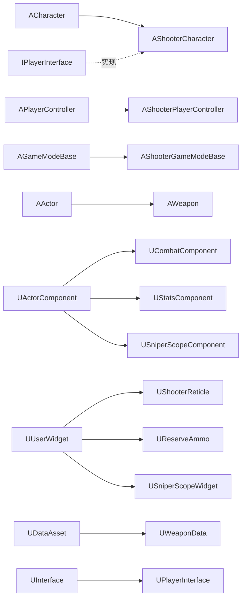

**Language / 语言：** [English](DOCUMENTATION.md) ｜ **中文**

---

# FPS 项目代码解释文档

> 对应工程：Unreal Engine 5.8 ｜ 模块 `FPS` ｜ 路径 `Source/FPS/`
> 本文只做**说明**，不修改任何代码。阅读顺序建议：第 2 节（全局结构）→ 第 5 节（接口）→ 第 6/7 节（核心两类）→ 其余按需查阅。
> 配套总览见 [README.zh-CN.md](<README.zh-CN.md>)。

---

## 目录

1. [文档说明与阅读顺序](#1-文档说明与阅读顺序)
2. [代码地图与数据流](#2-代码地图与数据流)
3. [模块与构建层](#3-模块与构建层)
4. [枚举、结构体与委托总表](#4-枚举结构体与委托总表)
5. [IPlayerInterface — 角色能力接口](#5-iplayerinterface--角色能力接口)
6. [AShooterCharacter — 玩家角色](#6-ashootercharacter--玩家角色)
7. [UCombatComponent — 战斗核心组件](#7-ucombatcomponent--战斗核心组件)
8. [AWeapon — 武器 Actor](#8-aweapon--武器-actor)
9. [UWeaponData — 武器数据资产](#9-uweapondata--武器数据资产)
10. [伤害与命中部位系统](#10-伤害与命中部位系统)
11. [UStatsComponent — 生命值组件](#11-ustatscomponent--生命值组件)
12. [AShooterPlayerController — 输入与移动](#12-ashooterplayercontroller--输入与移动)
13. [AShooterGameModeBase](#13-ashootergamemodebase)
14. [UShooterReticle — 动态准星](#14-ushooterreticle--动态准星)
15. [UReserveAmmo — 弹药 HUD](#15-ureserveammo--弹药-hud)
16. [狙击镜 — USniperScopeComponent / USniperScopeWidget](#16-狙击镜--usniperscopecomponent--usniperscopewidget)
17. [配置层](#17-配置层)
18. [端到端时序](#18-端到端时序)
19. [蓝图契约清单](#19-蓝图契约清单)
20. [注意事项、已知问题与扩展建议](#20-注意事项已知问题与扩展建议)

> **最新修订（后坐力 / 耐力 / 治疗 / 移动步态）：** 在原有章节内新增了子章节 —— `4.11`（后坐力结构体、新委托、`FPlayerAnim.Strafe_Walking`）、`6.5–6.7`（治疗、移动步态、移动相关钩子）、`7.7–7.9`（后坐力、开镜状态广播、BlendSpace 刷新）、`8.4–8.6`（后坐力属性、握持 Socket 重挂、治疗时隐藏武器）、`11.1`（耐力）、`12.1–12.2`（冲刺/静步速度模型、移动状态复制）、`19.1`（蓝图契约新增项）、`20.1.1`（新增已知问题）。

---

## 1. 文档说明与阅读顺序

| 章节 | 内容 | 适合谁 |
| --- | --- | --- |
| 3 | 模块、构建、Tag、Trace 通道 | 搭环境的人 |
| 4 | 所有枚举 / 结构体 / 委托 | 所有人（速查） |
| 5–8 | 接口、角色、战斗组件、武器 | 改玩法的人（核心） |
| 9 | 数据资产如何填 | 策划 / 装配资产的人 |
| 10–16 | 伤害、血量、输入、UI、狙击镜 | 按功能查 |
| 17–19 | 配置、时序、蓝图契约 | 联调排错的人 |
| 20 | 坑与待办 | 接手项目的人 |

符号约定：

- `◆` 表示该函数/成员被**蓝图**调用或影响蓝图。
- `⇄` 表示该函数参与**网络复制 / RPC**。
- `⚠` 表示已知问题或需要注意的坑。

---

## 2. 代码地图与数据流

### 2.1 类关系



### 2.2 所有权

```
BP_ShooterGameMode
└─ BP_ShooterCharacter (AShooterCharacter)
   ├─ SpringArm (USpringArmComponent)          // 臂长 0，仅用于相机延迟
   │  └─ FirstPersonCamera (UCameraComponent)
   │     └─ Mesh1P (USkeletalMeshComponent)    // 仅自己可见的手臂
   ├─ Mesh (ACharacter 自带 3P 身体)            // 别人看得到
   ├─ Combat (UCombatComponent, Replicated)
   │  └─ 运行时生成 → AWeapon × N（Inventory）
   │     ├─ Mesh1P（自己看的枪）
   │     └─ Mesh3P（别人看的枪）
   ├─ Stats (UStatsComponent, Replicated)
   └─ SniperScope (USniperScopeComponent, 运行时 NewObject 创建)
      ├─ Capture (USceneCaptureComponent2D)
      ├─ RenderTarget (UTextureRenderTarget2D)
      └─ Overlay (USniperScopeWidget，加入视口 ZOrder = -1)
```

### 2.3 一次开火的数据流（概览）

```
输入 IA_FireWeapon(Started)
 → AShooterCharacter::Input_FireWeapon_Pressed
 → UCombatComponent::Initiate_FireWeapon_Pressed   （记 bTriggerPressed，射速门控）
 → UCombatComponent::Local_FireWeapon
     ├─ 播 1P 开火 Montage
     ├─ AWeapon::WeaponTrace         （球形 Sweep，得到 FHitResult）
     ├─ AWeapon::Local_Fire          （→ 蓝图 FireEffect；本地预测扣弹匣）
     ├─ OnCurrentReserveAmmoChanged 广播（刷新 UI）
     ├─ 启动 FireTimer（射速 / 全自动循环）
     └─ Server_FireWeapon(Hit)  ⇄
          ├─ 射速节流校验
          ├─ 骨骼 → 部位 → 伤害倍率
          ├─ IPlayerInterface::Execute_DoDamage   （服务端扣血）
          ├─ AWeapon::Auth_Fire                   （权威扣弹匣）
          └─ Multicast_FireWeapon(Hit, AuthAmmo)  ⇄
               ├─ 本地：AWeapon::Rep_Fire(AuthAmmo) 校正
               └─ 远端：Local_Fire(FX, bFirstPerson=false) + 3P 开火 Montage
```

---

## 3. 模块与构建层

### 3.1 `Source/FPS/FPS.Build.cs`

| 项 | 值 | 说明 |
| --- | --- | --- |
| `PCHUsage` | `UseExplicitOrSharedPCHs` | 共享 PCH |
| `PublicDependencyModuleNames` | `Core`, `CoreUObject`, `Engine`, `InputCore`, `EnhancedInput`, `GameplayTags`, `PhysicsCore`, `UMG` | 缺 `PhysicsCore` 会导致 `EPhysicalSurface` 相关链接失败；缺 `GameplayTags` 会导致 `NativeGameplayTags.h` 找不到 |
| `PrivateDependencyModuleNames` | `Slate`, `SlateCore` | UMG 控件内部依赖 |

### 3.2 `Source/FPS/FPS.cpp` / `FPS.h`

- `IMPLEMENT_PRIMARY_GAME_MODULE(FDefaultGameModuleImpl, FPS, "FPS")`：把 `FPS` 声明为主游戏模块；`FPS.h` 只是 `CoreMinimal.h` + `FPSTraceChannels.h` 的汇总头。

### 3.3 `FPSTraceChannels.h`

```cpp
namespace FPSTraceChannels { constexpr ECollisionChannel ECC_Weapon = ECC_GameTraceChannel2; }
```

- **作用**：把"武器"通道起个别名，避免代码里到处出现 `ECC_GameTraceChannel2`。
- **效果**：与 [DefaultEngine.ini](<Config/DefaultEngine.ini>) 中 `+DefaultChannelResponses=(Channel=ECC_GameTraceChannel2,...,bTraceType=True,...,Name="Weapon")` 一一对应。**如果改通道顺序（例如在项目设置里新增/删除通道），必须同步改这里和 ini。**

### 3.4 `ShooterGamePlayTags.h` / `.cpp`

| 常量 | Tag | 用途 |
| --- | --- | --- |
| `Tag_WeaponType_None` | `Weapon.type.none` | 未指定类型 |
| `Tag_WeaponType_Rifle` | `Weapon.type.rifle` | 步枪（长枪） |
| `Tag_WeaponType_Pistol` | `Weapon.type.pistol` | 手枪 |
| `Tag_WeaponType_Sniper` | `Weapon.type.sniper` | 狙击枪（**狙击镜只在这把枪上激活**） |
| `Tag_WeaponType_Melee` | `Weapon.type.melee` | 近战 |

- 用原生 Tag（`UE_DECLARE/DEFINE_GAMEPLAY_TAG_EXTERN`），因此无需在 ini 里再注册。
- **效果**：`AWeapon::WeaponType` 与 `UWeaponData` 的各个 `TMap<FGameplayTag, …>` 以这些 Tag 为键；`USniperScopeComponent::UpdateView` 用 `MatchesTagExact(Tag_WeaponType_Sniper)` 判断是否开镜。

### 3.5 目标文件

| 文件 | 内容 |
| --- | --- |
| [FPS.Target.cs](<Source/FPS.Target.cs>) | `Type = Game`，`BuildSettingsVersion.V7`，模块 `FPS` |
| [FPSEditor.Target.cs](<Source/FPSEditor.Target.cs>) | `Type = Editor`，同上 |

---

## 4. 枚举、结构体与委托总表

### 4.1 `EWeaponKind`（Weapon.h）— 决定槽位归属

| 值 | 显示名 | 说明 |
| --- | --- | --- |
| `LongGun` | Long Gun | 只有长枪能进"主武器 / 副武器"槽 |
| `Pistol` | Pistol | 手枪槽 |
| `Melee` | Knife | 近战槽；近战不参与"瞄准隐藏准星"逻辑，也不要求 `AimSocket` |

### 4.2 `EFireType`（Weapon.h）

| 值 | 效果 |
| --- | --- |
| `Single` | 松开扳机前不会自动连发；`FireTimerFinished` 里不会再次调用 `Local_FireWeapon` |
| `Automatic` | 只要 `bTriggerPressed == true` 且弹匣 > 0，`FireTimerFinished` 就继续开火 |

### 4.3 `EWeaponStatus`（Weapon.h）— 状态机

| 值 | 何时进入 | 何时离开 | 影响 |
| --- | --- | --- | --- |
| `Idle` | 初始装备、Montage 结束 | — | 可开火 / 换弹 / 切枪 |
| `Firing` | ⚠ **当前没有任何代码写入** | — | 保留位 |
| `Reloading` | `Initiate_ReloadWeapon`、`Server_ReloadWeapon` | `OnReloadMontageEnded`、`Client_ReloadWeapon`、`Server_EndReload`、`Notify_ReloadWeapon` | 阻止开火、切枪、重复换弹 |
| `Cycling` | 播放切枪 Montage 时 | `OnEquipMontageEnded` | 阻止换弹与再次切枪 |
| `UnEquipped` | 构造、`Equip` 换下旧枪、`OnRep_Instigator` 未装备时 | 被 `Equip` 时 | 配合 `SetActorHiddenInGame(true)` 隐藏枪 |

### 4.4 `EWeaponSlot`（CombatComponent.h）

| 值 | 映射规则（`FindWeaponForSlot`） |
| --- | --- |
| `Main` | 第 1 把 `EWeaponKind::LongGun` |
| `Secondary` | 第 2 把 `LongGun` |
| `Pistol` | 第 1 把 `Pistol` |
| `Melee` | 第 1 把 `Melee` |

### 4.5 `ETurningInPlace`（ShooterType.h）

`Left` / `Right` / `NotTurning` — 由 `AShooterCharacter::TurnInPlace` 计算，供 3P 动画蓝图播放"原地转身"动画。

### 4.6 `EHitZone`（ShooterType.h）

`Head` / `Torso` / `Limb` — 伤害倍率判定结果。

### 4.7 `EDeathState`（StatsComponent.h）

`NotDead` / `DeadStart` / `DeadFinished` — ⚠ 目前只用到 `NotDead`，死亡状态机未实现。

### 4.8 `FPlayerAnim`（WeaponData.h）— 注入动画蓝图的结构体

| 字段 | 类型 | 用途 |
| --- | --- | --- |
| `IdleAnim` | `UAnimSequence*` | 站立待机 |
| `AimIdleAnim` | `UAnimSequence*` | 瞄准待机 |
| `CrouchIdleAnim` | `UAnimSequence*` | 蹲伏待机 |
| `SprintAnim` | `UAnimSequence*` | 冲刺 |
| `AimOffset_Hip` | `UBlendSpace*` | 腰射 AimOffset |
| `AimOffset_Aim` | `UBlendSpace*` | 瞄准 AimOffset |
| `Strafe_Standing` | `UBlendSpace*` | 站立移动混合 |
| `Strafe_Crouching` | `UBlendSpace*` | 蹲伏移动混合 |

**效果**：`UCombatComponent::ApplyEquippedWeaponAnim` 会把整个结构体**逐字节复制**进 ABP 的同名结构体变量，从而让换枪时动画资产随之切换。

### 4.9 `FMontageData`（WeaponData.h）

| 字段 | 用途 |
| --- | --- |
| `EquipMontage` | 切枪动画 |
| `ReloadMontage` | 换弹动画 |
| `FireMontage` | 开火动画 |

同一结构体被复用在三个表里：`WeaponMontages`（**武器自身骨骼网格体**上的动画，如换弹时弹匣运动）、`FirstPersonMontages`、`ThirdPersonMontages`。

### 4.10 委托（Delegates）

| 委托 | 声明处 | 参数 | 触发时机 | 用途 |
| --- | --- | --- | --- | --- |
| `FWeaponFirstReplicated` | ShooterCharacter.h | `AWeapon*` | 第一把武器**首次复制到客户端**成功时，仅广播一次 | 让 HUD 在武器就绪后再取准星材质 |
| `FReticleChanged` | CombatComponent.h | `UMaterialInstanceDynamic*` | `InitializeWeaponWidget` / 换枪 | 准星控件更换材质 |
| `FCurrentReserveAmmoChanged` | CombatComponent.h | `int32 RoundsInServe, int32 RoundsInWeapon, UTexture2D*` | 装备、开火、换弹、`OnRep_CurrentReserveAmmo` | 刷新弹药文字与武器图标 |
| `FHealthChanged` | StatsComponent.h | `UStatsComponent*, float Old, float New, AActor* Instigator` | 血量 / 上限变化 | 血条 UI、死亡判断 |

---

### 4.11 后坐力结构体、新增委托与 `FPlayerAnim` 新增字段

| 类型 | 声明处 | 作用 |
| --- | --- | --- |
| `FRecoilStep` | Weapon.h | 单发子弹的视角偏移（度）：`Pitch`（向上为正、向下为负）、`Yaw`（向右为正、向左为负）。提供默认构造与 `(Pitch, Yaw)` 便捷构造 |
| `FRecoilScale` | RecoilModifierInterface.h | 叠加在武器固有后坐力上的倍率：`Pitch`、`Yaw`、`Recovery`，默认都是 `1`（不改变） |
| `IRecoilModifier` / `URecoilModifier` | RecoilModifierInterface.h | 只有一个函数 `GetAttachmentRecoilScale()` 的 `BlueprintNativeEvent` 接口。实现在**武器本身，或武器/角色身上的任意组件**（握把、枪口补偿器、枪托、天赋组件……）即可修正后坐力 |
| `FPlayerAnim::Strafe_Walking` | WeaponData.h | 慢走速度下使用的 `UBlendSpace*`；慢走步态激活时会被复制覆盖 `Strafe_Standing`（见 6.6、7.9） |

新增委托：

| 委托 | 声明处 | 类型 | 触发时机 | 使用方 |
| --- | --- | --- | --- | --- |
| `FAimStateChanged` | CombatComponent.h | 普通 C++ 多播（`DECLARE_MULTICAST_DELEGATE_OneParam`，`bool`），**不是**蓝图委托 | `Local_Aim` 真正改变了 `bAiming` 时 | `AShooterCharacter::HandleAimStateChanged`（蓝图 `OnAim`、移动速度、步态） |
| `FStaminaChanged` | StatsComponent.h | 动态多播（组件、旧值、新值） | 耐力或耐力上限变化 | 耐力条（`WB_Stamina`） |
| `FStaminaDepleted` | StatsComponent.h | 动态多播，无参数 | 服务器在冲刺中把最后一点耐力耗尽 | `AShooterPlayerController::HandleStaminaDepleted` |

> `EDeathState` 现在会被**读取**（`HealPlayer` 与 `Server_BeginHeal` 拒绝治疗死亡或满血的角色），但仍然从未被写入，因此永远停留在 `NotDead` —— 见 20.1。

---

## 5. IPlayerInterface — 角色能力接口

**位置**：[PlayerInterface.h](<Source/FPS/Public/Interface/PlayerInterface.h>)（`.cpp` 为空，注释说"不需要修改"）

**为什么存在**：`AWeapon`（武器）需要反向操作持有者（取挂点、取 1P/3P 网格体、造成伤害），但武器不应该 `Cast<AShooterCharacter>`。用 `BlueprintNativeEvent` 接口后，**武器只依赖接口**，任何蓝图角色只要实现这些事件就能直接复用整套武器逻辑。

所有函数均为 `BlueprintNativeEvent + BlueprintCallable`，C++ 侧调用必须用 `IPlayerInterface::Execute_Xxx(Object, ...)` 形式。

| 函数 | 签名 | 作用 | 谁在调用 |
| --- | --- | --- | --- |
| ◆`GetWeaponAttachPoint` | `FName(const FGameplayTag& WeaponTag) const` | 按武器类型返回角色身上的挂点 Socket 名 | `AWeapon::AttachToOwingPawn` |
| ◆`GetMesh1P` | `USkeletalMeshComponent*() const` | 返回第一人称（手臂）网格体 | `AWeapon::AttachToOwingPawn`、`UCombatComponent::ApplyEquippedWeaponAnim/PlayEquipMontage/GetReloadMontage/Local_FireWeapon` |
| ◆`GetMesh3P` | `USkeletalMeshComponent*() const` | 返回第三人称（身体）网格体 | 同上（3P 分支）、`Multicast_FireWeapon` |
| ◆`WeaponReplicated` | `void()` | 通知"武器已复制到客户端" | `UCombatComponent::SpawnInventory`、`OnRep_CurrentWeapon` |
| ◆`GetCurrentWeapon` | `AWeapon*()` | 取当前武器 | `UShooterReticle::NativeOnInitialized` |
| ◆`GetReserveAmmo` | `int32() const` | 取当前备弹 | 供蓝图 / UI 查询 |
| ◆`Notify_ReloadWeapon` | `void()` | 动画通知调用：权威侧填弹并回传客户端 | 蓝图换弹动画的 AnimNotify |
| ◆`DoDamage` | `bool(float DamageAmout, AActor* DamageInstigator)` | 对"实现了该接口的 Actor"造成伤害 | `UCombatComponent::Server_FireWeapon` |

**实现者**：仅 `AShooterCharacter`（第 6 节）。

---

## 6. AShooterCharacter — 玩家角色

**位置**：[ShooterCharacter.h](<Source/FPS/Public/ShooterCharacter.h>) / [ShooterCharacter.cpp](<Source/FPS/Private/ShooterCharacter.cpp>)
**继承**：`ACharacter` + `IPlayerInterface`

### 6.1 组件与默认值（构造函数）

| 成员 | 类型 | 设置 | 效果 |
| --- | --- | --- | --- |
| `SpringArm` | `USpringArmComponent` | 挂根组件；`TargetArmLength = 0`；`bEnableCameraLag = true`；`CameraLagSpeed = 15`；`bUsePawnControlRotation = true` | 相机不自己处理旋转，而是用 SpringArm 的**相机延迟**做出准星跟随的顺滑感；臂长 0 表示相机就在角色头部位置 |
| `FirstPersonCamera` | `UCameraComponent` | 挂 `SpringArm`；`bUsePawnControlRotation = false` | 随控制旋转（由 SpringArm 转发），FOV 在 `BeginPlay` 设为 `DefaultFOV = 90` |
| `Mesh1P` | `USkeletalMeshComponent` | 挂 `FirstPersonCamera`；`bOnlyOwnerSee = true`；`bCastDynamicShadow = false`；`bReceivesDecals = false`；`VisibilityBasedAnimTickOption = OnlyTickPoseWhenRendered`；TickGroup = `TG_PrePhysics`；`AllowPrivateAccess` | 只有本地玩家看得到的手臂；不投影、不接收贴花，省性能；`TG_PrePhysics` + 后面的 Tick 前置依赖保证"手臂先动、瞄准对齐后算" |
| `GetMesh()`（3P 身体） | `USkeletalMeshComponent` | `bOnlyOwnerSee = false`；`bOwnerNoSee = true`；`bReceivesDecals = false` | 自己看不到自己的身体，别人能看到 |
| `Combat` | `UCombatComponent` | `SetIsReplicated(true)` | 战斗核心（详见第 7 节） |
| `Stats` | `UStatsComponent` | `SetIsReplicated(true)` | 生命值（第 11 节） |
| `DefaultFOV` | `float` | `90.f`（`EditDefaultsOnly`） | 腰射 FOV，也是狙击镜激活时强制恢复的 FOV |
| `TurningStatus` | `ETurningInPlace` | `NotTurning` | 交给 ABP |
| `bWeaponFirstReplicated` | `bool` | `false` | 只允许 `OnWeaponFirstReplicated` 广播一次 |
| — | — | 调 `ConfigureWeaponHitCollision()` | 见 6.3 |

### 6.2 生命周期函数

| 函数 | 作用与效果 |
| --- | --- |
| `BeginPlay()` | ① 非专用服务器且没有 `USniperScopeComponent` 时用 `NewObject` + `RegisterComponent` **动态创建狙击镜组件**（所以蓝图里不需要手动挂）；② `Super::BeginPlay()`；③ **再次**调用 `ConfigureWeaponHitCollision()`（注释说明蓝图会在构造之后覆盖碰撞设置）；④ 相机 FOV 设为 `DefaultFOV`；⑤ 记录 `StartingAimRotation`（初始 Yaw）；⑥ 缓存 `Mesh1P` 的初始相对位置/旋转到 `AuthoredHipMeshLocation/Rotation`；⑦ `ConfigureAimTickOrder()` |
| `BeginDestroy()` | 调用 `Combat->DestroyInventory()`，角色销毁时一并销毁所有武器 Actor，避免残留 |
| `Tick(DeltaTime)` | 每帧：`CalculateTurnInPlaceParameters` → `CalculateFABRIKSocket` → `UpdateAimSocketAlignment` → 若存在狙击镜组件则 `Scope->UpdateView()`。**顺序有含义**：先算转身参数，再算 IK 挂点，最后做 ADS 对齐 |
| `PossessedBy(NewController)` | `Super::` 之后调用 `Combat->SpawnInventory()` —— 只有被控制时（服务端）才生成武器库存 |
| `OnRep_PlayerState()` | 客户端 `PlayerState` 复制完成时调 `Combat->InitializeWeaponWidget()`，把准星材质与弹药刷到 HUD 上 |

### 6.3 逐函数详解

#### `ConfigureWeaponHitCollision()`（private）

| 对象 | 设置 | 为什么 |
| --- | --- | --- |
| `GetCapsuleComponent()` | 对 `ECC_Weapon` 通道 `ECR_Ignore` | 胶囊体没有骨骼，若被命中则 `Hit.BoneName` 为空，无法判断部位 |
| `GetMesh()`（3P 身体） | `SetCollisionEnabled(QueryOnly)` + 对 `ECC_Weapon` 通道 `ECR_Block` | 让子弹打到**有骨骼的身体网格**，从而拿到骨头名做爆头判定 |
| `Mesh1P` | `NoCollision` | 自己的手臂不参与判定 |

#### `GetFixedAimRotation() const` ◆

```
FRotator AimRotation = GetBaseAimRotation();
if (AimRotation.Pitch > 90 && !IsLocallyControlled())
    Pitch = MapRangeClamped(Pitch, [270,360) → [-90,0])
```
- **作用**：修正**远端角色**的俯仰角表示。网络压缩后的 Pitch 会落在 `[270,360)`，映射到 `[-90,0]` 才能给动画蓝图/瞄具使用。
- **效果**：远端玩家的瞄准方向不翻转。本地玩家不受影响（本地已是标准 `[-90,90]`）。
- ◆ `BlueprintCallable`，主要给 ABP / 蓝图计算用。

#### `HasCurrentWeapon() const` ◆
- 返回 `Combat` 有效且 `Combat->CurrentWeapon != nullptr`。用于蓝图/HUD 判断"是否已持有武器"。

#### `CalculateTurnInPlaceParameters(float DeltaTime)`（private）

```
速度(去掉 Z) == 0 且未下落：
    AO_Yaw = NormalizedDeltaRotator(当前 Yaw, StartingAimRotation).Yaw
    if TurningStatus == NotTurning: InterpAO_Yaw = AO_Yaw
    TurnInPlace(DeltaTime)
速度 > 0 或在下落：
    StartingAimRotation = 当前 Yaw
    AO_Yaw = 0
    MovementOffsetYaw = NormalizedDeltaRotator(移动朝向, 瞄准朝向).Yaw
    TurningStatus = NotTurning
最后 AO_Yaw *= -1
```
- **输出**（全部 `BlueprintReadOnly`，供 ABP 读取）：
  - `AO_Yaw`：身体与瞄准方向的偏航差（换向取负，匹配骨骼朝向约定）→ 用于**原地转身动画**与 AimOffset。
  - `MovementOffsetYaw`：移动方向相对瞄准方向的角度 → 用于**八向移动 / 步态混合**。
  - `TurningStatus`：转身状态。
- **效果**：站立不动时角色可以"上半身转身"，一旦开始移动就重置基准角。

#### `TurnInPlace(float DeltaTime)`（private）

- `AO_Yaw > 90` → `Right`；`AO_Yaw < -90` → `Left`。
- 进入转身状态后：`InterpAO_Yaw = FInterpTo(InterpAO_Yaw, 0, DeltaTime, 4.0)`，并把 `AO_Yaw` 拉向 0（转身动画会把角度"消化"掉）。
- 当 `|AO_Yaw| < 5` 时结束转身，并把 `StartingAimRotation` 重置为当前 Yaw。
- **效果**：转身动画播完后状态自动回到 `NotTurning`，不会卡死。

#### `CalculateFABRIKSocket()`（private）◆

1. 无武器直接返回。
2. 取武器的 `Mesh3P`；若其没有名为 `FABRIK` 的 Socket，则把 `FABRIK_SocketTransform` 设为 `Identity` 并返回。
3. **`WeaponMesh->RefreshBoneTransforms()`** —— 关键：**隐藏的第三人称枪不会 Tick 动画**，不强制刷新会读到旧姿态。
4. 取 `FABRIK` Socket 的世界变换 → 用 `GetMesh()->TransformToBoneSpace("hand_r", ...)` 换算到 3P 身体 `hand_r` 骨骼空间。
5. 写入 `FABRIK_SocketTransform`（位置 + 旋转，缩放固定为 1）。

- **效果**：ABP_ThirdPerson 用这个变换做 **FABRIK IK**，让左手正确握住护木/枪身。

#### `ConfigureAimTickOrder()`（private）

- `PrimaryActorTick.AddPrerequisite(Mesh1P, Mesh1P->PrimaryComponentTick)`。
- **效果**：角色 Tick（内含 ADS 对齐计算）**晚于** `Mesh1P` 的动画 Tick 执行，保证读到的手臂骨骼姿态是本帧最新的。

#### `GetAimTimelineAlpha(float)`（private）⚠

- 目前仅 `return AimAlignAlpha;`（`AimAlignAlpha` 恒为 0，`AimTimeline` 从未被赋值、该函数也无人调用）。
- 结论：这是**遗留/未接线**的接口，时间轴驱动的 ADS 已被下面的蓝图变量方案取代。

#### `UpdateAimSocketAlignment(float)`（private）◆ — ADS 瞄具对齐

执行条件（任一不满足即返回）：本地控制、`Mesh1P`/`FirstPersonCamera`/`Combat` 有效。

1. 用模板函数 `FindBlueprintStruct<FVector>(this, "AdsMesh1PLoc")` 在**角色蓝图**里按名字找 `FVector` 属性；找不到就整个跳过（所以蓝图中必须有这个变量）。
2. 取当前武器的 `Mesh1P`，必须存在且**已挂在 `Mesh1P`（手臂）下**。
3. 若武器没有 `AimSocket`：对非近战武器**只打一次 Warn 日志**（用 `MissingAimSocketWeapon` 记录，避免每帧刷屏），然后保持蓝图给定位置，返回。
4. 计算：
   - `SocketWorld`：瞄具 Socket 的世界位置；
   - 把它转到相机空间 `SocketCamera`；
   - 目标位置 `DesiredWorld` = 相机空间中 **X 不变、Y/Z 归零**（即把瞄具拉到视线轴上）；
   - 差值转换到 `Mesh1P` 父空间 `DeltaParent`；
   - `CenteredLocation = Mesh1P->GetRelativeLocation() + DeltaParent`；
   - 含 NaN 则放弃本次写入。
5. `*AdsLocationProperty = CenteredLocation;` —— **直接写角色蓝图变量 `AdsMesh1PLoc`**。

- **效果**：蓝图里用 `AdsMesh1PLoc` 驱动 `Mesh1P` 的 ADS 位置，从而"枪的瞄具自动对准屏幕中心"；吸附强度由蓝图的时间轴/插值决定，C++ 只负责算目标值。
- ⚠ 该函数只处理位置，不处理旋转（注释明确说明蓝图不应用旋转变量，`Mesh1P` 保持组件旋转，Yaw −90 相对相机）。

#### `SetupPlayerInputComponent(UInputComponent*)` ◆

用 `CastChecked<UEnhancedInputComponent>`（不匹配会断言）绑定 9 个动作：

| 输入动作 | 触发事件 | 回调 | 效果 |
| --- | --- | --- | --- |
| `CycleWeaponAction` | `Started` | `Input_CycleWeapon` | 循环切枪 |
| `FireWeaponAction` | `Started` | `Input_FireWeapon_Pressed` | 按下开火 |
| `FireWeaponAction` | `Completed` | `Input_FireWeapon_Released` | 松开停火（全自动） |
| `AimWeaponAction` | `Started` | `Input_Aim_Pressed` | 切换 ADS + 蓝图事件 `OnAim` |
| `ReloadWeaponAction` | `Started` | `Input_ReloadWeapon` | 换弹 |
| `EquipMainWeaponAction` | `Started` | `Input_EquipMainWeapon` | 主武器 |
| `EquipSeconedaryWeaponAction` | `Started` | `Input_EquipSeconedaryWeapon` | 副武器（**原代码拼写为 Seconedary，勿改**） |
| `EquipMeleeWeaponAction` | `Started` | `Input_EquipMeleeWeapon` | 近战 |
| `EquipPistolWeaponAction` | `Started` | `Input_EquipPistolWeapon` | 手枪 |

#### 输入回调（private）

| 函数 | 行为 |
| --- | --- |
| `Input_CycleWeapon` | `Combat->Initiate_CycleWeapon()` |
| `Input_ReloadWeapon` | `Combat->Initiate_ReloadWeapon()` |
| `Input_FireWeapon_Pressed` | `Combat->Initiate_FireWeapon_Pressed()` |
| `Input_FireWeapon_Released` | `Combat->Initiate_FireWeapon_Released()` |
| `Input_Aim_Pressed` | `Combat->Initiate_Aim_Pressed()`，然后调用蓝图事件 **`OnAim(Combat->bAiming)`**（`BlueprintImplementableEvent`，供蓝图做 FOV / 后坐力 / 音效） |
| `Input_EquipXxx` | 转发到同名的公开 `EquipXxx()` |

所有回调都有 `IsValid(Combat)` 保护。

#### 公开装备函数（public，◆ `BlueprintCallable`）

`EquipMainWeapon() / EquipSeconedaryWeapon() / EquipMeleeWeapon() / EquipPistolWeapon()`
- 都只是 `Combat->Initiate_EquipXxx()` 的包装。
- **效果**：蓝图（例如背包 UI、拾取提示）可以直接调用它们切枪，而不必模拟按键。

#### IPlayerInterface 实现

| 函数 | 行为细节 |
| --- | --- |
| `GetWeaponAttachPoint_Implementation(Tag)` | `checkf(Combat)`、`checkf(Combat->WeaponData)` 强校验 → 在 `WeaponData->GripPoints` 里查 Tag；查不到打 Warn 并回退 `"RifleSocket"` |
| `GetMesh1P_Implementation()` | 返回 `Mesh1P` |
| `GetMesh3P_Implementation()` | 返回 `GetMesh()` |
| `WeaponReplicated_Implementation()` | 首次调用置 `bWeaponFirstReplicated = true` 并广播 `OnWeaponFirstReplicated`（HUD 用） |
| `GetCurrentWeapon_Implementation()` | `Combat->CurrentWeapon` |
| `GetReserveAmmo_Implementation()` | `Combat->CurrentReserveAmmo` |
| `Notify_ReloadWeapon_Implementation()` | `Combat->Notify_ReloadWeapon()`（权威侧瞬时填弹 + 回传客户端） |
| `DoDamage_Implementation(DamageAmount, Instigator)` | 扣血 `Stats->ChangeHealthByAmout(-DamageAmount, Instigator)`；随机抽一个 `HitReacts` 下标并 `Multicast_HitReact`；**恒返回 false**（⚠ 返回值语义未使用；`HitReacts` 为空会越界） |

#### `Multicast_HitReact_Implementation(int32 MontageIndex)` ⇄

- 条件：非专用服务器（`GetNetMode() != NM_DedicatedServer`）**且**非本地控制 → 说明是"别人"的客户端。
- 在 3P 身体网格体的 `AnimInstance` 上 `Montage_Play(HitReacts[MontageIndex])`。
- **效果**：自己中弹时不播（避免第一人称看到第三人称受击动画），其他玩家能看到受击反应。

### 6.4 暴露给蓝图的关键成员

| 成员 | 说明 |
| --- | --- |
| ◆`OnWeaponFirstReplicated` | `BlueprintAssignable`，武器首次复制完成 |
| ◆`HitReacts` | `TArray<UAnimMontage*>`，`EditDefaultsOnly`，受击动画池 |
| ◆`FABRIK_SocketTransform` | `BlueprintReadOnly`，IK 目标 |
| ◆`AO_Yaw` / `MovementOffsetYaw` / `TurningStatus` | `BlueprintReadOnly`，动画参数 |
| ◆`OnAim(bool)` | `BlueprintImplementableEvent`，ADS 状态回调 |
| `GetFirstPersonCamera()` / `GetCombatComponent()` / `GetDefaultFieldOfView()` | C++ 访问器（`SniperScopeComponent` 使用） |

---

### 6.5 治疗

设计思路：**动画决定"什么时候"加血，服务器决定"加多少"**。

| 函数 | 行为与效果 |
| --- | --- |
| ◆`HealPlayer(float InHealAmout)`（public，`BlueprintCallable`） | 客户端入口。守卫条件：本地控制、未在治疗、治疗量 > 0、`Stats` 有效、`Stats->DeathState == NotDead`、`Health < MaxHealth`、当前武器不在 `Reloading`/`Cycling`。通过后记录 `PendingHealAmout`，播放 Montage（先试 `Mesh1P`，失败再试 3P 身体网格），两个网格都播不了就打印 Warning；设置 `bIsHealing = true`，用 `HealMontage->GetPlayLength() + 2.f` 给 `HealLocalTimer` 上一个**超时兜底**（即使动画通知永远不触发也不会把角色锁死），最后 `Server_BeginHeal(PendingHealAmout)` |
| `PlayHealMontage(USkeletalMeshComponent* HealMesh, bool bBindEnd)`（private） | 在指定网格上 `Montage_Play`；调用 `HideEquippedWeaponForHeal()` 隐藏武器；当 `bBindEnd` 为真**或**当前是旁观代理时绑定 `OnHealMontageEnded`（保证远端玩家的枪在 3P 动画结束后会恢复） |
| `HideEquippedWeaponForHeal()` / `RestoreWeaponAfterHeal()`（private） | 把当前武器记到 `HealHiddenWeapon`，并调用 `AWeapon::SetHiddenForHeal(true/false)`（见 8.6） |
| ◆`Notify_HealPlayer()`（public，`BlueprintCallable`） | 动画通知入口。仅本地控制者执行：清 `bIsHealing`、清超时定时器、`Server_FinishHeal(true)` |
| `OnHealMontageEnded(UAnimMontage*, bool bInterrupted)`（private） | 先恢复武器；旁观代理只清 `bIsHealing`；对拥有者来说，被打断则放弃治疗（`Server_FinishHeal(false)`），正常结束则转调 `Notify_HealPlayer()` —— 因此**没有放通知的 Montage 也会在结束时结算一次** |
| `AbortLocalHeal()` / `AbortServerHeal()`（private） | 超时回调，复位治疗标记并恢复武器 |
| `Server_BeginHeal_Implementation(float InHealAmout)` ⇄ | 仅权威。已在治疗、治疗量 ≤ 0、`HealAmout <= 0`、已死亡或满血时直接拒绝。**把请求量钳制到服务器自己的值**（`ServerHealAmout = min(InHealAmout, HealAmout)`），客户端无法要求更大的治疗量；设置 `HealServerTimer`（Montage 时长 + 2 秒）并 `Multicast_PlayHealMontage()` |
| `Server_FinishHeal_Implementation(bool bCompleted)` ⇄ | 仅权威。不在治疗状态直接忽略；清超时定时器；**只有 `bCompleted` 为真**才执行 `Stats->ChangeHealthByAmout(ServerHealAmout, this)`。由于会先清掉 `bServerHealing`，动画通知与 Montage 结束回调的"双重提交"最多只生效一次 |
| `Multicast_PlayHealMontage_Implementation()` ⇄ | 跳过本地控制的拥有者与专用服务器；其他客户端播放 3P 治疗 Montage（`bBindEnd = false`，代理的结束委托在 `PlayHealMontage` 内部绑定） |

数据成员：`HealMontage`（`EditDefaultsOnly`，本工程指向 `AnimMontage_Arms_Healing`）、`HealAmout`（构造函数中默认 `30`），以及 `bIsHealing`、`bServerHealing`、`PendingHealAmout`、`ServerHealAmout`、`HealLocalTimer`（客户端）、`HealServerTimer`（服务器）。

注意：

- 输入链路：`IA_Heal` → `Input_Heal()` → `HealPlayer(HealAmout)`。
- 治疗量不会按缺失血量缩放；`ChangeHealthByAmout` 会 `Clamp` 到 `MaxHealth`，因此不会溢出，但"消耗"量永远是固定值。
- ⚠ `PlayHealMontage(Mesh1P, true) || PlayHealMontage(GetMesh(), true)` 是短路求值：只有第一个成功的网格会播动画。
- ⚠ 动画通知与 Montage 结束两条路径都会提交；服务器的守卫让它安全，但不要再增加第三个**服务端**入口。
- 治疗不受移动或受伤打断：动画期间被打中不会中止。

### 6.6 移动步态、地面速度与播放速率

新增 `BlueprintPure` 取值函数：`GetGroundSpeed()`、`IsUsingWalkGait()`、`GetLocomotionPlayRate()`。

| 函数 | 行为与效果 |
| --- | --- |
| `RefreshLocomotionGait()`（public） | `UpdateLocomotionGait(true)` 的包装。控制器改完 `MaxWalkSpeed` 后调用，`OnStartCrouch` / `OnEndCrouch` 也会调用 |
| `UpdateLocomotionGait(bool bNotifyCombat)`（private） | **每帧**执行，产出下面三个移动相关数值 |

`UpdateLocomotionGait` 细节：

1. `GroundSpeed` = 去掉 Z 之后的水平速度大小。
2. `MaxSpeed` = 蹲下时取 `MaxWalkSpeedCrouched`，否则取 `MaxWalkSpeed`。注意这是**允许的最大速度**，不是 `Velocity / MaxWalkSpeed` 的归一化。
3. `bWantWalkGait = MaxSpeed > 0 && MaxSpeed <= WalkGaitSpeedThreshold`（默认 `360`）。
4. `bHasWalkBS = Combat->HasStrafeWalkingAnim()`；`bNewWalkGait = bWantWalkGait && bHasWalkBS` —— 只有 `DA_WeaponData` 真的填了 Walk BlendSpace 才会切换步态。
5. 参考速度取决于**当前真正在播**的 BlendSpace：蹲下用 `CrouchAnimReferenceSpeed`（`150`），慢走步态用 `WalkAnimReferenceSpeed`（`150`），否则用 `JogAnimReferenceSpeed`（`375`）。
6. `LocomotionPlayRate = Clamp(GroundSpeed / RefSpeed, MinLocomotionPlayRate(0.15), MaxLocomotionPlayRate(2.0))`；当 `GroundSpeed <= 1` 时直接给 `0`（待机时冻结脚步）。
7. 把数值**按变量名**写进**两个** AnimInstance（`Mesh1P` 与 3P 身体），并且容忍多种拼写：`bUseWalkGait`（bool），以及 `LocomotionPlayRate` / `PlayRate` / `BS_PlayRate`，还有 `GroundSpeed` / `Speed`（float）。变量不存在时静默跳过。
8. 步态发生变化且 `bNotifyCombat` 为真时，调用 `Combat->RefreshLocomotionBlendSpaces(bUseWalkGait)`，让 ABP 里的 `FPlayerAnim` 副本把 `Strafe_Standing` 换成 `Strafe_Walking`。

效果：慢速移动（静步 / 开镜）不再以 1 倍速播放跑步循环，动画步频随实际地面速度变化 —— 这正是消除滑步与"小碎步"的关键。

⚠ 蓝图契约：ABP 至少要暴露上述别名之一。本工程 3P ABP 里有 `bUseWalkGait`、`LocomotionPlayRate`、`GroundSpeed`；1P ABP 里有 `PlayRate`。

### 6.7 移动相关钩子（下蹲、跳跃耐力、开镜状态）

| 重写 / 函数 | 行为 |
| --- | --- |
| `CanJumpInternal_Implementation() const` | `Super::` **且**（`Stats` 无效或 `Stats->HasStaminaForJump()`）。客户端用同步过来的耐力做预测，服务器做最终判定 |
| `OnJumped_Implementation()` | `Super::` 之后扣 `Stats->JumpStaminaCost`（默认 `15`），**只在权威端扣** —— `OnJumped` 在预测客户端和服务器上都会调用，无条件扣会扣两次 |
| `OnStartCrouch(...)` / `OnEndCrouch(...)` | `Super::`，然后 `RefreshControllerMovementSpeed()` + `RefreshLocomotionGait()`；服务器与本地客户端都会执行，保证下蹲后速度/步态立刻重算 |
| `HandleAimStateChanged(bool bIsAiming)`（private，`BeginPlay` 中绑定到 `Combat->OnAimStateChanged`） | **仅在本地控制时**调用蓝图事件 `OnAim(bIsAiming)`；并且总是调用 `RefreshControllerMovementSpeed()` + `RefreshLocomotionGait()` —— 服务器也需要新速度，否则会把客户端拉回旧速度 |
| `RefreshControllerMovementSpeed()`（private） | `Cast<AShooterPlayerController>(GetController())->RefreshMovementSpeed()`。模拟代理（别人电脑上的你）没有本地控制器，直接跳过 |
| `Input_Aim_Pressed()` | 不再直接调 `OnAim` —— 开镜状态统一由 `UCombatComponent::Local_Aim` 通过 `OnAimStateChanged` 广播（见 7.8） |
| ⚠`Input_VersionWeapon()` | 空函数，且 `SetupInputComponent` 里**没有绑定**（`VersionWeaponAction` 声明了但没用）—— 占位死代码 |

---

## 7. UCombatComponent — 战斗核心组件

**位置**：[CombatComponent.h](<Source/FPS/Public/CombatComponent.h>) / [CombatComponent.cpp](<Source/FPS/Private/CombatComponent.cpp>)
**定位**：把"库存 / 装备 / 开火 / 换弹 / 瞄准 / 弹药"全部集中在一个可复制组件里，角色只做输入转发。

### 7.1 关键成员

| 成员 | 复制方式 | 说明 |
| --- | --- | --- |
| `WeaponData` | `EditDefaultsOnly`（不复制） | 指向 `DA_WeaponData`，**所有武器都要配** |
| `DefaultWeaponClass` | `EditDefaultsOnly` | 出生时生成的武器类列表 |
| `TraceLength` | `EditDefaultsOnly`，默认 `20000` | 命中检测长度（cm） |
| `Inventory` | `Replicated`（`TArray<AWeapon*>`，`Transient`） | 生成的武器实例 |
| `CurrentWeapon` | `ReplicatedUsing = OnRep_CurrentWeapon` | 当前武器 |
| `bAiming` | `Replicated` + `COND_SkipOwner` | 瞄准开关；Owner 本地已预测，无需回传 |
| `CurrentReserveAmmo` | `ReplicatedUsing = OnRep_CurrentReserveAmmo` + `COND_OwnerOnly` | 当前武器备弹 |
| `ReserveAmmo` | 不复制（`TMap<FGameplayTag,int32>`） | **每把武器各自的备弹池**，服务端权威 |
| `bTriggerPressed` | 不复制 | 本地扳机状态，决定全自动持续 |
| `FireTimer` / `ServerNextFireTime` | 不复制 | 射速节流 |
| `LocalWeaponIndex` | 不复制 | 本地循环切枪下标 |

委托：`OnReticleChanged`、`OnCurrentReserveAmmoChanged`（均 `BlueprintAssignable`）。

### 7.2 辅助函数

#### `static UCombatComponent* FindCombatComponent(const AActor* Actor)` ◆
- 空安全地 `FindComponentByClass<UCombatComponent>()`。
- **效果**：UI（`UShooterReticle`、`UReserveAmmo`）与 `AWeapon::OnRep_Instigator` 都用它从任意 Actor 找战斗组件。

#### `GetLifetimeReplicatedProps` ⇄

```cpp
DOREPLIFETIME(Inventory);
DOREPLIFETIME(CurrentWeapon);
DOREPLIFETIME_CONDITION(bAiming, COND_SkipOwner);
DOREPLIFETIME_CONDITION(CurrentReserveAmmo, COND_OwnerOnly);
```

#### `TickComponent(...)` / `BeginPlay()`
- 两者当前都是**空实现**（只调 `Super::`），保留扩展位。

### 7.3 库存与装备

#### `SpawnInventory()` ⇄ — 生成初始武器

1. 非 `ROLE_Authority` 直接返回（保证只在服务端生成）。
2. 遍历 `DefaultWeaponClass` → `SpawnWeapon()` → `Inventory.AddUnique()` + `ReserveAmmo.Add(WeaponType, StartingCarriedAmmo)`。
3. 统计 `LongGun` / `Pistol` / `Melee` 数量，超过槽位上限（长枪 > 2、手枪 > 1、近战 > 1）时打 **Warning** 提示哪些会被忽略。
4. 若库存非空：`Equip(Inventory[0])` → `InitializeWeaponWidget()` → `IPlayerInterface::Execute_WeaponReplicated(GetOwner())`。
- **调用时机**：`AShooterCharacter::PossessedBy`。

#### `SpawnWeapon(TSubclassOf<AWeapon>) const`（private）⇄
- 仅服务端；`FActorSpawnParameters` 设置 `Instigator = 拥有者 Pawn`、`Owner = 拥有者 Actor`、`AlwaysSpawn`。
- 生成后立即 `SetActorHiddenInGame(true)`、状态 `UnEquipped`。
- **为什么 `Instigator` 关键**：客户端靠 `AWeapon::OnRep_Instigator` 反查 `Combat` 来决定要不要挂到身上。

#### `Equip(AWeapon* Weapon)` ⇄ — 装备武器（本地 + 服务端共用）

1. 旧武器（若不同）：`DetachFromPawn()` + 隐藏 + `UnEquipped`。
2. `CurrentWeapon = Weapon`；取消隐藏；状态 `Idle`；`AttachToOwingPawn()`。
3. `ApplyEquippedWeaponAnim(CurrentWeapon)` —— 切换动画资产。
4. 备弹处理：`ReserveAmmo` 里有就用它，否则用 `StartingCarriedAmmo` 并把该武器类型登记进表。
5. 广播 `OnCurrentReserveAmmoChanged(备弹, 弹匣, 图标)` + `NotifyAmmoChanged()`。
- **效果**：这是一次"换枪"的完整收尾动作，客户端与服务端都会执行，最终状态一致。

#### `DestroyInventory()`
- 遍历 `Inventory` 逐个 `Destroy()`；由 `AShooterCharacter::BeginDestroy` 调用。

#### `InitializeWeaponWidget()` ◆
- 需要 `CurrentWeapon` 有效；广播 `OnReticleChanged(武器准星动态材质)` + `NotifyAmmoChanged()`。
- **调用时机**：`SpawnInventory`、`OnRep_CurrentWeapon`、`AShooterCharacter::OnRep_PlayerState`。

#### `NotifyAmmoChanged()` ◆
- 广播 `OnCurrentReserveAmmoChanged(CurrentReserveAmmo, CurrentWeapon->Ammo, CurrentWeapon->WeaponIcon)`。
- **调用点**：`Equip`、`ApplyReload`、`Local_FireWeapon`、`Multicast_FireWeapon`（本地分支）、`Client_ReloadWeapon`。

#### `OnRep_CurrentWeapon(AWeapon* LastWeapon)` ⇄
1. 旧武器：解挂、隐藏、`UnEquipped`。
2. 新武器有效时：显示、`AttachToOwingPawn()`、`ApplyEquippedWeaponAnim()`、`Execute_WeaponReplicated(Owner)`、`InitializeWeaponWidget()`。
- **效果**：客户端在武器复制到达后自动完成挂接与动画切换（服务端不会走这条路径）。

#### `AdvanceWeaponIndex()`（private）
- 库存 ≥ 2 时 `LocalWeaponIndex = (LocalWeaponIndex + 1) % Inventory.Num()`，返回新下标。

#### `Initiate_CycleWeapon()` — 循环切枪入口

守卫：有当前武器、状态不是 `Cycling`/`Reloading`、库存 ≥ 2。
流程：`AdvanceWeaponIndex()` → `Local_CycleWeapon(NextIndex, /*bFirstPerson=*/true)`（本地立即表现）→ `Server_CycleWeapon(NextIndex)`（服务端）。

#### `Local_CycleWeapon(int32 WeaponIndex, bool bFirstPerson)`（private）
- 下标越界或武器无效则返回；武器不同则先 `Equip()`；然后 `PlayEquipMontage(Weapon, bFirstPerson)`。

#### `Server_CycleWeapon_Implementation(int32 WeaponIndex)` ⇄
- 越界返回；当前武器正在换弹则拒绝。
- **监听服务器特判**：`NM_ListenServer` 且拥有者本地控制时，不重复 `Equip`（本地已做过），只更新 `LocalWeaponIndex`。
- 最后 `Multicast_CycleWeapon(WeaponIndex)`。

#### `Multicast_CycleWeapon_Implementation(int32 WeaponIndex)` ⇄
- 本地控制的 Pawn（= 发起者自己）直接返回 —— 注释明确说明：否则会从 `Local_CycleWeapon` 再次调 `Server_CycleWeapon`，在监听服务器上**递归爆栈**。
- 其他客户端：更新 `LocalWeaponIndex` → `Local_CycleWeapon(WeaponIndex, /*bFirstPerson=*/false)`（走 3P Montage）。

#### `ApplyEquippedWeaponAnim(AWeapon* Weapon)`（private）◆ — 动画资产注入

```
按 1P/3P 选择表：WeaponData->FirstPersonAnims / ThirdPersonAnims
查 Weapon->WeaponType 得到 FPlayerAnim*
在 AnimInstance 的类上按名字找 FStructProperty：
    1P → "CurrenrAnim"（ABP_FirstPerson 里的拼写就是这样）
    3P → "CurrentAnim"
类型匹配 FPlayerAnim::StaticStruct() 才写入（CopyCompleteValue）
```
- **效果**：切枪时 ABP 的结构体变量被整体替换，Idle/AimOffset/Strafe 等动画资源随武器切换。
- ⚠ 1P 的属性名是 `CurrenrAnim`（拼写错误但在资产里已存在），改名会导致动画不切换且**无任何日志**。

#### `PlayEquipMontage(AWeapon* Weapon, bool bFirstPerson)`（private）

1. 按 1P/3P 选表 `FirstPersonMontages` / `ThirdPersonMontages`，取该武器 Tag 的 `EquipMontage`；没有则回退到 `WeaponMontages`（共享表）。
2. 取对应网格体的 `AnimInstance`；`Montage_Play` 返回 ≤ 0 视为失败。
3. `bEnableAutoBlendOut = true`。
4. 绑定 `OnEquipMontageEnded` 结束委托，并把武器状态置 **`Cycling`**。
- **效果**：切枪期间禁止换弹/再次切枪；Montage 结束自动恢复 `Idle`。
- 代码注释特别说明：把装备动画播在 1P 手臂网格上是**有意为之**，即使动画属于全身骨架（早期"拒绝播放"的逻辑导致了 1P 静音）。

#### `OnEquipMontageEnded(UAnimMontage*, bool)`（private）
- 若当前武器仍处于 `Cycling` → 恢复 `Idle`。

#### 槽位装备

| 函数 | 作用 |
| --- | --- |
| `FindWeaponForSlot(EWeaponSlot) const`（private） | 遍历库存：`Pistol`/`Melee` 取第一个匹配的 kind；`Main`/`Secondary` 取第 1/第 2 把 `LongGun`（用 `LongGunIndex` 计数）。找不到返回 `nullptr` |
| `Initiate_EquipSlot(EWeaponSlot)`（private） | 找到武器且不是当前武器；当前武器 `Cycling`/`Reloading` 时拒绝；`LocalWeaponIndex = Index` → `Local_CycleWeapon(Index, true)` → `Server_EquipSlot(Slot)` |
| `Server_EquipSlot_Implementation(EWeaponSlot)` ⇄ | **服务端按槽位重新解析**武器（注释：客户端不能把手枪塞进主武器槽），再走 `Server_CycleWeapon_Implementation` |
| `Initiate_EquipMainWeapon()` ◆ / `Initiate_EquipSeconedaryWeapon()` ◆ / `Initiate_EquipMeleeWeapon()` ◆ / `Initiate_EquipPistolWeapon()` ◆ | 分别调用 `Initiate_EquipSlot(Main/Secondary/Melee/Pistol)` |

### 7.4 开火与命中

#### `Initiate_FireWeapon_Pressed()` — 按下扳机

```
无当前武器 → 返回
bTriggerPressed = true
正在换弹 → 返回（松开前不会开火）
if (FireTimer 正在计时) return;   // 关键：允许 FireTimerFinished 里的连发继续，而不是吞掉下一发
if (Ammo > 0) Local_FireWeapon();
```
- **效果**：单发武器靠 `Completed` 清 `bTriggerPressed`；全自动武器靠 `FireTimer` 循环。

#### `Initiate_FireWeapon_Released()`
- `bTriggerPressed = false`。

#### `Local_FireWeapon()`（private）— 本地/预测开火

1. 需要 `WeaponData` 与 `CurrentWeapon`；正在换弹则返回。
2. 播 **1P 开火 Montage**（`FirstPersonMontages[WeaponType].FireMontage`）。
3. `CurrentWeapon->WeaponTrace(Hit, TraceLength)` 做命中检测。
4. 取物理材质表面类型（`Hit.PhysMaterial` 的 `SurfaceType`，无则默认 `SurfaceType1`）。
5. `CurrentWeapon->Local_Fire(ImpactPoint, ImpactNormal, SurfaceType, /*bIsFirstPerson=*/true)` —— 本地特效 + **预测扣弹匣**。
6. `NotifyAmmoChanged()` 刷 UI。
7. `SetTimer(FireTimer, FireTimerFinished, CurrentWeapon->FireTime)` —— 射速。
8. `Server_FireWeapon(Hit)` 上报（把**完整 FHitResult** 发给服务端）。

#### `FireTimerFinished()`（private）— 射速计时结束

```
无武器 → 返回
若 Ammo == 0 且备弹 > 0 且本地控制 → Initiate_ReloadWeapon()（空仓自动换弹），返回
若正在换弹 → 返回
若 bTriggerPressed && FireType == Automatic && Ammo > 0 → Local_FireWeapon()（连发）
```
- ⚠ 注释说明：这里**故意**不用 `ApplyReload()`（那会瞬间填弹、跳过 Montage）。

#### `Server_FireWeapon_Implementation(const FHitResult& Hit)` ⇄ — 权威开火

1. `CurrentWeapon` 有效性、非换弹状态。
2. **射速节流**：`MinInterval = max(0, FireTime - 0.02)`；若 `Now < ServerNextFireTime` 则丢弃本次（防客户端加速射速作弊），否则 `ServerNextFireTime = Now + MinInterval`。
3. **伤害结算**（仅当命中对象实现了 `IPlayerInterface`）：
   - `ResolveDamageBone(Hit)` 取骨骼名；
   - `ScaleDamageForBone(Damage, Bone, HeadshotMultiplier, LimbMultiplier)` 算最终伤害；
   - 打一条 `Log` 级日志（目标 / 骨骼 / 部位 / 伤害）；
   - `IPlayerInterface::Execute_DoDamage(Hit.GetActor(), Damage, GetOwner())`。
4. 非监听服务器拥有者时执行 `CurrentWeapon->Auth_Fire()`（权威扣弹匣）。
5. `Multicast_FireWeapon(Hit, CurrentWeapon->Ammo)` 广播最终特效与权威弹数。

#### `Multicast_FireWeapon_Implementation(const FHitResult& Hit, int32 AuthAmmo)` ⇄

- **本地分支**：`Rep_Fire(AuthAmmo)`（用权威值校正本地预测）+ `NotifyAmmoChanged()`，然后 `return`。注释：本机已经在 `Local_FireWeapon` 播过 1P 特效，不重复。
- **远端分支**：需要 `WeaponData`（否则 `ensure` + 返回）；`Local_Fire(..., bIsFirstPerson=false)` 播**第三人称**枪口特效；再播 `ThirdPersonMontages[WeaponType].FireMontage`。

### 7.5 换弹

#### `Initiate_ReloadWeapon()` — 换弹入口

守卫：有当前武器；非 `Reloading`/`Cycling`；`Ammo < MagCapacity`；`CurrentReserveAmmo > 0`；能取到 1P 换弹 Montage。
流程：状态置 `Reloading` → `Server_ReloadWeapon()` → `PlayReloadMontage(true)`；若播放失败则回滚状态并 `Server_EndReload()`。

#### `ApplyReload()` ◆ — 动画通知驱动的"入弹"

- 只能在本地控制者或 `ROLE_Authority` 上执行（注释：模拟代理虽然也播 3P Montage，但要忽略它们的通知）。
- `Needed = MagCapacity - Ammo`；`Taken = min(Needed, CurrentReserveAmmo)`；`Taken <= 0` 返回 false。
- 执行弹匣/备弹/`ReserveAmmo` 表更新 + `NotifyAmmoChanged()`，返回 true。
- **调用时机**：蓝图换弹动画上的 **AnimNotify**（插入弹匣的那一帧）。这是"看起来对上动画"的关键。

#### `GetReloadMontage(bool bFirstPerson, UAnimMontage*& OutMontage, UAnimInstance*& OutAnim) const`（private）
- 按视角选表 → 取 `ReloadMontage` → 取对应网格体的 `AnimInstance`；任一缺失返回 false。

#### `PlayReloadMontage(bool bFirstPerson)`（private）
1. `GetReloadMontage` 失败 → false；`Montage_Play` 返回 ≤ 0 → false。
2. **仅 1P**：额外在**武器自身的 `Mesh1P`** 上播 `WeaponMontages[WeaponType].ReloadMontage`（弹匣运动动画）。注释：3P 的枪不播，否则弹匣会飘。
3. **仅 1P**：绑定 `OnReloadMontageEnded`（1P Montage 才持有 `Reloading` 锁；3P 只是给别人看的）。

#### `OnReloadMontageEnded(UAnimMontage*, bool)`（private）
- 状态 `Reloading` → `Idle`；若自己是本地控制者且非权威，调 `Server_EndReload()` 让服务端同步解锁。

#### `Server_ReloadWeapon_Implementation()` ⇄
- **监听服务器拥有者**：不再重复校验（本地已处理），直接 `Multicast_ReloadWeapon()`。
- 其他情况：重新做全套守卫（非换弹、非切枪、弹匣未满、有备弹），置 `Reloading`，再 `Multicast_ReloadWeapon()`。

#### `Multicast_ReloadWeapon_Implementation()` ⇄
- 本地控制者直接返回（避免重新播 1P 换弹动画导致动画跳帧）；其他客户端 `PlayReloadMontage(false)`。

#### `Server_EndReload_Implementation()` ⇄
- 状态是 `Reloading` 时恢复 `Idle`。

#### `Client_ReloadWeapon_Implementation(int32 NewWeaponAmmo, int32 NewCarryAmmo)` ⇄
- 只有本地控制者处理：写回弹匣/备弹/`ReserveAmmo`，状态 `Idle`，`NotifyAmmoChanged()`。
- 若扳机仍按着且弹匣 > 0 → 立刻 `Local_FireWeapon()`（换弹结束立即续火）。

#### `Notify_ReloadWeapon()` ◆ — 权威瞬时填弹 + 回传

- 非 `ROLE_Authority` 直接返回。注释说明：客户端 RPC 只能在权威上调用，远端客户端的 1P 通知不能直接触发 `Client_ReloadWeapon`，必须由服务端的 3P 通知转发。
- 计算 `EmptySpace` / `AmountToRefill`，填弹并同步 `ReserveAmmo`，状态 `Idle`，最后 `Client_ReloadWeapon(弹匣, 备弹)`。
- **与 `ApplyReload` 的区别**：`ApplyReload` 在"当前机器"改数据；`Notify_ReloadWeapon` 是**权威侧**改数据并推送给拥有者。两者都由换弹动画通知调用，用来覆盖"单机 / 客户端 / 服务端"三种组合。

### 7.6 瞄准

| 函数 | 行为 |
| --- | --- |
| `Initiate_Aim_Pressed()` | `bNextAim = !bAiming` → `Local_Aim(bNextAim)`（本地立即生效）+ `Server_Aim(bNextAim)` |
| `Local_Aim(bool bPressed)`（private） | 仅 `bAiming = bPressed`（复制属性，跳过 Owner） |
| `Server_Aim_Implementation(bool bPressed)` ⇄ | 服务端同样执行 `Local_Aim`，使服务端与远端看到一致的瞄准状态 |

- **效果**：OTS/ADS 的**相机 FOV 变化由蓝图 `OnAim` 实现**；C++ 只维护布尔状态与 ADS 位置对齐；狙击枪的镜筒由 `USniperScopeComponent` 处理。

---

### 7.7 后坐力（视角上跳、弹道与回正）

`UCombatComponent` 持有运行时状态，`AWeapon` 持有作者配置的弹道。

| 成员 | 含义 |
| --- | --- |
| `UnrecoveredRecoil`（`FVector2D`） | `X` = 偏航、`Y` = 俯仰：**已经施加但还没还回去**的量 |
| `RecoilShotIndex`（`int32`） | 当前连发在 `RecoilPattern` 中的下标 |
| `SecondsSinceRecoilShot`（`float`） | 距离上一发的时长，用于弹道复位与回正延迟 |

[CombatComponent.cpp](<Source/FPS/Private/CombatComponent.cpp>) 内部的匿名命名空间辅助函数：

| 辅助函数 | 行为 |
| --- | --- |
| `AppendAttachmentRecoil(UObject*, FRecoilScale&)` | 如果对象所属类实现了 `IRecoilModifier`，就把返回的 `Pitch`、`Yaw`、`Recovery` 乘进当前倍率（各自 `max(0, x)`） |
| `GatherAttachmentRecoil(const AActor*, FRecoilScale&)` | 对**该 Actor 本身以及它的每一个组件**执行上面的累乘 |
| `AddViewRecoil(APlayerController*, Pitch, Yaw, out AppliedPitch, out AppliedYaw)` | 把偏移加进控制旋转，俯仰按 `PlayerCameraManager->ViewPitchMin/ViewPitchMax` 钳制（取不到时回退 ±89°），并且只回报**真正加进去的那部分**，所以因为视角上限而没加上去的量不会被记成"欠账" |

| 函数 | 行为与效果 |
| --- | --- |
| `ResolveRecoilScale() const`（private） | `Pitch/Yaw = 武器 RecoilPitchScale/RecoilYawScale × (bAiming ? AimRecoilMultiplier : 1)`，再乘以**武器与拥有者角色**（含双方组件）上所有 `IRecoilModifier` 的返回值。`Recovery` 初值 1，只被接口修正 |
| `ApplyFireRecoil()`（private） | 仅本地玩家；近战或 `RecoilPattern` 为空的武器直接返回。取 `RecoilPattern[Clamp(RecoilShotIndex, 0, Num-1)]` —— 超出数组长度后重复最后一发 —— 乘倍率后通过 `AddViewRecoil` 施加，把实际生效的增量累加到 `UnrecoveredRecoil`，清零 `SecondsSinceRecoilShot`，并自增下标 |
| `TickRecoil(float DeltaTime)`（private） | 由 `TickComponent` 每帧调用。没有欠账就直接返回。**未按扳机**且 `SecondsSinceRecoilShot >= RecoilResetTime` 时把弹道下标复位为 0（下一轮连发从第一发开始）。连发中、处于 `RecoilRecoveryDelay` 内或没有欠账时不回正。否则沿着欠账向量方向回正 `Step = min(|UnrecoveredRecoil|, max(0, RecoilRecoverySpeed × Recovery) × DeltaTime)`，并把实际生效量加回 `UnrecoveredRecoil`，因此被视角上限挡住的部分仍然"欠着" |
| `ResetRecoilPattern()`（private） | 把 `RecoilShotIndex` 置 0；在 `Equip`、`OnRep_CurrentWeapon`、`Initiate_ReloadWeapon` 中调用 |

调用点：`Local_FireWeapon()` 在 `AWeapon::Local_Fire(...)` 之后立刻调用 `ApplyFireRecoil()`。

`AWeapon` 上作者配置的默认值（见 8.4）：12 发弹道（上抬 → 右偏 → 左摆 → 回中）、`RecoilPitchScale` / `RecoilYawScale` = 1、`AimRecoilMultiplier` = 0.65、`RecoilRecoverySpeed` = 18 度/秒、`RecoilRecoveryDelay` = 0.12 秒、`RecoilResetTime` = 0.4 秒。

⚠ 视角偏移**只作用在本地控制旋转上**，服务器既不模拟也不校验。这与 UE 本身"瞄准由客户端决定"的模型一致，但也意味着后坐力只是手感表现，不能当作服务端的精度惩罚。

### 7.8 开镜状态广播与切枪自动关镜

| 函数 | 行为与效果 |
| --- | --- |
| `Local_Aim(bool bPressed)`（private） | `bAiming == bPressed` 时直接返回（这正是避免监听服务器重复广播的关键），否则赋值并广播 `OnAimStateChanged(bAiming)` |
| `StopAimForWeaponSwitch()`（public） | 若正在开镜：`Local_Aim(false)` 保证本地手感即时，**同时** `Server_Aim(false)`（可靠 RPC，按顺序到达） |
| 调用点 | `Initiate_CycleWeapon()` 与 `Initiate_EquipSlot()` |
| `Server_CycleWeapon_Implementation` | 也会调用 `Local_Aim(false)`，让其他玩家看到开镜状态被取消 |

行为变化：`Initiate_EquipSlot` 以前在开镜时会直接 `return`（按数字键没反应），现在改成"切枪并自动关镜"。

### 7.9 移动 BlendSpace 刷新（慢走步态）

| 函数 | 行为与效果 |
| --- | --- |
| `HasStrafeWalkingAnim() const` | 当 `FirstPersonAnims` **或** `ThirdPersonAnims` 中当前武器类型填了 `Strafe_Walking` 时返回真（任意一个视角有就够 —— 滑步主要看 3P） |
| `RefreshLocomotionBlendSpaces(bool bUseWalkGait)` | 把 `FPlayerAnim` 复制进 ABP 的结构体变量（1P 是 `CurrenrAnim`，3P 是 `CurrentAnim`）。当 `bUseWalkGait` 为真**且** `Strafe_Walking` 有效时，先把副本里的 `Strafe_Standing` 替换成 `Strafe_Walking`。两个网格都会写 |
| `ApplyEquippedWeaponAnim(AWeapon*)` | 现在只是薄包装：读取 `AShooterCharacter::IsUsingWalkGait()` 后转调 `RefreshLocomotionBlendSpaces` —— 因此换枪时也会重新应用当前正确的步态 |

---

## 8. AWeapon — 武器 Actor

**位置**：[Weapon.h](<Source/FPS/Public/Weapon/Weapon.h>) / [Weapon.cpp](<Source/FPS/Private/Weapon/Weapon.cpp>)

### 8.1 构造函数默认值

| 成员 | 默认值 | 说明 |
| --- | --- | --- |
| `PrimaryActorTick.bCanEverTick` | `false` | 武器本身不 Tick（性能） |
| `bReplicates` | `true` | 需要复制 |
| `bNetUseOwnerRelevancy` | `true` | 以拥有者相关性决定是否复制（丢给别人时不再同步自己的枪） |
| `Mesh1P` | 根组件，`CastShadow = false`，默认隐藏，`OnlyTickPoseWhenRendered` | 第一人称枪 |
| `Mesh3P` | 挂在 `Mesh1P` 下，`CastShadow = true`，默认隐藏 | 第三人称枪 |
| `AimFeildOfView` | `60` | ADS 期望 FOV（原代码拼写为 `AimFeildOfView`） |
| `AimSocketName` | `"AimSocket"` | 瞄具 Socket（ADS 对齐目标） |
| `TraceRadius` | `5` | 球形 Sweep 半径（cm） |
| `FireTime` | `0.1` | 射速间隔（秒） |
| `Damage` | `15` | 基础伤害 |
| `HeadshotMultiplier` | `2.0` | 爆头倍率 |
| `LimbMultiplier` | `0.75` | 四肢倍率 |
| `MagCapacity` / `Ammo` / `StartingCarriedAmmo` | `10` / `5` / `10` | 弹匣容量 / 当前弹匣 / 初始备弹 |
| `WeaponStatus` | `UnEquipped` | 初始未装备 |
| `WeaponKind` | `LongGun` | 默认长枪 |

### 8.2 函数详解

| 函数 | 作用与效果 |
| --- | --- |
| `OnRep_Instigator()` ⇄ | 客户端`Instigator` 复制到达时回调。用 `FindCombatComponent(GetInstigator())` 找战斗组件：若**自己就是当前武器** → 取消隐藏 + `AttachToOwingPawn()`；否则 → `DetachFromPawn()` + 隐藏 + `UnEquipped`。**效果**：修复"客户端把所有复制的枪都挂到身上、导致腰间的步枪和手枪同时出现"的问题 |
| `GetMesh1P()` / `GetMesh3P()` | 返回两个枪械网格体 |
| `HasAimSocket() const` | `Mesh1P` 有效 && `AimSocketName` 非 None && `DoesSocketExist`。ADS 对齐与"缺 Socket 警告"都依赖它 |
| `GetAimSocketWorldLocation(FVector&) const` | 无 Socket 返回 false；否则输出 `Mesh1P->GetSocketLocation(AimSocketName)`（世界空间） |
| `GetReticleDynamicMaterialInstance()` ◆ | 懒创建 `DynMatInst_Reticle = UMaterialInstanceDynamic::Create(ReticleMaterial, this)` 并返回。**效果**：每把枪有独立的准星材质实例（可做扩散/颜色），HUD 用它替换 Image 的 Brush |
| `CaptureAuthoredMeshRelative()`（private） | 只在首次记录 `Mesh1P`/`Mesh3P` 的**相对变换**（`bCapturedAuthoredRelative` 一次性） |
| `AttachToOwingPawn()` | ① `CaptureAuthoredMeshRelative()`；② `SetMeshVisibility()`；③ 通过接口取挂点与 1P/3P 网格体；④ 用 `SnapToTargetNotIncludingScale` 把 `Mesh1P`/`Mesh3P` 吸附到挂点，**再把作者手调的相对偏移 `SetRelativeTransform` 写回**；⑤ `Mesh3P` 的动画 Tick 选项临时设为 `AlwaysTickPoseAndRefreshBones` 并 `RefreshBoneTransforms()`。**效果**：解决"枪挂在旧 Socket 上导致位置的错位"以及"隐藏的 3P 枪不刷新骨骼导致 FABRIK 挂点算错" |
| `DetachFromPawn()` | 把 `Mesh3P` 的动画 Tick 选项恢复为 `OnlyTickPoseWhenRendered`，然后 `KeepRelativeTransform` 解挂两个网格体 |
| `SetMeshVisibility(APawn*) const`（private） | 本地控制者：`Mesh1P` 显示、`Mesh3P` 隐藏；其他人反之 |
| `WeaponTrace(FHitResult& OutHit, float TraceLength)` | 见下方"命中检测" |
| `Local_Fire(ImpactPoint, ImpactNormal, SurfaceType, bIsFirstPerson)` | ① 调蓝图事件 **`FireEffect`**（枪口火光、弹孔、音效、曳光）；② **仅当 `bIsFirstPerson`** 且拥有者本地控制时，预测性 `Ammo--`（`Clamp`），非权威时 `++Sequence`。**效果**：远端多播只做表现，避免监听服务器重复扣弹 |
| `Auth_Fire()` | 权威扣弹匣（`Clamp(Ammo - 1, 0, MagCapacity)`） |
| `Rep_Fire(int32 AuthAmmo)` | 客户端校正：`Sequence = max(Sequence - 1, 0)`；`Ammo = Clamp(AuthAmmo - Sequence, 0, MagCapacity)`。**效果**：用"本地已预测但服务端尚未确认"的发数（`Sequence`）抵消权威值，避免弹数跳变 |
| `BeginPlay()` | 空实现（只调 `Super::`） |
| ◆`FireEffect(...)` | `BlueprintImplementableEvent`，在武器蓝图里实现；参数：命中点、命中法线、表面类型、是否第一人称（可据此切换 1P/3P 特效） |

#### 命中检测 `WeaponTrace` 细节

```cpp
起点 = PlayerController->GetActorEyesViewPoint()   // 眼睛世界位置
方向 = 眼睛朝向的 Forward
终点 = 起点 + 方向 * TraceLength
```
- `FCollisionQueryParams`：`bReturnPhysicalMaterial = true`（拿表面类型给 `FireEffect`）；忽略**武器自身**与**持有者 Pawn**。
- `FCollisionResponseParams`：先全部 `ECR_Ignore`，只对 `ECC_Pawn`、`ECC_WorldStatic`、`ECC_WorldDynamic`、`ECC_PhysicsBody` 设 `ECR_Block` —— **显式限定可命中的物体类型**。
- 用 `SweepSingleByChannel(..., ECC_Weapon, FCollisionShape::MakeSphere(TraceRadius), ...)`：走自定义 `Weapon` 通道 + 球体扫掠（有体积的"子弹"）。
- **未命中兜底**：`OutHit.Location/ImpactPoint = End`、`Normal/ImpactNormal = -方向`、`Distance = TraceLength`、`Time = 1`。注释说明：不这样做的话未命中时 `ImpactPoint` 会留在原点，特效会在世界原点炸开。

### 8.3 参与者注意
- `AWeapon` **没有** 自己的 Tick、也不主动开火：所有决策都在 `UCombatComponent`，武器只负责"表现 + 数据 + 命中检测"。
- 蓝图派生武器（`BP_RIfle`、`BP_Pistol`、`BP_M700` 等）需要做的事：设 `WeaponType`(Tag)、`WeaponKind`、两个网格体 / 动画蓝图、`AimSocketName`，并实现 `FireEffect`。

---

### 8.4 后坐力属性

| 属性 | 默认值 | 含义 |
| --- | --- | --- |
| `RecoilPattern`（`TArray<FRecoilStep>`） | 12 发 | 按开火顺序排列的每发偏移（度）。超出数组长度后重复最后一发。内置弹道为"上抬 → 右偏 → 左摆 → 回中" |
| `RecoilPitchScale` | `1.0` | 弹道俯仰倍率（`ClampMin = 0`） |
| `RecoilYawScale` | `1.0` | 弹道偏航倍率 |
| `AimRecoilMultiplier` | `0.65` | 开镜时的额外倍率 |
| `RecoilRecoverySpeed` | `18.0` | 延迟结束后每秒回正的角度 |
| `RecoilRecoveryDelay` | `0.12` | 打完最后一发后等待多久开始回正（秒） |
| `RecoilResetTime` | `0.4` | 松开扳机超过这个时间，下一轮连发从弹道第 1 发重新开始 |

内置 12 发弹道：

```
(0.48, 0.00) (0.55, 0.10) (0.52, 0.22) (0.46, 0.30)
(0.40, 0.16) (0.38,-0.08) (0.36,-0.26) (0.34,-0.34)
(0.32,-0.12) (0.30, 0.14) (0.28, 0.22) (0.26, 0.06)
```

`BP_RIfle` 覆盖了 `RecoilPattern`，其他武器蓝图沿用 C++ 默认值。组件的消费方式见 7.7。

### 8.5 把武器重新挂到手部 Socket（握持通知）

`AttachToPawnSocket(USkeletalMeshComponent* PawnMesh, FName SocketName)`：

1. 校验 `PawnMesh` 与 Socket 名有效，且拥有者 Pawn 实现了 `IPlayerInterface`。
2. 通过比较传入网格与接口的 `GetMesh1P()` / `GetMesh3P()` 决定操作 `Mesh1P` 还是 `Mesh3P`。
3. 角色网格上**Socket 或骨骼名都可以**（`DoesSocketExist` 或 `GetBoneIndex`）；都不存在时打印一条带挂点名与网格名的 Warning 并返回。
4. 用 `EAttachmentRule::KeepWorld`（位置/旋转/缩放三项都是 `KeepWorld`，`bWeldSimulatedBodies = false`）挂接，因此枪会保持当前帧姿态，然后跟随新的 Socket。

这是 `UAnimNotify_WeaponGrip` 调用的入口（契约见 19.1）。配合现在都会调用 `AttachToOwingPawn()` 的 `UCombatComponent::OnReloadMontageEnded` / `OnObservedReloadMontageEnded`，修掉了"狙击枪换弹 / 退壳 Montage 把枪带偏"的问题。

### 8.6 治疗相关支持

| 函数 | 行为 |
| --- | --- |
| `SetHiddenForHeal(bool bHideWeapon)` | `true` 时隐藏 `Mesh1P` 与 `Mesh3P`（`bPropagateToChildren`）；`false` 时通过 `SetMeshVisibility(GetInstigator())` 恢复可见性，从而保持"谁能看到哪把枪"的规则 |

由 `AShooterCharacter::HideEquippedWeaponForHeal` / `RestoreWeaponAfterHeal` 调用（见 6.5）。

---

## 9. UWeaponData — 武器数据资产

**位置**：[WeaponData.h](<Source/FPS/Public/WeaponData.h>)（`.cpp` 只有 include，纯数据）
**实例**：`/Game/FPS/Data/DA_WeaponData`（`CombatComponent::WeaponData` 指向它）

| 属性 | 类型 | 键 → 值 | 使用者 |
| --- | --- | --- | --- |
| `GripPoints` | `TMap<FGameplayTag, FName>` | 武器类型 → 角色身上的 Socket 名（如 `Weapon.type.rifle` → `RifleSocket`） | `AShooterCharacter::GetWeaponAttachPoint_Implementation` |
| `WeaponMontages` | `TMap<FGameplayTag, FMontageData>` | 武器类型 → **武器骨骼**动画（换弹时弹匣运动） | `PlayEquipMontage`（回退）、`PlayReloadMontage`（1P 武器网格体） |
| `FirstPersonAnims` | `TMap<FGameplayTag, FPlayerAnim>` | 武器类型 → 手臂动画集 | `ApplyEquippedWeaponAnim` → ABP_FirstPerson |
| `ThirdPersonAnims` | `TMap<FGameplayTag, FPlayerAnim>` | 武器类型 → 全身动画集 | `ApplyEquippedWeaponAnim` → ABP_ThirdPerson |
| `FirstPersonMontages` | `TMap<FGameplayTag, FMontageData>` | 武器类型 → 装备 / 换弹 / 开火（1P） | `PlayEquipMontage`、`GetReloadMontage`、`Local_FireWeapon` |
| `ThirdPersonMontages` | `TMap<FGameplayTag, FMontageData>` | 同上（3P） | `PlayEquipMontage`、`GetReloadMontage`、`Multicast_FireWeapon` |

**使用效果（数据驱动）**：新增一把武器时，通常**不需要改 C++**——在武器蓝图里选一个 `WeaponType` Tag，然后在 `DA_WeaponData` 的 5 张表里补齐同一个 Tag 的条目即可（`GripPoints` 必填，否则回退到 `RifleSocket`）。

---

## 10. 伤害与命中部位系统

**位置**：[ShooterType.h](<Source/FPS/Public/ShooterType/ShooterType.h>) / [ShooterType.cpp](<Source/FPS/Private/ShooterType/ShooterType.cpp>)
这三个都是**自由函数**（不是成员函数），可在任意模块复用。

### `EHitZone ResolveHitZone(FName BoneName)`

| 条件 | 结果 |
| --- | --- |
| `BoneName.IsNone()` | `Torso` |
| 含 `head` 或 `neck`（忽略大小写） | `Head` |
| 含 `arm` / `hand` / `thigh` / `calf` / `foot` / `toe` / `ball` / `leg` | `Limb` |
| 其他 | `Torso` |

- 用**子串匹配**而不是硬编码骨骼名，所以对 UE5 Mannequin（`head`、`neck_01`、`lowerarm_l`、`thigh_r`、`foot_l`…）与多数第三方骨架都能工作。
- ⚠ 顺序敏感：先判 Head，再判 Limb（`neck` 不会被 `leg` 之类误判）；但注意 `ball` 会匹配 `ball_l`（脚掌骨），这是有意为之。

### `FName ResolveDamageBone(const FHitResult& Hit)`

1. `Hit.BoneName` 非 None → 直接用它（这是正常路径：网格体开了 `QueryOnly` + Block `Weapon` 通道后能拿到骨头）。
2. 否则尝试把 `Hit.GetComponent()` 转成 `USkeletalMeshComponent`，用 `FindClosestBone(Hit.ImpactPoint)` 找最近骨骼（兜底：命中物有骨骼但没有物理体时）。
3. 都失败 → `NAME_None`（最终按 `Torso` 计）。

### `float ScaleDamageForBone(BaseDamage, BoneName, HeadshotMultiplier, LimbMultiplier)`

| 部位 | 结果 |
| --- | --- |
| `Head` | `BaseDamage * HeadshotMultiplier` |
| `Limb` | `BaseDamage * LimbMultiplier` |
| `Torso`（默认） | `BaseDamage` |

- **调用链**：`UCombatComponent::Server_FireWeapon` → 三个函数 → `Execute_DoDamage`。
- **效果**：命中判定完全在**服务端**完成，客户端无法伪造爆头。

---

## 11. UStatsComponent — 生命值组件

**位置**：[StatsComponent.h](<Source/FPS/Public/Stats/StatsComponent.h>) / [StatsComponent.cpp](<Source/FPS/Private/Stats/StatsComponent.cpp>)

| 成员 | 复制 | 默认 | 说明 |
| --- | --- | --- | --- |
| `Health` | `ReplicatedUsing = OnRep_Health`，`COND_OwnerOnly`，`EditDefaultsOnly` | `100` | 当前血量 |
| `MaxHealth` | `ReplicatedUsing = OnRep_MaxHealth`，`COND_OwnerOnly`，`EditDefaultsOnly` | `100` | 血量上限 |
| `DeathState` | `ReplicatedUsing = OnRep_DeathState` | `NotDead` | ⚠ 未使用 |
| `OnHealthChanged` / `OnMaxHealthChanged` | `BlueprintAssignable` | — | 4 参数委托（组件、旧值、新值、伤害来源） |

| 函数 | 行为 |
| --- | --- |
| 构造函数 | Tick 现在**已开启**（`bStartWithTickEnabled = true`、`bCanEverTick = true`）用于耐力消耗；`SetIsReplicatedByDefault(true)`；生命值 100/100，耐力 100/100 |
| `GetLifetimeReplicatedProps` ⇄ | 复制 `DeathState`；`Health`/`MaxHealth` 仅 `COND_OwnerOnly`（**敌人看不到你的血量**） |
| `static FindStatsComponent(const AActor*)` ◆ | 空安全的 `FindComponentByClass`，供蓝图/其他组件快速取用 |
| `ChangeHealthByAmout(float Amout, AActor* Instigator)` ◆ | 先存旧值 → `Health = Clamp(Health + Amout, 0, MaxHealth)` → 广播 `OnHealthChanged(组件, 旧值, 新值, Instigator)`；⚠ **恒返回 false**（返回值语义未实现） |
| `ChangeMaxHealthByAmout(float Amout, AActor* Instigator)` ◆ | `MaxHealth += Amout`（⚠ 未做下限/上限约束）→ 广播 `OnMaxHealthChanged` |
| `GetHealthNormolize() const` ◆ | `MaxHealth > 0 ? Health / MaxHealth : 0` —— **血条百分比** |
| `BeginPlay()` | 空实现 |
| `OnRep_DeathState(EDeathState)` | ⚠ 空实现 |
| `OnRep_Health(float OldValue)` | 广播 `OnHealthChanged(组件, 旧值, 新值, nullptr)`（客户端刷新血条） |
| `OnRep_MaxHealth(float OldValue)` | 广播 `OnMaxHealthChanged(...)` |

**使用方式（效果）**：蓝图里把 `OnHealthChanged` 绑到血条（`WB_Health`），用 `GetHealthNormolize()` 或 `NewValue` 设置进度条；伤害来源由 `UCombatComponent` 传入（`GetOwner()`，即开枪者），可用于击杀提示。

---

## 12. AShooterPlayerController — 输入与移动

**位置**：[ShooterPlayerController.h](<Source/FPS/Public/ShooterPlayerController.h>) / [.cpp](<Source/FPS/Private/ShooterPlayerController.cpp>)

| 函数 | 行为与效果 |
| --- | --- |
| 构造函数 | `bReplicates = true`（控制器也需要网络同步） |
| `BeginPlay()` | 取 `UEnhancedInputLocalPlayerSubsystem`（经 `ULocalPlayer::GetSubsystem`），把 `ShooterIMC` 以优先级 `0` 加入映射上下文 —— **这是整个项目输入生效的前提**；两者任一无效则静默跳过 |
| `SetupInputComponent()` | 取 `UEnhancedInputComponent`（转换失败直接返回，不像角色那样 `CastChecked`），按非空判断逐个绑定：`MoveAction → Triggered → Input_Move`、`LookAction → Triggered → Input_Look`、`JumpAction → Started → Input_Jump`、`CrouchAction → Started → Input_Crouch` |
| `Input_Move(const FInputActionValue&)` | 读 `FVector2D`；以**控制旋转的 Yaw** 构造旋转矩阵取 X/Y 轴 → `AddMovementInput(Forward, Y)`、`AddMovementInput(Right, X)`。**效果**：WASD 相对镜头方向，且不会因为俯仰角导致移动变慢 |
| `Input_Look(const FInputActionValue&)` | `AddYawInput(X)` + `AddPitchInput(Y)`；灵敏度由输入资产/`DefaultInput.ini` 的 `MouseX/Y` 决定 |
| `Input_Jump()` | 若 `bWantsToCrouch` 为真 → 先取消蹲伏（起身）；否则 `GetCharacter()->Jump()`。**效果**：蹲下时按跳跃先站起，避免"卡在蹲姿" |
| `Input_Crouch()` | 直接翻转 `CharacterMovement->bWantsToCrouch`（**切换式**蹲伏，不是按住式） |

---

### 11.1 耐力

组件现在在生命值之外还管理第二项资源。完整成员表（全部为 `EditDefaultsOnly`）：

| 成员 | 默认值 | 复制 | 说明 |
| --- | --- | --- | --- |
| `Stamina` | `100` | `ReplicatedUsing = OnRep_Stamina`，`COND_OwnerOnly` | 当前耐力 |
| `MaxStamina` | `100` | `ReplicatedUsing = OnRep_MaxStamina`，`COND_OwnerOnly` | 耐力上限 |
| `StaminaDrainRate` | `20` /秒 | 不复制 | 冲刺时的消耗速度 |
| `StaminaRegenRate` | `10` /秒 | 不复制 | 非冲刺时的回复速度 |
| `JumpStaminaCost` | `15` | 不复制 | 每次跳跃的消耗，只在权威端扣（见 6.7） |

| 函数 | 行为与效果 |
| --- | --- |
| `SetSprinting(bool bNewSprinting)` | 内联 setter，由控制器写入，让消耗 Tick 知道是否处于冲刺 |
| `HasStaminaForJump() const` | `Stamina >= JumpStaminaCost`；`CanJumpInternal_Implementation` 用它做客户端预测与服务端判定 |
| `TickComponent(...)` | **组件现在会 Tick**（`bCanEverTick = true`、`bStartWithTickEnabled = true`）—— 早期版本是关闭的。仅权威端执行：`Owner->HasAuthority()` 不成立直接返回。`bIsMoving = Velocity.Size2D() > 10`；`bIsDraining = bIsSprinting && bIsMoving`；增量为消耗时的 `-StaminaDrainRate * dt`，否则 `+StaminaRegenRate * dt`。当某次**消耗**把耐力打到 0 时，清掉 `bIsSprinting` 并广播 `OnStaminaDepleted` |
| `ChangeStaminaByAmout(float Amout)` | `Clamp(Stamina + Amout, 0, MaxStamina)`；**只有数值真的变化**才广播 `OnStaminaChanged`（避免每帧刷委托），返回 `Stamina > 0.f`（"还有耐力"） |
| `ChangeMaxStaminaAmout(float Amout)` | `MaxStamina += Amout` 并广播 `OnMaxStaminaChanged`；⚠ 没有上下限约束 |
| `OnRep_Stamina` / `OnRep_MaxStamina` | 广播对应委托，让客户端 HUD（`WB_Stamina`）刷新 |

设计要点：

- 耐力**只在服务器计算**，再同步给拥有者；客户端不跑消耗计算，因此 `bIsSprinting` 必须由控制器上报（`Server_SetMovementState`）—— 见 12.1。
- `bIsSprinting` 存放在组件上（`SetSprinting`），但只有 `AShooterPlayerController::ApplyMovementSpeed` 会写入它，所以脱离该控制器使用 `UStatsComponent` 时冲刺永远不会消耗耐力。
- 跳跃消耗在 `AShooterCharacter::OnJumped_Implementation` 中仅权威端扣除，因为 `OnJumped` 在预测客户端与服务器上都会触发。

### 12.1 冲刺、静步与速度模型

| 属性 | 默认值 | 含义 |
| --- | --- | --- |
| `WalkSpeed` | `250` | 静步模式的基础速度（保留用于调参/参考） |
| `RunSpeed` | `500` | 既不冲刺也不静步时的基础速度 |
| `SprintSpeed` | `800` | 冲刺时的基础速度 |
| `CrouchSpeedMultiplier` | `0.6` | 乘到 `MaxWalkSpeedCrouched` 上 |
| `WalkSpeedMultiplier` | `0.5` | 静步开关打开时乘到 `MaxWalkSpeed` 上 |
| `AimSpeedMultiplier` | `0.7` | 开镜时乘到 `MaxWalkSpeed` 上 |

| 函数 | 行为与效果 |
| --- | --- |
| `Input_Sprint()` | 翻转 `bIsSprinting`，并清掉 `bIsWalking`（冲刺打断静步），然后 `UpdateMovementSpeed()` |
| `Input_Walk()` | 翻转 `bIsWalking`，并清掉 `bIsSprinting`（静步打断冲刺），然后 `UpdateMovementSpeed()` |
| `UpdateMovementSpeed()`（private） | 先复查耐力（客户端耐力为 0 时不允许开始冲刺：`bIsSprinting && Stats->Stamina <= 0` 会清标记），本地应用速度；非权威时再发 `Server_SetMovementState(bIsSprinting, bIsWalking)`。**这个镜像上报是必须的**：服务器会纠正 `MaxWalkSpeed`，只改客户端会被拉回 |
| `ApplyMovementSpeed()`（private） | 开镜或下蹲时拒绝冲刺；`Speed = bIsSprinting ? SprintSpeed : RunSpeed`；静步时乘 `WalkSpeedMultiplier`，开镜时乘 `AimSpeedMultiplier`；**同时**写 `CMC->MaxWalkSpeed = Speed` 与 `CMC->MaxWalkSpeedCrouched = Speed * CrouchSpeedMultiplier`；调用 `AShooterCharacter::RefreshLocomotionGait()`；在权威端把 `Stats->SetSprinting(bIsSprinting)` 推给组件，让消耗 Tick 跟随 |
| `RefreshMovementSpeed()`（public，不发 RPC） | `ApplyMovementSpeed()` 的内联包装；角色在开镜或下蹲状态变化时调用（`HandleAimStateChanged`、`OnStartCrouch`、`OnEndCrouch`） |
| `GetStats()`（private） | `UStatsComponent::FindStatsComponent(GetPawn())`，同时用 `AddUniqueDynamic` 注册 `HandleStaminaDepleted`，反复调用不会重复订阅 |

倍率是**相乘叠加**的 —— 头文件注释给出了 `下蹲 + 静步 + 开镜 = 500 × 0.6 × 0.5 × 0.7`（其中下蹲倍率作用于 `MaxWalkSpeedCrouched`）。

自动打断规则：开镜或下蹲时禁止冲刺；耐力耗尽由 `HandleStaminaDepleted` 中断冲刺；静步开关也会中断冲刺。

### 12.2 移动状态的网络同步

| 函数 | 行为 |
| --- | --- |
| `Server_SetMovementState(bool bNewSprinting, bool bNewWalking)` ⇄ | 权威端：保存标记并重新执行 `UpdateMovementSpeed()`。在权威端这次调用不会再发 RPC（`HasAuthority()` 守卫），因此不会递归 |
| `Client_StopSprint()` ⇄ | 服务器 → 客户端："你的耐力耗尽了，退出冲刺"。客户端清 `bIsSprinting` 并本地重算速度 |
| `HandleStaminaDepleted()` | 在**服务器**上执行（注册到 `Stats->OnStaminaDepleted`）：清 `bIsSprinting`、重算速度；如果拥有者是远程客户端（`!IsLocalController()`）再调用 `Client_StopSprint()` |

---

## 13. AShooterGameModeBase

**位置**：[ShooterGameModeBase.h](<Source/FPS/Public/ShooterGameModeBase.h>) / [.cpp](<Source/FPS/Private/ShooterGameModeBase.cpp>)

- 只是 `AGameModeBase` 的空派生类，没有任何重写。
- **作用**：作为 C++ 侧的类型锚点，让 `DefaultEngine.ini` 的 `GlobalDefaultGameMode=/Script/FPS.ShooterGameModeBase` 生效；实际项目里应使用蓝图子类 `BP_ShooterGameMode` 来指定 `DefaultPawnClass` / `PlayerControllerClass` / `HUDClass` / 计分规则等。

---

## 14. UShooterReticle — 动态准星

**位置**：[ShooterReticle.h](<Source/FPS/Public/Ui/ShooterReticle.h>) / [.cpp](<Source/FPS/Private/Ui/ShooterReticle.cpp>)

| 成员/函数 | 行为与效果 |
| --- | --- |
| ◆`Image_Reticle` | `meta = (BindWidgetOptional)`，可在 WBP 里绑定同名 `UImage` |
| `ResolveReticleImage()`（private） | 先返回已绑定的 `Image_Reticle`；否则 `GetWidgetFromName("Image_Reticle")`，再退化为 `"Image_Redicle"`（**兼容原资产的拼写错误**） |
| `NativeOnInitialized()` | ① 监听 `PlayerController->OnPossessedPawnChanged`；② 立即用当前 Pawn 调一次 `OnPossessedPawnChanged`（初始化绑定）；③ 若已有武器 → `OnReticleChanged(武器准星材质)`；否则订阅角色的 `OnWeaponFirstReplicated` 等武器就绪 |
| `NativeTick(...)` | 计算是否"正瞄准且不是近战" → 是则把 Image 设为 `Collapsed`（开镜时屏幕上不出现 UI 准星，用枪的机瞄），否则 `HitTestInvisible`。**控件本身继续 Tick**，所以松开瞄准时准星能回来 |
| `OnPossessedPawnChanged(Old, New)` | 解除旧 Pawn 战斗组件的 `OnReticleChanged` 订阅，订阅新 Pawn 的；若新 Pawn 已有武器则立即刷新材质 |
| `OnWeaponFirstReplicated(AWeapon*)` | 武器首次复制完成后应用其准星材质 |
| `OnReticleChanged(UMaterialInstanceDynamic*)` | 记录到 `CurrentReticle_DynMatInst` 并 `Image->SetBrushResourceObject(材质)`。**效果**：准星外观随武器切换（例如狙击枪换成细十字） |

**使用方式**：做一个以 `UShooterReticle` 为父类的 WBP，内部放名为 `Image_Reticle` 的 Image；把它放进 HUD（或直接加到视口）。材质由武器蓝图的 `ReticleMaterial` 提供，动态参数可在材质里做扩散/命中反馈。

---

## 15. UReserveAmmo — 弹药 HUD

**位置**：[ReserveAmmo.h](<Source/FPS/Public/Ui/ReserveAmmo.h>) / [.cpp](<Source/FPS/Private/Ui/ReserveAmmo.cpp>)

| 成员/函数 | 行为与效果 |
| --- | --- |
| ◆`Image_WeaponIcon` | 绑定武器图标 `UImage` |
| ◆`Text_Ammo` | 绑定弹药文本 `UTextBlock` |
| `NativeOnInitialized()` | ① 两个控件先设为**完全透明**（`SetRenderOpacity(0)`，避免无武器时露出空 HUD）；② 监听 `OnPossessedPawnChanged`；③ 立即用当前 Pawn 初始化；④ 若武器尚未复制完成则订阅 `OnWeaponFirstReplicated` |
| `OnPossessedPawnChanged(Old, New)` | 退订旧 Pawn 的 `OnCurrentReserveAmmoChanged`；订阅新 Pawn 的，并把两个控件透明度恢复为 1，然后 `RefreshAmmoFromPawn(新 Pawn)` |
| `RefreshAmmoFromPawn(APawn*)` | 直接读 `Combat->CurrentReserveAmmo`、`CurrentWeapon->Ammo`、`WeaponIcon` 并手动调用一次刷新函数（**主动拉取**，不等广播） |
| `OnCurrentReserveAmmoChanged(int32 备弹, int32 弹匣, UTexture2D* 图标)` | ① 有图标则 `SetBrushFromTexture(图标)`；② 文本格式化为 `"{弹匣}/{备弹}"`（`NSLOCTEXT`，可本地化） |
| `OnWeaponFirstReplicated(AWeapon*)` | 转调 `RefreshAmmoFromPawn(GetOwningPlayerPawn())` |

**效果**：HUD 显示形如 `7/30` 的"弹匣/备弹"，并随开火、换弹、切枪实时更新；换 Pawn（复活/换角色）会自动重连。

---

## 16. 狙击镜 — USniperScopeComponent / USniperScopeWidget

**位置**：[SniperScopeComponent.h](<Source/FPS/Public/Weapon/SniperScopeComponent.h>) / [.cpp](<Source/FPS/Private/Weapon/SniperScopeComponent.cpp>)

### 16.1 设计思想

**不用改主相机 FOV**（否则整屏放大、视野丢失），而是：
1. 用 `USceneCaptureComponent2D` 挂在第一人称相机上，以**更小的 FOV**（= 放大）渲染一份画面到 `UTextureRenderTarget2D`；
2. 用一个全屏 UMG 遮罩（`M_SniperScope`）把这份画面**只画在镜筒圆内**，圆外保持正常画面；
3. 主相机 FOV 每帧被强制拉回 `DefaultFOV`（注释说明：否则蓝图的时间轴会把整屏放大）。

### 16.2 编译期常量

| 常量 | 值 | 含义 |
| --- | --- | --- |
| `SniperMagnification` | `3.f` | 放大倍数（固定 3 倍） |
| `SniperMaskRadius` | `0.5f` | 镜筒圆半径（**垂直方向屏幕 UV**，材质内部会做宽高比修正，0.5 即直径等于屏高） |
| `SniperRingWidth` | `0.022f` | 镜筒黑边宽度 |
| `SniperReticleThickness` | `0.0014f` | 准线粗细 |
| `SniperCaptureLongEdge` | `1280` | 捕获目标的长边分辨率 |
| `SniperScopeMaterialPath` | `/Game/FPS/UI/M_SniperScope.M_SniperScope` | **硬编码材质路径** |

### 16.3 USniperScopeWidget（全屏遮罩控件）

| 函数 | 行为 |
| --- | --- |
| `SetScopeMaterial(UMaterialInstanceDynamic*)` | 保存材质；若 Image 已存在则 `SetBrushFromMaterial` |
| `NativeOnInitialized()` | **纯 C++ 构造控件树**（没有对应 WBP 资产）：新建 `UCanvasPanel` 作为 `RootWidget` → 新建 `UImage` → 加到 Canvas 并设锚点 `(0,0,1,1)` + 边距 0（全屏铺满）→ 设为 `HitTestInvisible`（不挡输入）→ 应用材质 |

### 16.4 USniperScopeComponent

| 函数 | 行为 |
| --- | --- |
| 构造函数 | `PrimaryComponentTick.bCanEverTick = false` —— 不自己 Tick，由角色 `Tick` 调用 `UpdateView()` |
| `EndPlay(...)` | 从父级移除 Overlay 并置空；`DestroyComponent()` 销毁 Capture；再 `Super::EndPlay` —— **避免组件/控件泄漏** |
| `UpdateView()`（public） | ① 判定 `bWantScope`：拥有者是本地控制 && `Combat->bAiming` && 当前武器 `WeaponType.MatchesTagExact(Tag_WeaponType_Sniper)`；② 不满足 → `SetScopeActive(false)` 并返回；③ 满足 → `EnsureResources()`，未就绪返回；④ `SetScopeActive(true)` + `ApplyScopeFrame()` |
| `EnsureResources()`（private） | **懒初始化（只跑一次）**：取角色第一人称相机 → `LoadObject` 载入镜筒材质（失败打 Warning）→ 创建 `UTextureRenderTarget2D`（`RTF_RGBA8`、黑底、关 Mip、按 1280 长边初始化、`UpdateResourceImmediate`）→ 创建 `USceneCaptureComponent2D` 挂到相机（相对位置/旋转为 0；FOV = 镜筒 FOV；`TextureTarget`；`SCS_FinalColorLDR`；默认不每帧捕获、不随移动捕获；`bAlwaysPersistRenderingState`；`PRM_RenderScenePrimitives`；后处理权重 0；TickGroup = `TG_PostUpdateWork`）→ 创建材质实例并设置 `ScopeView`/`MaskRadius`/`RingWidth`/`ReticleThickness`/`Aspect` 参数 → 创建 Overlay 控件、赋材质、初始 `Collapsed`、`AddToViewport(-1)`（**ZOrder −1，位于 HUD 之下**，弹药血量仍然可见）→ 记录 `bResourcesReady` |
| `SetScopeActive(bool)`（private） | 状态未变化直接返回（避免每帧重复设置）；变化时同步：Capture 的 `bCaptureEveryFrame`、`SetVisibility`、`SetComponentTickEnabled`，以及 Overlay 的可见性（`HitTestInvisible` / `Collapsed`）。**效果**：不开镜时完全不花性能 |
| `ApplyScopeFrame()`（private） | ① 相机 FOV 强制为 `DefaultFOV`；② Capture FOV 重算；③ `HiddenActors` 清空后加入**角色本身与当前武器**（避免枪和手臂糊住镜头）；④ 取视口尺寸算宽高比写入材质 `Aspect`；⑤ 按视口比例把 RenderTarget `ResizeTarget` 到与屏幕一致的宽高比（长边 1280，最小 16） |
| `ComputeScopeFieldOfView(float CameraFOV) const`（private） | `HalfCamera = ToRadians(FOV/2)`；`HalfScope = Atan(Tan(HalfCamera) / 放大倍数)`；返回 `ToDegrees(HalfScope*2)`。**效果**：数学上精确的 N 倍放大（而不是简单地把 FOV 除以 3） |

### 16.5 材质需要暴露的参数

| 参数 | 类型 | 用途 |
| --- | --- | --- |
| `ScopeView` | Texture | 放大后的画面 |
| `MaskRadius` | Scalar | 镜筒圆半径 |
| `RingWidth` | Scalar | 黑边宽度 |
| `ReticleThickness` | Scalar | 准线粗细 |
| `Aspect` | Scalar | 宽高比修正 |

---

## 17. 配置层

### 17.1 碰撞通道（[DefaultEngine.ini](<Config/DefaultEngine.ini>)）

```ini
+Profiles=(Name="Projectile", CollisionEnabled=QueryOnly, bCanModify=True, ObjectTypeName="Projectile", ...)
+DefaultChannelResponses=(Channel=ECC_GameTraceChannel1, DefaultResponse=ECR_Block, bTraceType=False, bStaticObject=False, Name="Projectile")
+DefaultChannelResponses=(Channel=ECC_GameTraceChannel2, DefaultResponse=ECR_Block, bTraceType=True,  bStaticObject=False, Name="Weapon")
+EditProfiles=(Name="Trigger", CustomResponses=((Channel="Projectile",Response=ECR_Ignore)))
```

- `ECC_GameTraceChannel2` = **Weapon**，是 `FPSTraceChannels::ECC_Weapon`。
- 角色：胶囊体 Ignore、身体网格 Block（见 6.3）→ 子弹穿透胶囊、命中骨骼。
- `WeaponTrace` 另外用 `FCollisionResponseParams` 把可命中类型限定为 Pawn / WorldStatic / WorldDynamic / PhysicsBody。

### 17.2 输入（[DefaultInput.ini](<Config/DefaultInput.ini>)，[DefaultEngine.ini](<Config/DefaultEngine.ini>)）

| 设置 | 值 | 影响 |
| --- | --- | --- |
| `DefaultPlayerInputClass` | `/Script/EnhancedInput.EnhancedPlayerInput` | 使用 Enhanced Input |
| `DefaultInputComponentClass` | `/Script/EnhancedInput.EnhancedInputComponent` | 使 `CastChecked<UEnhancedInputComponent>` 成立 |
| `MouseX/MouseY` 灵敏度 | `0.07` | 视角灵敏度 |
| 手柄摇杆死区 | `0.25` | 手柄输入 |
| `DefaultViewportMouseCaptureMode` | `CapturePermanently_IncludingInitialMouseDown` | 游戏内鼠标锁定 |
| `DefaultTouchInterface` | `None` | 关闭移动端触摸摇杆 |

### 17.3 默认地图与 GameMode（[DefaultEngine.ini](<Config/DefaultEngine.ini>)）

```ini
EditorStartupMap=/Game/FirstPerson/Lvl_FirstPerson.Lvl_FirstPerson
GameDefaultMap=/Game/FirstPerson/Lvl_FirstPerson.Lvl_FirstPerson
GlobalDefaultGameMode=/Script/FPS.ShooterGameModeBase
```

---

## 18. 端到端时序

### 18.1 出生 → 拿到武器

```
Server: GameMode 生成 Pawn → PossessedBy
  → UCombatComponent::SpawnInventory
      → SpawnWeapon × N（Instigator=Pawn, Owner=Pawn, 隐藏）
      → ReserveAmmo 初始化
      → Equip(Inventory[0])：挂接 + ApplyEquippedWeaponAnim + 广播弹药
      → InitializeWeaponWidget()：广播准星材质
      → IPlayerInterface::Execute_WeaponReplicated(Owner)
Client: Inventory / CurrentWeapon 复制到达
  → AWeapon::OnRep_Instigator（判断自己是不是当前武器 → 挂接或隐藏）
  → UCombatComponent::OnRep_CurrentWeapon（挂接 + 动画 + 广播 + 初始 HUD）
  → AShooterCharacter::WeaponReplicated_Implementation（一次性广播给 UI）
```

### 18.2 单发 / 全自动开火

```
按下:  Initiate_FireWeapon_Pressed (bTriggerPressed = true, 首次立即 Local_FireWeapon)
本地:  1P Montage → WeaponTrace → Local_Fire(预测扣弹) → UI 刷新 → FireTimer → Server_FireWeapon
服务端: 射速节流 → 部位伤害 → Execute_DoDamage → Auth_Fire → Multicast_FireWeapon
本地回调: Rep_Fire(权威弹数) 校正
远端回调: 3P 枪口特效 + 3P 开火 Montage
全自动: FireTimerFinished 检查 bTriggerPressed && Automatic && Ammo > 0 → 再来一发
空仓:   FireTimerFinished 检测 Ammo==0 && 备弹>0 → 自动换弹
松开:  Initiate_FireWeapon_Released (bTriggerPressed = false)
```

### 18.3 换弹

```
Initiate_ReloadWeapon（本地守卫：非换弹/非切枪/未满/有备弹/有 1P Montage）
  → 状态 Reloading → Server_ReloadWeapon → PlayReloadMontage(1P)
        ├─ 手臂 1P 换弹 Montage（持锁 + 结束委托）
        └─ 武器 Mesh1P 换弹 Montage（弹匣运动）
Server_ReloadWeapon → Multicast_ReloadWeapon → 远端 PlayReloadMontage(3P)
动画通知: ApplyReload()（本机/服务端改数值）与/或 Notify_ReloadWeapon()（权威改数值 + Client_ReloadWeapon 回传）
Montage 结束: OnReloadMontageEnded → 状态 Idle → （非权威时）Server_EndReload
Client_ReloadWeapon: 写回权威弹数、状态 Idle、UI 刷新，若扳机仍按着立刻续火
```

### 18.4 切枪

```
Initiate_CycleWeapon / Initiate_EquipSlot
  → 本地：Equip(新枪) + PlayEquipMontage(1P) → 状态 Cycling
  → Server_CycleWeapon / Server_EquipSlot（服务端重新解析槽位）
      → 监听服务器拥有者：跳过重复 Equip
      → Multicast_CycleWeapon → 其他客户端 Equip + PlayEquipMontage(3P)
EquipMontage 结束 → OnEquipMontageEnded → Idle
```

### 18.5 瞄准（普通枪 / 狙击枪）

```
IA_AimWeapon(Started) → Initiate_Aim_Pressed
  → Local_Aim(!bAiming)（复制到远端，跳过 Owner） + Server_Aim
  → 蓝图事件 OnAim(bAiming)（FOV / 后坐力 / 音效）
普通枪（有 AimSocket）: 角色 Tick → UpdateAimSocketAlignment → 写 AdsMesh1PLoc → 蓝图驱动 Mesh1P 到 ADS 位置
狙击枪: 角色 Tick → USniperScopeComponent::UpdateView → 开/关 SceneCapture + 全屏镜筒遮罩
近战: 不隐藏 UI 准星、不要求 AimSocket、不触发狙击镜
```

### 18.6 命中与死亡（当前实现程度）

```
服务端 Server_FireWeapon → ResolveDamageBone → ScaleDamageForBone → Execute_DoDamage
  → UStatsComponent::ChangeHealthByAmout(-伤害) → OnHealthChanged（血条）
  → Multicast_HitReact → 其他客户端播受击 Montage
⚠ DeathState 未流转，死亡后的处理需要自行在蓝图里基于 Health <= 0 实现
```

---

## 19. 蓝图契约清单

C++ 与蓝图之间存在若干"按名字/按接口"的隐式约定，改动蓝图表会静默失效，务必核对：

| 类别 | 名称 | 类型 | 使用者 | 缺失后果 |
| --- | --- | --- | --- | --- |
| 角色蓝图变量 | `AdsMesh1PLoc` | `FVector` | `UpdateAimSocketAlignment` | ADS 位置对齐失效（找到不变量就直接 return） |
| ABP_FirstPerson 变量 | `CurrenrAnim`（**注意拼写**） | `FPlayerAnim` | `ApplyEquippedWeaponAnim` | 1P 动画不随武器切换，**无日志** |
| ABP_ThirdPerson 变量 | `CurrentAnim` | `FPlayerAnim` | `ApplyEquippedWeaponAnim` | 同上（3P） |
| ABP 变量 | `AO_Yaw` / `MovementOffsetYaw` / `TurningStatus` | float / float / enum | 角色 Tick 写入 | 转身/移动混合失效 |
| ABP 变量 | `FABRIK_SocketTransform` | `FTransform` | 角色 Tick 写入 | 3P 手部 IK 失效 |
| 骨骼体 Socket | 武器网格体上的 `AimSocket`（可在 `AimSocketName` 改） | Socket | `HasAimSocket` / ADS 对齐 | ADS 位置保持蓝图值并打一次 Warning |
| 骨骼体 Socket | 武器网格体上的 `FABRIK` | Socket | `CalculateFABRIKSocket` | `FABRIK_SocketTransform` 恒为 Identity |
| 角色骨骼体 Socket | `GripPoints` 指定的挂点（如 `RifleSocket`） | Socket | `AttachToOwingPawn` | 枪吸附到错误位置 |
| 控件 | `Image_Reticle`（兼容 `Image_Redicle`） | `UImage` | `UShooterReticle` | 准星不显示 |
| 控件 | `Text_Ammo` / `Image_WeaponIcon` | `UTextBlock` / `UImage` | `UReserveAmmo` | 弹药文字/图标不显示 |
| 动画通知 | 换弹动画上的 `ApplyReload` 与/或 `Notify_ReloadWeapon` | AnimNotify | 填弹逻辑 | 换弹播完但不补弹 |
| 蓝图事件 | `FireEffect(命中点, 法线, 表面类型, 是否1P)` | `BlueprintImplementableEvent` | `AWeapon::Local_Fire` | 无枪口特效/弹孔/音效 |
| 蓝图事件 | `OnAim(bool)` | `BlueprintImplementableEvent` | `AShooterCharacter::Input_Aim_Pressed` | ADS 的 FOV 变化等表现缺失 |
| 数据资产 | `Combat → WeaponData` = `DA_WeaponData` | `UWeaponData*` | 挂点/动画查表 | `checkf` 断言崩溃 |
| 数据资产 | 5 张 TMap 与武器 Tag 一一对应 | — | 装备/换弹/开火 | 对应动画缺失（部分有回退，部分是静默跳过） |
| 材质 | `M_SniperScope` 及参数 `ScopeView`/`MaskRadius`/`RingWidth`/`ReticleThickness`/`Aspect` | 材质 | 狙击镜 | 镜筒不显示并打 Warning |
| 输入 | 角色 8 个 + 控制器 4 个 `UInputAction` 引用 | — | `SetupPlayerInputComponent` | 动作无响应（部分会断言） |

---

### 19.1 后坐力 / 移动 / 治疗 / 新输入的契约新增项

| 类别 | 名称 | 类型 | 使用方 | 缺失后果 |
| --- | --- | --- | --- | --- |
| ABP 变量（3P） | `bUseWalkGait`、`LocomotionPlayRate`、`GroundSpeed` | bool / float / float | 由 `AShooterCharacter::UpdateLocomotionGait` 写入 | 慢走步态永不生效，播放速率恒为 1（静默） |
| ABP 变量（1P） | `PlayRate`（也兼容 `LocomotionPlayRate` / `BS_PlayRate`） | float | 同上 | 1P 移动动画不跟随地面速度 |
| 数据资产条目 | `FirstPersonAnims` / `ThirdPersonAnims` 中每个武器 Tag 的 `Strafe_Walking` | `UBlendSpace` | `HasStrafeWalkingAnim`、`RefreshLocomotionBlendSpaces` | 慢走步态静默回退到跑步 BlendSpace（`bUseWalkGait` 保持 false） |
| 动画通知 | **Weapon Grip**（`UAnimNotify_WeaponGrip`）及其 `GripSocket` | C++ `UAnimNotify` | `AWeapon::AttachToPawnSocket` | 换弹 / 退壳 Montage 播放时枪不会被重新挂到副手上（会跟着动画漂移） |
| 角色属性 | `HealMontage` | `UAnimMontage` | `PlayHealMontage` | 按治疗键只打印 Warning，没有任何效果 |
| 输入 | 控制器的 `IA_Sprint`、`IA_Walk`；角色的 `IA_Heal` | `UInputAction` | `SetupInputComponent` | 这些动作无响应 |
| 控件 | `WB_Stamina`（绑定 `OnStaminaChanged` / `OnMaxStaminaChanged`） | `UUserWidget` | `UStatsComponent` 委托 | 没有耐力条（控件已存在，由 `WBP_ShooterOverlay` 承载） |
| 接口 | 实现 `IRecoilModifier::GetAttachmentRecoilScale` 的武器/组件 | 蓝图接口 | `GatherAttachmentRecoil` | 配件无法修正后坐力（可选功能） |

## 20. 注意事项、已知问题与扩展建议

### 20.1 已知问题一览

| # | 位置 | 问题 | 影响 / 建议 |
| --- | --- | --- | --- |
| 1 | `EWeaponStatus::Firing` | 无任何代码写入该状态 | 仅占位；若要"开火期间禁止换弹"等逻辑可启用 |
| 2 | `AimTimeline`、`AimAlignAlpha`、`GetAimTimelineAlpha()` | 声明后未接入调用链 | 遗留代码；ADS 实际走蓝图变量 `AdsMesh1PLoc` |
| 3 | `UStatsComponent::DeathState` / `OnRep_DeathState` | 恒为 `NotDead`，回调为空 | 死亡流程需自行实现（或用蓝图响应 `OnHealthChanged` 判断 ≤ 0） |
| 4 | `UStatsComponent::ChangeHealthByAmout` | 恒返回 `false` | 不要依赖返回值判断"是否致死" |
| 5 | `UStatsComponent::ChangeMaxHealthByAmout` | `MaxHealth += Amout` 无下限 | 传入负值可能得到 0 或负上限 |
| 6 | `AShooterCharacter::DoDamage_Implementation` | `HitReacts` 为空时 `RandRange(0, -1)` + 越界索引 | 建议蓝图侧至少配一个受击 Montage，或自行加保护 |
| 7 | `UCombatComponent::Notify_ReloadWeapon` 与 `ApplyReload` | 两套填弹路径并存 | 两者若在**同一次换弹**里都被通知调用，会重复填弹；蓝图动画通知**只挂其中一个**（1P/3P 各自需要的那一个） |
| 8 | `AShooterCharacter::Multicast_HitReact` | 依赖 `GetMesh()->GetAnimInstance()` 非空 | 建议在蓝图确认 3P 网格体已设置动画类 |
| 9 | `USniperScopeComponent` 常量 | 放大倍数、镜筒半径等为编译期常量 | 想做成可配置/可升级（如 3x/6x）需要改为 `UPROPERTY` |
| 10 | `SniperScopeMaterialPath` | 硬编码资产路径 | 移动/改名资产会让镜筒失效（有 Warning） |
| 11 | `CastChecked<UEnhancedInputComponent>` | 角色输入绑定会在输入组件类型不匹配时**直接崩溃** | 确保 `DefaultInputComponentClass` 是 EnhancedInput |
| 12 | `AShooterGameModeBase` | 空壳 | 需要蓝图子类补充规则 |
| 13 | `AWeapon::Rep_Fire` 的 `Sequence` | 只在非权威预测时 `++` | 高延迟/丢包下弹数会短暂波动，靠多播校正收敛 |

#### 20.1.1 后坐力 / 耐力 / 治疗 / 移动步态修订新增

| # | 位置 | 问题 | 影响 / 建议 |
| --- | --- | --- | --- |
| 14 | `AShooterCharacter::Input_VersionWeapon` + `VersionWeaponAction` | 空函数且从未绑定 | 死代码；要么接上功能，要么删掉 |
| 15 | `ApplyFireRecoil` / `TickRecoil` | 只作用在本地控制旋转上 | 符合设计（UE 瞄准由客户端决定），但它只是手感表现，不能当作服务端的精度惩罚 |
| 16 | `UpdateLocomotionGait` | AnimInstance 变量是**按名字**查找的，且带多个别名 | 改名或缺失会静默失效 —— 发现脚步和速度对不上时，先检查 ABP 变量名 |
| 17 | `UStatsComponent::ChangeMaxStaminaAmout` | 没有上下限 | 传入负值可能得到 0 或负上限 |
| 18 | `UStatsComponent` 的耐力 Tick | 只在服务器跑；`bIsSprinting` 必须由 `AShooterPlayerController` 推入 | 脱离该控制器使用组件时，冲刺永远不会消耗耐力 |
| 19 | `AShooterCharacter::HealPlayer` | `PlayHealMontage(Mesh1P, true) \|\| PlayHealMontage(GetMesh(), true)` 短路求值，只有第一个成功的网格播动画 | 两个网格都播不了时治疗不会开始，并打印 Warning |
| 20 | 治疗结算 | `Notify_HealPlayer`（动画通知）**与** `OnHealMontageEnded` 都会调用 `Server_FinishHeal(true)` | 是安全的（`bServerHealing` 守卫，且 `Server_FinishHeal` 会先清标记再结算），但不要再增加第三个**服务端**入口 |
| 21 | 治疗 | 治疗量不按缺失血量缩放，动画也不会被受伤打断 | 不会溢出（`Clamp` 到 `MaxHealth`），但"代价"永远是固定值；想做高风险治疗需要自行加移动/受伤打断 |
| 22 | 后坐力回正 | 回正在相机 `ViewPitchMin/Max` 处被截断，未生效的部分仍然记在账上 | 这是 `AddViewRecoil` 的设计，但意味着玩家一直盯着地面/天花板时后坐力会累积 |

本次修订已修复（20.1 中不再成立）：

- 开镜不再阻止切枪 —— `Initiate_EquipSlot` 现在是"自动关镜后切枪"，而不是直接 `return`。
- 换弹与开火 Montage 结束后会重新挂接武器（`OnReloadMontageEnded`、`OnObservedReloadMontageEnded` 以及 **Weapon Grip** 通知），修掉了狙击枪换弹/退壳 Montage 把枪带偏的问题。
- `UStatsComponent` 终于会 Tick（`bCanEverTick` / `bStartWithTickEnabled` 现在都是 `true`），耐力系统因此可用。
- `EDeathState` 至少被读取了（治疗路径会拒绝治疗死亡角色），但依然从未被写入。

### 20.2 评审要点（代码质量观察）

- **注释即设计决策**：多处注释记录了"为什么不那样做"（例如 `Multicast_CycleWeapon` 的递归爆栈、`Initiate_FireWeapon_Pressed` 不能门控 `FireTimer`、1P 装备动画即使骨架不匹配也要播）。维护时**不要**当成冗余注释删掉。
- **接口解耦良好**：`AWeapon` ↔ `AShooterCharacter` 完全通过 `IPlayerInterface`，把武器逻辑移植到别的角色类型成本很低。
- **数据驱动的边界清楚**：武器数值（伤害/射速/弹匣）在 `AWeapon` 上，动画与挂点在 `UWeaponData` 上；想进一步数据化可把数值也搬进 `UWeaponData`。
- **服务器权威**：伤害、库存生成、槽位解析、弹匣结算都在服务端；客户端只做预测与表现，抗作弊基础不错。

### 20.3 扩展指引

| 想加的功能 | 建议改动点 |
| --- | --- |
| 新武器（不改 C++） | 新建 `BP_Weapon` 子类 → 选 `WeaponType` Tag 与 `WeaponKind` → 在 `DA_WeaponData` 5 张表补条目 → 加入 `BP_ShooterCharacter` 的 `DefaultWeaponClass` |
| 后坐力 / 扩散 | `AWeapon` 加参数 + 蓝图 `FireEffect` 里驱动准星材质与相机抖动；扩散会影响 `TraceRadius` 或方向随机 |
| 换弹打断 / 战术换弹 | 在 `Initiate_ReloadWeapon` 与 `OnReloadMontageEnded` 增加状态分支；备弹为 0 时保留弹匣内余弹（需修改 `ApplyReload` 的分支） |
| 死亡与重生 | `UStatsComponent` 里在血量归零时流转 `DeathState` 并广播；GameMode 里处理 `RestartPlayer`，角色 `BeginDestroy` 已有清库存逻辑 |
| 更多武器槽 / 拾取 | `EWeaponSlot` 扩展 + `FindWeaponForSlot` 分支；拾取时 `Inventory.AddUnique` + `ReserveAmmo.Add` + `Equip` |
| 可变倍率狙击镜 | 把 `SniperMagnification` 等常量改为 `UPROPERTY`，开镜时按输入切换并重设 `Capture->FOVAngle` 与材质参数 |

---

*本文档基于当前 `master` 分支源码（提交 `c096f05 Localmotion Play rate when player is walking` 时的本地状态）通读整理。*
