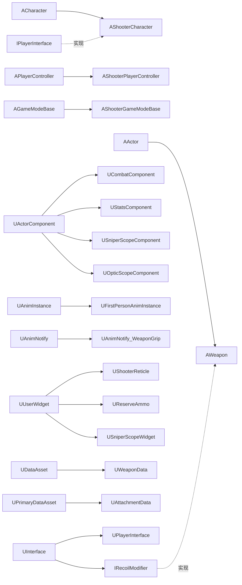

**Language / 语言：** [English](DOCUMENTATION.md) ｜ **中文**

---

# FPS 项目代码解释文档

> 对应工程：Unreal Engine 5.8 ｜ 模块 `FPS` ｜ 路径 `Source/FPS/`
> 本文只做**说明**，不修改任何代码。阅读顺序建议：第 2 节（全局结构）→ 第 5 节（接口）→ 第 6/7 节（核心两类）→ 其余按需查阅。
> 配套总览见 [README.zh-CN.md](<README.zh-CN.md>)。

---

## 目录

1. [文档说明与阅读顺序](#1-文档说明与阅读顺序)
2. [代码地图与数据流](#2-代码地图与数据流)
3. [模块与构建层](#3-模块与构建层)
4. [枚举、结构体与委托总表](#4-枚举结构体与委托总表)
5. [IPlayerInterface — 角色能力接口](#5-iplayerinterface--角色能力接口)
6. [AShooterCharacter — 玩家角色](#6-ashootercharacter--玩家角色)
7. [UCombatComponent — 战斗核心组件](#7-ucombatcomponent--战斗核心组件)
8. [AWeapon — 武器 Actor](#8-aweapon--武器-actor)
9. [UWeaponData — 武器数据资产](#9-uweapondata--武器数据资产)
10. [伤害与命中部位系统](#10-伤害与命中部位系统)
11. [UStatsComponent — 生命值组件](#11-ustatscomponent--生命值组件)
12. [AShooterPlayerController — 输入与移动](#12-ashooterplayercontroller--输入与移动)
13. [AShooterGameModeBase](#13-ashootergamemodebase)
14. [UShooterReticle — 动态准星](#14-ushooterreticle--动态准星)
15. [UReserveAmmo — 弹药 HUD](#15-ureserveammo--弹药-hud)
16. [狙击镜 — USniperScopeComponent / USniperScopeWidget](#16-狙击镜--usniperscopecomponent--usniperscopewidget)
17. [配置层](#17-配置层)
18. [端到端时序](#18-端到端时序)
19. [蓝图契约清单](#19-蓝图契约清单)
20. [注意事项、已知问题与扩展建议](#20-注意事项已知问题与扩展建议)
21. [配件数据资产 —— `UAttachmentData`](#21-配件数据资产--uattachmentdata)
22. [配件与整备界面](#22-配件与整备界面)
23. [瞄具、手电与第一人称扶枪 IK](#23-瞄具手电与第一人称扶枪-ik)
24. [武器手感与开镜修订（第 1–8 步）](#24-武器手感与开镜修订第-18-步)
25. [战斗反馈、探头、整备界面 WBP 与切枪/换弹规则（第 8 步之后）](#25-战斗反馈探头整备界面-wbp-与切枪换弹规则第-8-步之后)
26. [趴下/滑行、蹲伏模式、握把持姿与弹匣配件](#26-趴下滑行蹲伏模式握把持姿与弹匣配件)
27. [菜单、局外改枪、房间、暂停、团队竞技与死亡视角（2026-10 修订）](#27-菜单局外改枪房间暂停团队竞技与死亡视角2026-10-修订)
28. [局内 HUD、暖身倒计时、Search & Destroy、投掷物与连发/霰弹枪相关改动（2026-10 修订 2）](#28-局内-hud暖身倒计时search--destroy投掷物与连发霰弹枪相关改动2026-10-修订-2)
29. [对局 HUD 控件 —— `UMatchHUD`、比分头与击杀播报](#29-对局-hud-控件--umatchhud比分头与击杀播报)
30. [房间大厅、在线会话、BDM 赏金经济、第一人称观战、武器掉落拾取与 Tab 计分板（2026-10 修订 3）](#30-房间大厅在线会话bdm-赏金经济第一人称观战武器掉落拾取与-tab-计分板2026-10-修订-3)

> **最新修订（2026-10 修订 3）：** 新增顶层章节 `30`，说明 **Online Subsystem 在线会话管理器**（`UShooterSessionSubsystem`、`FRoomBrowserEntry`、`URoomBrowserScreen`）、**房间集结大厅**（`ALobbyGameMode`、`ALobbyGameState`、`ALobbyPlayerController`、`ULobbyScreen`）、**无缝漫游队伍与顺位继承**（`AShooterPlayerState::CopyProperties`）、**经典爆破对决 BDM 与 CS 风格购枪经济**（`ABDMGameMode`、`ABDMGameState`、`UBuyShopScreen`、`FBuyShopItem`）、**真第一人称队友观战系统**（`SetFirstPersonViewedLocally`、1P 观战动画）、**世界物体交互与地面武器掉落/贴地吸附**（`IInteractable`、`AWeaponPickup`、C4 贴地），以及**按住 Tab 实时战绩计分板与助攻伤害判定**（`UScoreboardScreen`、`NotifyDamage`、`AssistWindow`）。与前面各节冲突时以 §30 为准。
>
> **上一次修订（2026-10 修订 2）：** 新增顶层章节 `28` 与 `29`，说明**局内 HUD**（`UMatchHUD`、`UMatchHeaderWidget` / `UTDMHeaderWidget` / `USDHeaderWidget`、`UKillFeedWidget` / `UKillFeedEntry`）、**暖身倒计时**、**`PlayerN` 名字**、**冲刺 vs. 换弹**、整套 **Search & Destroy** 回合模式（`ASearchDestroyGameMode`、`ASearchDestroyGameState`、`ABombActor`、`ABombSite`、`ABombWeapon`）、**投掷物管线**（`AThrownProjectile`、高抛 / 低抛、投掷物伤害）、**`EFireType::Burst`**、**双管霰弹枪**的弹膛弹壳，以及**枪匠"装备为主武器"**流程和 **X24 配件集**。与 §4.1、§4.2、§4.4、§13、§17.1、§17.3、§22、§24.3、§27 或 §3.4 冲突时以 §28 / §29 为准。
>
> **最新修订（第 14 步之后）：** 新增顶层章节 `26`，说明**趴下 / 趴行**、**滑铲**、**Ctrl 按住 + C 切换的蹲伏**输入改造、**GripHoldStyle（Cradle / Grab）握把持姿**系统、**骨骼网格弹匣配件**（`SkeletalMesh`、`MagReloadAnim`、`bHideSpareMagazineBone`）、**近战扫掠**（`WeaponMeleeHit`）、**AK 武器 Tag 与 3P 挂点回退**、**扩散准星**以及**腰射散布锥角**（`HipFireSpread` × `HipFireSpreadMultiplier`，在 `WeaponTrace` 里掷骰）。与 §4.8、§4.9、§6.3、§6.7、§7.4、§7.5、§7.6、§8.2、§12、§14 或 §23.3 冲突时以 §26 为准。
>
> **上一次修订（第 8 步之后）：** 新增顶层章节 `25`，说明画中画曝光、命中默认 Concrete 表面、分方向受击、受伤方向环与命中确认标记、每把枪的预览偏移、可用 WBP 设计的整备界面、Q/E 探头（C++ + 3P ABP 脊椎）、射线跟随探头、删除循环切枪、切枪/换弹打断规则，以及第 9–14 步（检视、侧瞄、激光）汇总。与 §6.3、§7.3、§7.5、§8.2、§18.4 冲突时以 §25 为准。
>
> **上一次修订（武器手感与开镜，第 1–8 步）：** 新增顶层章节 `24`，说明换弹分种类、拉栓、左手 IK 渐变、开火模式切换、C++ 开镜 FOV 与开镜时间、可变倍率瞄具、按瞄具类型决定画中画（狙击不再特殊处理）、视觉后坐、每把枪的腰射偏移与开镜眼距。与 §16、§18.5、§23.1 冲突时以 §24 为准。
>
> **更早修订（武器配件 / 整备界面 / 画中画倍镜）：** 新增顶层章节 `21–23`，分别说明配件数据资产、配件与整备界面、以及画中画倍镜 + 手电 + 第一人称扶枪 IK；蓝图契约新增项见 `19.2`，新增已知问题见 `20.1.2`。
>
> **上一次修订（后坐力 / 耐力 / 治疗 / 移动步态）：** 子章节 `4.11`、`6.5–6.7`、`7.7–7.9`、`8.4–8.6`、`11.1`、`12.1–12.2`、`19.1`、`20.1.1`。

---

## 1. 文档说明与阅读顺序

| 章节 | 内容 | 适合谁 |
| --- | --- | --- |
| 3 | 模块、构建、Tag、Trace 通道 | 搭环境的人 |
| 4 | 所有枚举 / 结构体 / 委托 | 所有人（速查） |
| 5–8 | 接口、角色、战斗组件、武器 | 改玩法的人（核心） |
| 9 | 数据资产如何填 | 策划 / 装配资产的人 |
| 10–16 | 伤害、血量、输入、UI、狙击镜 | 按功能查 |
| 17–19 | 配置、时序、蓝图契约 | 联调排错的人 |
| 20 | 坑与待办 | 接手项目的人 |
| 21–29 | 配件数据/界面、瞄具 + 手电、武器手感修订、战斗反馈 + 探头、趴下/滑行/握把持姿/弹匣配件、局内 HUD 与 Search & Destroy / 投掷物 / 霰弹枪修订 | 按功能查（这些章节的说明优先于它们引用的旧章节） |

符号约定：

- `◆` 表示该函数/成员被**蓝图**调用或影响蓝图。
- `⇄` 表示该函数参与**网络复制 / RPC**。
- `⚠` 表示已知问题或需要注意的坑。

---

## 2. 代码地图与数据流

### 2.1 类关系



### 2.2 所有权

```
BP_ShooterGameMode
└─ BP_ShooterCharacter (AShooterCharacter)
   ├─ SpringArm (USpringArmComponent)          // 臂长 0，仅用于相机延迟
   │  └─ FirstPersonCamera (UCameraComponent)
   │     └─ Mesh1P (USkeletalMeshComponent)    // 仅自己可见的手臂
   ├─ Mesh (ACharacter 自带 3P 身体)            // 别人看得到
   ├─ Combat (UCombatComponent, Replicated)
   │  └─ 运行时生成 → AWeapon × N（Inventory）
   │     ├─ Mesh1P（自己看的枪）
   │     └─ Mesh3P（别人看的枪）
   ├─ Stats (UStatsComponent, Replicated)
   └─ SniperScope (USniperScopeComponent, 运行时 NewObject 创建)
      ├─ Capture (USceneCaptureComponent2D)
      ├─ RenderTarget (UTextureRenderTarget2D)
      └─ Overlay (USniperScopeWidget，加入视口 ZOrder = -1)
```

### 2.3 一次开火的数据流（概览）

```
输入 IA_FireWeapon(Started)
 → AShooterCharacter::Input_FireWeapon_Pressed
 → UCombatComponent::Initiate_FireWeapon_Pressed   （冲刺打断，记 bTriggerPressed，射速门控）
 → UCombatComponent::Local_FireWeapon
     ├─ 播 1P 开火 Montage（ResolveFireMontage：近战/射击变体随机取一个）
     ├─ AWeapon::WeaponTrace          （球形 Sweep → FHitResult；近战改用 WeaponMeleeHit）
     ├─ AWeapon::Local_Fire           （→ 蓝图 FireEffect；本地预测扣弹匣，!UsesAmmo 时跳过）
     ├─ OnCurrentReserveAmmoChanged 广播（刷新 UI）
     ├─ OnWeaponFired 广播            （准星扩散）
     ├─ 启动 FireTimer（射速 / 全自动循环）
     └─ Server_FireWeapon(Hit)  ⇄
          ├─ 射速节流校验
          ├─ 骨骼 → 部位 → 伤害倍率
          ├─ IPlayerInterface::Execute_DoDamage   （服务端扣血）
          ├─ AWeapon::Auth_Fire                   （权威扣弹匣）
          └─ Multicast_FireWeapon(Hit, AuthAmmo)  ⇄
               ├─ 本地：AWeapon::Rep_Fire(AuthAmmo) 校正
               └─ 远端：Local_Fire(FX, bFirstPerson=false) + 3P 开火 Montage
```

---

## 3. 模块与构建层

### 3.1 `Source/FPS/FPS.Build.cs`

| 项 | 值 | 说明 |
| --- | --- | --- |
| `PCHUsage` | `UseExplicitOrSharedPCHs` | 共享 PCH |
| `PublicDependencyModuleNames` | `Core`, `CoreUObject`, `Engine`, `InputCore`, `EnhancedInput`, `GameplayTags`, `PhysicsCore`, `UMG` | 缺 `PhysicsCore` 会导致 `EPhysicalSurface` 相关链接失败；缺 `GameplayTags` 会导致 `NativeGameplayTags.h` 找不到 |
| `PrivateDependencyModuleNames` | `Slate`, `SlateCore` | UMG 控件内部依赖 |

### 3.2 `Source/FPS/FPS.cpp` / `FPS.h`

- `IMPLEMENT_PRIMARY_GAME_MODULE(FDefaultGameModuleImpl, FPS, "FPS")`：把 `FPS` 声明为主游戏模块；`FPS.h` 只是 `CoreMinimal.h` + `FPSTraceChannels.h` 的汇总头。

### 3.3 `FPSTraceChannels.h`

```cpp
namespace FPSTraceChannels { constexpr ECollisionChannel ECC_Weapon = ECC_GameTraceChannel2; }
```

- **作用**：把"武器"通道起个别名，避免代码里到处出现 `ECC_GameTraceChannel2`。
- **效果**：与 [DefaultEngine.ini](<Config/DefaultEngine.ini>) 中 `+DefaultChannelResponses=(Channel=ECC_GameTraceChannel2,...,bTraceType=True,...,Name="Weapon")` 一一对应。**如果改通道顺序（例如在项目设置里新增/删除通道），必须同步改这里和 ini。**

### 3.4 `ShooterGamePlayTags.h` / `.cpp`

| 常量 | Tag | 用途 |
| --- | --- | --- |
| `Tag_WeaponType_None` | `Weapon.type.none` | 未指定类型 |
| `Tag_WeaponType_Rifle` | `Weapon.type.rifle` | 步枪（长枪） |
| `Tag_WeaponType_Pistol` | `Weapon.type.pistol` | 手枪（默认单发 + 连发，§28.3） |
| `Tag_WeaponType_Melee` | `Weapon.type.melee` | 近战（小刀） |
| `Tag_WeaponType_AK` | `Weapon.type.ak` | AK 步枪。**刻意单独一个 Tag**：AK 需要自己的一整套动画/Montage，而且它是唯一带专用第三人称挂点路径的 Tag（`RifleSocketak`，§26.6） |
| `Tag_WeaponType_ShotGun` | `Weapon.type.shotgun` | 双管霰弹枪 —— 自己的一整套 Montage，外加弹膛弹壳通知（§28.5） |
| `Tag_WeaponType_X24` | `Weapon.type.x24` | X24 手枪。用于守住枪身动画序列的变通做法（X24 枪身没有与手臂 Montage 匹配的槽）及其骨骼配件（§28.6） |
| `Tag_WeaponType_Grenade` | `Weapon.type.grenade` | 破片手雷 —— `FirstPersonMontages` 与枪械分开配置（§28.4） |
| `Tag_WeaponType_Smoke` | `Weapon.type.smoke` | 烟雾弹（仅蓝图 `OnDetonate`） |
| `Tag_WeaponType_Molotov` | `Weapon.type.molotov` | 燃烧瓶 / 燃烧弹（仅蓝图 `OnDetonate`） |
| `Tag_WeaponType_Flash` | `Weapon.type.flash` | 闪光弹（仅蓝图 `OnDetonate`） |

- 用原生 Tag（`UE_DECLARE/DEFINE_GAMEPLAY_TAG_EXTERN`），因此无需在 ini 里再注册。
- `Weapon.type.ak` **同时**也列在 [DefaultGameplayTags.ini](<Config/DefaultGameplayTags.ini>) 中（`ImportTagsFromConfig=True`）—— 这是唯一写进配置的武器 Tag；从 2026-10 修订 2 起，四个投掷物 Tag 也注册在那里，同时还新增了 `Attachment.Slot.RearSight`。

- **效果**：`AWeapon::WeaponType` 与 `UWeaponData` 的各个 `TMap<FGameplayTag, …>` 以这些 Tag 为键。⚠ `Weapon.type.sniper` **已不存在**（AWP / M700 已移除，§10.4）—— Tag 表里曾经列过它；现在狙击枪与其他枪一样跟随已装的瞄具（§24.6），`USniperScopeComponent` 已闲置。

### 3.5 目标文件

| 文件 | 内容 |
| --- | --- |
| [FPS.Target.cs](<Source/FPS.Target.cs>) | `Type = Game`，`BuildSettingsVersion.V7`，模块 `FPS` |
| [FPSEditor.Target.cs](<Source/FPSEditor.Target.cs>) | `Type = Editor`，同上 |

---

## 4. 枚举、结构体与委托总表

### 4.1 `EWeaponKind`（Weapon.h）— 决定槽位归属

| 值 | 显示名 | 说明 |
| --- | --- | --- |
| `LongGun` | Long Gun | 只有长枪能进"主武器 / 副武器"槽（Extraction 允许两把，竞技模式一把 —— §28.2） |
| `Pistol` | Pistol | 手枪槽；默认开火模式为单发 + 连发（`GetAllowedFireModes`） |
| `Melee` | Knife | 近战槽；近战永远不能开镜（`Initiate_Aim_Pressed` / `Local_Aim` 强制关闭），**永不消耗弹药**（`AWeapon::UsesAmmo()` 为 false），用近战扫掠代替相机射线，并把两个 FABRIK alpha 都置 0（§26.4/§26.5） |
| `Throwable` | Throwable | 投掷物槽（竞技模式按键 4）。消耗弹药但从不自动换弹；开火改为开始投掷而不是射击；永不瞄准（§28.4） |
| `Bomb` | Bomb | Search & Destroy 的按键 5。永不瞄准、永不使用弹药；安放 / 拆除由游戏模式处理，不是武器（§28.2） |

### 4.2 `EFireType`（Weapon.h）

| 值 | 效果 |
| --- | --- |
| `Single` | 松开扳机前不会自动连发；`FireTimerFinished` 里不会再次调用 `Local_FireWeapon` |
| `Automatic` | 只要 `bTriggerPressed == true` 且弹匣 > 0，`FireTimerFinished` 就继续开火 |
| `Burst` | 按 `GetBurstShotInterval()` 的间隔打出 `BurstCount` 发，不需要一直按住扳机；`BurstShotsRemaining` 是计数器，服务器射速限制用同一间隔（§28.3） |

`AWeapon::GetAllowedFireModes()` 决定武器能用这三种里的哪些：显式配了 `AllowedFireModes` 就以它为准；否则手枪 = `Single` + `Burst`，勾了 `bCanSwitchFireMode` 的步枪 = `Single` + `Automatic`，其余 = 自己配置的 `FireType`。`SanitizeFireType()` 在 `BeginPlay` / 装备时运行，`GetNextFireMode()` 在列表里循环。

### 4.3 `EWeaponStatus`（Weapon.h）— 状态机

| 值 | 何时进入 | 何时离开 | 影响 |
| --- | --- | --- | --- |
| `Idle` | 初始装备、Montage 结束 | — | 可开火 / 换弹 / 切枪 |
| `Firing` | ⚠ **当前没有任何代码写入** | — | 保留位 |
| `Reloading` | `Initiate_ReloadWeapon`、`Server_ReloadWeapon` | `OnReloadMontageEnded`、`Client_ReloadWeapon`、`Server_EndReload`、`Notify_ReloadWeapon` | 阻止开火、切枪、重复换弹 |
| `Cycling` | 播放切枪 Montage 时 | `OnEquipMontageEnded` | 阻止换弹与再次切枪 |
| `UnEquipped` | 构造、`Equip` 换下旧枪、`OnRep_Instigator` 未装备时 | 被 `Equip` 时 | 配合 `SetActorHiddenInGame(true)` 隐藏枪 |

### 4.4 `EWeaponSlot`（CombatComponent.h）

| 值 | 映射规则（`FindWeaponForSlot`） |
| --- | --- |
| `Main` | 第 1 把 `EWeaponKind::LongGun` |
| `Secondary` | 第 2 把 `LongGun`（Extraction；竞技模式在 `Initiate_Hotkey` 里把按键 2 重映射到 `Pistol`） |
| `Pistol` | 第 1 把 `Pistol` |
| `Melee` | 第 1 把 `Melee` |
| `Throwable` | 第 1 把 `Throwable`；当它的 `Ammo` 为 0 时 `Initiate_EquipSlot` 会拒绝 |
| `Bomb` | 第 1 把 `Bomb`（Search & Destroy 里由 `GrantBombWeapon()` 发放，`RemoveBombWeapon()` 移除） |

### 4.5 `ETurningInPlace`（ShooterType.h）

`Left` / `Right` / `NotTurning` — 由 `AShooterCharacter::TurnInPlace` 计算，供 3P 动画蓝图播放"原地转身"动画。

### 4.6 `EHitZone`（ShooterType.h）

`Head` / `Torso` / `Limb` — 伤害倍率判定结果。

### 4.7 `EDeathState`（StatsComponent.h）

`NotDead` / `DeadStart` / `DeadFinished` — ⚠ 目前只用到 `NotDead`，死亡状态机未实现。

### 4.8 `FPlayerAnim`（WeaponData.h）— 注入动画蓝图的结构体

| 字段 | 类型 | 用途 |
| --- | --- | --- |
| `IdleAnim` | `UAnimSequence*` | 站立待机 |
| `AimIdleAnim` | `UAnimSequence*` | 瞄准待机 |
| `CrouchIdleAnim` | `UAnimSequence*` | 蹲伏待机 |
| `SprintAnim` | `UAnimSequence*` | 冲刺 |
| `AimOffset_Hip` | `UBlendSpace*` | 腰射 AimOffset |
| `AimOffset_Aim` | `UBlendSpace*` | 瞄准 AimOffset |
| `Strafe_Standing` | `UBlendSpace*` | 站立移动混合 |
| `Strafe_Crouching` | `UBlendSpace*` | 蹲伏移动混合 |
| `Strafe_Walking` | `UBlendSpace*` | 慢走速度下的移动混合（慢走步态激活时使用，§6.6） |
| `IdleAnim_Grab` | `UAnimSequence*` | 握把配件报告 `EGripHoldStyle::Grab`（垂直握把）时使用的站立待机；留空则用 `IdleAnim`（§26.3） |
| `AimIdleAnim_Grab` | `UAnimSequence*` | Grab 持姿的瞄准待机 |
| `LeftHandHoldPose_Cradle` / `LeftHandHoldPose_Grab` | `UAnimSequence*` | 供 ABP 分层混合使用的**仅左手**握持姿势（可选，`bUseLeftHandHoldPose`，§26.3）。与普通待机相同的姿势会被忽略 |

**效果**：`UCombatComponent::ApplyEquippedWeaponAnim` 会把整个结构体**按值复制**进 ABP 的同名结构体变量，从而让换枪时动画资产随之切换。`RefreshLocomotionBlendSpaces` 在复制前还会为慢走步态把 `Strafe_Standing` 换成 `Strafe_Walking`，为 Grab 握把持姿把 `IdleAnim` 换成 `IdleAnim_Grab`。

### 4.9 `FMontageData`（WeaponData.h）

| 字段 | 用途 |
| --- | --- |
| `EquipMontage` | 切枪动画 |
| `ReloadMontage` | 换弹动画 |
| `FireMontage` | 开火动画 |

换弹变体与近战/射击变体：

| 字段 | 用途 |
| --- | --- |
| `FirstReloadMontage` / `EmptyReloadMontage` / `TacticalReloadMontage` | 换弹变体（§24.1） |
| `EmptyReloadMontage_Grab` / `TacticalReloadMontage_Grab` | Grab 持姿下覆盖空仓 / 战术换弹；仅当握把配件为 `EGripHoldStyle::Grab` 且该字段已填时使用，否则用 Cradle 变体（§26.3） |
| `BoltMontage` | 每发之后的拉栓 / 泵动循环 |
| `InspectMontage1P` | 武器检视 |
| `FireMontages` / `EquipMontages` | 近战挥砍与备用拔枪的 `TArray` 变体池。`ResolveFireMontage()` / `ResolveEquipMontage()` 会**随机**挑一个有效项，并把单数的 `FireMontage` / `EquipMontage` 追加为一个额外候选（去重）；两者都没配时返回 `nullptr`（调用方必须判空） |
| `ResolveReloadMontage(EReloadType Type, EGripHoldStyle GripStyle = Cradle)` | 解析顺序：`First` → `FirstReloadMontage`；然后（仅 Grab）`EmptyReloadMontage_Grab` / `TacticalReloadMontage_Grab`；然后 `EmptyReloadMontage` / `TacticalReloadMontage`；最后 `ReloadMontage`。⚠ `First` 只要 `FirstReloadMontage` 有值就立刻返回，所以第一次换弹永远不会走 Grab 覆盖 |

同一结构体被复用在三个表里：`WeaponMontages`（**武器自身骨骼网格体**上的动画，如换弹时弹匣运动）、`FirstPersonMontages`、`ThirdPersonMontages`。

### 4.10 委托（Delegates）

| 委托 | 声明处 | 参数 | 触发时机 | 用途 |
| --- | --- | --- | --- | --- |
| `FWeaponFirstReplicated` | ShooterCharacter.h | `AWeapon*` | 第一把武器**首次复制到客户端**成功时，仅广播一次 | 让 HUD 在武器就绪后再取准星材质 |
| `FReticleChanged` | CombatComponent.h | `UMaterialInstanceDynamic*` | `InitializeWeaponWidget` / 换枪 | 准星控件更换材质 |
| `FCurrentReserveAmmoChanged` | CombatComponent.h | `int32 RoundsInServe, int32 RoundsInWeapon, UTexture2D*` | 装备、开火、换弹、`OnRep_CurrentReserveAmmo` | 刷新弹药文字与武器图标 |
| `FHealthChanged` | StatsComponent.h | `UStatsComponent*, float Old, float New, AActor* Instigator` | 血量 / 上限变化 | 血条 UI、死亡判断 |

---

### 4.11 后坐力结构体、新增委托与 `FPlayerAnim` 新增字段

| 类型 | 声明处 | 作用 |
| --- | --- | --- |
| `FRecoilStep` | Weapon.h | 单发子弹的视角偏移（度）：`Pitch`（向上为正、向下为负）、`Yaw`（向右为正、向左为负）。提供默认构造与 `(Pitch, Yaw)` 便捷构造 |
| `FRecoilScale` | RecoilModifierInterface.h | 叠加在武器固有后坐力上的倍率：`Pitch`、`Yaw`、`Recovery`，默认都是 `1`（不改变） |
| `IRecoilModifier` / `URecoilModifier` | RecoilModifierInterface.h | 只有一个函数 `GetAttachmentRecoilScale()` 的 `BlueprintNativeEvent` 接口。实现在**武器本身，或武器/角色身上的任意组件**（握把、枪口补偿器、枪托、天赋组件……）即可修正后坐力 |
| `FPlayerAnim::Strafe_Walking` | WeaponData.h | 慢走速度下使用的 `UBlendSpace*`；慢走步态激活时会被复制覆盖 `Strafe_Standing`（见 6.6、7.9） |

新增委托：

| 委托 | 声明处 | 类型 | 触发时机 | 使用方 |
| --- | --- | --- | --- | --- |
| `FAimStateChanged` | CombatComponent.h | 普通 C++ 多播（`DECLARE_MULTICAST_DELEGATE_OneParam`，`bool`），**不是**蓝图委托 | `Local_Aim` 真正改变了 `bAiming` 时 | `AShooterCharacter::HandleAimStateChanged`（蓝图 `OnAim`、移动速度、步态） |
| `FStaminaChanged` | StatsComponent.h | 动态多播（组件、旧值、新值） | 耐力或耐力上限变化 | 耐力条（`WB_Stamina`） |
| `FStaminaDepleted` | StatsComponent.h | 动态多播，无参数 | 服务器在冲刺中把最后一点耐力耗尽 | `AShooterPlayerController::HandleStaminaDepleted` |
| `FWeaponFired` | CombatComponent.h | 动态多播，无参数 | `Local_FireWeapon` 真正打出一发时（在 `Local_Fire` 之后） | `UShooterReticle::HandleWeaponFired` → `NotifyWeaponFired()`（准星扩散，§26.7） |

> `EDeathState` 现在会被**读取**（`HealPlayer` 与 `Server_BeginHeal` 拒绝治疗死亡或满血的角色），但仍然从未被写入，因此永远停留在 `NotDead` —— 见 20.1。

---

### 4.12 `EGripHoldStyle`（AttachmentData.h）— 副手如何握枪

| 值 | 显示名 | 含义 |
| --- | --- | --- |
| `Cradle` | Cradle / Angled | 斜角 / 三角握把（或**完全没有握把**）：握持姿势来自常规待机动画 |
| `Grab` | Grab / Vertical | 垂直握把：待机 / 换弹动画换成 `_Grab` 变体，ABP 还可以分层混入 `LeftHandHoldPose_Grab` |

- `AWeapon::GetGripHoldStyle()` 从**已装备的握把配件**读取它；没有装握把时返回 `Cradle`，所以拆掉握把一切都会还原。
- **效果**：握持姿势由**动画**产生，**不是 FABRIK**。第一人称 FABRIK 路径被永久停用（`FABRIK_Alpha1P = 0`，§26.1）；第三人称左手使用 `FABRIK_Alpha`（近战为 0、趴行时为 0，其余为 1）。完整流程见 §26.3。

---

## 5. IPlayerInterface — 角色能力接口

**位置**：[PlayerInterface.h](<Source/FPS/Public/Interface/PlayerInterface.h>)（`.cpp` 为空，注释说"不需要修改"）

**为什么存在**：`AWeapon`（武器）需要反向操作持有者（取挂点、取 1P/3P 网格体、造成伤害），但武器不应该 `Cast<AShooterCharacter>`。用 `BlueprintNativeEvent` 接口后，**武器只依赖接口**，任何蓝图角色只要实现这些事件就能直接复用整套武器逻辑。

所有函数均为 `BlueprintNativeEvent + BlueprintCallable`，C++ 侧调用必须用 `IPlayerInterface::Execute_Xxx(Object, ...)` 形式。

| 函数 | 签名 | 作用 | 谁在调用 |
| --- | --- | --- | --- |
| ◆`GetWeaponAttachPoint` | `FName(const FGameplayTag& WeaponTag) const` | 按武器类型返回角色身上的挂点 Socket 名 | `AWeapon::AttachToOwingPawn` |
| ◆`GetMesh1P` | `USkeletalMeshComponent*() const` | 返回第一人称（手臂）网格体 | `AWeapon::AttachToOwingPawn`、`UCombatComponent::ApplyEquippedWeaponAnim/PlayEquipMontage/GetReloadMontage/Local_FireWeapon` |
| ◆`GetMesh3P` | `USkeletalMeshComponent*() const` | 返回第三人称（身体）网格体 | 同上（3P 分支）、`Multicast_FireWeapon` |
| ◆`WeaponReplicated` | `void()` | 通知"武器已复制到客户端" | `UCombatComponent::SpawnInventory`、`OnRep_CurrentWeapon` |
| ◆`GetCurrentWeapon` | `AWeapon*()` | 取当前武器 | `UShooterReticle::NativeOnInitialized` |
| ◆`GetReserveAmmo` | `int32() const` | 取当前备弹 | 供蓝图 / UI 查询 |
| ◆`Notify_ReloadWeapon` | `void()` | 动画通知调用：权威侧填弹并回传客户端 | 蓝图换弹动画的 AnimNotify |
| ◆`DoDamage` | `bool(float DamageAmout, AActor* DamageInstigator)` | 对"实现了该接口的 Actor"造成伤害 | `UCombatComponent::Server_FireWeapon` |

**实现者**：仅 `AShooterCharacter`（第 6 节）。

---

## 6. AShooterCharacter — 玩家角色

**位置**：[ShooterCharacter.h](<Source/FPS/Public/ShooterCharacter.h>) / [ShooterCharacter.cpp](<Source/FPS/Private/ShooterCharacter.cpp>)
**继承**：`ACharacter` + `IPlayerInterface`

### 6.1 组件与默认值（构造函数）

| 成员 | 类型 | 设置 | 效果 |
| --- | --- | --- | --- |
| `SpringArm` | `USpringArmComponent` | 挂根组件；`TargetArmLength = 0`；`bEnableCameraLag = true`；`CameraLagSpeed = 15`；`bUsePawnControlRotation = true` | 相机不自己处理旋转，而是用 SpringArm 的**相机延迟**做出准星跟随的顺滑感；臂长 0 表示相机就在角色头部位置 |
| `FirstPersonCamera` | `UCameraComponent` | 挂 `SpringArm`；`bUsePawnControlRotation = false` | 随控制旋转（由 SpringArm 转发），FOV 在 `BeginPlay` 设为 `DefaultFOV = 90` |
| `Mesh1P` | `USkeletalMeshComponent` | 挂 `FirstPersonCamera`；`bOnlyOwnerSee = true`；`bCastDynamicShadow = false`；`bReceivesDecals = false`；`VisibilityBasedAnimTickOption = OnlyTickPoseWhenRendered`；TickGroup = `TG_PrePhysics`；`AllowPrivateAccess` | 只有本地玩家看得到的手臂；不投影、不接收贴花，省性能；`TG_PrePhysics` + 后面的 Tick 前置依赖保证"手臂先动、瞄准对齐后算" |
| `GetMesh()`（3P 身体） | `USkeletalMeshComponent` | `bOnlyOwnerSee = false`；`bOwnerNoSee = true`；`bReceivesDecals = false` | 自己看不到自己的身体，别人能看到 |
| `Combat` | `UCombatComponent` | `SetIsReplicated(true)` | 战斗核心（详见第 7 节） |
| `Stats` | `UStatsComponent` | `SetIsReplicated(true)` | 生命值（第 11 节） |
| `DefaultFOV` | `float` | `90.f`（`EditDefaultsOnly`） | 腰射 FOV，也是狙击镜激活时强制恢复的 FOV |
| `TurningStatus` | `ETurningInPlace` | `NotTurning` | 交给 ABP |
| `bWeaponFirstReplicated` | `bool` | `false` | 只允许 `OnWeaponFirstReplicated` 广播一次 |
| — | — | 调 `ConfigureWeaponHitCollision()` | 见 6.3 |

### 6.2 生命周期函数

| 函数 | 作用与效果 |
| --- | --- |
| `BeginPlay()` | ① 非专用服务器且没有 `USniperScopeComponent` 时用 `NewObject` + `RegisterComponent` **动态创建狙击镜组件**（所以蓝图里不需要手动挂）；② `Super::BeginPlay()`；③ **再次**调用 `ConfigureWeaponHitCollision()`（注释说明蓝图会在构造之后覆盖碰撞设置）；④ 相机 FOV 设为 `DefaultFOV`；⑤ 记录 `StartingAimRotation`（初始 Yaw）；⑥ 缓存 `Mesh1P` 的初始相对位置/旋转到 `AuthoredHipMeshLocation/Rotation`；⑦ `ConfigureAimTickOrder()` |
| `BeginDestroy()` | 调用 `Combat->DestroyInventory()`，角色销毁时一并销毁所有武器 Actor，避免残留 |
| `Tick(DeltaTime)` | 每帧按此顺序：`UpdateLocomotionGait(true)` → `CalculateTurnInPlaceParameters` → `CalculateFABRIKSocket` → `UpdateAimAlpha`（先推进开镜进度，对齐与 FOV 都要用）→ `RemoveVisualRecoilFromMesh` → `UpdateAimSocketAlignment` → `ApplyVisualRecoilToMesh` → `UpdateAimFieldOfView` → `UpdateLean` → `UpdateSlide` → `UpdateProne` → 若存在狙击镜组件则 `Scope->UpdateView()` → 若存在瞄具组件则 `UOpticScopeComponent::UpdateView()`。**顺序有含义**：先算步态与原地转身，再算 IK 挂点，然后做 ADS 进度/对齐，最后跑镜类组件以读取最终的相机状态 |
| `PossessedBy(NewController)` | `Super::` 之后调用 `Combat->SpawnInventory()` —— 只有被控制时（服务端）才生成武器库存 |
| `OnRep_PlayerState()` | 客户端 `PlayerState` 复制完成时调 `Combat->InitializeWeaponWidget()`，把准星材质与弹药刷到 HUD 上 |

### 6.3 逐函数详解

#### `ConfigureWeaponHitCollision()`（private）

| 对象 | 设置 | 为什么 |
| --- | --- | --- |
| `GetCapsuleComponent()` | 对 `ECC_Weapon` 通道 `ECR_Ignore` | 胶囊体没有骨骼，若被命中则 `Hit.BoneName` 为空，无法判断部位 |
| `GetMesh()`（3P 身体） | `SetCollisionEnabled(QueryOnly)` + 对 `ECC_Weapon` 通道 `ECR_Block` | 让子弹打到**有骨骼的身体网格**，从而拿到骨头名做爆头判定 |
| `Mesh1P` | `NoCollision` | 自己的手臂不参与判定 |

#### `GetFixedAimRotation() const` ◆

```
FRotator AimRotation = GetBaseAimRotation();
if (AimRotation.Pitch > 90 && !IsLocallyControlled())
    Pitch = MapRangeClamped(Pitch, [270,360) → [-90,0])
```
- **作用**：修正**远端角色**的俯仰角表示。网络压缩后的 Pitch 会落在 `[270,360)`，映射到 `[-90,0]` 才能给动画蓝图/瞄具使用。
- **效果**：远端玩家的瞄准方向不翻转。本地玩家不受影响（本地已是标准 `[-90,90]`）。
- ◆ `BlueprintCallable`，主要给 ABP / 蓝图计算用。

#### `HasCurrentWeapon() const` ◆
- 返回 `Combat` 有效且 `Combat->CurrentWeapon != nullptr`。用于蓝图/HUD 判断"是否已持有武器"。

#### `CalculateTurnInPlaceParameters(float DeltaTime)`（private）

```
速度(去掉 Z) == 0 且未下落：
    AO_Yaw = NormalizedDeltaRotator(当前 Yaw, StartingAimRotation).Yaw
    if TurningStatus == NotTurning: InterpAO_Yaw = AO_Yaw
    TurnInPlace(DeltaTime)
速度 > 0 或在下落：
    StartingAimRotation = 当前 Yaw
    AO_Yaw = 0
    MovementOffsetYaw = NormalizedDeltaRotator(移动朝向, 瞄准朝向).Yaw
    TurningStatus = NotTurning
最后 AO_Yaw *= -1
```
- **输出**（全部 `BlueprintReadOnly`，供 ABP 读取）：
  - `AO_Yaw`：身体与瞄准方向的偏航差（换向取负，匹配骨骼朝向约定）→ 用于**原地转身动画**与 AimOffset。
  - `MovementOffsetYaw`：移动方向相对瞄准方向的角度 → 用于**八向移动 / 步态混合**。
  - `TurningStatus`：转身状态。
- **效果**：站立不动时角色可以"上半身转身"，一旦开始移动就重置基准角。

#### `TurnInPlace(float DeltaTime)`（private）

- `AO_Yaw > 90` → `Right`；`AO_Yaw < -90` → `Left`。
- 进入转身状态后：`InterpAO_Yaw = FInterpTo(InterpAO_Yaw, 0, DeltaTime, 4.0)`，并把 `AO_Yaw` 拉向 0（转身动画会把角度"消化"掉）。
- 当 `|AO_Yaw| < 5` 时结束转身，并把 `StartingAimRotation` 重置为当前 Yaw。
- **效果**：转身动画播完后状态自动回到 `NotTurning`，不会卡死。

#### `CalculateFABRIKSocket(float DeltaTime)`（private）◆

> **已重写：** 该函数的第一人称部分已不存在。1P 握持姿势来自每把枪的握持动画（握把持姿，§26.3），近战武器与徒手趴行两种情况都会把两个 alpha 关掉。`DeltaTime` 参数现在已不再使用。

1. 没有战斗组件或没有当前武器 → `FABRIK_Alpha1P = 0`、`FABRIK_Alpha = 0`，两个挂点变换都置 `Identity`，返回。
2. **近战**（`WeaponKind == Melee`）→ 同上：两个 alpha 都是 0，两个变换都是 `Identity`，返回。两只手只跟随小刀动画。
3. **第三人称**：`AWeapon::GetFabrikWorldTransform(false, SocketWorld)` —— 优先握把配件的 `FABRIK` Socket，否则用武器网格体自己的 `FABRIK` 骨骼。成功时把世界变换换算到 3P 身体的 `hand_r` 骨骼空间（`WriteHandSpace`）并设置 alpha：
   - `FABRIK_Alpha = bProneCrawling ? 0 : 1` —— 趴行用的是徒手全身趴伏动画，所以左手**不能**被拉向枪；趴下静止、站立、下蹲和滑铲都保持握枪（alpha 1）。
   - 没有可用 Socket → `FABRIK_SocketTransform = Identity`、`FABRIK_Alpha = 0`。
4. **第一人称**：无条件 `FABRIK_SocketTransform1P = Identity`、`FABRIK_Alpha1P = 0`。

- **效果**：`ABP_ThirdPerson` 的 FABRIK 节点 alpha 应绑定新的 `FABRIK_Alpha` 属性（而不是写死 1）；`UFirstPersonAnimInstance` 仍会每帧镜像 `FABRIK_Socket1P` / `FABRIK_Alpha1P`，但 alpha 恒为 0，所以 1P 的 FABRIK 节点实际不起作用。⚠ 旧属性 `bDisableLeftHandIKDuringReload`、`LeftHandIKBlendSpeed`、`DisableLeftHandIKCurveName` 仍然存在，但已不驱动任何逻辑。

#### `ConfigureAimTickOrder()`（private）

- `PrimaryActorTick.AddPrerequisite(Mesh1P, Mesh1P->PrimaryComponentTick)`。
- **效果**：角色 Tick（内含 ADS 对齐计算）**晚于** `Mesh1P` 的动画 Tick 执行，保证读到的手臂骨骼姿态是本帧最新的。

#### `GetAimTimelineAlpha(float)`（private）⚠

- 目前仅 `return AimAlignAlpha;`（`AimAlignAlpha` 恒为 0，`AimTimeline` 从未被赋值、该函数也无人调用）。
- 结论：这是**遗留/未接线**的接口，时间轴驱动的 ADS 已被下面的蓝图变量方案取代。

#### `UpdateAimSocketAlignment(float)`（private）◆ — ADS 瞄具对齐

执行条件（任一不满足即返回）：本地控制、`Mesh1P`/`FirstPersonCamera`/`Combat` 有效。

1. 用模板函数 `FindBlueprintStruct<FVector>(this, "AdsMesh1PLoc")` 在**角色蓝图**里按名字找 `FVector` 属性；找不到就整个跳过（所以蓝图中必须有这个变量）。
2. 取当前武器的 `Mesh1P`，必须存在且**已挂在 `Mesh1P`（手臂）下**。
3. 若武器没有 `AimSocket`：对非近战武器**只打一次 Warn 日志**（用 `MissingAimSocketWeapon` 记录，避免每帧刷屏），然后保持蓝图给定位置，返回。
4. 计算：
   - `SocketWorld`：瞄具 Socket 的世界位置；
   - 把它转到相机空间 `SocketCamera`；
   - 目标位置 `DesiredWorld` = 相机空间中 **X 不变、Y/Z 归零**（即把瞄具拉到视线轴上）；
   - 差值转换到 `Mesh1P` 父空间 `DeltaParent`；
   - `CenteredLocation = Mesh1P->GetRelativeLocation() + DeltaParent`；
   - 含 NaN 则放弃本次写入。
5. `*AdsLocationProperty = CenteredLocation;` —— **直接写角色蓝图变量 `AdsMesh1PLoc`**。

- **效果**：蓝图里用 `AdsMesh1PLoc` 驱动 `Mesh1P` 的 ADS 位置，从而"枪的瞄具自动对准屏幕中心"；吸附强度由蓝图的时间轴/插值决定，C++ 只负责算目标值。
- ⚠ 该函数只处理位置，不处理旋转（注释明确说明蓝图不应用旋转变量，`Mesh1P` 保持组件旋转，Yaw −90 相对相机）。

#### `SetupPlayerInputComponent(UInputComponent*)` ◆

用 `CastChecked<UEnhancedInputComponent>`（不匹配会断言）绑定以下动作：

| 输入动作 | 触发事件 | 回调 | 效果 |
| --- | --- | --- | --- |
| `ProneAction` | `Started` | `Input_Prone` | 切换趴下 / 趴行。留空 → `EnsureProneInput()` 创建 `IA_Prone_Runtime` + `IMC_Prone_Runtime`（**Z**，优先级 1）（§26.1） |
| `LeanLeftAction` / `LeanRightAction` | `Started` / `Completed` | `Input_LeanLeft_*` / `Input_LeanRight_*` | 探头（运行时默认 Q / E，§25.7）。`CycleWeaponAction` 已删除（§25.9） |
| `FireWeaponAction` | `Started` | `Input_FireWeapon_Pressed` | 按下开火 |
| `FireWeaponAction` | `Completed` | `Input_FireWeapon_Released` | 松开停火（全自动） |
| `AimWeaponAction` | `Started` | `Input_Aim_Pressed` | 切换 ADS + 蓝图事件 `OnAim` |
| `ReloadWeaponAction` | `Started` | `Input_ReloadWeapon` | 换弹 |
| `EquipMainWeaponAction` | `Started` | `Input_EquipMainWeapon` | 主武器 |
| `EquipSeconedaryWeaponAction` | `Started` | `Input_EquipSeconedaryWeapon` | 副武器（**原代码拼写为 Seconedary，勿改**） |
| `EquipMeleeWeaponAction` | `Started` | `Input_EquipMeleeWeapon` | 近战 |
| `EquipPistolWeaponAction` | `Started` | `Input_EquipPistolWeapon` | 手枪 |

#### 输入回调（private）

| 函数 | 行为 |
| --- | --- |
| `Input_Prone` | 仅本地：`RequestSetProne(!bIsProne, /*bExitToCrouch=*/false)`（§26.1） |
| `Input_LeanLeft_Started/Completed`、`Input_LeanRight_Started/Completed` | `HandleLeanInput(±1, bPressed)`（§25.7） |
| `Input_ReloadWeapon` | `Combat->Initiate_ReloadWeapon()` |
| `Input_FireWeapon_Pressed` | `Combat->Initiate_FireWeapon_Pressed()` |
| `Input_FireWeapon_Released` | `Combat->Initiate_FireWeapon_Released()` |
| `Input_Aim_Pressed` | `Combat->Initiate_Aim_Pressed()`，然后调用蓝图事件 **`OnAim(Combat->bAiming)`**（`BlueprintImplementableEvent`，供蓝图做 FOV / 后坐力 / 音效） |
| `Input_EquipXxx` | 转发到同名的公开 `EquipXxx()` |

所有回调都有 `IsValid(Combat)` 保护。

#### 公开装备函数（public，◆ `BlueprintCallable`）

`EquipMainWeapon() / EquipSeconedaryWeapon() / EquipMeleeWeapon() / EquipPistolWeapon()`
- 都只是 `Combat->Initiate_EquipXxx()` 的包装。
- **效果**：蓝图（例如背包 UI、拾取提示）可以直接调用它们切枪，而不必模拟按键。

#### IPlayerInterface 实现

| 函数 | 行为细节 |
| --- | --- |
| `GetWeaponAttachPoint_Implementation(Tag)` | `checkf(Combat)`、`checkf(Combat->WeaponData)` 强校验 → 在 `WeaponData->GripPoints` 里查 Tag；查不到打 Warn 并回退 `"RifleSocket"` |
| `GetMesh1P_Implementation()` | 返回 `Mesh1P` |
| `GetMesh3P_Implementation()` | 返回 `GetMesh()` |
| `WeaponReplicated_Implementation()` | 首次调用置 `bWeaponFirstReplicated = true` 并广播 `OnWeaponFirstReplicated`（HUD 用） |
| `GetCurrentWeapon_Implementation()` | `Combat->CurrentWeapon` |
| `GetReserveAmmo_Implementation()` | `Combat->CurrentReserveAmmo` |
| `Notify_ReloadWeapon_Implementation()` | `Combat->Notify_ReloadWeapon()`（权威侧瞬时填弹 + 回传客户端） |
| `DoDamage_Implementation(DamageAmount, Instigator)` | 扣血 `Stats->ChangeHealthByAmout(-DamageAmount, Instigator)`；随机抽一个 `HitReacts` 下标并 `Multicast_HitReact`；**恒返回 false**（⚠ 返回值语义未使用；`HitReacts` 为空会越界） |

#### `Multicast_HitReact_Implementation(int32 MontageIndex)` ⇄

> **已更新：** 现在是 `Multicast_HitReact(EHitReactDirection, int32)`，按方向分组 —— 见 §25.3。

- 条件：非专用服务器（`GetNetMode() != NM_DedicatedServer`）**且**非本地控制 → 说明是"别人"的客户端。
- 在 3P 身体网格体的 `AnimInstance` 上 `Montage_Play(HitReacts[MontageIndex])`。
- **效果**：自己中弹时不播（避免第一人称看到第三人称受击动画），其他玩家能看到受击反应。

### 6.4 暴露给蓝图的关键成员

| 成员 | 说明 |
| --- | --- |
| ◆`OnWeaponFirstReplicated` | `BlueprintAssignable`，武器首次复制完成 |
| ◆`HitReacts`（+ `HitReactsFront/Back/Left/Right`） | `TArray<UAnimMontage*>`，`EditDefaultsOnly`，受击动画池（§25.3） |
| ◆`FABRIK_SocketTransform` | `BlueprintReadOnly`，**3P** IK 目标 |
| ◆`FABRIK_Alpha` | `BlueprintReadOnly`，3P FABRIK 强度 —— 把 ABP 的 FABRIK 节点 alpha 绑到它（1 = 握枪，0 = 近战 / 趴行，§26.1） |
| ◆`FABRIK_SocketTransform1P` / `FABRIK_Alpha1P` | 为兼容性保留；1P 的 alpha 恒为 0（§26.1） |
| ◆`AO_Yaw` / `MovementOffsetYaw` / `TurningStatus` | `BlueprintReadOnly`，动画参数 |
| ◆`bIsProne` / `ProneAlpha` / `bProneCrawling` | `BlueprintReadOnly`，趴下状态、平滑 0…1 混合值，以及"趴着且在移动"（§26.1） |
| ◆`bIsSliding` / `SlideAlpha` | `BlueprintReadOnly`，滑铲状态与平滑 0…1 混合值（§26.2） |
| ◆`OnAim(bool)` | `BlueprintImplementableEvent`，ADS 状态回调 |
| `GetFirstPersonCamera()` / `GetCombatComponent()` / `GetDefaultFieldOfView()` | C++ 访问器（`SniperScopeComponent` 使用） |

---

### 6.5 治疗

设计思路：**动画决定"什么时候"加血，服务器决定"加多少"**。

| 函数 | 行为与效果 |
| --- | --- |
| ◆`HealPlayer(float InHealAmout)`（public，`BlueprintCallable`） | 客户端入口。守卫条件：本地控制、未在治疗、治疗量 > 0、`Stats` 有效、`Stats->DeathState == NotDead`、`Health < MaxHealth`、当前武器不在 `Reloading`/`Cycling`。通过后记录 `PendingHealAmout`，播放 Montage（先试 `Mesh1P`，失败再试 3P 身体网格），两个网格都播不了就打印 Warning；设置 `bIsHealing = true`，用 `HealMontage->GetPlayLength() + 2.f` 给 `HealLocalTimer` 上一个**超时兜底**（即使动画通知永远不触发也不会把角色锁死），最后 `Server_BeginHeal(PendingHealAmout)` |
| `PlayHealMontage(USkeletalMeshComponent* HealMesh, bool bBindEnd)`（private） | 在指定网格上 `Montage_Play`；调用 `HideEquippedWeaponForHeal()` 隐藏武器；当 `bBindEnd` 为真**或**当前是旁观代理时绑定 `OnHealMontageEnded`（保证远端玩家的枪在 3P 动画结束后会恢复） |
| `HideEquippedWeaponForHeal()` / `RestoreWeaponAfterHeal()`（private） | 把当前武器记到 `HealHiddenWeapon`，并调用 `AWeapon::SetHiddenForHeal(true/false)`（见 8.6） |
| ◆`Notify_HealPlayer()`（public，`BlueprintCallable`） | 动画通知入口。仅本地控制者执行：清 `bIsHealing`、清超时定时器、`Server_FinishHeal(true)` |
| `OnHealMontageEnded(UAnimMontage*, bool bInterrupted)`（private） | 先恢复武器；旁观代理只清 `bIsHealing`；对拥有者来说，被打断则放弃治疗（`Server_FinishHeal(false)`），正常结束则转调 `Notify_HealPlayer()` —— 因此**没有放通知的 Montage 也会在结束时结算一次** |
| `AbortLocalHeal()` / `AbortServerHeal()`（private） | 超时回调，复位治疗标记并恢复武器 |
| `Server_BeginHeal_Implementation(float InHealAmout)` ⇄ | 仅权威。已在治疗、治疗量 ≤ 0、`HealAmout <= 0`、已死亡或满血时直接拒绝。**把请求量钳制到服务器自己的值**（`ServerHealAmout = min(InHealAmout, HealAmout)`），客户端无法要求更大的治疗量；设置 `HealServerTimer`（Montage 时长 + 2 秒）并 `Multicast_PlayHealMontage()` |
| `Server_FinishHeal_Implementation(bool bCompleted)` ⇄ | 仅权威。不在治疗状态直接忽略；清超时定时器；**只有 `bCompleted` 为真**才执行 `Stats->ChangeHealthByAmout(ServerHealAmout, this)`。由于会先清掉 `bServerHealing`，动画通知与 Montage 结束回调的"双重提交"最多只生效一次 |
| `Multicast_PlayHealMontage_Implementation()` ⇄ | 跳过本地控制的拥有者与专用服务器；其他客户端播放 3P 治疗 Montage（`bBindEnd = false`，代理的结束委托在 `PlayHealMontage` 内部绑定） |

数据成员：`HealMontage`（`EditDefaultsOnly`，本工程指向 `AnimMontage_Arms_Healing`）、`HealAmout`（构造函数中默认 `30`），以及 `bIsHealing`、`bServerHealing`、`PendingHealAmout`、`ServerHealAmout`、`HealLocalTimer`（客户端）、`HealServerTimer`（服务器）。

注意：

- 输入链路：`IA_Heal` → `Input_Heal()` → `HealPlayer(HealAmout)`。
- 治疗量不会按缺失血量缩放；`ChangeHealthByAmout` 会 `Clamp` 到 `MaxHealth`，因此不会溢出，但"消耗"量永远是固定值。
- ⚠ `PlayHealMontage(Mesh1P, true) || PlayHealMontage(GetMesh(), true)` 是短路求值：只有第一个成功的网格会播动画。
- ⚠ 动画通知与 Montage 结束两条路径都会提交；服务器的守卫让它安全，但不要再增加第三个**服务端**入口。
- 治疗不受移动或受伤打断：动画期间被打中不会中止。

### 6.6 移动步态、地面速度与播放速率

新增 `BlueprintPure` 取值函数：`GetGroundSpeed()`、`IsUsingWalkGait()`、`GetLocomotionPlayRate()`。

| 函数 | 行为与效果 |
| --- | --- |
| `RefreshLocomotionGait()`（public） | `UpdateLocomotionGait(true)` 的包装。控制器改完 `MaxWalkSpeed` 后调用，`OnStartCrouch` / `OnEndCrouch` 也会调用 |
| `UpdateLocomotionGait(bool bNotifyCombat)`（private） | **每帧**执行，产出下面三个移动相关数值 |

`UpdateLocomotionGait` 细节：

1. `GroundSpeed` = 去掉 Z 之后的水平速度大小。
2. `MaxSpeed` = 蹲下时取 `MaxWalkSpeedCrouched`，否则取 `MaxWalkSpeed`。注意这是**允许的最大速度**，不是 `Velocity / MaxWalkSpeed` 的归一化。
3. `bWantWalkGait = MaxSpeed > 0 && MaxSpeed <= WalkGaitSpeedThreshold`（默认 `360`）。
4. `bHasWalkBS = Combat->HasStrafeWalkingAnim()`；`bNewWalkGait = bWantWalkGait && bHasWalkBS` —— 只有 `DA_WeaponData` 真的填了 Walk BlendSpace 才会切换步态。
5. 参考速度取决于**当前真正在播**的 BlendSpace：`bIsProne` 时用 `ProneAnimReferenceSpeed`（`100`，趴下优先于下蹲，因为趴下复用 CMC 的下蹲），下蹲时用 `CrouchAnimReferenceSpeed`（`150`），慢走步态用 `WalkAnimReferenceSpeed`（`150`），否则用 `JogAnimReferenceSpeed`（`375`）。
6. `LocomotionPlayRate = Clamp(GroundSpeed / RefSpeed, MinLocomotionPlayRate(0.15), MaxLocomotionPlayRate(2.0))`；当 `GroundSpeed <= 1` 时直接给 `0`（待机时冻结脚步）。
7. 把数值**按变量名**写进**两个** AnimInstance（`Mesh1P` 与 3P 身体），并且容忍多种拼写：`bUseWalkGait`（bool），以及 `LocomotionPlayRate` / `PlayRate` / `BS_PlayRate`，还有 `GroundSpeed` / `Speed`（float）。变量不存在时静默跳过。
8. 步态发生变化且 `bNotifyCombat` 为真时，调用 `Combat->RefreshLocomotionBlendSpaces(bUseWalkGait)`，让 ABP 里的 `FPlayerAnim` 副本把 `Strafe_Standing` 换成 `Strafe_Walking`。

效果：慢速移动（静步 / 开镜）不再以 1 倍速播放跑步循环，动画步频随实际地面速度变化 —— 这正是消除滑步与"小碎步"的关键。

⚠ 蓝图契约：ABP 至少要暴露上述别名之一。本工程 3P ABP 里有 `bUseWalkGait`、`LocomotionPlayRate`、`GroundSpeed`；1P ABP 里有 `PlayRate`。

### 6.7 移动相关钩子（下蹲、跳跃耐力、开镜状态）

| 重写 / 函数 | 行为 |
| --- | --- |
| `CanJumpInternal_Implementation() const` | `!bIsProne && !bIsSliding` **且** `Super::` **且**（`Stats` 无效或 `Stats->HasStaminaForJump()`）。客户端用同步过来的耐力做预测，服务器做最终判定。**效果**：任何机器上趴着或滑铲时都不能跳 |
| `OnJumped_Implementation()` | `Super::` 之后扣 `Stats->JumpStaminaCost`（默认 `15`），**只在权威端扣** —— `OnJumped` 在预测客户端和服务器上都会调用，无条件扣会扣两次 |
| `OnStartCrouch(...)` / `OnEndCrouch(...)` | `Super::`，然后 `RefreshControllerMovementSpeed()` + `RefreshLocomotionGait()`；服务器与本地客户端都会执行，保证下蹲后速度/步态立刻重算。趴下复用这条路径（§26.1） |
| `HandleAimStateChanged(bool bIsAiming)`（private，`BeginPlay` 中绑定到 `Combat->OnAimStateChanged`） | **仅在本地控制时**调用蓝图事件 `OnAim(bIsAiming)`；并且总是调用 `RefreshControllerMovementSpeed()` + `RefreshLocomotionGait()` —— 服务器也需要新速度，否则会把客户端拉回旧速度 |
| `IsLeanBlocked() const` | 冲刺**且移动**时为真；现在 `bIsProne` **或** `bIsSliding` 时也为真 —— 趴着或滑铲时不能探头（§26.1/§26.2） |
| `RefreshControllerMovementSpeed()`（private） | `Cast<AShooterPlayerController>(GetController())->RefreshMovementSpeed()`。模拟代理（别人电脑上的你）没有本地控制器，直接跳过 |
| `Input_Aim_Pressed()` | 不再直接调 `OnAim` —— 开镜状态统一由 `UCombatComponent::Local_Aim` 通过 `OnAimStateChanged` 广播（见 7.8） |
| `Input_VersionWeapon()` | 已绑定到 `VersionWeaponAction`（填了才绑）→ `Combat->Initiate_VersionWeapon()`（检视，§25.10） |

---

## 7. UCombatComponent — 战斗核心组件

**位置**：[CombatComponent.h](<Source/FPS/Public/CombatComponent.h>) / [CombatComponent.cpp](<Source/FPS/Private/CombatComponent.cpp>)
**定位**：把"库存 / 装备 / 开火 / 换弹 / 瞄准 / 弹药"全部集中在一个可复制组件里，角色只做输入转发。

### 7.1 关键成员

| 成员 | 复制方式 | 说明 |
| --- | --- | --- |
| `WeaponData` | `EditDefaultsOnly`（不复制） | 指向 `DA_WeaponData`，**所有武器都要配** |
| `DefaultWeaponClass` | `EditDefaultsOnly` | 出生时生成的武器类列表 |
| `TraceLength` | `EditDefaultsOnly`，默认 `20000` | 命中检测长度（cm） |
| `Inventory` | `Replicated`（`TArray<AWeapon*>`，`Transient`） | 生成的武器实例 |
| `CurrentWeapon` | `ReplicatedUsing = OnRep_CurrentWeapon` | 当前武器 |
| `bAiming` | `Replicated` + `COND_SkipOwner` | 瞄准开关；Owner 本地已预测，无需回传 |
| `CurrentReserveAmmo` | `ReplicatedUsing = OnRep_CurrentReserveAmmo` + `COND_OwnerOnly` | 当前武器备弹 |
| `ReserveAmmo` | 不复制（`TMap<FGameplayTag,int32>`） | **每把武器各自的备弹池**，服务端权威 |
| `bTriggerPressed` | 不复制 | 本地扳机状态，决定全自动持续 |
| `FireTimer` / `ServerNextFireTime` | 不复制 | 射速节流 |
| `LocalWeaponIndex` | 不复制 | 本地循环切枪下标 |

委托：`OnReticleChanged`、`OnCurrentReserveAmmoChanged`、`OnWeaponFired`（均 `BlueprintAssignable`）；`OnAimStateChanged`、`OnFireModeChanged`、`OnZoomLevelChanged` 以及配件/探头相关委托见 §4.11、§24.3、§24.5 与 §25。

### 7.2 辅助函数

#### `static UCombatComponent* FindCombatComponent(const AActor* Actor)` ◆
- 空安全地 `FindComponentByClass<UCombatComponent>()`。
- **效果**：UI（`UShooterReticle`、`UReserveAmmo`）与 `AWeapon::OnRep_Instigator` 都用它从任意 Actor 找战斗组件。

#### `GetLifetimeReplicatedProps` ⇄

```cpp
DOREPLIFETIME(Inventory);
DOREPLIFETIME(CurrentWeapon);
DOREPLIFETIME_CONDITION(bAiming, COND_SkipOwner);
DOREPLIFETIME_CONDITION(CurrentReserveAmmo, COND_OwnerOnly);
```

#### `TickComponent(...)` / `BeginPlay()`
- 两者当前都是**空实现**（只调 `Super::`），保留扩展位。

### 7.3 库存与装备

#### `SpawnInventory()` ⇄ — 生成初始武器

1. 非 `ROLE_Authority` 直接返回（保证只在服务端生成）。
2. 遍历 `DefaultWeaponClass` → `SpawnWeapon()` → `Inventory.AddUnique()` + `ReserveAmmo.Add(WeaponType, StartingCarriedAmmo)`。
3. 统计 `LongGun` / `Pistol` / `Melee` 数量，超过槽位上限（长枪 > 2、手枪 > 1、近战 > 1）时打 **Warning** 提示哪些会被忽略。
4. 若库存非空：`Equip(Inventory[0])` → `InitializeWeaponWidget()` → `IPlayerInterface::Execute_WeaponReplicated(GetOwner())`。
- **调用时机**：`AShooterCharacter::PossessedBy`。

#### `SpawnWeapon(TSubclassOf<AWeapon>) const`（private）⇄
- 仅服务端；`FActorSpawnParameters` 设置 `Instigator = 拥有者 Pawn`、`Owner = 拥有者 Actor`、`AlwaysSpawn`。
- 生成后立即 `SetActorHiddenInGame(true)`、状态 `UnEquipped`。
- **为什么 `Instigator` 关键**：客户端靠 `AWeapon::OnRep_Instigator` 反查 `Combat` 来决定要不要挂到身上。

#### `Equip(AWeapon* Weapon)` ⇄ — 装备武器（本地 + 服务端共用）

1. 旧武器（若不同）：`DetachFromPawn()` + 隐藏 + `UnEquipped`。
2. `CurrentWeapon = Weapon`；取消隐藏；状态 `Idle`；`AttachToOwingPawn()`。
3. `ApplyEquippedWeaponAnim(CurrentWeapon)` —— 切换动画资产。
4. 备弹处理：`ReserveAmmo` 里有就用它，否则用 `StartingCarriedAmmo` 并把该武器类型登记进表。
5. 广播 `OnCurrentReserveAmmoChanged(备弹, 弹匣, 图标)` + `NotifyAmmoChanged()`。
- **效果**：这是一次"换枪"的完整收尾动作，客户端与服务端都会执行，最终状态一致。

#### `DestroyInventory()`
- 遍历 `Inventory` 逐个 `Destroy()`；由 `AShooterCharacter::BeginDestroy` 调用。

#### `InitializeWeaponWidget()` ◆
- 需要 `CurrentWeapon` 有效；广播 `OnReticleChanged(武器准星动态材质)` + `NotifyAmmoChanged()`。
- **调用时机**：`SpawnInventory`、`OnRep_CurrentWeapon`、`AShooterCharacter::OnRep_PlayerState`。

#### `NotifyAmmoChanged()` ◆
- 广播 `OnCurrentReserveAmmoChanged(CurrentReserveAmmo, CurrentWeapon->Ammo, CurrentWeapon->WeaponIcon)`。
- **调用点**：`Equip`、`ApplyReload`、`Local_FireWeapon`、`Multicast_FireWeapon`（本地分支）、`Client_ReloadWeapon`。

#### `OnRep_CurrentWeapon(AWeapon* LastWeapon)` ⇄
1. 旧武器：解挂、隐藏、`UnEquipped`。
2. 新武器有效时：显示、`AttachToOwingPawn()`、`ApplyEquippedWeaponAnim()`、`Execute_WeaponReplicated(Owner)`、`InitializeWeaponWidget()`。
- **效果**：客户端在武器复制到达后自动完成挂接与动画切换（服务端不会走这条路径）。

#### `AdvanceWeaponIndex()`（private）
- 库存 ≥ 2 时 `LocalWeaponIndex = (LocalWeaponIndex + 1) % Inventory.Num()`，返回新下标。

#### `Initiate_CycleWeapon()` — 循环切枪入口（**已删除**，§25.9）

> 已和 `Input_CycleWeapon`、`CycleWeaponAction` 一起删除。下面的说明仅作历史保留；槽位键仍使用 `Local/Server/Multicast_CycleWeapon`。

守卫：有当前武器、状态不是 `Cycling`/`Reloading`、库存 ≥ 2。
流程：`AdvanceWeaponIndex()` → `Local_CycleWeapon(NextIndex, /*bFirstPerson=*/true)`（本地立即表现）→ `Server_CycleWeapon(NextIndex)`（服务端）。

#### `Local_CycleWeapon(int32 WeaponIndex, bool bFirstPerson)`（private）
- 下标越界或武器无效则返回；武器不同则先 `Equip()`；然后 `PlayEquipMontage(Weapon, bFirstPerson)`。

#### `Server_CycleWeapon_Implementation(int32 WeaponIndex)` ⇄
- 越界返回；`BoltCycling` 时拒绝（换弹中不再拒绝 —— 换弹会被打断，§25.9）；非监听主机请求当前武器时直接返回。
- **监听服务器特判**：`NM_ListenServer` 且拥有者本地控制时，不重复 `Equip`（本地已做过），只更新 `LocalWeaponIndex`。
- 最后 `Multicast_CycleWeapon(WeaponIndex)`。

#### `Multicast_CycleWeapon_Implementation(int32 WeaponIndex)` ⇄
- 本地控制的 Pawn（= 发起者自己）直接返回 —— 注释明确说明：否则会从 `Local_CycleWeapon` 再次调 `Server_CycleWeapon`，在监听服务器上**递归爆栈**。
- 其他客户端：更新 `LocalWeaponIndex` → `Local_CycleWeapon(WeaponIndex, /*bFirstPerson=*/false)`（走 3P Montage）。

#### `ApplyEquippedWeaponAnim(AWeapon* Weapon)`（private）◆ — 动画资产注入

```
按 1P/3P 选择表：WeaponData->FirstPersonAnims / ThirdPersonAnims
查 Weapon->WeaponType 得到 FPlayerAnim*
在 AnimInstance 的类上按名字找 FStructProperty：
    1P → "CurrenrAnim"（ABP_FirstPerson 里的拼写就是这样）
    3P → "CurrentAnim"
类型匹配 FPlayerAnim::StaticStruct() 才写入（CopyCompleteValue）
```
- **效果**：切枪时 ABP 的结构体变量被整体替换，Idle/AimOffset/Strafe 等动画资源随武器切换。
- ⚠ 1P 的属性名是 `CurrenrAnim`（拼写错误但在资产里已存在），改名会导致动画不切换且**无任何日志**。

#### `PlayEquipMontage(AWeapon* Weapon, bool bFirstPerson)`（private）

1. 按 1P/3P 选表 `FirstPersonMontages` / `ThirdPersonMontages`，取该武器 Tag 的 `EquipMontage`；没有则回退到 `WeaponMontages`（共享表）。
2. 取对应网格体的 `AnimInstance`；`Montage_Play` 返回 ≤ 0 视为失败。
3. `bEnableAutoBlendOut = true`。
4. 绑定 `OnEquipMontageEnded` 结束委托，并把武器状态置 **`Cycling`**。
- **效果**：切枪期间禁止换弹/再次切枪；Montage 结束自动恢复 `Idle`。
- 代码注释特别说明：把装备动画播在 1P 手臂网格上是**有意为之**，即使动画属于全身骨架（早期"拒绝播放"的逻辑导致了 1P 静音）。

#### `OnEquipMontageEnded(UAnimMontage*, bool)`（private）
- 现在是 `OnEquipMontageEnded(UAnimMontage*, bool, TWeakObjectPtr<AWeapon>)`：只有绑定的那把枪仍是当前武器且处于 `Cycling` 时才恢复 `Idle`（§25.9）。

#### 槽位装备

| 函数 | 作用 |
| --- | --- |
| `FindWeaponForSlot(EWeaponSlot) const`（private） | 遍历库存：`Pistol`/`Melee` 取第一个匹配的 kind；`Main`/`Secondary` 取第 1/第 2 把 `LongGun`（用 `LongGunIndex` 计数）。找不到返回 `nullptr` |
| `Initiate_EquipSlot(EWeaponSlot)`（private） | 找到武器且不是当前武器；只在 `BoltCycling` 时拒绝（拔枪或换弹中会被打断，§25.9）；`LocalWeaponIndex = Index` → `Local_CycleWeapon(Index, true)` → `Server_EquipSlot(Slot)` |
| `Server_EquipSlot_Implementation(EWeaponSlot)` ⇄ | **服务端按槽位重新解析**武器（注释：客户端不能把手枪塞进主武器槽），再走 `Server_CycleWeapon_Implementation` |
| `Initiate_EquipMainWeapon()` ◆ / `Initiate_EquipSeconedaryWeapon()` ◆ / `Initiate_EquipMeleeWeapon()` ◆ / `Initiate_EquipPistolWeapon()` ◆ | 分别调用 `Initiate_EquipSlot(Main/Secondary/Melee/Pistol)` |

### 7.4 开火与命中

#### `Initiate_FireWeapon_Pressed()` — 按下扳机

```
若拥有者控制器正在冲刺 → StopSprinting() 并返回   // 第一次点击只取消冲刺，不开火
无当前武器 → 返回
bTriggerPressed = true
正在换弹 → 返回（松开前不会开火）
if (FireTimer 正在计时) return;   // 关键：允许 FireTimerFinished 里的连发继续，而不是吞掉下一发
if (!UsesAmmo() || Ammo > 0) Local_FireWeapon();
```
- **效果**：单发武器靠 `Completed` 清 `bTriggerPressed`；全自动武器靠 `FireTimer` 循环。**冲刺打断**：会先检查 `AShooterPlayerController::IsSprinting()`，所以冲刺中扣扳机会先停下冲刺并**消耗掉这次按下** —— 真正开枪是下一次。近战的 `UsesAmmo()` 为 false，所以小刀永远"有弹药"（没有换弹提示，也不会自动换弹）。

#### `Initiate_FireWeapon_Released()`
- `bTriggerPressed = false`。

#### `Local_FireWeapon()`（private）— 本地/预测开火

1. 需要 `WeaponData` 与 `CurrentWeapon`；正在换弹或拉栓则返回。
2. 通过 `FirstPersonMontages[WeaponType].ResolveFireMontage()` 播 **1P 开火 Montage**（随机变体，可能为 null）。
3. **仅近战**：额外在身体网格上播 3P 开火 Montage（`ThirdPersonMontages[WeaponType].ResolveFireMontage()`）—— 近战挥砍是全身动画，所以该 Montage 必须进 `DefaultSlot`/`FullBody`，而不是上半身槽。
4. 命中检测：近战用 `WeaponMeleeHit(Hit)`，其他用 `CurrentWeapon->WeaponTrace(Hit, TraceLength)`（§8.2）。
5. 读取物理材质表面类型（`Hit.PhysMaterial` 的 `SurfaceType`，无则默认 `SurfaceType2`/Concrete，§25.2）。
6. `CurrentWeapon->Local_Fire(ImpactPoint, ImpactNormal, SurfaceType, /*bIsFirstPerson=*/true)` —— 本地特效 + **预测扣弹匣**（近战跳过）。
7. 广播 **`OnWeaponFired`**（准星扩散，§26.7）。
8. `NotifyAmmoChanged()` 刷 UI。
9. `SetTimer(FireTimer, FireTimerFinished, CurrentWeapon->FireTime)` —— 射速。
10. `Server_FireWeapon(Hit)` 上报（把**完整 FHitResult** 发给服务端）。

#### `FireTimerFinished()`（private）— 射速计时结束

```
无武器 → 返回
若 UsesAmmo() && Ammo == 0 && 备弹 > 0 && 本地控制 → Initiate_ReloadWeapon()（空仓自动换弹），返回
若正在换弹 → 返回
若 bTriggerPressed && FireType == Automatic && (!UsesAmmo() || Ammo > 0) → Local_FireWeapon()（连发）
```
- ⚠ 注释说明：这里**故意**不用 `ApplyReload()`（那会瞬间填弹、跳过 Montage）。`UsesAmmo()` 同时门控这两处检查，所以小刀永远不会进入自动换弹流程，可以一直挥。

#### `Server_FireWeapon_Implementation(const FHitResult& Hit)` ⇄ — 权威开火

1. `CurrentWeapon` 有效性、非换弹状态。
2. **射速节流**：`MinInterval = max(0, FireTime - 0.02)`；若 `Now < ServerNextFireTime` 则丢弃本次（防客户端加速射速作弊），否则 `ServerNextFireTime = Now + MinInterval`。
3. **伤害结算**（仅当命中对象实现了 `IPlayerInterface`）：
   - `ResolveDamageBone(Hit)` 取骨骼名；
   - `ScaleDamageForBone(Damage, Bone, HeadshotMultiplier, LimbMultiplier)` 算最终伤害；
   - 打一条 `Log` 级日志（目标 / 骨骼 / 部位 / 伤害）；
   - `IPlayerInterface::Execute_DoDamage(Hit.GetActor(), Damage, GetOwner())`。
4. 非监听服务器拥有者时执行 `CurrentWeapon->Auth_Fire()`（权威扣弹匣）。
5. `Multicast_FireWeapon(Hit, CurrentWeapon->Ammo)` 广播最终特效与权威弹数。

#### `Multicast_FireWeapon_Implementation(const FHitResult& Hit, int32 AuthAmmo)` ⇄

- **本地分支**：`Rep_Fire(AuthAmmo)`（用权威值校正本地预测）+ `NotifyAmmoChanged()`，然后 `return`。注释：本机已经在 `Local_FireWeapon` 播过 1P 特效，不重复。
- **远端分支**：需要 `WeaponData`（否则 `ensure` + 返回）；`Local_Fire(..., bIsFirstPerson=false)` 播**第三人称**枪口特效；再播 `ThirdPersonMontages[WeaponType].ResolveFireMontage()`（随机变体，可能为 null）。

### 7.5 换弹

#### `Initiate_ReloadWeapon()` — 换弹入口

守卫：有当前武器；**`UsesAmmo()` 为真**（小刀永远不能换弹）；状态不是 `Reloading`/`Cycling`/`BoltCycling`；`Ammo < MagCapacity`；`CurrentReserveAmmo > 0`；能取到 1P 换弹 Montage。
流程：状态置 `Reloading` → `Server_ReloadWeapon()` → `PlayReloadMontage(true)`；若播放失败则回滚状态并 `Server_EndReload()`。

#### `ApplyReload()` ◆ — 动画通知驱动的"入弹"

- 只能在本地控制者或 `ROLE_Authority` 上执行（注释：模拟代理虽然也播 3P Montage，但要忽略它们的通知）。
- `Needed = MagCapacity - Ammo`；`Taken = min(Needed, CurrentReserveAmmo)`；`Taken <= 0` 返回 false。
- 执行弹匣/备弹/`ReserveAmmo` 表更新 + `NotifyAmmoChanged()`，返回 true。
- **调用时机**：蓝图换弹动画上的 **AnimNotify**（插入弹匣的那一帧）。这是"看起来对上动画"的关键。

#### `GetReloadMontage(bool bFirstPerson, EReloadType, UAnimMontage*& OutMontage, UAnimInstance*& OutAnim) const`（private）
- 按视角选表 → 用 `ResolveReloadMontage(Type, CurrentWeapon->GetGripHoldStyle())` 解析变体 → 取对应网格体的 `AnimInstance`；任一缺失返回 false。

#### `PlayReloadMontage(bool bFirstPerson, EReloadType ReloadType)`（private）
1. `GetReloadMontage` 或 `Montage_Play`（返回 ≤ 0）失败 → false。
2. **仅 1P**：额外在**武器自身的 `Mesh1P`** 上播 `WeaponMontages[WeaponType]` 的**同一变体**（弹匣动画），并用同一握把持姿解析。注释：3P 的枪不播，否则弹匣会飘。没有 `FirstReloadMontage` 时 `First` 降级为 `Empty`/`Tactical`，保证枪和手臂永远播匹配的一对。
3. **仅 1P**：`CurrentWeapon->PlayMagazineReload(MagReloadType)` —— 通过 `MagReloadAnim` / `MagEmptyReloadAnim` / `MagTacticalReloadAnim` 驱动**骨骼网格弹匣配件**（§26.4）。这里 `First` 同样降级为 `Empty`/`Tactical`。
4. 绑定 `OnReloadMontageEnded`（1P）或 `OnObservedReloadMontageEnded`（3P）—— 只有 1P Montage 持有 `Reloading` 锁；3P 那个纯粹是表现，只在结束时重新挂枪。

#### `OnReloadMontageEnded(UAnimMontage*, bool)`（private）
- 状态 `Reloading` → `Idle`；若自己是本地控制者且非权威，调 `Server_EndReload()` 让服务端同步解锁。

#### `Server_ReloadWeapon_Implementation()` ⇄
- **监听服务器拥有者**：不再重复校验（本地已处理），直接 `Multicast_ReloadWeapon()`。
- 其他情况：重新做全套守卫（非换弹、非切枪、弹匣未满、有备弹），置 `Reloading`，再 `Multicast_ReloadWeapon()`。

#### `Multicast_ReloadWeapon_Implementation()` ⇄
- 本地控制者直接返回（避免重新播 1P 换弹动画导致动画跳帧）；其他客户端 `PlayReloadMontage(false)`。

#### `Server_EndReload_Implementation()` ⇄
- 状态是 `Reloading` 时恢复 `Idle`。

#### `Client_ReloadWeapon_Implementation(int32 NewWeaponAmmo, int32 NewCarryAmmo)` ⇄

> **已更新：** 现在是 `Client_ReloadWeapon(AWeapon* ReloadedWeapon, int32, int32)`；`Notify_ReloadWeapon` 只在武器仍为 `Reloading` 时填弹（§25.9）。
- 只有本地控制者处理：写回弹匣/备弹/`ReserveAmmo`，状态 `Idle`，`NotifyAmmoChanged()`。
- 若扳机仍按着且弹匣 > 0 → 立刻 `Local_FireWeapon()`（换弹结束立即续火）。

#### `Notify_ReloadWeapon()` ◆ — 权威瞬时填弹 + 回传

- 非 `ROLE_Authority` 直接返回。注释说明：客户端 RPC 只能在权威上调用，远端客户端的 1P 通知不能直接触发 `Client_ReloadWeapon`，必须由服务端的 3P 通知转发。
- 计算 `EmptySpace` / `AmountToRefill`，填弹并同步 `ReserveAmmo`，状态 `Idle`，最后 `Client_ReloadWeapon(弹匣, 备弹)`。
- **与 `ApplyReload` 的区别**：`ApplyReload` 在"当前机器"改数据；`Notify_ReloadWeapon` 是**权威侧**改数据并推送给拥有者。两者都由换弹动画通知调用，用来覆盖"单机 / 客户端 / 服务端"三种组合。

### 7.6 瞄准

| 函数 | 行为 |
| --- | --- |
| `Initiate_Aim_Pressed()` | **近战守卫**：当前武器是 `EWeaponKind::Melee` 时强制关镜（若正在开镜则 `Local_Aim(false)` + `Server_Aim(false)`）并返回 —— 小刀永远不开镜。否则 `bNextAim = !bAiming` → `Local_Aim(bNextAim)`（本地立即生效）+ `Server_Aim(bNextAim)` |
| `Local_Aim(bool bPressed)`（private） | 近战时强制 `bPressed = false`，让所有调用方（本地、服务器与切枪同步）都遵循同一条规则；值没变化直接返回，否则赋值 `bAiming` 并广播 `OnAimStateChanged` |
| `Server_Aim_Implementation(bool bPressed)` ⇄ | 服务端同样执行 `Local_Aim`，使服务端与远端看到一致的瞄准状态 |

- **效果**：OTS/ADS 的**相机 FOV 变化由蓝图 `OnAim` 实现**；C++ 只维护布尔状态与 ADS 位置对齐；狙击枪的镜筒由 `USniperScopeComponent` 处理。

---

### 7.7 后坐力（视角上跳、弹道与回正）

`UCombatComponent` 持有运行时状态，`AWeapon` 持有作者配置的弹道。

| 成员 | 含义 |
| --- | --- |
| `UnrecoveredRecoil`（`FVector2D`） | `X` = 偏航、`Y` = 俯仰：**已经施加但还没还回去**的量 |
| `RecoilShotIndex`（`int32`） | 当前连发在 `RecoilPattern` 中的下标 |
| `SecondsSinceRecoilShot`（`float`） | 距离上一发的时长，用于弹道复位与回正延迟 |

[CombatComponent.cpp](<Source/FPS/Private/CombatComponent.cpp>) 内部的匿名命名空间辅助函数：

| 辅助函数 | 行为 |
| --- | --- |
| `AppendAttachmentRecoil(UObject*, FRecoilScale&)` | 如果对象所属类实现了 `IRecoilModifier`，就把返回的 `Pitch`、`Yaw`、`Recovery` 乘进当前倍率（各自 `max(0, x)`） |
| `GatherAttachmentRecoil(const AActor*, FRecoilScale&)` | 对**该 Actor 本身以及它的每一个组件**执行上面的累乘 |
| `AddViewRecoil(APlayerController*, Pitch, Yaw, out AppliedPitch, out AppliedYaw)` | 把偏移加进控制旋转，俯仰按 `PlayerCameraManager->ViewPitchMin/ViewPitchMax` 钳制（取不到时回退 ±89°），并且只回报**真正加进去的那部分**，所以因为视角上限而没加上去的量不会被记成"欠账" |

| 函数 | 行为与效果 |
| --- | --- |
| `ResolveRecoilScale() const`（private） | `Pitch/Yaw = 武器 RecoilPitchScale/RecoilYawScale × (bAiming ? AimRecoilMultiplier : 1)`，再乘以**武器与拥有者角色**（含双方组件）上所有 `IRecoilModifier` 的返回值。`Recovery` 初值 1，只被接口修正 |
| `ApplyFireRecoil()`（private） | 仅本地玩家；近战或 `RecoilPattern` 为空的武器直接返回。取 `RecoilPattern[Clamp(RecoilShotIndex, 0, Num-1)]` —— 超出数组长度后重复最后一发 —— 乘倍率后通过 `AddViewRecoil` 施加，把实际生效的增量累加到 `UnrecoveredRecoil`，清零 `SecondsSinceRecoilShot`，并自增下标 |
| `TickRecoil(float DeltaTime)`（private） | 由 `TickComponent` 每帧调用。没有欠账就直接返回。**未按扳机**且 `SecondsSinceRecoilShot >= RecoilResetTime` 时把弹道下标复位为 0（下一轮连发从第一发开始）。连发中、处于 `RecoilRecoveryDelay` 内或没有欠账时不回正。否则沿着欠账向量方向回正 `Step = min(|UnrecoveredRecoil|, max(0, RecoilRecoverySpeed × Recovery) × DeltaTime)`，并把实际生效量加回 `UnrecoveredRecoil`，因此被视角上限挡住的部分仍然"欠着" |
| `ResetRecoilPattern()`（private） | 把 `RecoilShotIndex` 置 0；在 `Equip`、`OnRep_CurrentWeapon`、`Initiate_ReloadWeapon` 中调用 |

调用点：`Local_FireWeapon()` 在 `AWeapon::Local_Fire(...)` 之后立刻调用 `ApplyFireRecoil()`。

`AWeapon` 上作者配置的默认值（见 8.4）：12 发弹道（上抬 → 右偏 → 左摆 → 回中）、`RecoilPitchScale` / `RecoilYawScale` = 1、`AimRecoilMultiplier` = 0.65、`RecoilRecoverySpeed` = 18 度/秒、`RecoilRecoveryDelay` = 0.12 秒、`RecoilResetTime` = 0.4 秒。

⚠ 视角偏移**只作用在本地控制旋转上**，服务器既不模拟也不校验。这与 UE 本身"瞄准由客户端决定"的模型一致，但也意味着后坐力只是手感表现，不能当作服务端的精度惩罚。

### 7.8 开镜状态广播与切枪自动关镜

| 函数 | 行为与效果 |
| --- | --- |
| `Local_Aim(bool bPressed)`（private） | `bAiming == bPressed` 时直接返回（这正是避免监听服务器重复广播的关键），否则赋值并广播 `OnAimStateChanged(bAiming)` |
| `StopAimForWeaponSwitch()`（public） | 若正在开镜：`Local_Aim(false)` 保证本地手感即时，**同时** `Server_Aim(false)`（可靠 RPC，按顺序到达） |
| 调用点 | `Initiate_EquipSlot()`（`Initiate_CycleWeapon()` 已删除） |
| `Server_CycleWeapon_Implementation` | 也会调用 `Local_Aim(false)`，让其他玩家看到开镜状态被取消 |

行为变化：`Initiate_EquipSlot` 以前在开镜时会直接 `return`（按数字键没反应），现在改成"切枪并自动关镜"。

### 7.9 移动 BlendSpace 刷新（慢走步态）

| 函数 | 行为与效果 |
| --- | --- |
| `HasStrafeWalkingAnim() const` | 当 `FirstPersonAnims` **或** `ThirdPersonAnims` 中当前武器类型填了 `Strafe_Walking` 时返回真（任意一个视角有就够 —— 滑步主要看 3P） |
| `RefreshLocomotionBlendSpaces(bool bUseWalkGait)` | 把 `FPlayerAnim` 复制进 ABP 的结构体变量（1P 是 `CurrenrAnim`，3P 是 `CurrentAnim`）。当 `bUseWalkGait` 为真**且** `Strafe_Walking` 有效时，先把副本里的 `Strafe_Standing` 替换成 `Strafe_Walking`。**握把持姿**：当 `CurrentWeapon->GetGripHoldStyle()` 为 `Grab` 时，用 `IdleAnim_Grab` / `AimIdleAnim_Grab` 替换副本里的 `IdleAnim` / `AimIdleAnim`（仅当 Grab 待机与 `LeftHandHoldPose_Grab` 不同，避免把"仅左手"的姿势当成完整待机）。它还会在 `UFirstPersonAnimInstance` 上写 `GripHoldStyle`、`LeftHandHoldPose`、`ActiveIdleAnim` —— ⚠ 它**故意不**调用 `InitAnim()`，因为那会销毁 `DefaultSlot` 上的动态 Montage（§26.3）。两个网格都会写 |
| `ApplyEquippedWeaponAnim(AWeapon*)` | 现在只是薄包装：读取 `AShooterCharacter::IsUsingWalkGait()` 后转调 `RefreshLocomotionBlendSpaces` —— 因此换枪时也会重新应用当前正确的步态 |
| `AWeapon::OnRep_EquippedAttachments()` | 重建模型之后调用 `Combat->RefreshLocomotionBlendSpaces(false)`，因此装/拆握把会立刻重新应用 Cradle/Grab 待机（§26.3） |

---

## 8. AWeapon — 武器 Actor

**位置**：[Weapon.h](<Source/FPS/Public/Weapon/Weapon.h>) / [Weapon.cpp](<Source/FPS/Private/Weapon/Weapon.cpp>)

### 8.1 构造函数默认值

| 成员 | 默认值 | 说明 |
| --- | --- | --- |
| `PrimaryActorTick.bCanEverTick` | `false` | 武器本身不 Tick（性能） |
| `bReplicates` | `true` | 需要复制 |
| `bNetUseOwnerRelevancy` | `true` | 以拥有者相关性决定是否复制（丢给别人时不再同步自己的枪） |
| `Mesh1P` | 根组件，`CastShadow = false`，默认隐藏，`OnlyTickPoseWhenRendered` | 第一人称枪 |
| `Mesh3P` | 挂在 `Mesh1P` 下，`CastShadow = true`，默认隐藏 | 第三人称枪 |
| `AimFeildOfView` | `60` | ADS 期望 FOV（原代码拼写为 `AimFeildOfView`） |
| `AimSocketName` | `"AimSocket"` | 瞄具 Socket（ADS 对齐目标） |
| `TraceRadius` | `5` | 球形 Sweep 半径（cm） |
| `FireTime` | `0.1` | 射速间隔（秒） |
| `Damage` | `15` | 基础伤害 |
| `HeadshotMultiplier` | `2.0` | 爆头倍率 |
| `LimbMultiplier` | `0.75` | 四肢倍率 |
| `MagCapacity` / `Ammo` / `StartingCarriedAmmo` | `10` / `5` / `10` | 弹匣容量 / 当前弹匣 / 初始备弹 |
| `WeaponStatus` | `UnEquipped` | 初始未装备 |
| `WeaponKind` | `LongGun` | 默认长枪 |
| `MeleeHitRadius` / `MeleeHitReach` / `MeleeSocketName` | `40` / `120` / `"Melee"` | 近战扫掠的球半径（cm）、扫掠长度（cm）与起点 Socket；仅在 `WeaponKind == Melee` 时显示（`EditCondition`）（§8.7） |
| `HipFireSpread` | `3`（`EditAnywhere`、`ClampMin 0`、`ClampMax 30`） | **腰射散布**的基准半锥角（度），在每把枪的蓝图里配置；会被所有已装备配件的 `HipFireSpreadMultiplier` 缩放，开镜时强制为 0（§8.2、§26.8） |

### 8.2 函数详解

| 函数 | 作用与效果 |
| --- | --- |
| `OnRep_Instigator()` ⇄ | 客户端`Instigator` 复制到达时回调。用 `FindCombatComponent(GetInstigator())` 找战斗组件：若**自己就是当前武器** → 取消隐藏 + `AttachToOwingPawn()`；否则 → `DetachFromPawn()` + 隐藏 + `UnEquipped`。**效果**：修复"客户端把所有复制的枪都挂到身上、导致腰间的步枪和手枪同时出现"的问题 |
| `GetMesh1P()` / `GetMesh3P()` | 返回两个枪械网格体 |
| `HasAimSocket() const` | `Mesh1P` 有效 && `AimSocketName` 非 None && `DoesSocketExist`。ADS 对齐与"缺 Socket 警告"都依赖它 |
| `GetAimSocketWorldLocation(FVector&) const` | 无 Socket 返回 false；否则输出 `Mesh1P->GetSocketLocation(AimSocketName)`（世界空间） |
| `GetReticleDynamicMaterialInstance()` ◆ | 懒创建 `DynMatInst_Reticle = UMaterialInstanceDynamic::Create(ReticleMaterial, this)` 并返回。**效果**：每把枪有独立的准星材质实例（可做扩散/颜色），HUD 用它替换 Image 的 Brush |
| `CaptureAuthoredMeshRelative()`（private） | 只在首次记录 `Mesh1P`/`Mesh3P` 的**相对变换**（`bCapturedAuthoredRelative` 一次性） |
| `AttachToOwingPawn()` | ① `CaptureAuthoredMeshRelative()`；② `SetMeshVisibility()`；③ 通过接口取挂点与 1P/3P 网格体；④ 对每个网格用 `ResolveAttachPoint` **解析出可用的挂点**（细节见下）—— AK 还会在 3P 网格上强制使用 `RifleSocketak`；⑤ 用 `SnapToTargetNotIncludingScale` 把 `Mesh1P`/`Mesh3P` 吸附到解析出的 Socket，再**把作者手调的相对偏移 `SetRelativeTransform` 写回**；⑥ 临时把 `Mesh3P` 的动画 Tick 选项设为 `AlwaysTickPoseAndRefreshBones` 并 `RefreshBoneTransforms()`；⑦ 更新手电与激光的挂接；⑧ 打日志 `[WeaponAttach] <weapon> type=… grip=… -> 1P sock=… \| 3P sock=…`。**效果**：修掉了"枪仍挂在旧 Socket 上"、"隐藏的 3P 枪姿态过期导致 FABRIK 挂点算错"，以及"孤立骨骼把枪静默挂在网格根"这三类问题 |
| `DetachFromPawn()` | 把 `Mesh3P` 的动画 Tick 选项恢复为 `OnlyTickPoseWhenRendered`，然后 `KeepRelativeTransform` 解挂两个网格体 |
| `SetMeshVisibility(APawn*) const`（private） | 本地控制者：`Mesh1P` 显示、`Mesh3P` 隐藏；其他人反之。现在它还会把同样的 1P/3P 选择应用到**每一个配件模型**（`Mesh1P/Mesh3P` *以及* `SkelMesh1P/SkelMesh3P`）—— 否则骨骼弹匣可能残留在错误的网格上（例如挂在背后的备用弹匣） |
| `WeaponTrace(FHitResult& OutHit, float TraceLength)` | 见下方"命中检测" |
| `WeaponMeleeHit(FHitResult& OutHit)` | 见下方"近战扫掠"（§8.7） |
| `UsesAmmo() const` ◆ | `WeaponKind != EWeaponKind::Melee`。门控 `Local_Fire` 的预测扣弹、`Auth_Fire`、开火/自动换弹的检查以及 `Initiate_ReloadWeapon` |
| `GetHipFireSpread() const` ◆ | BlueprintPure。`UCombatComponent::bAiming` 为真时返回 `0`；否则返回 `HipFireSpread` × **所有**已装备配件的 `HipFireSpreadMultiplier`。由 `WeaponTrace`（真实锥角）与 `UShooterReticle`（换算成像素）消费 —— §26.8 |
| `GetGripHoldStyle() const` ◆ | 返回已装备**握把**配件的 `GripHoldStyle`；没装握把时返回 `Cradle`（§4.12） |
| `GetMagazineSkelMesh1P() const` | 返回为弹匣槽生成的 1P 骨骼网格组件，没有则为 null |
| `PlayMagazineReload(EReloadType)` | 在弹匣的骨骼组件上播 `MagReloadAnim`（或 Empty/Tactical 变体）；没有该组件时什么都不做 |
| `Local_Fire(ImpactPoint, ImpactNormal, SurfaceType, bIsFirstPerson)` | ① 调蓝图事件 **`FireEffect`**（枪口火光、弹孔、音效、曳光）；② **仅当 `bIsFirstPerson`**、拥有者本地控制**且 `UsesAmmo()`** 时，预测性 `Ammo--`（`Clamp`），非权威时 `++Sequence`。**效果**：远端多播只做表现，监听服务器不会重复扣弹；小刀没有弹匣 |
| `Auth_Fire()` | 权威扣弹匣（`Clamp(Ammo - 1, 0, MagCapacity)`）；`!UsesAmmo()` 时直接返回 |
| `Rep_Fire(int32 AuthAmmo)` | 客户端校正：`Sequence = max(Sequence - 1, 0)`；`Ammo = Clamp(AuthAmmo - Sequence, 0, MagCapacity)`。**效果**：用"本地已预测但服务端尚未确认"的发数（`Sequence`）抵消权威值，避免弹数跳变 |
| `BeginPlay()` | 空实现（只调 `Super::`） |
| ◆`FireEffect(...)` | `BlueprintImplementableEvent`，在武器蓝图里实现；参数：命中点、命中法线、表面类型、是否第一人称（可据此切换 1P/3P 特效） |

#### 命中检测 `WeaponTrace` 细节

```cpp
起点 = 当前激活的 UCameraComponent 世界位置   // 兜底：PC->GetPlayerViewPoint（§25.8）
方向 = 相机世界旋转的 Forward                 // 跟随探头和开镜
方向 = FMath::VRandCone(方向, radians(GetHipFireSpread()))   // 仅当散布 > 0 时（§26.8）
终点 = 起点 + 方向 * TraceLength
```
- **散布**：方向会在半锥角为 `GetHipFireSpread()` 的锥体内随机化。开镜时该函数返回 0，所以 ADS 绝对精准；下面的未命中兜底用的是随机化之后的方向，因此命中特效会跟随子弹。
- `FCollisionQueryParams`：`bReturnPhysicalMaterial = true`（拿表面类型给 `FireEffect`）；忽略**武器自身**与**持有者 Pawn**。
- `FCollisionResponseParams`：先全部 `ECR_Ignore`，只对 `ECC_Pawn`、`ECC_WorldStatic`、`ECC_WorldDynamic`、`ECC_PhysicsBody` 设 `ECR_Block` —— **显式限定可命中的物体类型**。
- 用 `SweepSingleByChannel(..., ECC_Weapon, FCollisionShape::MakeSphere(TraceRadius), ...)`：走自定义 `Weapon` 通道 + 球体扫掠（有体积的"子弹"）。
- **未命中兜底**：`OutHit.Location/ImpactPoint = End`、`Normal/ImpactNormal = -方向`、`Distance = TraceLength`、`Time = 1`。注释说明：不这样做的话未命中时 `ImpactPoint` 会留在原点，特效会在世界原点炸开。

#### 挂点解析（`IsUsableAttachPoint` / `ResolveAttachPoint`，文件内局部函数）

`AttachToOwingPawn` 不再直接挂到 `GripPoints` 里的原始名字。由两个文件内局部辅助函数决定：

| 辅助函数 | 行为 |
| --- | --- |
| `IsUsableAttachPoint(Mesh, SocketOrBone)` | 真正的 **Socket** 总是算数。**骨骼**只有在它是根骨骼或有父骨骼时才算数 —— *孤立骨骼*（例如 `SKM_Manny_Simple` 这类精简骨架里存在但没有父级的 `weapon_r`）会被拒绝，因为挂到它会把武器放到网格根而不是手里 |
| `ResolveAttachPoint(Mesh, Requested)` | 可用时返回 `Requested`；否则按顺序尝试 `RifleSocketak`、`RifleSocket`、`hand_r`、`HandGrip_R`，并打一条带所选回退名的 **Warning**；都不可用时打 **Error** 并返回原名 |

**AK 特例**：当 `WeaponType` 匹配 `Weapon.type.ak` 时，**3P** 网格始终使用 `RifleSocketak`（回退到 `ResolveAttachPoint(Mesh3P, "RifleSocket")`），而 **1P** 网格仍使用 `GripPoints` 里的条目（重定向后的 AK 手臂上的 `weapon_r`）。在这之前，一个 `GripPoints` 值要同时服务两个视角，导致第三人称的 AK 被拧到脱手。

### 8.3 参与者注意
- `AWeapon` **没有** 自己的 Tick、也不主动开火：所有决策都在 `UCombatComponent`，武器只负责"表现 + 数据 + 命中检测"。
- 蓝图派生武器（`BP_Rifle`、`BP_Weapon_AK`、`BP_Pistol`、`BP_M700`、`BP_Knife` 等）需要做的事：设 `WeaponType`(Tag)、`WeaponKind`、两个网格体 / 动画蓝图、`AimSocketName`，并实现 `FireEffect`。
- **近战武器**还需要在武器网格上配 `MeleeSocketName`（默认 `"Melee"`）、`MeleeHitRadius` / `MeleeHitReach`，并在 `FireMontages` / `ThirdPersonMontages` 里配全身开火 Montage（§8.7）。
- **AK 必须保留自己的 Tag**（`Weapon.type.ak`），不要复用 `Weapon.type.rifle`：`UWeaponData` 以 Tag 为键，而 AK 需要自己的一整套动画与 Montage，复用 `rifle` 会把两把枪的动画混在一起。

---

### 8.4 后坐力属性

| 属性 | 默认值 | 含义 |
| --- | --- | --- |
| `RecoilPattern`（`TArray<FRecoilStep>`） | 12 发 | 按开火顺序排列的每发偏移（度）。超出数组长度后重复最后一发。内置弹道为"上抬 → 右偏 → 左摆 → 回中" |
| `RecoilPitchScale` | `1.0` | 弹道俯仰倍率（`ClampMin = 0`） |
| `RecoilYawScale` | `1.0` | 弹道偏航倍率 |
| `AimRecoilMultiplier` | `0.65` | 开镜时的额外倍率 |
| `RecoilRecoverySpeed` | `18.0` | 延迟结束后每秒回正的角度 |
| `RecoilRecoveryDelay` | `0.12` | 打完最后一发后等待多久开始回正（秒） |
| `RecoilResetTime` | `0.4` | 松开扳机超过这个时间，下一轮连发从弹道第 1 发重新开始 |

内置 12 发弹道：

```
(0.48, 0.00) (0.55, 0.10) (0.52, 0.22) (0.46, 0.30)
(0.40, 0.16) (0.38,-0.08) (0.36,-0.26) (0.34,-0.34)
(0.32,-0.12) (0.30, 0.14) (0.28, 0.22) (0.26, 0.06)
```

`BP_RIfle` 覆盖了 `RecoilPattern`，其他武器蓝图沿用 C++ 默认值。组件的消费方式见 7.7。

### 8.5 把武器重新挂到手部 Socket（握持通知）

`AttachToPawnSocket(USkeletalMeshComponent* PawnMesh, FName SocketName)`：

1. 校验 `PawnMesh` 与 Socket 名有效，且拥有者 Pawn 实现了 `IPlayerInterface`。
2. 通过比较传入网格与接口的 `GetMesh1P()` / `GetMesh3P()` 决定操作 `Mesh1P` 还是 `Mesh3P`。
3. 角色网格上**Socket 或骨骼名都可以**（`DoesSocketExist` 或 `GetBoneIndex`）；都不存在时打印一条带挂点名与网格名的 Warning 并返回。
4. 用 `EAttachmentRule::KeepWorld`（位置/旋转/缩放三项都是 `KeepWorld`，`bWeldSimulatedBodies = false`）挂接，因此枪会保持当前帧姿态，然后跟随新的 Socket。

这是 `UAnimNotify_WeaponGrip` 调用的入口（契约见 19.1）。配合现在都会调用 `AttachToOwingPawn()` 的 `UCombatComponent::OnReloadMontageEnded` / `OnObservedReloadMontageEnded`，修掉了"狙击枪换弹 / 退壳 Montage 把枪带偏"的问题。

### 8.6 治疗相关支持

| 函数 | 行为 |
| --- | --- |
| `SetHiddenForHeal(bool bHideWeapon)` | `true` 时隐藏 `Mesh1P` 与 `Mesh3P`（`bPropagateToChildren`）；`false` 时通过 `SetMeshVisibility(GetInstigator())` 恢复可见性，从而保持"谁能看到哪把枪"的规则 |

由 `AShooterCharacter::HideEquippedWeaponForHeal` / `RestoreWeaponAfterHeal` 调用（见 6.5）。

### 8.7 近战扫掠 —— `WeaponMeleeHit(FHitResult& OutHit)`

小刀**不使用**相机射线（`WeaponTrace`），而是沿刀身扫出一个球，所以挥砍命中取决于刀身经过什么，而不是准星指向哪里。

```
BladeMesh = Mesh1P（存在且未隐藏时），否则 Mesh3P
起点     = 有 `MeleeSocketName` Socket（世界空间）时用它，否则用网格组件位置
Forward  = 该 Socket 的 Forward，否则网格 Forward
终点     = 起点 + Forward * MeleeHitReach
SweepSingleByChannel(ECC_Weapon, sphere(MeleeHitRadius), 起点 → 终点)
```

- `FCollisionQueryParams` 忽略武器自身与持有者 Pawn（所以永远不会捅到自己）。
- `FCollisionResponseParams` 从**全部忽略**开始，只对 `ECC_Pawn`、`ECC_WorldStatic`、`ECC_WorldDynamic`、`ECC_PhysicsBody` 设 Block —— 与 `WeaponTrace` 同一份白名单。
- **未命中兜底**（与 `WeaponTrace` 思路一致）：命中结果填 `End` 作为位置/命中点、`-Forward` 作为法线、`Distance = MeleeHitReach`、`Time = 1`，这样挥空时特效仍出现在玩家身前。
- 由 `UCombatComponent::Local_FireWeapon` 在 `WeaponKind == Melee` 时调用；得到的命中走同一条 `Local_Fire` → `Server_FireWeapon` → `DoDamage` 链路，所以**伤害与部位判定完全不变** —— 不同的只是"命中是怎么选出来的"。
- ⚠ 扫掠在**客户端**执行，`FHitResult` 像子弹一样发给服务端；服务端不会重新扫掠。

---

## 9. UWeaponData — 武器数据资产

**位置**：[WeaponData.h](<Source/FPS/Public/WeaponData.h>)（`.cpp` 只有 include，纯数据）
**实例**：`/Game/FPS/Data/DA_WeaponData`（`CombatComponent::WeaponData` 指向它）

| 属性 | 类型 | 键 → 值 | 使用者 |
| --- | --- | --- | --- |
| `GripPoints` | `TMap<FGameplayTag, FName>` | 武器类型 → 角色身上的 Socket 名（如 `Weapon.type.rifle` → `RifleSocket`） | `AShooterCharacter::GetWeaponAttachPoint_Implementation` |
| `WeaponMontages` | `TMap<FGameplayTag, FMontageData>` | 武器类型 → **武器骨骼**上的动画（换弹时弹匣运动）。与手臂 Montage 使用同一个 `EReloadType` **和**同一握把持姿来解析 | `PlayEquipMontage`（回退）、`PlayReloadMontage`（1P 武器网格体） |
| `FirstPersonAnims` | `TMap<FGameplayTag, FPlayerAnim>` | 武器类型 → 手臂动画集（含 `_Grab` 待机/瞄准待机与左手握持姿势） | `ApplyEquippedWeaponAnim` / `RefreshLocomotionBlendSpaces` → ABP_FirstPerson；`UFirstPersonAnimInstance::NativeUpdateAnimation` |
| `ThirdPersonAnims` | `TMap<FGameplayTag, FPlayerAnim>` | 武器类型 → 全身动画集 | `ApplyEquippedWeaponAnim` → ABP_ThirdPerson |
| `FirstPersonMontages` | `TMap<FGameplayTag, FMontageData>` | 武器类型 → 装备 / 换弹 / 开火（1P），含 Grab 换弹变体与随机的 `FireMontages` / `EquipMontages` 池 | `PlayEquipMontage`、`GetReloadMontage`、`Local_FireWeapon` |
| `ThirdPersonMontages` | `TMap<FGameplayTag, FMontageData>` | 同上（3P），也是近战全身挥砍的来源 | `PlayEquipMontage`、`GetReloadMontage`、`Local_FireWeapon`（近战）、`Multicast_FireWeapon` |

**使用效果（数据驱动）**：新增一把武器时，通常**不需要改 C++**——在武器蓝图里选一个 `WeaponType` Tag，然后在 `DA_WeaponData` 的 5 张表里补齐同一个 Tag 的条目即可（`GripPoints` 必填，否则回退到 `RifleSocket`）。`Weapon.type.ak` 的存在正是为了让 AK 在 5 张表里都有完全独立的条目，而不影响 `Weapon.type.rifle`。

---

## 10. 伤害与命中部位系统

**位置**：[ShooterType.h](<Source/FPS/Public/ShooterType/ShooterType.h>) / [ShooterType.cpp](<Source/FPS/Private/ShooterType/ShooterType.cpp>)
这三个都是**自由函数**（不是成员函数），可在任意模块复用。

### `EHitZone ResolveHitZone(FName BoneName)`

| 条件 | 结果 |
| --- | --- |
| `BoneName.IsNone()` | `Torso` |
| 含 `head` 或 `neck`（忽略大小写） | `Head` |
| 含 `arm` / `hand` / `thigh` / `calf` / `foot` / `toe` / `ball` / `leg` | `Limb` |
| 其他 | `Torso` |

- 用**子串匹配**而不是硬编码骨骼名，所以对 UE5 Mannequin（`head`、`neck_01`、`lowerarm_l`、`thigh_r`、`foot_l`…）与多数第三方骨架都能工作。
- ⚠ 顺序敏感：先判 Head，再判 Limb（`neck` 不会被 `leg` 之类误判）；但注意 `ball` 会匹配 `ball_l`（脚掌骨），这是有意为之。

### `FName ResolveDamageBone(const FHitResult& Hit)`

1. `Hit.BoneName` 非 None → 直接用它（这是正常路径：网格体开了 `QueryOnly` + Block `Weapon` 通道后能拿到骨头）。
2. 否则尝试把 `Hit.GetComponent()` 转成 `USkeletalMeshComponent`，用 `FindClosestBone(Hit.ImpactPoint)` 找最近骨骼（兜底：命中物有骨骼但没有物理体时）。
3. 都失败 → `NAME_None`（最终按 `Torso` 计）。

### `float ScaleDamageForBone(BaseDamage, BoneName, HeadshotMultiplier, LimbMultiplier)`

| 部位 | 结果 |
| --- | --- |
| `Head` | `BaseDamage * HeadshotMultiplier` |
| `Limb` | `BaseDamage * LimbMultiplier` |
| `Torso`（默认） | `BaseDamage` |

- **调用链**：`UCombatComponent::Server_FireWeapon` → 三个函数 → `Execute_DoDamage`。
- **效果**：命中判定完全在**服务端**完成，客户端无法伪造爆头。

---

## 11. UStatsComponent — 生命值组件

**位置**：[StatsComponent.h](<Source/FPS/Public/Stats/StatsComponent.h>) / [StatsComponent.cpp](<Source/FPS/Private/Stats/StatsComponent.cpp>)

| 成员 | 复制 | 默认 | 说明 |
| --- | --- | --- | --- |
| `Health` | `ReplicatedUsing = OnRep_Health`，`COND_OwnerOnly`，`EditDefaultsOnly` | `100` | 当前血量 |
| `MaxHealth` | `ReplicatedUsing = OnRep_MaxHealth`，`COND_OwnerOnly`，`EditDefaultsOnly` | `100` | 血量上限 |
| `DeathState` | `ReplicatedUsing = OnRep_DeathState` | `NotDead` | ⚠ 未使用 |
| `OnHealthChanged` / `OnMaxHealthChanged` | `BlueprintAssignable` | — | 4 参数委托（组件、旧值、新值、伤害来源） |

| 函数 | 行为 |
| --- | --- |
| 构造函数 | Tick 现在**已开启**（`bStartWithTickEnabled = true`、`bCanEverTick = true`）用于耐力消耗；`SetIsReplicatedByDefault(true)`；生命值 100/100，耐力 100/100 |
| `GetLifetimeReplicatedProps` ⇄ | 复制 `DeathState`；`Health`/`MaxHealth` 仅 `COND_OwnerOnly`（**敌人看不到你的血量**） |
| `static FindStatsComponent(const AActor*)` ◆ | 空安全的 `FindComponentByClass`，供蓝图/其他组件快速取用 |
| `ChangeHealthByAmout(float Amout, AActor* Instigator)` ◆ | 先存旧值 → `Health = Clamp(Health + Amout, 0, MaxHealth)` → 广播 `OnHealthChanged(组件, 旧值, 新值, Instigator)`；⚠ **恒返回 false**（返回值语义未实现） |
| `ChangeMaxHealthByAmout(float Amout, AActor* Instigator)` ◆ | `MaxHealth += Amout`（⚠ 未做下限/上限约束）→ 广播 `OnMaxHealthChanged` |
| `GetHealthNormolize() const` ◆ | `MaxHealth > 0 ? Health / MaxHealth : 0` —— **血条百分比** |
| `BeginPlay()` | 空实现 |
| `OnRep_DeathState(EDeathState)` | ⚠ 空实现 |
| `OnRep_Health(float OldValue)` | 广播 `OnHealthChanged(组件, 旧值, 新值, nullptr)`（客户端刷新血条） |
| `OnRep_MaxHealth(float OldValue)` | 广播 `OnMaxHealthChanged(...)` |

**使用方式（效果）**：蓝图里把 `OnHealthChanged` 绑到血条（`WB_Health`），用 `GetHealthNormolize()` 或 `NewValue` 设置进度条；伤害来源由 `UCombatComponent` 传入（`GetOwner()`，即开枪者），可用于击杀提示。

---

## 12. AShooterPlayerController — 输入与移动

**位置**：[ShooterPlayerController.h](<Source/FPS/Public/ShooterPlayerController.h>) / [.cpp](<Source/FPS/Private/ShooterPlayerController.cpp>)

| 函数 | 行为与效果 |
| --- | --- |
| 构造函数 | `bReplicates = true`（控制器也需要网络同步） |
| `BeginPlay()` | 取 `UEnhancedInputLocalPlayerSubsystem`（经 `ULocalPlayer::GetSubsystem`），把 `ShooterIMC` 以优先级 `0` 加入映射上下文 —— **这是整个项目输入生效的前提**；两者任一无效则静默跳过。随后调用 `EnsureLoadoutInput()` 与 `EnsureCrouchInput()` |
| `SetupInputComponent()` | 取 `UEnhancedInputComponent`（转换失败直接返回，不像角色那样 `CastChecked`），按非空判断逐个绑定：`MoveAction → Triggered → Input_Move`、`LookAction → Triggered → Input_Look`、`JumpAction → Started → Input_Jump`、蹲伏相关动作（见下）、`SprintAction`、`WalkAction`、`FlashlightAction`、`ToggleAttachmentMenuAction`、`LoadoutAction` |
| 蹲伏绑定 | 先执行 `EnsureCrouchInput()`。**只有在 `CrouchToggleAction` 与 `CrouchHoldAction` 都不存在时**才会绑定**旧的 `CrouchAction`** —— 这正是避免 Left Ctrl 触发两次切换的关键。`CrouchToggleAction → Started → Input_Crouch`；`CrouchHoldAction → Started/Completed → Input_CrouchHold_Started/Completed`（§26.2） |
| ◆`IsSprinting() const` | `BlueprintPure` 访问器；`UCombatComponent::Initiate_FireWeapon_Pressed`（开火打断冲刺）与 `AShooterCharacter::IsLeanBlocked` 也会读它 |
| ◆`StopSprinting()` | 公开 `BlueprintCallable`：清 `bIsSprinting` 并重新应用移动速度。玩家在冲刺中开火时由战斗组件调用 |
| `Input_Move(const FInputActionValue&)` | 读 `FVector2D`；以**控制旋转的 Yaw** 构造旋转矩阵取 X/Y 轴 → `AddMovementInput(Forward, Y)`、`AddMovementInput(Right, X)`。**效果**：WASD 相对镜头方向，且不会因为俯仰角导致移动变慢。**滑铲期间该函数直接返回**，让滑铲保持惯性，只由 `BrakingDecelerationWalking` 减速 |
| `Input_Look(const FInputActionValue&)` | `AddYawInput(X)` + `AddPitchInput(Y)`；灵敏度由输入资产/`DefaultInput.ini` 的 `MouseX/Y` 决定 |
| `Input_Jump()` | 顺序：**滑铲** → `CancelSlideToStand()` 并返回（这一帧不跳）；**趴下** → `RequestSetProne(false, false)` 并返回（站起来，不跳）；`bWantsToCrouch` → 取消蹲伏（起身）；否则 `GetCharacter()->Jump()`。**效果**：蹲着按跳跃会先站起来，而不是卡住 |
| `Input_Crouch()`（C / 旧动作） | **趴下** → `RequestSetProne(false, true)`（退到**蹲伏**）；**滑铲中** → 忽略；否则 `TryStartSlide()`（速度够快时开始滑铲、结束时蹲着），失败才翻转 `CharacterMovement->bWantsToCrouch` |
| `Input_CrouchHold_Started()`（左 Ctrl） | 置 `bCrouchHeld = true`。趴下 → 退到蹲伏并返回；滑铲 → 强制结束状态为蹲伏并返回；否则 `TryStartSlide()`（结束蹲着）或 `CMC->bWantsToCrouch = true` |
| `Input_CrouchHold_Completed()`（左 Ctrl） | 清 `bCrouchHeld`。趴下 → 忽略（Ctrl 不会让你从趴下站起来）；滑铲 → 把结束状态设为**站立**并返回；否则 `CMC->bWantsToCrouch = false`（CMC 会持续重试起身，所以低矮天花板下会一直保持蹲姿直到有空间） |
| `EnsureCrouchInput()`（private） | 属性为空时创建 `IA_CrouchToggle_Runtime`（**C**）与 `IA_CrouchHold_Runtime`（**左 Ctrl**），以及 `IMC_Crouch_Runtime`，并以**优先级 2** 加入该上下文 —— 高于 `IMC_Shooter`，所以运行时映射会压过 Left Ctrl 上任何残留的 `IA_Crouch` 映射 |
| `Input_Sprint()` / `Input_Walk()` | 见 12.1 |

---

### 11.1 耐力

组件现在在生命值之外还管理第二项资源。完整成员表（全部为 `EditDefaultsOnly`）：

| 成员 | 默认值 | 复制 | 说明 |
| --- | --- | --- | --- |
| `Stamina` | `100` | `ReplicatedUsing = OnRep_Stamina`，`COND_OwnerOnly` | 当前耐力 |
| `MaxStamina` | `100` | `ReplicatedUsing = OnRep_MaxStamina`，`COND_OwnerOnly` | 耐力上限 |
| `StaminaDrainRate` | `20` /秒 | 不复制 | 冲刺时的消耗速度 |
| `StaminaRegenRate` | `10` /秒 | 不复制 | 非冲刺时的回复速度 |
| `JumpStaminaCost` | `15` | 不复制 | 每次跳跃的消耗，只在权威端扣（见 6.7） |

| 函数 | 行为与效果 |
| --- | --- |
| `SetSprinting(bool bNewSprinting)` | 内联 setter，由控制器写入，让消耗 Tick 知道是否处于冲刺 |
| `HasStaminaForJump() const` | `Stamina >= JumpStaminaCost`；`CanJumpInternal_Implementation` 用它做客户端预测与服务端判定 |
| `TickComponent(...)` | **组件现在会 Tick**（`bCanEverTick = true`、`bStartWithTickEnabled = true`）—— 早期版本是关闭的。仅权威端执行：`Owner->HasAuthority()` 不成立直接返回。`bIsMoving = Velocity.Size2D() > 10`；`bIsDraining = bIsSprinting && bIsMoving`；增量为消耗时的 `-StaminaDrainRate * dt`，否则 `+StaminaRegenRate * dt`。当某次**消耗**把耐力打到 0 时，清掉 `bIsSprinting` 并广播 `OnStaminaDepleted` |
| `ChangeStaminaByAmout(float Amout)` | `Clamp(Stamina + Amout, 0, MaxStamina)`；**只有数值真的变化**才广播 `OnStaminaChanged`（避免每帧刷委托），返回 `Stamina > 0.f`（"还有耐力"） |
| `ChangeMaxStaminaAmout(float Amout)` | `MaxStamina += Amout` 并广播 `OnMaxStaminaChanged`；⚠ 没有上下限约束 |
| `OnRep_Stamina` / `OnRep_MaxStamina` | 广播对应委托，让客户端 HUD（`WB_Stamina`）刷新 |

设计要点：

- 耐力**只在服务器计算**，再同步给拥有者；客户端不跑消耗计算，因此 `bIsSprinting` 必须由控制器上报（`Server_SetMovementState`）—— 见 12.1。
- `bIsSprinting` 存放在组件上（`SetSprinting`），但只有 `AShooterPlayerController::ApplyMovementSpeed` 会写入它，所以脱离该控制器使用 `UStatsComponent` 时冲刺永远不会消耗耐力。
- 跳跃消耗在 `AShooterCharacter::OnJumped_Implementation` 中仅权威端扣除，因为 `OnJumped` 在预测客户端与服务器上都会触发。

### 12.1 冲刺、静步与速度模型

| 属性 | 默认值 | 含义 |
| --- | --- | --- |
| `WalkSpeed` | `250` | 静步模式的基础速度（保留用于调参/参考） |
| `RunSpeed` | `500` | 既不冲刺也不静步时的基础速度 |
| `SprintSpeed` | `800` | 冲刺时的基础速度。滑铲会把蹲伏速度上限抬到 `SprintSpeed * 1.5` |
| `CrouchSpeedMultiplier` | `0.6` | 乘到 `MaxWalkSpeedCrouched` 上 |
| `ProneSpeedMultiplier` | `0.25` | `bIsProne` 时**替代**下蹲倍率作用于 `MaxWalkSpeedCrouched`（`RunSpeed` 500 时约 125 cm/s） |
| `WalkSpeedMultiplier` | `0.5` | 静步开关打开时乘到 `MaxWalkSpeed` 上 |
| `AimSpeedMultiplier` | `0.7` | 开镜时乘到 `MaxWalkSpeed` 上 |

| 函数 | 行为与效果 |
| --- | --- |
| `Input_Sprint()` | 翻转 `bIsSprinting`，并清掉 `bIsWalking`（冲刺打断静步），然后 `UpdateMovementSpeed()` |
| `Input_Walk()` | 翻转 `bIsWalking`，并清掉 `bIsSprinting`（静步打断冲刺），然后 `UpdateMovementSpeed()` |
| `UpdateMovementSpeed()`（private） | 先复查耐力（客户端耐力为 0 时不允许开始冲刺：`bIsSprinting && Stats->Stamina <= 0` 会清标记），本地应用速度；非权威时再发 `Server_SetMovementState(bIsSprinting, bIsWalking)`。**这个镜像上报是必须的**：服务器会纠正 `MaxWalkSpeed`，只改客户端会被拉回 |
| `ApplyMovementSpeed()`（private） | 从角色读取 `bAiming`、`bIsCrouched`、**`IsProne()`** 与 **`IsSliding()`**。滑铲会清掉 `bIsSprinting`；开镜、下蹲**或趴下**时拒绝冲刺。`Speed = bIsSprinting ? SprintSpeed : RunSpeed`；静步时乘 `WalkSpeedMultiplier`，开镜时乘 `AimSpeedMultiplier`；**同时**写 `CMC->MaxWalkSpeed = Speed` 与 `CMC->MaxWalkSpeedCrouched` —— 后者在趴下时是 `Speed * ProneSpeedMultiplier`，否则是 `Speed * CrouchSpeedMultiplier`，并在**滑铲期间**抬到 `SprintSpeed * 1.5` 以免加速后的滑铲被夹住（减速由 `BrakingDecelerationWalking` 负责）；调用 `AShooterCharacter::RefreshLocomotionGait()`；在权威端把 `Stats->SetSprinting(bIsSprinting)` 推给组件，让消耗 Tick 跟随 |
| `RefreshMovementSpeed()`（public，不发 RPC） | `ApplyMovementSpeed()` 的内联包装；角色在开镜或下蹲状态变化时调用（`HandleAimStateChanged`、`OnStartCrouch`、`OnEndCrouch`） |
| `GetStats()`（private） | `UStatsComponent::FindStatsComponent(GetPawn())`，同时用 `AddUniqueDynamic` 注册 `HandleStaminaDepleted`，反复调用不会重复订阅 |

倍率是**相乘叠加**的 —— 头文件注释给出了 `下蹲 + 静步 + 开镜 = 500 × 0.6 × 0.5 × 0.7`（其中下蹲倍率作用于 `MaxWalkSpeedCrouched`）。

自动打断规则：开镜、下蹲**或趴下**时禁止冲刺；耐力耗尽由 `HandleStaminaDepleted` 中断冲刺；静步开关也会中断冲刺；**开始滑铲**也会中断；**按下开火**同样会中断（`UCombatComponent::Initiate_FireWeapon_Pressed` → `StopSprinting()`，且这次按下不会开火，§7.4）。

### 12.2 移动状态的网络同步

| 函数 | 行为 |
| --- | --- |
| `Server_SetMovementState(bool bNewSprinting, bool bNewWalking)` ⇄ | 权威端：保存标记并重新执行 `UpdateMovementSpeed()`。在权威端这次调用不会再发 RPC（`HasAuthority()` 守卫），因此不会递归 |
| `Client_StopSprint()` ⇄ | 服务器 → 客户端："你的耐力耗尽了，退出冲刺"。客户端清 `bIsSprinting` 并本地重算速度 |
| `HandleStaminaDepleted()` | 在**服务器**上执行（注册到 `Stats->OnStaminaDepleted`）：清 `bIsSprinting`、重算速度；如果拥有者是远程客户端（`!IsLocalController()`）再调用 `Client_StopSprint()` |

---

## 13. AShooterGameModeBase

**位置**：[ShooterGameModeBase.h](<Source/FPS/Public/ShooterGameModeBase.h>) / [.cpp](<Source/FPS/Private/ShooterGameModeBase.cpp>)

- `AGameModeBase` 子类，是**所有局内模式的基类**（团队竞技、Search & Destroy、靶场）；不再是空类。
- 构造函数设置 `PlayerStateClass = AShooterPlayerState` 与 `GameStateClass = AShooterGameState`。
- `CanDamage(Instigator, Victim)` —— 比赛状态为 `PostMatch` 后返回 false；子类重写它来实现队伍规则（友伤）。
- `OnPlayerKilled(Killer, Victim)` —— 累加击杀 / 死亡计数，然后通过 `AShooterGameState::Multicast_KillFeed` 广播击杀播报，**附带凶手的 `AWeapon::WeaponIcon`**（从 `UCombatComponent::CurrentWeapon` 读取，自杀时为 null），调用 `ScoreKill`（子类钩子）并启动复活计时。
- `RespawnPlayer(Controller, bForce = false)` —— 在 `RespawnDelay`（5 秒）后 `RestartPlayer`；`bForce` 跳过 `CanRespawn` 检查，用于 Search & Destroy 的回合之间。
- `PostLogin(NewPlayer)` → `AssignShortPlayerName()` —— 把加入的玩家改名为 `PlayerN`（N = 当前玩家数），除非名字已经是 `PlayerN` 形式，这样击杀播报和记分板能保持简短。
- `ClearRespawnTimers()` —— 比赛结束时调用。
- **子类**：`ATDMGameMode`（分队、团队计分、比赛时钟 / 暖身）与 `ASearchDestroyGameMode`（回合、炸弹、安放 / 拆除 —— §28.2）。`BP_ShooterGameMode` 是靶场用的普通蓝图。
- **作用**：`DefaultEngine.ini` 里的 `GlobalDefaultGameMode=/Script/FPS.ShooterGameModeBase` 解析到这个类；蓝图负责设置 `DefaultPawnClass` / `PlayerControllerClass` / `HUDClass`。

---

## 14. UShooterReticle — 动态准星

**位置**：[ShooterReticle.h](<Source/FPS/Public/Ui/ShooterReticle.h>) / [.cpp](<Source/FPS/Private/Ui/ShooterReticle.cpp>)

| 成员/函数 | 行为与效果 |
| --- | --- |
| ◆`Image_Reticle` | `meta = (BindWidgetOptional)`，可在 WBP 里绑定同名 `UImage` |
| `ResolveReticleImage()`（private） | 先返回已绑定的 `Image_Reticle`；否则 `GetWidgetFromName("Image_Reticle")`，再退化为 `"Image_Redicle"`（**兼容原资产的拼写错误**） |
| `NativeOnInitialized()` | ① 监听 `PlayerController->OnPossessedPawnChanged`；② 立即用当前 Pawn 调一次 `OnPossessedPawnChanged`（初始化绑定）；③ 若已有武器 → `OnReticleChanged(武器准星材质)`；否则订阅角色的 `OnWeaponFirstReplicated` 等武器就绪 |
| `NativeTick(...)` | 计算是否"正瞄准且不是近战" → 是则把 Image 设为 `Collapsed`（开镜时屏幕上不出现 UI 准星，用枪的机瞄），否则 `HitTestInvisible`。**控件本身继续 Tick**，所以松开瞄准时准星能回来 |
| `OnPossessedPawnChanged(Old, New)` | 解除旧 Pawn 战斗组件的 `OnReticleChanged` 订阅，订阅新 Pawn 的；若新 Pawn 已有武器则立即刷新材质 |
| `OnWeaponFirstReplicated(AWeapon*)` | 武器首次复制完成后应用其准星材质 |
| `OnReticleChanged(UMaterialInstanceDynamic*)` | 记录到 `CurrentReticle_DynMatInst` 并 `Image->SetBrushResourceObject(材质)`。**效果**：准星外观随武器切换（例如狙击枪换成细十字） |

**使用方式**：做一个以 `UShooterReticle` 为父类的 WBP，内部放名为 `Image_Reticle` 的 Image；把它放进 HUD（或直接加到视口）。材质由武器蓝图的 `ReticleMaterial` 提供，动态参数可在材质里做扩散/命中反馈。

**扩散准星（腰射，随移动/UI 修订加入）** —— 完整说明见 §26.7。简要来说：`UShooterReticle` 绑定 `UCombatComponent::OnWeaponFired`，用 `MakeLines` 画四条十字线，间距为 `CrosshairBaseGap + CrosshairSpread`；每开一枪按 `CrosshairSpreadKick` 加扩散（上限 `CrosshairSpreadMax`），并在 `NativeTick` 里按 `CrosshairSpreadRecovery` 每秒衰减。开镜且使用的是**非近战**武器时隐藏；全部是原生绘制，不需要动材质。

---

## 15. UReserveAmmo — 弹药 HUD

**位置**：[ReserveAmmo.h](<Source/FPS/Public/Ui/ReserveAmmo.h>) / [.cpp](<Source/FPS/Private/Ui/ReserveAmmo.cpp>)

| 成员/函数 | 行为与效果 |
| --- | --- |
| ◆`Image_WeaponIcon` | 绑定武器图标 `UImage` |
| ◆`Text_Ammo` | 绑定弹药文本 `UTextBlock` |
| `NativeOnInitialized()` | ① 两个控件先设为**完全透明**（`SetRenderOpacity(0)`，避免无武器时露出空 HUD）；② 监听 `OnPossessedPawnChanged`；③ 立即用当前 Pawn 初始化；④ 若武器尚未复制完成则订阅 `OnWeaponFirstReplicated` |
| `OnPossessedPawnChanged(Old, New)` | 退订旧 Pawn 的 `OnCurrentReserveAmmoChanged`；订阅新 Pawn 的，并把两个控件透明度恢复为 1，然后 `RefreshAmmoFromPawn(新 Pawn)` |
| `RefreshAmmoFromPawn(APawn*)` | 直接读 `Combat->CurrentReserveAmmo`、`CurrentWeapon->Ammo`、`WeaponIcon` 并手动调用一次刷新函数（**主动拉取**，不等广播） |
| `OnCurrentReserveAmmoChanged(int32 备弹, int32 弹匣, UTexture2D* 图标)` | ① 有图标则 `SetBrushFromTexture(图标)`；② 文本格式化为 `"{弹匣}/{备弹}"`（`NSLOCTEXT`，可本地化） |
| `OnWeaponFirstReplicated(AWeapon*)` | 转调 `RefreshAmmoFromPawn(GetOwningPlayerPawn())` |

**效果**：HUD 显示形如 `7/30` 的"弹匣/备弹"，并随开火、换弹、切枪实时更新；换 Pawn（复活/换角色）会自动重连。

---

## 16. 狙击镜 — USniperScopeComponent / USniperScopeWidget

> **已被取代（第 6 步）：** `USniperScopeComponent::UpdateView()` 现在只调用 `SetScopeActive(false)`。狙击枪和其他武器一样按装的瞄具走，见 §24.6。下面的说明仅作历史保留。

**位置**：[SniperScopeComponent.h](<Source/FPS/Public/Weapon/SniperScopeComponent.h>) / [.cpp](<Source/FPS/Private/Weapon/SniperScopeComponent.cpp>)

### 16.1 设计思想

**不用改主相机 FOV**（否则整屏放大、视野丢失），而是：
1. 用 `USceneCaptureComponent2D` 挂在第一人称相机上，以**更小的 FOV**（= 放大）渲染一份画面到 `UTextureRenderTarget2D`；
2. 用一个全屏 UMG 遮罩（`M_SniperScope`）把这份画面**只画在镜筒圆内**，圆外保持正常画面；
3. 主相机 FOV 每帧被强制拉回 `DefaultFOV`（注释说明：否则蓝图的时间轴会把整屏放大）。

### 16.2 编译期常量

| 常量 | 值 | 含义 |
| --- | --- | --- |
| `SniperMagnification` | `3.f` | 放大倍数（固定 3 倍） |
| `SniperMaskRadius` | `0.5f` | 镜筒圆半径（**垂直方向屏幕 UV**，材质内部会做宽高比修正，0.5 即直径等于屏高） |
| `SniperRingWidth` | `0.022f` | 镜筒黑边宽度 |
| `SniperReticleThickness` | `0.0014f` | 准线粗细 |
| `SniperCaptureLongEdge` | `1280` | 捕获目标的长边分辨率 |
| `SniperScopeMaterialPath` | `/Game/FPS/UI/M_SniperScope.M_SniperScope` | **硬编码材质路径** |

### 16.3 USniperScopeWidget（全屏遮罩控件）

| 函数 | 行为 |
| --- | --- |
| `SetScopeMaterial(UMaterialInstanceDynamic*)` | 保存材质；若 Image 已存在则 `SetBrushFromMaterial` |
| `NativeOnInitialized()` | **纯 C++ 构造控件树**（没有对应 WBP 资产）：新建 `UCanvasPanel` 作为 `RootWidget` → 新建 `UImage` → 加到 Canvas 并设锚点 `(0,0,1,1)` + 边距 0（全屏铺满）→ 设为 `HitTestInvisible`（不挡输入）→ 应用材质 |

### 16.4 USniperScopeComponent

| 函数 | 行为 |
| --- | --- |
| 构造函数 | `PrimaryComponentTick.bCanEverTick = false` —— 不自己 Tick，由角色 `Tick` 调用 `UpdateView()` |
| `EndPlay(...)` | 从父级移除 Overlay 并置空；`DestroyComponent()` 销毁 Capture；再 `Super::EndPlay` —— **避免组件/控件泄漏** |
| `UpdateView()`（public） | ① 判定 `bWantScope`：拥有者是本地控制 && `Combat->bAiming` && 当前武器 `WeaponType.MatchesTagExact(Tag_WeaponType_Sniper)`；② 不满足 → `SetScopeActive(false)` 并返回；③ 满足 → `EnsureResources()`，未就绪返回；④ `SetScopeActive(true)` + `ApplyScopeFrame()` |
| `EnsureResources()`（private） | **懒初始化（只跑一次）**：取角色第一人称相机 → `LoadObject` 载入镜筒材质（失败打 Warning）→ 创建 `UTextureRenderTarget2D`（`RTF_RGBA8`、黑底、关 Mip、按 1280 长边初始化、`UpdateResourceImmediate`）→ 创建 `USceneCaptureComponent2D` 挂到相机（相对位置/旋转为 0；FOV = 镜筒 FOV；`TextureTarget`；`SCS_FinalColorLDR`；默认不每帧捕获、不随移动捕获；`bAlwaysPersistRenderingState`；`PRM_RenderScenePrimitives`；后处理权重 0；TickGroup = `TG_PostUpdateWork`）→ 创建材质实例并设置 `ScopeView`/`MaskRadius`/`RingWidth`/`ReticleThickness`/`Aspect` 参数 → 创建 Overlay 控件、赋材质、初始 `Collapsed`、`AddToViewport(-1)`（**ZOrder −1，位于 HUD 之下**，弹药血量仍然可见）→ 记录 `bResourcesReady` |
| `SetScopeActive(bool)`（private） | 状态未变化直接返回（避免每帧重复设置）；变化时同步：Capture 的 `bCaptureEveryFrame`、`SetVisibility`、`SetComponentTickEnabled`，以及 Overlay 的可见性（`HitTestInvisible` / `Collapsed`）。**效果**：不开镜时完全不花性能 |
| `ApplyScopeFrame()`（private） | ① 相机 FOV 强制为 `DefaultFOV`；② Capture FOV 重算；③ `HiddenActors` 清空后加入**角色本身与当前武器**（避免枪和手臂糊住镜头）；④ 取视口尺寸算宽高比写入材质 `Aspect`；⑤ 按视口比例把 RenderTarget `ResizeTarget` 到与屏幕一致的宽高比（长边 1280，最小 16） |
| `ComputeScopeFieldOfView(float CameraFOV) const`（private） | `HalfCamera = ToRadians(FOV/2)`；`HalfScope = Atan(Tan(HalfCamera) / 放大倍数)`；返回 `ToDegrees(HalfScope*2)`。**效果**：数学上精确的 N 倍放大（而不是简单地把 FOV 除以 3） |

### 16.5 材质需要暴露的参数

| 参数 | 类型 | 用途 |
| --- | --- | --- |
| `ScopeView` | Texture | 放大后的画面 |
| `MaskRadius` | Scalar | 镜筒圆半径 |
| `RingWidth` | Scalar | 黑边宽度 |
| `ReticleThickness` | Scalar | 准线粗细 |
| `Aspect` | Scalar | 宽高比修正 |

---

## 17. 配置层

### 17.1 碰撞通道（[DefaultEngine.ini](<Config/DefaultEngine.ini>)）

```ini
+Profiles=(Name="Projectile", CollisionEnabled=QueryOnly, bCanModify=True, ObjectTypeName="Projectile", ...)
+DefaultChannelResponses=(Channel=ECC_GameTraceChannel1, DefaultResponse=ECR_Block, bTraceType=False, bStaticObject=False, Name="Projectile")
+DefaultChannelResponses=(Channel=ECC_GameTraceChannel2, DefaultResponse=ECR_Block, bTraceType=True,  bStaticObject=False, Name="Weapon")
+EditProfiles=(Name="Trigger", CustomResponses=((Channel="Projectile",Response=ECR_Ignore)))
```

- `ECC_GameTraceChannel2` = **Weapon**，是 `FPSTraceChannels::ECC_Weapon`。
- `ECC_GameTraceChannel1` = **Projectile**，即 `FPSTraceChannels::ECC_Projectile`（2026-10 修订 2 新增）。`AThrownProjectile` 用它作为对象类型：忽略 Pawn / Camera / Visibility，阻挡其他一切，所以扔出的手雷会在地形上反弹而不会推开角色（§28.4）。
- 角色：胶囊体 Ignore、身体网格 Block（见 6.3）→ 子弹穿透胶囊、命中骨骼。
- `WeaponTrace` 另外用 `FCollisionResponseParams` 把可命中类型限定为 Pawn / WorldStatic / WorldDynamic / PhysicsBody。

### 17.2 输入（[DefaultInput.ini](<Config/DefaultInput.ini>)，[DefaultEngine.ini](<Config/DefaultEngine.ini>)）

| 设置 | 值 | 影响 |
| --- | --- | --- |
| `DefaultPlayerInputClass` | `/Script/EnhancedInput.EnhancedPlayerInput` | 使用 Enhanced Input |
| `DefaultInputComponentClass` | `/Script/EnhancedInput.EnhancedInputComponent` | 使 `CastChecked<UEnhancedInputComponent>` 成立 |
| `MouseX/MouseY` 灵敏度 | `0.07` | 视角灵敏度 |
| 手柄摇杆死区 | `0.25` | 手柄输入 |
| `DefaultViewportMouseCaptureMode` | `CapturePermanently_IncludingInitialMouseDown` | 游戏内鼠标锁定 |
| `DefaultTouchInterface` | `None` | 关闭移动端触摸摇杆 |

### 17.3 默认地图与 GameMode（[DefaultEngine.ini](<Config/DefaultEngine.ini>)）

```ini
EditorStartupMap=/Game/FPS/Level/MainMenu/MainMenu.MainMenu
GameDefaultMap=/Game/FPS/Level/MainMenu/MainMenu.MainMenu
GlobalDefaultGameMode=/Script/FPS.ShooterGameModeBase
GameInstanceClass=/Game/FPS/Game/BP_ShooterGameInstance.BP_ShooterGameInstance_C
```

- 工程启动进的是**菜单关卡**；随后 `UShooterGameInstance`（`BP_ShooterGameInstance`）再前往所选模式的地图（`HostRoom` → 带 `?listen?game=<GameModeClass>` 的 `Modes[Mode].Map`，或靶场用 `OpenRange()`）。见 §10.4 / §28.2。
- ⚠ `GlobalDefaultGameMode` 是*对局*基类；菜单关卡在自己的 World Settings 里用 `AMainMenuGameMode` 覆盖它，而每张对局地图（或模式表里的 `GameModeClass`）再选择 `BP_TDMGameMode` / `BP_SearchDestroyGameMode`。

### 17.4 物理表面与 Gameplay Tag

`DefaultEngine.ini`（`[/Script/Engine.PhysicsSettings]`）声明了用于命中特效与贴花的碰撞表面类型：

```ini
+PhysicalSurfaces=(Type=SurfaceType1,Name="Character")
+PhysicalSurfaces=(Type=SurfaceType2,Name="Concrete")
+PhysicalSurfaces=(Type=SurfaceType3,Name="Glass")
+PhysicalSurfaces=(Type=SurfaceType4,Name="Wood")     # 新增
+PhysicalSurfaces=(Type=SurfaceType5,Name="Metal")    # 新增
```

- `SurfaceType2`（Concrete）是命中没有物理材质时传给 `FireEffect` 的**默认值**（§25.2）—— 所以它的下标不能改。
- `Wood` / `Metal` 是后加的，方便给场景几何体配物理材质，而不必回退到默认值。

[DefaultGameplayTags.ini](<Config/DefaultGameplayTags.ini>)（新文件）：

```ini
[/Script/GameplayTags.GameplayTagsSettings]
ImportTagsFromConfig=True
+GameplayTagList=(Tag="Weapon.type.ak",DevComment="AK — separate FirstPersonMontages from Weapon.type.rifle")
```

- 唯一通过配置注册的 Tag，其余都是原生 Tag（§3.4）。

---

## 18. 端到端时序

### 18.1 出生 → 拿到武器

```
Server: GameMode 生成 Pawn → PossessedBy
  → UCombatComponent::SpawnInventory
      → SpawnWeapon × N（Instigator=Pawn, Owner=Pawn, 隐藏）
      → ReserveAmmo 初始化
      → Equip(Inventory[0])：挂接 + ApplyEquippedWeaponAnim + 广播弹药
      → InitializeWeaponWidget()：广播准星材质
      → IPlayerInterface::Execute_WeaponReplicated(Owner)
Client: Inventory / CurrentWeapon 复制到达
  → AWeapon::OnRep_Instigator（判断自己是不是当前武器 → 挂接或隐藏）
  → UCombatComponent::OnRep_CurrentWeapon（挂接 + 动画 + 广播 + 初始 HUD）
  → AShooterCharacter::WeaponReplicated_Implementation（一次性广播给 UI）
```

### 18.2 单发 / 全自动开火

```
按下:  Initiate_FireWeapon_Pressed（正在冲刺? → StopSprinting 并返回；bTriggerPressed = true，首发立即 Local_FireWeapon）
本地:  1P Montage（ResolveFireMontage 变体）→ WeaponTrace（近战为 WeaponMeleeHit）→ Local_Fire(预测扣弹，!UsesAmmo 时跳过)
        → OnWeaponFired 广播（准星）→ UI 刷新 → FireTimer → Server_FireWeapon
服务端: 射速节流 → 部位伤害 → Execute_DoDamage → Auth_Fire → Multicast_FireWeapon
本地回调: Rep_Fire(权威弹数) 校正
远端回调: 3P 枪口特效 + 3P 开火 Montage（ResolveFireMontage 变体）
全自动: FireTimerFinished 检查 bTriggerPressed && Automatic && (!UsesAmmo || Ammo > 0) → 再来一发
空仓:   FireTimerFinished 检测 UsesAmmo && Ammo==0 && 备弹>0 → 自动换弹（近战永不触发）
松开:  Initiate_FireWeapon_Released (bTriggerPressed = false)
```

### 18.3 换弹

```
Initiate_ReloadWeapon（本地守卫：UsesAmmo / 非换弹 / 非切枪 / 非拉栓 / 弹匣未满 / 有备弹 / 有 1P Montage）
  → 状态 Reloading → Server_ReloadWeapon → PlayReloadMontage(1P, ReloadType)
        ├─ 手臂 1P 换弹 Montage，变体 + 握把持姿（Cradle/Grab）（持锁 + 结束委托）
        ├─ 武器 Mesh1P 换弹 Montage，同一变体 + 同一握把持姿
        └─ 弹匣骨骼组件：PlayMagazineReload(Empty/Tactical 变体)
Server_ReloadWeapon → Multicast_ReloadWeapon → 远端 PlayReloadMontage(3P)
动画通知: ApplyReload()（本机/服务端改数值）与/或 Notify_ReloadWeapon()（权威改数值 + Client_ReloadWeapon 回传）
Montage 结束: OnReloadMontageEnded → 状态 Idle → （非权威时）Server_EndReload
Client_ReloadWeapon: 写回权威弹数、状态 Idle、UI 刷新，若扳机仍按着立刻续火
```

### 18.4 切枪

```
Initiate_EquipSlot（循环切枪已删除；打断规则见 §25.9）
  → 本地：StopActiveEquipMontages、Equip(新枪) + PlayEquipMontage(1P) → 状态 Cycling
  → Server_CycleWeapon / Server_EquipSlot（服务端重新解析槽位）
      → 监听服务器拥有者：跳过重复 Equip
      → Multicast_CycleWeapon → 其他客户端 Equip + PlayEquipMontage(3P)
EquipMontage 结束 → OnEquipMontageEnded → Idle
```

### 18.5 瞄准（普通枪 / 狙击枪 / 近战）

```
IA_AimWeapon(Started) → Initiate_Aim_Pressed
  → 近战? 强制关镜（Local_Aim(false) + Server_Aim(false)）并返回
  → Local_Aim(!bAiming)（复制到远端，跳过 Owner） + Server_Aim
  → 蓝图事件 OnAim(bAiming)（FOV / 后坐力 / 音效）
普通枪（有 AimSocket）: 角色 Tick → UpdateAimSocketAlignment → 写 AdsMesh1PLoc → 蓝图驱动 Mesh1P 到 ADS 位置
倍镜: 角色 Tick → UOpticScopeComponent::UpdateView → 镜片内画中画拍摄（§24.5）
狙击枪: 现在和其他枪一样；USniperScopeComponent 保持闲置（§16、§24.6）
近战: 完全不能开镜；准星保持可见，镜类组件永不激活
```

### 18.6 命中与死亡（当前实现程度）

```
服务端 Server_FireWeapon → ResolveDamageBone → ScaleDamageForBone → Execute_DoDamage
  → UStatsComponent::ChangeHealthByAmout(-伤害) → OnHealthChanged（血条）
  → Multicast_HitReact → 其他客户端播受击 Montage
⚠ DeathState 未流转，死亡后的处理需要自行在蓝图里基于 Health <= 0 实现
```

---

## 19. 蓝图契约清单

C++ 与蓝图之间存在若干"按名字/按接口"的隐式约定，改动蓝图表会静默失效，务必核对：

| 类别 | 名称 | 类型 | 使用者 | 缺失后果 |
| --- | --- | --- | --- | --- |
| 角色蓝图变量 | `AdsMesh1PLoc` | `FVector` | `UpdateAimSocketAlignment` | ADS 位置对齐失效（找到不变量就直接 return） |
| ABP_FirstPerson 变量 | `CurrenrAnim`（**注意拼写**） | `FPlayerAnim` | `ApplyEquippedWeaponAnim` | 1P 动画不随武器切换，**无日志** |
| ABP_ThirdPerson 变量 | `CurrentAnim` | `FPlayerAnim` | `ApplyEquippedWeaponAnim` | 同上（3P） |
| ABP 变量 | `AO_Yaw` / `MovementOffsetYaw` / `TurningStatus` | float / float / enum | 角色 Tick 写入 | 转身/移动混合失效 |
| ABP 变量 | `FABRIK_SocketTransform` | `FTransform` | 角色 Tick 写入 | 3P 手部 IK 失效 |
| 骨骼体 Socket | 武器网格体上的 `AimSocket`（可在 `AimSocketName` 改） | Socket | `HasAimSocket` / ADS 对齐 | ADS 位置保持蓝图值并打一次 Warning |
| 骨骼体 Socket | 武器网格体上的 `FABRIK` | Socket | `CalculateFABRIKSocket` | `FABRIK_SocketTransform` 恒为 Identity |
| 角色骨骼体 Socket | `GripPoints` 指定的挂点（如 `RifleSocket`） | Socket | `AttachToOwingPawn` | 枪吸附到错误位置 |
| 控件 | `Image_Reticle`（兼容 `Image_Redicle`） | `UImage` | `UShooterReticle` | 准星不显示 |
| 控件 | `Text_Ammo` / `Image_WeaponIcon` | `UTextBlock` / `UImage` | `UReserveAmmo` | 弹药文字/图标不显示 |
| 动画通知 | 换弹动画上的 `ApplyReload` 与/或 `Notify_ReloadWeapon` | AnimNotify | 填弹逻辑 | 换弹播完但不补弹 |
| 蓝图事件 | `FireEffect(命中点, 法线, 表面类型, 是否1P)` | `BlueprintImplementableEvent` | `AWeapon::Local_Fire` | 无枪口特效/弹孔/音效 |
| 蓝图事件 | `OnAim(bool)` | `BlueprintImplementableEvent` | `AShooterCharacter::Input_Aim_Pressed` | ADS 的 FOV 变化等表现缺失 |
| 数据资产 | `Combat → WeaponData` = `DA_WeaponData` | `UWeaponData*` | 挂点/动画查表 | `checkf` 断言崩溃 |
| 数据资产 | 5 张 TMap 与武器 Tag 一一对应 | — | 装备/换弹/开火 | 对应动画缺失（部分有回退，部分是静默跳过） |
| 材质 | `M_SniperScope` 及参数 `ScopeView`/`MaskRadius`/`RingWidth`/`ReticleThickness`/`Aspect` | 材质 | 狙击镜 | 镜筒不显示并打 Warning |
| 输入 | 角色 8 个 + 控制器 4 个 `UInputAction` 引用 | — | `SetupPlayerInputComponent` | 动作无响应（部分会断言）。蹲伏 / 趴下 / 整备相关的动作是例外：属性为空时它们会**在运行时创建**（§26.2） |

---

### 19.1 后坐力 / 移动 / 治疗 / 新输入的契约新增项

| 类别 | 名称 | 类型 | 使用方 | 缺失后果 |
| --- | --- | --- | --- | --- |
| ABP 变量（3P） | `bUseWalkGait`、`LocomotionPlayRate`、`GroundSpeed` | bool / float / float | 由 `AShooterCharacter::UpdateLocomotionGait` 写入 | 慢走步态永不生效，播放速率恒为 1（静默） |
| ABP 变量（1P） | `PlayRate`（也兼容 `LocomotionPlayRate` / `BS_PlayRate`） | float | 同上 | 1P 移动动画不跟随地面速度 |
| 数据资产条目 | `FirstPersonAnims` / `ThirdPersonAnims` 中每个武器 Tag 的 `Strafe_Walking` | `UBlendSpace` | `HasStrafeWalkingAnim`、`RefreshLocomotionBlendSpaces` | 慢走步态静默回退到跑步 BlendSpace（`bUseWalkGait` 保持 false） |
| 动画通知 | **Weapon Grip**（`UAnimNotify_WeaponGrip`）及其 `GripSocket` | C++ `UAnimNotify` | `AWeapon::AttachToPawnSocket` | 换弹 / 退壳 Montage 播放时枪不会被重新挂到副手上（会跟着动画漂移） |
| 角色属性 | `HealMontage` | `UAnimMontage` | `PlayHealMontage` | 按治疗键只打印 Warning，没有任何效果 |
| 输入 | 控制器的 `IA_Sprint`、`IA_Walk`；角色的 `IA_Heal` | `UInputAction` | `SetupInputComponent` | 这些动作无响应 |
| 控件 | `WB_Stamina`（绑定 `OnStaminaChanged` / `OnMaxStaminaChanged`） | `UUserWidget` | `UStatsComponent` 委托 | 没有耐力条（控件已存在，由 `WBP_ShooterOverlay` 承载） |
| 接口 | 实现 `IRecoilModifier::GetAttachmentRecoilScale` 的武器/组件 | 蓝图接口 | `GatherAttachmentRecoil` | 配件无法修正后坐力（可选功能） |

### 19.2 配件 / 瞄具 / 整备界面的契约新增项

| 类别 | 名称 | 类型 | 使用方 | 缺失后果 |
| --- | --- | --- | --- | --- |
| 枪的槽位表 | 武器蓝图上的 `FPS\|Attachment → AttachmentSlots` | `TArray<FWeaponAttachmentSlot>` | `FindSlot`、`CanEquipAttachment`、`RebuildAttachmentVisuals` | 这把枪没有任何配件槽，菜单会显示"这把枪没有配件槽" |
| 配件资产 | `SlotTag` 与该枪某个槽位一致，且填了 `Mesh` | `UAttachmentData` | `AWeapon::EquipAttachment` | 请求被拒绝（服务器会打 Warning） |
| 模型 Socket | 握把模型的 `FABRIK`、枪口/枪管模型的 `Muzzle`、瞄具模型的 `SightSocket`、倍镜的 `LensSocket`、手电模型的 `LightSocket` | 配件 StaticMesh 上的 Socket | 1P/3P 扶枪 IK、枪口特效、开镜对准、画中画拍摄、手电挂点 | 对应功能被跳过并打印 Warning |
| 菜单控件 | `WBP_AttachmentMenu` 内含 `SlotList`（**必需**）与 `Text_WeaponName`（可选），并设置 `RowClass = WBP_AttachmentSlotRow` | UMG 绑定 | `UAttachmentMenu` | `BindWidget` 断言 / 菜单无法构建 |
| 槽位行控件 | `Text_SlotName` 与 `EntryContainer`（**必需**），并设置 `EntryClass = WBP_AttachmentEntry` | UMG 绑定 | `UAttachmentSlotRow::Setup` | 同上 |
| 配件按钮控件 | `Button_Select` 与 `Text_Name`（**必需**），`Image_Icon`（可选） | UMG 绑定 | `UAttachmentOptionEntry::Setup` | 同上 |
| 控制器属性 | `AttachmentMenuClass`、`ToggleAttachmentMenuAction`、`FlashlightAction` | `TSubclassOf` / `UInputAction` | `SetupInputComponent`、`Input_ToggleAttachmentMenu` | 菜单键或手电键无响应 |
| 输入资产 | `IMC_Shooter` 中存在 `IA_AttachmentMenu`、`IA_Flashlight` | 输入动作 | 控制器绑定 | 这两个键永远不会触发 |
| ABP_FirstPerson 父类 | 继承 `UFirstPersonAnimInstance`，暴露 `FABRIK_Socket1P` / `FABRIK_Alpha1P` | C++ 动画实例 | `NativeUpdateAnimation` | 1P 左手不会跟随枪或握把 |
| 硬编码控件路径 | `/Game/FPS/UI/WBP_AttachmentSlotRow` | 控件蓝图 | `ULoadoutAttachmentWindow::BuildLayout` | 整备界面的配件窗没有行（会打 Warning） |

### 19.3 趴下 / 滑铲 / 蹲伏输入 / 握把持姿 / 弹匣配件的契约新增项

| 类别 | 名称 | 类型 | 使用方 | 缺失后果 |
| --- | --- | --- | --- | --- |
| ABP_ThirdPerson 变量 | Pawn 上的 `bIsProne` / `IsProne()` | bool / BP 调用 | ABP 的 Prone 状态（手动连线，`Saved/Prone_REPORT.md`） | 胶囊体已经趴下，身体却还在播站立/蹲伏移动 |
| ABP_ThirdPerson 变量 | `bProneCrawling` | bool | 选择 `BS_Prone`（true）还是趴下待机身体（false） | 趴着不动的玩家会原地"趴行"，而且手永远不回枪上 |
| ABP_ThirdPerson 变量 | `FABRIK_Alpha` | float | FABRIK 节点的 alpha | 若 ABP 写死 1，趴行时左手会被硬拽到枪上；写死 0 则手永远不握枪 |
| 动画槽 | 角色骨架上的 `BodySlot`（`DefaultGroup`） | Anim Slot | `AShooterCharacter::SlideSlotName`（默认 `BodySlot`）+ ABP 的分层混合 | **滑铲动画会静默地什么都不播**（§26.2） |
| ABP_ThirdPerson 变量 | `bIsSliding` / `SlideAlpha` | bool / float | 可选（分层混合权重、跳过上半身层） | 仅影响表现 |
| ABP_ThirdPerson BlendSpace | `BS_Prone`（已存在，`/Game/FPS/Animation/Prone/BS_Prone`） | `UBlendSpace` | ABP 的 Prone 状态 | 没有趴行动画 |
| 骨骼 Socket | 小刀网格上的 `Melee`（`MeleeSocketName`） | Socket | `AWeapon::WeaponMeleeHit` | 扫掠从网格原点出发、沿网格 Forward —— 挥砍基本打不中 |
| 数据资产条目 | 近战的 `FireMontages` / `ThirdPersonMontages` 开火 Montage，需进 `DefaultSlot`/`FullBody` | `UAnimMontage` | `Local_FireWeapon` | 小刀只有上半身动画（或者干脆没有动画） |
| 武器属性 | `MeleeHitRadius` / `MeleeHitReach` | float | `WeaponMeleeHit` | 使用默认值（40 / 120 cm）；可能打不中或显得过于宽松 |
| 配件资产 | 握把 `UAttachmentData` 上的 `GripHoldStyle`，以及 `DA_WeaponData` 里的 `IdleAnim_Grab` / `AimIdleAnim_Grab` / `EmptyReloadMontage_Grab` / `TacticalReloadMontage_Grab` | enum / 动画资产 / Montage | `GetGripHoldStyle`、`RefreshLocomotionBlendSpaces`、`ResolveReloadMontage` | 垂直握把仍然用 Cradle 握持姿势与 Cradle 换弹（静默） |
| 配件资产 | 弹匣 `UAttachmentData` 上的 `SkeletalMesh` + `MagReloadAnim`（可选 `bHideSpareMagazineBone` / `BonesToHide`） | `USkeletalMesh` / `UAnimSequence` | `SpawnAttachmentSkelMesh`、`PlayMagazineReload` | 弹匣会按**静态**网格生成、永远不动；残留的 `mag_02` 骨骼会一直可见 |
| 配件模型 | **弹匣**骨骼网格上要有 `LensSocket`/`SightSocket`，武器上要有挂载 Socket | Socket | `FindAttachmentMount` | 弹匣会挂在武器根并打 Warning |
| 控制器属性 | `CrouchToggleAction`（C）/ `CrouchHoldAction`（左 Ctrl）、`ProneAction`（Z） | `UInputAction` | `EnsureCrouchInput` / `EnsureProneInput` | 这些键本来不会绑定，**但**两个辅助函数在字段为空时会创建运行时动作（IMC 优先级 2 / 1），所以默认一定能用 |
| 准星控件属性 | `CrosshairBaseGap`、`CrosshairLineLength`、`CrosshairLineThickness`、`CrosshairLineColor`、`CrosshairSpreadKick`、`CrosshairSpreadMax`、`CrosshairSpreadRecovery`、`bDrawSpreadingCrosshair` | — | `UShooterReticle::NativePaint` | 默认值合理；想做纯材质准星就把 `bDrawSpreadingCrosshair` 设为 false |
| 武器 / 配件属性 | `AWeapon::HipFireSpread`（3°）、`UAttachmentData::HipFireSpreadMultiplier`（1） | float | `GetHipFireSpread`、`WeaponTrace`、准星 | 两者默认值都能直接用；设为 0 时腰射完全精准（§26.8） |
| 引擎组件 | HUD 拥有者上要有有效的 `APlayerController::PlayerCameraManager` | — | 准星的像素换算 | 没有它会退化为 `SpreadPx = 0`（只画抖动）；不影响射线 |
| 硬编码滑铲动画 | `/Game/FreeAnimationLibrary/Animations/Slide/anim_Slide_L` | `UAnimSequenceBase` | `AShooterCharacter::SlideAnim` 默认值 | 资产被移动后，滑铲就没有身体动画（软引用加载失败） |
| 硬编码 Tag | `Weapon.type.ak` 必须存在（原生 + [DefaultGameplayTags.ini](<Config/DefaultGameplayTags.ini>)） | gameplay tag | `WeaponType` 匹配、3P 的 AK 挂点路径 | 从配置里删掉仍然能用（它是原生 Tag），但编辑器的 Tag 选择器可能看不到它 |

## 20. 注意事项、已知问题与扩展建议

### 20.1 已知问题一览

| # | 位置 | 问题 | 影响 / 建议 |
| --- | --- | --- | --- |
| 1 | `EWeaponStatus::Firing` | 无任何代码写入该状态 | 仅占位；若要"开火期间禁止换弹"等逻辑可启用 |
| 2 | `AimTimeline`、`AimAlignAlpha`、`GetAimTimelineAlpha()` | 声明后未接入调用链 | 遗留代码；ADS 实际走蓝图变量 `AdsMesh1PLoc` |
| 3 | `UStatsComponent::DeathState` / `OnRep_DeathState` | 恒为 `NotDead`，回调为空 | 死亡流程需自行实现（或用蓝图响应 `OnHealthChanged` 判断 ≤ 0） |
| 4 | `UStatsComponent::ChangeHealthByAmout` | 恒返回 `false` | 不要依赖返回值判断"是否致死" |
| 5 | `UStatsComponent::ChangeMaxHealthByAmout` | `MaxHealth += Amout` 无下限 | 传入负值可能得到 0 或负上限 |
| 6 | `AShooterCharacter::DoDamage_Implementation` | `HitReacts` 为空时 `RandRange(0, -1)` + 越界索引 | 建议蓝图侧至少配一个受击 Montage，或自行加保护 |
| 7 | `UCombatComponent::Notify_ReloadWeapon` 与 `ApplyReload` | 两套填弹路径并存 | 两者若在**同一次换弹**里都被通知调用，会重复填弹；蓝图动画通知**只挂其中一个**（1P/3P 各自需要的那一个） |
| 8 | `AShooterCharacter::Multicast_HitReact` | 依赖 `GetMesh()->GetAnimInstance()` 非空 | 建议在蓝图确认 3P 网格体已设置动画类 |
| 9 | `USniperScopeComponent` 常量 | 放大倍数、镜筒半径等为编译期常量 | 想做成可配置/可升级（如 3x/6x）需要改为 `UPROPERTY` |
| 10 | `SniperScopeMaterialPath` | 硬编码资产路径 | 移动/改名资产会让镜筒失效（有 Warning） |
| 11 | `CastChecked<UEnhancedInputComponent>` | 角色输入绑定会在输入组件类型不匹配时**直接崩溃** | 确保 `DefaultInputComponentClass` 是 EnhancedInput |
| 12 | `AShooterGameModeBase` | 空壳 | 需要蓝图子类补充规则 |
| 13 | `AWeapon::Rep_Fire` 的 `Sequence` | 只在非权威预测时 `++` | 高延迟/丢包下弹数会短暂波动，靠多播校正收敛 |

#### 20.1.1 后坐力 / 耐力 / 治疗 / 移动步态修订新增

| # | 位置 | 问题 | 影响 / 建议 |
| --- | --- | --- | --- |
| 14 | `AShooterCharacter::Input_VersionWeapon` + `VersionWeaponAction` | **已解决** —— 现在绑定到武器检视（§25.10） | — |
| 15 | `ApplyFireRecoil` / `TickRecoil` | 只作用在本地控制旋转上 | 符合设计（UE 瞄准由客户端决定），但它只是手感表现，不能当作服务端的精度惩罚 |
| 16 | `UpdateLocomotionGait` | AnimInstance 变量是**按名字**查找的，且带多个别名 | 改名或缺失会静默失效 —— 发现脚步和速度对不上时，先检查 ABP 变量名 |
| 17 | `UStatsComponent::ChangeMaxStaminaAmout` | 没有上下限 | 传入负值可能得到 0 或负上限 |
| 18 | `UStatsComponent` 的耐力 Tick | 只在服务器跑；`bIsSprinting` 必须由 `AShooterPlayerController` 推入 | 脱离该控制器使用组件时，冲刺永远不会消耗耐力 |
| 19 | `AShooterCharacter::HealPlayer` | `PlayHealMontage(Mesh1P, true) \|\| PlayHealMontage(GetMesh(), true)` 短路求值，只有第一个成功的网格播动画 | 两个网格都播不了时治疗不会开始，并打印 Warning |
| 20 | 治疗结算 | `Notify_HealPlayer`（动画通知）**与** `OnHealMontageEnded` 都会调用 `Server_FinishHeal(true)` | 是安全的（`bServerHealing` 守卫，且 `Server_FinishHeal` 会先清标记再结算），但不要再增加第三个**服务端**入口 |
| 21 | 治疗 | 治疗量不按缺失血量缩放，动画也不会被受伤打断 | 不会溢出（`Clamp` 到 `MaxHealth`），但"代价"永远是固定值；想做高风险治疗需要自行加移动/受伤打断 |
| 22 | 后坐力回正 | 回正在相机 `ViewPitchMin/Max` 处被截断，未生效的部分仍然记在账上 | 这是 `AddViewRecoil` 的设计，但意味着玩家一直盯着地面/天花板时后坐力会累积 |

本次修订已修复（20.1 中不再成立）：

- 开镜不再阻止切枪 —— `Initiate_EquipSlot` 现在是"自动关镜后切枪"，而不是直接 `return`。
- 换弹与开火 Montage 结束后会重新挂接武器（`OnReloadMontageEnded`、`OnObservedReloadMontageEnded` 以及 **Weapon Grip** 通知），修掉了狙击枪换弹/退壳 Montage 把枪带偏的问题。
- `UStatsComponent` 终于会 Tick（`bCanEverTick` / `bStartWithTickEnabled` 现在都是 `true`），耐力系统因此可用。
- `EDeathState` 至少被读取了（治疗路径会拒绝治疗死亡角色），但依然从未被写入。

#### 20.1.2 配件 / 整备界面修订新增

| # | 位置 | 问题 | 影响 / 建议 |
| --- | --- | --- | --- |
| 23 | `ULoadoutAttachmentWindow::BuildLayout` | 按硬编码路径加载 `/Game/FPS/UI/WBP_AttachmentSlotRow` | 该控件改名或移动后，整备界面的配件窗会没有行（会打 Warning） |
| 24 | `AWeapon::GetFallbackMuzzleSocketName` | 用**反射**读取 `MuzzleSocketName` 属性，读不到就回退 `"Muzzle"` | 蓝图里把这个属性改名后，会静默回退到默认枪口名 |
| 25 | 配件挂点解析 | 槽位 Socket 在枪和已装配件上都不存在时，打 Warning 并把模型挂在枪根 | 检查槽位的 `SocketName` 与配件模型的 Socket |
| 26 | `RebuildAttachmentVisuals` | 每次装卸都会销毁并重建**所有** 1P/3P 配件模型，并重新挂接手电 | 配件数量少时没问题，但它不是增量更新；默认配件在枪生成时会跑一次 |
| 27 | `ALoadoutPreviewRig` | 生成在 `Z = -100000`，标记 `RF_Transient`，渲染时关闭了光照/雾/后处理/大气 | 纯本地表现；因为是无光照渲染，模型永远看得清 |
| 28 | `ULoadoutScreen::RefreshWeapons` | 只显示背包前三把武器；右侧背包面板尚未实现 | 背包变大时需要扩展 |
| 29 | `AShooterCharacter::Input_FireWeapon_Pressed` | `PC->bShowMouseCursor` 为真时直接返回 | 点击界面不会误开枪；但反过来，鼠标光标意外可见时也无法开火 —— 开火"失灵"时先检查输入模式 |
| 30 | `UOpticScopeComponent::UpdateView` | 要求非狙击枪、`OpticType = Magnified`、有效 Lens Socket、Lens Material 与合法 `LensMaterialIndex` | 配置不全时打 Warning 且不放大（对准依然正常） |
| 31 | 配件界面 | 界面基于同步状态重建，被服务器拒绝的装卸不会在客户端报错 | 只有服务器日志有记录，客户端没有错误提示 |

#### 20.1.3 趴下 / 滑铲 / 握把持姿 / 近战修订新增

| # | 位置 | 问题 | 影响 / 建议 |
| --- | --- | --- | --- |
| 32 | `AShooterCharacter::CalculateFABRIKSocket` | `bDisableLeftHandIKDuringReload`、`LeftHandIKBlendSpeed`、`DisableLeftHandIKCurveName` 与 `FABRIK_SocketTransform1P` 现在都不起作用（1P alpha 恒为 0） | 握持来自动画；不要再打开 1P FABRIK 并指望旧的换弹渐变行为 |
| 33 | `AShooterCharacter::ApplyProneState` | 趴下**复用 CMC 的下蹲**，只换 `CrouchedHalfHeight`；`DefaultCrouchedHalfHeight` 在 `BeginPlay` 时记录 | 在那之后运行时改下蹲高度不会被感知；该属性也被 `CanExitProne` 用于头顶空间检测 |
| 34 | `AShooterCharacter::CanExitProne` | 用自己写的胶囊体重叠检测（`ProneStandUp` 场景查询），而不是 CMC 自带的检查 | 低矮天花板下拒绝起身的是这个检测，而不是移动组件 —— 碰撞设置不一致时二者可能给出不同结论 |
| 35 | `RequestSetProne` | `bIsSliding` 时直接返回 | 必须先把滑铲做完（或取消）才能趴下 |
| 36 | `Server_SetSliding` | 用 75% 速度容差校验，以吸收客户端/服务器漂移 | 确实太慢的客户端会被 `Client_SlideRejected` 拒绝，并保持蹲伏 |
| 37 | `UpdateSlide` | 服务器有 `SlideDuration + 0.5 s` 的安全超时 | 拥有者的结束 RPC 丢失时，服务器会自行结束滑铲；拥有者状态靠复制收敛 |
| 38 | `AShooterPlayerController::EnsureCrouchInput` | 运行时 IMC 是**优先级 2**，会抢占左 Ctrl / C | `IMC_Shooter` 里这两个键上的其他映射（例如左 Ctrl → `IA_Walk`，或旧的 `IA_Crouch`）会被压过。如果静步原本在左 Ctrl 上，记得改键；把过期的 `IA_Crouch` 行删掉更清楚 |
| 39 | 旧的 `CrouchAction` | **只在** `CrouchToggleAction` 与 `CrouchHoldAction` 都没配时才绑定 | 如果你填自己的资产，注意两个都要填（切换*和*按住）；只填一个，另一个仍然走运行时默认 |
| 40 | `AShooterCharacter::SlideAnim` | `TSoftObjectPtr`，默认 `/Game/FreeAnimationLibrary/Animations/Slide/anim_Slide_L`；`SlideMontage` 为空时在 `BodySlot` 里当作动态 Montage 播放 | 资产被移动会破坏滑铲身体动画；ABP 里没有 `BodySlot` 时动画会静默不播 |
| 41 | 滑铲 + 手臂 | `SlideSlotName` 默认 `BodySlot`，正是为了让**手臂保持握枪**（从 `clavicle_l/r` 分层混合回来） | `SlideMontage1P` 留空是有意的；填了会用滑铲动画盖住手臂并与握枪姿势打架 |
| 42 | `UFirstPersonAnimInstance::NativeUpdateAnimation` | 每帧读 `Combat->WeaponData->FirstPersonAnims[WeaponType]`，并用反射推 `CurrenrAnim.IdleAnim` | `FirstPersonAnims` 里缺某个武器类型时会静默沿用上一个待机；只有 `CurrenrAnim` 真的是 `FPlayerAnim` 属性时镜像写入才生效 |
| 43 | `CombatComponent::RefreshLocomotionBlendSpaces` | **故意不**调用 `InitAnim()` | 加回去会销毁 `DefaultSlot` 上的 Grab 待机动态 Montage，复现旧的"Grab 待机不切换"问题 |
| 44 | Grab 姿势的用法 | `IdleAnim_Grab` 与 `LeftHandHoldPose_Grab` 相同时会被当作完整待机而忽略 | 那种姿势（例如 `A_FPP_AK_Pose_G2`）是当**仅左手层**做的；当成完整待机会掰弯 `weapon_r`/`hand_r`，把枪拧歪 |
| 45 | `AWeapon::WeaponMeleeHit` | 在客户端执行；得到的 `FHitResult` 像子弹一样发给服务端 | 与枪械同一套信任模型 —— 近战命中不会在服务端重新扫掠 |
| 46 | `AWeapon::ResolveAttachPoint` | 配置的 Socket/骨骼不可用时回退 `RifleSocketak` → `RifleSocket` → `hand_r` → `HandGrip_R` | 每次回退都会打 Warning；设计上不允许**静默**回退，所以枪挂得奇怪时先看日志 |
| 47 | `SpawnAttachmentSkelMesh` | 把弹匣停在 `MagReloadAnim` 的第 0 帧（骨架静止姿态相对根有偏移） | 没有 `MagReloadAnim` 时弹匣会停在原始静止姿态，看起来是偏的 |
| 48 | `PlayMagazineReload` | 在弹匣组件上用**单节点** `PlayAnimation`，不是 Montage | 无法按骨骼混合或打断；时间以手臂 Montage 为准 |
| 49 | `UShooterReticle` 准星 | `CrosshairSpread` 只是 `OnWeaponFired` 触发的本地视觉抖动 | 它**不**改 `TraceRadius`；准星是反馈，不是命中概率模型 |
| 50 | `AShooterCharacter::bHideWeapon3PWhileProne` | 默认 `false` —— 趴下时枪还在手上 | 趴行动画是徒手的，所以只有 `bProneCrawling` 为 false 时左手才握枪（§26.1） |
| 51 | `FirstPersonAnimInstance.cpp` 的 `GripHoldAnim_Private` 命名空间与 `UFirstPersonAnimInstance::GrabIdleSlotAsset` | `NAME_DefaultSlot`、`GrabIdleMaxSpeedXY` 与瞬态属性 `GrabIdleSlotAsset` 都声明了但**从未使用** | 是被放弃的"在 `DefaultSlot` 上循环播 Grab 待机"方案的遗留（那个方案导致枪偏航）；无害，方便时删掉 |
| 52 | `AShooterCharacter::UpdateProne` | 每帧用记录的基准位置写 SpringArm 的相对 Z | 如果别的系统也动 SpringArm，两者会互相打架；基准在 `BeginPlay` 只记录一次（`bSpringArmBaseCaptured`） |
| 53 | `FWeaponAttachmentSlot::HipFireSpread`（Weapon.h） | **没有默认初始化**，`BlueprintReadOnly`，且没有任何代码读写它 | 看起来是从 `AWeapon::HipFireSpread` 误粘贴过来的；请改从武器属性取值，或使用 `UAttachmentData::HipFireSpreadMultiplier`（§26.8） |
| 54 | `AWeapon::GetHipFireSpread` / `WeaponTrace` | 锥角在负责射线的（拥有者）客户端上掷骰；`Server_FireWeapon` 信任客户端发来的 `FHitResult` | 与其余"客户端权威命中"模型一致，但因此散布属于**手感/平衡**功能，而不是反作弊的精度惩罚 |
| 55 | `AWeapon::GetHipFireSpread` | 只建模了 `bAiming` —— 没有移动 / 跳跃 / 射速散布惩罚 | 头部注释标明该 getter 就是加这些惩罚的地方；加上之后准星与射线都会自动跟着变 |

#### 20.1.4 2026-10 修订 2 新增（HUD、Search & Destroy、投掷物、霰弹枪、枪匠）

| # | 位置 | 问题 | 影响 / 建议 |
| --- | --- | --- | --- |
| 56 | `AShooterPlayerController::EnsureMatchHUD` | 只有控制器蓝图上设置了 `MatchHUDClass` 才会创建任何东西；否则只打一条 Warning | 指定 `WBP_MatchHUD`；不设就没有比分头和击杀播报 |
| 57 | `WBP_SDHeader` | 只有 `Text_TeamAScore`、`Text_TeamBScore`、`Text_Timer`、`Text_Round`、`Text_Prompt` 存在；`Text_BombState`、`Text_Role`、`Progress_Action` 是 `BindWidgetOptional` | C++ 会写全部字段，但另外三个要等控件加上才可见（§29.2） |
| 58 | `ASearchDestroyGameMode::SwitchSides` | 只在 `RoundIndex == RoundsToWin` 时触发，而且只翻转 `AttackerTeam`，不重置比分也不重新分队 | 当某队已经达到回合目标时实际上不可达；把半场交换视为未实现 |
| 59 | `ASearchDestroyGameMode::TryPickupBomb` | 没有距离检查：任何进攻方在任何地方按 F 都能捡起掉落的炸弹 | 可被利用；重叠球半径是 80 cm，而 HUD 提示按 120 cm 假设 |
| 60 | `ASearchDestroyGameMode::ExplodeBomb` | 2000 cm 内固定 500 伤害，**无衰减、无视线检查、无队伍过滤**；`DamageInstigator` 是炸弹 Actor | 会连进攻方一起炸死，并产生一条凶手名为空的击杀播报；在 `ABombActor` 或游戏模式里加视线 / 队伍过滤 |
| 61 | `BP_Bomb` | `OnBombExploded` / `OnBombDefused` 是蓝图事件，但蓝图里**没有实现** | 没有爆炸特效、没有嘀嗒声、没有拆除反馈 |
| 62 | `ABombActor::GiveTo` | 从不调用 `ApplyCarryAttach()`（死代码）；携带时只是把 Actor 隐藏 | "携带"的视觉完全来自按键 5 的 `ABombWeapon` 网格 |
| 63 | `AShooterGameState::IsMovementLocked` | 只在客户端输入层强制执行；服务器从不禁用 `CharacterMovement` | 改过的客户端在冻结期间仍能移动；动作锁（`IsActionLocked`）*会*在服务器检查 |
| 64 | `ASearchDestroyGameState::GetLifetimeReplicatedProps` | `RoundPhase` 排在 `LastWinReason` / `RoundWinningTeam` 前面，而 `OnRep_RoundPhase` 广播 `OnRoundEnded` 时会带上这两个字段 | 客户端在进入 `PostRound` 的那次切换时，可能收到仍带着过期 `None` / 255 的 `OnRoundEnded` |
| 65 | `UCombatComponent::bThrowInProgress` | 只由 `FinishThrow()` 清除，而它只从投掷 Montage 的结束委托运行 | 如果 `DA_WeaponData` 里某个投掷物没有投掷 Montage，`PlayThrowMontage` 会提前返回，而武器已经被 `SetHiddenForHeal(true)` 隐藏，换弹 / 切枪会一直被阻塞 —— 要加超时兜底 |
| 66 | `UCombatComponent::CommitThrow` | 有一处空的 `if` 分支（只有注释），原本是让客户端预测的弹药推进 `AWeapon::Sequence` 的地方 | 因此服务器拒绝时不会把客户端预测的弹药回滚 |
| 67 | `AWeapon::GetAllowedFireModes` + `SanitizeFireType` | 手枪永远暴露 `{Single, Burst}`，配置列表之外的 `FireType` 会在 `BeginPlay` / 装备 / Rep 时被改写 | 配置成 `Automatic` 的手枪蓝图会静默变成 `Single`；检查 `BP_Pistol` / `BP_Weapon_X24` |
| 68 | `AWeapon::SetupChamberShells` / `PlayX24Shot` | 硬编码的资源路径（`SM_ShotgunBullet`、`A_X24_Body_*`），且每生成一把武器打一条 `UE_LOG(Log)` | 重命名这些资源会静默丢失弹壳 / 序列；日志等级应降到 `Verbose` |
| 69 | `UAnimNotify_ThrowProjectile` | 工程里没有任何 Montage 引用它 | 投掷始终通过 `ThrowReleaseTime` 计时器释放；通知可用但未接线 |
| 70 | `UShooterGameInstance::EquipPrimaryWeapon` | 长枪插入与"最多两把长枪"的裁剪在 GameInstance 里，而不是在整备预设里 | 因此从枪匠保存预设也会**同时**改掉局内主武器；如果只想存储，请改用 `SetWeaponPreset` |

### 20.2 评审要点（代码质量观察）

- **注释即设计决策**：多处注释记录了"为什么不那样做"（例如 `Multicast_CycleWeapon` 的递归爆栈、`Initiate_FireWeapon_Pressed` 不能门控 `FireTimer`、1P 装备动画即使骨架不匹配也要播）。维护时**不要**当成冗余注释删掉。
- **接口解耦良好**：`AWeapon` ↔ `AShooterCharacter` 完全通过 `IPlayerInterface`，把武器逻辑移植到别的角色类型成本很低。
- **数据驱动的边界清楚**：武器数值（伤害/射速/弹匣）在 `AWeapon` 上，动画与挂点在 `UWeaponData` 上；想进一步数据化可把数值也搬进 `UWeaponData`。
- **服务器权威**：伤害、库存生成、槽位解析、弹匣结算都在服务端；客户端只做预测与表现，抗作弊基础不错。
- **最新系统的形态一致**：趴下与滑铲都是*本地预测、服务器校验、被拒时用 Client RPC 纠正*（`Client_ProneRejected` / `Client_SlideRejected`）—— 下一个移动能力照这个模式抄。
- **表现与玩法保持分离**：准星扩散、视觉后坐与画中画曝光是本地/纯表现，而握把持姿、弹匣动画与配件都来自复制状态。不要随手把一边挪到另一边。

### 20.3 扩展指引

| 想加的功能 | 建议改动点 |
| --- | --- |
| 新武器（不改 C++） | 新建 `BP_Weapon` 子类 → 选 `WeaponType` Tag 与 `WeaponKind` → 在 `DA_WeaponData` 5 张表补条目 → 加入 `BP_ShooterCharacter` 的 `DefaultWeaponClass` |
| 后坐力 / 扩散 | `AWeapon` 加参数 + 蓝图 `FireEffect` 里驱动准星材质与相机抖动；扩散会影响 `TraceRadius` 或方向随机 |
| 换弹打断 / 战术换弹 | 在 `Initiate_ReloadWeapon` 与 `OnReloadMontageEnded` 增加状态分支；备弹为 0 时保留弹匣内余弹（需修改 `ApplyReload` 的分支） |
| 死亡与重生 | `UStatsComponent` 里在血量归零时流转 `DeathState` 并广播；GameMode 里处理 `RestartPlayer`，角色 `BeginDestroy` 已有清库存逻辑 |
| 更多武器槽 / 拾取 | `EWeaponSlot` 扩展 + `FindWeaponForSlot` 分支；拾取时 `Inventory.AddUnique` + `ReserveAmmo.Add` + `Equip` |
| 可变倍率狙击镜 | 把 `SniperMagnification` 等常量改为 `UPROPERTY`，开镜时按输入切换并重设 `Capture->FOVAngle` 与材质参数 |
| 新的移动能力（翻越、闪避……） | 照趴下/滑铲的模式抄：一个带 `OnRep_` 的复制 `bIsX`、在 `Apply…State()` 里做本地预测、一个会重新校验的可靠 `Server_Set…`，以及 `Client_…Rejected` 回滚（§26.8）。服务器需要容忍漂移时，复用 `CanStartSlide` 的"速度缩放"技巧 |
| 新的握把持姿或握持姿势 | 扩展 `EGripHoldStyle`，在 `FPlayerAnim` / `FMontageData` 里加对应字段，然后在已经做切换的两个地方解析它们（`RefreshLocomotionBlendSpaces` 与 `UFirstPersonAnimInstance::NativeUpdateAnimation`），让 ABP 始终只有一个数据来源（§26.3） |
| 新的近战武器 | 新建 `BP_Weapon` 子类，设 `WeaponKind = Melee`，给网格加 `Melee` Socket，并在全身槽位里填 `FireMontages` + 3P 的 `ThirdPersonMontages` 开火动画。不需要改 C++（§26.5） |

---

## 21. 配件数据资产 —— `UAttachmentData`

**位置**：[AttachmentData.h](<Source/FPS/Public/Weapon/AttachmentData.h>) / [AttachmentData.cpp](<Source/FPS/Private/Weapon/AttachmentData.cpp>)
**继承**：`UPrimaryDataAsset` —— `GetPrimaryAssetId()` 返回 `("Attachment", 资产名)`，所以 AssetManager 可以按 Attachment 这个 PrimaryAssetType 枚举所有配件。

### 21.1 `EOpticType`

| 值 | 含义 |
| --- | --- |
| `None` | 不是瞄具（握把、弹匣、枪托、手电……） |
| `RedDot` | 相机对准 `SightSocket`，不做画中画 |
| `Holographic` | 与红点一致，保留为单独的配置选项 |
| `Magnified` | 既对准，又运行画中画拍摄（见第 23 章） |

`IsMagnifiedOptic()` 是 `UOpticScopeComponent` 使用的内联判断。

### 21.2 属性

| 属性 | 默认值 | 作用 |
| --- | --- | --- |
| `SlotTag` | — | 这个配件属于哪种槽位（`Attachment.Slot.*`），必须与枪上某个槽位 Tag 一致 |
| `DisplayName` / `Icon` | — | 菜单按钮用的名字与图标 |
| `Mesh` / `MeshOffset` | — / 单位变换 | 生成的 StaticMesh，以及相对挂点的偏移 |
| `SkeletalMesh` | — | **可选。** 填了就用 `USkeletalMeshComponent` 代替静态网格生成（AK 弹匣 `SKM_AK_Mag` 用的就是它）。此时 `Mesh` 被忽略 —— 见 §26.4 |
| `MagReloadAnim` / `MagEmptyReloadAnim` / `MagTacticalReloadAnim` | — | 在手臂换弹的同时**在弹匣自己的骨骼组件上**播放的动画，与手臂的换弹变体对应。`MagReloadAnim` 还兼作静止姿态（生成时会停在它的第 0 帧） |
| `bHideSpareMagazineBone` / `BonesToHide` | `false` / 空 | 生成后隐藏指定骨骼 —— `bHideSpareMagazineBone` 针对 AK 的备用弹匣骨骼 `mag_02`，`BonesToHide` 是任意列表 |
| `FabrikSocketName` | `FABRIK` | **握把模型上**手应该抓住的 Socket；**3P** 的 IK 指向它（`bFirstPerson` 已不再使用，§26.1） |
| `GripHoldStyle` | `Cradle` | 仅握把槽位：`Cradle`（斜角/三角）或 `Grab`（垂直）。决定待机与换弹动画集（§4.12、§26.3） |
| `MuzzleSocketName` | `Muzzle` | 枪口/枪管模型上的 Socket，作为开火特效原点（枪口配件优先于枪管） |
| `RecoilMultiplier` | `1.0` | 乘进后坐力（0.8 = 减少 20%）；多个配件相乘 |
| `RecoilRecoveryMultiplier` | `1.0` | 缩放回正速度 |
| `HipFireSpreadMultiplier` | `1.0` | 乘进武器的 `HipFireSpread`（垂直握把可以用 0.8 收紧腰射锥角）；多个配件相乘，开镜时结果为 0（§26.8） |
| `bOverridesAimFOV` / `AimFOV` | `false` / `55` | 勾选后开镜 FOV 用它，而不是枪自己的 `AimFeildOfView` |
| `SightSocketName` | `SightSocket` | 瞄具模型上的瞄准点 Socket（红点中心），开镜时相机对准它 |
| `OpticType` | `None` | 见 21.1 |
| `Magnification` / `BaseFOVForMagnification` | `4` / `0` | 倍率，以及换算拍摄 FOV 用的基准视野（0 = 用角色默认 FOV） |
| `LensSocketName` | `LensSocket` | `SceneCaptureComponent2D` 挂载的 Socket |
| `LensMaterial` / `LensTextureParameterName` / `LensMaterialIndex` | — / `ScopeView` / `0` | 换到镜片材质槽的动态材质、接收 RenderTarget 的贴图参数名，以及镜片是第几个材质槽 |
| `RenderTargetSize` | `512` | 正方形渲染目标分辨率（钳制 64…2048） |
| `bProvidesFlashlight` + `LightSocketName`、`LightIntensity`、`LightColor`、`LightAttenuationRadius`、`LightInnerConeAngle`、`LightOuterConeAngle` | `false`、`LightSocket`、`5000`、暖白、`2500`、`12`、`24` | 在武器上创建聚光灯并挂到这个模型上 |

**关键设计**：**挂载** Socket 不在配件上，而由枪的槽位表决定（`FWeaponAttachmentSlot::SocketName`）。这样同一个红点装在不同枪上可以落在不同位置，配件本身只需要负责自己的功能 Socket。

---

## 22. 配件与整备界面

> ⚠ **状态（2026-10 修订 2）：** §22.4 / §22.5 描述的局内 **Tab 整备界面**已**停用** —— `IA_Loadout_Runtime` 不再注册，所以 `ULoadoutScreen` 只剩遗留代码。自定义改到主菜单里通过 `UGunsmithScreen` / `UGunsmithComponent` 完成（§28.6），局内改配件仍然用 **B** 配件菜单（`UAttachmentMenu`，§22.1）。`ALoadoutPreviewRig` 仍在使用 —— 被枪匠预览使用。

### 22.1 `UAttachmentMenu`

**位置**：[AttachmentMenu.h](<Source/FPS/Public/Ui/AttachmentMenu.h>) / [AttachmentMenu.cpp](<Source/FPS/Private/Ui/AttachmentMenu.cpp>)

| 函数 | 行为 |
| --- | --- |
| `NativeConstruct()` | 从拥有者 Pawn 找到战斗组件，订阅 `OnCurrentWeaponChanged`（换枪要重建整张表），然后 `Refresh()` |
| `NativeDestruct()` | 解绑战斗组件与被绑定的武器，控件关闭后不再收到通知 |
| `BindToWeapon(AWeapon*)` | 把 `OnAttachmentsChanged` 的订阅从上一把枪搬到新枪上 |
| `Refresh()`（BlueprintCallable） | 清空 `SlotList`，取当前武器，用**蓝图类的显示名**设置 `Text_WeaponName`（`GetClass()->GetDisplayNameText()`，不是实例名），然后按 `Weapon->GetAttachmentSlots()` 每条创建一个 `RowClass` 控件 |
| `OnAttachmentsChanged` / `OnCurrentWeaponChanged` | 都调用 `ScheduleMenuRefresh`：把刷新**延迟到下一帧**——在按钮自己的 `OnClicked` 里当场刷新会把正在处理点击的控件拆掉 |

### 22.2 `UAttachmentSlotRow`

| 函数 | 行为 |
| --- | --- |
| `Setup(AWeapon*, const FWeaponAttachmentSlot&)` | 用槽位 Tag 的**最后一段**写 `Text_SlotName`（`Attachment.Slot.Barrel` → `Barrel`）；清空 `EntryContainer`；非必需槽位先放一个"卸下"按钮（`Data == nullptr`，槽位为空时视为已选中）；再按 `Weapon->GetAllowedAttachmentsForSlot()` 每个配件一个按钮，已装的标记为已装备，`CanEquipAttachment` 不通过的置灰 |

### 22.3 `UAttachmentOptionEntry`

| 函数 | 行为 |
| --- | --- |
| `NativeOnInitialized()` | 绑定 `Button_Select->OnClicked` |
| `Setup(Data, SlotTag, bEquipped, bAllowed, Weapon)` | 文本取 `DisplayName`，为空则用资产名（`Data` 为空时用 `RemoveText`）；有图标才显示 `Image_Icon`；已装备时用 `EquippedColor` 染色，`bAllowed` 为假时禁用按钮 |
| `OnSelectClicked()` | 已装备就直接返回；否则只通过战斗组件**发请求**（`Initiate_EquipAttachmentOnWeapon` 或 `Initiate_RemoveAttachmentOnWeapon`）。装不装由服务器决定，成功后广播 `OnAttachmentsChanged` 触发菜单重建 |

### 22.4 `ULoadoutScreen` 与 `ULoadoutAttachmentWindow`

**位置**：[LoadoutScreen.h](<Source/FPS/Public/Ui/LoadoutScreen.h>) / [LoadoutScreen.cpp](<Source/FPS/Private/Ui/LoadoutScreen.cpp>)

这两个控件**完全由 C++ 构建**（`WidgetTree->ConstructWidget`），没有对应的 WBP 资产：

| 函数 | 行为 |
| --- | --- |
| `ULoadoutScreen(const FObjectInitializer&)` | 调用 `SetIsFocusable(true)`，让界面能拿到键盘焦点 |
| `NativeOnInitialized()` → `BuildLayout()` | 构建 Canvas 根：全屏压暗 Border、武器面板（标题、"Tab 关闭"提示、预览层 = `UImage` + 三个透明点击 `UButton` 与其底部居中标签）、以及承载配件窗的 `PopupLayer`。同时按硬编码路径加载 `/Game/FPS/UI/WBP_AttachmentSlotRow` 作为配件窗的行控件 |
| `NativeConstruct()` → `RefreshWeapons()` | 先解绑旧武器，把 `ShownWeapons` 设为 3，为背包前三把订阅 `OnAttachmentsChanged`，给每张卡写名字（空位写"空"并禁用），按需生成 `ALoadoutPreviewRig`（`RF_Transient`、`AlwaysSpawn`、`Z = -100000`），调用 `PreviewRig->ShowWeapons(...)`，用渲染目标（512×768）设置预览笔刷，并在下一帧再拍一次 |
| `NativeDestruct()` | 解绑所有展示过的武器并销毁预览装置 |
| `OpenWindow(int32 Index)` | 在 `PopupLayer` 里按需创建唯一的 `ULoadoutAttachmentWindow`，首次打开时定位到 42% 宽度 / 72px（用户拖动过就不再自动定位），然后 `ShowForWeapon` |
| `HandleAttachmentsChanged(AWeapon*)` | 重新 `PreviewRig->ShowWeapons(...)`，让预览反映最新配件 |
| `ULoadoutAttachmentWindow::BuildLayout()` | `USizeBox`（最小宽 420）→ 圆角 `UBorder` 外框 → 竖直框：`DragHandle` Border（内含 `Text_WeaponName`）、`Text_Empty` 提示、`SlotList` |
| `ShowForWeapon` / `RebuildSlots` | 绑定武器（订阅 `OnAttachmentsChanged`），按槽位重建行；若重建由变化广播触发，则延迟到下一帧 |
| `NativeOnPreviewMouseButtonDown` / `NativeOnMouseMove` / `NativeOnMouseButtonUp` | 按住标题栏拖动窗口：捕获鼠标、按"本地点击位置 − 记录偏移"移动 Canvas 槽位、松开时释放捕获；`bUserMoved` 让整备界面以后不再自动定位 |

### 22.5 `ALoadoutPreviewRig`

**位置**：[LoadoutPreviewRig.h](<Source/FPS/Public/Ui/LoadoutPreviewRig.h>) / [LoadoutPreviewRig.cpp](<Source/FPS/Private/Ui/LoadoutPreviewRig.cpp>)

- 构造函数：一个根组件；**正交** `USceneCaptureComponent2D` 位于 `(400,0,0)`、朝 +X 反方向看，`OrthoWidth = 180`（于是 512×768 的目标高 270 单位 = 三个 90 单位的格位）；`PRM_UseShowOnlyList`；关闭每帧/随移动捕获；关闭大气、雾、后处理与**光照**（无光照渲染，模型永远可见）；另有一个可移动的方向光。
- `BeginPlay`：关闭 Actor 碰撞，创建 512×768 的 `PF_B8G8R8A8` 渲染目标（深色底色），赋给捕获组件，并把**只有自己**加入 `ShowOnlyActors`。
- `ShowWeapons(const TArray<AWeapon*>&)`：清掉上一次的预览组件，最多生成三把枪的预览并拍一张。
- `SpawnPreview(AWeapon*, Index)`：把武器的 1P/3P 骨骼网格体资产与**它的材质设置**复制到新的 `USkeletalMeshComponent`（强制 LOD1、无碰撞、不投影），放在 `(0, -28, (1-Index) * 90)` 并做 90° Yaw 修正；随后用与枪上相同的挂载顺序算法生成已装配件（挂点可以是预览网格体，也可以是已经生成的配件网格体）。
- `Capture()` 只是调 `CaptureScene()`，整备界面把它推迟到下一帧执行，保证模型都已注册。

---

## 23. 瞄具、手电与第一人称扶枪 IK

### 23.1 `UOpticScopeComponent`（画中画倍镜）

**位置**：[OpticScopeComponent.h](<Source/FPS/Public/Weapon/OpticScopeComponent.h>) / [OpticScopeComponent.cpp](<Source/FPS/Private/Weapon/OpticScopeComponent.cpp>)

| 函数 | 行为 |
| --- | --- |
| 构造函数 | `bCanEverTick = false` —— 由角色 Tick 驱动，所以它是在开镜对准**之后**才更新 |
| `UpdateView()` | 开启条件：本地控制、`Combat->bAiming`、武器**不是** `Weapon.type.sniper`、瞄具配件存在且 `IsMagnifiedOptic()`、瞄具 1P 模型存在。不满足就 `Deactivate()`；满足则 `BindToOptic()`（幂等），之后每帧刷新 `Capture->FOVAngle`、把 `HiddenActors` 重置为角色 + 武器（避免手臂和枪自己被拍进镜筒），并在首次激活时打开捕获/Tick/可见性并换入镜片动态材质 |
| `BindToOptic(OpticMesh, Optic)` | 绑定未变化时直接返回。否则先 `Deactivate()` 并还原上一个镜片材质，再校验 `LensSocketName`、`LensMaterial`、`LensMaterialIndex`（每种失败都打 Warning，并记住绑定以免每帧刷日志，返回 false）。渲染目标（正方形，`RenderTargetSize` 钳制 64…2048）与 `SceneCaptureComponent2D` **只创建一次**，之后用 `SnapToTargetNotIncludingScale` 重新挂到镜片 Socket；创建镜片 `UMaterialInstanceDynamic` 并把渲染目标塞进 `LensTextureParameterName`；记录镜片槽原材质以便还原 |
| `Deactivate()` | 停止逐帧捕获、关闭捕获组件 Tick 与可见性、还原镜片材质 —— 不开镜时零开销 |
| `RestoreLensMaterial()` | 仅当镜片槽当前仍是我们的 MID 时才还原，避免覆盖别人设置过的材质 |
| `ComputeCaptureFOV(Optic)` | 与狙击镜相同的三角换算：`2·atan(tan(基准/2) / 倍率)`，基准取 `BaseFOVForMagnification`，为 0 时用角色 `DefaultFOV` |
| `EndPlay(...)` | 关闭、还原材质并销毁捕获组件 |

与 `USniperScopeComponent`（第 16 章）的区别：狙击镜是**全屏 UMG 遮罩**，本组件是**在镜片位置做材质替换**的画中画 —— 因此非狙击武器也能装倍镜，而 `Weapon.type.sniper` 这条路径仍然独占全屏镜。

### 23.2 手电

| 函数（AWeapon） | 行为 |
| --- | --- |
| `HasFlashlight()` | 任一已装配件 `bProvidesFlashlight` 为真则返回真 |
| `ToggleFlashlight()` | 仅权威，且必须存在手电：翻转 `bFlashlightOn`，调用 `OnRep_FlashlightOn()`（服务器不会收到自己的 OnRep）并 `ForceNetUpdate()` |
| `OnRep_FlashlightOn()` | 客户端应用开关状态 |
| `ApplyFlashlightState()` | `SetHiddenInGame(!bFlashlightOn)` + `SetVisibility(bFlashlightOn)`。可见性变化后还要再调一次，因为父网格隐藏会把过期的隐藏标记传播给挂在上面的灯 |
| `UpdateFlashlightAttachment()` | 选择本地玩家真正能看到的模型（本地控制用 1P，否则 3P），把聚光灯挂到该模型的 `LightSocketName`（没有该 Socket 就挂在模型原点） |
| 创建 | `RebuildAttachmentVisuals` 按需创建 `USpotLightComponent`，并从第一个手电配件复制强度、颜色、衰减半径与内外锥角；没有手电配件时销毁它 |

### 23.3 第一人称扶枪 IK

| 函数 | 行为 |
| --- | --- |
| `AWeapon::GetFabrikWorldTransform(bool bFirstPerson, FTransform& OutWorld)` | 先刷新（可能被隐藏的）枪骨骼。优先**握把配件**：它必须挂在真实 Socket 上（父组件确实有该挂点 Socket），且模型上有 `FabrikSocketName`；否则回退到枪骨骼自己的 `FABRIK` Socket，连它也没有则返回 false。`bFirstPerson` 参数仍然保留，但 `CalculateFABRIKSocket` 现在只会用 **false** 调用它 |
| `AShooterCharacter::CalculateFABRIKSocket()` | 现在**只做第三人称**：写 `FABRIK_SocketTransform`（转换到 3P 身体 `hand_r` 骨骼空间），并把 `FABRIK_Alpha` 设为 0（近战 / 趴行 / 无 Socket）或 1。其他情况下两个变换都是 `Identity`、两个 alpha 都是 0（§6.3） |
| `UFirstPersonAnimInstance::NativeUpdateAnimation(float)` | 每帧把 `AShooterCharacter::FABRIK_SocketTransform1P` / `FABRIK_Alpha1P` 拷进自己的 `FABRIK_Socket1P` / `FABRIK_Alpha1P`（两者恒为 `Identity` / 0，所以 1P 的 FABRIK 节点不起作用），然后解析**握把持姿**：读 `WeaponData->FirstPersonAnims[CurrentWeapon->WeaponType]`，调 `CurrentWeapon->GetGripHoldStyle()`，对外暴露 `GripHoldStyle`、`ActiveIdleAnim`（待机 vs `IdleAnim_Grab`）、`LeftHandHoldPose` 与 `bUseLeftHandHoldPose`，并用反射把解析出的待机镜像进 ABP 的 `CurrenrAnim.IdleAnim` / `AimIdleAnim`。`ABP_FirstPerson` 继承这个类，因此 ABP 可以用 `ActiveIdleAnim` 驱动 Sequence Player，并分层混入 `LeftHandHoldPose`（§26.3） |

### 23.4 Socket 解析优先级

| 解析函数 | 顺序 |
| --- | --- |
| `AWeapon::GetAimSocketWorldLocation`（开镜对准） | 1) 瞄具配件的 `SightSocketName`（**1P** 模型）；2) **枪管**配件 1P 模型上的 `AimSocketName`；3) 其他配件（跳过瞄具/枪管）上的 `AimSocketName`；4) 枪自身 `Mesh1P` 上的 `AimSocketName` |
| `AWeapon::GetMuzzleAttachPoint`（开火特效原点） | 1) **枪口**配件的 `MuzzleSocketName`（消音器在枪管前面，所以优先）；2) **枪管**配件的 Socket；3) 枪模型 + 反射读取的 `MuzzleSocketName`（默认 `"Muzzle"`） |
| `AWeapon::GetFabrikWorldTransform` | 1) 正确挂载的握把配件 `FabrikSocketName`；2) 枪骨骼的 `FABRIK`；3) 失败 |
| `FindAttachmentMount`（新配件模型挂哪） | 1) 枪模型有该槽位 `SocketName`（或槽位没写 Socket）时挂枪；2) 否则找第一个带该 Socket 的已生成配件模型；3) 都没有则挂枪根并打 Warning |
| `FindAttachmentMount` —— **骨骼**配件 | 同一套查找，但也会接受已生成的**骨骼**配件组件（`SkelMesh1P` / `SkelMesh3P`）上的 Socket，而不只是静态网格 |
| `ResolveAttachPoint`（武器挂到**角色**哪个骨骼/Socket） | 1) `GripPoints` 里的名字，且它是可用 Socket 或非孤立骨骼；2) `RifleSocketak`；3) `RifleSocket`；4) `hand_r`；5) `HandGrip_R`；6) 原名 + Error 日志。**AK 覆盖**：3P 网格跳过第 1 步，永远先试 `RifleSocketak`（§8.2） |

### 23.5 输入与输入模式细节

| 函数 | 行为 |
| --- | --- |
| `AShooterPlayerController::EnsureLoadoutInput()` | `BeginPlay` 与 `SetupInputComponent` 都会调用。缺失时用 C++ 创建 `IA_Loadout_Runtime`（Boolean）与 `IMC_Loadout_Runtime`（映射 **Tab**），若子系统还没有该上下文则以优先级 1 加入 —— 所以整备键**不在** `IMC_Shooter` 里 |
| `Input_ToggleLoadout()` | 仅本地控制器。按需创建 `ULoadoutScreen`；已打开则移除并恢复 `FInputModeGameOnly`（隐藏鼠标、恢复转视角与移动）。打开时先关掉配件菜单（避免输入模式计数错乱），松开扳机，以 Z 20 加入视口并切到 `FInputModeGameAndUI`：控件获得焦点、显示鼠标、不锁定到视口、屏蔽转视角与移动 |
| `Input_ToggleAttachmentMenu()` | 仅本地控制器，且整备界面打开时忽略。按需创建 `AttachmentMenuClass`；关闭时恢复纯游戏输入，打开时松开扳机、以 Z 10 加入视口并切到 `FInputModeGameAndUI`（显示鼠标、屏蔽转视角，仍允许移动） |
| `Input_ToggleFlashlight()` | 只转发请求：`Combat->Initiate_ToggleFlashlight()` |
| `AShooterCharacter::Input_FireWeapon_Pressed()` | `PC->bShowMouseCursor` 为真时直接返回，因此在菜单里点鼠标不会开枪 |

---

*本文档基于当前 `master` 分支源码通读整理（第 24–26 节描述的是提交 `d2598b5 Fire interrep sprinting` 之后的状态，也是撰写时的最新修订）。*

---

## 24. 武器手感与开镜修订（第 1–8 步）

> 中文改动记录（含编辑器步骤和调参值）：`Saved/武器逻辑改动记录.md`。每一步改代码前都备份到 `Saved/CodeBackup_<时间戳>`。

### 24.1 换弹分种类与拉栓

- `EReloadType`（WeaponData.h）：`Tactical`、`Empty`、`First`。`FMontageData` 新增 `EmptyReloadMontage`、`TacticalReloadMontage`、`FirstReloadMontage`、`BoltMontage`；`ResolveReloadMontage(EReloadType)` 没配时回落到 `ReloadMontage`。
- `UCombatComponent::ChooseReloadType()`：`AWeapon::bHasReloadedOnce` 为 false 时选 `First`，弹匣空选 `Empty`，否则 `Tactical`。种类随 `Server_ReloadWeapon` / `Multicast_ReloadWeapon` 传递，1P 和 3P 播同一种。
- `EWeaponStatus::BoltCycling`：配了 `BoltMontage` 的枪开火后，`BeginBoltCycleAfterShot()` 进入该状态，`PlayBoltMontage1P()` / `PlayBoltMontage3P()` 播放，`OnBoltMontageEnded` 回到 `Idle`。期间不能开火、换弹、切枪、治疗；服务器用 `ServerBoltEndTime` 拒绝提前的开火/换弹。

### 24.2 换弹和拉栓时的左手 IK

> **已被 §26.1/§26.3 取代：** 第一人称 FABRIK 被永久停用（`FABRIK_Alpha1P` 恒为 0），握持姿势来自握把持姿动画。`bDisableLeftHandIKDuringReload`、`LeftHandIKBlendSpeed`、`DisableLeftHandIKCurveName` 仍然存在，但已无任何代码读取。以下文字仅作历史保留。

`CalculateFABRIKSocket(float DeltaTime)` 不再把 `FABRIK_Alpha1P` 写死为 1，而是插值。换弹或拉栓时（`bDisableLeftHandIKDuringReload`），或动画曲线 `DisableLeftHandIKCurveName` 大于 0 时，目标为 0，按 `LeftHandIKBlendSpeed` 渐变。狙击的握把特例保持不变。

### 24.3 开火模式切换

`AWeapon::bCanSwitchFireMode`（每把枪可改）和同步的 `FireType`（`COND_SkipOwner`）。`UCombatComponent::Initiate_SwitchFireMode()` 先检查 `CanSwitchFireMode()`（不在换弹 / 拉栓），本地切换，调用 `Server_SetFireMode`，并广播 `OnFireModeChanged`（`FFireModeChanged`）。输入：`AShooterCharacter::SwitchFireModeAction` → `Input_SwitchFireMode()`。

### 24.4 开镜 FOV、开镜时间与开镜进度

- `AShooterCharacter::UpdateAimAlpha()` 按 `AWeapon::GetEffectiveAdsTime()`（`AimDownSightTime` × 所有已装配件的 `AdsTimeMultiplier`）推进 `AimAlpha`。`GetAimAlpha()` 是 BlueprintPure。
- `UpdateAimFieldOfView()`（本地玩家，`bDriveAimFOVInCode`）按进度和 `AimFOVInterpSpeed` 把相机从 `DefaultFOV` 混到 `UCombatComponent::GetCurrentAimFOV()`；关镜、切枪、死亡时回默认。`AWeapon::GetEffectiveAimFOV()` 顺序：可变倍率当前档（仅非画中画）→ 勾了 `bOverridesAimFOV` 的瞄具 `AimFOV` → 枪 `AimFeildOfView` → 0（不变焦）。
- `bDriveAdsInCode`（默认 true）让 C++ 每帧写 Mesh1P；关掉则保留旧的蓝图 `AdsMesh1PLoc` 方案。

### 24.5 瞄具类型、可变倍率与画中画

- `EOpticType` 新增 `Variable`。配件新增 `ZoomLevelsFOV`（数组）、`AdsTimeMultiplier`；镜片相关字段对 Magnified 和 Variable 都可编辑。
- `AWeapon::UsesLensPiP()` 只有在 `Magnified` / `Variable` 瞄具的 1P 模型有 `LensSocketName` 或 `SightSocketName`，并且有画面材质（`LensMaterial`；Magnified 也可用 `LensMaterialIndex` 槽上现成的材质）时才为 true。`GetPiPCaptureFOV()`：可变倍率 → 当前 `ZoomLevelsFOV` 档；固定倍镜 → `AimFOV` / 由 `Magnification` 换算。
- `UOpticScopeComponent::UpdateView()`（角色 Tick 调用）只在本地玩家开镜且 `UsesLensPiP()` 时启用。拍摄机不挂在瞄具上：`PlaceCapture()` 每帧把它放到玩家镜头位置，画面中心就是子弹线；拍摄时隐藏角色和武器；不启用时关掉 `bCaptureEveryFrame`。只替换画面槽为动态材质，准心槽保持原材质。切档时 `SmoothedCaptureFOV` 平滑过渡。
- `UCombatComponent::Initiate_CycleZoom()` 轮换 `AWeapon::CurrentZoomIndex` 并广播 `OnZoomLevelChanged`（`FZoomLevelChanged`）。输入：`SwitchZoomAction` → `Input_SwitchZoom()`。

### 24.6 狙击不再特殊处理

相机 FOV、瞄具组件、画中画的判断不再看 `WeaponType == Sniper`。狙击装红点 / 全息 = 步枪行为；不装瞄具 = 对准枪或枪管的 `AimSocket`，用 `AimFeildOfView`；画中画只按 §24.5。`USniperScopeComponent` 保持停用（§16）。

### 24.7 枪身视觉后坐（默认关闭）

`ApplyFireRecoil` 用同一个 `FRecoilStep`、配件倍率和开镜倍率调用 `AShooterCharacter::AddVisualRecoil()`。踢动（位置往后/往上，小幅随机俯仰/偏航/翻滚）是只在本地作用于 Mesh1P 的弹簧：开镜对准前 `RemoveVisualRecoilFromMesh()`，之后 `ApplyVisualRecoilToMesh()`，不会干扰对准。武器调参：`VisualRecoilLocation`、`VisualRecoilRotation`、`VisualRecoilAimMultiplier`、`VisualRecoilKickSpeed`、`VisualRecoilRecoverySpeed`。总开关 `AShooterCharacter::bEnableVisualRecoil`（分类 `FPS|Recoil|Visual`）默认 **false**；关闭时不施加并清掉已有偏移。

### 24.8 每把枪的腰射偏移与开镜眼距

- `AWeapon::HipMesh1POffset`（FVector，厘米，相机父空间；X 负数把枪往后拉）和 `HipMesh1PRotationOffset`（FRotator）。`UpdateAimSocketAlignment` 里腰射目标 = `AuthoredHipMeshLocation + HipMesh1POffset`；旋转在测量开镜目标之前，按 `AimAlignAlpha` 从 `AuthoredHipMeshRotation + HipMesh1PRotationOffset` 球面插值回默认旋转，所以完全开镜时对准精确。每帧读当前武器，切枪即更新。
- `AWeapon::AdsEyeDistance`（厘米，0 = 保持）以及 `UAttachmentData::bOverridesEyeDistance` + `EyeDistance`。`ComputeAdsMeshLocation()` 把瞄准点放到镜头空间 `(眼距, 0, 0)`。为 0 时用瞄准点在腰射姿态下的距离（当前距离减去 Mesh1P 相对腰射目标已向前移动的量），它与 Mesh1P 当前位置无关，所以会收敛而不是漂移。
- `AdsOffset` 曾短暂存在，已**删除**：它会造成反馈漂移，只用眼距就够了。

### 24.9 已撤回：第 7 步的试验

第 7 步加过的自动镜片平面、开镜鼠标灵敏度缩放、可选第一人称视野（UE first-person rendering），之后已从代码里撤掉，当前源码中不存在。

---

## 25. 战斗反馈、探头、整备界面 WBP 与切枪/换弹规则（第 8 步之后）

中文改动记录：`Saved/武器逻辑改动记录.md`。第 9–14 步（检视、侧瞄、激光）汇总在 §25.10。

### 25.1 画中画曝光 — `UOpticScopeComponent::ApplyCaptureExposure(const UAttachmentData*)`

在创建 / 重新绑定拍摄机（`BindToOptic`）时以及每帧 `UpdateView()` 中调用。拍摄机不再继承主视角后处理（`bInheritMainViewCameraPostProcessSettings = false`、`PostProcessBlendWeight = 1`、`bAlwaysPersistRenderingState = true`），自己测光：

| 设置 | 值 |
| --- | --- |
| Show flags | `EyeAdaptation` 开，`Bloom` / `LocalExposure` / `Grain` 关，`AntiAliasing` 开，`TemporalAA = bPiPTemporalAA`（默认关 → **FXAA**） |
| 自动曝光 | `AEM_Histogram`，补偿 = `PiPExposureBias`，关掉物理相机曝光，最小/最大亮度 `0.03` / `8`，变亮/变暗速度 `3` / `1`，低/高百分比 `10` / `90` |
| 局部曝光 / 颗粒 | 高光 / 阴影对比 `1`，细节强度 `1`，胶片颗粒 `0` |
| GI / 反射 | `bPiPUseLumen`（默认 **true**）→ Lumen GI + Lumen 反射（含 show flags）；false → 无动态 GI + 屏幕空间反射 |

`UAttachmentData` 新字段（仅 Magnified / Variable）：`PiPExposureBias`（EV，UI −4…4，默认 0）、`bPiPUseLumen`（true）、`bPiPTemporalAA`（false）。侧瞄时 `UpdateView()` 也不拍主镜。项目默认自动曝光已在 `DefaultEngine.ini` 关闭（`r.DefaultFeature.AutoExposure=False`）。

### 25.2 命中表面默认值

命中没有物理材质时，`Local_FireWeapon()` 和 `Multicast_FireWeapon_Implementation()` 传给 `Local_Fire` / `FireEffect` 的是 `SurfaceType2`（项目物理表面列表里的 Concrete，原来是 `SurfaceType1`），所以没标表面的几何体会出混凝土弹孔和命中特效。

### 25.3 分方向受击

- 新枚举 `EHitReactDirection { Front, Back, Left, Right }`，`AShooterCharacter` 新增 Montage 组 `HitReactsFront / Back / Left / Right`（`HitReacts` 作为回落）。
- `DoDamage_Implementation`（服务器）：攻击者有效且不是自己时，`ComputeHitReactDirection(攻击者位置)` 用水平面上与角色朝向的点积（±45° → 前 / 后）和叉积符号（右 / 左）判断。`GetHitReactPool(Direction)` 返回对应组，空则用 `HitReacts`；结果仍为空就不播（原来空数组可能崩溃的问题没了）。
- `Multicast_HitReact(EHitReactDirection Direction, int32 MontageIndex)` 取代原来的 `(int32)` 签名；远端按同样的组在 3P 网格上播放。

### 25.4 受伤方向环与命中确认标记

| 部分 | 行为 |
| --- | --- |
| `Client_ShowDamageIndicator(FVector_NetQuantize InstigatorLocation)`（Client，Reliable） | 服务器发给玩家控制的受害者；广播 `OnDamageIndicator(FVector)` |
| `Client_ConfirmHit()`（Client，Reliable） | 发给造成伤害的玩家控制的射手；广播 `OnHitConfirmed` |
| `UShooterReticle` | Pawn 变化时绑定两个委托。`ShowDamageFrom()` 把来源换算成相对视角的偏航，点亮四段 90° 弧之一（前 / 右 / 后 / 左）；`NativePaint` 用 `MakeLines` 画弧，每段在 `DamageRingFadeTime` 内淡出。`ShowHitMarker()` 在 `HitMarkerDuration` 内画四条斜线，并播放 `HitMarkerSound`（2D） |
| 准星属性 | `DamageRingRadius` 60、`DamageRingThickness` 4、`DamageRingColor` 红、`DamageRingFadeTime` 1.2、`DamageRingGapDegrees` 6、`DamageRingSegments` 16；`HitMarkerInnerOffset` 8、`HitMarkerLength` 10、`HitMarkerThickness` 2、`HitMarkerColor` 白、`HitMarkerDuration` 0.25、`HitMarkerSound` |

准星控件需要放在 HUD 里（`WBP_ShooterOverlay` 里的 `HitFeedbackReticle`）。

### 25.5 每把枪的整备预览偏移

`AWeapon::PreviewRotationOffset`（默认 `(0, 90, 0)`）、`PreviewLocationOffset`（`(0, −28, 0)`）、`PreviewScale`（1）取代 `ALoadoutPreviewRig` 里写死的变换。预览台每行加 `RowSpacing`（90），并开放 `RenderTargetWidth` / `RenderTargetHeight`（512 × 768）和 `OrthoWidth`（180）。

### 25.6 可用 WBP 设计的整备界面

- `AShooterPlayerController::LoadoutScreenClass` —— Tab 创建的界面类（留空 → C++ 的 `ULoadoutScreen`）。
- `ULoadoutScreen` 设置：`CardClass`（`ULoadoutWeaponCard`）、`AttachmentWindowClass`、`PreviewRigClass`、`WindowDefaultPosition`（x < 1 表示宽度比例）、`NumCards`（3）。配件弹窗默认隐藏；选中卡片时显示，关闭按钮 / 再点一次隐藏。
- `ULoadoutAttachmentWindow` 设置：`RowClass`（`UAttachmentSlotRow`）、`RowPadding`；监听 `OnAttachmentsChanged` 重建行。
- 新增 `ULoadoutWeaponCard`（`LoadoutWeaponCard.h/.cpp`）：`GetWeapon()`、`GetCardIndex()`、`IsSelected()`、`IsEmptySlot()`、`EmptyText`、蓝图事件 `OnCardStateChanged(bIsSelected, bIsEmpty, Weapon)`。

| 类 | `BindWidget`（必须的名字） | `BindWidgetOptional` |
| --- | --- | --- |
| `ULoadoutScreen` | `PopupLayer`（`UCanvasPanel`，铺满全屏 —— 弹窗靠它的 CanvasSlot 定位和拖动）、`CardContainer`（`UPanelWidget`） | `PreviewImage`（`UImage`）、`Text_Title`、`Text_Hint`（`UTextBlock`） |
| `ULoadoutAttachmentWindow` | `DragHandle`（`UWidget`）、`SlotList`（`UPanelWidget`） | `CloseButton`（`UButton`）、`Text_WeaponName`、`Text_Empty`（`UTextBlock`） |
| `ULoadoutWeaponCard` | `Button`（`UButton`） | `Text_Name`（`UTextBlock`）、`Image_Icon`（`UImage`，武器没图标时隐藏） |

WBP 分步说明见 `Saved/背包UI自定义说明.md`。

### 25.7 探头（Q / E）

| 成员 | 默认 | 说明 |
| --- | --- | --- |
| `LeanAlpha` | 0 | `BlueprintReadOnly`，各端平滑的 −1（左）… 1（右）；`GetLeanAlpha()`（`BlueprintPure`） |
| `LeanTarget` | 0 | `Replicated`，`COND_SkipOwner`；本地设置并经 `Server_SetLeanTarget(float)`（可靠，钳制取整到 −1/0/1） |
| `LeanCameraOffset` | 30 | 1P 相机横移（厘米，相机父空间 Y） |
| `LeanRollDegrees` | 12 | 1P 相机侧倾 |
| `LeanInterpSpeed` | 10 | `LeanAlpha` 的 `FInterpTo` 速度 |
| `LeanSpineDegrees` | 20 | 建议 ABP 用的脊椎角度 |
| `bLeanToggleMode` | false | false = 按住，true = 按一下切换 |
| `LeanWallProbeRadius` | 12 | 从相机原位到探头位置的球形扫描（`ECC_Camera`），横移按命中比例缩短 |
| `LeanLeftAction` / `LeanRightAction` | 空 | 留空 → `EnsureLeanInput()` 创建 `IA_LeanLeft_Runtime` / `IA_LeanRight_Runtime` 和 `IMC_Lean_Runtime`（Q / E，优先级 1） |

流程：输入 → `HandleLeanInput(Dir, bPressed)`（按住：后按的优先；切换：再按同键取消）→ Tick 里 `UpdateLean()`。本地玩家算目标值（`IsLeanBlocked()` 时为 0 —— 通过 `AShooterPlayerController::IsSprinting()` 判断冲刺且速度 > 10 cm/s，**或处于 `bIsProne` / `bIsSliding` 时**，§26.1–§26.2），更新 `LeanTarget` 并调用服务器 RPC；各端插值 `LeanAlpha`；只有本地玩家移动 `FirstPersonCamera`（BeginPlay 记录的相对变换 + 横移 + 侧倾；Mesh1P 挂在相机下，手臂跟着动）。角色新增了 `GetLifetimeReplicatedProps`。

3P：`ABP_ThirdPerson` 新增 float `LeanAlpha`，在 Event Blueprint Update Animation 的 `UpdateGaitFlags` 之后设置（用 `IsValid(ShooterCharacter)` 保护）；AnimGraph 在 `OrientationWarping` 与接 Output Pose 的最后一个 Component To Local 之间插入 **Transform (Modify) Bone**（`spine_03`，旋转 *Add to Existing*，*Component Space*，Rotation = `MakeRotator(Pitch = LeanAlpha × 20)`），所以 Montage 也会跟着侧倾。用 Pitch 是因为 SK_Mannequin 在组件空间朝 +Y。

### 25.8 射线跟随探头

`AWeapon::WeaponTrace` 现在从发起者当前激活的 `UCameraComponent` 取起点 / 方向（`GetComponentLocation` / `GetComponentRotation`），找不到再用 `PC->GetPlayerViewPoint()`；原来调用 `GetActorEyesViewPoint`，它不管相机，所以探头时子弹打向没探头的中心。服务器 `Server_FireWeapon` 仍直接信任客户端的 `FHitResult`，无需改服务器。侧瞄开镜的激光用 `GetPlayerViewPoint`（相机管理器 = 探头后的镜头），开镜对准用相机变换，二者本来就跟随探头。

### 25.9 删除循环切枪；切枪与换弹打断规则

- 已删除：`Initiate_CycleWeapon`、`Input_CycleWeapon`、`CycleWeaponAction` 及其绑定。`Local_CycleWeapon` / `Server_CycleWeapon` / `Multicast_CycleWeapon` 保留 —— 槽位键还在用。
- `Initiate_EquipSlot`：和 `CurrentWeapon` 相同的武器被忽略（因为 `Equip` 立即执行，这也覆盖了"拔枪中按同一把的键"）；`Cycling`、`Reloading` 不再阻止；`BoltCycling` 仍阻止。
- `Local_CycleWeapon` 先调用 `StopActiveEquipMontages()`（停掉记录的 1P/3P 拔枪 Montage 并解绑结束回调），再 `Equip` + `PlayEquipMontage` —— 完整的正常拔枪，时长不变。
- `OnEquipMontageEnded(Montage, bInterrupted, TWeakObjectPtr<AWeapon>)` 只在绑定的那把枪仍是当前武器且处于 `Cycling` 时设回 `Idle`。
- `Equip()`：换出的枪正在 `Reloading` 时，`StopReloadMontages(Weapon)` 停掉 Mesh1P、3P 网格和枪身上所有换弹变体（解绑结束回调），设 `Idle` 并重新挂枪。
- `Server_CycleWeapon`：换弹中不再拒绝；`BoltCycling` 时拒绝；非监听主机请求当前武器时直接返回。
- `Notify_ReloadWeapon` 只在 `CurrentWeapon` 仍为 `Reloading` 时填弹 → 被切枪打断的换弹不给子弹。`Client_ReloadWeapon(AWeapon* ReloadedWeapon, int32, int32)` 只写入那把换弹的枪；它已不是当前武器时，当前武器不受影响。
- 换弹中再按换弹仍被忽略（`Initiate_ReloadWeapon`）。

### 25.10 第 9–14 步汇总（检视、侧瞄、激光）

- **检视**：`VersionWeaponAction` → `Initiate_VersionWeapon()` 播放 `FMontageData::InspectMontage1P`（手臂；`WeaponMontages` 里有就连枪身一起），只在本地。开火、开镜、换弹、切枪、开始冲刺时 `CancelInspect()`（0.15 秒淡出）。
- **侧瞄**：带 `bProvidesCantedSight`（或 `bProvidesLaser`）的配件提供 `CantedSightSocketName`、`CantedAimFOV`、`CantedEyeDistance`。开镜时 `SwitchZoomAction` 循环：主镜各档 → 侧瞄 → 主镜第一档；切换瞬间完成；`AWeapon::bRememberCanted` 让下次开镜回到侧瞄；触发 `OnCantedSightChanged`；侧瞄时主镜画中画关闭。
- **激光**：`bProvidesLaser` 添加光束网格和贴花光点（`LaserSocketName`、`LaserBeamMesh/Material`、`LaserDotDecalMaterial`、`LaserRange`、`LaserBrightness`、`LaserColor`、`LaserDotSize`、`LaserDotSizePerMeter`、`bHideBeamWhenAiming`）。`bLaserOn` 同步；手电键同时开关手电和激光（`Initiate_ToggleLaser` / `Server_ToggleLaser`）；进入侧瞄调用 `Initiate_SetLaserOn(true)`。只有侧瞄开镜时光束指向准星，其他时候沿插槽方向。

---

## 26. 趴下/滑行、蹲伏模式、握把持姿与弹匣配件

> 中文改动记录（含编辑器步骤、备份与调参值）：`Saved/武器逻辑改动记录.md`。详细报告：`Saved/Prone_REPORT.md`、`Saved/CrouchSlide_REPORT.md`、`Saved/GripStyle_HoldPose_REPORT.md`、`Saved/GripGrab_Prone_REPORT.md`、`Saved/AK_*_REPORT.md`、`Saved/AK_Mag02_Hide_REPORT.md`。
> 本章取代 §4.8/§4.9（新增字段）、§6.3（FABRIK）、§6.7（移动钩子）、§7.4/§7.5/§7.6（开火/换弹/瞄准）、§8.2（挂接 + 近战）、§12（蹲伏输入、速度模型）、§14（准星）与 §23.3（第一人称 FABRIK）中的旧说法。

### 26.1 趴下与趴行

| 成员 | 默认值 | 复制 / 说明 |
| --- | --- | --- |
| `bIsProne` | `false` | `ReplicatedUsing = OnRep_IsProne`，`BlueprintReadOnly`。驱动 ABP 的 Prone 状态 |
| `ProneAlpha` | `0` | `BlueprintReadOnly`；在**每台机器**上按 `ProneCameraInterpSpeed` 用 `FInterpTo` 逼近 0/1（相机 + 可选的 ABP 混合） |
| `bProneCrawling` | `false` | `BlueprintReadOnly`；每台机器每帧重算为 `bIsProne && GroundSpeed > ProneCrawlSpeedThreshold` |
| `ProneCrawlSpeedThreshold` | `10` | 超过这个地面速度（cm/s）就算"趴行" |
| `ProneCapsuleHalfHeight` | `34`（`ClampMin 10`） | 趴下时使用的 `CrouchedHalfHeight` |
| `ProneCameraZOffset` | `-50` | 在胶囊体变矮之外额外的**1P** 相机下沉（SpringArm 相对 Z）；按 `ProneCameraZOffset * ProneAlpha + SlideCameraZOffset * SlideAlpha` 施加 |
| `ProneCameraInterpSpeed` | `6` | `ProneAlpha` 的插值速度 |
| `ProneAnimReferenceSpeed` | `100` | 趴下 BlendSpace 的标定爬行速度；`LocomotionPlayRate = GroundSpeed / 该值`（§6.6） |
| `bHideWeapon3PWhileProne` | `false` | 为真时趴下会隐藏当前武器的 `Mesh3P`（趴行动画是徒手的） |
| `ProneAction` | 空 | `EditAnywhere`。留空 → `EnsureProneInput()` 创建 `IA_Prone_Runtime`（Boolean）+ `IMC_Prone_Runtime`，映射到 **Z**，优先级 1 |
| `ProneSpeedMultiplier`（控制器） | `0.25` | 趴下时 `MaxWalkSpeedCrouched = Speed * 0.25`（`RunSpeed` 下约 125 cm/s） |

实现要点：

- **趴下复用 CMC 的下蹲。** `ApplyProneState()` 设置 `CMC->SetCrouchedHalfHeight(ProneCapsuleHalfHeight)` 与 `bWantsToCrouch = true`，所以胶囊体缩放、网络移动预测与胶囊体复制都走原生的下蹲路径。`DefaultCrouchedHalfHeight` 在 `BeginPlay` 记录，退出时还原。在**模拟代理**上会用显式的 `Crouch(true)` / `UnCrouch(true)` 重新应用，因为代理自己的 `bIsCrouched` 可能已被复制置真。
- **进入 / 退出校验。** `CanEnterProne()` 要求 `CMC->IsMovingOnGround()` 且 `!bIsHealing`。`CanExitProne(bToCrouch)` 比较目标胶囊体半高（站立或蹲伏）与当前值；需要在胶囊体变大时，对"中心上抬了高度差（脚不动）"的胶囊体做一次 `OverlapBlockingTestByChannel`。被挡住 → 保持趴下。
- **权威模型。** `RequestSetProne(bNewProne, bExitToCrouch)` 先本地应用（预测），非权威时调用 `Server_SetProne`。服务器重新校验，要么应用，要么用 `Client_ProneRejected(bServerProne)` 回应，把拥有者掰回服务器的值。`OnRep_IsProne` 只在数值确实与本地不同时才重新应用。
- **趴下时的限制**：跳跃（`CanJumpInternal_Implementation`）、探头（`IsLeanBlocked`）、冲刺（`ApplyMovementSpeed` 会清掉 `bIsSprinting`），而且滑铲中不能进入趴下（`bIsSliding` 时 `RequestSetProne` 直接返回）。
- **退出快捷方式**：空格 → `RequestSetProne(false, /*bExitToCrouch=*/false)`（站立）；C → `RequestSetProne(false, true)`（蹲伏）。离开趴下还会清掉探头输入（`LeanInputDir = 0`）。
- **第三人称手臂**（`FABRIK_Alpha`，§6.3/§23.3）：**趴行时为 0**（全身趴行动画接管两只手），**趴下静止时为 1**，让左手回到枪上。小刀永远是 0。
- **编辑器连线**（手工操作，没有 MCP 动画图工具）：在 `ABP_ThirdPerson` 的移动状态机里加一个 `Prone` 状态，按 `bProneCrawling` 选择 `BS_Prone`（X = `MovementOffsetYaw`，Y = `GroundSpeed`，PlayRate = `LocomotionPlayRate`），并在状态机之后加一个按骨骼的分层混合，在 `bIsProne && !bProneCrawling` 时保留站立的持枪上半身（分支过滤 `clavicle_l` / `clavicle_r`，开启网格空间旋转混合）。`BS_Prone` 本身已存在于 `/Game/FPS/Animation/Prone/BS_Prone`（14 个采样，3P 骨架）。完整步骤见 `Saved/Prone_REPORT.md`。

### 26.2 滑铲与蹲伏输入改造

**蹲伏输入**（运行时 Enhanced Input，与探头、趴下同一套模式）：

| 按键 | 运行时资产 | 处理函数 | 含义 |
| --- | --- | --- | --- |
| **左 Ctrl** | `IA_CrouchHold_Runtime`（`CrouchHoldAction`） | `Input_CrouchHold_Started` / `_Completed` | 按住蹲伏，松开起身 |
| **C** | `IA_CrouchToggle_Runtime`（`CrouchToggleAction`） | `Input_Crouch` | 切换蹲伏 / 起身 |
| 旧的 `CrouchAction`（`IA_Crouch`） | — | `Input_Crouch` | **仅当**上面两个都不存在时才绑定 |

两个运行时动作都在 `IMC_Crouch_Runtime` 里，以**优先级 2** 加入 —— 高于 `IMC_Shooter`，所以 `IMC_Shooter` 里残留的 `LeftControl → IA_Crouch`（或 `IA_Walk`）行会被压过。起身始终交给 CMC（`bWantsToCrouch = false`），它会每帧重试，因此低矮天花板下会一直保持蹲姿直到有空间。

**滑铲** —— 在**高于 `SlideMinSpeed`** 时按任一蹲伏键都会开始滑铲而不是蹲下：

| 成员 | 默认值 | 含义 |
| --- | --- | --- |
| `bIsSliding` | `false` | `ReplicatedUsing = OnRep_IsSliding`，`BlueprintReadOnly` |
| `SlideAlpha` | `0` | 每台机器上平滑到 0…1（速度 10）；也用于相机 Z 偏移 |
| `SlideMinSpeed` | `600` | 开始滑铲所需的地面速度（冲刺是 800）；服务器按它的 **75%** 重新检查，以吸收客户端/服务器漂移 |
| `SlideDuration` | `0.9` | 最长滑铲时间；拥有者的结束 RPC 丢失时，服务器在 `SlideDuration + 0.5 秒` 处有安全结束 |
| `SlideSpeedBoost` | `150` | 开始时沿当前速度方向额外增加的 cm/s |
| `SlideDeceleration` | `800` | 滑铲期间写入 `CMC->BrakingDecelerationWalking`，并把 `GroundFriction` 设为 0（结束后都用 `SavedGroundFriction` / `SavedBrakingDecelWalking` 还原） |
| `SlideEndSpeed` | `200` | 地面速度低于它时滑铲也结束 |
| `SlideCameraZOffset` | `-15` | 在蹲伏下沉之外额外的 1P 相机下沉 |
| `SlideMontage` | 空 | 可选的 3P 全身 Montage（优先于 `SlideAnim`） |
| `SlideAnim` | `/Game/FreeAnimationLibrary/Animations/Slide/anim_Slide_L`（软引用路径） | 在 `SlideSlotName` 里当作**动态 Montage** 播放，播放速率 = `时长 / SlideDuration` |
| `SlideSlotName` | `"BodySlot"` | 仅身体槽位：ABP 必须把手臂/脊椎从移动持枪姿势分层混回来 |
| `SlideMontage1P` | 空 | **故意留空** —— 滑铲期间 1P 手臂保持握枪 |

行为：

- **移动**：滑铲期间控制器忽略 `Input_Move`，所以角色保持惯性，只通过 CMC 的制动减速；`ApplyMovementSpeed` 把蹲伏速度上限抬到 `SprintSpeed * 1.5`，使加速后的滑铲不被夹住。冲刺被取消（耐力停止消耗），探头与趴下被阻止（`IsLeanBlocked`、`RequestSetProne`）。
- **结束状态**：用 **C** 开始、或结束时 **Ctrl 仍按着**，则结束为蹲伏；**滑铲中途松开 Ctrl** 则结束为站立（`SetSlideEndCrouch`）。
- **滑铲中跳跃**会取消滑铲并起身（`CancelSlideToStand`）—— 这一帧不发生跳跃。
- **权威**：拥有者做预测（`ApplySlideState(true)` + `Server_SetSliding(true)`）；服务器用 `CanStartSlide(0.75f)` 校验，不一致时用 `Client_SlideRejected()` 回应（客户端就保持蹲伏）。`OnRep_IsSliding` 在其他机器上应用状态，远端客户端也是靠它看到滑铲动画的。
- **动画**：`PlaySlideAnim` 在除专用服务器外的每台机器上执行。配了 `SlideMontage` 就正常播；否则用 `PlaySlotAnimationAsDynamicMontage(Seq, SlideSlotName, 0.15, 0.25, Rate, 1)` 播 `SlideAnim` 序列。⚠ ABP 里没有 `BodySlot` 时滑铲不会有任何动画，而且**不会打任何日志**。
- **编辑器连线**：ABP 需要 `BodySlot` 动画槽（Anim Slot Manager → `DefaultGroup`），并在移动 + 瞄准偏移姿势之后接 `Slot(BodySlot)` → Layered blend per bone（base = 槽位输出，blend pose = 缓存的移动姿势，分支过滤 `clavicle_l`/`clavicle_r` 深度 0，开启网格空间旋转混合）→ 现有的 FABRIK → `DefaultSlot` → Output。完整步骤见 `Saved/CrouchSlide_REPORT.md`。

### 26.3 握把持姿 —— Cradle 与 Grab

副手握持姿势由**动画**产生，**不是 FABRIK**。1P 的 FABRIK 路径被永久停用（§6.3）；第三人称左手使用 `FABRIK_Alpha`。

| 部件 | 行为 |
| --- | --- |
| `EGripHoldStyle` | `Cradle`（斜角 / 三角 / 无握把）或 `Grab`（垂直）。在**握把** `UAttachmentData` 上配置 |
| `AWeapon::GetGripHoldStyle()` | 读取已装备的握把配件；没有则返回 `Cradle` —— 所以拆掉握把就会还原姿势 |
| `FPlayerAnim::IdleAnim_Grab` / `AimIdleAnim_Grab` | Grab 持姿下替换 `IdleAnim` / `AimIdleAnim` |
| `FPlayerAnim::LeftHandHoldPose_Cradle` / `_Grab` | 可选的**仅左手**分层姿势；对外暴露为 `LeftHandHoldPose` + `bUseLeftHandHoldPose` |
| `FMontageData::EmptyReloadMontage_Grab` / `TacticalReloadMontage_Grab` | Grab 换弹变体，在 `FirstReloadMontage` **之后**、Cradle 变体**之前**解析 |
| `UFirstPersonAnimInstance` | 每帧：解析持姿，发布 `GripHoldStyle`、`ActiveIdleAnim`、`LeftHandHoldPose`、`bUseLeftHandHoldPose`，并用反射把解析出的待机镜像进真实的 `CurrenrAnim` `FPlayerAnim` 属性，让任何读取 `CurrenrAnim.IdleAnim` 的 Sequence Player 都能跟随 |
| `CombatComponent::RefreshLocomotionBlendSpaces` | 也会把 `IdleAnim_Grab` / `AimIdleAnim_Grab` 换进复制出来的结构体，并在 `UFirstPersonAnimInstance` 上写同样的字段。⚠ 它**绝不能**调用 `InitAnim()`，那会销毁 `DefaultSlot` 上的动态 Montage |
| `AWeapon::OnRep_EquippedAttachments` | 重建模型之后调用 `RefreshLocomotionBlendSpaces(false)`，因此装/拆握把会立刻重新应用待机 |

有两条设计规则已经写进代码（两处都有就地注释）：

1. **`IdleAnim_Grab` 与 `LeftHandHoldPose_Grab` 相同时，绝不当作完整待机使用。** 这种姿势（例如 `A_FPP_AK_Pose_G2`）是作为**仅左手层**制作的 —— 它的 `weapon_r` / `hand_r` 轨道与 Cradle 待机不匹配，当成完整待机会把枪转过去（这就是"Grab 待机让枪偏航约 90°"的 bug）。让这两个字段保持相等，由 ABP 把这个姿势分层混入。
2. **左手分层由 ABP 负责。** `UFirstPersonAnimInstance` 只**发布** `LeftHandHoldPose` / `bUseLeftHandHoldPose`；`ABP_FirstPerson` 应在 Cradle 待机之上，用从 `upperarm_l`（深度 0）分支的 Layered blend per bone 应用它。连线步骤见 `Saved/GripGrab_Prone_REPORT.md` 与 `Saved/GripStyle_HoldPose_REPORT.md`。

### 26.4 骨骼网格弹匣配件

AK 弹匣是一个**骨骼**网格，它的骨骼（弹匣本体，以及备用的 `mag_02`）必须随换弹动画运动。

| 部件 | 行为 |
| --- | --- |
| `UAttachmentData::SkeletalMesh` | 填了之后 `RebuildAttachmentVisuals` 调用 `SpawnAttachmentSkelMesh` 而不是 `SpawnAttachmentMesh`。`Mesh` 被忽略 |
| `SpawnAttachmentSkelMesh` | 创建 `USkeletalMeshComponent`（可移动、无碰撞、不接收贴花、仅在 3P 投影、`AlwaysTickPoseAndRefreshBones`），用 `FindAttachmentMount` 挂接（它现在也接受已生成的**骨骼**配件上的 Socket），应用 `MeshOffset`，并把它停在 **`MagReloadAnim` 的第 0 帧**（`SetPlaying(false)`，因为弹匣骨架的静止姿态相对根有偏移） |
| `bHideSpareMagazineBone` | 生成后隐藏 `mag_02` 骨骼（AK 的备用弹匣）。默认 `false`；工程里的 `DA_MPC_AK_Mag` 保持它可见 |
| `BonesToHide` | 用同样方式隐藏的额外 `FName` 列表 |
| `FAttachmentVisual::SkelMesh1P` / `SkelMesh3P` | 新的视觉槽位；两者都由 `RebuildAttachmentVisuals` 销毁并重建，可见性由 `SetMeshVisibility` 同步 |
| `AWeapon::PlayMagazineReload(EReloadType)` | 由 `PlayReloadMontage` 调用（仅 1P）：选 `MagReloadAnim`，`Empty` 用 `MagEmptyReloadAnim`、`Tactical` 用 `MagTacticalReloadAnim`，并用单节点 `PlayAnimation(Seq, false)` 驱动弹匣组件。`First` 通常不会传到这里（调用方已把它降级为 `Empty`/`Tactical`）；真的传进来时用 `MagReloadAnim` |
| `AWeapon::GetMagazineSkelMesh1P()` | 返回 1P 弹匣组件（没有则 null） |

**效果**：弹匣插入/拔出的动画**在弹匣自己身上**播放，靠同一个 `EReloadType` 与手臂 Montage 对齐，而不是依赖无法形变的静态网格或武器骨架上的 Montage。

### 26.5 近战作为一等武器类型

| 方面 | 变化 |
| --- | --- |
| 弹药 | `EWeaponKind::Melee` 的 `AWeapon::UsesAmmo()` 为 false；它门控 `Local_Fire` 的预测扣弹、`Auth_Fire`、`FireTimerFinished` 里的两处自动换弹检查，以及整个 `Initiate_ReloadWeapon` |
| 瞄准 | `Initiate_Aim_Pressed` 对近战提前返回（强制关镜），`Local_Aim` 把 `bPressed` 钳为 false，因此服务器与切枪路径都无法给小刀打开 ADS |
| 挥砍 | `Local_FireWeapon` 用 `WeaponMeleeHit`（刀身球形扫掠，§8.7）代替相机射线，并额外从 `ThirdPersonMontages` 播 **3P 全身**开火 Montage |
| Montage 变体 | `FMontageData::FireMontages` / `EquipMontages` 允许配多个挥砍 / 拔枪动画，由 `ResolveFireMontage()` / `ResolveEquipMontage()` 随机挑选 |
| FABRIK | `FABRIK_Alpha1P` 与 `FABRIK_Alpha` 对近战都强制为 0：两只手只跟随小刀动画 |
| 准星 | 用近战武器开镜时**不**隐藏准星（`UShooterReticle::NativePaint` 在近战武器时跳过 ADS 隐藏） |

### 26.6 AK 武器 Tag 与第三人称挂点路径

- AK 用自己的 Tag `Weapon.type.ak`（§3.4），因此 `DA_WeaponData` 可以拥有一整套独立条目（握点、1P/3P 动画、1P/3P/武器 Montage），完全不影响 `Weapon.type.rifle`。
- **挂点**（见 §8.2）：1P 网格使用 `GripPoints` 条目（重定向后的 AK 手臂上的 `weapon_r`）；3P 网格在该 Socket 存在时始终使用 `RifleSocketak`，否则用 `RifleSocket`。`ResolveAttachPoint` 会拒绝*孤立骨骼*（没有父级、且不是根骨骼的骨骼），这正是 AK 在 `SKM_Manny_Simple` 这类精简骨架上被静默挂在网格根的原因；任何回退都会打一条带所选 Socket 的 `[WeaponAttach] …` 日志。
- **配件 Socket**：手电/激光/枪口/瞄具的查找既接受**骨骼**配件组件上的 Socket，也接受静态配件上的。
- **诊断**：每次 `AttachToOwingPawn` 都会打 `[WeaponAttach] <weapon> type=… grip=… -> 1P sock=… \| 3P sock=…`。枪的位置奇怪时先看这一行 —— 它写明了实际用的是哪个 Socket。
- 含每一个中间修复（根挂接、朝向、位置、`RifleSocketak` + FABRIK、`mag_02`）的改动记录：`Saved/AK_*_REPORT.md` 与 `Saved/武器逻辑改动记录.md`。

### 26.7 扩散准星（腰射）

| 成员 | 默认值 | 含义 |
| --- | --- | --- |
| `bDrawSpreadingCrosshair` | `true` | 原生准星的总开关 |
| `CrosshairBaseGap` | `6` | 每条线距离屏幕中心的静止距离 |
| `CrosshairLineLength` | `8` | 线长 |
| `CrosshairLineThickness` | `2` | 线宽 |
| `CrosshairLineColor` | 白 | 会被控件的颜色与不透明度染色 |
| `CrosshairSpreadKick` | `4` | **每开一枪**增加的扩散 |
| `CrosshairSpreadMax` | `28` | 扩散上限 |
| `CrosshairSpreadRecovery` | `40` | 每秒恢复的扩散量 |

- `UCombatComponent` 在 `Local_FireWeapon` 末尾广播新的 **`OnWeaponFired`** 委托；`UShooterReticle` 在 `OnPossessedPawnChanged` 里绑定/解绑它（`HandleWeaponFired` → `NotifyWeaponFired()`，后者也是 `BlueprintCallable`，WBP 可以手动踢一下准星）。
- `NativePaint` 用 `FSlateDrawElement::MakeLines` 在 `CrosshairBaseGap + SpreadPx + CrosshairSpread` 处画四条十字线 —— 不涉及任何材质参数，所以材质驱动的准星与原生准星可以共存。**`SpreadPx` 是把武器真实的腰射锥角投影成像素**（`HalfWidth / tan(FOV/2) × tan(radians(GetHipFireSpread()))`，相机 FOV 钳制在 5…170°），所以准星几何形状与子弹实际能去的地方是对得上的；`CrosshairSpread` 只是叠加在上面的枪口抖动反馈（§26.8）。
- 开镜时隐藏，**除非**当前武器是近战；`CrosshairSpread` 在 `NativeTick` 里衰减。
- ⚠ `CrosshairSpread` 本身**只是表现**（这个抖动不改变 `TraceRadius`，也不改变子弹方向）。真正的*锥角*来自 `AWeapon::HipFireSpread`，见 §26.8。

### 26.8 腰射散布（玩法锥角）

§26.7 的准星抖动是纯表现；这里才是子弹真正可能飞出去的锥角。

| 部件 | 行为 |
| --- | --- |
| `AWeapon::HipFireSpread` | **度**为单位的基准半锥角，在武器蓝图上 `EditAnywhere`（默认 `3`、`ClampMin 0`、`ClampMax 30`）。按枪配置：手枪更紧，步枪更散 |
| `UAttachmentData::HipFireSpreadMultiplier` | 每配件的倍率（默认 `1`、`ClampMin 0`）；所有已装备配件相乘，所以 0.8 的垂直握把会把锥角收紧 20% |
| `AWeapon::GetHipFireSpread() const` ◆ | `UCombatComponent::bAiming` 时返回 `0`；否则返回 `HipFireSpread × Π(HipFireSpreadMultiplier)`。是 BlueprintPure，所以 WBP 可以用同一个数值做显示或动画 |
| `AWeapon::WeaponTrace` | 数值 > 0 时，在扫掠**之前**把射击方向替换为 `FMath::VRandCone(EyesWorldDirection, radians(SpreadDeg))`；未命中兜底（`ImpactPoint = End`、`Normal = -Direction`）用的是随机化之后的方向，所以特效跟着子弹走 |
| `UShooterReticle::NativePaint` | 把同一个角度投影成像素 —— `SpreadPx = (HalfWidth / tan(钳制后FOV/2)) × tan(radians(GetHipFireSpread()))` —— 并在线条位置加上它：`CrosshairBaseGap + SpreadPx + CrosshairSpread`，于是准星与锥角一致、开火抖动叠在上面（为了 `GetFOVAngle` 引入了 `Camera/PlayerCameraManager.h`） |

设计说明与已知问题：

- **开镜是绝对精准的**：开镜会把散布强制为 0，所以瞄具画面永远不会骗人（开镜时准星也会隐藏，近战除外 —— 近战没有散布）。
- **移动 / 跳跃惩罚**尚未实现：该 getter 是唯一该加它们的地方（今天只有一个 `Combat->bAiming` 项），这也是头文件注释写着"以后移动/跳跃惩罚也加在这里"的原因。
- ⚠ **锥角是在负责射线的机器上掷骰的** —— 也就是拥有者客户端 —— 而 `Server_FireWeapon` 仍然信任客户端发来的 `FHitResult`。这与既有的命中模型一致，但因此散布是一个*手感/平衡*功能，而不是反作弊手段：改过的客户端可以把自己的散布去掉。
- ⚠ `FWeaponAttachmentSlot`（Weapon.h）声明了一个 `HipFireSpread` 成员，既没有初始化，也没有任何代码读写它 —— 看起来是从 `AWeapon::HipFireSpread` 误粘贴过来的。权威数值是**武器**上的属性和 `UAttachmentData::HipFireSpreadMultiplier`。
- 弹道仍然是沿随机化方向的**球体扫掠**（`TraceRadius`，默认 5 cm），不是霰弹式的逐颗弹丸分布。

### 26.9 本次修订的网络模型汇总

| 功能 | 预测 | 权威 | 收敛方式 |
| --- | --- | --- | --- |
| 趴下 | 拥有者立即应用 | `Server_SetProne` 重新校验进入（在地面、不在治疗）与退出（头顶空间） | `bIsProne` 复制 + `Client_ProneRejected` 回滚；`OnRep_IsProne` 在远端重新应用 |
| 滑铲 | 拥有者立即应用（`bIsSliding` + 胶囊体 + 摩擦） | `Server_SetSliding` 重新检查地面与 `SlideMinSpeed` 的 75% | `bIsSliding` 复制、`Client_SlideRejected`（回退到蹲伏）、服务器在 `SlideDuration + 0.5 秒` 安全超时 |
| 握把持姿 | 客户端读取复制过来的配件列表 | 配件由服务器校验，所以持姿是权威的 | `OnRep_EquippedAttachments` → 所有机器上 `RefreshLocomotionBlendSpaces` |
| 弹匣动画 | 仅 1P，由同一个换弹 Montage 驱动 | 纯表现（无玩法数据） | 不复制；只有拥有者客户端播放 |
| 近战命中 | 客户端扫掠刀身并发 `FHitResult` | `Server_FireWeapon` 与子弹完全一样地结算伤害/部位 | 与枪械相同的多播特效路径 |
| 准星扩散 | 本地视觉抖动 | — | 纯本地手感功能 |
| 腰射锥角 | 在负责射线的客户端上掷骰（`FMath::VRandCone`），即由该客户端决定方向 | 服务器复用客户端发来的 `FHitResult`；服务端没有锥角逻辑 | 不是复制状态 —— 锥角和准星都来自 `GetHipFireSpread()` |

---

## 27. 菜单、局外改枪、房间、暂停、团队竞技与死亡视角（2026-10 修订）

**武器变动**
- 移除了 AWP / M700 狙击枪（`BP_M700`、`ABP_M700` 等不再使用；本文旧章节里提到它们的地方仅作历史参考）。
- 新增 RAR 步枪（`BP_FPS_RAR`、`DA_RAR_*`）：换弹弹药由动画通知控制时机；枪口 Socket 依次回退 `SOCKET_Muzzle` → `SOCKET_Emitter` → `Muzzle` → `MuzzleFlash`；整备预览角度 `PreviewRotationOffset` 按枪单独配置。
- 修复单机（Standalone / 靶场）下每枪扣 2 发子弹：开火/换弹的服务器扣弹改为对**任何本地控制的 Pawn** 跳过（`bLocallyPredicted = IsLocallyControlled()`），不再只判断 Listen Server 房主。

**局外改枪（Loadout 预设）**
- 改枪从局内移到主菜单：`UGunsmithComponent` + `UGunsmithScreen`（WBP_Gunsmith）编辑 `FLoadoutPreset`（`Name` + `TArray<FWeaponPreset>`，每把枪 = `WeaponClass` + `Attachments`）。
- 预设由 `UShooterGameInstance` 保存/读取（`SaveLoadout` / `LoadLoadout`，SaveGame 类 `UShooterLoadoutSave`，槽位 `SaveSlotName = "Loadout"`）。
- 进局后控制器在 `BeginPlay` 调 `Server_SubmitLoadout` 把预设发给服务器，`UCombatComponent::SpawnInventory` 生成背包时套用预设（`RebuildInventory()` 可重建）。
- **局内 Tab 改枪已注释掉**（`IA_Loadout_Runtime` 不再注册）；B 键配件菜单仍保留。下文 §4.2 / §10 / §22 中关于 Tab 整备界面的描述为旧行为。

**主菜单、模式表、自建房间与靶场**
- `UShooterGameInstance`（蓝图 `BP_ShooterGameInstance`，已在 DefaultEngine.ini 设为 GameInstanceClass）：
  - `Modes`：`TMap<EShooterGameMode, FShooterModeInfo>`，每行 `DisplayName`、`GameModeClass`、`Map`、`bImplemented`、`MaxPlayers`。
  - `HostRoom(Mode)`：以 `?listen?game=<GameModeClass>` 打开模式地图（自建房间，房主即服务器）。
  - `JoinByIP(Address)`：加入房间（本机测试填 `127.0.0.1`）。
  - `OpenRange()`：单机打开靶场（`RangeMap` + `RangeGameMode`，不带 listen）。
  - `GoToMainMenu()`：回 `MainMenuMap`。
- 主菜单关卡用 `AMainMenuGameMode` + `AMainMenuPlayerController`（UI 输入模式、显示鼠标），界面 `WBP_MainMenu`，房间界面 `WBP_Lobby`（模式按钮必须在蓝图里调用 `HostRoom`）。
- 进入局内后控制器 `BeginPlay` 恢复 **GameOnly 输入模式并隐藏鼠标**（修复从菜单进图后鼠标/输入不对的问题）。

**暂停菜单**
- `Esc` / `P` 开关（`EnsurePauseInput` 运行时创建输入），控制器 `PauseMenuWidgetClass` 指定 `WBP_PauseMenu`（父类 `UPauseMenuScreen`）。
- 打开时切 UIOnly 并显示鼠标；联机下不暂停世界。可"继续"或"返回大厅"（`GoToMainMenu`）。

**团队竞技（TDM）**
- `AShooterGameModeBase` 现为所有局内模式的父类：`CanDamage`、`OnPlayerKilled`（记分 + 击杀播报）、`RespawnPlayer`（`RespawnDelay` 默认 5 秒后 `RestartPlayer`）；默认 PlayerState / GameState 为 `AShooterPlayerState` / `AShooterGameState`。
- `ATDMGameMode`（蓝图 `BP_TDMGameMode`，地图 `Lvl_TeamDeathMatch`）：按人数自动分两队；按 `Player Start Tag` = `TeamA` / `TeamB` 出生（无标签时回退任意出生点）；默认关友伤；击杀 +1 分；`ScoreToWin` 50 / `MatchDuration` 600 秒 / `WarmupTime` 3 秒；结束后 `PostMatchDelay` 8 秒全员回主菜单（房主最后）。
- `AShooterPlayerState`：`TeamId`（0/1，255 = 无队）、`Kills`、`Deaths`、复活倒计时；`AShooterGameState`：比赛状态、`TeamScores`、剩余时间、`WinningTeam`、`Multicast_KillFeed`，均有委托供 HUD 绑定。
- HUD 注意：`WB_Health` 等控件要在控制器的 `OnPossessedPawnChanged` 里重新绑定新 Pawn，否则客户端/复活后血条不刷新。

**死亡视角**
- 本地玩家死亡时：隐藏 Mesh1P 与所有武器 1P 网格，3P 身体对自己可见；相机脱离角色，在 `DeathCamMoveTime`（0.65 秒）内平滑落到地面上方 `DeathCamGroundHeight`（18 cm），转为仰望天空（俯仰 ≈ 90°、`DeathCamRoll` 8°）后固定，不跟布娃娃、不跟控制器旋转。
- 随后眨眼 `DeathBlinkCount` 次（每次 `DeathBlinkTime` 0.35 秒），`DeathFadeDelay` 后用 `PlayerCameraManager->StartCameraFade` 在 `DeathFadeDuration` 内淡到全黑；蓝图事件 `OnDeathView()` 可接眼皮 UMG / 音效。
- 复活时控制器在 `OnPossess` / `AcknowledgePossession` 清除淡出。死亡期间探头逻辑不再改写相机位置（否则相机会被拉到世界原点）。

**测试方法**
- 单人：PIE 的 Net Mode 选 **Standalone**，从 MainMenu 关卡开始。
- 联机（完整流程）：Play → Standalone Game 开两个窗口；窗口 1 选模式 → 房间 → 开始（`HostRoom`）；窗口 2 → 房间 → IP 填 `127.0.0.1` → 加入（`JoinByIP`）。
- 快速测 TDM：打开 TDM 地图，World Settings 的 GameMode Override 临时设 `BP_TDMGameMode`，Number of Players = 2，Net Mode = Play As Listen Server；可把 `ScoreToWin` 临时改成 3 测结算。

**蓝图 / UMG 配置要点**
- `BP_ShooterGameInstance` → `Modes`：TDM 行填 `GameModeClass = BP_TDMGameMode`、`Map = Lvl_TeamDeathMatch`、勾 `bImplemented`；同时设置 `RangeMap`、`RangeGameMode`、`MainMenuMap`。
- 主菜单 GameMode 的 `MainMenuWidgetClass` = `WBP_MainMenu`；`WBP_Lobby` 的模式按钮调用 `HostRoom`，加入按钮调用 `JoinByIP`。
- `BP_ShooterPlayerController`：`PauseMenuWidgetClass` = `WBP_PauseMenu`。
- `BP_ShooterGameMode` / `BP_TDMGameMode` 的 Player State / Game State Class 保持默认。
- TDM HUD：GameState 绑 `OnTeamScoreChanged`、`OnKillFeed`、`OnMatchStateChanged`、`OnMatchEnded`，读 `GetRemainingTime`；PlayerState 绑 `OnTeamChanged`、`OnStatsChanged`，读 `GetRespawnRemaining`。
- 每把 `DA_RAR_*` 填写 `DisplayName`，否则改枪界面不显示名字。

---

## 28. 局内 HUD、暖身倒计时、Search & Destroy、投掷物与连发/霰弹枪相关改动（2026-10 修订 2）

> 叠加在 §4.1 / §4.2 / §4.4 / §13 / §17 / §22 / §24.3 / §27 之上；冲突时以本节为准。

### 28.1 暖身倒计时、`PlayerN` 名字与冲刺 vs. 换弹

| 项目 | 细节 |
| --- | --- |
| `AShooterGameState::MatchStartServerTime` | 由游戏模式在暖身开始时设置的复制 float（`SetMatchStartServerTime`）；`GetWarmupRemaining()` 返回 `MatchStartServerTime − serverWorldTime`（钳到 0），且只在 `ShooterMatchState == WaitingToStart` 时有意义 |
| `AShooterGameState::GetRemainingTime` | 现在是 `virtual`，所以 `ASearchDestroyGameState` 可以返回回合时钟 / 炸弹引信而不是比赛时钟（§28.2） |
| `AShooterGameState::IsMovementLocked` / `IsActionLocked` | 同样改为 virtual；基类只在 `PostMatch` 返回 true。`ASearchDestroyGameState` 把它们扩展到 `Freeze` / `PostRound`。调用方：`AShooterPlayerController::IsMovementLocked`（移动 / 视角 / 跳跃 / 下蹲 / 冲刺 / 静步）与 `UCombatComponent`（开火、投掷、换弹的守卫） |
| `HasMatchHeader()` + `MatchMode` | `SetMatchRules(EShooterGameMode)` 写入模式、设置 `bHasMatchHeader` 并广播 `OnMatchModeChanged`；战斗组件据此按模式决定背包规模（竞技 = 1 把长枪 + 投掷物，Extraction = 2 把长枪，无投掷物） |
| `AShooterGameModeBase::AssignShortPlayerName` | 由 `PostLogin` 与 `ATDMGameMode::HandleStartingNewPlayer` 调用；把 PlayerState 改名为 `PlayerN`（N = 玩家数），已经匹配 `Player?N` 的名字跳过 |
| 冲刺 vs. 换弹 | `UCombatComponent::IsReloading()` 门控 `Input_Sprint`；`Initiate_ReloadWeapon` 调用 `PC->StopSprinting()`；`ApplyMovementSpeed` 在换弹时清 `bIsSprinting`；`Server_SetMovementState` 再校验一次 |

### 28.2 Search & Destroy —— `ASearchDestroyGameMode` / `ASearchDestroyGameState`

**默认值**（`FPS|SD`）：`RoundsToWin` 6、`WarmupTime` 3、`FreezeTime` 5、`RoundTime` 115、`PlantTime` 3.5、`DefuseTime` 7、`BombTimer` 40、`RoundEndDelay` 5、`PostMatchDelay` 8、`PlantCancelSpeed` 120、`DefuseRange` 140、`ExplosionRadius` 2000、`ExplosionDamage` 500、`bFriendlyFire` false、`BombClass` = `BP_Bomb`、出生 Tag `Attacker` / `Defender`（回退 `TeamA` / `TeamB`）。

| 函数 | 行为 |
| --- | --- |
| `InitGameState` / `StartPlay` | 先 `ApplyMatchRules()`（模式 → GameState、2 队、`ScoreToWin = RoundsToWin`、暖身开始时间），再由 `bMatchClockStarted` 守卫执行 `StartWarmupOrMatch()` |
| `StartMatch` | 进入 `InProgress`、进攻方 = 0、0.05 秒的目标轮询，然后 `StartRound()` |
| `StartRound` | `RoundIndex++`、重置炸弹 / 交互、`RespawnAllPlayers()`（强制 `RespawnPlayer(PC, true)`）、在随机 `Attacker` 出生点生成炸弹、`GiveBombToRandomAttacker()`、阶段 `Freeze` |
| `GoLive` | 阶段 `Live`，`MatchEndServerTime = now + RoundTime` |
| `BeginBombInteract` / `EndBombInteract` | 交互按下 / 松开：携带炸弹且在包点内时开始安放、在 `DefuseRange` 内开始拆除、捡起掉落的炸弹，或者取消 |
| `TickObjective` | 0.05 秒轮询：安放 / 拆除完成、爆炸计时、`TimeExpired` |
| `FinishRound(Team, Reason)` | 胜方 +1 回合、阶段 `PostRound`、广播 `OnRoundEnded`；`RoundEndDelay` 之后要么 `StartRound()`（并在 `RoundIndex == RoundsToWin` 时 `SwitchSides()`），要么在达到 `RoundsToWin` 时 `EndMatch()` |
| `EndMatch` | 进入 `PostMatch`，`PostMatchDelay` 后 `ReturnAllToMainMenu()` |
| `ScoreKill` | **空实现** —— 击杀只记在 PlayerState 和击杀播报里，不给回合计分 |

**`ASearchDestroyGameState` 上的复制状态**：`RoundIndex`、`AttackerTeam`、`BombState`、`PlantedSite`、`RoundPhase`、`LastWinReason`、`RoundWinningTeam`、`Bomb`（Actor）、`FreezeEndServerTime`、`BombExplodeServerTime`、`ActionStartServerTime`、`ActionDuration`；委托 `OnBombStateChanged`、`OnRoundPhaseChanged`、`OnRoundEnded`；辅助函数 `GetRoundsToWin`、`GetAttackerTeam` / `GetDefenderTeam` / `IsAttackingTeam`、`IsBombDown`、`GetActionProgress`、`GetPromptForPawn`。

| 枚举 | 值与用途 |
| --- | --- |
| `EBombSiteId` | `None` / `A` / `B`（`None` 的包点会被忽略） |
| `EBombState` | `Idle`（在地上）→ `Carried` → `Planting` → `Planted` → `Defusing` → `Exploded` / `Defused` |
| `EBombRoundPhase` | `Warmup` → `Freeze` → `Live` → `PostRound` |
| `ERoundWinReason` | `None` / `Elimination` / `BombExploded` / `BombDefused` / `TimeExpired` |
| `EBombPrompt` | `None` / `Pickup` / `Plant` / `Defuse` —— 由 `GetPromptForPawn` 在客户端只根据本地 Pawn 计算 |

**胜负判定**（`CheckElimination` + `TickObjective`）：防守方全部阵亡 → 进攻方胜（`Elimination`）；进攻方全部阵亡**且炸弹未安放** → 防守方胜；进攻方全部阵亡但炸弹已落下 → 回合继续；爆炸 → 进攻方；拆除 → 防守方；`Live` 计时耗尽且未安放 → 防守方（`TimeExpired`）。

**Actor**：`ABombActor`（`PickupSphere` 80 cm、`CarryOffset`、复制的 `Carrier` / `bPlanted`、`GiveTo` / `DropAt` / `PlantAt` + 五个蓝图事件与对应的 `Multicast_*` 调用）；`ABombSite`（对 Pawn 做盒体重叠、`SiteId`、`GetSiteLetter`）；`ABombWeapon`（按键 5 的炸弹，`Visual1P` / `Visual3P` 静态网格，无 Montage）。

**玩家侧**：`EWeaponSlot::Bomb` / `EWeaponKind::Bomb`、`UCombatComponent::GrantBombWeapon()` / `RemoveBombWeapon()`（生成 `BombWeaponClass` 或 C++ 的 `ABombWeapon`，以 `ROLE_Authority` 为条件）、`AShooterPlayerState::IsCarryingBomb()`（`bHasBomb`，复制并触发 `OnRep_HasBomb` → `OnBombCarryChanged`），标志置位时 `RebuildInventory()` 会重新发放炸弹。交互输入：`InteractAction`（或 **F** 上的运行时 `IA_Interact_Runtime`）→ `Server_BeginBombInteract` / `Server_EndBombInteract` → `ASearchDestroyGameMode`。

**热键路由**（`UCombatComponent::Initiate_Hotkey`）：1 → `Main`；2 → Extraction 里是 `Secondary`，其余情况 `Pistol`；3 → `Melee`；4 → Extraction 里是 `Pistol`，其余情况 `Throwable`；5 → Search & Destroy 里是 `Bomb`，其余情况返回 `false`，好让 `AShooterCharacter::Input_Heal` 落到治疗。`AllowsHeal()` 只在局外或 Extraction 里为 true。

**未实现**：经济 / 购买菜单、护甲、拆弹器、半场比分重置（见 §20.1.4 #58）、加时、平局处理、观战（`Live` 阶段加入的人会保持无 Pawn 直到下一回合）、回合结算 UI、C4 音效。

### 28.3 连发与数据驱动的开火模式

| 项目 | 细节 |
| --- | --- |
| `EFireType::Burst` | 新值。`BurstShotsRemaining`（组件上）在 `FireTimerFinished` 里递减；间隔来自 `GetBurstShotInterval()`（`BurstShotInterval`，0 → `FireTime`） |
| `GetAllowedFireModes()` | 显式配了 `AllowedFireModes` → 原样使用；否则手枪 = `{Single, Burst}`；否则勾了 `bCanSwitchFireMode` = `{Single, Automatic}`；再否则 `{FireType}` |
| `GetNextFireMode()` / `AllowsFireType()` / `SanitizeFireType()` | 循环 / 校验 / 钳制配置值（在 `BeginPlay`、`Equip`、`OnRep_CurrentWeapon` 时调用） |
| `CanSwitchFireMode()` | 当前武器暴露 ≥ 2 种模式且状态不是 `Reloading` / `Cycling` 时为 true |
| `Server_SetFireMode` | 拒绝武器不允许的模式，并把 `BurstShotsRemaining` 清零 |
| 服务器射速限制 | `Server_FireWeapon` 使用与客户端相同的间隔（连发用 `GetBurstShotInterval`，否则用 `FireTime`）再减 0.02 秒 |
| `Initiate_Aim_Released` | 新增：绑定到 `AimWeaponAction` 的 `Completed` 事件；投掷物上会释放投掷，其余情况为空操作 |

### 28.4 投掷物 —— `AThrownProjectile` + 投掷管线

**武器侧**（`AWeapon`、`EWeaponKind::Throwable`）：`ProjectileClass`、`HighThrowSpeed` 2200、`LowThrowSpeed` 900、`HighThrowPitchOffset` +8°、`LowThrowPitchOffset` −18°、`ThrowReleaseTime` 0.35 秒、`ThrowSpawnForward` 40 cm；`ComputeThrowLaunch()` 返回眼睛位置 + 方向 × `ThrowSpawnForward`（低抛再 −20 cm Z）以及速度。投掷物与炸弹的 `AWeapon::CanAimWeapon()` 为 false；投掷物的 `UsesAmmo()` 为 true（确实消耗一发），但 `Initiate_ReloadWeapon` 会提前返回，所以没有换弹。

**组件侧**（`UCombatComponent`）：`Initiate_Throw(bHighThrow)` → 取消检视、冲刺时拒绝（调用 `StopSprinting`）、播放拔销 Montage（取自武器的装备 Montage 槽）并发送 `Server_BeginThrow`；`ReleaseThrow()` → `Server_ReleaseThrow` + `TryBeginThrowRelease`；`BeginThrowRelease()` 播放投掷 Montage（`FMontageData::ResolveThrowMontage` → 低抛用 `SecondaryFireMontage`，否则 `FireMontage`）并启动 `ThrowReleaseTime` 计时器；`CommitThrow()` 隐藏武器（`SetHiddenForHeal`）、本地扣弹，并在权威端生成投掷物（`SpawnThrownProjectile`）；`Client_ThrowAmmo` 通过 `AWeapon::Rep_Fire` 校正客户端弹药。`Notify_ThrowWeapon()`（由 `UAnimNotify_ThrowProjectile` 调用）也会提交投掷，除非拔销 Montage 还在播放 —— 目前没有随工程发布的 Montage 用到该通知（§20.1.4 #69）。`FinishThrow()` / `EquipFallbackAfterThrow()` / `FindFallbackWeaponAfterThrow()` 结束投掷，并在最后一颗手雷用完后切回上一把武器。

**投掷物**（`AThrownProjectile`）：球形碰撞（半径 8），对象类型 `ECC_Projectile`，忽略 Pawn / Camera / Visibility；`UProjectileMovementComponent` 的 `GravityScale` 1、`bShouldBounce`、`Bounciness` 0.35、`Friction` 0.2、`MaxSpeed` 4000，客户端开插值；服务器 `FuseTime` 2 秒（或 `bDetonateOnImpact`）→ `Detonate()` → `ApplyThrownEffect()` + `Multicast_OnDetonate()` + `OnDetonate` 蓝图事件。破片伤害：`Damage` 100、`InnerRadius` 150（满伤）、`DamageRadius` 550（0 伤），线性衰减，可选 `bRequireLineOfSight` 视线检测，通过 `IPlayerInterface::Execute_DoDamage` 施加（所以队伍规则仍然生效）—— 但投掷者**不会**被排除在自己的爆炸之外。`EThrownEffect` = `Frag` / `Smoke` / `Molotov` / `Flash`；只有 Frag 有 C++ 行为。

**Tag**：`Weapon.type.grenade` / `smoke` / `molotov` / `flash`（原生 + ini）。`DA_WeaponData.FirstPersonMontages` / `ThirdPersonMontages` 需要每个 Tag 一行，否则找不到投掷 Montage。

### 28.5 双管霰弹枪 —— 弹膛弹壳

`AWeapon::SetupChamberShells()`（在 `BeginPlay` 运行，专用服务器上跳过）加载 `SM_ShotgunBullet`，并在 `Mesh1P` 与 `Mesh3P` 上按 Socket `Bullet1Socket` / `Bullet2Socket` 各挂一个 `UStaticMeshComponent`，存进 `ChamberShells1P` / `ChamberShells3P`。`ForceChamberSocketBones()` 给每个 Socket 设 `bForceAlwaysAnimated`，然后 `RecalcRequiredBones` + `RefreshBoneTransforms`，否则未蒙皮的 `Bullet` 骨骼会让 Socket 停在绑定姿态。可见性按观察者（`ApplyChamberShellVisibility`：本地玩家只看 1P，其余用 3P）与按弹壳（`bChamberShellOn[2]`）分别控制。

`BindChamberShellNotifies()` 在角色的 1P 与 3P 网格上挂 `UAnimInstance::OnPlayMontageNotifyBegin`；`HandleChamberShellNotify` 响应 `Bullet1Spawn`、`Bullet1Delete`、`Bullet2Spawn`、`Bullet2Delete`、`DeleteAllBullets`。弹壳纯属表现 —— 弹药、伤害与散布来自正常开火路径和武器蓝图。

### 28.6 X24 配件、弹匣覆盖与枪匠"装备为主武器"

| 项目 | 细节 |
| --- | --- |
| `UAttachmentData::FoldedMesh` | 装备瞄具时使用（`ResolveAttachmentVisualMesh`）；没有 `FoldedMesh` 时代码会尝试 `Ironsight_B → IronSight_B_Folded` / `IronSight_F → IronSight_F_Folded` 的路径替换 |
| `UAttachmentData::MagazineCapacity` | `AWeapon::ApplyMagazineCapacity()` 覆盖 `MagCapacity`（AK 弹鼓 = 95），卸下弹匣时恢复 `AuthoredMagCapacity`；在 `BeginPlay` 与 `OnRep_EquippedAttachments` 时调用 |
| `UAttachmentData::MagCharacter*ReloadMontage` | 每个弹匣的角色换弹 Montage（正常 / 空仓 / 战术，Cradle 与 Grab 变体）；`UCombatComponent::GetReloadMontage` 优先用它们，找不到再回退到武器那套，`StopReloadMontages` 也会收集它们 |
| 骨骼配件 | ADS Socket 查找、枪口查找、激光与手电现在都通过 `USceneComponent`（`AttachmentViewComponent`）解析，所以只以 `SkeletalMesh` 存在的配件（X24 消音器 / 手电 / 迷你红点）也能工作 |
| X24 枪身序列 | `PlayX24BodySequence` / `PlayX24Shot` 直接在武器骨架上播放 `A_X24_Body_*` 动画序列，因为 X24 枪身没有与手臂槽匹配的 Montage；由 `Weapon.type.x24` 守卫 |
| `UShooterGameInstance::EquipPrimaryWeapon` | 把长枪插到第一个长枪槽、最多保留两把，并通过 `GetPrimaryLongGun()` 返回类；`SetWeaponPreset` 现在更新同类预设，而不是按 `WeaponKind` 替换 |
| `UGunsmithComponent::SaveCurrent` / `UGunsmithScreen::Equip` | 一步完成保存 + 装备，UI 用 `OnEquippedPrimary(WeaponClass, bSuccess)`；可选的 `Button_Equip` 是单独的按钮 |

---

## 29. 对局 HUD 控件 —— `UMatchHUD`、比分头与击杀播报

### 29.1 `UMatchHUD`

| 成员 | 作用 |
| --- | --- |
| `HeaderHost`（`UWidget`，可选） | 各模式比分头生成到的容器；`RebuildHeader()` 也接受已经放好的、名为 `TDMHeader` / `SDHeader` 的控件 |
| `TDMHeader` / `KillFeed`（可选） | 可选的预放置控件；`FindPlacedHeader()` 依次检查 `TDMHeader`、`SDHeader`、`Header`，然后扫描控件树 |
| `HeaderClasses`（`TMap<EShooterGameMode, TSubclassOf<UMatchHeaderWidget>>`） | 按模式的比分头类；`TDMHeaderClass` 是 TDM 的快捷方式，`ResolveHeaderClass` 会回退到加载 `/Game/FPS/UI/WBP_TDMHeader` 或 `WBP_SDHeader` |
| `Text_Respawn` / `ResultPanel` / `Text_MatchResult` | 可选的复活倒计时、结算面板与结算文本 |
| `NativeConstruct` / `NativeDestruct` | 绑定 / 解绑 GameState（`OnTeamScoreChanged`、`OnMatchStateChanged`、`OnMatchEnded`、`OnKillFeed`、`OnMatchModeChanged`）与本地 PlayerState；0.1 秒的计时器刷新复活倒计时 |
| `OnShowMatchResult(WinningTeam, bLocalWon, bDraw)` / `OnHeaderSpawned(Header, Mode)` | 结算面板与比分头生成动画的蓝图钩子 |
| `FormatMatchTime(Seconds)` | 静态 `MM:SS` 格式化函数，与比分头共用 |

### 29.2 `UMatchHeaderWidget` / `UTDMHeaderWidget` / `USDHeaderWidget`

| 类 | 控件（全部为 `BindWidgetOptional`） | 行为 |
| --- | --- | --- |
| `UMatchHeaderWidget`（Abstract） | — | `BindMatch(GameState)` / `UnbindMatch()`、`GetMatchGameState()`、`FormatMatchTime()`；在子类里绑定本地 PlayerState |
| `UTDMHeaderWidget` | `Text_TeamAScore`、`Text_TeamBScore`、`Text_Timer`、`Text_ScoreToWin`、`Text_MatchState` | 比分来自 `GetTeamScore`，计时来自 `GetWarmupRemaining` / `GetRemainingTime`（无时限时显示 `UnlimitedTimeText`），状态文本来自 `Text_MatchState`；用 `LastDisplayedSeconds` 避免重复写入；事件 `OnScoresUpdated`、`OnLocalTeamChanged`、`OnHeaderMatchStateChanged` |
| `USDHeaderWidget` | `Text_TeamAScore`、`Text_TeamBScore`、`Text_Timer`、`Text_Round`、`Text_BombState`、`Text_Prompt`、`Text_Role`、`Progress_Action`（进度条） | 读取 `ASearchDestroyGameState`（`GetRoundIndex`、`GetBombState`、`GetRoundPhase`、`GetRemainingTime`、`GetActionProgress`、`GetPromptForPawn`）；炸弹落下时计时器切换为 `BombTimerColor`；事件 `OnScoresUpdated`、`OnLocalTeamChanged`、`OnHeaderBombStateChanged`、`OnHeaderRoundPhaseChanged`、`OnHeaderPromptChanged` |

⚠ 现有 WBP 的绑定情况：`WBP_TDMHeader` 绑定了 `Text_TeamAScore` / `Text_TeamBScore` / `Text_Timer` / `Text_ScoreToWin`（没有 `Text_MatchState`）；`WBP_SDHeader` 绑定了 `Text_TeamAScore` / `Text_TeamBScore` / `Text_Timer` / `Text_Round` / `Text_Prompt`。表中其余控件 C++ 都会写值，但需要控件存在才显示。

### 29.3 `UKillFeedWidget` / `UKillFeedEntry`

| 项目 | 细节 |
| --- | --- |
| 数据来源 | `AShooterGameState::Multicast_KillFeed(KillerName, KillerTeam, VictimName, VictimTeam, WeaponIcon)` → `OnKillFeed` 委托。图标来自 `AShooterGameModeBase::OnPlayerKilled` 里凶手的 `AWeapon::WeaponIcon`（自杀时为 null） |
| `FeedList` | 条目加进去的 `UPanelWidget`（随工程发布的 WBP 里是 `VerticalBox`） |
| `EntryClass` | `TSubclassOf<UKillFeedEntry>`；`MaxEntries` 5、`EntryLifetime` 5 秒，最旧的一行先被移除 |
| `UKillFeedEntry::Setup` | 名字、队伍、武器图标，以及用于高亮的本地玩家名；`Text_Killer` / `Text_Victim` / `Image_Weapon` 可选，`Text_Separator` 存在时隐藏 |
| 颜色 | `TeamAColor` / `TeamBColor` / `NeutralColor` 分别对应队伍 0 / 队伍 1 / 无队伍，`LocalPlayerColor` 覆盖本地玩家自己的名字 |
| 事件 | `OnEntryReady(KillerName, KillerTeam, VictimName, VictimTeam, bSuicide)`，用于逐条动画 |

**网络**：击杀播报是 GameState 上的 `NetMulticast, Reliable`，所以每个客户端构建同样的行；图标是 `UTexture2D*` 资源引用，作为 RPC 载荷的一部分复制。

---

## 30. 房间大厅、在线会话、BDM 赏金经济、第一人称观战、武器掉落拾取与 Tab 计分板（2026-10 修订 3）

### 30.1 `UShooterSessionSubsystem` 与 `FRoomBrowserEntry`

脱离具体引擎平台的 `GameInstanceSubsystem`，封装对 `OnlineSubsystem`（当前配置为局域网 `OnlineSubsystemNull`，仅需在 [DefaultEngine.ini](<Config/DefaultEngine.ini>) 调整 `DefaultPlatformService` 与开启插件即可平滑切换 Steam / EOS）。

#### 30.1.1 `FRoomBrowserEntry`
| 属性 | 类型 | 说明 |
| --- | --- | --- |
| `ResultIndex` | `int32` | 内部搜索结果下标，给 `JoinRoom` 使用 |
| `RoomCode` | `FString` | 6 位房间代号 |
| `Mode` | `EShooterGameMode` | 玩法模式（TDM / SearchDestroy） |
| `Players` / `MaxPlayers` | `int32` | 当前在线人数 / 最大容纳人数 |
| `PingMs` | `int32` | 毫秒延迟 |
| `HostName` | `FString` | 房主昵称 |
| `bInGame` | `bool` | 房间是否已经开局（对局中） |
| `bDedicated` | `bool` | 是否为专用服务器房间 |

#### 30.1.2 子系统核心接口
| 方法 | 说明 |
| --- | --- |
| `AdvertiseRoom(...)` | （服务器）发布或刷新当前房间的元数据字典（`KeyRoomCode`、`KeyMode`、`KeyPlayers`、`KeyHost`、`KeyInGame`） |
| `DestroyRoomSession()` | （服务器/客户端）销毁活跃会话 |
| `FindRooms(Mode, bAnyMode)` | （客户端）异步搜索局域网房间，广播 `OnRoomsFound(bSuccess, Rooms)` |
| `JoinRoom(ResultIndex)` | （客户端）解析指定搜索条目的连接串并执行 `ClientTravel` |
| `JoinByCode(RoomCode)` | （客户端）自动查找房间码并执行加入 |
| `GetOnlineServiceName()` | 获取当前生效的 OSS 名称（`NULL`、`Steam` 等） |

---

### 30.2 房间大厅架构

在正式进入对局关卡前的准备集结模式（地图 `Lvl_RoomLobby`）。

| 类 | 基类 | 职责说明 |
| --- | --- | --- |
| `ALobbyGameMode` | `AGameModeBase` | 服务器权威管理大厅逻辑。负责双方队伍人数上限 `MaxPlayersPerTeam` (5)、队伍分差上限 `MaxTeamDifference` (2)、允许切换的模式列表 `AllowedModes`、按加入顺位 `JoinOrder` 自动移交房主，并在点击开始后触发对局漫游 |
| `ALobbyGameState` | `AGameStateBase` | 复制 `RoomCode`、`RoomMode`、`HostPlayerState`、`bStarting` 以及各项规则（`OnRep_Lobby` 触发 `OnLobbyStateChanged` 广播） |
| `ALobbyPlayerController` | `APlayerController` | 创建并显示 `LobbyWidgetClass`（`ULobbyScreen`），向服务器发送操作 RPC（`Server_RequestTeam`、`Server_ToggleReady`、`Server_SetRoomMode`、`Server_StartGame`），并接收拒绝提示 `Client_LobbyRejected(Reason)` |
| `ULobbyScreen` | `UUserWidget` | `WBP_RoomLobby` 的 C++ 父类。按名称绑定 `Button_TeamA`、`Button_TeamB`、`Button_Ready`、`Button_Start`、`Button_Leave`；在客户端本地预评估 `CanStart(OutReason)` |
| `ULobbyPlayerRowWidget` | `UUserWidget` | `WBP_LobbyPlayerRow` 的 C++ 父类。展示单行玩家昵称、房主皇冠、准备状态及队伍归属 |

---

### 30.3 无缝漫游、队伍继承与弃权判定

1. **无缝漫游（Seamless Travel）**：`AShooterGameModeBase::bUseSeamlessTravel = true` 并配合 ini 配置 `net.AllowPIESeamlessTravel=1`，跨关卡切图时网络连接不断开。
2. **PlayerState 状态继承**：`AShooterPlayerState::CopyProperties` 将玩家所属队伍 `TeamId`、进房顺位 `JoinOrder` 与状态带入新地图的 PlayerState 实例。
3. **到场等待机制（Expected Players）**：房主点击开局时，`UShooterGameInstance::Room.ExpectedPlayerKeys` 记录大厅全员名单；比赛地图加载后，`AShooterGameModeBase::AreExpectedPlayersPresent` 持续等待全员进入后方可开始暖身倒计时。
4. **中途断线与弃权判定**：`AShooterGameModeBase::CheckTeamsAfterLogout` 在玩家断线后 0.2 秒执行：
   - 某一方全员断线退出时，调用 `HandleTeamForfeit` 判另一方直接获胜；
   - 若全员离开，则通过 `ReturnToRoomLobby` 自动将服务器切回 `Lvl_RoomLobby`。
5. **赛后自动返场**：比赛结束后在 `PostMatchDelay` (8 秒) 自动漫游回大厅；若无活跃房间则返回 `MainMenuMap`。

---

### 30.4 经典爆破对决 (BDM) 与 CS 风格经济系统

继承自 Search & Destroy，并引入局内赏金经济与商店（`BP_BDMGameMode`，地图 `Lvl_BombDefuceMatch`）。

#### 30.4.1 回合阶段流转
```
WaitingForPlayers（等待双方最低人数，超时 120 秒关房）
       ↓
    Warmup（暖身 3 秒）
       ↓
Freeze / 购买阶段（BuyTime：20 秒，禁止移动，可按 B 购枪）
       ↓
     Live（回合实战 115 秒，下包/拆包/对抗）
       ↓
   PostRound（回合结束 5 秒，允许自由移动）
```

#### 30.4.2 购枪经济与商店
- **商店按键**：按 **B** 键触发 `IA_BuyShop_Runtime`（`IMC_BuyShop_Runtime`，优先级 1），呼出 `UBuyShopScreen`（`WBP_BuyShop`）。仅在 `Warmup` 与 `Freeze`（购买阶段）开放，`Live` 战斗打响时自动关闭。
- **经济参数**：
  - `StartMoney`：$800
  - `MaxMoney`：$16000
  - `KillReward`：$300
  - `RoundWinReward`：$3250
  - `RoundLossReward`：$1400
- **出生配装规则**：
  - BDM 模式开局不带预设长枪，仅发放默认副手手枪（`BuyCatalog` 中 `Price == 0` 的手枪，如 Glock18）与小刀。
  - 购买任何长枪后，服务器立即自动将其装配至手上（`Auth_ApplyBoughtWeapon`）。

---

### 30.5 真第一人称队友观战系统

在爆破与 BDM 模式中，阵亡玩家（在死亡镜头播完及 `SpectateDelay` 3 秒后）或中途加入的玩家自动进入第一人称队友观战（`bSpectating = true`）：

1. **状态同步**：服务器调用 `Auth_StartSpectating()`，`bSpectating` 与 `SpectateTarget` 复制到拥有者端（`OnRep_Spectate`）。
2. **本地视角与模型呈现**：`AShooterPlayerController::SyncSpectatedCharacter()` 检测当前被观察的角色，调用 `SetFirstPersonViewedLocally(true)`：
   - 解除弹簧臂控制旋转跟随（`SpringArm->bUsePawnControlRotation = false`），将其锁定至角色的 `GetFixedAimRotation()`；
   - 强制将被观察角色的 1P 骨骼网格体设为 `AlwaysTickPoseAndRefreshBones`；
   - 本地呈现被观战角色的 1P 手臂与武器模型，并对本地观战者隐藏其 3P 身体网格。
3. **第一人称动画镜像**：
   - 远端广播 `Multicast_FireWeapon` 时，`UCombatComponent::PlaySpectated1PFire()` 驱动本地被观战角色的 1P 武器与手臂开火蒙太奇；
   - 远端广播 `Multicast_ReloadWeapon` 时，本地驱动 `PlaySpectated1PReload(ReloadType)`。
4. **切人操作**：
   - 按**鼠标左键**（`IA_SpectateNext_Runtime`）触发 `Server_SpectateNext()` 顺位切换下一位存活队友。
   - 当正在观战的目标阵亡时，系统自动切换至下一个存活队友。

---

### 30.6 世界交互接口 (`IInteractable`) 与地面武器拾取 (`AWeaponPickup`)

#### 30.6.1 `IInteractable` 接口
| 方法 | 说明 |
| --- | --- |
| `CanInteract(Pawn)` | 当前 Pawn 是否满足交互条件 |
| `GetInteractPrompt(Pawn)` | 显示在 HUD 准星上的交互提示文字（例如“按 F 拾取武器”） |
| `Interact(Pawn)` | 在服务器上执行具体交互逻辑 |

`AShooterPlayerController::TraceInteractable()` 每帧从相机发射一条 250 cm 的射线。命中实现接口的对象时显示提示；按下 **F** 键发送 `Server_Interact(Target)`。若未命中任何目标，在包点内长按 F 依然执行下包与拆包。

#### 30.6.2 `AWeaponPickup` 武器掉落物
- 玩家在 BDM 中阵亡时，服务器自动把主枪与手枪作为 `AWeaponPickup` 丢弃在地面（`Auth_DropWeaponsOnDeath`）。
- 复制 `WeaponClass` 与 `Attachments` 配件数组；生成附带配件的 3P 网格体模型。
- **地面吸附（SnapToGround）**：利用对 `ECC_WorldStatic` 的向下射线检测，自动将掉落武器贴紧地面（此机制同样修复了 C4 炸弹 `ABombActor` 悬空的问题）。
- **拾取置换**：按 F 捡起掉落物时，玩家对应槽位原有的枪支会被换下并丢弃在地面上。

---

### 30.7 实时 Tab 计分板与助攻统计

#### 30.7.1 `UScoreboardScreen` / `UScoreboardRowWidget`
- **操作方式**：按住 **Tab** 键触发 `IA_Scoreboard_Runtime`（优先级 1），将 `WBP_Scoreboard` 贴到视口；松开 Tab 键自动销毁/隐藏。
- **定时刷新**：每 0.25 秒（`RefreshInterval`）自动更新列表，按照击杀数降序、死亡数升序排序展示。
- **行数据显示**：包含玩家昵称、击杀数、死亡数、助攻数与延迟，并对本地玩家高亮显示。

#### 30.7.2 助攻统计机制
- `AShooterGameModeBase::NotifyDamage` 在 `RecentDamage` 中记录攻击者对受害者的伤害时间戳。
- 触发 `OnPlayerKilled` 时，所有在 `AssistWindow` 窗口期内对受害者造成过伤害且非击杀者、非自残的玩家，均通过 `AShooterPlayerState::AddAssist()` 计入助攻。
- 受害者阵亡后，其伤害记录立即被清空。

---

### 30.8 耐力系统参数调优
- `UStatsComponent::StaminaDrainRate` 调整为 `10.f`（相比原始的 20.f 消耗率降低 50%）。
- `UStatsComponent::JumpStaminaCost` 调整为 `8.f`（相比原始的 15.f 降低近半）。
