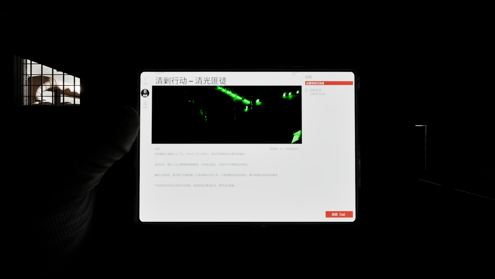
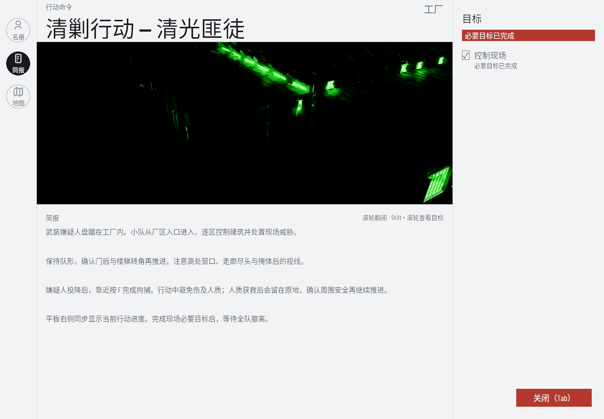

# 简报平板实施说明

项目：Co-op CQB FPS / UE 5.8.3。对应 puzzle 于 2026-11-12 提供的本期平板规格。

Tab 已切换为本地第一人称平板 Actor，使用 FPS_Devices 的真实模型、手臂及 Get / Hide / Idle 动画。部署选择、无人机等待叠加层和结算仍走各自现有界面。

## 模型和显示

- 模型：`/Game/FPS_Devices/Mesh/SM_Tablet`；手臂：`SK_Hands_04`；挂点：`Socket_Tablet`。资源没有独立玻璃组件，整机只有一个材质槽；没有修改原模型或原材质。
- 从 LOD0 三角面量得完整屏幕面宽 **21.327908 cm**、高 **14.803008 cm**，包含圆角外缘。中心为模型局部 `(-1.22945, 0.60098, 10.89065)`。此前测到的 20.82 × 14.25 cm 是内部矩形，最终使用完整屏幕范围。
- World Widget，Plane，Pivot `(0.5, 0.5)`，Draw Size **1280 × 888**，约 **60 px/cm**。组件朝模型 +Y，局部 Y = **0.701 cm**，高于屏幕约 0.1 cm。Y/Z 缩放分别由真实宽高计算，几何没有拉伸。
- 1600 宽参考画布按真实屏幕比例调整高度，约 1110.5 px；导航 96、右栏 400、中栏自适应，情报区 430，标题区 110。内容铺满屏幕，圆角处由模型遮挡。
- 原装备仅对本机持有者隐藏，收起后恢复原先 OwnerNoSee 状态。没有增加网络复制的平板 Actor。开着平板时沿用原任务板的移动、瞄准和开火锁定；收起动画结束才恢复输入。Esc 可以直接收起。

## 屏幕 UI 和光感

- 亮色主题：背景 `#F2F3F4`，文字 `#17191C` / `#5A6066`，分隔线 `#D8DBDE`，强调红 `#B3392E`。红色仅用于当前目标横条和右下关闭提示。
- 复用 `FOperationUIStyle` 的字体与中英文字体回退。导航使用 1.5 px 线性矢量图标，默认简报选中；本期导航不响应点击。
- 平板专用材质：`/Game/FPS/UI/Tablet/M_TabletDisplay`。从引擎 `Widget3DPassThrough` 复制，保留 SlateUI 等参数，改为 Opaque，Emissive × **1.6**，再用 EyeAdaptationInverse 保持曝光变化时的文字对比。没有加点阵。
- 本地平板的低优先级后期组件将 Bloom Threshold 设为 **1.0**、Intensity **0.35**；相机的夜视和闪光覆盖仍保留优先级，平板销毁后该后期组件一起移除。
- 夜视观看亮屏会出现现有 NVG 材质的强烈泛光；测试截图如实保留这个结果，没有自动关闭夜视或改动原 NVG 算法。
- `ManuallyRedraw=true`、`TickMode=Disabled`，开屏、任务数据更新和翻阅时才 `RequestRenderUpdate()`。静置后组件 Tick 回到关闭。
- 滚轮或 PgUp / PgDn 翻阅简报；Shift + 滚轮翻阅目标。没有引入 Widget Interaction、鼠标模式或页签点击。

## 数据与素材

- 任务名和地点继续复用 `ShooterLoadingScreen::GetTaskName/GetMapName`，从现有 `[FPS.MissionUI]` 配置读取。
- 类型、正文和侦察图也位于同一配置段：`FactoryTypeLabel` / `DefaultTypeLabel`、`FactoryBriefing` / `DefaultBriefing`、`FactoryReconImage`；后续地图可填写 `DefaultReconImage`。没有新建任务数据库或复制状态管道。
- 目标使用现有 GameState 的 `Report`、`ObjectiveDescriptions`，由现有 `OnMissionUpdated` 驱动；隐藏目标仅在原系统发现并完成后显示。没有把测试目标或虚构目标写进正式地图。
- 工厂侦察图：`T_Factory_Recon`，来自当前工厂地图的已有无人机航点 `(-1000,-4800,1800)`，方向 Pitch -27.4183° / Yaw 28.6105°，FOV 70。使用同源 NVG 后期材质并开启 Lumen 捕获；图像为 2000 × 780。
- 可重复生成入口：`Scripts/BuildMissionTabletAssets.py`。在编辑器 Python 中执行后，打开工厂地图、停止 PIE，再调用 `capture_factory_recon()`；捕获完成自动清理临时 SceneCapture Actor。材质创建函数不会在重复执行时叠加倍率。

## 验证结果

- 最终 FPSEditor / Win64 / Development 完整编译通过，记录见 `Saved/TabletImplementation/BuildDeliveryFinal.log`。
- 使用真实 Enhanced Input 的 Tab 动作，在独立 PIE 窗口验证开关、输入锁定和恢复。
- 临时测试目标通过原生 `CompleteObjective()` 完成。0/2 → 1/2 时平板实时勾选，收起并重开仍为 1/2。8 项运行断言通过，见同目录 `Tablet/RuntimeQA.json`。
- 静置时 World Widget / Plane / 1280×888 / ManualRedraw 均符合设置，组件 Tick 为 false。
- 已检查正视和 30° 斜视，截图中屏幕贴合模型，无可见黑边或边框溢出。斜视测试只临时转动平板组件，用于检查屏幕贴合，不代表新增持握姿势。
- 已运行夜视与闪光叠加测试。闪光期间原效果 Alpha 为 0.1885，随后恢复；没有覆盖掉既有受闪效果。
- 本机短测：关闭平板中位帧时间 **19.00 ms**（113 帧），打开 **19.57 ms**（125 帧）；P95 23.53 / 24.23 ms。仅代表本次编辑器场景短测，不等于独立包或其他硬件性能保证。
- 测试目标已删除，剩余 0 个；临时编辑器偏好已恢复。测试前后工厂地图 SHA256 相同：`F97DCD18B82691DEC1F473BA607663CA58E0F1F0578199DC35FBD0E709A74EAE`。
- 本轮没有重新打包，也没有新增多人运行验收；目标同步继续使用现有的服务器状态复制与客户端更新事件。
- 冷启动额外修正：侦察帧按情报槽匹配的宽高比直接满幅绘制，避免内层 ScaleBox 再次裁剪；平板目录已加入 AlwaysCook，保证配置软路径引用的侦察图随构建收集。
- 启用 Live Coding 的一次重新启动在角色／武器资源加载阶段崩溃，当时平板尚未创建；同版本使用 `-NoLiveCoding` 完整重启后，带声音的 PIE 与平板开关、闪光叠加复验通过。没有把这当作已定位根因；日志在 `Saved/TabletImplementation/EditorDelivery.log` 和 `EditorSoundRetry.log`。本轮新增反射类采用完整编译版本，当前编辑器关闭 Live Coding。

## 画面

以下为临时目标测试的实时勾选状态：

其余证据：`Tablet_30deg.png`、`Tablet_NVG.png`、`Tablet_Flash.png`、`Tablet_FlashRecovered.png`。

本期保留后续范围：可点击页签、名册展开、地图标记、视频情报。用户提到的 `ui-final-plan-2026-11-12.md` 与 `drone-cg-production-checklist.md` 未在本地项目中找到；本实现以本次消息规格和项目现有 UI 字体资源为准。
