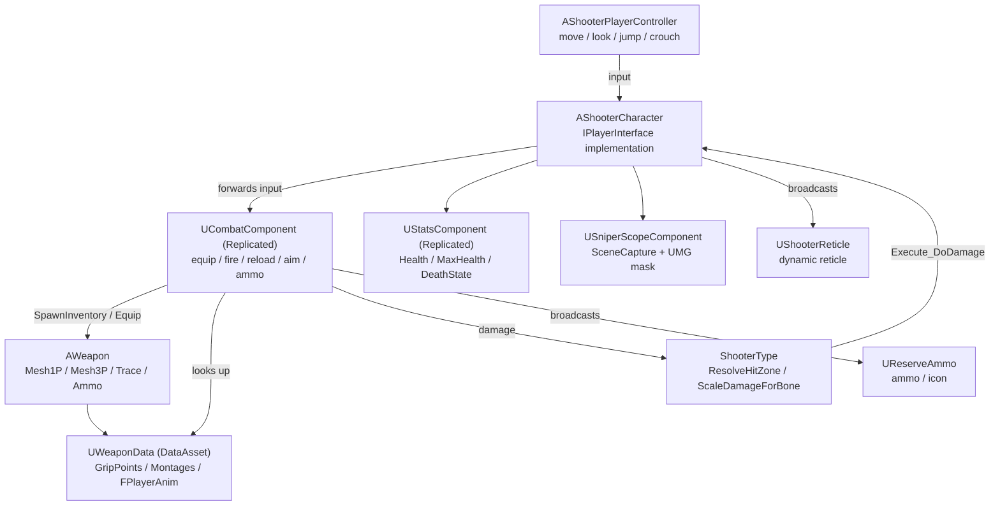

**Language / 语言：** **English** ｜ [中文](README.zh-CN.md)

---

# FPS — Unreal Engine 5 C++ First-Person Shooter

A first-person shooter gameplay framework built with **Unreal Engine 5.8 + C++**: character movement and look, weapons (long gun / pistol / melee) with equipping and cycling, firing and hit detection, reloading, aiming down sights (ADS), a sniper scope, health and per-body-part damage, hit reactions, and full multiplayer replication.

> This document was written by reading the source code. **No code file was modified.**
> For the function-by-function, component-by-component deep dive (signatures, behaviour, call chains, effects), see [DOCUMENTATION.md](<DOCUMENTATION.md>).
> Chinese version: [README.zh-CN.md](<README.zh-CN.md>) ｜ [DOCUMENTATION.zh-CN.md](<DOCUMENTATION.zh-CN.md>)

---

## 1. Project Overview

| Item | Value |
| --- | --- |
| Engine version | Unreal Engine 5.8 (`EngineAssociation: "5.8"` in [FPS.uproject](<FPS.uproject>)) |
| Primary module | `FPS`, type Runtime ([FPS.Build.cs](<Source/FPS/FPS.Build.cs>)) |
| Language | C++ — most entry points are exposed to Blueprints via `BlueprintCallable` / `BlueprintImplementableEvent` |
| Input | Enhanced Input (`UEnhancedInputComponent` + `UInputMappingContext`) |
| Default map | `/Game/FirstPerson/Lvl_FirstPerson` |
| Default GameMode | `/Script/FPS.ShooterGameModeBase` (see [DefaultEngine.ini](<Config/DefaultEngine.ini>)) |
| Custom collision channel | `Weapon` = `ECC_GameTraceChannel2` (trace type) |
| Build targets | `FPS` (Game), `FPSEditor` (Editor), `BuildSettingsVersion.V7` |

Module dependencies ([FPS.Build.cs](<Source/FPS/FPS.Build.cs>)):

- Public: `Core`, `CoreUObject`, `Engine`, `InputCore`, `EnhancedInput`, `GameplayTags`, `PhysicsCore`, `UMG`
- Private: `Slate`, `SlateCore`

Enabled plugins ([FPS.uproject](<FPS.uproject>)): `ModelingToolsEditorMode` (editor only), `GameplayStateTree`, `AnimationWarping`, `ModelContextProtocol`, `AllToolsets`.

---

## 2. Feature Overview

| System | What is implemented | Main code |
| --- | --- | --- |
| Character | First-person camera (zero-length spring arm + camera lag), separate 1P/3P skeletal meshes, crouch, jump, movement | [ShooterCharacter.cpp](<Source/FPS/Private/ShooterCharacter.cpp>), [ShooterPlayerController.cpp](<Source/FPS/Private/ShooterPlayerController.cpp>) |
| Weapons | Three kinds (long gun / pistol / melee), four slots (main / secondary / pistol / melee), weapon cycling, equip montages | [Weapon.cpp](<Source/FPS/Private/Weapon/Weapon.cpp>), [CombatComponent.cpp](<Source/FPS/Private/CombatComponent.cpp>) |
| Shooting | Sphere-sweep hit detection, single / automatic fire, server-side rate limiting, blueprint-driven muzzle and impact FX, magazine and reserve ammo | [Weapon.cpp](<Source/FPS/Private/Weapon/Weapon.cpp>), [CombatComponent.cpp](<Source/FPS/Private/CombatComponent.cpp>) |
| Reloading | 1P/3P reload montages, animation-notify-driven ammo transfer, auto-reload on empty, firing/cycling locked while reloading | [CombatComponent.cpp](<Source/FPS/Private/CombatComponent.cpp>) |
| ADS | Replicated `bAiming` (owner skipped), 1P arms/weapon sight alignment written into the blueprint variable `AdsMesh1PLoc` | [ShooterCharacter.cpp](<Source/FPS/Private/ShooterCharacter.cpp>), [CombatComponent.cpp](<Source/FPS/Private/CombatComponent.cpp>) |
| Sniper scope | SceneCapture2D + render target + full-screen UMG mask material; 3x zoom shown only inside the scope disc; the main camera keeps its normal FOV | [SniperScopeComponent.cpp](<Source/FPS/Private/Weapon/SniperScopeComponent.cpp>) |
| Damage | Bone name → hit zone (head / torso / limb) → multiplier (headshot ×2, limb ×0.75), resolved on the server | [ShooterType.cpp](<Source/FPS/Private/ShooterType/ShooterType.cpp>), [StatsComponent.cpp](<Source/FPS/Private/Stats/StatsComponent.cpp>) |
| Animation driving | `AO_Yaw`, `MovementOffsetYaw`, `TurningStatus`, `FABRIK_SocketTransform`, `FPlayerAnim` struct injection into the ABPs | [ShooterCharacter.cpp](<Source/FPS/Private/ShooterCharacter.cpp>), [WeaponData.h](<Source/FPS/Public/WeaponData.h>) |
| Hit reactions | Random montage from `HitReacts`, broadcast with a NetMulticast | [ShooterCharacter.cpp](<Source/FPS/Private/ShooterCharacter.cpp>) |
| UI | Dynamic reticle material (per weapon), ammo/reserve + weapon icon HUD, reticle hidden while aiming | [ShooterReticle.cpp](<Source/FPS/Private/Ui/ShooterReticle.cpp>), [ReserveAmmo.cpp](<Source/FPS/Private/Ui/ReserveAmmo.cpp>) |
| Networking | Server-authoritative spawning, equipping and damage; client-side magazine prediction; NetMulticast FX and third-person montages | [CombatComponent.cpp](<Source/FPS/Private/CombatComponent.cpp>) |

---

## 3. Directory Layout

```
FPS/
├─ FPS.uproject                     # Engine version, modules, plugins
├─ Config/
│  ├─ DefaultEngine.ini             # Collision channels (Weapon/Projectile), default map and GameMode
│  ├─ DefaultInput.ini              # Enhanced Input default classes, mouse sensitivity, axis config
│  └─ DefaultGame.ini               # Project name, AssetManager scan rules
├─ Content/
│  ├─ FPS/                          # First-party assets (see section 6)
│  └─ ...                           # Third-party asset packs (FPSTP, InfimaGames, IBWP3DPistol3Pack, ...)
└─ Source/
   ├─ FPS.Target.cs                 # Game target
   ├─ FPSEditor.Target.cs           # Editor target
   └─ FPS/
      ├─ FPS.Build.cs              # Module dependencies
      ├─ FPS.h / FPS.cpp           # Primary game module declaration
      ├─ Public/
      │  ├─ FPSTraceChannels.h            # Weapon trace channel constant
      │  ├─ ShooterGamePlayTags.h         # Native gameplay tag declarations
      │  ├─ ShooterCharacter.h            # Player character
      │  ├─ ShooterPlayerController.h     # Player controller (move / look / jump / crouch)
      │  ├─ ShooterGameModeBase.h         # GameMode (empty shell for blueprint subclassing)
      │  ├─ CombatComponent.h             # Core combat component
      │  ├─ WeaponData.h                  # Weapon data asset + FPlayerAnim / FMontageData
      │  ├─ Interface/PlayerInterface.h   # Character capability interface
      │  ├─ Stats/StatsComponent.h        # Health component
      │  ├─ ShooterType/ShooterType.h     # Hit zone / damage multiplier helpers
      │  ├─ Ui/ShooterReticle.h           # Dynamic reticle widget
      │  ├─ Ui/ReserveAmmo.h              # Ammo HUD widget
      │  └─ Weapon/
      │     ├─ Weapon.h                   # Weapon actor
      │     └─ SniperScopeComponent.h     # Sniper scope component + full-screen overlay widget
      └─ Private/                        # Implementations, one per public header
```

---

## 4. Getting Started

1. **Open the project**: open [FPS.uproject](<FPS.uproject>) with UE 5.8; on first open choose "Rebuild" or generate project files and compile the `FPS` module.
2. **Default map**: `/Game/FirstPerson/Lvl_FirstPerson` (already set as `GameDefaultMap` in [DefaultEngine.ini](<Config/DefaultEngine.ini>)).
3. **GameMode**: the global default is `AShooterGameModeBase`; in practice subclass it as `BP_ShooterGameMode` ([BP_ShooterGameMode.uasset](<Content/FPS/Game/BP_ShooterGameMode.uasset>)) and set:
   - `DefaultPawnClass = BP_ShooterCharacter`
   - `PlayerControllerClass = BP_ShooterPlayerController`
4. **Required character setup** (`BP_ShooterCharacter`; the code `checkf`s some of these):
   - `Combat → WeaponData` must point at `DA_WeaponData`, otherwise `GetWeaponAttachPoint` trips a `checkf` assertion.
   - `Combat → DefaultWeaponClass` must contain at least one weapon blueprint.
   - Every input field (`IA_FireWeapon`, `IA_CycleWeapon`, `IA_ReloadWeapon`, `IA_AimWeapon`, and the four `IA_Equip*`) must be assigned.
   - The blueprint variable `AdsMesh1PLoc` (`FVector`) must exist — the ADS sight alignment writes straight into it.
   - `HitReacts` should contain at least one montage: `Multicast_HitReact` picks a random index with no empty-array guard.
5. **Player controller**: `BP_ShooterPlayerController` needs `ShooterIMC = IMC_Shooter` plus `IA_Move` / `IA_Look` / `IA_Jump` / `IA_Crouch`.
6. **Input assets**: bind the `IA_*` assets to keys inside `IMC_Shooter`. `IA_FireWeapon` should be able to fire both `Started` and `Completed` — the code binds both to distinguish single from automatic fire.
7. **Weapon blueprints**: derive from `BP_Weapon` (`AWeapon`), set `WeaponType` (gameplay tag), `WeaponKind`, the `Mesh1P` / `Mesh3P` skeletal meshes and their animation blueprints (`ABP_Rifle`, `ABP_Pistol`, `ABP_M700`), and implement the `FireEffect` blueprint event for muzzle flash / bullet holes / sound.
8. **Data asset**: fill `DA_WeaponData` per weapon tag — `GripPoints` (attach socket names), `WeaponMontages`, `FirstPersonAnims` / `ThirdPersonAnims`, `FirstPersonMontages` / `ThirdPersonMontages`.
9. **HUD**: add `WBP_ShooterOverlay` to the viewport (it contains `WBP_ReserveAmmo`). The reticle widget is based on `UShooterReticle` and must contain an Image named `Image_Reticle` (the code also tolerates the misspelled `Image_Redicle`).
10. **Scope material**: `/Game/FPS/UI/M_SniperScope` is a hard-coded path (see `SniperScopeMaterialPath` in [SniperScopeComponent.cpp](<Source/FPS/Private/Weapon/SniperScopeComponent.cpp>)). Renaming or moving it breaks the scope view and logs a warning. The material must expose `ScopeView` (texture), `MaskRadius`, `RingWidth`, `ReticleThickness` and `Aspect` parameters.

---

## 5. Controls

Input is dispatched through Enhanced Input: move / look / jump / crouch live on `AShooterPlayerController`, everything combat-related lives on `AShooterCharacter`.

| Action | Input asset | Trigger event | Notes |
| --- | --- | --- | --- |
| Move | `IA_Move` | `Triggered` | Moves relative to the yaw of the control rotation |
| Look | `IA_Look` | `Triggered` | `AddYawInput` / `AddPitchInput` |
| Jump | `IA_Jump` | `Started` | Stands up first while crouched, otherwise `Jump()` |
| Crouch | `IA_Crouch` | `Started` | Toggles `bWantsToCrouch` |
| Fire | `IA_FireWeapon` | `Started` / `Completed` | Press to fire, release to stop (drives automatic fire) |
| Aim | `IA_AimWeapon` | `Started` | Toggles ADS (`bAiming`) and calls the blueprint event `OnAim` |
| Reload | `IA_ReloadWeapon` | `Started` | Plays the reload montage; ammo is moved by the animation notify |
| Cycle weapon | `IA_CycleWeapon` | `Started` | Cycles to the next weapon in the inventory |
| Main weapon | `IA_EquipMainWeapon` | `Started` | Equips the first long gun |
| Secondary weapon | `IA_EquipSecondaryWeapon` | `Started` | Equips the second long gun |
| Pistol | `IA_EquipPistol` | `Started` | Equips the first pistol |
| Melee | `IA_EquipMeleeWeapon` | `Started` | Equips the first melee weapon |

> Note: `IMC_Shooter` contains `LeftMouseButton`, `RightMouseButton`, `SpaceBar`, `LeftControl`, `One`–`Four`, `R`, `Q`, `E` and gamepad triggers. The mapping in the table above reflects the common configuration — **`IMC_Shooter` inside the editor is the source of truth**.

---

## 6. Key Blueprints and Assets (`/Game/FPS`)

| Asset | Purpose |
| --- | --- |
| `Character/BP_ShooterCharacter` | Player character blueprint (attach points, FOV, weapon classes, ADS variable `AdsMesh1PLoc`, `HitReacts`) |
| `Character/ABP_FirstPerson` / `ABP_ThirdPerson` | 1P / 3P animation blueprints; consume `AO_Yaw`, `MovementOffsetYaw`, `TurningStatus`, `FABRIK_SocketTransform` and hold the `CurrenrAnim` / `CurrentAnim` variables |
| `Player/BP_ShooterPlayerController` | Input mapping context and move/look bindings |
| `Game/BP_ShooterGameMode` | GameMode that sets the default Pawn and Controller |
| `Data/DA_WeaponData` | The single weapon data asset (grip points, montages, animation structs) |
| `Weapon/BP_Weapon`, `BP_RIfle`, `BP_Refile`, `BP_Pistol`, `BP_M700` | Weapon actor blueprints (kind: long gun / pistol / sniper) |
| `Weapon/ABP_Rifle`, `ABP_Pistol`, `ABP_M700` | Animation blueprints for the weapon skeletal meshes |
| `UI/WBP_ShooterOverlay`, `UI/WBP_ReserveAmmo`, `UI/WB_Health` | HUD root widget, ammo widget, health widget |
| `UI/M_SniperScope` | Sniper scope mask material (referenced by a hard-coded path) |
| `Input/IMC_Shooter`, `Input/InputAction/IA_*` | Input mapping context and every input action |

---

## 7. Architecture at a Glance



---

## 8. Networking Model

- **Spawning and equipping**: `SpawnInventory` only runs on `ROLE_Authority`. `UCombatComponent` replicates `Inventory` and `CurrentWeapon`; clients re-attach and re-apply animation through `OnRep_CurrentWeapon`.
- **Firing**: the client predicts immediately (plays the 1P montage, decrements the magazine, spawns local FX) → `Server_FireWeapon(Hit)` validates the fire rate and resolves damage → `Multicast_FireWeapon` lets remote clients play FX and the 3P montage, and reconciles the magazine via `Rep_Fire(AuthAmmo)`.
- **Reloading**: locally plays the 1P montage and sets `Reloading` → `Server_ReloadWeapon` → `Multicast_ReloadWeapon` (remotes play 3P) → the animation notify calls `ApplyReload` / `Notify_ReloadWeapon`, which move rounds on the server → `Client_ReloadWeapon` sends the authoritative numbers back.
- **Aiming**: `bAiming` replicates with `COND_SkipOwner` (the owner already predicted it), while `Server_Aim` still informs the server.
- **Reserve ammo**: `CurrentReserveAmmo` replicates to the owner only (`COND_OwnerOnly`).
- **Damage**: resolved on the server; `Multicast_HitReact` makes the other clients play a hit reaction montage.

---

## 9. Known Limitations

- `EWeaponStatus::Firing` is never written by any code path.
- `AimTimeline`, `GetAimTimelineAlpha()` and `AimAlignAlpha` are declared but not wired into any call chain (ADS alignment currently works by rewriting a blueprint variable).
- `UStatsComponent::DeathState` only ever holds `NotDead`, `OnRep_DeathState` is empty, and `ChangeHealthByAmout` always returns `false` — there is no death flow yet.
- `AShooterCharacter::DoDamage_Implementation` picks a random index into `HitReacts` without checking for an empty array; keep at least one montage configured.
- Scope magnification, disc radius and reticle thickness are compile-time constants in `SniperScopeComponent.cpp` and are not exposed as properties.
- `AShooterGameModeBase` is an empty shell; match rules (rounds, scoring, respawn) must be added.

---

## 10. Statement (preserved verbatim)

1. All asset were download from [fab](https://fab.com)
2. All code can be use by yourself
3. If you have any question for the code or find some error, please mail me anytime
4. It mostly include basic code, may not include some asset data, but all asset can by replace because I using TMap data

---

## 11. Further Reading

- Function-by-function / component-by-component reference: [DOCUMENTATION.md](<DOCUMENTATION.md>)
- 中文版：[README.zh-CN.md](<README.zh-CN.md>) ｜ [DOCUMENTATION.zh-CN.md](<DOCUMENTATION.zh-CN.md>)
- Unreal Engine docs: Gameplay Framework, Enhanced Input, `UDataAsset`, `USceneCaptureComponent2D`
