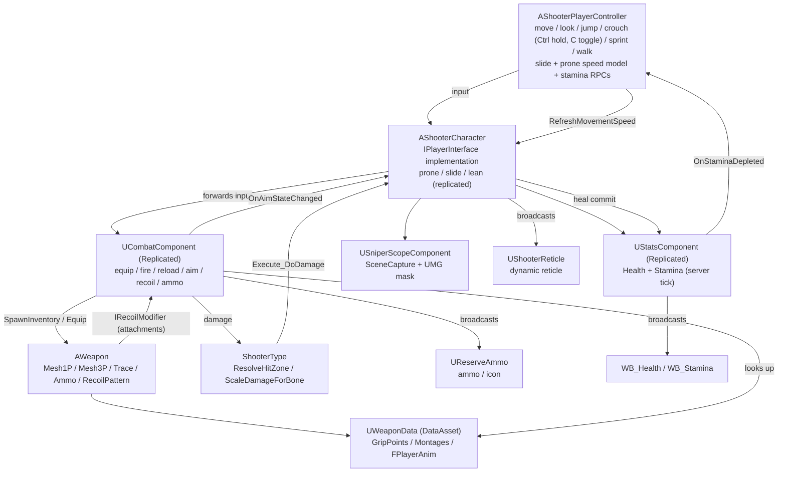

**Language / 语言：** **English** ｜ [中文](README.zh-CN.md)

---

# FPS — Unreal Engine 5 C++ First-Person Shooter

A first-person shooter gameplay framework built with **Unreal Engine 5.8 + C++**: character movement and look, walk/sprint movement modes with stamina, **Ctrl-hold / C-toggle crouch, a speed-based slide and prone crawling**, weapons (long gun / **double-barrel shotgun** / AK / pistol / melee / **throwables** / the **bomb**) with equipping, slot selection and auto-un-aim, firing with hit detection (including a **blade sweep for melee**), **recoil patterns with view-kick recovery**, reloading, aiming down sights (ADS), a sniper scope, **a data-driven weapon attachment system** (barrel / handguard / muzzle / optic / grip / stock / tactical / magazine) with an in-game attachment menu and a Tab loadout screen, **picture-in-picture magnified optics**, a flashlight, health with healing, per-body-part damage, hit reactions, and full multiplayer replication.

Three match modes share one `AShooterGameModeBase` / `AShooterGameState` base: **Team Deathmatch**, **Search & Destroy** (rounds, a plantable C4 and two bomb sites) and the free-play range. On top of that sits an **in-match HUD** — a mode-aware score header (TDM / SD), a kill feed with weapon icons, a respawn countdown — and a menu-driven gunsmith/loadout flow that also equips the primary weapon.

> This document was written by reading the source code. **No code file was modified.**
> For the function-by-function, component-by-component deep dive (signatures, behaviour, call chains, effects), see [DOCUMENTATION.md](<DOCUMENTATION.md>).
> Chinese version: [README.zh-CN.md](<README.zh-CN.md>) ｜ [DOCUMENTATION.zh-CN.md](<DOCUMENTATION.zh-CN.md>)

---

## 1. Project Overview

| Item | Value |
| --- | --- |
| Engine version | Unreal Engine 5.8 (`EngineAssociation: "5.8"` in [FPS.uproject](<FPS.uproject>)) |
| Primary module | `FPS`, type Runtime ([FPS.Build.cs](<Source/FPS/FPS.Build.cs>)) |
| Language | C++ — most entry points are exposed to Blueprints via `BlueprintCallable` / `BlueprintImplementableEvent` |
| Input | Enhanced Input (`UEnhancedInputComponent` + `UInputMappingContext`) |
| Default map | `/Game/FPS/Level/MainMenu/MainMenu` — the menu level; each mode travels to its own map (see §10.4 and §10.5) |
| Default GameMode | `/Script/FPS.ShooterGameModeBase` (see [DefaultEngine.ini](<Config/DefaultEngine.ini>)) |
| Custom collision channel | `Weapon` = `ECC_GameTraceChannel2` (trace type) |
| Build targets | `FPS` (Game), `FPSEditor` (Editor), `BuildSettingsVersion.V7` |

Module dependencies ([FPS.Build.cs](<Source/FPS/FPS.Build.cs>)):

- Public: `Core`, `CoreUObject`, `Engine`, `InputCore`, `EnhancedInput`, `GameplayTags`, `PhysicsCore`, `UMG`, `Niagara`
- Private: `Slate`, `SlateCore`

Enabled plugins ([FPS.uproject](<FPS.uproject>)): `ModelingToolsEditorMode` (editor only), `GameplayStateTree`, `AnimationWarping`, `ModelContextProtocol`, `AllToolsets`.

---

## 2. Feature Overview

| System | What is implemented | Main code |
| --- | --- | --- |
| Character | First-person camera (zero-length spring arm + camera lag), separate 1P/3P skeletal meshes, crouch, jump, movement | [ShooterCharacter.cpp](<Source/FPS/Private/ShooterCharacter.cpp>), [ShooterPlayerController.cpp](<Source/FPS/Private/ShooterPlayerController.cpp>) |
| Lean (peek) | Q / E lean left / right (hold, optional toggle), replicated `LeanTarget` + smoothed `LeanAlpha`, 1P camera slide + roll with wall probe, blocked while sprinting, 3P spine lean in `ABP_ThirdPerson`; the weapon trace follows the leaned camera | [ShooterCharacter.cpp](<Source/FPS/Private/ShooterCharacter.cpp>), [Weapon.cpp](<Source/FPS/Private/Weapon/Weapon.cpp>) |
| Movement modes | Toggle walk and toggle sprint, multiplicative speed model (walk / crouch / ADS / prone), sprint cancelled by ADS, crouch, prone or by **starting a slide**, sprint cancelled when stamina runs out, and **firing cancels a sprint** (the press that cancels does not fire) | [ShooterPlayerController.cpp](<Source/FPS/Private/ShooterPlayerController.cpp>), [CombatComponent.cpp](<Source/FPS/Private/CombatComponent.cpp>) |
| Crouch modes | **Left Ctrl held** to crouch (stand on release, delayed by the ceiling), **C** to toggle; both are runtime Enhanced Input actions at priority 2, so the legacy `IA_Crouch` mapping is shadowed | [ShooterPlayerController.cpp](<Source/FPS/Private/ShooterPlayerController.cpp>) |
| Slide | Pressing a crouch key above `SlideMinSpeed` (600) slides instead of crouching: crouched capsule, `+150` cm/s boost, friction 0 with linear `BrakingDecelerationWalking`, movement input ignored, ends after 0.9 s / below 200 cm/s / when leaving the ground; ends crouched (C / Ctrl held) or standing (Ctrl released); jump cancels it; server-validated at 75 % speed with a `Client_SlideRejected` rollback | [ShooterCharacter.cpp](<Source/FPS/Private/ShooterCharacter.cpp>), [ShooterPlayerController.cpp](<Source/FPS/Private/ShooterPlayerController.cpp>) |
| Prone / crawl | **Z** toggles prone (runtime input when unassigned). Prone reuses CMC crouch with `CrouchedHalfHeight` 34, drops the camera, crawls at `RunSpeed × 0.25`, blocks jump / lean / sprint, refuses to stand up under a low ceiling, and is server-authoritative with `Client_ProneRejected`. `bProneCrawling` (prone **and** moving) lets the ABP play a full-body crawl when moving and a gun-hold upper body when stopped | [ShooterCharacter.cpp](<Source/FPS/Private/ShooterCharacter.cpp>), [ShooterPlayerController.cpp](<Source/FPS/Private/ShooterPlayerController.cpp>) |
| Stamina | Server-authoritative drain/regen, jump cost, `OnStaminaDepleted`, stamina bar HUD | [StatsComponent.cpp](<Source/FPS/Private/Stats/StatsComponent.cpp>) |
| Locomotion feel | `GroundSpeed`, walk-gait BlendSpace swap (`Strafe_Walking`), per-frame locomotion play rate pushed into the AnimBPs (prone uses `ProneAnimReferenceSpeed` 100) | [ShooterCharacter.cpp](<Source/FPS/Private/ShooterCharacter.cpp>) |
| Weapons | Five kinds (long gun / pistol / melee / throwable / bomb) across six slots (main / secondary / pistol / melee / throwable / bomb) selected by the number keys, equip montages (with optional random variant pools), interruptible equip/reload (see §10.2), auto un-aim when switching. `UsesAmmo()` / `CanAimWeapon()` are kind-driven, so the knife and the bomb never aim and throwables do not auto-reload (see §10.5) | [Weapon.cpp](<Source/FPS/Private/Weapon/Weapon.cpp>), [CombatComponent.cpp](<Source/FPS/Private/CombatComponent.cpp>) |
| Fire modes | `EFireType` = single / automatic / **burst**. `AllowedFireModes` decides what a weapon may use (default: pistol = single + burst, `bCanSwitchFireMode` rifle = single + automatic), `BurstCount` 3 and `BurstShotInterval` shape the burst; the burst loop runs in `FireTimerFinished` and the server rate limit uses the same interval (see §10.5) | [Weapon.cpp](<Source/FPS/Private/Weapon/Weapon.cpp>), [CombatComponent.cpp](<Source/FPS/Private/CombatComponent.cpp>) |
| Double-barrel shotgun | Uses the normal fire path; the two shells in the breech are real static meshes on `Bullet1Socket` / `Bullet2Socket` toggled by `Bullet1Spawn` / `Bullet1Delete` / `Bullet2Spawn` / `Bullet2Delete` / `DeleteAllBullets` notifies, and the shell sockets are forced always-animated so they do not freeze in bind pose (see §10.5) | [Weapon.cpp](<Source/FPS/Private/Weapon/Weapon.cpp>) |
| Throwables | Frag / smoke / molotov / flash share `AThrownProjectile`. Fire starts a pin-pull, the release throws high (left button) or low (right button) and is driven by `ThrowReleaseTime` or the `Notify_ThrowWeapon` anim notify; frag does radial damage with line-of-sight, the other effects override `OnDetonate` in Blueprint (see §10.5) | [ThrownProjectile.cpp](<Source/FPS/Private/Weapon/ThrownProjectile.cpp>), [CombatComponent.cpp](<Source/FPS/Private/CombatComponent.cpp>) |
| Game modes | `AShooterGameModeBase` (players, kills, kill feed, respawn) → `ATDMGameMode` (team deathmatch), `ASearchDestroyGameMode` (rounds + bomb) and the range. `UShooterGameInstance` holds the mode table (`GameModeClass` + `Map` + `bImplemented`) and opens rooms / joins by IP (see §10.4, §10.5) | [ShooterGameModeBase.cpp](<Source/FPS/Private/ShooterGameModeBase.cpp>), [SearchDestroyGameMode.cpp](<Source/FPS/Private/Game/SearchDestroyGameMode.cpp>), [ShooterGameInstance.cpp](<Source/FPS/Private/ShooterGameInstance.cpp>) |
| Search & Destroy | Two teams, attackers plant a C4 at one of two bomb sites, defenders defuse. Round phases warmup / freeze / live / post-round, movement and actions locked outside live, no respawn inside a round, first to 6 rounds with a side swap (see §10.5) | [SearchDestroyGameMode.cpp](<Source/FPS/Private/Game/SearchDestroyGameMode.cpp>), [BombActor.cpp](<Source/FPS/Private/Game/BombActor.cpp>), [BombSite.cpp](<Source/FPS/Private/Game/BombSite.cpp>) |
| Match HUD | `UMatchHUD` hosts a per-mode score header (`UTDMHeaderWidget` / `USDHeaderWidget`) and the kill feed; the header shows scores, warmup / match / bomb timer, and the SD version adds round, bomb state, prompt and an action progress bar. `UKillFeedWidget` draws team-coloured killer → weapon icon → victim rows that expire (see §10.5) | [MatchHUD.cpp](<Source/FPS/Private/Ui/MatchHUD.cpp>), [MatchHeaderWidget.cpp](<Source/FPS/Private/Ui/MatchHeaderWidget.cpp>), [KillFeedWidget.cpp](<Source/FPS/Private/Ui/KillFeedWidget.cpp>) |
| Melee | `EWeaponKind::Melee` never aims, never consumes ammo (`UsesAmmo()`), never auto-reloads, turns both FABRIK alphas off, and hits with a **sphere sweep along the blade** (`MeleeSocketName`, `MeleeHitRadius` 40, `MeleeHitReach` 120) plus a full-body 3P swing montage | [Weapon.cpp](<Source/FPS/Private/Weapon/Weapon.cpp>), [CombatComponent.cpp](<Source/FPS/Private/CombatComponent.cpp>) |
| Shooting | Sphere-sweep hit detection with a **hip-fire spread cone** (randomised by `HipFireSpread` × attachment multipliers, 0 while aiming), single / automatic fire with a per-weapon **fire-mode toggle** (`bCanSwitchFireMode`, replicated `FireType`), bolt-action cycling (`BoltCycling` state), **recoil pattern with recovery and attachment modifiers**, server-side rate limiting, blueprint-driven muzzle and impact FX, magazine and reserve ammo | [Weapon.cpp](<Source/FPS/Private/Weapon/Weapon.cpp>), [CombatComponent.cpp](<Source/FPS/Private/CombatComponent.cpp>), [RecoilModifierInterface.h](<Source/FPS/Public/Interface/RecoilModifierInterface.h>) |
| Reloading | 1P/3P reload montages with **variants** (first / empty / tactical, falling back to the default montage), left-hand IK blended off during reload and bolt, animation-notify-driven ammo transfer, auto-reload on empty, weapon re-gripped by a C++ anim notify | [CombatComponent.cpp](<Source/FPS/Private/CombatComponent.cpp>), [AnimNotify_WeaponGrip.cpp](<Source/FPS/Private/AnimNotify/AnimNotify_WeaponGrip.cpp>) |
| Healing | Heal montage with weapon hidden during the animation, server-clamped heal amount, 3P multicast for other players | [ShooterCharacter.cpp](<Source/FPS/Private/ShooterCharacter.cpp>) |
| ADS | Replicated `bAiming` (owner skipped), `OnAimStateChanged` broadcast, C++-driven ADS: `AimAlpha` advances over the weapon's ADS time (scaled by attachments), Mesh1P is interpolated from a **per-weapon hip offset** to the sight-aligned position at a configurable **eye distance**, and the camera FOV is interpolated in C++ (optic `AimFOV` → weapon `AimFeildOfView` → default). Optional visual weapon recoil (off by default). See §10.1 | [ShooterCharacter.cpp](<Source/FPS/Private/ShooterCharacter.cpp>), [CombatComponent.cpp](<Source/FPS/Private/CombatComponent.cpp>) |
| Sniper scope | **Legacy, now idle.** `USniperScopeComponent` only keeps itself switched off; the sniper follows its equipped optic like every other gun (see §10.1) | [SniperScopeComponent.cpp](<Source/FPS/Private/Weapon/SniperScopeComponent.cpp>) |
| Damage | Bone name → hit zone (head / torso / limb) → multiplier (headshot ×2, limb ×0.75), resolved on the server | [ShooterType.cpp](<Source/FPS/Private/ShooterType/ShooterType.cpp>), [StatsComponent.cpp](<Source/FPS/Private/Stats/StatsComponent.cpp>) |
| Animation driving | `AO_Yaw`, `MovementOffsetYaw`, `TurningStatus`, `FABRIK_SocketTransform`, `FABRIK_Alpha`, `FPlayerAnim` struct injection into the ABPs, prone/slide/grip-hold values | [ShooterCharacter.cpp](<Source/FPS/Private/ShooterCharacter.cpp>), [WeaponData.h](<Source/FPS/Public/WeaponData.h>) |
| Hit reactions | **Directional** hit reacts (front / back / left / right pools, falling back to `HitReacts`), broadcast with a NetMulticast; the victim gets a damage-direction ring and the shooter gets hit-confirm marks | [ShooterCharacter.cpp](<Source/FPS/Private/ShooterCharacter.cpp>) |
| UI | Dynamic reticle material (per weapon), **native spreading crosshair** driven by `OnWeaponFired`, ammo/reserve + weapon icon HUD, health bar, stamina bar, reticle hidden while aiming (except with melee), **damage direction ring** and **hit confirm marks** drawn by `UShooterReticle` | [ShooterReticle.cpp](<Source/FPS/Private/Ui/ShooterReticle.cpp>), [ReserveAmmo.cpp](<Source/FPS/Private/Ui/ReserveAmmo.cpp>) |
| Weapon attachments | Data-asset driven attachments per slot, server-validated whitelist, default loadout per weapon, replicated, live 1P/3P meshes (**static or skeletal**), and redirection of the grip / muzzle / aim sockets | [Weapon.cpp](<Source/FPS/Private/Weapon/Weapon.cpp>), [AttachmentData.h](<Source/FPS/Public/Weapon/AttachmentData.h>) |
| Grip hold style | Cradle (angled/no grip) vs Grab (vertical) per grip attachment: swaps the idle/aim-idle animations, adds Grab reload variants and exposes a left-hand hold pose for the ABP's layered blend | [AttachmentData.h](<Source/FPS/Public/Weapon/AttachmentData.h>), [FirstPersonAnimInstance.cpp](<Source/FPS/Private/Animation/FirstPersonAnimInstance.cpp>) |
| Magazine attachments | A magazine can be a **skeletal** mesh with its own reload animations played in sync with the arm reload (± empty / tactical variants) and optional bone hiding (`mag_02` spare mag) | [Weapon.cpp](<Source/FPS/Private/Weapon/Weapon.cpp>), [AttachmentData.h](<Source/FPS/Public/Weapon/AttachmentData.h>) |
| Attachment UI | In-game attachment menu (one row per slot), Tab loadout screen with a three-weapon preview render and a draggable attachment window | [AttachmentMenu.cpp](<Source/FPS/Private/Ui/AttachmentMenu.cpp>), [LoadoutScreen.cpp](<Source/FPS/Private/Ui/LoadoutScreen.cpp>) |
| Optics & flashlight | Red dot / holographic sights align on the optic's own socket and use camera FOV; only `Magnified` / `Variable` optics with a usable lens render a picture-in-picture scope (variable optics cycle zoom levels), and the flashlight is a spotlight driven by the attachment data | [OpticScopeComponent.cpp](<Source/FPS/Private/Weapon/OpticScopeComponent.cpp>) |
| 1P hand IK | The first-person FABRIK is **disabled by design** (`FABRIK_Alpha1P` is always 0): the hold pose comes from per-weapon hold animations and the Grab/Cradle style. `UFirstPersonAnimInstance` publishes `GripHoldStyle`, `ActiveIdleAnim`, `LeftHandHoldPose` and `bUseLeftHandHoldPose` for the ABP | [FirstPersonAnimInstance.cpp](<Source/FPS/Private/Animation/FirstPersonAnimInstance.cpp>) |
| Networking | Server-authoritative spawning, equipping, attachments, damage, stamina, healing, **prone and slide**; client-side magazine prediction and recoil; NetMulticast FX and third-person montages; `Client_ProneRejected` / `Client_SlideRejected` rollbacks | [CombatComponent.cpp](<Source/FPS/Private/CombatComponent.cpp>), [ShooterCharacter.cpp](<Source/FPS/Private/ShooterCharacter.cpp>) |

---

## 3. Directory Layout

```
FPS/
├─ FPS.uproject                     # Engine version, modules, plugins
├─ Config/
│  ├─ DefaultEngine.ini             # Collision channels (Weapon/Projectile), physical surfaces, default map and GameMode
│  ├─ DefaultInput.ini              # Enhanced Input default classes, mouse sensitivity, axis config
│  ├─ DefaultGame.ini               # Project name, AssetManager scan rules
│  └─ DefaultGameplayTags.ini       # The one config-registered tag: Weapon.type.ak
├─ Content/
│  ├─ FPS/                          # First-party assets (see section 6)
│  └─ ...                           # Third-party asset packs (FPSTP, InfimaGames, IBWP3DPistol3Pack, ...)
└─ Source/
   ├─ FPS.Target.cs                 # Game target
   ├─ FPSEditor.Target.cs           # Editor target
   └─ FPS/
      ├─ FPS.Build.cs              # Module dependencies
      ├─ FPS.h / FPS.cpp           # Primary game module declaration
      ├─ Public/
      │  ├─ FPSTraceChannels.h            # Weapon trace channel constant
      │  ├─ ShooterGamePlayTags.h         # Native gameplay tag declarations
      │  ├─ ShooterCharacter.h            # Player character
      │  ├─ ShooterPlayerController.h     # Player controller (move / look / jump / crouch / sprint / walk)
      │  ├─ ShooterGameModeBase.h         # GameMode (empty shell for blueprint subclassing)
      │  ├─ CombatComponent.h             # Core combat component (inventory, fire, reload, aim, recoil)
      │  ├─ WeaponData.h                  # Weapon data asset + FPlayerAnim / FMontageData
      │  ├─ AnimNotify/
      │  │  └─ AnimNotify_WeaponGrip.h    # C++ anim notify: re-attach the weapon to a hand socket
      │  ├─ Interface/
      │  │  ├─ PlayerInterface.h          # Character capability interface
      │  │  └─ RecoilModifierInterface.h  # IRecoilModifier + FRecoilScale (attachment recoil hooks)
      │  ├─ Animation/FirstPersonAnimInstance.h   # C++ base for ABP_FirstPerson: 1P hand FABRIK + grip hold style
      │  ├─ Ui/AttachmentMenu.h                   # Attachment menu (one row per slot)
      │  ├─ Ui/AttachmentSlotRow.h                # Slot row + attachment option buttons
      │  ├─ Ui/AttachmentOptionEntry.h            # One attachment button / the "remove" button
      │  ├─ Ui/LoadoutScreen.h                    # Tab loadout screen + draggable attachment window
      │  ├─ Ui/LoadoutPreviewRig.h                # SceneCapture rig for the three-weapon preview
      │  ├─ Ui/LoadoutWeaponCard.h                # One weapon card in the loadout screen
      │  ├─ Weapon/AttachmentData.h               # Attachment data asset (+ EOpticType, EGripHoldStyle)
      │  ├─ Weapon/OpticScopeComponent.h          # Picture-in-picture magnified optic
      │  ├─ Stats/StatsComponent.h        # Health + stamina component
      │  ├─ ShooterType/ShooterType.h     # Hit zone / damage multiplier helpers
      │  ├─ Ui/ShooterReticle.h           # Dynamic reticle widget
      │  ├─ Ui/ReserveAmmo.h              # Ammo HUD widget
      │  └─ Weapon/
      │     ├─ Weapon.h                   # Weapon actor (+ FRecoilStep)
      │     └─ SniperScopeComponent.h     # Sniper scope component + full-screen overlay widget
      └─ Private/                        # Implementations, one per public header
```

---

## 4. Getting Started

1. **Open the project**: open [FPS.uproject](<FPS.uproject>) with UE 5.8; on first open choose "Rebuild" or generate project files and compile the `FPS` module.
2. **Default map**: `/Game/FPS/Level/MainMenu/MainMenu` (already set as `GameDefaultMap` and `EditorStartupMap` in [DefaultEngine.ini](<Config/DefaultEngine.ini>)); the menu then travels to the mode's own map through `UShooterGameInstance`.
3. **GameMode**: the global default is `AShooterGameModeBase`; in practice subclass it as `BP_ShooterGameMode` ([BP_ShooterGameMode.uasset](<Content/FPS/Game/BP_ShooterGameMode.uasset>)) and set:
   - `DefaultPawnClass = BP_ShooterCharacter`
   - `PlayerControllerClass = BP_ShooterPlayerController`
4. **Required character setup** (`BP_ShooterCharacter`; the code `checkf`s some of these):
   - `Combat → WeaponData` must point at `DA_WeaponData`, otherwise `GetWeaponAttachPoint` trips a `checkf` assertion.
   - `Combat → DefaultWeaponClass` must contain at least one weapon blueprint.
   - Every input field (`IA_FireWeapon`, `IA_ReloadWeapon`, `IA_AimWeapon`, `IA_Heal` and the four `IA_Equip*`) must be assigned.
   - `HealMontage` must be set, otherwise heal input logs a warning and does nothing. `HealAmout` defaults to `30`.
   - The blueprint variable `AdsMesh1PLoc` (`FVector`) must exist — the ADS sight alignment writes straight into it.
   - `HitReacts` should contain at least one montage: `Multicast_HitReact` picks a random index with no empty-array guard.
5. **Player controller**: `BP_ShooterPlayerController` needs `ShooterIMC = IMC_Shooter` plus `IA_Move` / `IA_Look` / `IA_Jump` / `IA_Crouch` / `IA_Sprint` / `IA_Walk`. Speeds and multipliers (`WalkSpeed` 250, `RunSpeed` 500, `SprintSpeed` 800, `CrouchSpeedMultiplier` 0.6, `WalkSpeedMultiplier` 0.5, `AimSpeedMultiplier` 0.7) live on the controller.
6. **Input assets**: bind the `IA_*` assets to keys inside `IMC_Shooter`. `IA_FireWeapon` should be able to fire both `Started` and `Completed` — the code binds both to distinguish single from automatic fire. `IA_Sprint`, `IA_Walk` and `IA_Heal` are toggle/press actions bound on `Started`.
7. **Weapon blueprints**: derive from `BP_Weapon` (`AWeapon`), set `WeaponType` (gameplay tag), `WeaponKind`, the `Mesh1P` / `Mesh3P` skeletal meshes and their animation blueprints (`ABP_Rifle`, `ABP_Pistol`, `ABP_M700`), tune the recoil block (`RecoilPattern`, `RecoilPitchScale`, `RecoilYawScale`, `AimRecoilMultiplier`, `RecoilRecoverySpeed`, `RecoilRecoveryDelay`, `RecoilResetTime`), and implement the `FireEffect` blueprint event for muzzle flash / bullet holes / sound.
8. **Data asset**: fill `DA_WeaponData` per weapon tag — `GripPoints` (attach socket names), `WeaponMontages`, `FirstPersonAnims` / `ThirdPersonAnims` (including `Strafe_Walking` if the weapon has walk-speed blends), `FirstPersonMontages` / `ThirdPersonMontages`.
9. **Animation blueprints** must expose the names the C++ pushes by property name: the 3P ABP should have `bUseWalkGait`, `LocomotionPlayRate` (or `PlayRate`) and `GroundSpeed`; the 1P ABP needs `PlayRate`. A missing property is a silent no-op.
10. **Weapon grip notify**: place the **Weapon Grip** notify (`UAnimNotify_WeaponGrip`) on the frame where the supporting hand takes the gun in reload/fire montages and set `GripSocket` to the hand socket/bone. The sniper reload montages in this project already use it.
11. **HUD**: add `WBP_ShooterOverlay` to the viewport (it contains `WBP_ReserveAmmo` and `WB_Stamina`); `WB_Health` shows health. The reticle widget is based on `UShooterReticle` and must contain an Image named `Image_Reticle` (the code also tolerates the misspelled `Image_Redicle`).
12. **Scope material**: `/Game/FPS/UI/M_SniperScope` is a hard-coded path (see `SniperScopeMaterialPath` in [SniperScopeComponent.cpp](<Source/FPS/Private/Weapon/SniperScopeComponent.cpp>)). Renaming or moving it breaks the scope view and logs a warning. The material must expose `ScopeView` (texture), `MaskRadius`, `RingWidth`, `ReticleThickness` and `Aspect` parameters.

---

### 4.1 Movement modes: crouch input, slide and prone

All three keys are **runtime Enhanced Input actions** created in C++ when the matching `UInputAction` property is empty, so they work out of the box:

| Mode | Key | Runtime assets | Property to assign your own asset |
| --- | --- | --- | --- |
| Crouch (hold) | **Left Ctrl** | `IA_CrouchHold_Runtime` in `IMC_Crouch_Runtime` (priority 2) | `BP_ShooterPlayerController → CrouchHoldAction` |
| Crouch (toggle) | **C** | `IA_CrouchToggle_Runtime` | `BP_ShooterPlayerController → CrouchToggleAction` |
| Prone | **Z** | `IA_Prone_Runtime` in `IMC_Prone_Runtime` (priority 1) | `BP_ShooterCharacter → ProneAction` |

1. **Legacy input**: the old `IA_Crouch` (`CrouchAction`) is **only** bound when both new crouch actions are unset. Because the runtime IMC has priority 2, a stale `LeftControl → IA_Crouch` (or `IA_Walk`) row in `IMC_Shooter` is shadowed — delete that row (or `IA_Crouch`) for clarity, and remap Walk if it was on Left Ctrl.
2. **Prone animation wiring** (manual; the C++ exposes everything): create/locate `BS_Prone` (already shipped at `/Game/FPS/Animation/Prone/BS_Prone`, 14 samples on the 3P skeleton), add a **Prone** state to the `ABP_ThirdPerson` locomotion state machine (X = `MovementOffsetYaw`, Y = `GroundSpeed`, PlayRate = `LocomotionPlayRate`), and inside it blend `BS_Prone` vs a prone idle on **`bProneCrawling`**. After the state machine add a layered blend per bone (`clavicle_l` / `clavicle_r`, depth 0, mesh space rotation blend on) with weight `bIsProne && !bProneCrawling`, so the arms hold the gun while prone and stopped.
3. **Slide animation wiring** (manual): create the anim slot **`BodySlot`** on the character skeleton (`Anim Slot Manager → DefaultGroup`), then after the locomotion/aim pose add `Slot(BodySlot)` → Layered blend per bone (base = the slot output, blend pose = the cached locomotion pose, branch filters `clavicle_l` / `clavicle_r`, mesh space rotation blend on) → the existing FABRIK → `DefaultSlot` → Output. **The slide animation silently does nothing without `BodySlot`.** `SlideAnim` already defaults to `/Game/FreeAnimationLibrary/Animations/Slide/anim_Slide_L`; keep `SlideMontage1P` empty so the arms keep the weapon hold.
4. **FABRIK**: bind the 3P FABRIK node's alpha to **`FABRIK_Alpha`** (not a literal 1). It is 0 for melee and while crawling, 1 otherwise. The 1P FABRIK is intentionally dead (`FABRIK_Alpha1P` is always 0).
5. **Tuning**: `BP_ShooterCharacter → ProneCapsuleHalfHeight` (34), `ProneCameraZOffset` (−50), `ProneAnimReferenceSpeed` (100), `bHideWeapon3PWhileProne`, `SlideMinSpeed` (600), `SlideDuration` (0.9), `SlideSpeedBoost` (150), `SlideDeceleration` (800), `SlideEndSpeed` (200), `SlideCameraZOffset` (−15); `BP_ShooterPlayerController → ProneSpeedMultiplier` (0.25).

### 4.2 Weapon attachments and loadout setup

1. **Tags** — attachment slot types are gameplay tags declared in [ShooterGamePlayTags.h](<Source/FPS/Public/ShooterGamePlayTags.h>): `Attachment.Slot.Barrel`, `Handguard`, `Muzzle`, `Optic`, `Grip`, `Stock`, `Tactical`, `Magazine`. Adding a new type is a tag-only change.
2. **Attachment assets** — create one `UAttachmentData` data asset per attachment (right-click → Miscellaneous → Data Asset → AttachmentData). The shipped ones live in `Content/FPS/Data/Accessries/` (`DA_Barris`, `DA_HangGuard`, `DA_Grip`, `DA_Grip_Vertical`, `DA_Sight`, `DA_Sight1`, `DA_Sight2`, `DA_MAG45`, `DA_Back`) and in its `MPC/` sub-folder (`DA_MPC_AK_Mag`, `DA_MPC_VerticalGrip`, `DA_MPC_AK_Stock`, `DA_MPC_MAG`, `DA_MPC_RedDot`, `DA_MPC_Suppressor`, `DA_MPC_Flashlight`). Fill `SlotTag`, `Mesh` (or `SkeletalMesh`, see step 7), `MeshOffset`, and optionally the recoil multipliers, the grip style, the optic block and the flashlight block. The moving sockets (`FABRIK`, `Muzzle`, `SightSocket`, `LensSocket`, `LightSocket`) are authored **on the attachment's mesh** (static or skeletal).
3. **Weapon slot table** — on the weapon blueprint (`BP_RIfle` already has it) fill `FPS|Attachment → AttachmentSlots`: one row per slot with `SlotTag`, `SocketName`, the `AllowedAttachments` whitelist, an optional `DefaultAttachment` and `bRequired`. A slot socket is looked up on the weapon skeleton first and then on already-spawned attachments, which is how a grip mounts onto the handguard.
4. **Menu + loadout** — set `AttachmentMenuClass = WBP_AttachmentMenu` on `BP_ShooterPlayerController` and assign `IA_AttachmentMenu` (bound in `IMC_Shooter`) and `IA_Flashlight`. `WBP_AttachmentMenu` must contain a `VerticalBox` named `SlotList` and set `RowClass = WBP_AttachmentSlotRow`; that row needs `Text_SlotName` + `EntryContainer` with `EntryClass = WBP_AttachmentEntry`; the entry needs `Button_Select` + `Text_Name` (`Image_Icon` is optional).
5. **Loadout screen** — the Tab screen and its attachment window are built entirely in C++ and created on demand, so no WBP is needed; only their slot rows load `/Game/FPS/UI/WBP_AttachmentSlotRow` by a hard-coded path.
6. **Grip hold style** — set `GripHoldStyle` on each **grip** attachment: `Cradle` for angled/triangular grips, `Grab` for vertical ones (`DA_Grip` = Cradle, `DA_Grip_Vertical` / `DA_MPC_VerticalGrip` = Grab in this project). Then add the Grab animations per weapon tag in `DA_WeaponData`: `IdleAnim_Grab`, `AimIdleAnim_Grab`, `LeftHandHoldPose_Grab` (and `_Cradle`), plus `EmptyReloadMontage_Grab` / `TacticalReloadMontage_Grab` in the montage maps. ⚠ `IdleAnim_Grab` must **differ** from `LeftHandHoldPose_Grab`: the code ignores an `IdleAnim_Grab` that equals the left-hand pose, because such a pose (e.g. `A_FPP_AK_Pose_G2`) is a left-hand-only layer and would twist the gun if used as a full idle. In `ABP_FirstPerson`, layer `LeftHandHoldPose` in with a Layered blend per bone branching from `upperarm_l` (depth 0) and blend weight `bUseLeftHandHoldPose`.
7. **Skeletal magazine** — for a magazine that must animate (the AK), set `SkeletalMesh` instead of `Mesh` on the magazine attachment, plus `MagReloadAnim` / `MagEmptyReloadAnim` / `MagTacticalReloadAnim`. `MagReloadAnim` frame 0 is also the rest pose the component is parked on. Optionally tick `bHideSpareMagazineBone` (hides the AK's `mag_02` spare) and/or list extra `BonesToHide`.
8. **Melee (knife)** — set `WeaponKind = Melee`, add a `Melee` socket on the knife mesh (or change `MeleeSocketName`), tune `MeleeHitRadius` / `MeleeHitReach`, fill `FireMontages` (random swing variants) and make sure the 3P swing montage is slotted into `DefaultSlot`/`FullBody` — a melee swing plays on the **whole body**. Melee needs no ammo, cannot aim and never reloads.
9. **Hip-fire spread** — set `HipFireSpread` on each weapon blueprint (degrees, half cone, default 3, 0–30): it randomises the shot direction inside that cone whenever you are **not** aiming (aiming forces it to 0). Attachments multiply it via `HipFireSpreadMultiplier` (default 1; e.g. a vertical grip at 0.8 tightens the cone by 20 %). The native crosshair automatically projects the same angle into pixels, so it matches the cone, and the per-shot `CrosshairSpread` kick rides on top. ⚠ The cone is rolled on the client that traces and the server trusts the resulting `FHitResult` — it is a feel/balance feature, not an accuracy penalty.

New controls:

| Action | Input asset | Bound on | Trigger event | Notes |
| --- | --- | --- | --- | --- |
| Attachment menu | `IA_AttachmentMenu` | Controller → `ToggleAttachmentMenuAction` | `Started` | Opens/closes the per-slot attachment menu; shows the cursor and ignores look input |
| Flashlight | `IA_Flashlight` | Controller → `FlashlightAction` | `Started` | Requests a flashlight toggle through the combat component (server-authoritative) |
| Loadout | runtime `IA_Loadout_Runtime` (Tab) | Controller, registered at runtime | `Started` | Opens the full-screen loadout; the action and its mapping context are created in C++ and are **not** part of `IMC_Shooter` |
| Crouch (hold) | runtime `IA_CrouchHold_Runtime` (Left Ctrl) | Controller, registered at runtime | `Started` / `Completed` | Crouch while held; releasing stands up (a low ceiling delays it). Slide when fast enough |
| Crouch (toggle) | runtime `IA_CrouchToggle_Runtime` (C) | Controller, registered at runtime | `Started` | Toggles crouch/stand; from prone it exits to crouch; while sliding it is ignored |
| Prone | runtime `IA_Prone_Runtime` (Z) | Character, registered at runtime | `Started` | Toggles prone/crawl; entering requires being on the ground and not healing, cancels sprint, and is refused while sliding; sprint, jump and lean are blocked while prone; Z or Space stands up (refused under a low ceiling), C goes to crouch |

## 5. Controls

Input is dispatched through Enhanced Input: movement and movement modes live on `AShooterPlayerController`, combat actions live on `AShooterCharacter`.

| Action | Input asset | Bound on | Trigger event | Notes |
| --- | --- | --- | --- | --- |
| Move | `IA_Move` | Controller | `Triggered` | Moves relative to the yaw of the control rotation |
| Look | `IA_Look` | Controller | `Triggered` | `AddYawInput` / `AddPitchInput` |
| Jump | `IA_Jump` | Controller | `Started` | Stands up first while crouched; while sliding it cancels the slide and stands; while prone it stands up (no jump); costs stamina on the server |
| Crouch (hold) | runtime `IA_CrouchHold_Runtime` (Left Ctrl) | Controller, registered at runtime | `Started` / `Completed` | Crouch while held, stand on release (blocked by a low ceiling). From prone, Ctrl takes you to crouch; while sliding, releasing makes the slide end standing |
| Crouch (toggle) | runtime `IA_CrouchToggle_Runtime` (C) | Controller, registered at runtime | `Started` | Toggles `bWantsToCrouch`; from prone it exits to **crouch**; ignored while sliding |
| Slide | either crouch key | Controller / character | — | Starts a slide instead of crouching when the ground speed exceeds `SlideMinSpeed` (600) |
| Prone | runtime `IA_Prone_Runtime` (Z) | Character, registered at runtime | `Started` | Toggles prone/crawl; sprint, jump and lean are blocked while prone; Z or Space stands up, C goes to crouch |
| Sprint | `IA_Sprint` | Controller | `Started` | Toggles sprint; cancelled by crouch, prone, ADS, a slide, firing, or when stamina reaches 0 |
| Walk | `IA_Walk` | Controller | `Started` | Toggles slow walk (`WalkSpeedMultiplier`); cancels sprint |
| Fire | `IA_FireWeapon` | Character | `Started` / `Completed` | Press to fire, release to stop (drives automatic fire and recoil recovery). **Pressing fire while sprinting cancels the sprint and does not fire** — the next press shoots |
| Aim | `IA_AimWeapon` | Character | `Started` | Toggles ADS; broadcast through `OnAimStateChanged` (blueprint `OnAim`, speed, gait). A melee weapon can never aim |
| Reload | `IA_ReloadWeapon` | Character | `Started` | Plays the reload montage; ammo is moved by the animation notify. Ignored for melee (no ammo) |
| Heal | `IA_Heal` | Character | `Started` | Plays `HealMontage`, weapon hidden meanwhile; the server clamps and commits the heal |
| Lean left / right | `LeanLeftAction` / `LeanRightAction` (empty → runtime `IA_LeanLeft_Runtime` / `IA_LeanRight_Runtime` on **Q / E**) | Character | `Started` / `Completed` | Hold to lean (`bLeanToggleMode` = press to toggle); blocked while sprinting and moving |
| Inspect weapon | `IA_VersionWeapon` → `VersionWeaponAction` | Character | `Started` | Plays the weapon's `InspectMontage1P` (local 1P only); cancelled by fire, aim, reload, switch, sprint |
| Main weapon (**1**) | `IA_EquipMainWeapon` | Character | `Started` | `Combat->Initiate_Hotkey(1)` → first long gun, drops out of ADS |
| Secondary weapon (**2**) | `IA_EquipSecondaryWeapon` | Character | `Started` | `Initiate_Hotkey(2)` → second long gun in Extraction, pistol in arena modes |
| Melee (**3**) | `IA_EquipMeleeWeapon` | Character | `Started` | `Initiate_Hotkey(3)` → first melee weapon |
| Pistol (**4**) | `IA_EquipPistol` | Character | `Started` | `Initiate_Hotkey(4)` → pistol in Extraction, **throwable** in arena modes |
| Bomb (**5**, Search & Destroy) | `IA_Heal` (shared key) | Character | `Started` | `Initiate_Hotkey(5)` returns `false` outside Search & Destroy, so the same key falls through to the heal; in SD it equips the bomb (see §10.5) |
| Switch fire mode | your IA asset → `SwitchFireModeAction` | Character | `Started` | Cycles `AllowedFireModes` (single / automatic / **burst**); blocked while reloading or bolting; server RPC + `OnFireModeChanged` |
| Interact (plant / defuse / pick up the bomb) | runtime `IA_Interact_Runtime` (**F**) when `InteractAction` is empty | Controller, registered at runtime | `Started` / `Completed` | Fires `Server_BeginBombInteract` / `Server_EndBombInteract`; only Search & Destroy acts on it |
| Switch zoom | your IA asset → `SwitchZoomAction` | Character | `Started` | While aiming a `Variable` optic, cycles `ZoomLevelsFOV`; `OnZoomLevelChanged` for UI |

> Note: `IMC_Shooter` contains `LeftMouseButton`, `RightMouseButton`, `SpaceBar`, `LeftControl`, `LeftShift`, `LeftAlt`, `One`–`Five`, `R`, `Q`, `E` and gamepad triggers. Slots 1–5 are interpreted per mode by `UCombatComponent::Initiate_Hotkey()` (see the table, and §10.5 for the exact mapping), and the bomb interact key **F** is a runtime action — no asset needed. The mapping in the table above reflects the common configuration — **`IMC_Shooter` inside the editor is the source of truth**.

> The cycle-weapon action was **removed** (C++ binding, `Input_CycleWeapon`, `Initiate_CycleWeapon`, `CycleWeaponAction`). Delete the leftover `IA_CycleWeapon` mapping in `IMC_Shooter` (and the asset) if you still have it. Weapons are selected only with the slot keys.

---

## 6. Key Blueprints and Assets (`/Game/FPS`)

| Asset | Purpose |
| --- | --- |
| `Character/BP_ShooterCharacter` | Player character blueprint (attach points, FOV, weapon classes, ADS variable `AdsMesh1PLoc`, `HealMontage` / `HealAmout`, `HitReacts`) |
| `Character/ABP_FirstPerson` / `ABP_ThirdPerson` | 1P / 3P animation blueprints; consume `AO_Yaw`, `MovementOffsetYaw`, `TurningStatus`, `FABRIK_SocketTransform`, `CurrenrAnim` / `CurrentAnim`, and (3P) `bUseWalkGait` / `LocomotionPlayRate` / `GroundSpeed` |
| `Player/BP_ShooterPlayerController` | Input mapping context, move/look bindings, sprint/walk actions, speed and multiplier tuning |
| `Game/BP_ShooterGameMode` | GameMode that sets the default Pawn and Controller |
| `Game/BP_TDMGameMode`, `Game/BP_SearchDestroyGameMode` | The two match GameModes (team deathmatch, rounds + bomb); the SD one also references `BP_Bomb` through `BombClass` |
| `Game/BP_ShooterGameInstance` | `UShooterGameInstance`: the mode table (`Modes`: `GameModeClass` + `Map` + `bImplemented`), `RangeMap` / `RangeGameMode`, `MainMenuMap`, and the saved loadout (`Loadout` save slot) |
| `Game/BP_MainMenuPC`, `Menu/BP_MainMenuGameMode`, `UI/WBP_MainMenu`, `UI/WBP_Lobby` | Menu level: UI-only input, mode buttons (`HostRoom`), IP join (`JoinByIP`) |
| `Level/Lvl_TeamDeathMatch`, `Level/Lvl_BombDefuceMatch`, `Level/Lvl_Range` | Playable maps of the three modes |
| `Blueprint/BP_Bomb`, `Blueprint/BP_BombSite` | Search & Destroy C4 (`ABombActor`) and plant volume (`ABombSite`) |
| `Weapon/BP_DSShotGun`, `Weapon/ABP_ShotGun`, `Weapon/BP_BulletShell` | Double-barrel shotgun, its weapon anim BP and the chamber shell mesh |
| `Weapon/Throwable/BP_Weapon_Grenade`, `BP_ThrownFrag`, `AM_TPP_Grenade_Start` | Throwable weapon (pin pull + throw montages via `DA_WeaponData`), the thrown projectile actor and the 3P throw montage |
| `UI/WBP_MatchHUD`, `WBP_TDMHeader`, `WBP_SDHeader`, `WBP_KillFeed`, `WBP_KillFeedEntry` | In-match HUD: root widget, per-mode score headers (`HeaderHost`), kill feed list (`FeedList`) and one feed row (`Image_Weapon`) |
| `UI/WBP_Gunsmith` | Out-of-match gunsmith screen (`UGunsmithScreen`) with the three-weapon preview |
| `Data/DA_WeaponData` | The single weapon data asset (grip points, montages, animation structs incl. `Strafe_Walking`) |
| `Weapon/BP_Weapon`, `BP_RIfle`, `BP_Refile`, `BP_Pistol`, `BP_M700`, `BP_Weapon_AK`, `BP_Knife` | Weapon actor blueprints; `BP_RIfle` overrides `RecoilPattern`, `BP_Weapon_AK` uses `Weapon.type.ak` and `RifleSocketak` on the 3P mesh |
| `Animation/Prone/BS_Prone` | Prone crawl BlendSpace (14 samples, 3P skeleton) referenced by the `ABP_ThirdPerson` Prone state |
| `FreeAnimationLibrary/Animations/Slide/anim_Slide_L` | Default slide body animation (`AShooterCharacter::SlideAnim`), played as a dynamic montage in the `BodySlot` slot |
| `Data/Accessries/MPC/DA_MPC_AK_Mag`, `SKM_AK_Mag` | Skeletal AK magazine attachment (reload animations + `mag_02` spare-mag bone switch) |
| `Weapon/ABP_Rifle`, `ABP_Pistol`, `ABP_M700` | Animation blueprints for the weapon skeletal meshes |
| `UI/WBP_ShooterOverlay`, `UI/WBP_ReserveAmmo`, `UI/WB_Health`, `UI/WB_Stamina` | HUD root, ammo, health and stamina widgets |
| `UI/M_SniperScope` | Sniper scope mask material (referenced by a hard-coded path) |
| `Input/IMC_Shooter`, `Input/InputAction/IA_*` | Input mapping context and every input action (incl. `IA_Sprint`, `IA_Walk`, `IA_Heal`). **Crouch (Ctrl / C), prone (Z) and the loadout (Tab) are runtime actions created in C++**, not assets |
| `Animation/AnimMontage_Arms_Healing` | Heal montage (assign to `HealMontage`) |
| `Animation/AnimMontage_Arms_SniperRiffle_*` | Sniper reload / shell-eject montages that use the **Weapon Grip** notify |

---

## 7. Architecture at a Glance



---

## 8. Networking Model

- **Spawning and equipping**: `SpawnInventory` only runs on `ROLE_Authority`. `UCombatComponent` replicates `Inventory` and `CurrentWeapon`; clients re-attach and re-apply animation through `OnRep_CurrentWeapon`.
- **Firing**: the client predicts immediately (plays the 1P montage, decrements the magazine, spawns local FX, applies recoil) → `Server_FireWeapon(Hit)` validates the fire rate and resolves damage → `Multicast_FireWeapon` lets remote clients play FX and the 3P montage, and reconciles the magazine via `Rep_Fire(AuthAmmo)`.
- **Recoil**: applied to the local control rotation only (`ApplyFireRecoil` / `TickRecoil`) — a client-side feel feature; the server never sees the kick, exactly like the rest of UE's client-authoritative aim.
- **Reloading**: locally plays the 1P montage and sets `Reloading` → `Server_ReloadWeapon` → `Multicast_ReloadWeapon` (remotes play 3P) → the animation notify calls `ApplyReload` / `Notify_ReloadWeapon`, which move rounds on the server → `Client_ReloadWeapon` sends the authoritative numbers back.
- **Aiming**: `bAiming` replicates with `COND_SkipOwner` (the owner already predicted it); `Server_Aim` keeps the server informed, and `Server_CycleWeapon` forces aim off so remote players see the state change.
- **Stamina**: computed **only on the server** (`UStatsComponent::TickComponent` is authority-gated) and replicated to the owner; the controller pushes its sprint/walk state up with `Server_SetMovementState` and is told to stop sprinting with `Client_StopSprint`.
- **Movement speed**: the client applies `MaxWalkSpeed` locally for responsiveness but must mirror the state to the server, otherwise the server's correction would snap the player back.
- **Healing**: the client starts the montage and sends `Server_BeginHeal`; the server clamps the amount to its own `HealAmout`, arms a timeout, multicasts the 3P montage, and only commits health on `Server_FinishHeal(true)`.
- **Reserve ammo**: `CurrentReserveAmmo` replicates to the owner only (`COND_OwnerOnly`).
- **Damage**: resolved on the server; `Multicast_HitReact` makes the other clients play a hit reaction montage.
- **Prone and slide**: both are **predicted by the owner** (immediate local capsule/state change) and validated on the server — `Server_SetProne` re-checks the ground / healing / ceiling headroom, `Server_SetSliding` re-checks the ground and 75 % of `SlideMinSpeed`. A refusal comes back as `Client_ProneRejected(server value)` or `Client_SlideRejected()`, and `bIsProne` / `bIsSliding` (both `ReplicatedUsing`) drive every other machine; the server also force-ends a slide half a second after `SlideDuration` if the owner's end RPC is lost.
- **Sprint cancellation from firing** happens purely on the owning client (`StopSprinting()`), which then mirrors the state through the usual `Server_SetMovementState` path.
- **Hip-fire spread** is rolled on the owning client inside `AWeapon::WeaponTrace` (`FMath::VRandCone`) and the server re-uses the client's `FHitResult`, exactly like the un-spread case — there is no server-side cone and no replicated spread state. The crosshair recomputes the same angle locally, so client and server never need to agree on a number.
- **Match state and kill feed**: `AShooterGameState` replicates the match clock, `MatchMode` / `bHasMatchHeader` and the team scores, and delivers the kill feed with a `NetMulticast, Reliable` `Multicast_KillFeed` that also carries the killer's `UTexture2D` weapon icon. `ASearchDestroyGameState` extends the same pattern with the round phase, bomb state / site, action clock and `OnRoundEnded`.
- **Bomb interaction**: the client only sends `Server_BeginBombInteract` / `Server_EndBombInteract`; the game mode owns the carrier, the plant / defuse timers, the explosion and the round result. The bomb actor replicates `Carrier` / `bPlanted` and mirrors each transition with a `Multicast_*` Blueprint event.
- **Throwables**: `Server_BeginThrow` / `ReleaseThrow` / `CommitThrow` are reliable server RPCs, the 3P pin-pull / throw montages go out through `Multicast_BeginThrow` / `Multicast_ReleaseThrow`, the projectile actor replicates movement, and the ammo is predicted locally then reconciled by `Client_ThrowAmmo` → `AWeapon::Rep_Fire`.
- **Burst fire** adds no new network state: `FireType` was already replicated, and the server rate limit uses the burst interval so a client cannot fire a burst faster than `BurstShotInterval`.

---

## 9. Known Limitations

- `EWeaponStatus::Firing` is never written by any code path.
- `AimTimeline` is still declared but unused; ADS is now driven in C++ by `AimAlpha` / `AimAlignAlpha` (set `bDriveAdsInCode = false` to fall back to the old blueprint `AdsMesh1PLoc` path).
- If you assign your own `LeanLeftAction` / `LeanRightAction` assets, you must map their keys in `IMC_Shooter`; the runtime Q/E mapping is only created when the fields are empty. Q/E may clash with other mappings in `IMC_Shooter`.
- The 3P spine lean lives in `ABP_ThirdPerson` (Transform (Modify) Bone on `spine_03`, Pitch = `LeanAlpha` × 20); if the direction looks wrong on another skeleton, flip the sign.
- Recoil is a pure local effect: it cannot be used as a server-side accuracy penalty.
- The locomotion gait/play-rate push finds AnimInstance properties **by name** (with `PlayRate` / `LocomotionPlayRate` / `BS_PlayRate` aliases); a renamed property silently does nothing.
- `UStatsComponent::DeathState` is now *read* by the heal path but still never written — death handling is still missing; `OnRep_DeathState` is empty and `ChangeHealthByAmout` always returns `false`.
- `ChangeMaxHealthByAmout` / `ChangeMaxStaminaAmout` have no floor or ceiling.
- `AShooterCharacter::DoDamage_Implementation` picks a random index into `HitReacts` without checking for an empty array; keep at least one montage configured.
- `USniperScopeComponent` is kept only for compatibility and is permanently idle; its constants no longer matter.
- The Step 7 experiments (auto lens plane, ADS sensitivity scaling, optional viewmodel FOV) were removed from the code again; a PiP optic still needs a lens material slot (`LensMaterialIndex`) or a `LensMaterial`, and look sensitivity is not scaled while aiming.
- The attachment window loads its rows from a hard-coded path (`/Game/FPS/UI/WBP_AttachmentSlotRow.WBP_AttachmentSlotRow_C`); renaming that widget breaks the loadout window rows (a warning is logged).
- `BP_M700` (the sniper) has no `AttachmentSlots` configured, so the attachment menu reports "this weapon has no attachment slots" for it.
- `DA_Sight` sets `bOverridesAimFOV` but has no lens material, so it behaves as a red-dot style sight; a magnified optic needs the full `OpticType = Magnified` block (lens socket, lens material, material index, render-target size) or the picture-in-picture scope logs a warning and stays off.
- The loadout screen only shows the **first three** inventory weapons, and its preview rig is a transient actor spawned far below the level (Z = −100000) that is destroyed when the widget is destructed.
- Attachment equip/remove is validated on the server, but the menu is built from replicated state, so a rejected request leaves the menu unchanged (the server logs a warning).
- `AShooterGameModeBase` is no longer an empty shell: it assigns default PlayerState / GameState classes, short `PlayerN` names on login, kills / deaths, the kill feed (with the killer's weapon icon) and timed respawning (`RespawnDelay`); `ATDMGameMode` and `ASearchDestroyGameMode` add the match rules on top.
- **Prone** reuses CMC crouch by swapping `CrouchedHalfHeight`; `DefaultCrouchedHalfHeight` is captured at `BeginPlay`, and `CanExitProne` does its own capsule overlap test (`ProneStandUp`) — if the capsule collision settings diverge from CMC's, "can I stand up?" can disagree with the movement component. Prone cannot be entered while sliding, and leaving prone clears the lean input.
- The **1P FABRIK is dead on purpose**: `FABRIK_Alpha1P` is always 0 and `bDisableLeftHandIKDuringReload` / `LeftHandIKBlendSpeed` / `DisableLeftHandIKCurveName` no longer do anything. The 1P hold pose comes from the weapon's hold animations and the grip style. Bind the **3P** FABRIK alpha to `FABRIK_Alpha` (0 for melee and while crawling).
- The **slide needs an anim slot named `BodySlot`** on the character skeleton and a layered blend per bone in `ABP_ThirdPerson`; without it the slide animates nothing and **logs nothing**. The shipped default `SlideAnim` is a soft asset path (`anim_Slide_L`) — moving the asset breaks the slide body animation.
- The **Grab idle only shows up if `IdleAnim_Grab` differs from `LeftHandHoldPose_Grab`**; an `IdleAnim_Grab` equal to the left-hand pose is deliberately ignored (it is a left-hand-only layer and would twist the gun). `RefreshLocomotionBlendSpaces` must **not** call `InitAnim()` — that destroys `DefaultSlot` Grab-idle dynamic montages.
- The runtime `IMC_Crouch_Runtime` has **priority 2** and consumes Left Ctrl and C, so a stale `LeftControl → IA_Crouch` (or `IA_Walk`) row in `IMC_Shooter` is shadowed. The legacy `CrouchAction` is only bound when **neither** `CrouchToggleAction` nor `CrouchHoldAction` is assigned.
- `FirstPersonAnimInstance.cpp`'s namespace `GripHoldAnim_Private` (`NAME_DefaultSlot`, `GrabIdleMaxSpeedXY`) and the transient `GrabIdleSlotAsset` property are unused leftovers from the abandoned "loop the Grab idle on `DefaultSlot`" approach.
- **Melee hits are swept on the client** and the `FHitResult` is sent to the server exactly like a bullet (no server re-sweep). The blade needs a `Melee` socket (`MeleeSocketName`) or the sweep starts at the mesh origin.
- The **magazine animation** uses a single-node `PlayAnimation` on the magazine component (not a montage), so it cannot be blended or interrupted per bone.
- **Crosshair spread is presentation only** — `CrosshairSpread` does not change `TraceRadius` or the bullet direction. The gameplay cone is `AWeapon::HipFireSpread` (§10.3), which is applied in `WeaponTrace` on the **owning client** and then trusted by `Server_FireWeapon`; a modified client can therefore remove its own spread.
- ⚠ `FWeaponAttachmentSlot` (Weapon.h) declares an `HipFireSpread` member that no code reads or writes and that has no default initialiser — it looks like a stray paste from `AWeapon::HipFireSpread`. Use the **weapon** property plus `UAttachmentData::HipFireSpreadMultiplier` instead.
- Movement / jump spread penalties are not implemented yet: `GetHipFireSpread()` only checks `bAiming`, and the header comment marks it as the place to add them.
- `AWeapon::ResolveAttachPoint` silently **falls back** (`RifleSocketak` → `RifleSocket` → `hand_r` → `HandGrip_R`) when the configured socket is unusable, but it always logs a warning; check `[WeaponAttach]` lines when a gun hangs oddly. Orphan bones (a bone with no parent that is not the root) are rejected on purpose.
- `Weapon.type.ak` is the only tag registered in [DefaultGameplayTags.ini](<Config/DefaultGameplayTags.ini>); it is also a native tag, so it exists either way.
- **Match HUD needs one assignment**: `BP_ShooterPlayerController → MatchHUDClass` must point at `WBP_MatchHUD`, otherwise `EnsureMatchHUD()` logs `[MatchHUD] MatchHUDClass is not set` and no header / kill feed appears. The per-mode header is created from `HeaderHost`, and a header already placed in the WBP must be named `TDMHeader` / `SDHeader` to be reused.
- **The shotgun's pellet count is data, not code**: `AWeapon` fires the normal trace and the chamber shell visuals are the only shotgun-specific C++ (`Bullet1Socket` / `Bullet2Socket` + the five shell notifies). Spread, damage, ammo and fire rate live on `BP_DSShotGun` (`HipFireSpread`, `FireTime`, `MagCapacity`…).
- **Throwable ammo is weapon-side**: `CommitThrow()` decrements the owning weapon locally and the server corrects through `Client_ThrowAmmo`; a throwable at 0 ammo cannot be equipped (`Initiate_EquipSlot` refuses it), so the slot does not auto-refill from reserve ammo the way guns do.
- **The bomb has no animations in C++**: `ABombWeapon` is a plain fallback (two static mesh components, no montages). Set `BP_ShooterCharacter → Combat → BombWeaponClass` to a Blueprint with a mesh and montages if the bomb should animate when held.
- **Search & Destroy never respawns inside a round**: `ASearchDestroyGameMode::CanRespawn` is false while a round is running, and `AShooterGameModeBase::RespawnPlayer(Controller, /*bForce*/ true)` is only used between rounds, so a dead attacker cannot plant and a dead defender cannot defuse.
- **Kill feed limits are widget-side**: `UKillFeedWidget::MaxEntries` (5) and `EntryLifetime` (5 s) drop the oldest row; `UKillFeedEntry` needs `Text_Killer`, `Text_Victim` and `Image_Weapon` by name, and the weapon icon is null for suicides / environmental kills.

---

## 10. Weapon Attachments and Loadout

| Piece | What it does |
| --- | --- |
| `FWeaponAttachmentSlot` | One row of a weapon's slot table: slot tag, mount socket, whitelist, default attachment, `bRequired` |
| `UAttachmentData` | One data asset per attachment: slot tag, name/icon, **static or skeletal** mesh + offset, `FabrikSocketName` / `MuzzleSocketName`, `GripHoldStyle`, the magazine block (`MagReloadAnim`, `MagEmptyReloadAnim`, `MagTacticalReloadAnim`, `bHideSpareMagazineBone`, `BonesToHide`), recoil multipliers, `HipFireSpreadMultiplier`, the optic block (`OpticType`, `AimFOV`, `SightSocketName`, magnification, lens socket / material / index, render-target size) and the flashlight block |
| `AWeapon` attachment API | `EquipAttachment` / `RemoveAttachment` / `ToggleFlashlight` (server only, `BlueprintAuthorityOnly`), plus `GetAttachmentSlots`, `GetAllowedAttachmentsForSlot`, `CanEquipAttachment`, `HasAttachmentSlot`, `GetAttachmentInSlot`, `GetEquippedAttachments`, `GetRecoilMultiplier`, `GetEffectiveAimFOV`, `GetOpticAttachment`, `GetOpticMesh1P`, `HasFlashlight`, `IsFlashlightOn` and the `OnAttachmentsChanged` delegate |
| Replication | `EquippedAttachments` (an array — maps cannot replicate) and `bFlashlightOn`, both `ReplicatedUsing`; the server rebuilds visuals on every change and calls `ForceNetUpdate` |
| Runtime visuals | `RebuildAttachmentVisuals` destroys and respawns the 1P/3P static meshes, resolves mount sockets in dependency order (a handguard is mounted before the grip it carries) and re-parents the spotlight to the mesh the local player can see |
| Recoil / ADS integration | `AWeapon` implements `IRecoilModifier`, so attachment multipliers feed the recoil system; `GetAimSocketWorldLocation` prefers the optic's `SightSocket`, then a barrel attachment's `AimSocket`, then the weapon's own; the ADS FOV comes from `GetEffectiveAimFOV()` |
| Input & UI | `IA_AttachmentMenu` (B) toggles `UAttachmentMenu`, `IA_Flashlight` (F) toggles the light, and Tab opens `ULoadoutScreen` (created at runtime together with its input action/context) |
| Grip / muzzle / scope | The 1P hand IK follows the grip attachment's `FABRIK` socket when it is mounted; muzzle FX use muzzle attachment → barrel attachment → weapon socket; snipers keep the full-screen `SniperScopeComponent`, while `UOpticScopeComponent` handles picture-in-picture magnified optics on other weapons |

Networking summary: the client only **requests** through `UCombatComponent` (`Initiate_EquipAttachment`, `Initiate_RemoveAttachment`, `Initiate_ToggleFlashlight` and their `…OnWeapon` variants), which forwards to reliable server RPCs; `AWeapon` re-validates the slot and the whitelist, applies the change, and the replicated array drives `OnRep_EquippedAttachments` → visual rebuild + `OnAttachmentsChanged` so the UI refreshes. That rep also re-applies the locomotion animation set (`RefreshLocomotionBlendSpaces`) so a grip swap changes the hold pose immediately; prone and slide follow the same "predict → validate → roll back" pattern with `Client_ProneRejected` / `Client_SlideRejected`.

### 10.1 ADS, optics and weapon feel (weapon-logic Steps 1–8)

Change history in Chinese: `Saved/武器逻辑改动记录.md`.

| Area | Behaviour | Where to configure |
| --- | --- | --- |
| Reload variants | `ChooseReloadType()` picks `First` (first reload of this weapon), `Empty` (magazine empty) or `Tactical`; `FMontageData::ResolveReloadMontage()` falls back to `ReloadMontage` when a variant is empty | `UWeaponData` → `FirstReloadMontage`, `EmptyReloadMontage`, `TacticalReloadMontage` |
| Bolt action | After a shot a weapon with `BoltMontage` enters `EWeaponStatus::BoltCycling`; fire, reload, switch and heal are blocked until the montage ends; the server checks `ServerBoltEndTime` | `UWeaponData` → `BoltMontage` |
| Left-hand IK | `FABRIK_Alpha1P` blends to 0 during reload / bolt (or when the anim curve `DisableLeftHandIKCurveName` is > 0) and back at `LeftHandIKBlendSpeed` | Character → `bDisableLeftHandIKDuringReload`, `LeftHandIKBlendSpeed` |
| Fire mode | `Initiate_SwitchFireMode()` flips `FireType` locally and through `Server_SetFireMode`; `FireType` is replicated (skip owner) | Weapon → `bCanSwitchFireMode`; bind `SwitchFireModeAction` |
| ADS FOV | Local-only FOV interpolation in C++: variable optic level → optic `AimFOV` (if `bOverridesAimFOV`) → weapon `AimFeildOfView` → `DefaultFOV`; returns to default on un-aim, weapon switch and death | Character → `bDriveAimFOVInCode`, `AimFOVInterpSpeed`, `DefaultFOV` |
| ADS time | `AimAlpha` moves 0→1 over `GetEffectiveAdsTime()` = `AimDownSightTime` × every equipped attachment's `AdsTimeMultiplier` | Weapon → `AimDownSightTime`; attachment → `AdsTimeMultiplier` |
| Optic types | `None`, `RedDot`, `Holographic` → camera FOV only. `Magnified` / `Variable` → picture-in-picture through `UOpticScopeComponent` when the optic mesh has a `LensSocket` or `SightSocket` and a picture material (`LensMaterial`, or for `Magnified` the existing material in `LensMaterialIndex`). The capture sits on the player camera, so the image centre is the bullet line; capture is off when not aiming | Attachment → `OpticType`, `AimFOV`, `Magnification`, `ZoomLevelsFOV`, `LensSocketName`, `LensMaterial`, `LensTextureParameterName`, `LensMaterialIndex`, `RenderTargetSize` |
| Variable zoom | `Initiate_CycleZoom()` steps `CurrentZoomIndex` through `ZoomLevelsFOV`; the PiP capture FOV interpolates to the new level | Attachment → `ZoomLevelsFOV`; bind `SwitchZoomAction` |
| Sniper | No longer hard-coded: with a red dot it behaves like a rifle; with no optic it aligns to its `AimSocket` with `AimFeildOfView`; PiP only for Magnified / Variable optics | — |
| Hip position | Hip target = Mesh1P default location (captured at BeginPlay) + the weapon's offset; the rotation offset fades back to the default rotation while aiming; read every frame, so it follows weapon switches | Weapon → `HipMesh1POffset`, `HipMesh1PRotationOffset` |
| Eye distance | ADS target puts the sight on the camera axis at the eye distance: optic `EyeDistance` (if `bOverridesEyeDistance`) → weapon `AdsEyeDistance` → 0 = keep the sight's natural distance (computed from the hip pose, so it does not drift). The earlier `AdsOffset` property was **removed** | Weapon → `AdsEyeDistance`; attachment → `bOverridesEyeDistance`, `EyeDistance` |
| Visual recoil | Local-only kick of Mesh1P on top of the pattern recoil (bullets still follow the crosshair), scaled by attachment and ADS multipliers. **Off by default** | Character → `bEnableVisualRecoil`; weapon → `VisualRecoilLocation`, `VisualRecoilRotation`, `VisualRecoilAimMultiplier`, `VisualRecoilKickSpeed`, `VisualRecoilRecoverySpeed` |

### 10.2 Combat feedback, lean, loadout UI and switching rules (since Step 8)

Change history in Chinese: `Saved/武器逻辑改动记录.md`; loadout WBP guide: `Saved/背包UI自定义说明.md`.

| Area | Behaviour | Where to configure |
| --- | --- | --- |
| PiP scope exposure | The optic capture meters itself with **Histogram auto exposure** (min/max brightness 0.03–8, low/high percent 10/90), ignores the main view's post process, disables bloom / local exposure / film grain / physical-camera exposure, and uses **Lumen** GI + reflections by default. Anti-aliasing is **FXAA** unless TAA is enabled. The project-wide default auto exposure is off (`r.DefaultFeature.AutoExposure=False`) | Attachment → `PiPExposureBias` (EV, −4…4), `bPiPUseLumen` (default on), `bPiPTemporalAA` (default off = FXAA) |
| Impact decals | When the hit has no physical material, the surface passed to `FireEffect` defaults to `SurfaceType2` (**Concrete**) instead of `SurfaceType1` | Physical materials / blueprint FX tables |
| Directional hit reacts | Server computes front / back / left / right from the attacker (±45° cones) and multicasts `(Direction, Index)`; empty pools fall back to `HitReacts` | Character → `HitReactsFront`, `HitReactsBack`, `HitReactsLeft`, `HitReactsRight`, `HitReacts` |
| Damage direction ring | Victim gets `Client_ShowDamageIndicator(attacker location)` → `OnDamageIndicator`; `UShooterReticle` lights the quadrant arc (front / right / back / left, relative to the view yaw) facing the attacker; each arc fades out independently. The widget must be in the HUD (e.g. `HitFeedbackReticle` in `WBP_ShooterOverlay`) | Reticle → `DamageRingRadius`, `DamageRingThickness`, `DamageRingColor`, `DamageRingFadeTime`, `DamageRingGapDegrees`, `DamageRingSegments` |
| Hit confirm marks | Shooter gets `Client_ConfirmHit()` → `OnHitConfirmed`; the reticle draws four diagonal marks around the centre (optional sound) | Reticle → `HitMarkerInnerOffset`, `HitMarkerLength`, `HitMarkerThickness`, `HitMarkerColor`, `HitMarkerDuration`, `HitMarkerSound` |
| Loadout preview | Each weapon's preview pose in the loadout render is per weapon; the rig's render target and spacing are editable | Weapon → `PreviewRotationOffset` (0,90,0), `PreviewLocationOffset` (0,−28,0), `PreviewScale`; rig → `RenderTargetWidth/Height`, `OrthoWidth`, `RowSpacing` |
| Loadout UI in WBP | `ULoadoutScreen`, `ULoadoutAttachmentWindow` and the new `ULoadoutWeaponCard` can be designed as WBPs (named `BindWidget`s, see the table below); empty class fields keep the C++ default layout. The attachment popup is closed by default and has a close button | Controller → `LoadoutScreenClass`; screen → `CardClass`, `AttachmentWindowClass`, `PreviewRigClass`, `WindowDefaultPosition`, `NumCards`; window → `RowClass`, `RowPadding` |
| Lean (Q / E) | Hold to lean (or toggle). `LeanTarget` is replicated (skip owner) through `Server_SetLeanTarget`; every machine interpolates `LeanAlpha` (−1…1). Locally the 1P camera slides `LeanCameraOffset` and rolls `LeanRollDegrees`; a sphere sweep shortens the slide near walls. Blocked while sprinting and moving. 3P: `ABP_ThirdPerson` reads `LeanAlpha` and rotates `spine_03` | Character → `LeanCameraOffset` (30), `LeanRollDegrees` (12), `LeanInterpSpeed` (10), `LeanSpineDegrees` (20), `bLeanToggleMode`, `LeanWallProbeRadius` (12), `LeanLeftAction`, `LeanRightAction` |
| Lean-aware weapon trace | `AWeapon::WeaponTrace` starts at the pawn's active camera (location + rotation, i.e. what the player sees, including lean and ADS) and falls back to `GetPlayerViewPoint`; it no longer uses `GetActorEyesViewPoint` | — |
| Switch interrupts | Pressing a **different** slot key during an equip stops the old equip montage and runs a full normal equip for the new weapon (same timing); the **same** key during its own equip is ignored. Switching during a reload stops every reload montage (arms, body, weapon) and **grants no ammo**. Bolt cycling still blocks switching | — |
| Reload | Reload while reloading is ignored. `Notify_ReloadWeapon` only refills if the weapon is still `Reloading`; `Client_ReloadWeapon` now carries the weapon so a late result never lands on the newly equipped gun | — |
| Inspect, canted sight, laser | `VersionWeaponAction` plays `InspectMontage1P`; attachments with `bProvidesCantedSight` / `bProvidesLaser` add a 45° canted sight reached by cycling zoom past the last main level (remembered per weapon), and a laser beam + dot toggled with the flashlight key (auto-on when entering the canted sight) | `FMontageData::InspectMontage1P`; attachment → `CantedSightSocketName`, `CantedAimFOV`, `CantedEyeDistance`, `LaserSocketName`, `LaserColor`, `LaserBrightness`, `LaserRange`, `LaserDotSize`, `bHideBeamWhenAiming` |

Required widget names for the loadout WBPs (`BindWidget` = must exist with exactly this name, `Optional` = may be omitted):

| Widget class | Required | Optional |
| --- | --- | --- |
| `ULoadoutScreen` | `PopupLayer` (CanvasPanel, full screen), `CardContainer` (any panel) | `PreviewImage` (Image), `Text_Title`, `Text_Hint` (TextBlock) |
| `ULoadoutAttachmentWindow` | `DragHandle` (any widget), `SlotList` (panel, e.g. VerticalBox / ScrollBox) | `CloseButton` (Button), `Text_WeaponName`, `Text_Empty` (TextBlock) |
| `ULoadoutWeaponCard` | `Button` (Button) | `Text_Name` (TextBlock), `Image_Icon` (Image); BP event `OnCardStateChanged(bSelected, bEmpty, Weapon)` |

### 10.3 Movement modes, grip style, melee and magazine attachments (newest revision)

Change history in Chinese: `Saved/武器逻辑改动记录.md`; reports: `Saved/Prone_REPORT.md`, `Saved/CrouchSlide_REPORT.md`, `Saved/GripGrab_Prone_REPORT.md`, `Saved/AK_*_REPORT.md`.

| Area | Behaviour | Where to configure |
| --- | --- | --- |
| Prone | `bIsProne` (replicated, `OnRep_IsProne`) toggled by Z; owner predicts, `Server_SetProne` re-validates on the ground / not healing and, on exit, the ceiling headroom (`CanExitProne` overlap test); `Client_ProneRejected` rolls the owner back. Reuses CMC crouch with `CrouchedHalfHeight` 34, drops the 1P camera, blocks jump / lean / sprint, and sets `ProneAlpha` for blends | Character → `ProneAction`, `ProneCapsuleHalfHeight` (34), `ProneCameraZOffset` (−50), `ProneCameraInterpSpeed` (6), `ProneAnimReferenceSpeed` (100), `ProneCrawlSpeedThreshold` (10), `bHideWeapon3PWhileProne`; controller → `ProneSpeedMultiplier` (0.25) |
| Prone crawl vs prone hold | Every machine computes **`bProneCrawling`** = prone **and** ground speed > threshold. `ABP_ThirdPerson` should use it to switch between `BS_Prone` (crawling, full body, `FABRIK_Alpha` 0) and a prone idle body with a layered gun-hold upper body (stopped, `FABRIK_Alpha` 1) | ABP → `bIsProne`, `bProneCrawling`, `FABRIK_Alpha`; BlendSpace `BS_Prone` |
| Slide | A crouch key above `SlideMinSpeed` (600) slides: crouched capsule, +150 cm/s, `GroundFriction` 0 and `BrakingDecelerationWalking` 800 (both restored afterwards), movement input ignored, crouched speed cap raised to 1.5 × `SprintSpeed`. Ends at 0.9 s, below 200 cm/s or when leaving the ground → crouch (C / Ctrl held) or stand (Ctrl released); jump cancels it. Server validates at 75 % and answers with `Client_SlideRejected` | Character → `SlideMinSpeed`, `SlideDuration`, `SlideSpeedBoost`, `SlideDeceleration`, `SlideEndSpeed`, `SlideCameraZOffset`, `SlideMontage`, `SlideAnim`, `SlideSlotName` (BodySlot), `SlideMontage1P` (keep empty) |
| Crouch input | Left Ctrl = hold, C = toggle, as runtime Enhanced Input actions in `IMC_Crouch_Runtime` at **priority 2**; the legacy `IA_Crouch` is only bound when neither new action is assigned. Standing up is delegated to the CMC, so a low ceiling delays it automatically | Controller → `CrouchHoldAction`, `CrouchToggleAction` |
| Grip hold style | `EGripHoldStyle` on the grip attachment (`Cradle` / `Grab`). `GetGripHoldStyle()` returns `Cradle` when no grip is mounted. Grab swaps `IdleAnim_Grab` / `AimIdleAnim_Grab` into the injected `FPlayerAnim` and prefers `EmptyReloadMontage_Grab` / `TacticalReloadMontage_Grab`. `UFirstPersonAnimInstance` publishes `GripHoldStyle`, `ActiveIdleAnim`, `LeftHandHoldPose`, `bUseLeftHandHoldPose` for the ABP's layered blend. ⚠ An `IdleAnim_Grab` equal to `LeftHandHoldPose_Grab` is ignored as a full idle | Attachment → `GripHoldStyle`; `DA_WeaponData` → `IdleAnim_Grab`, `AimIdleAnim_Grab`, `LeftHandHoldPose_Cradle/_Grab`, `…ReloadMontage_Grab` |
| Skeletal magazine | A magazine attachment with `SkeletalMesh` spawns as a `USkeletalMeshComponent` (parked on frame 0 of `MagReloadAnim`), and `PlayMagazineReload` plays the matching reload variant in sync with the arm reload; `bHideSpareMagazineBone` hides the AK's `mag_02` spare, `BonesToHide` hides extra bones | Attachment → `SkeletalMesh`, `MagReloadAnim`, `MagEmptyReloadAnim`, `MagTacticalReloadAnim`, `bHideSpareMagazineBone`, `BonesToHide` |
| Melee | `UsesAmmo()` false → no magazine decrement, no auto-reload, reload blocked; aiming is forced off locally and on the server; the hit is a **blade sphere sweep** (`WeaponMeleeHit`) instead of the camera trace; both FABRIK alphas are forced to 0; the 3P swing montage plays on the whole body; `FireMontages` / `EquipMontages` allow random variants | Weapon → `MeleeSocketName` (Melee), `MeleeHitRadius` (40), `MeleeHitReach` (120), `FireMontages`, `EquipMontages` |
| Fire cancels sprint | `Initiate_FireWeapon_Pressed` checks `AShooterPlayerController::IsSprinting()` first: it calls `StopSprinting()` and returns, so the press is consumed and the shot is the next one | Controller → `IsSprinting()` (BlueprintPure), `StopSprinting()` (BlueprintCallable) |
| Spreading crosshair | `OnWeaponFired` (broadcast at the end of `Local_FireWeapon`) kicks `CrosshairSpread` by 4 up to 28; `UShooterReticle` decays it at 40/s and draws four cardinal lines natively at `CrosshairBaseGap + CrosshairSpread`. Hidden while aiming unless the weapon is melee. The panel also adds the **real** cone in pixels | Reticle → `bDrawSpreadingCrosshair`, `CrosshairBaseGap`, `CrosshairLineLength`, `CrosshairLineThickness`, `CrosshairLineColor`, `CrosshairSpreadKick`, `CrosshairSpreadMax`, `CrosshairSpreadRecovery` |
| Hip-fire spread | `AWeapon::GetHipFireSpread()` = `HipFireSpread` × every equipped attachment's `HipFireSpreadMultiplier`, and **0 while aiming**. `WeaponTrace` randomises the direction inside that cone with `FMath::VRandCone`, and `UShooterReticle` projects the same angle to pixels (`HalfWidth / tan(FOV/2) × tan(spread)`), so the crosshair matches the cone. Rolled on the tracing client; movement / jump penalties are not implemented | Weapon → `HipFireSpread` (3, 0–30°); attachment → `HipFireSpreadMultiplier` (1) |
| AK weapon | Its own tag `Weapon.type.ak` (the only tag also registered in `DefaultGameplayTags.ini`), a dedicated `DA_WeaponData` entry set, and a hard-coded 3P attach path: `RifleSocketak` (fallback `RifleSocket`), while the 1P mesh uses `GripPoints` (`weapon_r`). `ResolveAttachPoint` rejects orphan bones and logs every fallback with a `[WeaponAttach]` line | Weapon blueprint `WeaponType`; `DA_WeaponData` → `GripPoints` |

### 10.4 Menus, out-of-match loadouts, rooms, pause, Team Deathmatch and death camera (2026-10 revision)

**Weapon changes**
- The AWP / M700 sniper was removed (`BP_M700`, `ABP_M700` etc. are no longer used; older sections that mention them are historical).
- New RAR rifle (`BP_FPS_RAR`, `DA_RAR_*`): reload ammo transfer is timed by the anim notify; the muzzle socket falls back `SOCKET_Muzzle` → `SOCKET_Emitter` → `Muzzle` → `MuzzleFlash`; the loadout preview angle `PreviewRotationOffset` is per weapon.
- Fixed double ammo consumption in Standalone / range: server-side ammo deduction for fire/reload is skipped for **any locally controlled pawn** (`bLocallyPredicted = IsLocallyControlled()`), not just the listen-server host.

**Out-of-match loadout presets**
- Weapon customisation moved to the main menu: `UGunsmithComponent` + `UGunsmithScreen` (WBP_Gunsmith) edit an `FLoadoutPreset` (`Name` + `TArray<FWeaponPreset>`; each = `WeaponClass` + `Attachments`).
- Presets are saved/loaded by `UShooterGameInstance` (`SaveLoadout` / `LoadLoadout`, SaveGame class `UShooterLoadoutSave`, slot `SaveSlotName = "Loadout"`).
- In a match the controller calls `Server_SubmitLoadout` in `BeginPlay`; `UCombatComponent::SpawnInventory` applies the preset (`RebuildInventory()` rebuilds it).
- **In-match Tab loadout is commented out** (`IA_Loadout_Runtime` is no longer registered); the B attachment menu remains. Tab-screen descriptions in §4.2 / §10 / §22 describe the old behaviour.

**Main menu, mode table, self-hosted rooms and range**
- `UShooterGameInstance` (`BP_ShooterGameInstance`, set as GameInstanceClass in DefaultEngine.ini):
  - `Modes`: `TMap<EShooterGameMode, FShooterModeInfo>` with `DisplayName`, `GameModeClass`, `Map`, `bImplemented`, `MaxPlayers`.
  - `HostRoom(Mode)`: opens the mode map with `?listen?game=<GameModeClass>` (host = server).
  - `JoinByIP(Address)`: joins a room (`127.0.0.1` for local testing).
  - `OpenRange()`: opens the shooting range offline (`RangeMap` + `RangeGameMode`, no listen).
  - `GoToMainMenu()`: travels to `MainMenuMap`.
- The menu level uses `AMainMenuGameMode` + `AMainMenuPlayerController` (UI input, cursor shown); widgets `WBP_MainMenu` and `WBP_Lobby` (mode buttons must call `HostRoom` in Blueprint).
- Entering a match, the controller's `BeginPlay` restores **GameOnly input and hides the cursor** (fixes input/cursor state carried over from the menu).

**Pause menu**
- `Esc` / `P` toggle it (input created at runtime by `EnsurePauseInput`); the controller's `PauseMenuWidgetClass` points at `WBP_PauseMenu` (parent `UPauseMenuScreen`).
- While open: UIOnly input with cursor; the world is not paused online. Resume, or Return to lobby (`GoToMainMenu`).

**Team Deathmatch (TDM)**
- `AShooterGameModeBase` is now the base of all match modes: `CanDamage`, `OnPlayerKilled` (scoring + kill feed), `RespawnPlayer` (`RestartPlayer` after `RespawnDelay`, default 5 s); default PlayerState / GameState are `AShooterPlayerState` / `AShooterGameState`.
- `ATDMGameMode` (`BP_TDMGameMode`, map `Lvl_TeamDeathMatch`): auto-balanced two teams; spawns at `Player Start Tag` = `TeamA` / `TeamB` (falls back to any start); friendly fire off by default; +1 team score per kill; `ScoreToWin` 50 / `MatchDuration` 600 s / `WarmupTime` 3 s; after `PostMatchDelay` 8 s everyone returns to the main menu (host last).
- `AShooterPlayerState`: `TeamId` (0/1, 255 = none), `Kills`, `Deaths`, respawn countdown. `AShooterGameState`: match state, `TeamScores`, remaining time, `WinningTeam`, `Multicast_KillFeed`; all expose delegates for the HUD.
- HUD note: widgets such as `WB_Health` must rebind to the new pawn in the controller's `OnPossessedPawnChanged`, otherwise the bar does not update on clients or after respawn.

**Death camera**
- When the local player dies: Mesh1P and all weapon 1P meshes are hidden and the 3P body becomes visible to the owner; the camera detaches and eases over `DeathCamMoveTime` (0.65 s) to `DeathCamGroundHeight` (18 cm) above the floor, turning to look up at the sky (pitch ≈ 90°, `DeathCamRoll` 8°), then stays fixed — no ragdoll follow, no controller rotation.
- It then blinks `DeathBlinkCount` times (`DeathBlinkTime` 0.35 s each) and after `DeathFadeDelay` fades to black over `DeathFadeDuration` via `PlayerCameraManager->StartCameraFade`. Blueprint event `OnDeathView()` can drive an eyelid widget / sound.
- On respawn the controller clears the fade in `OnPossess` / `AcknowledgePossession`. The lean update no longer writes the camera while it is detached (that used to snap it to the world origin).

**How to test**
- Solo: PIE Net Mode **Standalone**, starting from the MainMenu level.
- Online (full flow): Play → Standalone Game twice; window 1 picks a mode → Room → Start (`HostRoom`); window 2 → Room → IP `127.0.0.1` → Join (`JoinByIP`).
- Quick TDM: open the TDM map, temporarily set World Settings → GameMode Override to `BP_TDMGameMode`, Number of Players = 2, Net Mode = Play As Listen Server; set `ScoreToWin` to 3 to test match end.

**Blueprint / UMG setup pointers**
- `BP_ShooterGameInstance` → `Modes`: TDM row `GameModeClass = BP_TDMGameMode`, `Map = Lvl_TeamDeathMatch`, tick `bImplemented`; also set `RangeMap`, `RangeGameMode`, `MainMenuMap`.
- Main-menu GameMode `MainMenuWidgetClass` = `WBP_MainMenu`; `WBP_Lobby` mode buttons call `HostRoom`, the join button calls `JoinByIP`.
- `BP_ShooterPlayerController`: `PauseMenuWidgetClass` = `WBP_PauseMenu`.
- Keep the default Player State / Game State classes on `BP_ShooterGameMode` / `BP_TDMGameMode`.
- TDM HUD: bind GameState `OnTeamScoreChanged`, `OnKillFeed`, `OnMatchStateChanged`, `OnMatchEnded`, read `GetRemainingTime`; bind PlayerState `OnTeamChanged`, `OnStatsChanged`, read `GetRespawnRemaining`.
- Fill `DisplayName` on every `DA_RAR_*`, otherwise the gunsmith shows no name.

### 10.5 In-match HUD, Search & Destroy, throwables and the shotgun (2026-10 revision 2)

> Where this section conflicts with §2 / §5 / §9 / §10.4, this section wins.

**In-match HUD**
- `UMatchHUD` (`WBP_MatchHUD`, parent `UMatchHUD`) is created by `AShooterPlayerController::BeginPlay` → `EnsureMatchHUD()` at Z-order 5 and requires `BP_ShooterPlayerController → MatchHUDClass = WBP_MatchHUD`. It binds the GameState (`OnTeamScoreChanged`, `OnMatchStateChanged`, `OnMatchEnded`, `OnKillFeed`, `OnMatchModeChanged`) and spawns the header for `GameState.GetMatchMode()` into the `HeaderHost` slot (a header already placed in the WBP can be named `TDMHeader` / `SDHeader` instead).
- `UTDMHeaderWidget` (WBP_TDMHeader): `Text_TeamAScore` / `Text_TeamBScore`, `Text_Timer`, optional `Text_ScoreToWin` / `Text_MatchState` (the shipped WBP binds the first three plus `Text_ScoreToWin`, but not `Text_MatchState`); the timer shows the warmup countdown while the match has not started (`GetWarmupRemaining()`) and the remaining match time afterwards (`GetRemainingTime()`, `--:--` when untimed).
- `USDHeaderWidget` (WBP_SDHeader): team scores, `Text_Round`, `Text_Timer` (round clock, switches to the bomb fuse once planted), `Text_BombState`, `Text_Prompt` (pickup / plant / defuse), `Text_Role` (attacker / defender) and `Progress_Action` for the plant / defuse bar. Events: `OnScoresUpdated`, `OnLocalTeamChanged`, `OnHeaderBombStateChanged`, `OnHeaderRoundPhaseChanged`, `OnHeaderPromptChanged`. ⚠ The shipped `WBP_SDHeader` only binds **five** of them — `Text_TeamAScore`, `Text_TeamBScore`, `Text_Timer`, `Text_Round`, `Text_Prompt`; `Text_BombState`, `Text_Role` and `Progress_Action` are `BindWidgetOptional`, so the C++ writes them but nothing is drawn until you add those widgets.
- `UKillFeedWidget` (WBP_KillFeed, `FeedList` container) builds `UKillFeedEntry` rows (`Text_Killer`, `Text_Victim`, `Image_Weapon`): team-coloured names, the local player highlighted, the killer's weapon icon in the middle, `MaxEntries` 5 and `EntryLifetime` 5 s.
- Warmup / clock split: `AShooterGameState` now replicates `MatchStartServerTime` and exposes `GetWarmupRemaining()`, `HasTimeLimit()`, `GetMatchMode()`, `HasMatchHeader()`, `OnMatchModeChanged`; `AShooterGameModeBase` gives every mode a `PlayerN` name on login.
- Sprint and reload are now mutually exclusive: `UCombatComponent::IsReloading()` gates `Input_Sprint`, starting a reload calls `StopSprinting()`, `ApplyMovementSpeed` drops the sprint flag while reloading, and `Server_SetMovementState` re-validates it.

**Search & Destroy (bomb mode)**
- `ASearchDestroyGameMode` (BP_SearchDestroyGameMode, map `Lvl_BombDefuceMatch`) with defaults: `RoundsToWin` 6, `WarmupTime` 3 s, `FreezeTime` 5 s, `RoundTime` 115 s, `PlantTime` 3.5 s, `DefuseTime` 7 s, `BombTimer` 40 s, `RoundEndDelay` 5 s, `PostMatchDelay` 8 s, `PlantCancelSpeed` 120 cm/s, `DefuseRange` 140 cm, `ExplosionRadius` 2000 cm, `ExplosionDamage` 500, friendly fire off. Team 0 is the attacker team at match start; spawn tags `Attacker` / `Defender` (fallback `TeamA` / `TeamB`). `SwitchSides()` flips the attacker team once the round index reaches `RoundsToWin` — note it only flips who attacks, it does not reset the score or re-team the players, and it is unreachable whenever a team already reached the round target.
- Round phases (`EBombRoundPhase`): `Warmup` → `Freeze` → `Live` → `PostRound`; the bomb runs `Idle` → `Carried` → `Planting` → `Planted` → `Defusing` → `Exploded` / `Defused`. A round ends by elimination, explosion, defuse or timeout (`ERoundWinReason`) and scores one round for the winner.
- Outside `Live` the GameState locks input and combat: `IsMovementLocked()` (move / look / jump / crouch / sprint / walk) and `IsActionLocked()` (fire, reload, plant, defuse). ⚠ The movement lock is enforced **on the client input layer only** — the server does not freeze `CharacterMovement`, so the action lock (fire / throw / plant) is the authoritative half.
- Round end conditions and their subtleties: elimination (defenders wiped → attackers win; attackers wiped → defenders win **unless the bomb is already planted**), `BombExploded` (attackers), `BombDefused` (defenders), `TimeExpired` (defenders). Simultaneous events resolve defenders-wiped first, defuse before explosion.
- Bomb explosion: `ExplosionRadius` 2000 cm, flat `ExplosionDamage` 500, **no distance falloff, no line-of-sight test and no team filter** — it also kills attackers, and the kill is credited to the bomb actor, so the kill feed shows an empty killer. `BP_Bomb` does not implement `OnBombExploded`, so the C4 currently has no explosion FX / sound.
- Not implemented (deliberately out of scope so far): economy / buy menu, armour, defuse kit, half-time score reset, overtime, draw handling, spectator / free-look, round-result panel, C4 beeps, surrender. A player joining during `Live` gets no pawn until the next round (no spectator camera in between).
- `ABombActor` (BP_Bomb) is the C4: one random attacker gets it, `AShooterPlayerState::IsCarryingBomb()` / `OnBombCarryChanged` track the carrier, the bomb drops on death and any attacker can pick it up. `ABombSite` (BP_BombSite) marks the plant volumes; the bomb is planted with the interact key inside a site, defused within `DefuseRange`. ⚠ `TryPickupBomb` does **not** check distance, so pressing F anywhere picks up a dropped bomb (the overlap sphere is 80 cm and the prompt assumes 120 cm); the carried bomb is never attached to the pawn (`GiveTo` only hides the actor), so the "holding it" visual is the key-5 `ABombWeapon`.
- Hotkeys in SD: **1** main, **2** pistol, **3** knife, **4** throwable, **5** bomb (`Initiate_Hotkey`); the interact key is the runtime **F** action.

**Throwables**
- `EWeaponKind::Throwable` on a weapon (frag / smoke / molotov / flash, tags `Weapon.type.grenade` / `smoke` / `molotov` / `flash`) with `ProjectileClass` (`AThrownProjectile`), `HighThrowSpeed` 2200, `LowThrowSpeed` 900, `HighThrowPitchOffset` 8°, `LowThrowPitchOffset` −18°, `ThrowReleaseTime` 0.35 s, `ThrowSpawnForward` 40 cm.
- Left button throws high, right button (aim) throws low; the release is driven by `ThrowReleaseTime` **or** the `Notify_ThrowWeapon` anim notify on the throw montage, whichever comes first. ⚠ No shipped montage references `UAnimNotify_ThrowProjectile` yet, so in practice the 0.35 s timer is what releases the grenade. The pin-pull montage comes from the equip montage slot, and `FMontageData::SecondaryFireMontage` is the low-throw variant.
- `AThrownProjectile` bounces (`Bounciness` 0.35, `Friction` 0.2), detonates after `FuseTime` 2 s or on impact (`bDetonateOnImpact`), applies frag radial damage (100 at the centre, 0 at `DamageRadius` 550 cm, full damage inside `InnerRadius` 150 cm, line-of-sight required) and broadcasts `OnDetonate` (Blueprint) plus `ExplosionFX` / `ExplosionSound`. Smoke / molotov / flash only need the Blueprint half.

**Double-barrel shotgun**
- `BP_DSShotGun` uses the regular firing path; the two shells in the breech are static meshes on `Bullet1Socket` / `Bullet2Socket`, toggled by the `Bullet1Spawn` / `Bullet1Delete` / `Bullet2Spawn` / `Bullet2Delete` / `DeleteAllBullets` notifies in the arm reload montages, and the shell sockets are flagged `bForceAlwaysAnimated` so they do not sit in bind pose.

**Gunsmith and loadout**
- `UGunsmithComponent::SaveCurrent()` saves the preset **and** equips it as the primary: `UShooterGameInstance::EquipPrimaryWeapon()` moves a long gun to the first long-gun slot, keeps at most two and pushes the old primary to slot 2. `UGunsmithScreen` exposes `Equip()` (optional `Button_Equip`) and `OnEquippedPrimary`.
- In-match Tab loadout stays disabled; attachments are still edited in-match with the **B** menu. New attachment data: `FoldedMesh` (folded iron sights once an optic is mounted), `MagazineCapacity` (AK drum = 95) and per-magazine character reload montages.

**How to test**
- HUD: play any map in Standalone; check the header shows warmup → match, and that a kill appears in the feed with the weapon icon.
- Search & Destroy: open `Lvl_BombDefuceMatch` with GameMode override `BP_SearchDestroyGameMode`, 2 players, listen server; set `RoundsToWin` to 1 to see the match end.
- Throwables: equip `BP_Weapon_Grenade` on the character's default weapons, left click to throw high, right click to throw low; check the fuse and the frag radius.
- Shotgun: equip `BP_DSShotGun` and reload — one shell per reload, shells appear / disappear on the notifies.

**Blueprint / UMG setup pointers**
- `BP_ShooterPlayerController`: `MatchHUDClass = WBP_MatchHUD`, `InteractAction` empty (F is created at runtime) or your own asset.
- `BP_ShooterCharacter`: `Combat → DefaultWeaponClass` should contain the shotgun / throwable; `Combat → BombWeaponClass` optional.
- `BP_ShooterGameInstance → Modes`: add the SearchDestroy row (`GameModeClass = BP_SearchDestroyGameMode`, `Map = Lvl_BombDefuceMatch`, `bImplemented` ticked).
- `WBP_MatchHUD`: name the header container `HeaderHost` and the kill feed `KillFeed`; `WBP_KillFeed` needs a `FeedList` panel; `WBP_KillFeedEntry` needs `Text_Killer` / `Text_Victim` / `Image_Weapon`.

---

## 11. Further Reading

- Function-by-function / component-by-component reference: [DOCUMENTATION.md](<DOCUMENTATION.md>)
- 中文版：[README.zh-CN.md](<README.zh-CN.md>) ｜ [DOCUMENTATION.zh-CN.md](<DOCUMENTATION.zh-CN.md>)
- Unreal Engine docs: Gameplay Framework, Enhanced Input, `UDataAsset`, `USceneCaptureComponent2D`, `UAnimNotify`
