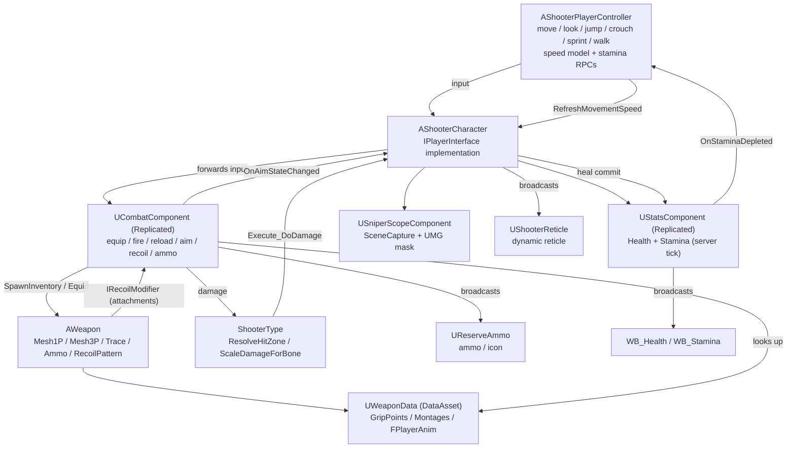

**Language / 语言：** **English** ｜ [中文](README.zh-CN.md)

---

# FPS — Unreal Engine 5 C++ First-Person Shooter

A first-person shooter gameplay framework built with **Unreal Engine 5.8 + C++**: character movement and look, walk/sprint movement modes with stamina, weapons (long gun / pistol / melee) with equipping, cycling and auto-un-aim, firing with hit detection, **recoil patterns with view-kick recovery**, reloading, aiming down sights (ADS), a sniper scope, health with healing, per-body-part damage, hit reactions, and full multiplayer replication.

> This document was written by reading the source code. **No code file was modified.**
> For the function-by-function, component-by-component deep dive (signatures, behaviour, call chains, effects), see [DOCUMENTATION.md](<DOCUMENTATION.md>).
> Chinese version: [README.zh-CN.md](<README.zh-CN.md>) ｜ [DOCUMENTATION.zh-CN.md](<DOCUMENTATION.zh-CN.md>)

---

## 1. Project Overview

| Item | Value |
| --- | --- |
| Engine version | Unreal Engine 5.8 (`EngineAssociation: "5.8"` in [FPS.uproject](<FPS.uproject>)) |
| Primary module | `FPS`, type Runtime ([FPS.Build.cs](<Source/FPS/FPS.Build.cs>)) |
| Language | C++ — most entry points are exposed to Blueprints via `BlueprintCallable` / `BlueprintImplementableEvent` |
| Input | Enhanced Input (`UEnhancedInputComponent` + `UInputMappingContext`) |
| Default map | `/Game/FirstPerson/Lvl_FirstPerson` |
| Default GameMode | `/Script/FPS.ShooterGameModeBase` (see [DefaultEngine.ini](<Config/DefaultEngine.ini>)) |
| Custom collision channel | `Weapon` = `ECC_GameTraceChannel2` (trace type) |
| Build targets | `FPS` (Game), `FPSEditor` (Editor), `BuildSettingsVersion.V7` |

Module dependencies ([FPS.Build.cs](<Source/FPS/FPS.Build.cs>)):

- Public: `Core`, `CoreUObject`, `Engine`, `InputCore`, `EnhancedInput`, `GameplayTags`, `PhysicsCore`, `UMG`
- Private: `Slate`, `SlateCore`

Enabled plugins ([FPS.uproject](<FPS.uproject>)): `ModelingToolsEditorMode` (editor only), `GameplayStateTree`, `AnimationWarping`, `ModelContextProtocol`, `AllToolsets`.

---

## 2. Feature Overview

| System | What is implemented | Main code |
| --- | --- | --- |
| Character | First-person camera (zero-length spring arm + camera lag), separate 1P/3P skeletal meshes, crouch, jump, movement | [ShooterCharacter.cpp](<Source/FPS/Private/ShooterCharacter.cpp>), [ShooterPlayerController.cpp](<Source/FPS/Private/ShooterPlayerController.cpp>) |
| Movement modes | Toggle walk and toggle sprint, multiplicative speed model (walk / crouch / ADS), sprint cancelled by ADS or crouch, sprint cancelled when stamina runs out | [ShooterPlayerController.cpp](<Source/FPS/Private/ShooterPlayerController.cpp>) |
| Stamina | Server-authoritative drain/regen, jump cost, `OnStaminaDepleted`, stamina bar HUD | [StatsComponent.cpp](<Source/FPS/Private/Stats/StatsComponent.cpp>) |
| Locomotion feel | `GroundSpeed`, walk-gait BlendSpace swap (`Strafe_Walking`), per-frame locomotion play rate pushed into the AnimBPs | [ShooterCharacter.cpp](<Source/FPS/Private/ShooterCharacter.cpp>) |
| Weapons | Three kinds (long gun / pistol / melee), four slots (main / secondary / pistol / melee), cycling, equip montages, auto un-aim when switching | [Weapon.cpp](<Source/FPS/Private/Weapon/Weapon.cpp>), [CombatComponent.cpp](<Source/FPS/Private/CombatComponent.cpp>) |
| Shooting | Sphere-sweep hit detection, single / automatic fire, **recoil pattern with recovery and attachment modifiers**, server-side rate limiting, blueprint-driven muzzle and impact FX, magazine and reserve ammo | [Weapon.cpp](<Source/FPS/Private/Weapon/Weapon.cpp>), [CombatComponent.cpp](<Source/FPS/Private/CombatComponent.cpp>), [RecoilModifierInterface.h](<Source/FPS/Public/Interface/RecoilModifierInterface.h>) |
| Reloading | 1P/3P reload montages, animation-notify-driven ammo transfer, auto-reload on empty, weapon re-gripped by a C++ anim notify | [CombatComponent.cpp](<Source/FPS/Private/CombatComponent.cpp>), [AnimNotify_WeaponGrip.cpp](<Source/FPS/Private/AnimNotify/AnimNotify_WeaponGrip.cpp>) |
| Healing | Heal montage with weapon hidden during the animation, server-clamped heal amount, 3P multicast for other players | [ShooterCharacter.cpp](<Source/FPS/Private/ShooterCharacter.cpp>) |
| ADS | Replicated `bAiming` (owner skipped), `OnAimStateChanged` broadcast, 1P arms/weapon sight alignment via the blueprint variable `AdsMesh1PLoc` | [ShooterCharacter.cpp](<Source/FPS/Private/ShooterCharacter.cpp>), [CombatComponent.cpp](<Source/FPS/Private/CombatComponent.cpp>) |
| Sniper scope | SceneCapture2D + render target + full-screen UMG mask material; 3x zoom shown only inside the scope disc; the main camera keeps its normal FOV | [SniperScopeComponent.cpp](<Source/FPS/Private/Weapon/SniperScopeComponent.cpp>) |
| Damage | Bone name → hit zone (head / torso / limb) → multiplier (headshot ×2, limb ×0.75), resolved on the server | [ShooterType.cpp](<Source/FPS/Private/ShooterType/ShooterType.cpp>), [StatsComponent.cpp](<Source/FPS/Private/Stats/StatsComponent.cpp>) |
| Animation driving | `AO_Yaw`, `MovementOffsetYaw`, `TurningStatus`, `FABRIK_SocketTransform`, `FPlayerAnim` struct injection into the ABPs | [ShooterCharacter.cpp](<Source/FPS/Private/ShooterCharacter.cpp>), [WeaponData.h](<Source/FPS/Public/WeaponData.h>) |
| Hit reactions | Random montage from `HitReacts`, broadcast with a NetMulticast | [ShooterCharacter.cpp](<Source/FPS/Private/ShooterCharacter.cpp>) |
| UI | Dynamic reticle material (per weapon), ammo/reserve + weapon icon HUD, health bar, stamina bar, reticle hidden while aiming | [ShooterReticle.cpp](<Source/FPS/Private/Ui/ShooterReticle.cpp>), [ReserveAmmo.cpp](<Source/FPS/Private/Ui/ReserveAmmo.cpp>) |
| Networking | Server-authoritative spawning, equipping, damage, stamina and healing; client-side magazine prediction and recoil; NetMulticast FX and third-person montages | [CombatComponent.cpp](<Source/FPS/Private/CombatComponent.cpp>) |

---

## 3. Directory Layout

```
FPS/
├─ FPS.uproject                     # Engine version, modules, plugins
├─ Config/
│  ├─ DefaultEngine.ini             # Collision channels (Weapon/Projectile), default map and GameMode
│  ├─ DefaultInput.ini              # Enhanced Input default classes, mouse sensitivity, axis config
│  └─ DefaultGame.ini               # Project name, AssetManager scan rules
├─ Content/
│  ├─ FPS/                          # First-party assets (see section 6)
│  └─ ...                           # Third-party asset packs (FPSTP, InfimaGames, IBWP3DPistol3Pack, ...)
└─ Source/
   ├─ FPS.Target.cs                 # Game target
   ├─ FPSEditor.Target.cs           # Editor target
   └─ FPS/
      ├─ FPS.Build.cs              # Module dependencies
      ├─ FPS.h / FPS.cpp           # Primary game module declaration
      ├─ Public/
      │  ├─ FPSTraceChannels.h            # Weapon trace channel constant
      │  ├─ ShooterGamePlayTags.h         # Native gameplay tag declarations
      │  ├─ ShooterCharacter.h            # Player character
      │  ├─ ShooterPlayerController.h     # Player controller (move / look / jump / crouch / sprint / walk)
      │  ├─ ShooterGameModeBase.h         # GameMode (empty shell for blueprint subclassing)
      │  ├─ CombatComponent.h             # Core combat component (inventory, fire, reload, aim, recoil)
      │  ├─ WeaponData.h                  # Weapon data asset + FPlayerAnim / FMontageData
      │  ├─ AnimNotify/
      │  │  └─ AnimNotify_WeaponGrip.h    # C++ anim notify: re-attach the weapon to a hand socket
      │  ├─ Interface/
      │  │  ├─ PlayerInterface.h          # Character capability interface
      │  │  └─ RecoilModifierInterface.h  # IRecoilModifier + FRecoilScale (attachment recoil hooks)
      │  ├─ Stats/StatsComponent.h        # Health + stamina component
      │  ├─ ShooterType/ShooterType.h     # Hit zone / damage multiplier helpers
      │  ├─ Ui/ShooterReticle.h           # Dynamic reticle widget
      │  ├─ Ui/ReserveAmmo.h              # Ammo HUD widget
      │  └─ Weapon/
      │     ├─ Weapon.h                   # Weapon actor (+ FRecoilStep)
      │     └─ SniperScopeComponent.h     # Sniper scope component + full-screen overlay widget
      └─ Private/                        # Implementations, one per public header
```

---

## 4. Getting Started

1. **Open the project**: open [FPS.uproject](<FPS.uproject>) with UE 5.8; on first open choose "Rebuild" or generate project files and compile the `FPS` module.
2. **Default map**: `/Game/FirstPerson/Lvl_FirstPerson` (already set as `GameDefaultMap` in [DefaultEngine.ini](<Config/DefaultEngine.ini>)).
3. **GameMode**: the global default is `AShooterGameModeBase`; in practice subclass it as `BP_ShooterGameMode` ([BP_ShooterGameMode.uasset](<Content/FPS/Game/BP_ShooterGameMode.uasset>)) and set:
   - `DefaultPawnClass = BP_ShooterCharacter`
   - `PlayerControllerClass = BP_ShooterPlayerController`
4. **Required character setup** (`BP_ShooterCharacter`; the code `checkf`s some of these):
   - `Combat → WeaponData` must point at `DA_WeaponData`, otherwise `GetWeaponAttachPoint` trips a `checkf` assertion.
   - `Combat → DefaultWeaponClass` must contain at least one weapon blueprint.
   - Every input field (`IA_FireWeapon`, `IA_CycleWeapon`, `IA_ReloadWeapon`, `IA_AimWeapon`, `IA_Heal` and the four `IA_Equip*`) must be assigned.
   - `HealMontage` must be set, otherwise heal input logs a warning and does nothing. `HealAmout` defaults to `30`.
   - The blueprint variable `AdsMesh1PLoc` (`FVector`) must exist — the ADS sight alignment writes straight into it.
   - `HitReacts` should contain at least one montage: `Multicast_HitReact` picks a random index with no empty-array guard.
5. **Player controller**: `BP_ShooterPlayerController` needs `ShooterIMC = IMC_Shooter` plus `IA_Move` / `IA_Look` / `IA_Jump` / `IA_Crouch` / `IA_Sprint` / `IA_Walk`. Speeds and multipliers (`WalkSpeed` 250, `RunSpeed` 500, `SprintSpeed` 800, `CrouchSpeedMultiplier` 0.6, `WalkSpeedMultiplier` 0.5, `AimSpeedMultiplier` 0.7) live on the controller.
6. **Input assets**: bind the `IA_*` assets to keys inside `IMC_Shooter`. `IA_FireWeapon` should be able to fire both `Started` and `Completed` — the code binds both to distinguish single from automatic fire. `IA_Sprint`, `IA_Walk` and `IA_Heal` are toggle/press actions bound on `Started`.
7. **Weapon blueprints**: derive from `BP_Weapon` (`AWeapon`), set `WeaponType` (gameplay tag), `WeaponKind`, the `Mesh1P` / `Mesh3P` skeletal meshes and their animation blueprints (`ABP_Rifle`, `ABP_Pistol`, `ABP_M700`), tune the recoil block (`RecoilPattern`, `RecoilPitchScale`, `RecoilYawScale`, `AimRecoilMultiplier`, `RecoilRecoverySpeed`, `RecoilRecoveryDelay`, `RecoilResetTime`), and implement the `FireEffect` blueprint event for muzzle flash / bullet holes / sound.
8. **Data asset**: fill `DA_WeaponData` per weapon tag — `GripPoints` (attach socket names), `WeaponMontages`, `FirstPersonAnims` / `ThirdPersonAnims` (including `Strafe_Walking` if the weapon has walk-speed blends), `FirstPersonMontages` / `ThirdPersonMontages`.
9. **Animation blueprints** must expose the names the C++ pushes by property name: the 3P ABP should have `bUseWalkGait`, `LocomotionPlayRate` (or `PlayRate`) and `GroundSpeed`; the 1P ABP needs `PlayRate`. A missing property is a silent no-op.
10. **Weapon grip notify**: place the **Weapon Grip** notify (`UAnimNotify_WeaponGrip`) on the frame where the supporting hand takes the gun in reload/fire montages and set `GripSocket` to the hand socket/bone. The sniper reload montages in this project already use it.
11. **HUD**: add `WBP_ShooterOverlay` to the viewport (it contains `WBP_ReserveAmmo` and `WB_Stamina`); `WB_Health` shows health. The reticle widget is based on `UShooterReticle` and must contain an Image named `Image_Reticle` (the code also tolerates the misspelled `Image_Redicle`).
12. **Scope material**: `/Game/FPS/UI/M_SniperScope` is a hard-coded path (see `SniperScopeMaterialPath` in [SniperScopeComponent.cpp](<Source/FPS/Private/Weapon/SniperScopeComponent.cpp>)). Renaming or moving it breaks the scope view and logs a warning. The material must expose `ScopeView` (texture), `MaskRadius`, `RingWidth`, `ReticleThickness` and `Aspect` parameters.

---

## 5. Controls

Input is dispatched through Enhanced Input: movement and movement modes live on `AShooterPlayerController`, combat actions live on `AShooterCharacter`.

| Action | Input asset | Bound on | Trigger event | Notes |
| --- | --- | --- | --- | --- |
| Move | `IA_Move` | Controller | `Triggered` | Moves relative to the yaw of the control rotation |
| Look | `IA_Look` | Controller | `Triggered` | `AddYawInput` / `AddPitchInput` |
| Jump | `IA_Jump` | Controller | `Started` | Stands up first while crouched; costs stamina on the server |
| Crouch | `IA_Crouch` | Controller | `Started` | Toggles `bWantsToCrouch`; crouching cancels sprint |
| Sprint | `IA_Sprint` | Controller | `Started` | Toggles sprint; cancelled by crouch, by ADS, or when stamina reaches 0 |
| Walk | `IA_Walk` | Controller | `Started` | Toggles slow walk (`WalkSpeedMultiplier`); cancels sprint |
| Fire | `IA_FireWeapon` | Character | `Started` / `Completed` | Press to fire, release to stop (drives automatic fire and recoil recovery) |
| Aim | `IA_AimWeapon` | Character | `Started` | Toggles ADS; broadcast through `OnAimStateChanged` (blueprint `OnAim`, speed, gait) |
| Reload | `IA_ReloadWeapon` | Character | `Started` | Plays the reload montage; ammo is moved by the animation notify |
| Heal | `IA_Heal` | Character | `Started` | Plays `HealMontage`, weapon hidden meanwhile; the server clamps and commits the heal |
| Cycle weapon | `IA_CycleWeapon` | Character | `Started` | Cycles to the next weapon and drops out of ADS |
| Main weapon | `IA_EquipMainWeapon` | Character | `Started` | Equips the first long gun and drops out of ADS |
| Secondary weapon | `IA_EquipSecondaryWeapon` | Character | `Started` | Equips the second long gun and drops out of ADS |
| Pistol | `IA_EquipPistol` | Character | `Started` | Equips the first pistol and drops out of ADS |
| Melee | `IA_EquipMeleeWeapon` | Character | `Started` | Equips the first melee weapon and drops out of ADS |

> Note: `IMC_Shooter` contains `LeftMouseButton`, `RightMouseButton`, `SpaceBar`, `LeftControl`, `LeftShift`, `LeftAlt`, `One`–`Four`, `R`, `Q`, `E` and gamepad triggers. The mapping in the table above reflects the common configuration — **`IMC_Shooter` inside the editor is the source of truth**.

> `IA_VersionWeapon` / `Input_VersionWeapon()` is declared in C++ but never bound — a placeholder.

---

## 6. Key Blueprints and Assets (`/Game/FPS`)

| Asset | Purpose |
| --- | --- |
| `Character/BP_ShooterCharacter` | Player character blueprint (attach points, FOV, weapon classes, ADS variable `AdsMesh1PLoc`, `HealMontage` / `HealAmout`, `HitReacts`) |
| `Character/ABP_FirstPerson` / `ABP_ThirdPerson` | 1P / 3P animation blueprints; consume `AO_Yaw`, `MovementOffsetYaw`, `TurningStatus`, `FABRIK_SocketTransform`, `CurrenrAnim` / `CurrentAnim`, and (3P) `bUseWalkGait` / `LocomotionPlayRate` / `GroundSpeed` |
| `Player/BP_ShooterPlayerController` | Input mapping context, move/look bindings, sprint/walk actions, speed and multiplier tuning |
| `Game/BP_ShooterGameMode` | GameMode that sets the default Pawn and Controller |
| `Data/DA_WeaponData` | The single weapon data asset (grip points, montages, animation structs incl. `Strafe_Walking`) |
| `Weapon/BP_Weapon`, `BP_RIfle`, `BP_Refile`, `BP_Pistol`, `BP_M700` | Weapon actor blueprints; `BP_RIfle` overrides `RecoilPattern` |
| `Weapon/ABP_Rifle`, `ABP_Pistol`, `ABP_M700` | Animation blueprints for the weapon skeletal meshes |
| `UI/WBP_ShooterOverlay`, `UI/WBP_ReserveAmmo`, `UI/WB_Health`, `UI/WB_Stamina` | HUD root, ammo, health and stamina widgets |
| `UI/M_SniperScope` | Sniper scope mask material (referenced by a hard-coded path) |
| `Input/IMC_Shooter`, `Input/InputAction/IA_*` | Input mapping context and every input action (incl. `IA_Sprint`, `IA_Walk`, `IA_Heal`) |
| `Animation/AnimMontage_Arms_Healing` | Heal montage (assign to `HealMontage`) |
| `Animation/AnimMontage_Arms_SniperRiffle_*` | Sniper reload / shell-eject montages that use the **Weapon Grip** notify |

---

## 7. Architecture at a Glance



---

## 8. Networking Model

- **Spawning and equipping**: `SpawnInventory` only runs on `ROLE_Authority`. `UCombatComponent` replicates `Inventory` and `CurrentWeapon`; clients re-attach and re-apply animation through `OnRep_CurrentWeapon`.
- **Firing**: the client predicts immediately (plays the 1P montage, decrements the magazine, spawns local FX, applies recoil) → `Server_FireWeapon(Hit)` validates the fire rate and resolves damage → `Multicast_FireWeapon` lets remote clients play FX and the 3P montage, and reconciles the magazine via `Rep_Fire(AuthAmmo)`.
- **Recoil**: applied to the local control rotation only (`ApplyFireRecoil` / `TickRecoil`) — a client-side feel feature; the server never sees the kick, exactly like the rest of UE's client-authoritative aim.
- **Reloading**: locally plays the 1P montage and sets `Reloading` → `Server_ReloadWeapon` → `Multicast_ReloadWeapon` (remotes play 3P) → the animation notify calls `ApplyReload` / `Notify_ReloadWeapon`, which move rounds on the server → `Client_ReloadWeapon` sends the authoritative numbers back.
- **Aiming**: `bAiming` replicates with `COND_SkipOwner` (the owner already predicted it); `Server_Aim` keeps the server informed, and `Server_CycleWeapon` forces aim off so remote players see the state change.
- **Stamina**: computed **only on the server** (`UStatsComponent::TickComponent` is authority-gated) and replicated to the owner; the controller pushes its sprint/walk state up with `Server_SetMovementState` and is told to stop sprinting with `Client_StopSprint`.
- **Movement speed**: the client applies `MaxWalkSpeed` locally for responsiveness but must mirror the state to the server, otherwise the server's correction would snap the player back.
- **Healing**: the client starts the montage and sends `Server_BeginHeal`; the server clamps the amount to its own `HealAmout`, arms a timeout, multicasts the 3P montage, and only commits health on `Server_FinishHeal(true)`.
- **Reserve ammo**: `CurrentReserveAmmo` replicates to the owner only (`COND_OwnerOnly`).
- **Damage**: resolved on the server; `Multicast_HitReact` makes the other clients play a hit reaction montage.

---

## 9. Known Limitations

- `EWeaponStatus::Firing` is never written by any code path.
- `AimTimeline`, `GetAimTimelineAlpha()` and `AimAlignAlpha` are declared but not wired into any call chain (ADS alignment currently works by rewriting a blueprint variable).
- `Input_VersionWeapon()` is empty and `VersionWeaponAction` is never bound — dead code.
- Recoil is a pure local effect: it cannot be used as a server-side accuracy penalty.
- The locomotion gait/play-rate push finds AnimInstance properties **by name** (with `PlayRate` / `LocomotionPlayRate` / `BS_PlayRate` aliases); a renamed property silently does nothing.
- `UStatsComponent::DeathState` is now *read* by the heal path but still never written — death handling is still missing; `OnRep_DeathState` is empty and `ChangeHealthByAmout` always returns `false`.
- `ChangeMaxHealthByAmout` / `ChangeMaxStaminaAmout` have no floor or ceiling.
- `AShooterCharacter::DoDamage_Implementation` picks a random index into `HitReacts` without checking for an empty array; keep at least one montage configured.
- Scope magnification, disc radius and reticle thickness are compile-time constants in `SniperScopeComponent.cpp` and are not exposed as properties.
- `AShooterGameModeBase` is an empty shell; match rules (rounds, scoring, respawn) must be added.

---

## 10. Further Reading

- Function-by-function / component-by-component reference: [DOCUMENTATION.md](<DOCUMENTATION.md>)
- 中文版：[README.zh-CN.md](<README.zh-CN.md>) ｜ [DOCUMENTATION.zh-CN.md](<DOCUMENTATION.zh-CN.md>)
- Unreal Engine docs: Gameplay Framework, Enhanced Input, `UDataAsset`, `USceneCaptureComponent2D`, `UAnimNotify`
