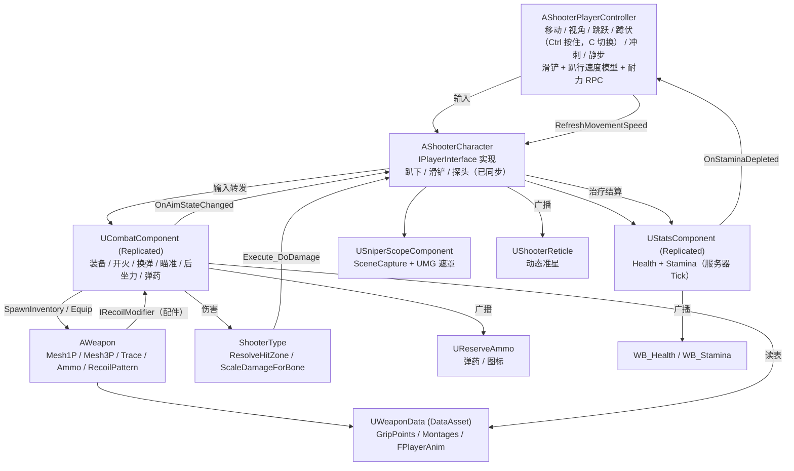

**Language / 语言：** [English](README.md) ｜ **中文**

---

# FPS — Unreal Engine 5 C++ 第一人称射击项目

一个使用 **Unreal Engine 5.8 + C++** 实现的第一人称射击（FPS）玩法框架：角色移动与视角、静步/冲刺移动模式与耐力、**Ctrl 按住 / C 切换蹲伏、按速度触发的滑铲与趴行**、武器（长枪 / **双管霰弹枪** / AK / 手枪 / 近战 / **投掷物** / **炸弹**）装备/切换/切枪自动关镜、开火与命中判定（近战为**沿刀刃的扫掠**）、**后坐力弹道（Recoil Pattern）与回正**、换弹、瞄准（ADS）、狙击镜、**数据驱动的武器配件系统**（枪管 / 护木 / 枪口 / 瞄具 / 握把 / 枪托 / 战术 / 弹匣）以及游戏内配件菜单与 Tab 整备界面、**画中画倍镜**、手电、生命值与治疗、部位伤害、受击动画，以及完整的多人网络同步。

三种比赛模式共用同一套 `AShooterGameModeBase` / `AShooterGameState` 基类：**团队竞技**、**爆破（Search & Destroy：回合制 + 可安放的 C4 + 两个包点）** 和自由练习靶场。在此之上是**局内 HUD**（按模式切换的头顶计分条 TDM / 爆破、带武器图标的击杀播报、复活倒计时），以及菜单里的枪匠/整备流程（可直接把改好的枪装备成主武器）。

> 本文档由阅读源码整理而成，**未修改任何代码文件**。
> 逐函数、逐组件的详细说明（含每个函数的签名、作用、调用链与效果）请见 [DOCUMENTATION.zh-CN.md](<DOCUMENTATION.zh-CN.md>)。
> English version: [README.md](<README.md>) ｜ [DOCUMENTATION.md](<DOCUMENTATION.md>)

---

## 1. 项目概览

| 项目 | 内容 |
| --- | --- |
| 引擎版本 | Unreal Engine 5.8（[FPS.uproject](<FPS.uproject>) 中 `EngineAssociation: "5.8"`） |
| 主模块 | `FPS`，类型 Runtime（[FPS.Build.cs](<Source/FPS/FPS.Build.cs>)） |
| 语言 | C++，大量接口通过 `BlueprintCallable` / `BlueprintImplementableEvent` 暴露给蓝图 |
| 输入 | Enhanced Input（`UEnhancedInputComponent` + `UInputMappingContext`） |
| 默认关卡 | `/Game/FPS/Level/MainMenu/MainMenu` —— 主菜单关卡；每种模式再各自切到自己的地图（见 §10.4、§10.5） |
| 默认 GameMode | `/Script/FPS.ShooterGameModeBase`（见 [DefaultEngine.ini](<Config/DefaultEngine.ini>)） |
| 自定义碰撞通道 | `Weapon` = `ECC_GameTraceChannel2`（Trace 类型） |
| 构建目标 | `FPS`（Game）、`FPSEditor`（Editor），`BuildSettingsVersion.V7` |

模块依赖（[FPS.Build.cs](<Source/FPS/FPS.Build.cs>)）：

- Public：`Core`、`CoreUObject`、`Engine`、`InputCore`、`EnhancedInput`、`GameplayTags`、`PhysicsCore`、`UMG`、`Niagara`
- Private：`Slate`、`SlateCore`

启用的插件（[FPS.uproject](<FPS.uproject>)）：`ModelingToolsEditorMode`（仅编辑器）、`GameplayStateTree`、`AnimationWarping`、`ModelContextProtocol`、`AllToolsets`。

---

## 2. 功能一览

| 系统 | 已实现内容 | 主要代码位置 |
| --- | --- | --- |
| 角色 | 第一人称相机（SpringArm 臂长 0 + 相机延迟）、1P/3P 双 SkeletalMesh、蹲伏、跳跃、移动 | [ShooterCharacter.cpp](<Source/FPS/Private/ShooterCharacter.cpp>)、[ShooterPlayerController.cpp](<Source/FPS/Private/ShooterPlayerController.cpp>) |
| 移动模式 | 静步 / 冲刺均为切换式；速度倍率相乘（静步 / 下蹲 / 开镜 / 趴下）；开镜、下蹲、趴下或**开始滑铲**都会打断冲刺；耐力耗尽自动退出冲刺；**开火也会打断冲刺**（取消用的这一下按键不会开火） | [ShooterPlayerController.cpp](<Source/FPS/Private/ShooterPlayerController.cpp>)、[CombatComponent.cpp](<Source/FPS/Private/CombatComponent.cpp>) |
| 蹲伏模式 | **按住左 Ctrl** 蹲伏（松开起身，遇到天花板会延后），**C** 键切换；两者都是优先级 2 的运行时 Enhanced Input 动作，因此旧的 `IA_Crouch` 映射会被屏蔽 | [ShooterPlayerController.cpp](<Source/FPS/Private/ShooterPlayerController.cpp>) |
| 滑铲 | 速度高于 `SlideMinSpeed`（600）时按蹲伏键会滑铲而不是下蹲：下蹲胶囊、`+150` cm/s 加速、摩擦力 0 并改用线性 `BrakingDecelerationWalking`、忽略移动输入，0.9 秒 / 低于 200 cm/s / 离地时结束；结束时保持蹲伏（按了 C 或仍按住 Ctrl）或起身（已松开 Ctrl）；跳跃会取消滑铲；服务器按 75 % 速度校验，不通过则回滚 `Client_SlideRejected` | [ShooterCharacter.cpp](<Source/FPS/Private/ShooterCharacter.cpp>)、[ShooterPlayerController.cpp](<Source/FPS/Private/ShooterPlayerController.cpp>) |
| 趴下 / 趴行 | **Z** 键切换趴下（字段为空时运行时创建输入）。趴下复用 CMC 蹲伏并把 `CrouchedHalfHeight` 设为 34，压低相机，以 `RunSpeed × 0.25` 爬行，禁止跳跃 / 探头 / 冲刺，头顶空间不足时拒绝起身，服务器权威并用 `Client_ProneRejected` 回滚。`bProneCrawling`（趴下**且**在移动）让 ABP 移动时播放全身爬行、停下时播放端枪的上半身 | [ShooterCharacter.cpp](<Source/FPS/Private/ShooterCharacter.cpp>)、[ShooterPlayerController.cpp](<Source/FPS/Private/ShooterPlayerController.cpp>) |
| 耐力 | 服务器权威的消耗/回复、跳跃消耗、`OnStaminaDepleted` 广播、耐力条 HUD | [StatsComponent.cpp](<Source/FPS/Private/Stats/StatsComponent.cpp>) |
| 移动手感 | `GroundSpeed`、慢走步态 BlendSpace 替换（`Strafe_Walking`）、每帧把 Locomotion 播放速率写进 AnimBP（趴下用 `ProneAnimReferenceSpeed` 100） | [ShooterCharacter.cpp](<Source/FPS/Private/ShooterCharacter.cpp>) |
| 武器 | 长枪 / 手枪 / 近战 / 投掷物 / 炸弹五类；主 / 副 / 手枪 / 近战 / 投掷 / 炸弹六个槽位，用数字键选择；切枪 Montage（可配随机变体池）；拔枪/换弹可被打断（见 §10.2）；切枪自动关镜。`UsesAmmo()` / `CanAimWeapon()` 由枪种决定：近战和炸弹永不瞄准，投掷物不会自动换弹（见 §10.5） | [Weapon.cpp](<Source/FPS/Private/Weapon/Weapon.cpp>)、[CombatComponent.cpp](<Source/FPS/Private/CombatComponent.cpp>) |
| 射击模式 | `EFireType` = 单发 / 全自动 / **三连发**。`AllowedFireModes` 决定一把枪能切哪几种（默认：手枪 = 单发 + 三连发，勾了 `bCanSwitchFireMode` 的步枪 = 单发 + 全自动），`BurstCount` 3、`BurstShotInterval` 控制连发节奏；连发循环在 `FireTimerFinished` 里跑，服务端射速节流用同一间隔（见 §10.5） | [Weapon.cpp](<Source/FPS/Private/Weapon/Weapon.cpp>)、[CombatComponent.cpp](<Source/FPS/Private/CombatComponent.cpp>) |
| 双管霰弹枪 | 走普通开火流程；膛内两发弹壳是挂在 `Bullet1Socket` / `Bullet2Socket` 上的真实静态网格，由手臂换弹 Montage 里的 `Bullet1Spawn` / `Bullet1Delete` / `Bullet2Spawn` / `Bullet2Delete` / `DeleteAllBullets` 通知开关，弹壳插槽强制 `bForceAlwaysAnimated`，不会卡在绑定姿势（见 §10.5） | [Weapon.cpp](<Source/FPS/Private/Weapon/Weapon.cpp>) |
| 投掷物 | 破片 / 烟雾 / 燃烧瓶 / 闪光共用 `AThrownProjectile`。按下开火先拉保险，松手投出：左键高抛、右键低抛，出手时机由 `ThrowReleaseTime` **或** `Notify_ThrowWeapon` 动画通知里先到的那个决定；破片是带视线检测的球形伤害，其它效果在蓝图里重写 `OnDetonate`（见 §10.5） | [ThrownProjectile.cpp](<Source/FPS/Private/Weapon/ThrownProjectile.cpp>)、[CombatComponent.cpp](<Source/FPS/Private/CombatComponent.cpp>) |
| 游戏模式 | `AShooterGameModeBase`（玩家、击杀、击杀播报、复活）→ `ATDMGameMode`（团队竞技）、`ASearchDestroyGameMode`（回合制 + 炸弹）和靶场。`UShooterGameInstance` 维护模式表（`GameModeClass` + `Map` + `bImplemented`），并负责开房 / 按 IP 加入（见 §10.4、§10.5） | [ShooterGameModeBase.cpp](<Source/FPS/Private/ShooterGameModeBase.cpp>)、[SearchDestroyGameMode.cpp](<Source/FPS/Private/Game/SearchDestroyGameMode.cpp>)、[ShooterGameInstance.cpp](<Source/FPS/Private/ShooterGameInstance.cpp>) |
| 爆破模式 | 两队，进攻方在 A / B 两个包点之一安放 C4，防守方拆除。回合阶段为准备 / 冻结 / 回合中 / 回合结束，非「回合中」时锁移动与操作，回合内不复活，先赢 6 局、平局后换边（见 §10.5） | [SearchDestroyGameMode.cpp](<Source/FPS/Private/Game/SearchDestroyGameMode.cpp>)、[BombActor.cpp](<Source/FPS/Private/Game/BombActor.cpp>)、[BombSite.cpp](<Source/FPS/Private/Game/BombSite.cpp>) |
| 局内 HUD | `UMatchHUD` 承载按模式创建的头顶计分条（`UTDMHeaderWidget` / `USDHeaderWidget`）和击杀播报；计分条显示比分、暖身 / 比赛 / 炸弹倒计时，爆破版另有回合数、炸弹状态、交互提示和安放/拆除进度条。`UKillFeedWidget` 画「击杀者 → 武器图标 → 被击杀者」并按队伍着色、到期消失（见 §10.5） | [MatchHUD.cpp](<Source/FPS/Private/Ui/MatchHUD.cpp>)、[MatchHeaderWidget.cpp](<Source/FPS/Private/Ui/MatchHeaderWidget.cpp>)、[KillFeedWidget.cpp](<Source/FPS/Private/Ui/KillFeedWidget.cpp>) |
| 近战 | `EWeaponKind::Melee` 不能开镜、不消耗弹药（`UsesAmmo()`）、不会自动换弹，两个 FABRIK alpha 都强制为 0；命中判定改为**沿刀刃的球形扫掠**（`MeleeSocketName`、`MeleeHitRadius` 40、`MeleeHitReach` 120），并播放 3P 全身挥砍 Montage | [Weapon.cpp](<Source/FPS/Private/Weapon/Weapon.cpp>)、[CombatComponent.cpp](<Source/FPS/Private/CombatComponent.cpp>) |
| 射击 | 球形 Sweep 命中判定，带**腰射散布锥**（由 `HipFireSpread` × 配件倍率随机，开镜时为 0）、单发 / 全自动（每把枪可选**切换开火模式**：`bCanSwitchFireMode`，`FireType` 已同步）、拉栓（`BoltCycling` 状态）、**后坐力弹道 + 回正 + 配件修正接口**、服务端射速节流、蓝图枪口/命中特效、弹匣与备弹 | [Weapon.cpp](<Source/FPS/Private/Weapon/Weapon.cpp>)、[CombatComponent.cpp](<Source/FPS/Private/CombatComponent.cpp>)、[RecoilModifierInterface.h](<Source/FPS/Public/Interface/RecoilModifierInterface.h>) |
| 换弹 | 1P/3P 换弹 Montage，**分种类**（首次 / 空仓 / 战术，没配就回落到默认 Montage），换弹和拉栓时左手 IK 渐隐、动画通知填弹、空仓自动换弹、C++ 动画通知把枪重新握到手上 | [CombatComponent.cpp](<Source/FPS/Private/CombatComponent.cpp>)、[AnimNotify_WeaponGrip.cpp](<Source/FPS/Private/AnimNotify/AnimNotify_WeaponGrip.cpp>) |
| 治疗 | 治疗 Montage（播放期间隐藏武器）、服务端钳制治疗量、多播给其他玩家播 3P 动画 | [ShooterCharacter.cpp](<Source/FPS/Private/ShooterCharacter.cpp>) |
| 瞄准 ADS | `bAiming` 复制（跳过 Owner）、`OnAimStateChanged` 广播、C++ 驱动开镜：`AimAlpha` 按武器开镜时间推进（配件可乘倍率），Mesh1P 从**每把枪的腰射偏移**插值到瞄具对准位置（**眼距**可配），相机 FOV 在 C++ 里插值（瞄具 `AimFOV` → 枪 `AimFeildOfView` → 默认）；可选枪身视觉后坐（默认关）。见 §10.1 | [ShooterCharacter.cpp](<Source/FPS/Private/ShooterCharacter.cpp>)、[CombatComponent.cpp](<Source/FPS/Private/CombatComponent.cpp>) |
| 狙击镜 | **旧方案，已停用。** `USniperScopeComponent` 只会让自己保持关闭；狙击枪和其他枪一样按装的瞄具走（见 §10.1） | [SniperScopeComponent.cpp](<Source/FPS/Private/Weapon/SniperScopeComponent.cpp>) |
| 伤害 | 骨骼名 → 命中部位（头 / 躯干 / 四肢）→ 倍率（爆头 ×2、四肢 ×0.75），服务端结算 | [ShooterType.cpp](<Source/FPS/Private/ShooterType/ShooterType.cpp>)、[StatsComponent.cpp](<Source/FPS/Private/Stats/StatsComponent.cpp>) |
| 探头 | Q / E 左右探头（按住，可选切换模式），同步 `LeanTarget` + 平滑 `LeanAlpha`，1P 相机横移 + 侧倾并防穿墙，冲刺时禁止，3P 在 `ABP_ThirdPerson` 里转脊椎；射线跟随探头后的镜头 | [ShooterCharacter.cpp](<Source/FPS/Private/ShooterCharacter.cpp>)、[Weapon.cpp](<Source/FPS/Private/Weapon/Weapon.cpp>) |
| 动画驱动 | `AO_Yaw`、`MovementOffsetYaw`、`TurningStatus`、`FABRIK_SocketTransform`、`FABRIK_Alpha`、`FPlayerAnim` 结构体注入 ABP，以及趴下 / 滑铲 / 握把持姿相关值 | [ShooterCharacter.cpp](<Source/FPS/Private/ShooterCharacter.cpp>)、[WeaponData.h](<Source/FPS/Public/WeaponData.h>) |
| 受击反馈 | **分方向**受击动画（前 / 后 / 左 / 右四组，空的回落到 `HitReacts`），NetMulticast 广播；被打的人看到受伤方向环，开枪的人看到命中确认标记 | [ShooterCharacter.cpp](<Source/FPS/Private/ShooterCharacter.cpp>) |
| UI | 动态准星材质（跟随武器）、**由 `OnWeaponFired` 驱动的原生散布准星**、弹药/备弹 + 武器图标 HUD、血条、耐力条、瞄准时隐藏准星（近战除外），`UShooterReticle` 绘制**受伤方向环**和**命中确认标记** | [ShooterReticle.cpp](<Source/FPS/Private/Ui/ShooterReticle.cpp>)、[ReserveAmmo.cpp](<Source/FPS/Private/Ui/ReserveAmmo.cpp>) |
| 武器配件 | 每个槽位一份数据资产的配件、服务器校验白名单、每把枪的默认配件、网络同步、1P/3P 实时生成模型（**静态或骨骼网格体**），并重定向握把 / 枪口 / 瞄准插槽 | [Weapon.cpp](<Source/FPS/Private/Weapon/Weapon.cpp>)、[AttachmentData.h](<Source/FPS/Public/Weapon/AttachmentData.h>) |
| 握把持姿 | 每份握把配件可选 Cradle（斜角 / 无握把）或 Grab（垂直握把）：会替换待机 / 瞄准待机动画、增加 Grab 换弹变体，并暴露左手握持姿态给 ABP 做分层混合 | [AttachmentData.h](<Source/FPS/Public/Weapon/AttachmentData.h>)、[FirstPersonAnimInstance.cpp](<Source/FPS/Private/Animation/FirstPersonAnimInstance.cpp>) |
| 弹匣配件 | 弹匣配件可以是**骨骼网格体**，自带换弹动画并与手臂换弹同步播放（含空仓 / 战术变体），还可选择隐藏骨骼（`mag_02` 备用弹匣） | [Weapon.cpp](<Source/FPS/Private/Weapon/Weapon.cpp>)、[AttachmentData.h](<Source/FPS/Public/Weapon/AttachmentData.h>) |
| 配件界面 | 游戏内配件菜单（一个槽位一行）、Tab 整备界面（三把枪预览渲染 + 可拖动配件窗） | [AttachmentMenu.cpp](<Source/FPS/Private/Ui/AttachmentMenu.cpp>)、[LoadoutScreen.cpp](<Source/FPS/Private/Ui/LoadoutScreen.cpp>) |
| 瞄具与手电 | 红点 / 全息对准瞄具自己的 Socket、只改相机 FOV；只有能用的 `Magnified` / `Variable` 瞄具才做画中画放大（可变倍率可切档），手电是按配件数据生成的聚光灯 | [OpticScopeComponent.cpp](<Source/FPS/Private/Weapon/OpticScopeComponent.cpp>) |
| 第一人称扶枪 IK | 第一人称 FABRIK **有意停用**（`FABRIK_Alpha1P` 恒为 0）：持枪姿态来自每把枪的持枪动画与 Grab/Cradle 持姿。`UFirstPersonAnimInstance` 向 ABP 暴露 `GripHoldStyle`、`ActiveIdleAnim`、`LeftHandHoldPose` 与 `bUseLeftHandHoldPose` | [FirstPersonAnimInstance.cpp](<Source/FPS/Private/Animation/FirstPersonAnimInstance.cpp>) |
| 网络 | 服务器权威：生成、装备、配件、伤害、耐力、治疗、**趴下与滑铲**；客户端预测弹匣与后坐力；NetMulticast 播特效与第三人称动画；`Client_ProneRejected` / `Client_SlideRejected` 回滚 | [CombatComponent.cpp](<Source/FPS/Private/CombatComponent.cpp>)、[ShooterCharacter.cpp](<Source/FPS/Private/ShooterCharacter.cpp>) |

---

## 3. 目录结构

```
FPS/
├─ FPS.uproject                     # 引擎版本、模块、插件
├─ Config/
│  ├─ DefaultEngine.ini             # 碰撞通道（Weapon/Projectile）、默认关卡与 GameMode
│  ├─ DefaultInput.ini              # EnhancedInput 默认类、鼠标灵敏度、按键轴
│  ├─ DefaultGame.ini               # 项目名、AssetManager 扫描规则
│  └─ DefaultGameplayTags.ini       # 唯一在配置里注册的 Tag：Weapon.type.ak
├─ Content/
│  ├─ FPS/                          # 本项目自己的资产（见第 6 节）
│  └─ ...                           # 第三方素材包（FPSTP、InfimaGames、IBWP3DPistol3Pack 等）
└─ Source/
   ├─ FPS.Target.cs                 # Game 目标
   ├─ FPSEditor.Target.cs           # Editor 目标
   └─ FPS/
      ├─ FPS.Build.cs              # 模块依赖
      ├─ FPS.h / FPS.cpp           # 主游戏模块声明
      ├─ Public/
      │  ├─ FPSTraceChannels.h            # 武器 Trace 通道常量
      │  ├─ ShooterGamePlayTags.h         # 原生 GameplayTag 声明
      │  ├─ ShooterCharacter.h            # 玩家角色
      │  ├─ ShooterPlayerController.h     # 玩家控制器（移动/视角/跳跃/蹲伏/冲刺/静步）
      │  ├─ ShooterGameModeBase.h         # 所有局内模式的基类：击杀、播报、复活
      │  ├─ CombatComponent.h             # 战斗核心组件（库存/开火/换弹/瞄准/后坐力）
      │  ├─ WeaponData.h                  # 武器数据资产 + FPlayerAnim / FMontageData
      │  ├─ AnimNotify/
      │  │  └─ AnimNotify_WeaponGrip.h    # C++ 动画通知：把武器重新挂到手上
      │  ├─ Interface/
      │  │  ├─ PlayerInterface.h          # 角色能力接口
      │  │  └─ RecoilModifierInterface.h  # IRecoilModifier + FRecoilScale（配件后坐力修正）
      │  ├─ Animation/FirstPersonAnimInstance.h   # ABP_FirstPerson 的 C++ 基类：1P 扶枪 IK + 握把持姿
      │  ├─ Ui/AttachmentMenu.h                   # 配件菜单（一个槽位一行）
      │  ├─ Ui/AttachmentSlotRow.h                # 槽位行 + 可选配件按钮
      │  ├─ Ui/AttachmentOptionEntry.h            # 单个配件按钮 / "卸下"按钮
      │  ├─ Ui/LoadoutScreen.h                    # Tab 整备界面 + 可拖动配件窗
      │  ├─ Ui/LoadoutPreviewRig.h                # 三把枪预览用的 SceneCapture 装置
      │  ├─ Ui/LoadoutWeaponCard.h                # 整备界面里的单张武器卡片
      │  ├─ Weapon/AttachmentData.h               # 配件数据资产（+ EOpticType、EGripHoldStyle）
      │  ├─ Weapon/OpticScopeComponent.h          # 画中画倍镜
      │  ├─ Stats/StatsComponent.h        # 生命值 + 耐力组件
      │  ├─ ShooterType/ShooterType.h     # 部位判定 / 伤害倍率工具函数
      │  ├─ Ui/ShooterReticle.h           # 动态准星控件
      │  ├─ Ui/ReserveAmmo.h              # 弹药 HUD 控件
      │  └─ Weapon/
      │     ├─ Weapon.h                   # 武器 Actor（+ FRecoilStep）
      │     └─ SniperScopeComponent.h     # 狙击镜组件 + 全屏遮罩控件
      └─ Private/                        # 与 Public 一一对应的实现文件
```

---

## 4. 快速开始

1. **打开工程**：用 UE 5.8 打开 [FPS.uproject](<FPS.uproject>)，首次打开时选择 "Rebuild" 或先生成工程文件再编译 `FPS` 模块。
2. **默认关卡**：`/Game/FPS/Level/MainMenu/MainMenu`（[DefaultEngine.ini](<Config/DefaultEngine.ini>) 已同时设为 `GameDefaultMap` 与 `EditorStartupMap`）；进入菜单后再由 `UShooterGameInstance` 切到各模式自己的地图。
3. **GameMode**：全局默认为 `AShooterGameModeBase`；实际使用请继承为 `BP_ShooterGameMode`（[BP_ShooterGameMode.uasset](<Content/FPS/Game/BP_ShooterGameMode.uasset>)），并在其中指定：
   - `DefaultPawnClass = BP_ShooterCharacter`
   - `PlayerControllerClass = BP_ShooterPlayerController`
4. **角色必需配置**（`BP_ShooterCharacter`，代码里有 `checkf` 强校验）：
   - `Combat → WeaponData` 必须指向 `DA_WeaponData`，否则 `GetWeaponAttachPoint` 会触发 `checkf` 断言。
   - `Combat → DefaultWeaponClass` 至少填一把武器蓝图。
   - 输入字段（`IA_FireWeapon`、`IA_ReloadWeapon`、`IA_AimWeapon`、`IA_Heal` 以及四个 `IA_Equip*`）都要赋值。
   - `HealMontage` 必须赋值，否则按治疗键只会打一条 Warning 且没有任何效果；`HealAmout` 默认 30。
   - 蓝图变量 `AdsMesh1PLoc`（`FVector`）必须存在 —— ADS 瞄具对齐会直接写这个变量。
   - `HitReacts` 至少填一个受击 Montage，否则 `Multicast_HitReact` 的随机下标会越界（当前代码未做空数组保护）。
5. **玩家控制器**：`BP_ShooterPlayerController` 需要设置 `ShooterIMC = IMC_Shooter`，以及 `IA_Move` / `IA_Look` / `IA_Jump` / `IA_Crouch` / `IA_Sprint` / `IA_Walk`。速度与倍率（`WalkSpeed` 250、`RunSpeed` 500、`SprintSpeed` 800、`CrouchSpeedMultiplier` 0.6、`WalkSpeedMultiplier` 0.5、`AimSpeedMultiplier` 0.7）配置在控制器上。
6. **输入资产**：在 `IMC_Shooter` 里绑定 `IA_*` 与按键。`IA_FireWeapon` 建议能同时触发 `Started` 与 `Completed`（单发/全自动靠这两个事件区分）；`IA_Sprint`、`IA_Walk`、`IA_Heal` 都绑在 `Started`。
7. **武器蓝图**：基于 `BP_Weapon`（`AWeapon`）派生，设置 `WeaponType`（GameplayTag）、`WeaponKind`、`Mesh1P` / `Mesh3P` 的骨骼网格体与动画蓝图（`ABP_Rifle`、`ABP_Pistol`、`ABP_M700`），调好后坐力参数（`RecoilPattern`、`RecoilPitchScale`、`RecoilYawScale`、`AimRecoilMultiplier`、`RecoilRecoverySpeed`、`RecoilRecoveryDelay`、`RecoilResetTime`），并在 `FireEffect` 蓝图事件里做枪口火焰 / 弹孔 / 音效。
8. **数据资产**：在 `DA_WeaponData` 里按武器 Tag 填写 `GripPoints`（挂点 Socket 名）、`WeaponMontages`、`FirstPersonAnims` / `ThirdPersonAnims`（有慢走混合的话还要填 `Strafe_Walking`）、`FirstPersonMontages` / `ThirdPersonMontages`。
9. **动画蓝图**必须暴露 C++ 按名字写入的变量：3P ABP 建议有 `bUseWalkGait`、`LocomotionPlayRate`（或 `PlayRate`）、`GroundSpeed`；1P ABP 至少要有 `PlayRate`。变量名对不上时不会有任何提示，只是静默失效。
10. **武器握持通知**：在换弹/开火 Montage 里"副手抓住枪"的那一帧放一个 **Weapon Grip** 通知（`UAnimNotify_WeaponGrip`），并把 `GripSocket` 设为手部 Socket 或骨骼名。本工程的狙击枪换弹 Montage 已经用了它。
11. **HUD**：把 `WBP_ShooterOverlay` 加入视口（内部含 `WBP_ReserveAmmo` 与 `WB_Stamina`），`WB_Health` 显示血量。准星控件基于 `UShooterReticle`，其内部 Image 命名为 `Image_Reticle`（代码也兼容拼写错误的 `Image_Redicle`）。
12. **狙击镜材质**：`/Game/FPS/UI/M_SniperScope` 是硬编码路径（见 [SniperScopeComponent.cpp](<Source/FPS/Private/Weapon/SniperScopeComponent.cpp>) 中的 `SniperScopeMaterialPath`），改名或移动会导致镜筒不显示并打印 Warning。材质参数需包含 `ScopeView`(Texture)、`MaskRadius`、`RingWidth`、`ReticleThickness`、`Aspect`。

---

### 4.1 移动模式：蹲伏输入、滑铲与趴行

三个按键都是 C++ 里**运行时创建的 Enhanced Input 动作**（对应的 `UInputAction` 字段为空时创建），开箱即用：

| 模式 | 按键 | 运行时资产 | 想用自己的资产就填 |
| --- | --- | --- | --- |
| 蹲伏（按住） | **左 Ctrl** | `IMC_Crouch_Runtime`（优先级 2）里的 `IA_CrouchHold_Runtime` | `BP_ShooterPlayerController → CrouchHoldAction` |
| 蹲伏（切换） | **C** | `IA_CrouchToggle_Runtime` | `BP_ShooterPlayerController → CrouchToggleAction` |
| 趴下 | **Z** | `IMC_Prone_Runtime`（优先级 1）里的 `IA_Prone_Runtime` | `BP_ShooterCharacter → ProneAction` |

1. **旧输入**：老的 `IA_Crouch`（`CrouchAction`）**只有**在两个新蹲伏动作都没赋值时才会绑定。因为运行时 IMC 优先级是 2，`IMC_Shooter` 里残留的 `LeftControl → IA_Crouch`（或 `IA_Walk`）那一行会被屏蔽 —— 为了清晰请删掉该行（或删掉 `IA_Crouch`），如果静步原本在左 Ctrl 上就改绑到别的键。
2. **趴下动画接线**（手动，C++ 只负责把值送出来）：创建/找到 `BS_Prone`（本工程已放在 `/Game/FPS/Animation/Prone/BS_Prone`，3P 骨架上 14 个采样点），在 `ABP_ThirdPerson` 的 Locomotion 状态机里加一个 **Prone** 状态（X = `MovementOffsetYaw`，Y = `GroundSpeed`，PlayRate = `LocomotionPlayRate`），并在里面用 **`bProneCrawling`** 在 `BS_Prone` 与趴下待机之间混合。状态机之后再接一个按骨骼分层混合（`clavicle_l` / `clavicle_r`，深度 0，勾选网格体空间旋转混合），权重用 `bIsProne && !bProneCrawling`，这样趴下停住时手臂仍端着枪。
3. **滑铲动画接线**（手动）：在角色骨架上创建动画槽 **`BodySlot`**（`Anim Slot Manager → DefaultGroup`），然后在 Locomotion/瞄准姿态之后接 `Slot(BodySlot)` → 按骨骼分层混合（基础姿势 = 槽输出，混合姿势 = 缓存下来的 Locomotion 姿态，分支过滤 `clavicle_l` / `clavicle_r`，勾选网格体空间旋转混合）→ 原有的 FABRIK → `DefaultSlot` → Output。**没有 `BodySlot` 时滑铲动画会静默失效。** `SlideAnim` 默认已经是 `/Game/FreeAnimationLibrary/Animations/Slide/anim_Slide_L`；`SlideMontage1P` 请保持为空，这样手臂仍然保持持枪。
4. **FABRIK**：把 3P FABRIK 节点的 alpha 绑到 **`FABRIK_Alpha`**（不要写常量 1）。近战和爬行时为 0，其他情况为 1。1P FABRIK 是有意留空的（`FABRIK_Alpha1P` 恒为 0）。
5. **调参**：`BP_ShooterCharacter → ProneCapsuleHalfHeight`（34）、`ProneCameraZOffset`（−50）、`ProneAnimReferenceSpeed`（100）、`bHideWeapon3PWhileProne`、`SlideMinSpeed`（600）、`SlideDuration`（0.9）、`SlideSpeedBoost`（150）、`SlideDeceleration`（800）、`SlideEndSpeed`（200）、`SlideCameraZOffset`（−15）；`BP_ShooterPlayerController → ProneSpeedMultiplier`（0.25）。

### 4.2 武器配件与整备界面配置

1. **标签** —— 配件槽位类型是 GameplayTag，声明在 [ShooterGamePlayTags.h](<Source/FPS/Public/ShooterGamePlayTags.h>)：`Attachment.Slot.Barrel`、`Handguard`、`Muzzle`、`Optic`、`Grip`、`Stock`、`Tactical`、`Magazine`。新增类型只需要加 Tag。
2. **配件资产** —— 每个配件建一份 `UAttachmentData` 数据资产（右键 → Miscellaneous → Data Asset → AttachmentData）。工程自带的在 `Content/FPS/Data/Accessries/`（`DA_Barris`、`DA_HangGuard`、`DA_Grip`、`DA_Grip_Vertical`、`DA_Sight`、`DA_Sight1`、`DA_Sight2`、`DA_MAG45`、`DA_Back`），以及其 `MPC/` 子目录（`DA_MPC_AK_Mag`、`DA_MPC_VerticalGrip`、`DA_MPC_AK_Stock`、`DA_MPC_MAG`、`DA_MPC_RedDot`、`DA_MPC_Suppressor`、`DA_MPC_Flashlight`）。填 `SlotTag`、`Mesh`（或 `SkeletalMesh`，见第 7 点）、`MeshOffset`，以及可选的 后坐力倍率 / 握把持姿 / 瞄具块 / 手电块。位置相关的 Socket（`FABRIK`、`Muzzle`、`SightSocket`、`LensSocket`、`LightSocket`）都做在**配件自己的网格体**上（静态或骨骼）。。
3. **枪的槽位表** —— 在武器蓝图（`BP_RIfle` 已经配好）的 `FPS|Attachment → AttachmentSlots` 里，一个槽位一行：`SlotTag`、`SocketName`、`AllowedAttachments` 白名单、可选的 `DefaultAttachment` 和 `bRequired`。槽位 Socket 会先在枪骨骼上找，找不到再在"已经装上的配件"上找 —— 握把装到护木上就是靠这个。
4. **菜单与整备** —— 在 `BP_ShooterPlayerController` 上设置 `AttachmentMenuClass = WBP_AttachmentMenu`，并赋好 `IA_AttachmentMenu`（在 `IMC_Shooter` 中绑定）与 `IA_Flashlight`。`WBP_AttachmentMenu` 里必须有名为 `SlotList` 的 `VerticalBox`，并设置 `RowClass = WBP_AttachmentSlotRow`；行控件需要 `Text_SlotName` + `EntryContainer`，并设置 `EntryClass = WBP_AttachmentEntry`；按钮控件需要 `Button_Select` + `Text_Name`（`Image_Icon` 可选）。
5. **整备界面** —— Tab 界面和它的配件窗完全由 C++ 构建、按需创建，因此不需要 WBP；只有槽位行是按硬编码路径加载 `/Game/FPS/UI/WBP_AttachmentSlotRow`。
6. **握把持姿** —— 在每份**握把**配件上设置 `GripHoldStyle`：斜角/三角握把用 `Cradle`，垂直握把用 `Grab`（本工程 `DA_Grip` = Cradle，`DA_Grip_Vertical` / `DA_MPC_VerticalGrip` = Grab）。然后在 `DA_WeaponData` 里按武器 Tag 补上 Grab 用的动画：`IdleAnim_Grab`、`AimIdleAnim_Grab`、`LeftHandHoldPose_Grab`（以及 `_Cradle`），并在 Montage 表里补 `EmptyReloadMontage_Grab` / `TacticalReloadMontage_Grab`。⚠ `IdleAnim_Grab` 必须**不同于** `LeftHandHoldPose_Grab`：代码会忽略与左手姿态相同的 `IdleAnim_Grab`，因为这种姿态（例如 `A_FPP_AK_Pose_G2`）只是"只有左手"的一层，当作完整待机用会把枪拧歪。在 `ABP_FirstPerson` 里用按骨骼分层混合接入 `LeftHandHoldPose`，分支从 `upperarm_l` 开始（深度 0），混合权重用 `bUseLeftHandHoldPose`。
7. **骨骼弹匣** —— 需要播动画的弹匣（AK）请设置配件的 `SkeletalMesh` 而不是 `Mesh`，并填 `MagReloadAnim` / `MagEmptyReloadAnim` / `MagTacticalReloadAnim`。`MagReloadAnim` 的第 0 帧同时是组件停放的静止姿态。可选勾选 `bHideSpareMagazineBone`（隐藏 AK 的 `mag_02` 备用弹匣），或在 `BonesToHide` 里列出额外要隐藏的骨骼。
8. **近战（刀）** —— 设置 `WeaponKind = Melee`，在刀的网格体上加 `Melee` Socket（或改 `MeleeSocketName`），调 `MeleeHitRadius` / `MeleeHitReach`，填 `FireMontages`（随机挥砍变体），并确保 3P 挥砍 Montage 走的是 `DefaultSlot`/`FullBody` —— 近战挥砍是**全身**动画。近战不需要弹药、不能开镜、永不换弹。
9. **腰射散布** —— 在每把武器蓝图上设置 `HipFireSpread`（角度制，半锥角，默认 3，范围 0–30）：只要**没有**开镜，子弹方向就会在该锥体内随机（开镜时强制为 0）。配件通过 `HipFireSpreadMultiplier` 乘算（默认 1；例如垂直握把 0.8，等于把锥体收紧 20 %）。原生准星会自动把同一个角度换算成像素，因此准星与散布锥一致，每次开火的 `CrosshairSpread` 抖动叠加在它上面。⚠ 散布锥是在做射线的客户端上随机出来的，服务器直接信任由此得到的 `FHitResult` —— 这是手感 / 平衡特性，不是精度惩罚。

新增操作：

| 动作 | 输入资产 | 绑定对象 | 触发事件 | 说明 |
| --- | --- | --- | --- | --- |
| 配件菜单 | `IA_AttachmentMenu` | 控制器 → `ToggleAttachmentMenuAction` | `Started` | 开关按槽位排列的配件菜单；显示鼠标并屏蔽转视角 |
| 手电 | `IA_Flashlight` | 控制器 → `FlashlightAction` | `Started` | 通过战斗组件请求开关手电（服务器权威） |
| 整备界面 | 运行时创建的 `IA_Loadout_Runtime`（Tab） | 控制器，运行时注册 | `Started` | 打开全屏整备界面；输入动作与映射上下文都是 C++ 运行时创建，**不在** `IMC_Shooter` 里 |
| 蹲伏（按住） | 运行时创建的 `IA_CrouchHold_Runtime`（左 Ctrl） | 控制器，运行时注册 | `Started` / `Completed` | 按住蹲伏，松开起身（头顶有障碍会延后）。速度够快时改为滑铲 |
| 蹲伏（切换） | 运行时创建的 `IA_CrouchToggle_Runtime`（C） | 控制器，运行时注册 | `Started` | 切换蹲 / 站；趴下时退出到蹲伏；滑铲中忽略 |
| 趴下 | 运行时创建的 `IA_Prone_Runtime`（Z） | 角色，运行时注册 | `Started` | 切换趴下 / 趴行；进入要求着地且不在治疗中，会取消冲刺，滑铲中不允许；趴下时禁止冲刺 / 跳跃 / 探头；Z 或空格起身（头顶没空间会被拒绝），C 转为蹲伏 |

## 5. 操作说明

输入由 Enhanced Input 分发：移动与移动模式在 `AShooterPlayerController`，战斗动作在 `AShooterCharacter`。

| 动作 | 输入资产 | 绑定对象 | 触发事件 | 说明 |
| --- | --- | --- | --- | --- |
| 移动 | `IA_Move` | 控制器 | `Triggered` | 以控制旋转的 Yaw 为基准前后左右移动 |
| 视角 | `IA_Look` | 控制器 | `Triggered` | `AddYawInput` / `AddPitchInput` |
| 跳跃 | `IA_Jump` | 控制器 | `Started` | 蹲伏中先起身；滑铲中会取消滑铲并起身；趴下中站起来（不跳）；起跳会在服务器扣耐力 |
| 蹲伏（按住） | 运行时创建的 `IA_CrouchHold_Runtime`（左 Ctrl） | 控制器，运行时注册 | `Started` / `Completed` | 按住蹲伏，松开起身（头顶有障碍会延后）。趴下时按 Ctrl 会转成蹲伏；滑铲中松开则结束时起身 |
| 蹲伏（切换） | 运行时创建的 `IA_CrouchToggle_Runtime`（C） | 控制器，运行时注册 | `Started` | 切换 `bWantsToCrouch`；趴下时退出到**蹲伏**；滑铲中忽略 |
| 滑铲 | 任一蹲伏键 | 控制器 / 角色 | — | 地面速度高于 `SlideMinSpeed`（600）时改为滑铲而不是下蹲 |
| 趴下 | 运行时创建的 `IA_Prone_Runtime`（Z） | 角色，运行时注册 | `Started` | 切换趴下 / 趴行；趴下时禁止冲刺、跳跃和探头；Z 或空格起身，C 转为蹲伏 |
| 冲刺 | `IA_Sprint` | 控制器 | `Started` | 切换冲刺；被蹲伏、趴下、开镜、滑铲、开火，或耐力归零打断 |
| 静步 | `IA_Walk` | 控制器 | `Started` | 切换慢走（`WalkSpeedMultiplier`）；会打断冲刺 |
| 开火 | `IA_FireWeapon` | 角色 | `Started` / `Completed` | 按下开火，松开停止（决定全自动与后坐力回正）。**冲刺中按下开火只会取消冲刺，不会开火** —— 要再按一次才射击 |
| 瞄准 | `IA_AimWeapon` | 角色 | `Started` | 切换 ADS；通过 `OnAimStateChanged` 广播（蓝图 `OnAim`、速度、步态）。近战武器永远不能开镜 |
| 换弹 | `IA_ReloadWeapon` | 角色 | `Started` | 播放换弹 Montage，由动画通知填弹。近战忽略（没有弹药） |
| 治疗 | `IA_Heal` | 角色 | `Started` | 播放 `HealMontage`，期间隐藏武器；服务端钳制并结算治疗量 |
| 左 / 右探头 | `LeanLeftAction` / `LeanRightAction`（留空 → 运行时创建 `IA_LeanLeft_Runtime` / `IA_LeanRight_Runtime`，绑 **Q / E**） | 角色 | `Started` / `Completed` | 按住探头（`bLeanToggleMode` = 按一下切换）；冲刺移动中禁止 |
| 检视武器 | `IA_VersionWeapon` → `VersionWeaponAction` | 角色 | `Started` | 播放武器的 `InspectMontage1P`（只在本地 1P）；开火、开镜、换弹、切枪、冲刺会打断 |
| 主武器（**1**） | `IA_EquipMainWeapon` | 角色 | `Started` | `Combat->Initiate_Hotkey(1)` → 第一把长枪，并自动关镜 |
| 副武器（**2**） | `IA_EquipSecondaryWeapon` | 角色 | `Started` | `Initiate_Hotkey(2)` → 摸金模式是第二把长枪，竞技模式是手枪 |
| 近战（**3**） | `IA_EquipMeleeWeapon` | 角色 | `Started` | `Initiate_Hotkey(3)` → 第一把近战武器 |
| 手枪（**4**） | `IA_EquipPistol` | 角色 | `Started` | `Initiate_Hotkey(4)` → 摸金模式是手枪，竞技模式是**投掷物** |
| 炸弹（**5**，仅爆破） | `IA_Heal`（共用键） | 角色 | `Started` | `Initiate_Hotkey(5)` 在非爆破模式返回 `false`，于是同一个键回落到治疗；爆破模式里切出炸弹（见 §10.5） |
| 切换开火模式 | 自建 IA → `SwitchFireModeAction` | 角色 | `Started` | 在 `AllowedFireModes` 里循环（单发 / 全自动 / **三连发**）；换弹、拉栓时不能切；服务器 RPC + `OnFireModeChanged` |
| 交互（安放 / 拆除 / 捡包） | `InteractAction` 为空时运行时创建 `IA_Interact_Runtime`（**F**） | 控制器，运行时注册 | `Started` / `Completed` | 发 `Server_BeginBombInteract` / `Server_EndBombInteract`；只有爆破模式会响应 |
| 切换倍率 | 自建 IA → `SwitchZoomAction` | 角色 | `Started` | 开镜且装了 `Variable` 瞄具时，在 `ZoomLevelsFOV` 几档之间切换；`OnZoomLevelChanged` 给界面用 |

> 说明：`IMC_Shooter` 中存在 `LeftMouseButton`、`RightMouseButton`、`SpaceBar`、`LeftControl`、`LeftShift`、`LeftAlt`、`One`~`Five`、`R`、`Q`、`E` 及手柄扳机等按键；槽位 1–5 的语义由 `UCombatComponent::Initiate_Hotkey()` 按模式解释（见上表，以及 §10.5 的完整映射），炸弹交互键 **F** 是运行时动作、不需要资产。上表"哪个键对应哪个动作"是常见配置，**最终以编辑器内 `IMC_Shooter` 的实际绑定为准**。

> 循环切枪已**删除**（C++ 绑定、`Input_CycleWeapon`、`Initiate_CycleWeapon`、`CycleWeaponAction`）。如果 `IMC_Shooter` 里还有 `IA_CycleWeapon` 映射（以及该资产），可以删掉。切枪只用槽位键。

---

## 6. 关键蓝图与资产（`/Game/FPS`）

| 资产 | 作用 |
| --- | --- |
| `Character/BP_ShooterCharacter` | 玩家角色蓝图（挂点、FOV、武器类、ADS 变量 `AdsMesh1PLoc`、`HealMontage` / `HealAmout`、`HitReacts`） |
| `Character/ABP_FirstPerson` / `ABP_ThirdPerson` | 1P / 3P 动画蓝图；读取 `AO_Yaw`、`MovementOffsetYaw`、`TurningStatus`、`FABRIK_SocketTransform`、`CurrenrAnim` / `CurrentAnim`，以及 3P 的 `bUseWalkGait` / `LocomotionPlayRate` / `GroundSpeed` |
| `Player/BP_ShooterPlayerController` | 输入映射、移动/视角绑定、冲刺/静步动作、速度与倍率配置 |
| `Game/BP_ShooterGameMode` | GameMode，指定默认 Pawn 与 Controller |
| `Game/BP_TDMGameMode`、`Game/BP_SearchDestroyGameMode` | 两个比赛 GameMode（团队竞技、回合制爆破）；爆破的在 `BombClass` 里指向 `BP_Bomb` |
| `Game/BP_ShooterGameInstance` | `UShooterGameInstance`：模式表（`Modes`：`GameModeClass` + `Map` + `bImplemented`）、`RangeMap` / `RangeGameMode`、`MainMenuMap`，以及存档的配装（`Loadout` 存档槽） |
| `Game/BP_MainMenuPC`、`Menu/BP_MainMenuGameMode`、`UI/WBP_MainMenu`、`UI/WBP_Lobby` | 主菜单关卡：UI 输入模式、模式按钮（`HostRoom`）、按 IP 加入（`JoinByIP`） |
| `Level/Lvl_TeamDeathMatch`、`Level/Lvl_BombDefuceMatch`、`Level/Lvl_Range` | 三种模式的可玩地图 |
| `Blueprint/BP_Bomb`、`Blueprint/BP_BombSite` | 爆破的 C4（`ABombActor`）与包点体积（`ABombSite`） |
| `Weapon/BP_DSShotGun`、`Weapon/ABP_ShotGun`、`Weapon/BP_BulletShell` | 双管霰弹枪、它的枪身动画蓝图和膛内弹壳网格 |
| `Weapon/Throwable/BP_Weapon_Grenade`、`BP_ThrownFrag`、`AM_TPP_Grenade_Start` | 投掷武器（拉保险 / 投掷 Montage 走 `DA_WeaponData`）、飞行中的投射物 Actor、3P 投掷 Montage |
| `UI/WBP_MatchHUD`、`WBP_TDMHeader`、`WBP_SDHeader`、`WBP_KillFeed`、`WBP_KillFeedEntry` | 局内 HUD：根控件、按模式的计分条（`HeaderHost`）、击杀播报列表（`FeedList`）与单条播报（`Image_Weapon`） |
| `UI/WBP_Gunsmith` | 局外枪匠界面（`UGunsmithScreen`），带三把枪的预览 |
| `Data/DA_WeaponData` | 唯一的武器数据资产（挂点、Montage、动画结构体，含 `Strafe_Walking`） |
| `Weapon/BP_Weapon`、`BP_RIfle`、`BP_Refile`、`BP_Pistol`、`BP_M700`、`BP_Weapon_AK`、`BP_Knife` | 武器 Actor 蓝图；`BP_RIfle` 覆盖了 `RecoilPattern`，`BP_Weapon_AK` 用 `Weapon.type.ak` 并在 3P 网格体上用 `RifleSocketak` |
| `Animation/Prone/BS_Prone` | 趴行 BlendSpace（14 个采样点，3P 骨架），由 `ABP_ThirdPerson` 的 Prone 状态引用 |
| `FreeAnimationLibrary/Animations/Slide/anim_Slide_L` | 默认的滑铲身体动画（`AShooterCharacter::SlideAnim`），以动态 Montage 播在 `BodySlot` 槽里 |
| `Data/Accessries/MPC/DA_MPC_AK_Mag`、`SKM_AK_Mag` | 骨骼版 AK 弹匣配件（换弹动画 + `mag_02` 备用弹匣骨骼开关） |
| `Weapon/ABP_Rifle`、`ABP_Pistol`、`ABP_M700` | 武器骨骼网格体的动画蓝图 |
| `UI/WBP_ShooterOverlay`、`UI/WBP_ReserveAmmo`、`UI/WB_Health`、`UI/WB_Stamina` | HUD 根控件、弹药控件、血量控件、耐力控件 |
| `UI/M_SniperScope` | 狙击镜遮罩材质（代码硬编码引用） |
| `Input/IMC_Shooter`、`Input/InputAction/IA_*` | 输入映射上下文与全部输入动作（含 `IA_Sprint`、`IA_Walk`、`IA_Heal`）。**蹲伏（Ctrl / C）、趴下（Z）和整备界面（Tab）都是 C++ 运行时创建的动作**，不是资产 |
| `Animation/AnimMontage_Arms_Healing` | 治疗 Montage（赋给 `HealMontage`） |
| `Animation/AnimMontage_Arms_SniperRiffle_*` | 使用 **Weapon Grip** 通知的狙击枪换弹 / 退壳 Montage |

---

## 7. 系统架构（速览）



---

## 8. 网络模型要点

- **生成与装备**：`SpawnInventory` 只在 `ROLE_Authority` 执行；`UCombatComponent` 复制 `Inventory` 与 `CurrentWeapon`，客户端靠 `OnRep_CurrentWeapon` 重新挂接与播放动画。
- **开火**：本地立即预测（播 1P Montage、扣弹匣、本地特效、施加后坐力）→ `Server_FireWeapon(Hit)` 校验射速并结算伤害 → `Multicast_FireWeapon` 让远端补特效与 3P 动画，并用 `Rep_Fire(AuthAmmo)` 校正弹匣。
- **后坐力**：只作用在本地控制旋转上（`ApplyFireRecoil` / `TickRecoil`），属于客户端手感表现；服务器不会看到这段偏移，与 UE 本身"瞄准由客户端决定"的模型一致。
- **换弹**：本地播 1P Montage 并置 `Reloading` → `Server_ReloadWeapon` → `Multicast_ReloadWeapon`（远端播 3P）→ 动画通知调用 `ApplyReload` / `Notify_ReloadWeapon` 在服务端填弹 → `Client_ReloadWeapon` 回传权威数值。
- **瞄准**：`bAiming` 使用 `COND_SkipOwner` 复制（Owner 已本地预测）；`Server_Aim` 保持服务端一致，切枪时 `Server_CycleWeapon` 也会强制关镜，让其他玩家看到状态变化。
- **耐力**：**只在服务器**计算（`UStatsComponent::TickComponent` 有权威判断）后同步给 Owner；控制器用 `Server_SetMovementState` 上报冲刺/静步状态，服务器用 `Client_StopSprint` 通知客户端退出冲刺。
- **移动速度**：客户端为了手感会在本地设置 `MaxWalkSpeed`，但必须把状态镜像给服务器，否则会被服务器纠正拉回。
- **治疗**：客户端起手播动画并 `Server_BeginHeal`；服务器把治疗量钳制到自己的 `HealAmout`，设定超时兜底，多播 3P 动画，并且只在 `Server_FinishHeal(true)` 时真正加血。
- **备弹**：`CurrentReserveAmmo` 只复制给 Owner（`COND_OwnerOnly`）。
- **受击**：伤害在服务端结算，`Multicast_HitReact` 让其他客户端播放受击 Montage。
- **趴下与滑铲**：两者都由 **Owner 预测**（本地立即改变胶囊与状态），再由服务器校验 —— `Server_SetProne` 重新检查是否着地 / 是否在治疗 / 头顶空间，`Server_SetSliding` 重新检查是否着地和 75 % 的 `SlideMinSpeed`。被拒绝时回传 `Client_ProneRejected(服务器值)` 或 `Client_SlideRejected()`，而 `bIsProne` / `bIsSliding`（都是 `ReplicatedUsing`）驱动其他所有机器；如果 Owner 的结束 RPC 丢了，服务器会在 `SlideDuration` 之后半秒强制结束滑铲。
- **开火打断冲刺**完全在拥有者客户端上处理（`StopSprinting()`），随后照常通过 `Server_SetMovementState` 把状态镜像给服务器。
- **腰射散布**在拥有者客户端的 `AWeapon::WeaponTrace` 里随机（`FMath::VRandCone`），服务器直接复用客户端的 `FHitResult`，与不散布的情况完全一样 —— 服务端没有散布锥，也没有任何同步的散布状态。准星在本地重算同一个角度，所以客户端与服务器永远不需要就某个数值达成一致。
- **比赛状态与击杀播报**：`AShooterGameState` 同步比赛计时、`MatchMode` / `bHasMatchHeader` 与两队比分，击杀播报走 `NetMulticast, Reliable` 的 `Multicast_KillFeed`，连击杀者的 `UTexture2D` 武器图标一起下发。`ASearchDestroyGameState` 用同一套模式扩展出回合阶段、炸弹状态 / 包点、交互计时与 `OnRoundEnded`。
- **炸弹交互**：客户端只发 `Server_BeginBombInteract` / `Server_EndBombInteract`；携带者、安放 / 拆除计时、爆炸与回合结算全在 GameMode 里。炸弹 Actor 同步 `Carrier` / `bPlanted`，每次状态变化都配一个 `Multicast_*` 蓝图事件。
- **投掷物**：`Server_BeginThrow` / `ReleaseThrow` / `CommitThrow` 是可靠的服务器 RPC，3P 的拔销 / 投掷 Montage 走 `Multicast_BeginThrow` / `Multicast_ReleaseThrow`，投射物 Actor 同步移动，弹药在本地预测后由 `Client_ThrowAmmo` → `AWeapon::Rep_Fire` 校正。
- **三连发**不引入新的同步状态：`FireType` 本来就在同步，服务端射速节流改用连发间隔，客户端无法以快于 `BurstShotInterval` 的节奏打出连发。

---

## 9. 已知限制

- `EWeaponStatus::Firing` 未被任何代码写入。
- `AimTimeline` 仍然声明但没用；开镜现在由 C++ 的 `AimAlpha` / `AimAlignAlpha` 驱动（把 `bDriveAdsInCode` 关掉可回到旧的蓝图 `AdsMesh1PLoc` 方案）。
- 如果给 `LeanLeftAction` / `LeanRightAction` 填了自己的资产，需要自己在 `IMC_Shooter` 里映射按键；只有字段为空时才会运行时创建 Q/E 映射。Q/E 可能和 `IMC_Shooter` 里的其他映射冲突。
- 3P 脊椎探头在 `ABP_ThirdPerson` 里（`spine_03` 上的 Transform (Modify) Bone，Pitch = `LeanAlpha` × 20）；换骨架后方向不对就把符号取反。
- 后坐力是纯本地表现，不能当作服务端的"精度惩罚"使用。
- 步态/播放速率是通过**变量名**写进 AnimInstance 的（兼容 `PlayRate` / `LocomotionPlayRate` / `BS_PlayRate` 等别名），改名后会静默失效。
- `UStatsComponent::DeathState` 现在会被治疗逻辑**读取**，但仍然从未被写入 —— 死亡流程依旧缺失；`OnRep_DeathState` 为空，`ChangeHealthByAmout` 恒返回 `false`。
- `ChangeMaxHealthByAmout` / `ChangeMaxStaminaAmout` 没有上下限约束。
- `AShooterCharacter::DoDamage_Implementation` 在 `HitReacts` 为空时会对空数组取随机数，建议在蓝图侧保证至少一个 Montage。
- `USniperScopeComponent` 只为兼容保留，永久不工作，里面的常量已经不影响效果。
- 第 7 步试过的自动镜片平面、开镜灵敏度缩放、可选第一人称视野，已经从代码里撤掉；画中画瞄具仍需要镜片材质槽（`LensMaterialIndex`）或 `LensMaterial`，开镜时鼠标灵敏度不会自动缩放。
- 配件窗的行控件是按硬编码路径加载的（`/Game/FPS/UI/WBP_AttachmentSlotRow.WBP_AttachmentSlotRow_C`），改名会让整备界面的行消失（会打印 Warning）。
- `BP_M700`（狙击枪）没有配置 `AttachmentSlots`，所以它的配件菜单会显示"这把枪没有配件槽"。
- `DA_Sight` 勾了 `bOverridesAimFOV` 但没有填镜片材质，因此目前只相当于红点类瞄具；要做倍镜必须把 `OpticType = Magnified` 那一整块（Lens Socket、Lens Material、材质槽序号、渲染目标尺寸）填全，否则画中画会打警告并且不生效。
- 整备界面只显示背包里的**前三把**武器；预览装置是一个生成在地图下方极远处（Z = −100000）的临时 Actor，控件销毁时一并销毁。
- 配件装卸在服务器校验，但菜单是基于同步状态重建的，所以被服务器拒绝的请求只会留下一条 Warning，界面不会变化。
- `AShooterGameModeBase` 已不再是空壳：它负责默认 PlayerState / GameState、登录时分配简短 `PlayerN` 名字、击杀 / 死亡统计、击杀播报（带击杀者武器图标）和定时复活（`RespawnDelay`）；`ATDMGameMode` 与 `ASearchDestroyGameMode` 在此之上实现各自的比赛规则。
- **趴下**是复用 CMC 蹲伏、通过替换 `CrouchedHalfHeight` 实现的；`DefaultCrouchedHalfHeight` 在 `BeginPlay` 时记录，而 `CanExitProne` 自己做了一次胶囊重叠检测（`ProneStandUp`）—— 如果胶囊碰撞设置和 CMC 的不一致，"能不能站起来"的判定可能和移动组件不一致。滑铲中不能进入趴下，退出趴下会清空探头输入。
- **1P FABRIK 是有意停用的**：`FABRIK_Alpha1P` 恒为 0，`bDisableLeftHandIKDuringReload` / `LeftHandIKBlendSpeed` / `DisableLeftHandIKCurveName` 都已经不起作用。1P 持枪姿态来自武器的持枪动画和握把持姿。**3P** 的 FABRIK alpha 要绑到 `FABRIK_Alpha`（近战和爬行时为 0）。
- **滑铲需要角色骨架上有一个名为 `BodySlot` 的动画槽**，以及 `ABP_ThirdPerson` 里的按骨骼分层混合；没有的话滑铲什么都不会动，而且**不会打印任何日志**。工程自带的默认 `SlideAnim` 是软引用路径（`anim_Slide_L`）—— 移动资产会让滑铲身体动画失效。
- **只有当 `IdleAnim_Grab` 与 `LeftHandHoldPose_Grab` 不同时 Grab 待机才会生效**；与左手姿态相同的 `IdleAnim_Grab` 会被有意忽略（它只是"只有左手"的一层，会把枪拧歪）。`RefreshLocomotionBlendSpaces` **不能**调用 `InitAnim()` —— 那会销毁 `DefaultSlot` 上的 Grab 待机动态 Montage。
- 运行时创建的 `IMC_Crouch_Runtime` **优先级是 2**，并且会消费左 Ctrl 和 C，所以 `IMC_Shooter` 里残留的 `LeftControl → IA_Crouch`（或 `IA_Walk`）那一行会被屏蔽。旧的 `CrouchAction` 只有在 `CrouchToggleAction` 和 `CrouchHoldAction` **都**没赋值时才会绑定。
- `FirstPersonAnimInstance.cpp` 的命名空间 `GripHoldAnim_Private` 里还留着 `NAME_DefaultSlot` 和 `GrabIdleMaxSpeedXY`，是"把 Grab 待机循环挂在 `DefaultSlot` 上"那套废弃方案的遗留物，已经没人用。
- **近战命中是在客户端扫掠**的，`FHitResult` 和子弹一样直接发给服务器（服务端不会重新扫掠）。刀刃需要有 `Melee` Socket（`MeleeSocketName`），否则扫掠会从网格体原点开始。
- **弹匣动画**用的是弹匣组件上的单节点 `PlayAnimation`（不是 Montage），所以无法按骨骼混合，也无法被打断。
- **准星散布只是表现** —— `CrosshairSpread` 不会改变 `TraceRadius`，也不会改变子弹方向。真正的散布锥是 `AWeapon::HipFireSpread`（§10.3），它在 `WeaponTrace` 里、在**拥有者客户端**上施加，然后被 `Server_FireWeapon` 直接信任；因此被改过的客户端可以把自己的散布去掉。
- ⚠ `FWeaponAttachmentSlot`（Weapon.h）声明了一个 `HipFireSpread` 成员，没有任何代码读写它，也没有默认初始化 —— 看起来是从 `AWeapon::HipFireSpread` 误粘贴过来的。请改用**武器**上的属性加上 `UAttachmentData::HipFireSpreadMultiplier`。
- 移动 / 跳跃的散布惩罚尚未实现：`GetHipFireSpread()` 只判断 `bAiming`，头文件注释里标注了应该在这里补上。
- `AWeapon::ResolveAttachPoint` 在配置的 Socket 不可用时会静默**回落**（`RifleSocketak` → `RifleSocket` → `hand_r` → `HandGrip_R`），但每次都会打 Warning；枪挂得奇怪时先看 `[WeaponAttach]` 日志。没有父级又不是根骨骼的孤立骨骼会被有意拒绝。
- `Weapon.type.ak` 是 [DefaultGameplayTags.ini](<Config/DefaultGameplayTags.ini>) 里唯一注册的 Tag；它同时也是一个原生 Tag，所以两种方式都存在。
- **局内 HUD 需要一处赋值**：`BP_ShooterPlayerController → MatchHUDClass` 必须指向 `WBP_MatchHUD`，否则 `EnsureMatchHUD()` 会打日志 `[MatchHUD] MatchHUDClass is not set`，既没有计分条也没有击杀播报。按模式的计分条创建进 `HeaderHost`；如果直接把计分条拖进 WBP，名字必须是 `TDMHeader` / `SDHeader` 才会被复用。
- **霰弹枪的弹丸数量是数据不是代码**：`AWeapon` 走普通射线，霰弹枪专属的 C++ 只有膛内弹壳（`Bullet1Socket` / `Bullet2Socket` + 五个弹壳通知）。散布、伤害、弹药和射速都在 `BP_DSShotGun` 上配（`HipFireSpread`、`FireTime`、`MagCapacity`……）。
- **投掷物弹药记在武器上**：`CommitThrow()` 先在本地扣，服务器再用 `Client_ThrowAmmo` 校正；弹药为 0 的投掷物 `Initiate_EquipSlot` 会拒绝装备，也就是说它不会像枪械那样从备弹里自动补满。
- **炸弹在 C++ 里没有动画**：`ABombWeapon` 只是纯 C++ 兜底（两个静态网格组件、无 Montage）。想让炸弹拿在手上时播动画，把 `BP_ShooterCharacter → Combat → BombWeaponClass` 指到一个带网格和 Montage 的蓝图。
- **爆破模式回合内不复活**：回合进行中 `ASearchDestroyGameMode::CanRespawn` 返回 false，`AShooterGameModeBase::RespawnPlayer(Controller, /*bForce*/ true)` 只在回合之间用，所以阵亡的进攻方不能再下包、阵亡的防守方也不能再拆包。
- **击杀播报的条数上限在控件侧**：`UKillFeedWidget::MaxEntries`（5）与 `EntryLifetime`（5 秒）会淘汰最旧的一条；`UKillFeedEntry` 需要按名字绑定 `Text_Killer`、`Text_Victim`、`Image_Weapon`，自杀 / 环境击杀时武器图标为 null。

---

## 10. 武器配件与整备界面

| 组成 | 作用 |
| --- | --- |
| `FWeaponAttachmentSlot` | 枪的槽位表里的一行：槽位 Tag、挂点 Socket、白名单、默认配件、`bRequired` |
| `UAttachmentData` | 一个配件一份数据资产：槽位 Tag、名称/图标、**静态或骨骼**网格体 + 偏移、`FabrikSocketName` / `MuzzleSocketName`、`GripHoldStyle`、弹匣块（`MagReloadAnim`、`MagEmptyReloadAnim`、`MagTacticalReloadAnim`、`bHideSpareMagazineBone`、`BonesToHide`）、后坐力倍率、`HipFireSpreadMultiplier`、瞄具块（`OpticType`、`AimFOV`、`SightSocketName`、倍率、镜片 Socket / 材质 / 材质槽、渲染目标尺寸）与手电块 |
| `AWeapon` 配件 API | `EquipAttachment` / `RemoveAttachment` / `ToggleFlashlight`（仅服务器，`BlueprintAuthorityOnly`），以及 `GetAttachmentSlots`、`GetAllowedAttachmentsForSlot`、`CanEquipAttachment`、`HasAttachmentSlot`、`GetAttachmentInSlot`、`GetEquippedAttachments`、`GetRecoilMultiplier`、`GetEffectiveAimFOV`、`GetOpticAttachment`、`GetOpticMesh1P`、`HasFlashlight`、`IsFlashlightOn` 与委托 `OnAttachmentsChanged` |
| 网络同步 | `EquippedAttachments`（用数组 —— TMap 不能同步）与 `bFlashlightOn`，都是 `ReplicatedUsing`；服务器每次改动都重建模型并 `ForceNetUpdate` |
| 运行时模型 | `RebuildAttachmentVisuals` 会销毁并重新生成 1P/3P 的 StaticMesh，按依赖顺序解析挂点（护木先装，握把才能挂到护木上），并把聚光灯重新挂到本地玩家能看到的那个模型上 |
| 与后坐力 / 开镜的衔接 | `AWeapon` 实现了 `IRecoilModifier`，配件倍率会进入后坐力系统；`GetAimSocketWorldLocation` 优先瞄具的 `SightSocket`，其次枪管配件的 `AimSocket`，最后才是枪本身；开镜 FOV 取 `GetEffectiveAimFOV()` |
| 输入与界面 | `IA_AttachmentMenu`（B 键）开关 `UAttachmentMenu`，`IA_Flashlight`（F 键）开关手电，Tab 打开 `ULoadoutScreen`（与它的输入动作/映射上下文一起在运行时创建） |
| 握把 / 枪口 / 瞄具 | 握把真正挂住时，1P 扶枪 IK 跟随握把的 `FABRIK` Socket；枪口特效按 枪口配件 → 枪管配件 → 枪本体 Socket 的顺序取点；狙击枪继续走全屏 `SniperScopeComponent`，其他武器用 `UOpticScopeComponent` 做画中画倍镜 |

网络小结：客户端只通过 `UCombatComponent` **发起请求**（`Initiate_EquipAttachment`、`Initiate_RemoveAttachment`、`Initiate_ToggleFlashlight` 以及带 `…OnWeapon` 的版本），内部转发为可靠的服务器 RPC；`AWeapon` 再校验槽位与白名单并应用改动，最后由同步的数组触发 `OnRep_EquippedAttachments` → 重建模型 + 广播 `OnAttachmentsChanged` 让界面刷新。这个 Rep 还会重新应用 Locomotion 动画集（`RefreshLocomotionBlendSpaces`），所以换握把会立刻改变持枪姿态；趴下和滑铲走的是同一套"预测 → 校验 → 回滚"模式，回滚用 `Client_ProneRejected` / `Client_SlideRejected`。

### 10.1 开镜、瞄具与武器手感（武器逻辑第 1–8 步）

完整改动记录：`Saved/武器逻辑改动记录.md`。

| 方面 | 行为 | 在哪里配置 |
| --- | --- | --- |
| 换弹分种类 | `ChooseReloadType()` 选 `First`（这把枪第一次换弹）、`Empty`（空仓）或 `Tactical`；`FMontageData::ResolveReloadMontage()` 某种没配时回落到 `ReloadMontage` | `UWeaponData` → `FirstReloadMontage`、`EmptyReloadMontage`、`TacticalReloadMontage` |
| 拉栓 | 配了 `BoltMontage` 的枪开火后进入 `EWeaponStatus::BoltCycling`，Montage 结束前不能开火、换弹、切枪、治疗；服务器用 `ServerBoltEndTime` 校验 | `UWeaponData` → `BoltMontage` |
| 左手 IK | 换弹 / 拉栓时（或动画曲线 `DisableLeftHandIKCurveName` > 0）`FABRIK_Alpha1P` 渐变到 0，结束后按 `LeftHandIKBlendSpeed` 回来 | 角色 → `bDisableLeftHandIKDuringReload`、`LeftHandIKBlendSpeed` |
| 开火模式 | `Initiate_SwitchFireMode()` 本地切 `FireType` 并走 `Server_SetFireMode`；`FireType` 同步（跳过 Owner） | 武器 → `bCanSwitchFireMode`；绑定 `SwitchFireModeAction` |
| 开镜 FOV | 只在本地用 C++ 插值：可变倍率当前档 → 瞄具 `AimFOV`（勾了 `bOverridesAimFOV`）→ 枪 `AimFeildOfView` → `DefaultFOV`；关镜、切枪、死亡时回到默认 | 角色 → `bDriveAimFOVInCode`、`AimFOVInterpSpeed`、`DefaultFOV` |
| 开镜时间 | `AimAlpha` 在 `GetEffectiveAdsTime()` 内从 0 到 1；= `AimDownSightTime` × 所有已装配件的 `AdsTimeMultiplier` | 武器 → `AimDownSightTime`；配件 → `AdsTimeMultiplier` |
| 瞄具类型 | `None`、`RedDot`、`Holographic` 只改相机 FOV。`Magnified` / `Variable` 在瞄具模型有 `LensSocket` 或 `SightSocket`、并且有画面材质（`LensMaterial`，Magnified 也可用 `LensMaterialIndex` 槽上现成的材质）时，由 `UOpticScopeComponent` 做画中画。拍摄机和玩家镜头重合，画面中心就是子弹线；不开镜时不拍 | 配件 → `OpticType`、`AimFOV`、`Magnification`、`ZoomLevelsFOV`、`LensSocketName`、`LensMaterial`、`LensTextureParameterName`、`LensMaterialIndex`、`RenderTargetSize` |
| 可变倍率 | `Initiate_CycleZoom()` 让 `CurrentZoomIndex` 在 `ZoomLevelsFOV` 里轮换，画中画拍摄 FOV 平滑过渡到新档 | 配件 → `ZoomLevelsFOV`；绑定 `SwitchZoomAction` |
| 狙击 | 不再写死：装红点就和步枪一样；没装瞄具就对准自己的 `AimSocket`、用 `AimFeildOfView`；只有 Magnified / Variable 才画中画 | — |
| 腰射位置 | 腰射目标 = Mesh1P 默认位置（BeginPlay 记下）+ 武器偏移；旋转偏移在开镜时过渡回默认旋转；每帧读当前武器，切枪即生效 | 武器 → `HipMesh1POffset`、`HipMesh1PRotationOffset` |
| 眼距 | 开镜时把瞄准点放到镜头正前方的眼距处：瞄具 `EyeDistance`（勾了 `bOverridesEyeDistance`）→ 武器 `AdsEyeDistance` → 0 = 保持瞄准点本来的距离（按腰射姿态算，不会漂）。之前的 `AdsOffset` 已**删除** | 武器 → `AdsEyeDistance`；配件 → `bOverridesEyeDistance`、`EyeDistance` |
| 视觉后坐 | 只在本地给 Mesh1P 加的枪身后坐，叠在图案后坐上（子弹仍跟准星），受配件和开镜倍率影响。**默认关** | 角色 → `bEnableVisualRecoil`；武器 → `VisualRecoilLocation`、`VisualRecoilRotation`、`VisualRecoilAimMultiplier`、`VisualRecoilKickSpeed`、`VisualRecoilRecoverySpeed` |

### 10.2 战斗反馈、探头、整备界面与切枪规则（第 8 步之后）

中文改动记录：`Saved/武器逻辑改动记录.md`；整备界面 WBP 说明：`Saved/背包UI自定义说明.md`。

| 方面 | 行为 | 在哪里配置 |
| --- | --- | --- |
| 画中画曝光 | 倍镜拍摄机自己用 **Histogram 自动曝光**测光（亮度范围 0.03–8，低/高百分比 10/90），不继承主视角后处理，关掉泛光 / 局部曝光 / 胶片颗粒 / 物理相机曝光，默认用 **Lumen** GI + 反射。抗锯齿默认 **FXAA**，勾选后才用 TAA。项目默认自动曝光已关（`r.DefaultFeature.AutoExposure=False`） | 配件 → `PiPExposureBias`（EV，−4…4）、`bPiPUseLumen`（默认开）、`bPiPTemporalAA`（默认关 = FXAA） |
| 弹孔贴花 | 命中没有物理材质时，传给 `FireEffect` 的表面类型默认是 `SurfaceType2`（**Concrete**，原来是 `SurfaceType1`） | 物理材质 / 蓝图特效表 |
| 分方向受击 | 服务器按攻击者位置算前 / 后 / 左 / 右（±45° 扇区），多播 `(方向, 下标)`；某组为空时回落到 `HitReacts` | 角色 → `HitReactsFront`、`HitReactsBack`、`HitReactsLeft`、`HitReactsRight`、`HitReacts` |
| 受伤方向环 | 被打的人收到 `Client_ShowDamageIndicator(攻击者位置)` → `OnDamageIndicator`；`UShooterReticle` 按视角朝向点亮朝向攻击者的那一象限弧（前 / 右 / 后 / 左），每段独立淡出。该控件要放在 HUD 里（例如 `WBP_ShooterOverlay` 里的 `HitFeedbackReticle`） | 准星 → `DamageRingRadius`、`DamageRingThickness`、`DamageRingColor`、`DamageRingFadeTime`、`DamageRingGapDegrees`、`DamageRingSegments` |
| 命中确认标记 | 开枪的人收到 `Client_ConfirmHit()` → `OnHitConfirmed`；准星在中心画四条斜线（可选音效） | 准星 → `HitMarkerInnerOffset`、`HitMarkerLength`、`HitMarkerThickness`、`HitMarkerColor`、`HitMarkerDuration`、`HitMarkerSound` |
| 整备预览 | 整备界面里每把枪的预览姿态按枪单独配置；预览台的渲染目标和间距可调 | 武器 → `PreviewRotationOffset`（0,90,0）、`PreviewLocationOffset`（0,−28,0）、`PreviewScale`；预览台 → `RenderTargetWidth/Height`、`OrthoWidth`、`RowSpacing` |
| 整备界面 WBP | `ULoadoutScreen`、`ULoadoutAttachmentWindow` 和新的 `ULoadoutWeaponCard` 都可以用 WBP 设计（按名字绑定，见下表）；类字段留空就用 C++ 默认布局。配件弹窗默认关闭，并有关闭按钮 | 控制器 → `LoadoutScreenClass`；界面 → `CardClass`、`AttachmentWindowClass`、`PreviewRigClass`、`WindowDefaultPosition`、`NumCards`；弹窗 → `RowClass`、`RowPadding` |
| 探头（Q / E） | 按住探头（或切换模式）。`LeanTarget` 通过 `Server_SetLeanTarget` 同步（跳过拥有者）；各端都插值 `LeanAlpha`（−1…1）。本地 1P 相机横移 `LeanCameraOffset` 并侧倾 `LeanRollDegrees`，球形扫描在墙边缩短横移。冲刺移动中禁止。3P：`ABP_ThirdPerson` 读 `LeanAlpha` 转 `spine_03` | 角色 → `LeanCameraOffset`（30）、`LeanRollDegrees`（12）、`LeanInterpSpeed`（10）、`LeanSpineDegrees`（20）、`bLeanToggleMode`、`LeanWallProbeRadius`（12）、`LeanLeftAction`、`LeanRightAction` |
| 射线跟随探头 | `AWeapon::WeaponTrace` 从角色当前激活的相机出发（位置 + 旋转，即玩家实际画面，含探头和开镜），找不到再用 `GetPlayerViewPoint`；不再使用 `GetActorEyesViewPoint` | — |
| 切枪打断 | 拔枪中按**另一把**的键：停掉旧拔枪动画，新枪完整走一遍正常拔枪（时长一样）；拔枪中按**同一把**的键：忽略。换弹中切枪：停掉所有换弹动画（手臂、身体、枪身），**不给子弹**。拉栓中仍不能切枪 | — |
| 换弹 | 换弹中再按换弹：忽略。`Notify_ReloadWeapon` 只有武器仍在 `Reloading` 才填弹；`Client_ReloadWeapon` 现在带上武器，迟到的结果不会落到新枪上 | — |
| 检视、侧瞄、激光 | `VersionWeaponAction` 播放 `InspectMontage1P`；带 `bProvidesCantedSight` / `bProvidesLaser` 的配件提供 45° 侧瞄（切倍率越过主镜最后一档进入，每把枪记住），以及用手电键开关的激光束 + 光点（进侧瞄自动开） | `FMontageData::InspectMontage1P`；配件 → `CantedSightSocketName`、`CantedAimFOV`、`CantedEyeDistance`、`LaserSocketName`、`LaserColor`、`LaserBrightness`、`LaserRange`、`LaserDotSize`、`bHideBeamWhenAiming` |

整备界面 WBP 必须的控件名（`BindWidget` = 必须存在且名字完全一致，可选 = 可以不放）：

| 控件类 | 必需 | 可选 |
| --- | --- | --- |
| `ULoadoutScreen` | `PopupLayer`（CanvasPanel，铺满全屏）、`CardContainer`（任意面板） | `PreviewImage`（Image）、`Text_Title`、`Text_Hint`（TextBlock） |
| `ULoadoutAttachmentWindow` | `DragHandle`（任意控件）、`SlotList`（面板，如 VerticalBox / ScrollBox） | `CloseButton`（Button）、`Text_WeaponName`、`Text_Empty`（TextBlock） |
| `ULoadoutWeaponCard` | `Button`（Button） | `Text_Name`（TextBlock）、`Image_Icon`（Image）；蓝图事件 `OnCardStateChanged(bSelected, bEmpty, Weapon)` |

### 10.3 移动模式、握把持姿、近战与弹匣配件（最新修订）

中文改动记录：`Saved/武器逻辑改动记录.md`；报告：`Saved/Prone_REPORT.md`、`Saved/CrouchSlide_REPORT.md`、`Saved/GripGrab_Prone_REPORT.md`、`Saved/AK_*_REPORT.md`。

| 方面 | 行为 | 在哪里配置 |
| --- | --- | --- |
| 趴下 | `bIsProne`（已同步，`OnRep_IsProne`）由 Z 键切换；Owner 先预测，`Server_SetProne` 再校验是否着地 / 是否在治疗，退出时还要校验头顶空间（`CanExitProne` 做重叠检测）；不通过时用 `Client_ProneRejected` 把 Owner 拉回。复用 CMC 蹲伏并把 `CrouchedHalfHeight` 设为 34，压低 1P 相机，禁止跳跃 / 探头 / 冲刺，并写出 `ProneAlpha` 供混合使用 | 角色 → `ProneAction`、`ProneCapsuleHalfHeight`（34）、`ProneCameraZOffset`（−50）、`ProneCameraInterpSpeed`（6）、`ProneAnimReferenceSpeed`（100）、`ProneCrawlSpeedThreshold`（10）、`bHideWeapon3PWhileProne`；控制器 → `ProneSpeedMultiplier`（0.25） |
| 趴行 vs 趴下静止 | 每台机器都自己计算 **`bProneCrawling`** = 趴下**且**地面速度 > 阈值。`ABP_ThirdPerson` 应该用它来切换：`BS_Prone`（爬行、全身、`FABRIK_Alpha` 0）与"趴下待机身体 + 分层端枪上半身"（静止、`FABRIK_Alpha` 1） | ABP → `bIsProne`、`bProneCrawling`、`FABRIK_Alpha`；BlendSpace `BS_Prone` |
| 滑铲 | 速度高于 `SlideMinSpeed`（600）时按蹲伏键即滑铲：下蹲胶囊、+150 cm/s、`GroundFriction` 0 且 `BrakingDecelerationWalking` 800（结束后都会还原）、忽略移动输入、下蹲速度上限提到 1.5 × `SprintSpeed`。0.9 秒、低于 200 cm/s 或离地时结束 → 蹲伏（按了 C 或仍按住 Ctrl）或起身（已松开 Ctrl）；跳跃会取消。服务器按 75 % 校验，不通过回 `Client_SlideRejected` | 角色 → `SlideMinSpeed`、`SlideDuration`、`SlideSpeedBoost`、`SlideDeceleration`、`SlideEndSpeed`、`SlideCameraZOffset`、`SlideMontage`、`SlideAnim`、`SlideSlotName`（BodySlot）、`SlideMontage1P`（保持为空） |
| 蹲伏输入 | 左 Ctrl = 按住，C = 切换，都是 `IMC_Crouch_Runtime` 里**优先级 2** 的运行时 Enhanced Input 动作；旧的 `IA_Crouch` 只在两个新动作都没赋值时才绑定。起身交给 CMC 处理，所以头顶有障碍会自动延后 | 控制器 → `CrouchHoldAction`、`CrouchToggleAction` |
| 握把持姿 | 握把配件上的 `EGripHoldStyle`（`Cradle` / `Grab`）。没装握把时 `GetGripHoldStyle()` 返回 `Cradle`。Grab 会把 `IdleAnim_Grab` / `AimIdleAnim_Grab` 换进注入的 `FPlayerAnim`，并优先使用 `EmptyReloadMontage_Grab` / `TacticalReloadMontage_Grab`。`UFirstPersonAnimInstance` 暴露 `GripHoldStyle`、`ActiveIdleAnim`、`LeftHandHoldPose`、`bUseLeftHandHoldPose` 给 ABP 做分层混合。⚠ 与 `LeftHandHoldPose_Grab` 相同的 `IdleAnim_Grab` 会被当作完整待机而忽略 | 配件 → `GripHoldStyle`；`DA_WeaponData` → `IdleAnim_Grab`、`AimIdleAnim_Grab`、`LeftHandHoldPose_Cradle/_Grab`、`…ReloadMontage_Grab` |
| 骨骼弹匣 | 配了 `SkeletalMesh` 的弹匣配件会生成 `USkeletalMeshComponent`（停在 `MagReloadAnim` 第 0 帧），`PlayMagazineReload` 会播放对应的换弹变体并与手臂换弹同步；`bHideSpareMagazineBone` 隐藏 AK 的 `mag_02` 备用弹匣，`BonesToHide` 隐藏其他骨骼 | 配件 → `SkeletalMesh`、`MagReloadAnim`、`MagEmptyReloadAnim`、`MagTacticalReloadAnim`、`bHideSpareMagazineBone`、`BonesToHide` |
| 近战 | `UsesAmmo()` 为 false → 不扣弹匣、不自动换弹、禁止换弹；本地和服务器都强制关镜；命中判定改为**沿刀刃的球形扫掠**（`WeaponMeleeHit`）而不是相机射线；两个 FABRIK alpha 都强制为 0；3P 挥砍 Montage 走全身；`FireMontages` / `EquipMontages` 支持随机变体 | 武器 → `MeleeSocketName`（Melee）、`MeleeHitRadius`（40）、`MeleeHitReach`（120）、`FireMontages`、`EquipMontages` |
| 开火打断冲刺 | `Initiate_FireWeapon_Pressed` 先判断 `AShooterPlayerController::IsSprinting()`：是就调用 `StopSprinting()` 直接返回，所以这一下按键被消耗掉，真正开火要等下一次按下 | 控制器 → `IsSprinting()`（BlueprintPure）、`StopSprinting()`（BlueprintCallable） |
| 散布准星 | `OnWeaponFired`（在 `Local_FireWeapon` 末尾广播）让 `CrosshairSpread` 增加 4，上限 28；`UShooterReticle` 以 40/s 衰减，并用原生绘制在 `CrosshairBaseGap + CrosshairSpread` 处画四条正交线。开镜时隐藏（近战除外）。面板还会把**真实**的散布锥换算成像素一并加上 | 准星 → `bDrawSpreadingCrosshair`、`CrosshairBaseGap`、`CrosshairLineLength`、`CrosshairLineThickness`、`CrosshairLineColor`、`CrosshairSpreadKick`、`CrosshairSpreadMax`、`CrosshairSpreadRecovery` |
| 腰射散布 | `AWeapon::GetHipFireSpread()` = `HipFireSpread` × 所有已装配件的 `HipFireSpreadMultiplier`，开镜时为 **0**。`WeaponTrace` 用 `FMath::VRandCone` 在该锥体内随机方向，`UShooterReticle` 把同一个角度投影成像素（`HalfWidth / tan(FOV/2) × tan(spread)`），所以准星与散布锥一致。在负责射线的客户端上随机；移动 / 跳跃惩罚尚未实现 | 武器 → `HipFireSpread`（3，0–30°）；配件 → `HipFireSpreadMultiplier`（1） |
| AK 武器 | 用自己独立的 Tag `Weapon.type.ak`（也是 `DefaultGameplayTags.ini` 里唯一注册的 Tag），在 `DA_WeaponData` 里有一套单独的条目，并有一条硬编码的 3P 挂接路径：`RifleSocketak`（回落 `RifleSocket`），而 1P 网格体走 `GripPoints`（`weapon_r`）。`ResolveAttachPoint` 会拒绝孤立骨骼，并且每次回落都会打印一条 `[WeaponAttach]` 日志 | 武器蓝图 `WeaponType`；`DA_WeaponData` → `GripPoints` |

### 10.4 菜单、局外改枪、房间、暂停、团队竞技与死亡视角（2026-10 修订）

**武器变动**
- 移除了 AWP / M700 狙击枪（`BP_M700`、`ABP_M700` 等不再使用；本文旧章节里提到它们的地方仅作历史参考）。
- 新增 RAR 步枪（`BP_FPS_RAR`、`DA_RAR_*`）：换弹弹药由动画通知控制时机；枪口 Socket 依次回退 `SOCKET_Muzzle` → `SOCKET_Emitter` → `Muzzle` → `MuzzleFlash`；整备预览角度 `PreviewRotationOffset` 按枪单独配置。
- 修复单机（Standalone / 靶场）下每枪扣 2 发子弹：开火/换弹的服务器扣弹改为对**任何本地控制的 Pawn** 跳过（`bLocallyPredicted = IsLocallyControlled()`），不再只判断 Listen Server 房主。

**局外改枪（Loadout 预设）**
- 改枪从局内移到主菜单：`UGunsmithComponent` + `UGunsmithScreen`（WBP_Gunsmith）编辑 `FLoadoutPreset`（`Name` + `TArray<FWeaponPreset>`，每把枪 = `WeaponClass` + `Attachments`）。
- 预设由 `UShooterGameInstance` 保存/读取（`SaveLoadout` / `LoadLoadout`，SaveGame 类 `UShooterLoadoutSave`，槽位 `SaveSlotName = "Loadout"`）。
- 进局后控制器在 `BeginPlay` 调 `Server_SubmitLoadout` 把预设发给服务器，`UCombatComponent::SpawnInventory` 生成背包时套用预设（`RebuildInventory()` 可重建）。
- **局内 Tab 改枪已注释掉**（`IA_Loadout_Runtime` 不再注册）；B 键配件菜单仍保留。下文 §4.2 / §10 / §22 中关于 Tab 整备界面的描述为旧行为。

**主菜单、模式表、自建房间与靶场**
- `UShooterGameInstance`（蓝图 `BP_ShooterGameInstance`，已在 DefaultEngine.ini 设为 GameInstanceClass）：
  - `Modes`：`TMap<EShooterGameMode, FShooterModeInfo>`，每行 `DisplayName`、`GameModeClass`、`Map`、`bImplemented`、`MaxPlayers`。
  - `HostRoom(Mode)`：以 `?listen?game=<GameModeClass>` 打开模式地图（自建房间，房主即服务器）。
  - `JoinByIP(Address)`：加入房间（本机测试填 `127.0.0.1`）。
  - `OpenRange()`：单机打开靶场（`RangeMap` + `RangeGameMode`，不带 listen）。
  - `GoToMainMenu()`：回 `MainMenuMap`。
- 主菜单关卡用 `AMainMenuGameMode` + `AMainMenuPlayerController`（UI 输入模式、显示鼠标），界面 `WBP_MainMenu`，房间界面 `WBP_Lobby`（模式按钮必须在蓝图里调用 `HostRoom`）。
- 进入局内后控制器 `BeginPlay` 恢复 **GameOnly 输入模式并隐藏鼠标**（修复从菜单进图后鼠标/输入不对的问题）。

**暂停菜单**
- `Esc` / `P` 开关（`EnsurePauseInput` 运行时创建输入），控制器 `PauseMenuWidgetClass` 指定 `WBP_PauseMenu`（父类 `UPauseMenuScreen`）。
- 打开时切 UIOnly 并显示鼠标；联机下不暂停世界。可"继续"或"返回大厅"（`GoToMainMenu`）。

**团队竞技（TDM）**
- `AShooterGameModeBase` 现为所有局内模式的父类：`CanDamage`、`OnPlayerKilled`（记分 + 击杀播报）、`RespawnPlayer`（`RespawnDelay` 默认 5 秒后 `RestartPlayer`）；默认 PlayerState / GameState 为 `AShooterPlayerState` / `AShooterGameState`。
- `ATDMGameMode`（蓝图 `BP_TDMGameMode`，地图 `Lvl_TeamDeathMatch`）：按人数自动分两队；按 `Player Start Tag` = `TeamA` / `TeamB` 出生（无标签时回退任意出生点）；默认关友伤；击杀 +1 分；`ScoreToWin` 50 / `MatchDuration` 600 秒 / `WarmupTime` 3 秒；结束后 `PostMatchDelay` 8 秒全员回主菜单（房主最后）。
- `AShooterPlayerState`：`TeamId`（0/1，255 = 无队）、`Kills`、`Deaths`、复活倒计时；`AShooterGameState`：比赛状态、`TeamScores`、剩余时间、`WinningTeam`、`Multicast_KillFeed`，均有委托供 HUD 绑定。
- HUD 注意：`WB_Health` 等控件要在控制器的 `OnPossessedPawnChanged` 里重新绑定新 Pawn，否则客户端/复活后血条不刷新。

**死亡视角**
- 本地玩家死亡时：隐藏 Mesh1P 与所有武器 1P 网格，3P 身体对自己可见；相机脱离角色，在 `DeathCamMoveTime`（0.65 秒）内平滑落到地面上方 `DeathCamGroundHeight`（18 cm），转为仰望天空（俯仰 ≈ 90°、`DeathCamRoll` 8°）后固定，不跟布娃娃、不跟控制器旋转。
- 随后眨眼 `DeathBlinkCount` 次（每次 `DeathBlinkTime` 0.35 秒），`DeathFadeDelay` 后用 `PlayerCameraManager->StartCameraFade` 在 `DeathFadeDuration` 内淡到全黑；蓝图事件 `OnDeathView()` 可接眼皮 UMG / 音效。
- 复活时控制器在 `OnPossess` / `AcknowledgePossession` 清除淡出。死亡期间探头逻辑不再改写相机位置（否则相机会被拉到世界原点）。

**测试方法**
- 单人：PIE 的 Net Mode 选 **Standalone**，从 MainMenu 关卡开始。
- 联机（完整流程）：Play → Standalone Game 开两个窗口；窗口 1 选模式 → 房间 → 开始（`HostRoom`）；窗口 2 → 房间 → IP 填 `127.0.0.1` → 加入（`JoinByIP`）。
- 快速测 TDM：打开 TDM 地图，World Settings 的 GameMode Override 临时设 `BP_TDMGameMode`，Number of Players = 2，Net Mode = Play As Listen Server；可把 `ScoreToWin` 临时改成 3 测结算。

**蓝图 / UMG 配置要点**
- `BP_ShooterGameInstance` → `Modes`：TDM 行填 `GameModeClass = BP_TDMGameMode`、`Map = Lvl_TeamDeathMatch`、勾 `bImplemented`；同时设置 `RangeMap`、`RangeGameMode`、`MainMenuMap`。
- 主菜单 GameMode 的 `MainMenuWidgetClass` = `WBP_MainMenu`；`WBP_Lobby` 的模式按钮调用 `HostRoom`，加入按钮调用 `JoinByIP`。
- `BP_ShooterPlayerController`：`PauseMenuWidgetClass` = `WBP_PauseMenu`。
- `BP_ShooterGameMode` / `BP_TDMGameMode` 的 Player State / Game State Class 保持默认。
- TDM HUD：GameState 绑 `OnTeamScoreChanged`、`OnKillFeed`、`OnMatchStateChanged`、`OnMatchEnded`，读 `GetRemainingTime`；PlayerState 绑 `OnTeamChanged`、`OnStatsChanged`，读 `GetRespawnRemaining`。
- 每把 `DA_RAR_*` 填写 `DisplayName`，否则改枪界面不显示名字。

### 10.5 局内 HUD、爆破模式、投掷物与双管霰弹枪（2026-10 修订 2）

> 本节与 §2 / §5 / §9 / §10.4 冲突时，以本节为准。

**局内 HUD**
- `UMatchHUD`（`WBP_MatchHUD`，父类 `UMatchHUD`）由 `AShooterPlayerController::BeginPlay` → `EnsureMatchHUD()` 以 ZOrder 5 创建，需要 `BP_ShooterPlayerController → MatchHUDClass = WBP_MatchHUD`。它绑定 GameState（`OnTeamScoreChanged`、`OnMatchStateChanged`、`OnMatchEnded`、`OnKillFeed`、`OnMatchModeChanged`），并按 `GameState.GetMatchMode()` 在 `HeaderHost` 里创建对应计分条（也可以直接在 WBP 里放一个名为 `TDMHeader` / `SDHeader` 的计分条给它复用）。
- `UTDMHeaderWidget`（WBP_TDMHeader）：`Text_TeamAScore` / `Text_TeamBScore`、`Text_Timer`，可选 `Text_ScoreToWin` / `Text_MatchState`（现有 WBP 绑了前三个加 `Text_ScoreToWin`，没有绑 `Text_MatchState`）；比赛未开始时倒计时显示暖身剩余（`GetWarmupRemaining()`），开始后显示比赛剩余时间（`GetRemainingTime()`，无时限显示 `--:--`）。
- `USDHeaderWidget`（WBP_SDHeader）：两队比分、`Text_Round`、`Text_Timer`（回合倒计时，下包后切到引信倒计时）、`Text_BombState`、`Text_Prompt`（拾取 / 安放 / 拆除）、`Text_Role`（进攻 / 防守）以及安放拆除进度条 `Progress_Action`。事件：`OnScoresUpdated`、`OnLocalTeamChanged`、`OnHeaderBombStateChanged`、`OnHeaderRoundPhaseChanged`、`OnHeaderPromptChanged`。⚠ 现有 `WBP_SDHeader` 只绑定了其中 **5 个**：`Text_TeamAScore`、`Text_TeamBScore`、`Text_Timer`、`Text_Round`、`Text_Prompt`；`Text_BombState`、`Text_Role`、`Progress_Action` 是 `BindWidgetOptional`，C++ 会写值但界面不显示，需要自己在 WBP 里补上这几个控件。
- `UKillFeedWidget`（WBP_KillFeed，`FeedList` 容器）生成 `UKillFeedEntry` 行（`Text_Killer`、`Text_Victim`、`Image_Weapon`）：名字按队伍着色、本地玩家高亮、中间是击杀者的武器图标，`MaxEntries` 5 条、`EntryLifetime` 5 秒。
- 暖身 / 计时拆分：`AShooterGameState` 现在同步 `MatchStartServerTime`，并提供 `GetWarmupRemaining()`、`HasTimeLimit()`、`GetMatchMode()`、`HasMatchHeader()`、`OnMatchModeChanged`；`AShooterGameModeBase` 在登录时给每个玩家分配 `PlayerN` 名字。
- 冲刺与换弹互斥：`UCombatComponent::IsReloading()` 拦住 `Input_Sprint`，开始换弹会调 `StopSprinting()`，`ApplyMovementSpeed` 里换弹状态也会取消冲刺，`Server_SetMovementState` 在服务端再校验一次。

**爆破模式（Search & Destroy）**
- `ASearchDestroyGameMode`（BP_SearchDestroyGameMode，地图 `Lvl_BombDefuceMatch`）默认值：`RoundsToWin` 6、`WarmupTime` 3 秒、`FreezeTime` 5 秒、`RoundTime` 115 秒、`PlantTime` 3.5 秒、`DefuseTime` 7 秒、`BombTimer` 40 秒、`RoundEndDelay` 5 秒、`PostMatchDelay` 8 秒、`PlantCancelSpeed` 120 cm/s、`DefuseRange` 140 cm、`ExplosionRadius` 2000 cm、`ExplosionDamage` 500，默认关闭友伤。开赛时 0 队固定为进攻方；出生点 Tag 为 `Attacker` / `Defender`（取不到时回落 `TeamA` / `TeamB`）。`SwitchSides()` 在回合序号达到 `RoundsToWin` 时翻转进攻方，但它**只翻攻守身份，不清空比分、不重排玩家队伍**，而且只要某队已经够分结束比赛，这个分支根本不会走到。
- 回合阶段（`EBombRoundPhase`）：`Warmup` → `Freeze` → `Live` → `PostRound`；炸弹状态 `Idle` → `Carried` → `Planting` → `Planted` → `Defusing` → `Exploded` / `Defused`。回合以歼灭、爆炸、拆除或超时结束（`ERoundWinReason`），胜方加一局分。
- 非 `Live` 阶段 GameState 会锁输入与战斗：`IsMovementLocked()`（移动 / 视角 / 跳跃 / 蹲伏 / 冲刺 / 静步）与 `IsActionLocked()`（开火、换弹、安放、拆除）。⚠ 移动锁**只拦客户端输入层**，服务器不会冻结 `CharacterMovement`，真正权威的只有动作锁（开火 / 投掷 / 安放）。
- 回合结束条件及其细节：歼灭（防守方全灭 → 进攻方赢；进攻方全灭 → 防守方赢，**但炸弹已安放时不结束**）、`BombExploded`（进攻方）、`BombDefused`（防守方）、`TimeExpired`（防守方）。同一帧内判定时，「防守方全灭」优先，拆包优先于爆炸。
- 炸弹爆炸：`ExplosionRadius` 2000 cm、固定 `ExplosionDamage` 500，**没有距离衰减、没有遮挡检测、也没有队伍过滤** —— 会炸死进攻方自己人，而且伤害来源记在炸弹 Actor 上，所以击杀播报里凶手名为空。`BP_Bomb` 没有实现 `OnBombExploded`，因此 C4 目前**没有爆炸特效和音效**。
- 未实现（当前有意留白）：经济 / 购买菜单、护甲、拆弹器、半场比分重置、加时、平局处理、观战 / 自由视角、回合结算面板、C4 滴滴声、投降。在 `Live` 中途加入的玩家本回合不生成角色（也没有观战相机），要等下一回合。
- `ABombActor`（BP_Bomb）就是 C4：开局随机一名进攻方拿到，`AShooterPlayerState::IsCarryingBomb()` / `OnBombCarryChanged` 跟踪携带状态，携带者阵亡后炸弹掉在地上，进攻方可以捡；`ABombSite`（BP_BombSite）标记包点，站在包点里按交互键安放，防守方在 `DefuseRange` 内拆除。⚠ `TryPickupBomb` **不校验距离**，按 F 可以在任意位置捡起地上的炸弹（重叠球半径 80 cm，提示按 120 cm 算）；而且炸弹携带时并没有挂到角色身上（`GiveTo` 只是隐藏 Actor），「拿在手上」的视觉是 5 号位 `ABombWeapon`。
- 爆破热键：**1** 主武器、**2** 手枪、**3** 刀、**4** 投掷物、**5** 炸弹（`Initiate_Hotkey`）；交互键是运行时创建的 **F**。

**投掷物**
- `EWeaponKind::Throwable` 的武器（破片 / 烟雾 / 燃烧瓶 / 闪光，Tag `Weapon.type.grenade` / `smoke` / `molotov` / `flash`）配 `ProjectileClass`（`AThrownProjectile`）、`HighThrowSpeed` 2200、`LowThrowSpeed` 900、`HighThrowPitchOffset` 8°、`LowThrowPitchOffset` −18°、`ThrowReleaseTime` 0.35 秒、`ThrowSpawnForward` 40 cm。
- 左键高抛、右键（瞄准键）低抛；出手时机由 `ThrowReleaseTime` **或**投掷 Montage 上的 `Notify_ThrowWeapon` 动画通知中先到的那个决定。⚠ 现有资产里没有任何蒙太奇挂了 `UAnimNotify_ThrowProjectile`，所以实际出手靠的是 0.35 秒定时器。拉保险用的 Montage 走装备 Montage 槽位，低抛变体是 `FMontageData::SecondaryFireMontage`。
- `AThrownProjectile` 会弹跳（`Bounciness` 0.35、`Friction` 0.2），`FuseTime` 2 秒后或撞击时（`bDetonateOnImpact`）引爆；破片做球形伤害（中心 100、`DamageRadius` 550 cm 处为 0，`InnerRadius` 150 cm 内满伤，需要视线），并广播 `OnDetonate`（蓝图）与 `ExplosionFX` / `ExplosionSound`。烟雾 / 燃烧瓶 / 闪光只需要在蓝图里实现效果。

**双管霰弹枪**
- `BP_DSShotGun` 走普通开火流程；膛内两发弹壳是挂在 `Bullet1Socket` / `Bullet2Socket` 上的静态网格，由手臂换弹 Montage 里的 `Bullet1Spawn` / `Bullet1Delete` / `Bullet2Spawn` / `Bullet2Delete` / `DeleteAllBullets` 通知开关，弹壳插槽强制 `bForceAlwaysAnimated`，不会卡在绑定姿势。

**枪匠与整备**
- `UGunsmithComponent::SaveCurrent()` 保存配装的同时**把它装备成主武器**：`UShooterGameInstance::EquipPrimaryWeapon()` 把长枪放到第一把长枪的位置、最多保留两把，原来的主枪顺延到 2 号位。`UGunsmithScreen` 提供 `Equip()`（可选 `Button_Equip`）与 `OnEquippedPrimary` 事件。
- 局内 Tab 整备仍然停用；局内改配件还是用 **B** 键菜单。新增的配件数据：`FoldedMesh`（装了瞄具后换用的倒下机瞄）、`MagazineCapacity`（AK 弹鼓 = 95）以及每个弹匣自己的手臂换弹 Montage。

**怎么测**
- HUD：任意地图 Standalone 进局，确认计分条先显示暖身再到比赛倒计时，击杀后播报里能看到武器图标。
- 爆破：打开 `Lvl_BombDefuceMatch`，World Settings 的 GameMode Override 选 `BP_SearchDestroyGameMode`，2 名玩家、Listen Server；把 `RoundsToWin` 调成 1 就能直接看到比赛结束。
- 投掷物：把 `BP_Weapon_Grenade` 加进角色默认武器，左键高抛、右键低抛，看引信与破片范围。
- 霰弹枪：装备 `BP_DSShotGun` 并换弹——每次装一发，弹壳随通知出现 / 消失。

**蓝图 / UMG 配置要点**
- `BP_ShooterPlayerController`：`MatchHUDClass = WBP_MatchHUD`；`InteractAction` 留空（运行时创建 F）或填自己的资产。
- `BP_ShooterCharacter`：`Combat → DefaultWeaponClass` 里应有霰弹枪 / 投掷物；`Combat → BombWeaponClass` 可选。
- `BP_ShooterGameInstance → Modes`：新增 SearchDestroy 行（`GameModeClass = BP_SearchDestroyGameMode`、`Map = Lvl_BombDefuceMatch`、勾 `bImplemented`）。
- `WBP_MatchHUD`：计分条容器命名为 `HeaderHost`、击杀播报命名为 `KillFeed`；`WBP_KillFeed` 需要一个 `FeedList` 面板；`WBP_KillFeedEntry` 需要 `Text_Killer` / `Text_Victim` / `Image_Weapon`。

---

## 11. 延伸阅读

- 逐函数 / 逐组件详解：[DOCUMENTATION.zh-CN.md](<DOCUMENTATION.zh-CN.md>)
- English: [README.md](<README.md>) ｜ [DOCUMENTATION.md](<DOCUMENTATION.md>)
- UE 官方参考：Gameplay Framework、Enhanced Input、`UDataAsset`、`USceneCaptureComponent2D`、`UAnimNotify`
