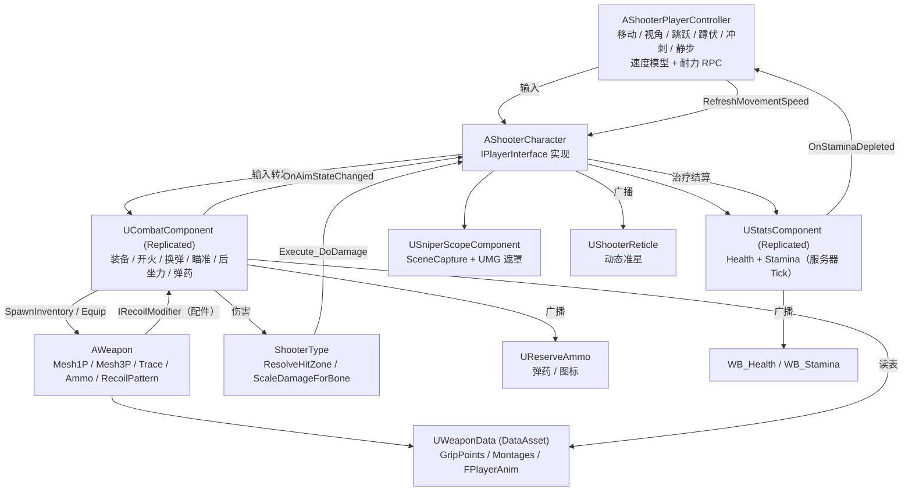

**Language / 语言：** [English](README.md) ｜ **中文**

---

# FPS — Unreal Engine 5 C++ 第一人称射击项目

一个使用 **Unreal Engine 5.8 + C++** 实现的第一人称射击（FPS）玩法框架：角色移动与视角、静步/冲刺移动模式与耐力、武器（长枪 / 手枪 / 近战）装备/切换/切枪自动关镜、开火与命中判定、**后坐力弹道（Recoil Pattern）与回正**、换弹、瞄准（ADS）、狙击镜、**数据驱动的武器配件系统**（枪管 / 护木 / 枪口 / 瞄具 / 握把 / 枪托 / 战术 / 弹匣）以及游戏内配件菜单与 Tab 整备界面、**画中画倍镜**、手电、生命值与治疗、部位伤害、受击动画，以及完整的多人网络同步。

> 本文档由阅读源码整理而成，**未修改任何代码文件**。
> 逐函数、逐组件的详细说明（含每个函数的签名、作用、调用链与效果）请见 [DOCUMENTATION.zh-CN.md](<DOCUMENTATION.zh-CN.md>)。
> English version: [README.md](<README.md>) ｜ [DOCUMENTATION.md](<DOCUMENTATION.md>)

---

## 1. 项目概览

| 项目 | 内容 |
| --- | --- |
| 引擎版本 | Unreal Engine 5.8（[FPS.uproject](<FPS.uproject>) 中 `EngineAssociation: "5.8"`） |
| 主模块 | `FPS`，类型 Runtime（[FPS.Build.cs](<Source/FPS/FPS.Build.cs>)） |
| 语言 | C++，大量接口通过 `BlueprintCallable` / `BlueprintImplementableEvent` 暴露给蓝图 |
| 输入 | Enhanced Input（`UEnhancedInputComponent` + `UInputMappingContext`） |
| 默认关卡 | `/Game/FirstPerson/Lvl_FirstPerson` |
| 默认 GameMode | `/Script/FPS.ShooterGameModeBase`（见 [DefaultEngine.ini](<Config/DefaultEngine.ini>)） |
| 自定义碰撞通道 | `Weapon` = `ECC_GameTraceChannel2`（Trace 类型） |
| 构建目标 | `FPS`（Game）、`FPSEditor`（Editor），`BuildSettingsVersion.V7` |

模块依赖（[FPS.Build.cs](<Source/FPS/FPS.Build.cs>)）：

- Public：`Core`、`CoreUObject`、`Engine`、`InputCore`、`EnhancedInput`、`GameplayTags`、`PhysicsCore`、`UMG`
- Private：`Slate`、`SlateCore`

启用的插件（[FPS.uproject](<FPS.uproject>)）：`ModelingToolsEditorMode`（仅编辑器）、`GameplayStateTree`、`AnimationWarping`、`ModelContextProtocol`、`AllToolsets`。

---

## 2. 功能一览

| 系统 | 已实现内容 | 主要代码位置 |
| --- | --- | --- |
| 角色 | 第一人称相机（SpringArm 臂长 0 + 相机延迟）、1P/3P 双 SkeletalMesh、蹲伏、跳跃、移动 | [ShooterCharacter.cpp](<Source/FPS/Private/ShooterCharacter.cpp>)、[ShooterPlayerController.cpp](<Source/FPS/Private/ShooterPlayerController.cpp>) |
| 移动模式 | 静步 / 冲刺均为切换式；速度倍率相乘（静步 / 下蹲 / 开镜）；开镜或下蹲会打断冲刺；耐力耗尽自动退出冲刺 | [ShooterPlayerController.cpp](<Source/FPS/Private/ShooterPlayerController.cpp>) |
| 耐力 | 服务器权威的消耗/回复、跳跃消耗、`OnStaminaDepleted` 广播、耐力条 HUD | [StatsComponent.cpp](<Source/FPS/Private/Stats/StatsComponent.cpp>) |
| 移动手感 | `GroundSpeed`、慢走步态 BlendSpace 替换（`Strafe_Walking`）、每帧把 Locomotion 播放速率写进 AnimBP | [ShooterCharacter.cpp](<Source/FPS/Private/ShooterCharacter.cpp>) |
| 武器 | 长枪 / 手枪 / 近战三类；主 / 副 / 手枪 / 近战四个槽位；循环切枪；切枪 Montage；切枪自动关镜 | [Weapon.cpp](<Source/FPS/Private/Weapon/Weapon.cpp>)、[CombatComponent.cpp](<Source/FPS/Private/CombatComponent.cpp>) |
| 射击 | 球形 Sweep 命中判定、单发 / 全自动（每把枪可选**切换开火模式**：`bCanSwitchFireMode`，`FireType` 已同步）、拉栓（`BoltCycling` 状态）、**后坐力弹道 + 回正 + 配件修正接口**、服务端射速节流、蓝图枪口/命中特效、弹匣与备弹 | [Weapon.cpp](<Source/FPS/Private/Weapon/Weapon.cpp>)、[CombatComponent.cpp](<Source/FPS/Private/CombatComponent.cpp>)、[RecoilModifierInterface.h](<Source/FPS/Public/Interface/RecoilModifierInterface.h>) |
| 换弹 | 1P/3P 换弹 Montage，**分种类**（首次 / 空仓 / 战术，没配就回落到默认 Montage），换弹和拉栓时左手 IK 渐隐、动画通知填弹、空仓自动换弹、C++ 动画通知把枪重新握到手上 | [CombatComponent.cpp](<Source/FPS/Private/CombatComponent.cpp>)、[AnimNotify_WeaponGrip.cpp](<Source/FPS/Private/AnimNotify/AnimNotify_WeaponGrip.cpp>) |
| 治疗 | 治疗 Montage（播放期间隐藏武器）、服务端钳制治疗量、多播给其他玩家播 3P 动画 | [ShooterCharacter.cpp](<Source/FPS/Private/ShooterCharacter.cpp>) |
| 瞄准 ADS | `bAiming` 复制（跳过 Owner）、`OnAimStateChanged` 广播、C++ 驱动开镜：`AimAlpha` 按武器开镜时间推进（配件可乘倍率），Mesh1P 从**每把枪的腰射偏移**插值到瞄具对准位置（**眼距**可配），相机 FOV 在 C++ 里插值（瞄具 `AimFOV` → 枪 `AimFeildOfView` → 默认）；可选枪身视觉后坐（默认关）。见 §10.1 | [ShooterCharacter.cpp](<Source/FPS/Private/ShooterCharacter.cpp>)、[CombatComponent.cpp](<Source/FPS/Private/CombatComponent.cpp>) |
| 狙击镜 | **旧方案，已停用。** `USniperScopeComponent` 只会让自己保持关闭；狙击枪和其他枪一样按装的瞄具走（见 §10.1） | [SniperScopeComponent.cpp](<Source/FPS/Private/Weapon/SniperScopeComponent.cpp>) |
| 伤害 | 骨骼名 → 命中部位（头 / 躯干 / 四肢）→ 倍率（爆头 ×2、四肢 ×0.75），服务端结算 | [ShooterType.cpp](<Source/FPS/Private/ShooterType/ShooterType.cpp>)、[StatsComponent.cpp](<Source/FPS/Private/Stats/StatsComponent.cpp>) |
| 动画驱动 | `AO_Yaw`、`MovementOffsetYaw`、`TurningStatus`、`FABRIK_SocketTransform`、`FPlayerAnim` 结构体注入 ABP | [ShooterCharacter.cpp](<Source/FPS/Private/ShooterCharacter.cpp>)、[WeaponData.h](<Source/FPS/Public/WeaponData.h>) |
| 受击反馈 | `HitReacts` 随机 Montage，NetMulticast 广播 | [ShooterCharacter.cpp](<Source/FPS/Private/ShooterCharacter.cpp>) |
| UI | 动态准星材质（跟随武器）、弹药/备弹 + 武器图标 HUD、血条、耐力条、瞄准时隐藏准星 | [ShooterReticle.cpp](<Source/FPS/Private/Ui/ShooterReticle.cpp>)、[ReserveAmmo.cpp](<Source/FPS/Private/Ui/ReserveAmmo.cpp>) |
| 武器配件 | 每个槽位一份数据资产的配件、服务器校验白名单、每把枪的默认配件、网络同步、1P/3P 实时生成模型，并重定向握把 / 枪口 / 瞄准插槽 | [Weapon.cpp](<Source/FPS/Private/Weapon/Weapon.cpp>)、[AttachmentData.h](<Source/FPS/Public/Weapon/AttachmentData.h>) |
| 配件界面 | 游戏内配件菜单（一个槽位一行）、Tab 整备界面（三把枪预览渲染 + 可拖动配件窗） | [AttachmentMenu.cpp](<Source/FPS/Private/Ui/AttachmentMenu.cpp>)、[LoadoutScreen.cpp](<Source/FPS/Private/Ui/LoadoutScreen.cpp>) |
| 瞄具与手电 | 红点 / 全息对准瞄具自己的 Socket、只改相机 FOV；只有能用的 `Magnified` / `Variable` 瞄具才做画中画放大（可变倍率可切档），手电是按配件数据生成的聚光灯 | [OpticScopeComponent.cpp](<Source/FPS/Private/Weapon/OpticScopeComponent.cpp>) |
| 第一人称扶枪 IK | `UFirstPersonAnimInstance` 读取 `FABRIK_Socket1P` / `FABRIK_Alpha1P`，让左手跟随枪或已装的握把 | [FirstPersonAnimInstance.cpp](<Source/FPS/Private/Animation/FirstPersonAnimInstance.cpp>) |
| 网络 | 服务器权威：生成、装备、配件、伤害、耐力、治疗；客户端预测弹匣与后坐力；NetMulticast 播特效与第三人称动画 | [CombatComponent.cpp](<Source/FPS/Private/CombatComponent.cpp>) |

---

## 3. 目录结构

```
FPS/
├─ FPS.uproject                     # 引擎版本、模块、插件
├─ Config/
│  ├─ DefaultEngine.ini             # 碰撞通道（Weapon/Projectile）、默认关卡与 GameMode
│  ├─ DefaultInput.ini              # EnhancedInput 默认类、鼠标灵敏度、按键轴
│  └─ DefaultGame.ini               # 项目名、AssetManager 扫描规则
├─ Content/
│  ├─ FPS/                          # 本项目自己的资产（见第 6 节）
│  └─ ...                           # 第三方素材包（FPSTP、InfimaGames、IBWP3DPistol3Pack 等）
└─ Source/
   ├─ FPS.Target.cs                 # Game 目标
   ├─ FPSEditor.Target.cs           # Editor 目标
   └─ FPS/
      ├─ FPS.Build.cs              # 模块依赖
      ├─ FPS.h / FPS.cpp           # 主游戏模块声明
      ├─ Public/
      │  ├─ FPSTraceChannels.h            # 武器 Trace 通道常量
      │  ├─ ShooterGamePlayTags.h         # 原生 GameplayTag 声明
      │  ├─ ShooterCharacter.h            # 玩家角色
      │  ├─ ShooterPlayerController.h     # 玩家控制器（移动/视角/跳跃/蹲伏/冲刺/静步）
      │  ├─ ShooterGameModeBase.h         # GameMode（空壳，供蓝图继承）
      │  ├─ CombatComponent.h             # 战斗核心组件（库存/开火/换弹/瞄准/后坐力）
      │  ├─ WeaponData.h                  # 武器数据资产 + FPlayerAnim / FMontageData
      │  ├─ AnimNotify/
      │  │  └─ AnimNotify_WeaponGrip.h    # C++ 动画通知：把武器重新挂到手上
      │  ├─ Interface/
      │  │  ├─ PlayerInterface.h          # 角色能力接口
      │  │  └─ RecoilModifierInterface.h  # IRecoilModifier + FRecoilScale（配件后坐力修正）
      │  ├─ Animation/FirstPersonAnimInstance.h   # ABP_FirstPerson 的 C++ 基类：1P 扶枪 IK 目标
      │  ├─ Ui/AttachmentMenu.h                   # 配件菜单（一个槽位一行）
      │  ├─ Ui/AttachmentSlotRow.h                # 槽位行 + 可选配件按钮
      │  ├─ Ui/AttachmentOptionEntry.h            # 单个配件按钮 / "卸下"按钮
      │  ├─ Ui/LoadoutScreen.h                    # Tab 整备界面 + 可拖动配件窗
      │  ├─ Ui/LoadoutPreviewRig.h                # 三把枪预览用的 SceneCapture 装置
      │  ├─ Weapon/AttachmentData.h               # 配件数据资产（+ EOpticType）
      │  ├─ Weapon/OpticScopeComponent.h          # 画中画倍镜
      │  ├─ Stats/StatsComponent.h        # 生命值 + 耐力组件
      │  ├─ ShooterType/ShooterType.h     # 部位判定 / 伤害倍率工具函数
      │  ├─ Ui/ShooterReticle.h           # 动态准星控件
      │  ├─ Ui/ReserveAmmo.h              # 弹药 HUD 控件
      │  └─ Weapon/
      │     ├─ Weapon.h                   # 武器 Actor（+ FRecoilStep）
      │     └─ SniperScopeComponent.h     # 狙击镜组件 + 全屏遮罩控件
      └─ Private/                        # 与 Public 一一对应的实现文件
```

---

## 4. 快速开始

1. **打开工程**：用 UE 5.8 打开 [FPS.uproject](<FPS.uproject>)，首次打开时选择 "Rebuild" 或先生成工程文件再编译 `FPS` 模块。
2. **默认关卡**：`/Game/FirstPerson/Lvl_FirstPerson`（[DefaultEngine.ini](<Config/DefaultEngine.ini>) 已设为 `GameDefaultMap`）。
3. **GameMode**：全局默认为 `AShooterGameModeBase`；实际使用请继承为 `BP_ShooterGameMode`（[BP_ShooterGameMode.uasset](<Content/FPS/Game/BP_ShooterGameMode.uasset>)），并在其中指定：
   - `DefaultPawnClass = BP_ShooterCharacter`
   - `PlayerControllerClass = BP_ShooterPlayerController`
4. **角色必需配置**（`BP_ShooterCharacter`，代码里有 `checkf` 强校验）：
   - `Combat → WeaponData` 必须指向 `DA_WeaponData`，否则 `GetWeaponAttachPoint` 会触发 `checkf` 断言。
   - `Combat → DefaultWeaponClass` 至少填一把武器蓝图。
   - 输入字段（`IA_FireWeapon`、`IA_CycleWeapon`、`IA_ReloadWeapon`、`IA_AimWeapon`、`IA_Heal` 以及四个 `IA_Equip*`）都要赋值。
   - `HealMontage` 必须赋值，否则按治疗键只会打一条 Warning 且没有任何效果；`HealAmout` 默认 30。
   - 蓝图变量 `AdsMesh1PLoc`（`FVector`）必须存在 —— ADS 瞄具对齐会直接写这个变量。
   - `HitReacts` 至少填一个受击 Montage，否则 `Multicast_HitReact` 的随机下标会越界（当前代码未做空数组保护）。
5. **玩家控制器**：`BP_ShooterPlayerController` 需要设置 `ShooterIMC = IMC_Shooter`，以及 `IA_Move` / `IA_Look` / `IA_Jump` / `IA_Crouch` / `IA_Sprint` / `IA_Walk`。速度与倍率（`WalkSpeed` 250、`RunSpeed` 500、`SprintSpeed` 800、`CrouchSpeedMultiplier` 0.6、`WalkSpeedMultiplier` 0.5、`AimSpeedMultiplier` 0.7）配置在控制器上。
6. **输入资产**：在 `IMC_Shooter` 里绑定 `IA_*` 与按键。`IA_FireWeapon` 建议能同时触发 `Started` 与 `Completed`（单发/全自动靠这两个事件区分）；`IA_Sprint`、`IA_Walk`、`IA_Heal` 都绑在 `Started`。
7. **武器蓝图**：基于 `BP_Weapon`（`AWeapon`）派生，设置 `WeaponType`（GameplayTag）、`WeaponKind`、`Mesh1P` / `Mesh3P` 的骨骼网格体与动画蓝图（`ABP_Rifle`、`ABP_Pistol`、`ABP_M700`），调好后坐力参数（`RecoilPattern`、`RecoilPitchScale`、`RecoilYawScale`、`AimRecoilMultiplier`、`RecoilRecoverySpeed`、`RecoilRecoveryDelay`、`RecoilResetTime`），并在 `FireEffect` 蓝图事件里做枪口火焰 / 弹孔 / 音效。
8. **数据资产**：在 `DA_WeaponData` 里按武器 Tag 填写 `GripPoints`（挂点 Socket 名）、`WeaponMontages`、`FirstPersonAnims` / `ThirdPersonAnims`（有慢走混合的话还要填 `Strafe_Walking`）、`FirstPersonMontages` / `ThirdPersonMontages`。
9. **动画蓝图**必须暴露 C++ 按名字写入的变量：3P ABP 建议有 `bUseWalkGait`、`LocomotionPlayRate`（或 `PlayRate`）、`GroundSpeed`；1P ABP 至少要有 `PlayRate`。变量名对不上时不会有任何提示，只是静默失效。
10. **武器握持通知**：在换弹/开火 Montage 里"副手抓住枪"的那一帧放一个 **Weapon Grip** 通知（`UAnimNotify_WeaponGrip`），并把 `GripSocket` 设为手部 Socket 或骨骼名。本工程的狙击枪换弹 Montage 已经用了它。
11. **HUD**：把 `WBP_ShooterOverlay` 加入视口（内部含 `WBP_ReserveAmmo` 与 `WB_Stamina`），`WB_Health` 显示血量。准星控件基于 `UShooterReticle`，其内部 Image 命名为 `Image_Reticle`（代码也兼容拼写错误的 `Image_Redicle`）。
12. **狙击镜材质**：`/Game/FPS/UI/M_SniperScope` 是硬编码路径（见 [SniperScopeComponent.cpp](<Source/FPS/Private/Weapon/SniperScopeComponent.cpp>) 中的 `SniperScopeMaterialPath`），改名或移动会导致镜筒不显示并打印 Warning。材质参数需包含 `ScopeView`(Texture)、`MaskRadius`、`RingWidth`、`ReticleThickness`、`Aspect`。

---

### 4.1 武器配件与整备界面配置

1. **标签** —— 配件槽位类型是 GameplayTag，声明在 [ShooterGamePlayTags.h](<Source/FPS/Public/ShooterGamePlayTags.h>)：`Attachment.Slot.Barrel`、`Handguard`、`Muzzle`、`Optic`、`Grip`、`Stock`、`Tactical`、`Magazine`。新增类型只需要加 Tag。
2. **配件资产** —— 每个配件建一份 `UAttachmentData` 数据资产（右键 → Miscellaneous → Data Asset → AttachmentData）。工程自带的在 `Content/FPS/Data/Accessries/`（`DA_Barris`、`DA_HangGuard`、`DA_Grip`、`DA_Grip_Vertical`、`DA_Sight`、`DA_Sight1`、`DA_Sight2`、`DA_MAG45`、`DA_Back`）。填 `SlotTag`、`Mesh`、`MeshOffset`，以及可选的 后坐力倍率 / 瞄具块 / 手电块。位置相关的 Socket（`FABRIK`、`Muzzle`、`SightSocket`、`LensSocket`、`LightSocket`）都做在**配件自己的 StaticMesh** 上。
3. **枪的槽位表** —— 在武器蓝图（`BP_RIfle` 已经配好）的 `FPS|Attachment → AttachmentSlots` 里，一个槽位一行：`SlotTag`、`SocketName`、`AllowedAttachments` 白名单、可选的 `DefaultAttachment` 和 `bRequired`。槽位 Socket 会先在枪骨骼上找，找不到再在"已经装上的配件"上找 —— 握把装到护木上就是靠这个。
4. **菜单与整备** —— 在 `BP_ShooterPlayerController` 上设置 `AttachmentMenuClass = WBP_AttachmentMenu`，并赋好 `IA_AttachmentMenu`（在 `IMC_Shooter` 中绑定）与 `IA_Flashlight`。`WBP_AttachmentMenu` 里必须有名为 `SlotList` 的 `VerticalBox`，并设置 `RowClass = WBP_AttachmentSlotRow`；行控件需要 `Text_SlotName` + `EntryContainer`，并设置 `EntryClass = WBP_AttachmentEntry`；按钮控件需要 `Button_Select` + `Text_Name`（`Image_Icon` 可选）。
5. **整备界面** —— Tab 界面和它的配件窗完全由 C++ 构建、按需创建，因此不需要 WBP；只有槽位行是按硬编码路径加载 `/Game/FPS/UI/WBP_AttachmentSlotRow`。

新增操作：

| 动作 | 输入资产 | 绑定对象 | 触发事件 | 说明 |
| --- | --- | --- | --- | --- |
| 配件菜单 | `IA_AttachmentMenu` | 控制器 → `ToggleAttachmentMenuAction` | `Started` | 开关按槽位排列的配件菜单；显示鼠标并屏蔽转视角 |
| 手电 | `IA_Flashlight` | 控制器 → `FlashlightAction` | `Started` | 通过战斗组件请求开关手电（服务器权威） |
| 整备界面 | 运行时创建的 `IA_Loadout_Runtime`（Tab） | 控制器，运行时注册 | `Started` | 打开全屏整备界面；输入动作与映射上下文都是 C++ 运行时创建，**不在** `IMC_Shooter` 里 |

## 5. 操作说明

输入由 Enhanced Input 分发：移动与移动模式在 `AShooterPlayerController`，战斗动作在 `AShooterCharacter`。

| 动作 | 输入资产 | 绑定对象 | 触发事件 | 说明 |
| --- | --- | --- | --- | --- |
| 移动 | `IA_Move` | 控制器 | `Triggered` | 以控制旋转的 Yaw 为基准前后左右移动 |
| 视角 | `IA_Look` | 控制器 | `Triggered` | `AddYawInput` / `AddPitchInput` |
| 跳跃 | `IA_Jump` | 控制器 | `Started` | 蹲伏中先起身；起跳会在服务器扣耐力 |
| 蹲伏 | `IA_Crouch` | 控制器 | `Started` | 切换 `bWantsToCrouch`；下蹲会打断冲刺 |
| 冲刺 | `IA_Sprint` | 控制器 | `Started` | 切换冲刺；开镜 / 下蹲 / 耐力耗尽都会退出 |
| 静步 | `IA_Walk` | 控制器 | `Started` | 切换慢走（`WalkSpeedMultiplier`）；会打断冲刺 |
| 开火 | `IA_FireWeapon` | 角色 | `Started` / `Completed` | 按下开火，松开停止（决定全自动与后坐力回正） |
| 瞄准 | `IA_AimWeapon` | 角色 | `Started` | 切换 ADS；通过 `OnAimStateChanged` 广播（蓝图 `OnAim`、速度、步态） |
| 换弹 | `IA_ReloadWeapon` | 角色 | `Started` | 播放换弹 Montage，由动画通知填弹 |
| 治疗 | `IA_Heal` | 角色 | `Started` | 播放 `HealMontage`，期间隐藏武器；服务端钳制并结算治疗量 |
| 切枪 | `IA_CycleWeapon` | 角色 | `Started` | 循环到下一把武器，并自动关镜 |
| 主武器 | `IA_EquipMainWeapon` | 角色 | `Started` | 切到第一把长枪，并自动关镜 |
| 副武器 | `IA_EquipSecondaryWeapon` | 角色 | `Started` | 切到第二把长枪，并自动关镜 |
| 手枪 | `IA_EquipPistol` | 角色 | `Started` | 切到第一把手枪，并自动关镜 |
| 近战 | `IA_EquipMeleeWeapon` | 角色 | `Started` | 切到第一把近战武器，并自动关镜 |
| 切换开火模式 | 自建 IA → `SwitchFireModeAction` | 角色 | `Started` | 对 `bCanSwitchFireMode` 的枪切单发 / 全自动；换弹、拉栓时不能切；服务器 RPC + `OnFireModeChanged` |
| 切换倍率 | 自建 IA → `SwitchZoomAction` | 角色 | `Started` | 开镜且装了 `Variable` 瞄具时，在 `ZoomLevelsFOV` 几档之间切换；`OnZoomLevelChanged` 给界面用 |

> 说明：`IMC_Shooter` 中存在 `LeftMouseButton`、`RightMouseButton`、`SpaceBar`、`LeftControl`、`LeftShift`、`LeftAlt`、`One`~`Four`、`R`、`Q`、`E` 及手柄扳机等按键；上表"哪个键对应哪个动作"是常见配置，**最终以编辑器内 `IMC_Shooter` 的实际绑定为准**。

> `IA_VersionWeapon` / `Input_VersionWeapon()` 在 C++ 中已声明但**从未绑定**，属于占位代码。

---

## 6. 关键蓝图与资产（`/Game/FPS`）

| 资产 | 作用 |
| --- | --- |
| `Character/BP_ShooterCharacter` | 玩家角色蓝图（挂点、FOV、武器类、ADS 变量 `AdsMesh1PLoc`、`HealMontage` / `HealAmout`、`HitReacts`） |
| `Character/ABP_FirstPerson` / `ABP_ThirdPerson` | 1P / 3P 动画蓝图；读取 `AO_Yaw`、`MovementOffsetYaw`、`TurningStatus`、`FABRIK_SocketTransform`、`CurrenrAnim` / `CurrentAnim`，以及 3P 的 `bUseWalkGait` / `LocomotionPlayRate` / `GroundSpeed` |
| `Player/BP_ShooterPlayerController` | 输入映射、移动/视角绑定、冲刺/静步动作、速度与倍率配置 |
| `Game/BP_ShooterGameMode` | GameMode，指定默认 Pawn 与 Controller |
| `Data/DA_WeaponData` | 唯一的武器数据资产（挂点、Montage、动画结构体，含 `Strafe_Walking`） |
| `Weapon/BP_Weapon`、`BP_RIfle`、`BP_Refile`、`BP_Pistol`、`BP_M700` | 武器 Actor 蓝图；`BP_RIfle` 覆盖了 `RecoilPattern` |
| `Weapon/ABP_Rifle`、`ABP_Pistol`、`ABP_M700` | 武器骨骼网格体的动画蓝图 |
| `UI/WBP_ShooterOverlay`、`UI/WBP_ReserveAmmo`、`UI/WB_Health`、`UI/WB_Stamina` | HUD 根控件、弹药控件、血量控件、耐力控件 |
| `UI/M_SniperScope` | 狙击镜遮罩材质（代码硬编码引用） |
| `Input/IMC_Shooter`、`Input/InputAction/IA_*` | 输入映射上下文与全部输入动作（含 `IA_Sprint`、`IA_Walk`、`IA_Heal`） |
| `Animation/AnimMontage_Arms_Healing` | 治疗 Montage（赋给 `HealMontage`） |
| `Animation/AnimMontage_Arms_SniperRiffle_*` | 使用 **Weapon Grip** 通知的狙击枪换弹 / 退壳 Montage |

---

## 7. 系统架构（速览）



---

## 8. 网络模型要点

- **生成与装备**：`SpawnInventory` 只在 `ROLE_Authority` 执行；`UCombatComponent` 复制 `Inventory` 与 `CurrentWeapon`，客户端靠 `OnRep_CurrentWeapon` 重新挂接与播放动画。
- **开火**：本地立即预测（播 1P Montage、扣弹匣、本地特效、施加后坐力）→ `Server_FireWeapon(Hit)` 校验射速并结算伤害 → `Multicast_FireWeapon` 让远端补特效与 3P 动画，并用 `Rep_Fire(AuthAmmo)` 校正弹匣。
- **后坐力**：只作用在本地控制旋转上（`ApplyFireRecoil` / `TickRecoil`），属于客户端手感表现；服务器不会看到这段偏移，与 UE 本身"瞄准由客户端决定"的模型一致。
- **换弹**：本地播 1P Montage 并置 `Reloading` → `Server_ReloadWeapon` → `Multicast_ReloadWeapon`（远端播 3P）→ 动画通知调用 `ApplyReload` / `Notify_ReloadWeapon` 在服务端填弹 → `Client_ReloadWeapon` 回传权威数值。
- **瞄准**：`bAiming` 使用 `COND_SkipOwner` 复制（Owner 已本地预测）；`Server_Aim` 保持服务端一致，切枪时 `Server_CycleWeapon` 也会强制关镜，让其他玩家看到状态变化。
- **耐力**：**只在服务器**计算（`UStatsComponent::TickComponent` 有权威判断）后同步给 Owner；控制器用 `Server_SetMovementState` 上报冲刺/静步状态，服务器用 `Client_StopSprint` 通知客户端退出冲刺。
- **移动速度**：客户端为了手感会在本地设置 `MaxWalkSpeed`，但必须把状态镜像给服务器，否则会被服务器纠正拉回。
- **治疗**：客户端起手播动画并 `Server_BeginHeal`；服务器把治疗量钳制到自己的 `HealAmout`，设定超时兜底，多播 3P 动画，并且只在 `Server_FinishHeal(true)` 时真正加血。
- **备弹**：`CurrentReserveAmmo` 只复制给 Owner（`COND_OwnerOnly`）。
- **受击**：伤害在服务端结算，`Multicast_HitReact` 让其他客户端播放受击 Montage。

---

## 9. 已知限制

- `EWeaponStatus::Firing` 未被任何代码写入。
- `AimTimeline` 仍然声明但没用；开镜现在由 C++ 的 `AimAlpha` / `AimAlignAlpha` 驱动（把 `bDriveAdsInCode` 关掉可回到旧的蓝图 `AdsMesh1PLoc` 方案）。
- `Input_VersionWeapon()` 是空函数，`VersionWeaponAction` 也从未被绑定 —— 死代码。
- 后坐力是纯本地表现，不能当作服务端的"精度惩罚"使用。
- 步态/播放速率是通过**变量名**写进 AnimInstance 的（兼容 `PlayRate` / `LocomotionPlayRate` / `BS_PlayRate` 等别名），改名后会静默失效。
- `UStatsComponent::DeathState` 现在会被治疗逻辑**读取**，但仍然从未被写入 —— 死亡流程依旧缺失；`OnRep_DeathState` 为空，`ChangeHealthByAmout` 恒返回 `false`。
- `ChangeMaxHealthByAmout` / `ChangeMaxStaminaAmout` 没有上下限约束。
- `AShooterCharacter::DoDamage_Implementation` 在 `HitReacts` 为空时会对空数组取随机数，建议在蓝图侧保证至少一个 Montage。
- `USniperScopeComponent` 只为兼容保留，永久不工作，里面的常量已经不影响效果。
- 第 7 步试过的自动镜片平面、开镜灵敏度缩放、可选第一人称视野，已经从代码里撤掉；画中画瞄具仍需要镜片材质槽（`LensMaterialIndex`）或 `LensMaterial`，开镜时鼠标灵敏度不会自动缩放。
- 配件窗的行控件是按硬编码路径加载的（`/Game/FPS/UI/WBP_AttachmentSlotRow.WBP_AttachmentSlotRow_C`），改名会让整备界面的行消失（会打印 Warning）。
- `BP_M700`（狙击枪）没有配置 `AttachmentSlots`，所以它的配件菜单会显示"这把枪没有配件槽"。
- `DA_Sight` 勾了 `bOverridesAimFOV` 但没有填镜片材质，因此目前只相当于红点类瞄具；要做倍镜必须把 `OpticType = Magnified` 那一整块（Lens Socket、Lens Material、材质槽序号、渲染目标尺寸）填全，否则画中画会打警告并且不生效。
- 整备界面只显示背包里的**前三把**武器；预览装置是一个生成在地图下方极远处（Z = −100000）的临时 Actor，控件销毁时一并销毁。
- 配件装卸在服务器校验，但菜单是基于同步状态重建的，所以被服务器拒绝的请求只会留下一条 Warning，界面不会变化。
- `AShooterGameModeBase` 目前是空壳，规则逻辑（回合、计分、复活）需要自行扩展。

---

## 10. 武器配件与整备界面

| 组成 | 作用 |
| --- | --- |
| `FWeaponAttachmentSlot` | 枪的槽位表里的一行：槽位 Tag、挂点 Socket、白名单、默认配件、`bRequired` |
| `UAttachmentData` | 一个配件一份数据资产：槽位 Tag、名称/图标、StaticMesh + 偏移、`FabrikSocketName` / `MuzzleSocketName`、后坐力倍率、瞄具块（`OpticType`、`AimFOV`、`SightSocketName`、倍率、镜片 Socket / 材质 / 材质槽、渲染目标尺寸）与手电块 |
| `AWeapon` 配件 API | `EquipAttachment` / `RemoveAttachment` / `ToggleFlashlight`（仅服务器，`BlueprintAuthorityOnly`），以及 `GetAttachmentSlots`、`GetAllowedAttachmentsForSlot`、`CanEquipAttachment`、`HasAttachmentSlot`、`GetAttachmentInSlot`、`GetEquippedAttachments`、`GetRecoilMultiplier`、`GetEffectiveAimFOV`、`GetOpticAttachment`、`GetOpticMesh1P`、`HasFlashlight`、`IsFlashlightOn` 与委托 `OnAttachmentsChanged` |
| 网络同步 | `EquippedAttachments`（用数组 —— TMap 不能同步）与 `bFlashlightOn`，都是 `ReplicatedUsing`；服务器每次改动都重建模型并 `ForceNetUpdate` |
| 运行时模型 | `RebuildAttachmentVisuals` 会销毁并重新生成 1P/3P 的 StaticMesh，按依赖顺序解析挂点（护木先装，握把才能挂到护木上），并把聚光灯重新挂到本地玩家能看到的那个模型上 |
| 与后坐力 / 开镜的衔接 | `AWeapon` 实现了 `IRecoilModifier`，配件倍率会进入后坐力系统；`GetAimSocketWorldLocation` 优先瞄具的 `SightSocket`，其次枪管配件的 `AimSocket`，最后才是枪本身；开镜 FOV 取 `GetEffectiveAimFOV()` |
| 输入与界面 | `IA_AttachmentMenu`（B 键）开关 `UAttachmentMenu`，`IA_Flashlight`（F 键）开关手电，Tab 打开 `ULoadoutScreen`（与它的输入动作/映射上下文一起在运行时创建） |
| 握把 / 枪口 / 瞄具 | 握把真正挂住时，1P 扶枪 IK 跟随握把的 `FABRIK` Socket；枪口特效按 枪口配件 → 枪管配件 → 枪本体 Socket 的顺序取点；狙击枪继续走全屏 `SniperScopeComponent`，其他武器用 `UOpticScopeComponent` 做画中画倍镜 |

网络小结：客户端只通过 `UCombatComponent` **发起请求**（`Initiate_EquipAttachment`、`Initiate_RemoveAttachment`、`Initiate_ToggleFlashlight` 以及带 `…OnWeapon` 的版本），内部转发为可靠的服务器 RPC；`AWeapon` 再校验槽位与白名单并应用改动，最后由同步的数组触发 `OnRep_EquippedAttachments` → 重建模型 + 广播 `OnAttachmentsChanged` 让界面刷新。

### 10.1 开镜、瞄具与武器手感（武器逻辑第 1–8 步）

完整改动记录：`Saved/武器逻辑改动记录.md`。

| 方面 | 行为 | 在哪里配置 |
| --- | --- | --- |
| 换弹分种类 | `ChooseReloadType()` 选 `First`（这把枪第一次换弹）、`Empty`（空仓）或 `Tactical`；`FMontageData::ResolveReloadMontage()` 某种没配时回落到 `ReloadMontage` | `UWeaponData` → `FirstReloadMontage`、`EmptyReloadMontage`、`TacticalReloadMontage` |
| 拉栓 | 配了 `BoltMontage` 的枪开火后进入 `EWeaponStatus::BoltCycling`，Montage 结束前不能开火、换弹、切枪、治疗；服务器用 `ServerBoltEndTime` 校验 | `UWeaponData` → `BoltMontage` |
| 左手 IK | 换弹 / 拉栓时（或动画曲线 `DisableLeftHandIKCurveName` > 0）`FABRIK_Alpha1P` 渐变到 0，结束后按 `LeftHandIKBlendSpeed` 回来 | 角色 → `bDisableLeftHandIKDuringReload`、`LeftHandIKBlendSpeed` |
| 开火模式 | `Initiate_SwitchFireMode()` 本地切 `FireType` 并走 `Server_SetFireMode`；`FireType` 同步（跳过 Owner） | 武器 → `bCanSwitchFireMode`；绑定 `SwitchFireModeAction` |
| 开镜 FOV | 只在本地用 C++ 插值：可变倍率当前档 → 瞄具 `AimFOV`（勾了 `bOverridesAimFOV`）→ 枪 `AimFeildOfView` → `DefaultFOV`；关镜、切枪、死亡时回到默认 | 角色 → `bDriveAimFOVInCode`、`AimFOVInterpSpeed`、`DefaultFOV` |
| 开镜时间 | `AimAlpha` 在 `GetEffectiveAdsTime()` 内从 0 到 1；= `AimDownSightTime` × 所有已装配件的 `AdsTimeMultiplier` | 武器 → `AimDownSightTime`；配件 → `AdsTimeMultiplier` |
| 瞄具类型 | `None`、`RedDot`、`Holographic` 只改相机 FOV。`Magnified` / `Variable` 在瞄具模型有 `LensSocket` 或 `SightSocket`、并且有画面材质（`LensMaterial`，Magnified 也可用 `LensMaterialIndex` 槽上现成的材质）时，由 `UOpticScopeComponent` 做画中画。拍摄机和玩家镜头重合，画面中心就是子弹线；不开镜时不拍 | 配件 → `OpticType`、`AimFOV`、`Magnification`、`ZoomLevelsFOV`、`LensSocketName`、`LensMaterial`、`LensTextureParameterName`、`LensMaterialIndex`、`RenderTargetSize` |
| 可变倍率 | `Initiate_CycleZoom()` 让 `CurrentZoomIndex` 在 `ZoomLevelsFOV` 里轮换，画中画拍摄 FOV 平滑过渡到新档 | 配件 → `ZoomLevelsFOV`；绑定 `SwitchZoomAction` |
| 狙击 | 不再写死：装红点就和步枪一样；没装瞄具就对准自己的 `AimSocket`、用 `AimFeildOfView`；只有 Magnified / Variable 才画中画 | — |
| 腰射位置 | 腰射目标 = Mesh1P 默认位置（BeginPlay 记下）+ 武器偏移；旋转偏移在开镜时过渡回默认旋转；每帧读当前武器，切枪即生效 | 武器 → `HipMesh1POffset`、`HipMesh1PRotationOffset` |
| 眼距 | 开镜时把瞄准点放到镜头正前方的眼距处：瞄具 `EyeDistance`（勾了 `bOverridesEyeDistance`）→ 武器 `AdsEyeDistance` → 0 = 保持瞄准点本来的距离（按腰射姿态算，不会漂）。之前的 `AdsOffset` 已**删除** | 武器 → `AdsEyeDistance`；配件 → `bOverridesEyeDistance`、`EyeDistance` |
| 视觉后坐 | 只在本地给 Mesh1P 加的枪身后坐，叠在图案后坐上（子弹仍跟准星），受配件和开镜倍率影响。**默认关** | 角色 → `bEnableVisualRecoil`；武器 → `VisualRecoilLocation`、`VisualRecoilRotation`、`VisualRecoilAimMultiplier`、`VisualRecoilKickSpeed`、`VisualRecoilRecoverySpeed` |

## 11. 延伸阅读

- 逐函数 / 逐组件详解：[DOCUMENTATION.zh-CN.md](<DOCUMENTATION.zh-CN.md>)
- English: [README.md](<README.md>) ｜ [DOCUMENTATION.md](<DOCUMENTATION.md>)
- UE 官方参考：Gameplay Framework、Enhanced Input、`UDataAsset`、`USceneCaptureComponent2D`、`UAnimNotify`
