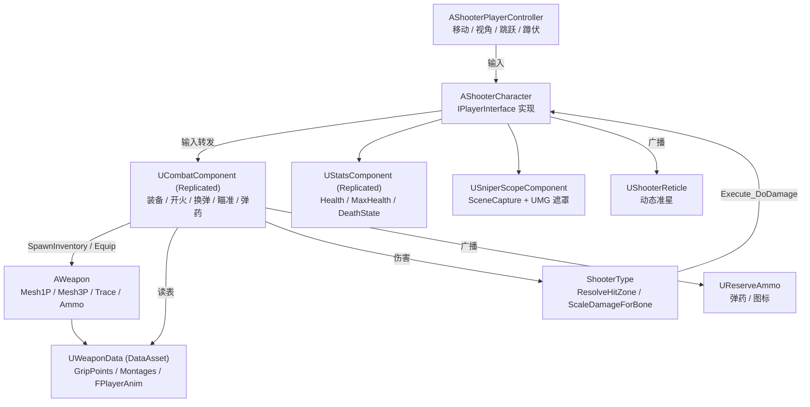

**Language / 语言：** [English](README.md) ｜ **中文**

---

# FPS — Unreal Engine 5 C++ 第一人称射击项目

一个使用 **Unreal Engine 5.8 + C++** 实现的第一人称射击（FPS）玩法框架：角色移动与视角、武器（长枪 / 手枪 / 近战）装备与切换、开火与命中判定、换弹、瞄准（ADS）、狙击镜、生命值与部位伤害、受击动画，以及完整的多人网络同步。

> 本文档由阅读源码整理而成，**未修改任何代码文件**。
> 逐函数、逐组件的详细说明（含每个函数的签名、作用、调用链与效果）请见 [DOCUMENTATION.zh-CN.md](<DOCUMENTATION.zh-CN.md>)。

---

## 1. 项目概览

| 项目 | 内容 |
| --- | --- |
| 引擎版本 | Unreal Engine 5.8（[FPS.uproject](<FPS.uproject>) 中 `EngineAssociation: "5.8"`） |
| 主模块 | `FPS`，类型 Runtime（[FPS.Build.cs](<Source/FPS/FPS.Build.cs>)） |
| 语言 | C++，大量接口通过 `BlueprintCallable` / `BlueprintImplementableEvent` 暴露给蓝图 |
| 输入系统 | Enhanced Input（`UEnhancedInputComponent` + `UInputMappingContext`） |
| 默认关卡 | `/Game/FirstPerson/Lvl_FirstPerson` |
| 默认 GameMode | `/Script/FPS.ShooterGameModeBase`（见 [DefaultEngine.ini](<Config/DefaultEngine.ini>)） |
| 自定义碰撞通道 | `Weapon` = `ECC_GameTraceChannel2`（Trace 类型） |
| 默认构建目标 | `FPS`（Game）、`FPSEditor`（Editor），`BuildSettingsVersion.V7` |

模块依赖（[FPS.Build.cs](<Source/FPS/FPS.Build.cs>)）：

- Public：`Core`、`CoreUObject`、`Engine`、`InputCore`、`EnhancedInput`、`GameplayTags`、`PhysicsCore`、`UMG`
- Private：`Slate`、`SlateCore`

启用的插件（[FPS.uproject](<FPS.uproject>)）：`ModelingToolsEditorMode`（仅编辑器）、`GameplayStateTree`、`AnimationWarping`、`ModelContextProtocol`、`AllToolsets`。

---

## 2. 功能一览

| 系统 | 已实现内容 | 主要代码位置 |
| --- | --- | --- |
| 角色 | 第一人称相机（SpringArm 臂长 0 + 相机延迟）、1P/3P 双 SkeletalMesh、蹲伏、跳跃、移动 | [ShooterCharacter.cpp](<Source/FPS/Private/ShooterCharacter.cpp>)、[ShooterPlayerController.cpp](<Source/FPS/Private/ShooterPlayerController.cpp>) |
| 武器 | 长枪 / 手枪 / 近战三类；主武器 / 副武器 / 手枪 / 近战四个槽位；循环切枪；切枪 Montage | [Weapon.cpp](<Source/FPS/Private/Weapon/Weapon.cpp>)、[CombatComponent.cpp](<Source/FPS/Private/CombatComponent.cpp>) |
| 射击 | 球形 Sweep 命中判定、单发 / 全自动、射速节流、枪口与命中特效（蓝图实现）、弹匣与备弹 | [Weapon.cpp](<Source/FPS/Private/Weapon/Weapon.cpp>)、[CombatComponent.cpp](<Source/FPS/Private/CombatComponent.cpp>) |
| 换弹 | 1P/3P 换弹 Montage、动画通知填弹、空仓自动换弹、换弹期间锁定开火/切枪 | [CombatComponent.cpp](<Source/FPS/Private/CombatComponent.cpp>) |
| 瞄准 ADS | `bAiming` 复制（跳过 Owner）、1P 手臂与枪械的瞄具对齐（写入蓝图变量 `AdsMesh1PLoc`） | [ShooterCharacter.cpp](<Source/FPS/Private/ShooterCharacter.cpp>)、[CombatComponent.cpp](<Source/FPS/Private/CombatComponent.cpp>) |
| 狙击镜 | SceneCapture2D + RenderTarget + 全屏 UMG 遮罩材质，3 倍放大只显示在镜筒圆内，主相机保持原 FOV | [SniperScopeComponent.cpp](<Source/FPS/Private/Weapon/SniperScopeComponent.cpp>) |
| 伤害 | 骨骼名 → 命中部位（头 / 躯干 / 四肢）→ 倍率（爆头 ×2、四肢 ×0.75），服务端结算 | [ShooterType.cpp](<Source/FPS/Private/ShooterType/ShooterType.cpp>)、[StatsComponent.cpp](<Source/FPS/Private/Stats/StatsComponent.cpp>) |
| 动画驱动 | `AO_Yaw`、`MovementOffsetYaw`、`TurningStatus`、`FABRIK_SocketTransform`、`FPlayerAnim` 结构体注入 ABP | [ShooterCharacter.cpp](<Source/FPS/Private/ShooterCharacter.cpp>)、[WeaponData.h](<Source/FPS/Public/WeaponData.h>) |
| 受击反馈 | `HitReacts` 随机 Montage，NetMulticast 广播 | [ShooterCharacter.cpp](<Source/FPS/Private/ShooterCharacter.cpp>) |
| UI | 动态准星材质（跟随武器）、`弹药/备弹` + 武器图标 HUD、瞄准时隐藏准星 | [ShooterReticle.cpp](<Source/FPS/Private/Ui/ShooterReticle.cpp>)、[ReserveAmmo.cpp](<Source/FPS/Private/Ui/ReserveAmmo.cpp>) |
| 网络 | 服务器权威生成/装备/伤害，客户端预测弹匣，`NetMulticast` 播放特效与第三人称动画 | [CombatComponent.cpp](<Source/FPS/Private/CombatComponent.cpp>) |

---

## 3. 目录结构

```
FPS/
├─ FPS.uproject                     # 引擎版本、模块、插件
├─ Config/
│  ├─ DefaultEngine.ini             # 碰撞通道（Weapon/Projectile）、默认关卡与 GameMode
│  ├─ DefaultInput.ini              # EnhancedInput 默认类、鼠标灵敏度、按键轴
│  └─ DefaultGame.ini               # 项目名、AssetManager 扫描规则
├─ Content/
│  ├─ FPS/                          # 本项目自己的资产（见第 6 节）
│  └─ ...                           # 第三方素材包（FPSTP、InfimaGames、IBWP3DPistol3Pack 等）
└─ Source/
   ├─ FPS.Target.cs                 # Game 目标
   ├─ FPSEditor.Target.cs           # Editor 目标
   └─ FPS/
      ├─ FPS.Build.cs              # 模块依赖
      ├─ FPS.h / FPS.cpp           # 主游戏模块声明
      ├─ Public/
      │  ├─ FPSTraceChannels.h            # 武器 Trace 通道常量
      │  ├─ ShooterGamePlayTags.h         # 原生 GameplayTag 声明
      │  ├─ ShooterCharacter.h            # 玩家角色
      │  ├─ ShooterPlayerController.h     # 玩家控制器（移动/视角/跳跃/蹲伏）
      │  ├─ ShooterGameModeBase.h         # GameMode（空壳，供蓝图继承）
      │  ├─ CombatComponent.h             # 战斗核心组件
      │  ├─ WeaponData.h                  # 武器数据资产 + FPlayerAnim / FMontageData
      │  ├─ Interface/PlayerInterface.h   # 角色能力接口
      │  ├─ Stats/StatsComponent.h        # 生命值组件
      │  ├─ ShooterType/ShooterType.h     # 部位判定 / 伤害倍率工具函数
      │  ├─ Ui/ShooterReticle.h           # 动态准星控件
      │  ├─ Ui/ReserveAmmo.h              # 弹药 HUD 控件
      │  └─ Weapon/
      │     ├─ Weapon.h                   # 武器 Actor
      │     └─ SniperScopeComponent.h     # 狙击镜组件 + 全屏遮罩控件
      └─ Private/                        # 与 Public 一一对应的实现文件
```

---

## 4. 快速开始

1. **打开工程**：用 UE 5.8 打开 [FPS.uproject](<FPS.uproject>)，首次打开时选择 "Rebuild" 或先生成工程文件再编译 `FPS` 模块。
2. **默认关卡**：`/Game/FirstPerson/Lvl_FirstPerson`（[DefaultEngine.ini](<Config/DefaultEngine.ini>) 已设为 `GameDefaultMap`）。
3. **GameMode**：全局默认为 `AShooterGameModeBase`；实际使用请继承为 `BP_ShooterGameMode`（[BP_ShooterGameMode.uasset](<Content/FPS/Game/BP_ShooterGameMode.uasset>)），并在其中指定：
   - `DefaultPawnClass = BP_ShooterCharacter`
   - `PlayerControllerClass = BP_ShooterPlayerController`
4. **角色必需配置**（`BP_ShooterCharacter`，代码里有 `checkf` 强校验）：
   - `Combat → WeaponData` 必须指向 `DA_WeaponData`，否则 `GetWeaponAttachPoint` 会触发 `checkf` 断言。
   - `Combat → DefaultWeaponClass` 至少填一把武器蓝图。
   - 每个 `Input` 字段（`IA_FireWeapon`、`IA_CycleWeapon`、`IA_ReloadWeapon`、`IA_AimWeapon`、四个 `IA_Equip*`）都要赋值。
   - 蓝图变量 `AdsMesh1PLoc`（`FVector`）需要存在 —— ADS 瞄具对齐逻辑会直接写这个变量。
   - `HitReacts` 至少填一个受击 Montage，否则 `Multicast_HitReact` 的随机下标会越界（当前代码未做空数组保护）。
5. **玩家控制器**：`BP_ShooterPlayerController` 需要设置 `ShooterIMC = IMC_Shooter`，以及 `IA_Move` / `IA_Look` / `IA_Jump` / `IA_Crouch`。
6. **输入资产**：在 `IMC_Shooter` 里绑定 `IA_*` 与按键；`IA_FireWeapon` 建议能同时触发 `Started` 与 `Completed`（代码同时绑定了这两个事件，用于单发/全自动区分）。
7. **武器蓝图**：基于 `BP_Weapon`（`AWeapon`）派生，设置 `WeaponType`（GameplayTag）、`WeaponKind`、`Mesh1P` / `Mesh3P` 的骨骼网格体与动画蓝图（`ABP_Rifle`、`ABP_Pistol`、`ABP_M700`），并在 `FireEffect` 蓝图事件里做枪口火焰 / 弹孔 / 音效。
8. **数据资产**：在 `DA_WeaponData` 里按武器 Tag 填写 `GripPoints`（挂点 Socket 名）、`WeaponMontages`、`FirstPersonAnims` / `ThirdPersonAnims`、`FirstPersonMontages` / `ThirdPersonMontages`。
9. **HUD**：把 `WBP_ShooterOverlay` 加入视口（内部含 `WBP_ReserveAmmo`）；准星控件基于 `UShooterReticle`，其内部 Image 命名为 `Image_Reticle`（代码也兼容拼写错误的 `Image_Redicle`）。
10. **狙击镜材质**：`/Game/FPS/UI/M_SniperScope` 是硬编码路径（[SniperScopeComponent.cpp](<Source/FPS/Private/Weapon/SniperScopeComponent.cpp>) 中的 `SniperScopeMaterialPath`），改名或移动会导致镜筒不显示并打印 Warning。材质参数需包含 `ScopeView`(Texture)、`MaskRadius`、`RingWidth`、`ReticleThickness`、`Aspect`。

---

## 5. 操作说明

动作由 Enhanced Input 分发：移动 / 视角 / 跳跃 / 蹲伏在 `AShooterPlayerController`，其余战斗动作在 `AShooterCharacter`。

| 动作 | 输入资产 | 绑定事件 | 说明 |
| --- | --- | --- | --- |
| 移动 | `IA_Move` | `Triggered` | 以控制旋转的 Yaw 为基准前后左右移动 |
| 视角 | `IA_Look` | `Triggered` | `AddYawInput` / `AddPitchInput` |
| 跳跃 | `IA_Jump` | `Started` | 蹲伏中先起身，否则 `Jump()` |
| 蹲伏 | `IA_Crouch` | `Started` | 切换 `bWantsToCrouch` |
| 开火 | `IA_FireWeapon` | `Started` / `Completed` | 按下开火，松开停止（决定全自动持续） |
| 瞄准 | `IA_AimWeapon` | `Started` | 切换 ADS（`bAiming` 取反），并回调蓝图 `OnAim` |
| 换弹 | `IA_ReloadWeapon` | `Started` | 播放换弹 Montage，由动画通知填弹 |
| 切枪 | `IA_CycleWeapon` | `Started` | 在库存中循环到下一把 |
| 主武器 | `IA_EquipMainWeapon` | `Started` | 切到第一把长枪 |
| 副武器 | `IA_EquipSecondaryWeapon` | `Started` | 切到第二把长枪 |
| 手枪 | `IA_EquipPistol` | `Started` | 切到第一把手枪 |
| 近战 | `IA_EquipMeleeWeapon` | `Started` | 切到第一把近战武器 |

> 说明：`IMC_Shooter` 中存在 `LeftMouseButton`、`RightMouseButton`、`SpaceBar`、`LeftControl`、`One`~`Four`、`R`、`Q`、`E` 及手柄扳机等按键；上表"哪个键对应哪个动作"是常见配置，**最终以编辑器内 `IMC_Shooter` 的实际绑定为准**。

---

## 6. 关键蓝图与资产（`/Game/FPS`）

| 资产 | 作用 |
| --- | --- |
| `Character/BP_ShooterCharacter` | 玩家角色蓝图（挂点、FOV、武器类、ADS 变量 `AdsMesh1PLoc`、HitReacts） |
| `Character/ABP_FirstPerson` / `ABP_ThirdPerson` | 1P / 3P 动画蓝图；读取 `AO_Yaw`、`MovementOffsetYaw`、`TurningStatus`、`FABRIK_SocketTransform`，并持有 `CurrenrAnim` / `CurrentAnim` 变量 |
| `Player/BP_ShooterPlayerController` | 输入映射与移动/视角绑定 |
| `Game/BP_ShooterGameMode` | GameMode，指定默认 Pawn 与 Controller |
| `Data/DA_WeaponData` | 唯一的武器数据资产（挂点、Montage、动画结构体映射） |
| `Weapon/BP_Weapon`、`BP_RIfle`、`BP_Refile`、`BP_Pistol`、`BP_M700` | 武器 Actor 蓝图（按 `WeaponKind`：长枪 / 手枪 / 狙击枪） |
| `Weapon/ABP_Rifle`、`ABP_Pistol`、`ABP_M700` | 武器骨骼网格体的动画蓝图 |
| `UI/WBP_ShooterOverlay`、`UI/WBP_ReserveAmmo`、`UI/WB_Health` | HUD 根控件、弹药控件、生命值控件 |
| `UI/M_SniperScope` | 狙击镜遮罩材质（代码硬编码引用） |
| `Input/IMC_Shooter`、`Input/InputAction/IA_*` | 输入映射上下文与全部输入动作 |

---

## 7. 系统架构（速览）



---

## 8. 网络模型要点

- **生成与装备**：`SpawnInventory` 只在 `ROLE_Authority` 执行；`UCombatComponent` 复制 `Inventory` 与 `CurrentWeapon`，客户端靠 `OnRep_CurrentWeapon` 重新挂接与播放动画。
- **开火**：本地立即预测（播 1P Montage、扣弹匣、生成本地特效）→ `Server_FireWeapon(Hit)` 校验射速并结算伤害 → `Multicast_FireWeapon` 让远端补特效与 3P 动画，并用 `Rep_Fire(AuthAmmo)` 校正弹匣。
- **换弹**：本地播 1P Montage 并置 `Reloading` → `Server_ReloadWeapon` → `Multicast_ReloadWeapon`（远端播 3P）→ 动画通知调用 `ApplyReload` / `Notify_ReloadWeapon` 在服务端填弹 → `Client_ReloadWeapon` 回传权威数值。
- **瞄准**：`bAiming` 使用 `COND_SkipOwner` 复制（Owner 已本地预测），但 `Server_Aim` 仍会同步到服务端。
- **备弹**：`CurrentReserveAmmo` 只复制给 Owner（`COND_OwnerOnly`）。
- **受击**：伤害在服务端结算，`Multicast_HitReact` 让其他客户端播放受击 Montage。

---

## 9. 已知限制与待办

- `EWeaponStatus::Firing` 未被任何代码写入。
- `AimTimeline` / `GetAimTimelineAlpha()` / `AimAlignAlpha` 已声明但未接入调用链（当前 ADS 对齐走的是蓝图变量改写方案）。
- `UStatsComponent::DeathState` 只有 `NotDead`，`OnRep_DeathState` 为空；`ChangeHealthByAmout` 恒返回 `false`，死亡流程尚未实现。
- `AShooterCharacter::DoDamage_Implementation` 在 `HitReacts` 为空时会对空数组取随机数，建议在蓝图侧保证至少一个 Montage。
- 狙击镜放大倍数、镜筒半径、准线粗细是 `SniperScopeComponent.cpp` 中的编译期常量，暂未暴露为可配置参数。
- `AShooterGameModeBase` 目前是空壳，规则逻辑（回合、计分、复活）需要自行扩展。

---

## 10. Statement（原文保留）

1. All asset were download from [fab](https://fab.com)
2. All code can be use by yourself
3. If you have any question for the code or find some error, please mail me anytime
4. It mostly include basic code, may not include some asset data, but all asset can by replace because I using TMap data

---

## 11. 延伸阅读

- 逐函数 / 逐组件详解：[DOCUMENTATION.zh-CN.md](<DOCUMENTATION.zh-CN.md>)
- UE 官方参考：Gameplay Framework、Enhanced Input、`UDataAsset`、`USceneCaptureComponent2D`
